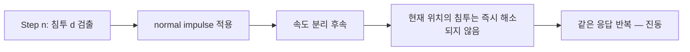
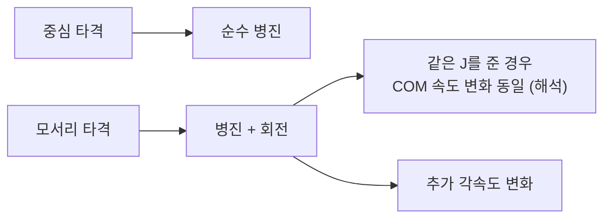
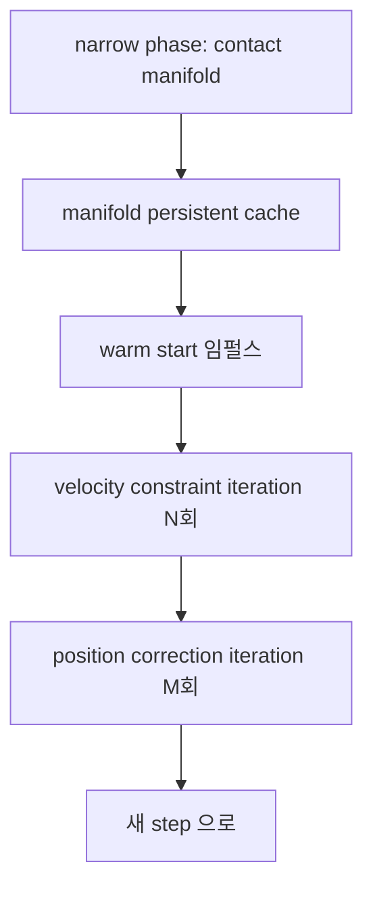

## 들어가며

충돌 파이프라인의 broad phase와 narrow phase는 충돌 후보를 좁히고 *접촉 매니폴드* 를 만든다. 충돌 응답은 그 출력을 받아 *강체의 속도와 위치를 어떻게 갱신할지* 결정한다.

가장 단순한 접근은 *penalty 방법* 으로 침투 깊이에 비례한 스프링·감쇠 힘을 적용하는 것이다. 강성 계수와 timestep이 결합되고 명시적 적분에서는 작은 step이 필요할 수 있다. 강체 접촉에는 impulse·constraint 기반 솔버가 흔하지만, compliant contact·deformable body·촉각 모델에는 penalty와 implicit 변형도 쓰인다.

이 글의 목표.

1. **Penalty 방법** — 강성·감쇠와 timestep의 결합.
2. **충격량 (impulse)** — 미소 시간 큰 힘의 모델.
3. **Normal impulse 의 도출** — 강체 충돌 응답의 핵심 한 줄 식.
4. **회복 계수 (restitution)** — 충돌의 탄성 / 비탄성 모델.
5. **Position correction** — 속도만 바꿔서 안 되는 이유.
6. **Baumgarte 안정화** — 침투를 *속도 제약의 bias* 로 흘려 부드럽게.
7. **회전 성분의 임펄스** — 접촉점이 질량중심 외부일 때.
8. **반복 접촉 솔버의 구성**.

이 글이 마치면 *단일 접촉점에서의 normal impulse 적용* + *position correction 의 기본 형태* 가 정리된다.


---

## 목차
1. [Penalty 방법의 한계](#1-penalty-방법의-한계)
2. [충격량의 정의](#2-충격량의-정의)
3. [상대 속도와 normal impulse](#3-상대-속도와-normal-impulse)
4. [회복 계수](#4-회복-계수)
5. [Position correction](#5-position-correction)
6. [Baumgarte 안정화](#6-baumgarte-안정화)
7. [회전 성분의 임펄스](#7-회전-성분의-임펄스)
8. [반복 접촉 솔버의 구성](#8-반복-접촉-솔버의-구성)


---

## 1. Penalty 방법의 한계

가장 *직관적* 인 접근. 침투 깊이에 *스프링 힘*.

### 1.1 식

침투 깊이 $d\ge0$, 법선 $\hat{n}$ (A→B), 법선 방향 상대 속도 $v_n=(\vec{v}_B-\vec{v}_A)\cdot\hat{n}$:

$$
\vec{F}_B = \max\!\big(0,\; k_s d - k_d v_n\big)\,\hat{n},
\qquad \vec{F}_A = -\vec{F}_B
$$

$k_s$ = 스프링 강도, $k_d$ = 감쇠 계수. 침투할수록 *밀어내는 힘* + 빠른 침투엔 *감쇠*. 힘은 B에 작용하고 A에는 반작용이 간다.

```cpp
void PenaltyResponse(Body& a, Body& b, vec2 n, float depth) {
    vec2 vRel = b.linearVelocity - a.linearVelocity;
    float vn  = dot(vRel, n);
    float fn  = std::max(0.0f, kSpring * depth - kDamper * vn);
    vec2  F   = fn * n;                                    // B 에 작용하는 힘 (A 에는 -F)
    a.forceAccum -= F;
    b.forceAccum += F;
}
```

`max(0, ...)` clamp는 빠르게 분리하는 중($v_n>0$)에 $k_s d-k_d v_n$이 음수가 되어 두 물체를 잡아당기는 접착을 막는다. 이는 비관통 접촉 경계 모델의 제한이며, 양방향 힘을 갖는 Kelvin–Voigt 재료 내부 스프링과는 구분한다. 접착을 허용하려면 별도 재질 모델로 선언한다.

### 1.2 매력

- *단순*: 일반 force 한 줄.
- *연속*: 접촉이 활성인 구간에서는 침투 깊이의 연속 함수 — 다른 힘과 같은 적분기 경로로 넣을 수 있다. 다만 *어떤 적분기든 안정*을 뜻하지는 않고, 접촉 활성화($d=0$) 경계에서 힘의 미분 가능성은 보장되지 않는다.
- *통합 자연*: 다른 외력 (중력, 사용자 입력) 과 *같은 accumulator* 에 더하기.

### 1.3 함정 — 강성 계수의 dilemma

자연스러운 *딱딱한 충돌* 을 원하면 $k_s$ 가 *큼* 이어야 함. 하지만 *큰 $k_s$ → 시뮬레이션의 빠른 진동* → *적분기가 그 진동을 따라잡으려면 작은 dt* 필요.

$$
\Delta t < \frac{2}{\sqrt{k_s / m}}
$$

이상 (안정 조건). 이 부등식은 *무감쇠 선형 진동자* 를 semi-implicit Euler/velocity Verlet 로 적분할 때의 안정 경계다. explicit Euler 는 이 무감쇠 계에서 임의의 양의 $\Delta t$ 에서도 에너지가 증가하므로 같은 식이 적용되지 않는다. 감쇠나 접촉 방향 유효질량을 넣으면 경계가 달라진다. 여기서 $m$ 은 접촉 법선 방향의 *effective mass* 로 해석하고, 접촉 활성화 경계의 비매끄러움은 별도로 다룬다. $k_s = 10^5$, $m = 1$ 이면 dt < 6 ms. 60 fps (16 ms) 안에 *여러 substep 필요* — 비용.

게임이 *부드러운 박스 (soft body 느낌)* 를 원하면 OK, *딱딱한 충돌* 은 timestep 부담.

### 1.4 튜닝 어려움

물체별로 *적절한 $k_s$* 선택이 어렵다. 가벼운 박스와 무거운 박스가 *같은 강성* 이면 무거운 박스가 *더 깊이 침투*. 객체별 조정 필요.

### 1.5 그래도 penalty 가 쓰이는 곳

- *Soft body / cloth*: 본질적으로 *deformable* 이라 penalty 가 자연스러움.
- *Soft contact (게임 느낌)*: 닿을 때 *말랑* 한 효과를 일부러.
- *학습 / 디버깅*: 단순함으로 첫 구현.

대부분의 *강체 충돌* 은 유한 시간의 큰 힘을 직접 적분하지 않고, 운동량을 순간적으로 바꾸는 impulse로 모델링한다.

## 2. 충격량의 정의

순간적 속도 변화의 *수학적 모델*.

### 2.1 정의

$$
\vec{J} = \int_{t_0}^{t_1} \vec{F} \, dt = \Delta(\vec{p}) = M \Delta \vec{v}
$$

미소 시간 $\Delta t \to 0$ 동안 *큰 힘* — *적분된 결과* 가 *유한 충격량*. 속도 직접 변화로 변환.

$$
\Delta \vec{v} = \vec{J} / M
$$

### 2.2 충격량 vs 힘

| 양 | 작용 시간 | 단위 |
|---|---|---|
| 힘 (Force) | 지속 (dt 동안 적용) | N |
| 충격량 (Impulse) | 순간 | N·s = kg·m/s |

게임 코드의 차이.

```cpp
// 힘 (지속) — accumulator 에 더함, 적분에 영향
void ApplyForce(Body& b, vec3 force) {
    b.forceAccum += force;
}

// 충격량 (순간) — 속도 즉시 변화
void ApplyImpulse(Body& b, vec3 impulse) {
    b.linearVelocity += impulse * b.invMass;
}
```

### 2.3 충돌이 impulse 인 이유

충돌은 *물리적으로 미소 시간의 큰 힘*. 두 박스가 부딪힐 때 *수 ms 동안 매우 큰 힘*. 게임 시뮬은 *그 미소 시간을 풀이* 안 하고 *순간 속도 변화* 로 모델.


이 단순화가 *게임 충돌 응답의 핵심 모델*.

### 2.4 운동량 보존

내부 충돌 (외력 없음) 에서 *총 운동량 불변*. 한 충돌에서 두 강체에 *대칭 충격량* (action-reaction):

$$
\vec{J}_A = -\vec{J}, \quad \vec{J}_B = +\vec{J}
$$

```cpp
void ApplyContactImpulse(Body& a, Body& b, vec3 j) {
    a.linearVelocity -= j * a.invMass;
    b.linearVelocity += j * b.invMass;
}
```

자연스럽게 *운동량 보존*.

### 2.5 임펄스 모델의 한계

- *작은 dt 의 부드러운 응답이 안 됨* — 충돌이 *이산 사건*.
- *연속 충돌 (resting contact, stacking)* 에 부자연 — 한 step 에 한 번 impulse 만 적용하면 *진동* 가능. *Sequential impulse* 같은 반복 적용으로 해결.

## 3. 상대 속도와 normal impulse

핵심 도출.

### 3.1 접촉점 속도

회전 강체에서 *접촉점 $\vec{p}$* 의 속도:

$$
\vec{v}_p = \vec{v}_{cm} + \vec{\omega} \times \vec{r}
$$

$\vec{r}$ = 질량중심에서 접촉점까지 벡터. 병진 + 회전에 의한 접선 속도.

### 3.2 상대 속도

두 강체 $A, B$ 의 접촉점 상대 속도:

$$
\vec{v}_{rel} = \vec{v}_{B,p} - \vec{v}_{A,p}
 = (\vec{v}_B + \vec{\omega}_B \times \vec{r}_B) - (\vec{v}_A + \vec{\omega}_A \times \vec{r}_A)
$$

이 벡터의 *법선 성분* 이 *충돌 응답의 입력*.

$$
v_{rel,n} = \vec{v}_{rel} \cdot \hat{n}
$$

$v_{rel,n} < 0$ 이면 *서로 가까워지는 중* (충돌 진행), $> 0$ 이면 *멀어지는 중* (이미 분리되는 중).

### 3.3 충돌 후 속도 조건

회복 계수 $e$ 의 정의:

$$
v_{rel,n}^{\text{after}} = -e \cdot v_{rel,n}^{\text{before}}
$$

$e = 0$: 완전 비탄성 (충돌 후 상대 속도 0).
$e = 1$: 법선 방향 완전 탄성 (마찰 없는 단일 접촉에서는 탄성 충돌).
$0 < e < 1$: 일부 에너지 손실.

### 3.4 normal impulse 의 식

위 후속 속도 조건을 *임펄스로 풀기*. 임펄스 $\vec{J} = j \hat{n}$ (법선 방향).

두 강체의 속도 변화:

$$
\Delta \vec{v}_A = -\frac{j \hat{n}}{M_A}, \quad \Delta \vec{v}_B = +\frac{j \hat{n}}{M_B}
$$

회전:

$$
\Delta \vec{\omega}_A = -\mathbf{I}_A^{-1} (\vec{r}_A \times j \hat{n}), \quad
\Delta \vec{\omega}_B = +\mathbf{I}_B^{-1} (\vec{r}_B \times j \hat{n})
$$

후속 상대 속도 계산 + 회복 계수 조건 적용. 풀이:

$$
j = \frac{-(1 + e) v_{rel,n}}
 {\tfrac{1}{M_A} + \tfrac{1}{M_B}
 + \hat{n} \cdot (\mathbf{I}_A^{-1} (\vec{r}_A \times \hat{n}) \times \vec{r}_A)
 + \hat{n} \cdot (\mathbf{I}_B^{-1} (\vec{r}_B \times \hat{n}) \times \vec{r}_B)}
$$

식이 길지만 *모두 알려진 양*. 한 번의 계산.

### 3.5 2D 단순화

2D 의 관성이 *스칼라*. 식이 간결.

$$
j = \frac{-(1 + e) v_{rel,n}}
 {\tfrac{1}{M_A} + \tfrac{1}{M_B}
 + \tfrac{(\vec{r}_A \times \hat{n})^2}{I_A}
 + \tfrac{(\vec{r}_B \times \hat{n})^2}{I_B}}
$$

(2D 외적은 스칼라 — z 성분.)

```cpp
float ComputeNormalImpulse2D(
        const Body2D& a, const Body2D& b,
        vec2 rA, vec2 rB, vec2 n, float restitution) {
    vec2  vA = a.linearVelocity + Perp(rA) * a.angularVelocity;
    vec2  vB = b.linearVelocity + Perp(rB) * b.angularVelocity;
    vec2  vRel = vB - vA;
    float vRelN = dot(vRel, n);

    if (vRelN > 0) return 0;        // 이미 분리 중 — 임펄스 불필요

    float rACrossN = Cross2D(rA, n);
    float rBCrossN = Cross2D(rB, n);
    float denom = a.invMass + b.invMass
                 + rACrossN * rACrossN * a.invInertia
                 + rBCrossN * rBCrossN * b.invInertia;

    if (!(denom > 0.0f)) return 0.0f;   // 양의 inverse effective mass 가 없으면 제약행 비활성화

    return -(1.0f + restitution) * vRelN / denom;
}

// 적용
float j = ComputeNormalImpulse2D(a, b, rA, rB, n, e);
vec2  impulse = n * j;
a.linearVelocity  -= impulse * a.invMass;
a.angularVelocity -= Cross2D(rA, impulse) * a.invInertia;
b.linearVelocity  += impulse * b.invMass;
b.angularVelocity += Cross2D(rB, impulse) * b.invInertia;
```

이 함수를 solve하기 전에 적어도 한 자유도가 반응하여 `denom > 0`인 pair만 통과시킨다는 전제가 필요하다. 회전까지 잠긴 두 static/kinematic body는 `denom = 0`이고 정지 접촉에서는 `0/0`로 NaN이 된다. 위처럼 `denom <= 0`이면 제약행을 비활성화하거나 upstream filter가 그런 pair를 걸러낸다. $\hat n$은 단위 벡터, 회복 계수 $e$는 정책 범위 안, $\vec r_A,\vec r_B$는 COM 기준이어야 한다.

### 3.6 이미 분리 중인 경우

$v_{rel,n} > 0$ 이면 *이미 멀어지는 중* — 임펄스 적용하면 *오히려 같이 끌어당김*. 게임 코드에서 *0 으로 clamp* 표준.

```cpp
if (vRelN > 0) return 0;       // 또는 j = std::max(j, 0.0f);
```

이 *one-sided constraint* 가 충돌 응답의 본질.

## 4. 회복 계수

표면별 *탄성 / 비탄성* 모델.

### 4.1 정의

$$
e = -\frac{v_{rel,n}^{\text{after}}}{v_{rel,n}^{\text{before}}}
$$

법선 방향 *후속 / 이전 상대 속도* 의 비율 (부호 반전).

### 4.2 물리적 의미

- $e = 1$: 충돌 후 *법선 속도 정확히 반사*. 마찰·감쇠·안정화가 없는 이상적 단일 접촉에서 운동 에너지 손실 0.
- $e = 0$: 충돌 후 *법선 속도 0*. 두 물체가 *그 방향으로 같이* 움직임. 완전 비탄성 (점토 흙 흡수).
- $0 < e < 1$: 일반적. *일부 에너지 손실*.

### 4.3 게임 튜닝 예시 값

아래 수치는 조건이 명시된 실측 물성표가 아니라, 속도·형상·표면·실험 조건 없이 관행적으로 인용되는 *가상의 게임 튜닝 예시*다. 실제 $e$ 는 재질 하나의 상수가 아니라 접촉 쌍 모델의 파라미터이며, 충돌 속도·형상·표면 상태에 따라 달라진다.

| 재질 | 예시 e |
|---|---|
| 강철 / 강철 | 0.7 ~ 0.8 |
| 고무 공 | 0.7 ~ 0.9 |
| 목재 | 0.4 ~ 0.6 |
| 흙 / 진흙 | 0.0 ~ 0.2 |
| 점토 | 0.0 |
| Super ball | 0.95+ |

게임에서는 보통 *0.0 ~ 0.4* 범위에서 시작해 장면별로 조정한다. $e > 0.7$ 을 비현실로 단정하지는 않으며, $e$ 가 크면 튀어 오름이 과장되어 캐릭터가 *5 번 튕긴 후 멈추는* 모습이 부자연스러워질 수 있다.

### 4.4 두 표면의 결합

두 강체의 *재질이 다르면* 어떻게 결합할 것인가. 표준 옵션.

```cpp
float combinedRestitution = std::max(e_A, e_B);    // 더 탄성적인 쪽 우선
// 또는
float combinedRestitution = (e_A + e_B) * 0.5f;    // 평균
// 또는
float combinedRestitution = e_A * e_B;             // 곱 (둘 다 탄성적이어야 큼)
```

Box2D 는 *max* 채택. 사용자가 *fixture 별 e* 를 설정 + 충돌 시 합성.

### 4.5 e 의 함정

매우 작은 상대 속도에서 *튀어 오름 제거* — 그렇지 않으면 *작은 속도 충돌이 영원히 진동* (수치 함정).

```cpp
const float kRestThreshold = 1.0f;        // m/s
float effectiveE = (std::fabs(vRelN) < kRestThreshold) ? 0.0f : e;
```

작은 속도엔 *e = 0 강제*. 시뮬 안정. `kRestThreshold` 는 장면·단위·재질에 맞춰 조정하는 예시값이지 자연 상수가 아니다.

### 4.6 회복 계수 vs 마찰

회복 계수가 *법선* 방향을 바꾸고, 마찰은 *접선* 방향 상대 속도를 줄인다. 두 효과는 같은 접촉점에서 함께 계산되지만 역할이 다르다.

## 5. Position correction

속도 갱신만으로는 *침투 누적*. 위치 자체도 *직접 보정*.

### 5.1 왜 위치 보정

normal impulse 가 *후속 속도* 를 분리시킴 — 다음 step 부터는 멀어진다. 하지만 *현재 step 에 이미 침투* 한 부분은 그대로 — 그 침투가 *다음 step 의 새 충돌* 로 재검출.



해결: 속도 외에 *위치 직접 보정*.

### 5.2 단순한 보정

```cpp
void PositionCorrection(Body& a, Body& b, vec3 n, float depth) {
    float totalInvMass = a.invMass + b.invMass;
    if (totalInvMass <= 0) return;
    vec3 correction = n * (depth / totalInvMass);
    a.position -= correction * a.invMass;
    b.position += correction * b.invMass;
}
```

침투 깊이만큼 *두 강체를 역질량 비율로* 분리. 정적 객체 ($\text{invMass} = 0$) 는 안 움직임.

### 5.3 Slop (허용 침투)

매우 작은 침투까지 보정하면 *작은 jitter*. *slop* (허용 침투) 만큼 *무시*.

```cpp
constexpr float kSlop = 0.005f;        // 5 mm 허용
float effectiveDepth = std::max(depth - kSlop, 0.0f);
```

5 mm 이하 침투는 *무시* — 안정적인 *resting contact*.

### 5.4 Percentage (단계적 보정)

한 step 에 *전체 침투 보정* 하면 *큰 점프*. *비율로 점진적*.

```cpp
constexpr float kCorrectionPercent = 0.2f;   // 20% 씩
float correctionAmount = effectiveDepth * kCorrectionPercent;
```

매 step 20% — *잔여 침투가 $0.8^n$ 으로 감쇠, 약 11 step 후 90% 해소*. 부드럽고 안정.

### 5.5 결합

```cpp
void PositionCorrection(Body& a, Body& b, vec3 n, float depth) {
    constexpr float kPercent = 0.2f, kSlop = 0.005f;
    float totalInvMass = a.invMass + b.invMass;
    if (totalInvMass <= 0) return;
    float magnitude = std::max(depth - kSlop, 0.0f)
                     / totalInvMass * kPercent;
    a.position -= n * magnitude * a.invMass;
    b.position += n * magnitude * b.invMass;
}
```

Box2D v2.4 의 *NGS (Non-linear Gauss-Seidel) position solver* 를 병진만 남겨 단순화한 예다. 산업 코드는 *반복 (iter) + 안정성* 추가.

### 5.6 위치 보정과 운동량

직접 위치 보정은 속도를 바꾸지 않으므로 선운동량과 운동 에너지는 그대로다. 하지만 위치를 바꾸면서 공통 원점에 대한 각운동량과 위치 에너지는 달라질 수 있으므로 *연속 시간 시뮬* 의 충실한 모델은 아니다. 그래도 *시각적 안정 + 시뮬 진동 회피* 가 우선인 경우가 많다.

### 5.7 대안: pseudo-velocity

Bullet 의 접근. 위치 보정 대신 *위치 보정을 또 다른 속도 (pseudo-velocity)* 로 표현. 정규 속도와 *분리된 별도 채널* 로 두어 시뮬 속도 적분과 충돌하지 않게 한다. 다만 pseudo-velocity도 결국 위치를 바꾸는 채널이므로 각운동량·위치 에너지를 자동으로 보존하지는 않는다.

```cpp
struct Body {
    vec3 linearVelocity;
    vec3 pseudoVelocity;          // 위치 보정용
    // ...
};
```

Step 마지막에 `position += pseudoVelocity * dt; pseudoVelocity = 0;`. 이 위치 변화는 정규 속도 적분과 분리되어 정규 솔버의 운동량 계산을 교란하지 않지만, 위치 채널이므로 각운동량·위치 에너지 보존을 자동 보장하지는 않는다.

## 6. Baumgarte 안정화

위치 보정의 또 다른 표현 — *속도 제약의 bias 항*.

### 6.1 핵심 아이디어

normal impulse 식의 *목표 후속 속도* 를 *(- e × prev) + bias* 로. bias 가 *침투를 추가로 분리하는* 방향.

$$
v_{rel,n}^{\text{after}} = -e v_{rel,n}^{\text{before}} + \beta \cdot \frac{d}{\Delta t}
$$

$\beta$ = Baumgarte 계수 (0~1), $d$ = 침투 깊이.

직관: *목표 후속 속도에 작은 분리 속도 추가*. 자연스럽게 침투 해소.

### 6.2 적용

```cpp
float bias = (kBaumgarte * std::max(depth - kSlop, 0.0f)) / dt;
float j = -(1.0f + restitution) * vRelN + bias;
j /= denom;
```

normal impulse 계산에 *bias 한 항* 을 추가해 후속 속도가 침투를 줄이도록 한다. 직접 position correction 없이도 drift를 줄일 수 있지만 유한 반복, slop과 bias clamp 때문에 잔여 침투가 남을 수 있다.

### 6.3 장점

- *별도 위치 pass 없음* — bias 항으로 속도 제약에 통합한다.
- *통일된 솔버* — 모든 응답이 *임펄스* 한 종류.
- *Sequential impulse 와 호환*.

### 6.4 함정

- *큰 침투에서 큰 bias* → *큰 임펄스* → *시각적 jitter*.
- *Baumgarte 계수 튜닝* 어려움.

해결: *bias 의 cap* + *작은 침투 무시 (slop)*.

```cpp
float bias = std::min((kBaumgarte * std::max(depth - kSlop, 0.0f)) / dt,
                      kMaxBias);
```

### 6.5 NGS vs Baumgarte

세 기법을 운동량 충실성 순위로 나누지 않는다. 모두 위치 오차를 줄이는 안정화 채널이 다를 뿐이다.

| 방법 | 안정화 채널 | 특징 |
|---|---|---|
| Position correction (NGS) | 위치를 직접 이동 | 선운동량은 보존하지만 각운동량·위치 에너지가 변할 수 있음 |
| Baumgarte bias | 속도 제약의 bias | 별도 위치 pass 없음, 속도에 인공 에너지를 주입할 수 있음 |
| Pseudo-velocity (Bullet) | 별도 위치 채널 | 시뮬 속도와 분리, 역시 자동 보존은 아님 |

Box2D v2.4 는 *위치 NGS와 별도 TOI 경로의 보정*을 사용한다. 최신 버전의 솔버 구성은 다를 수 있다. PhysX 는 *bias 기반 PGS + substep 기반 TGS*. 엔진별 다른 선택.

### 6.6 산업 채택

Erin Catto 의 "Iterative Dynamics with Temporal Coherence" (Box2D, 2005) 가 *Baumgarte 활용 sequential impulse* 의 산업 reference.

## 7. 회전 성분의 임펄스

접촉점이 *질량중심 외부* 일 때 충돌이 회전에도 영향.

### 7.1 토크로서의 임펄스

질량중심에서 $\vec{r}$ 만큼 떨어진 점에 임펄스 $\vec{J}$ 가 작용하면 *각속도 변화*:

$$
\Delta \vec{\omega} = \mathbf{I}^{-1} (\vec{r} \times \vec{J})
$$

2D 에서는 스칼라:

$$
\Delta \omega = \frac{r_x J_y - r_y J_x}{I}
$$

### 7.2 응답 코드

```cpp
void ApplyImpulseAtPoint2D(Body2D& body, vec2 impulse, vec2 r) {
    body.linearVelocity  += impulse * body.invMass;
    body.angularVelocity += Cross2D(r, impulse) * body.invInertia;
}
```

회전 영향 자동.

### 7.3 충돌점의 위치

normal impulse 계산 시 *$\vec{r}_A$, $\vec{r}_B$* 가 *각 강체 질량중심에서 충돌점까지의 벡터*. narrow phase 가 *접촉점의 world 좌표* 를 출력 — 거기서 각 강체의 질량중심을 빼서 계산.

```cpp
vec2 contactWorld = manifold.contactPoint;
vec2 rA = contactWorld - a.position;
vec2 rB = contactWorld - b.position;
```

### 7.4 회전이 응답 식에 미치는 영향

3절의 normal impulse 식 분모.

$$
\frac{1}{M_A} + \frac{1}{M_B}
 + \frac{(\vec{r}_A \times \hat{n})^2}{I_A}
 + \frac{(\vec{r}_B \times \hat{n})^2}{I_B}
$$

회전 항은 접촉점의 normal 속도에 대한 *inverse effective mass* 를 더한다. 접촉점이 질량중심에서 멀어 $|\vec{r}\times\hat{n}|$가 커지면 같은 impulse가 더 큰 각속도와 접촉점 속도 변화를 만들므로 분모가 커지고, 같은 목표 normal 속도 보정에 필요한 $j$는 작아진다. 적용된 impulse의 회전 효과는 $\vec{r}\times\vec{J}$에 의해 커진다.

### 7.5 직관

당구공의 *중심 vs 모서리* 타격. 중심은 *순수 병진*, 모서리는 *병진 + 회전*. 같은 충격이라도 *효과가 분배* — 임펄스 식에 자연스럽게 반영.



접촉 제약이 같은 normal 상대속도 변화를 요구하는 상황에서는 off-center 항 때문에 계산된 임펄스 크기가 작아질 수 있다. 이미 주어진 동일한 임펄스를 서로 다른 지점에 가하면 COM 병진 변화 $\Delta\vec{v}=\vec{J}/m$ 는 같고 회전 변화만 달라진다.

### 7.6 안정성 함정

접촉점이 실제 feature에서 벗어나면 $\vec r$과 torque arm이 잘못되어 유효 질량과 각임펄스가 모두 왜곡된다. 접촉점을 질량중심 근처로 임의 clamp하는 대신 narrow phase의 witness point, feature ID와 manifold 갱신을 검증한다.

## 8. 반복 접촉 솔버의 구성

실시간 접촉 솔버에서 흔히 조합하는 흐름은 다음과 같다.



- *Manifold persistent + warm starting*.
- *Velocity 와 position 의 분리 (또는 결합) 솔버*.
- 반복 종료는 고정 숫자만이 아니라 잔차, penetration, 시간 예산으로 판단할 수 있다.
- velocity와 position을 별도 pass로 풀거나, sub-step마다 함께 갱신할 수 있다.
- 접촉점 수를 줄이면 비용은 감소하지만 torque와 friction patch 표현이 달라진다.

### 8.1 정확성 vs 성능 트레이드오프

- *반복 ↑ → 정확성 ↑* (제약이 더 정확히 만족) *비용 ↑*.
- *반복 ↓ → 빠름* 하지만 *침투 / 진동 더 크게 보임*.

반복 수를 장르 이름으로 정하지 않는다. 최대 penetration, contact velocity residual, stack drift와 solver 시간을 같은 장면에서 측정해 정한다. sub-step 수를 바꾸면 contact geometry 갱신 횟수도 달라지므로 단순 iteration 숫자만 비교할 수 없다.


---

## 결론

충돌 응답이 *narrow phase 의 출력 (법선·침투·접촉점)* 을 받아 *강체 속도·위치* 를 갱신. *Impulse 기반* 이 게임 엔진의 표준.

이 글에서 정리한 핵심.

1. **Penalty 방법의 한계** — 강성 계수 튜닝 어려움 + 작은 timestep 요구.
2. **충격량의 정의** — 미소 시간 큰 힘 → 순간 속도 변화.
3. **Normal impulse 식** — 한 줄로 충돌 후속 속도 결정. 회복 계수 + 회전 항 포함.
4. **회복 계수** — 이상화한 수동 접촉에서는 0(비탄성)부터 1(탄성) 사이를 주로 쓰며, 재질 합성·저속 threshold·solver 정책을 함께 정의한다.
5. **Position correction** — 속도만 갱신해선 안 됨. Slop + percentage 의 안정적 보정.
6. **Baumgarte 안정화** — 위치 오차를 *속도 bias* 로 흘려넣는다. 수치 안정화 항이 에너지를 주입할 수 있어 clamp와 튜닝이 필요하다.
7. **회전 임펄스** — 접촉점이 질량중심 외부면 자동으로 회전 갱신.
8. **반복 접촉 솔버의 구성** — persistent manifold + warm start, velocity·position iteration 의 분리, 반복 수는 장르 이름이 아니라 측정으로 결정.

Normal impulse 와 position correction 은 충돌 응답의 뼈대다. 여기에 접선 방향 응답, 여러 접촉점, 관절 제약을 같은 solver 틀로 결합하면 강체 월드의 안정성이 결정된다.

## 더 읽을거리

- Erin Catto, "Iterative Dynamics with Temporal Coherence" (2005) — sequential impulse 의 표준 논문.
- Erin Catto, "Fast and Simple Physics using Sequential Impulses" (GDC 2006) — 게임 친화적 발표.
- Brian Mirtich, *Impulse-based Dynamic Simulation of Rigid Body Systems* (PhD 1996) — impulse 모델의 학술적 토대.
- Ian Millington, *Game Physics Engine Development*, Ch. 13~14 — 충돌 응답 종합.
- David Baraff, "An Introduction to Physically Based Modeling: Rigid Body Simulation II" (SIGGRAPH Course) — 정밀한 유도.
- Box2D v2.4 소스 (`b2_contact_solver.cpp`) — sequential impulse + NGS 산업 reference.
- Bullet 소스 (`btSequentialImpulseConstraintSolver.cpp`) — pseudo-velocity 패턴.
- PhysX 5 SDK Guide, "Rigid Body Dynamics — Temporal Gauss-Seidel" — TGS 산업 구현.
