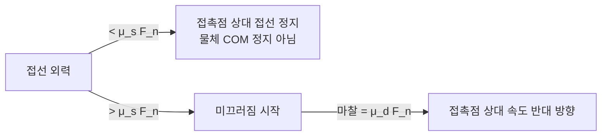
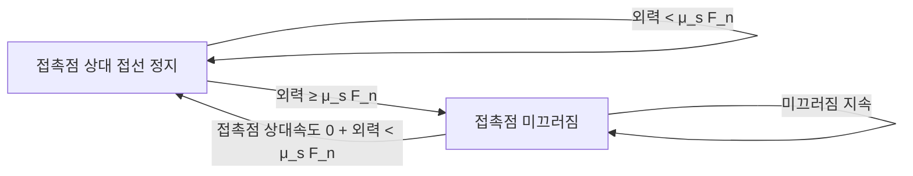
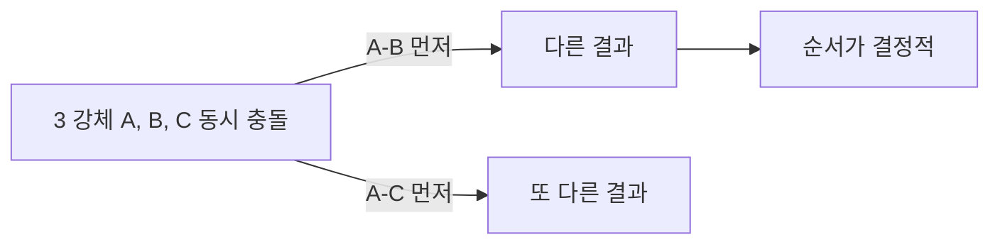
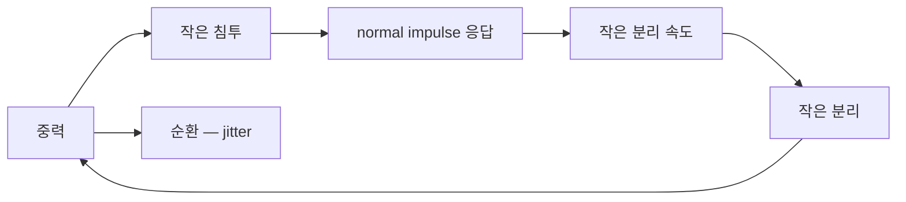
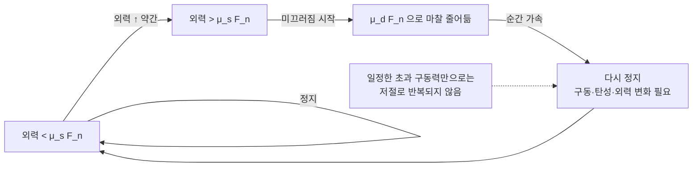
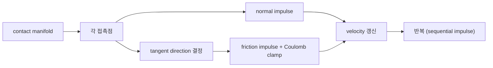

## 들어가며

*normal impulse* 가 *침투 방향 (법선)* 응답을 처리. 충돌 응답이 완성됐는가? 거의 — *접선 (tangential)* 방향이 남았다.

두 표면이 충돌할 때 *법선만 응답* 하면 *어떤 방향으로든 자유롭게 미끄러짐*. 현실에서는 *마찰* 이 그 미끄러짐을 막는다. 게임에서 *경사면에 멈춘 박스* 는 접촉점의 상대 접선 속도가 0으로 유지되는 특수한 경우이고, *지면 위에서 점차 정지하는 공* 은 접촉 마찰 외에 rolling resistance·접촉 변형·감쇠도 함께 작용한다.

또 *회복 계수 (restitution)* 의 디테일 — 게임의 *resting contact (쌓인 박스)* 가 *영원히 진동* 하지 않으려면 *임계값 아래는 비탄성* 처리가 필요.

이 글의 목표.

1. **Coulomb 마찰 모델** — 게임에서 거의 표준인 마찰 식.
2. **정마찰 vs 동마찰** — 두 계수와 게임의 단순화.
3. **Tangential impulse 계산** — friction impulse 의 도출.
4. **3D Friction cone vs pyramid** — 정확성과 비용의 트레이드오프.
5. **회복 계수 재방문** — 다중 충돌에서의 함정.
6. **Resting contact 의 jitter** — 임계 속도 아래 $e = 0$ 강제.
7. **마찰의 안정성 함정** — 정마찰의 모호성.
8. **엔진별 마찰 처리**.

이 글이 마치면 *완전한 충돌 응답* (법선 + 마찰 + restitution 안정화) 이 정리된다.


---

## 목차
1. [Coulomb 마찰 모델](#1-coulomb-마찰-모델)
2. [정마찰과 동마찰](#2-정마찰과-동마찰)
3. [Tangential impulse 계산](#3-tangential-impulse-계산)
4. [Friction cone vs pyramid](#4-friction-cone-vs-pyramid)
5. [회복 계수 재방문](#5-회복-계수-재방문)
6. [Resting contact의 jitter 문제](#6-resting-contact의-jitter-문제)
7. [마찰의 안정성 함정](#7-마찰의-안정성-함정)
8. [엔진별 마찰 처리](#8-엔진별-마찰-처리)


---

## 1. Coulomb 마찰 모델

게임 마찰의 *de facto* 표준.

### 1.1 부등식 형태

마찰력 $\vec{F}_t$ (접선 방향) 와 normal 력 $\vec{F}_n$:

$$
|\vec{F}_t| \le \mu \, |\vec{F}_n|
$$

마찰력의 *크기 한도* 가 normal force 의 *상수 배 (= μ × 1)* 이내. 한도 안에서는 *원하는 만큼* (정지 마찰), 한도를 넘으면 *상한에 갇혀 미끄러짐* (동마찰).

### 1.2 두 모드

*정지 (static)* 상태 — 접촉점의 상대 접선 속도 $v_{contact,t}=0$ 을 유지:
- 마찰력이 접선 상대 속도를 0으로 되돌리는 데 필요한 값을 제공한다. 강체 COM이 정지한다는 뜻은 아니다 (순수 구름이나 가속하는 컨베이어 위에서도 정마찰이 작용한다).
- 한도 $\mu_s F_n$ 이내 모든 값 가능.

*미끄러짐 (kinetic / dynamic)* 상태:
- 마찰력 크기 = $\mu_d F_n$ (정확히 상한).
- 방향 = *상대 속도의 반대*.



### 1.3 마찰 계수

| 표면 쌍 | μ (대략) |
|---|---|
| 강철 / 강철 (마른) | 0.6 |
| 강철 / 강철 (윤활) | 0.06 |
| 고무 / 콘크리트 | 1.0 |
| 나무 / 나무 | 0.4 |
| 얼음 / 얼음 | 0.03 |
| Teflon / 강철 | 0.04 |

게임은 *재질 시스템* 으로 도형별 μ + 충돌 시 합성.

### 1.4 마찰의 미시적 기원

거시 모델 (μ × N) 은 *경험적*. 미시적으로는 *표면의 미세 요철 + 분자간 힘* 의 결과. 정확한 미시 모델은 *너무 복잡* — 게임은 Coulomb 으로 충분. 이상적 순수 구름은 Coulomb 정마찰만으로 저절로 멈추지 않으며, 구르는 공의 감속은 rolling resistance·접촉 변형·감쇠 같은 별도 효과로 설명한다.

### 1.5 게임의 무자비한 단순화

- 정마찰 = 동마찰 = *한 값* (보통).
- 마찰 계수 재질 *상수* (속도·온도 의존 무시).
- *접촉 영역* 무시 (Coulomb 자체가 이미 무시).

이 단순화로 *시뮬 안정 + 튜닝 단순*. 정확하진 않아도 *시각적으로 자연*.

## 2. 정마찰과 동마찰

엄밀한 Coulomb 모델의 두 계수.

### 2.1 두 한도

- *정마찰 한도* $\mu_s F_n$: 접촉점의 상대 접선 속도가 0인 상태에서 마찰이 제공할 수 있는 *최대 크기*.
- *동마찰 한도* $\mu_d F_n$: 접촉점이 미끄러질 때 마찰의 *정확한 크기*.

일반적으로 $\mu_s > \mu_d$ — *처음 미끄러뜨리기 어려운데 일단 미끄러지면 쉬워짐*.

### 2.2 상태 전이



마찰력이 *항상 작용* 하지만 *값이 상태에 따라 다름*. 시뮬레이션에서 *상태 추적* 이 까다로움.

### 2.3 게임의 단순화

일부 실시간 solver는 정·동마찰을 하나의 $\mu$로 단순화한다. 두 계수를 분리하는 solver도 있으므로 API와 friction transition 모델을 확인해야 한다.

```cpp
struct PhysicsMaterial {
    float friction = 0.5f;     // 단일 마찰 계수
    float restitution = 0.0f;
    // ...
};
```

이유:
- *정-동 전이 jitter* 회피 (수치 함정).
- 사용자 튜닝이 *값 한 개* 로 단순.
- 시각적 차이 미미.

### 2.4 차이가 보이는 케이스

- *경사면에 박스가 미끄러지기 시작하는 각도* — μ_s 결정.
- *미끄러진 후 멈추기까지의 거리* — μ_d 결정.

엄밀한 시뮬에선 두 값이 *다른 결과*. 게임은 단일 값 + *시각적 plausibility* 우선.

### 2.5 두 표면의 합성

| 합성 방식 | 식 |
|---|---|
| 평균 | $(\mu_A + \mu_B) / 2$ |
| 최소 | $\min(\mu_A, \mu_B)$ — 더 미끄러운 쪽 dominant |
| 곱 | $\mu_A \cdot \mu_B$ — 둘 다 거칠어야 큼 |
| 기하 평균 | $\sqrt{\mu_A \mu_B}$ |

합성 규칙은 물리 법칙 하나로 정해지지 않는 재질 정책이다. 기하 평균, 평균, 최소·최대 또는 pair별 override를 쓸 수 있다. 저장 재질 값의 의미와 합성 규칙을 함께 버전 관리한다.

## 3. Tangential impulse 계산

마찰을 *임펄스 형태* 로 변환.

### 3.1 접선 방향 결정

접촉점의 *상대 속도* $\vec{v}_{rel}$ 에서 *법선 성분 제거* — 접선 성분만.

$$
\vec{v}_{rel,t} = \vec{v}_{rel} - (\vec{v}_{rel} \cdot \hat{n}) \hat{n}
$$

이 벡터의 *방향* 이 *현재 미끄러짐 방향*. 마찰 임펄스는 *반대 방향*.

```cpp
vec3 vRel = (vB + cross(wB, rB)) - (vA + cross(wA, rA));
vec3 vRelT = vRel - dot(vRel, n) * n;
float vRelTLen = length(vRelT);
vec3 t = (vRelTLen > 1e-6f) ? vRelT / vRelTLen : vec3{0, 0, 0};
```

`t` = 접선 단위 벡터. 미끄러짐이 거의 없으면 *0 벡터* (정지 상태) — 별도 분기.

### 3.2 마찰 임펄스 식

normal impulse 식과 같은 형태, *법선 대신 접선*:

$$
j_t = \frac{-\vec{v}_{rel} \cdot \hat{t}}
 {\tfrac{1}{M_A} + \tfrac{1}{M_B}
 + \hat{t} \cdot (\mathbf{I}_A^{-1} (\vec{r}_A \times \hat{t}) \times \vec{r}_A)
 + \hat{t} \cdot (\mathbf{I}_B^{-1} (\vec{r}_B \times \hat{t}) \times \vec{r}_B)}
$$

2D 는 접선이 한 축뿐이라 이 스칼라 식이 접선 상대 속도를 *정확히* 제거한다. 3D 에서는 이 식이 $\hat{t}$ 축에 대한 투영만 0으로 만든다는 점에 주의한다. 비중심 접촉이나 비등방 관성에서는 contact-space effective mass 가 두 접선 축을 결합하므로, $\vec{v}_{rel,t}$ 전체를 0으로 만들려면 두 접선 축의 2×2 tangential block $\mathbf{K}_{tt} = J_t \mathbf{M}^{-1} J_t^T$ 를 풀거나 두 축을 반복 갱신한다. 단일 축 스칼라식은 한 번의 투영으로 현재 축 성분만 제거한다.

### 3.3 Coulomb 클램프

위 $j_t$ 는 *마찰 크기 한도가 없는 가정* — 실제로는 *Coulomb 한도 안* 으로 클램프.

$$
j_t \leftarrow \text{clamp}(j_t, -\mu j_n, +\mu j_n)
$$

$j_n$ = normal impulse (계산). $\mu$ = 합성된 마찰 계수. 단일 적용 식이며, 반복 솔버에서는 누적 normal impulse로 한도를 정하고 누적 tangential impulse를 clamp한다. 매 반복에는 clamp 전후 누적값의 차이만 적용한다. 각 반복의 증분을 따로 clamp해 더하면 총 마찰이 한도를 넘을 수 있다.

```cpp
float jt = -dot(vRel, t) / denom;     // 무한 가정
jt = std::clamp(jt, -mu * jn, mu * jn);
```

클램프 안 — 해당 축의 미끄럼 정지 (정마찰 한도 안). 클램프 끝 — *미끄러짐* (동마찰 한도).

### 3.4 적용

normal impulse 와 같은 패턴, 방향만 접선:

```cpp
vec3 frictionImpulse = t * jt;
a.linearVelocity  -= frictionImpulse * a.invMass;
b.linearVelocity  += frictionImpulse * b.invMass;
a.angularVelocity -= a.invInertia * cross(rA, frictionImpulse);
b.angularVelocity += b.invInertia * cross(rB, frictionImpulse);
```

### 3.5 normal impulse 와의 순서

게임 엔진 표준 순서.

1. *normal impulse 먼저 계산 + 적용* → $j_n$ 결정.
2. *그 $j_n$ 을 활용해 마찰 한도 결정*.
3. *tangential impulse 계산 + 클램프 + 적용*.

Sequential impulse 솔버는 *여러 번 반복* — 한 step 에 normal + tangential 을 *여러 번 갱신* 해 *수렴*.

### 3.6 정지 상태

정지 마찰은 $v_{\mathrm{rel},t}\approx0$일 때도 0일 필요가 없다. 중력의 경사면 성분이나 플레이어가 미는 힘이 먼저 unconstrained velocity를 만들면, solver는 그 변화에 반대되는 접선 임펄스를 Coulomb 한도 안에서 적용해 정지를 유지한다. 현재 속도만 보고 접선 방향을 0으로 버리면 이 반응을 잃을 수 있으므로, 3D solver는 지속적인 tangent basis와 두 접선 축의 누적 impulse를 사용한다.

외력이 커서 마찰을 *넘으면* 미끄러짐 시작 — 클램프가 한도에 닿음.

## 4. Friction cone vs pyramid

3D 마찰의 *기하학적 표현*.

### 4.1 Friction cone

3D 의 정확한 Coulomb 마찰은 *법선 주위 cone*. 한 점에서의 마찰력이 *cone 안 어떤 방향* 이든 가능.


수학적 표현: $\sqrt{j_{t1}^2 + j_{t2}^2} \le \mu j_n$ — *2D 디스크 (반지름 $\mu j_n$)* 안의 임펄스 벡터.

### 4.2 비선형 제약

cone 제약이 *비선형* (제곱근). 선형 제약 (LCP) solver 에 *직접 안 맞음* — 비선형 솔버 필요.

해결책 둘.

- *원형 cone을 유지하는 solver* — 접선 임펄스를 디스크에 투영하는 반복법 등이 있다. 적절한 정식화에서는 SOCP (Second-Order Cone Program)도 쓸 수 있으나, 원형 한도 자체가 반드시 범용 SOCP 풀이를 요구하지는 않는다.
- *Pyramid 근사* — cone 을 *4 면 또는 8 면 다각뿔* 로 근사. 선형 제약 → LCP solver 가능.

### 4.3 Pyramid 근사

cone 을 *4 변 다각뿔* 로:

$$
|j_{t1}| \le \mu j_n, \quad |j_{t2}| \le \mu j_n
$$

두 축 (직교 접선 $\hat{t}_1, \hat{t}_2$) 에 각각 *독립적 절대값 제약*. 두 box-shaped clamp.

```cpp
jt1 = std::clamp(jt1, -mu * jn, mu * jn);
jt2 = std::clamp(jt2, -mu * jn, mu * jn);
```

*제약 두 개 → cone 의 외접 사각형* — 실제 cone 보다 큰 영역을 허용한다. 대각선 방향에서 최대 접선 크기가 $\sqrt{2}\,\mu j_n$ 까지 커져 원형 cone 한도보다 약 41.4% 크다. 따라서 두 접선 basis 방향에 따라 경사면 임계각이나 미끄러짐이 달라질 수 있다. 허용 가능 여부는 수치가 아니라 장면 테스트로 판단한다.

### 4.4 8 변 다각뿔

더 정확한 근사. cone 을 *8 변* 로. 더 작은 오차 + 약간 더 비싼 솔버.

Bullet 에는 8 변 옵션이 없다 — 기본은 접촉당 마찰 방향 1 개, `SOLVER_USE_2_FRICTION_DIRECTIONS` 옵션으로 두 방향 (4 변) 까지다.

### 4.5 2D 의 경우

2D 는 *접선이 한 방향만* — pyramid 가 *선분 (1D)*. cone 도 같음. *2D 에서는 cone vs pyramid 구분 없음*.

실시간 엔진은 구현이 단순한 pyramid를 자주 쓴다. 다만 근사 크기와 basis 의존성을 위에서처럼 명시하고, 정확도가 중요한 장면에서는 8변 근사나 cone solver와 비교한다.

### 4.6 접촉점 다수의 마찰

3D 의 한 면 접촉 — *4 ~ 8 접촉점*. 각 점에 *독립 마찰 임펄스* 를 적용한다.

먼저 원인을 분리한다. 공통 법선과 μ를 갖는 접촉에서 각 점이 진짜 원뿔 $\|j_{t,i}\| \le \mu j_{n,i}$ 를 만족하면 삼각 부등식으로 $\|\sum_i j_{t,i}\| \le \sum_i \|j_{t,i}\| \le \mu \sum_i j_{n,i}$ 이다. 즉 *접촉점 수 자체* 는 총 접선력이 Coulomb 한도를 넘는 원인이 아니다. 실제로 문제가 되는 것은 다음이다.

- *Pyramid 근사 오차*: 4.3 절의 독립 2축 clamp는 한 점만 있어도 대각선에서 $\sqrt{2}$ 배까지 허용하므로, 접촉점 수와 무관한 근사 오차다.
- *접촉 패치의 모멘트와 압력 분포*: 점별 임펄스의 합뿐 아니라 분포가 만드는 회전 마찰 모멘트가 별도로 작용한다.
- *중복·유한 반복 제약*: 같은 강체 쌍의 여러 행이 서로 결합되어, 수렴 전에는 합력이 잠정적으로 어긋날 수 있다.

PhysX 의 *Patch friction* 은 접촉 패치를 *한 마찰 단위* 로 묶는 다른 집계·근사 모델이다. 단순히 다점 Coulomb의 모순을 없애는 정답이라기보다 patch 생성·correlation 정책에 따라 안정성과 비용이 달라지는 선택지다.

## 5. 회복 계수 재방문

회복 계수 모델의 *디테일과 함정*.

### 5.1 단일 충돌 vs 다중 동시 충돌

단일 충돌은 $v' = -e v$ 로 깔끔. 다중 충돌 (3개 이상의 강체가 같은 순간 충돌) 은 *순서 의존성*.



Sequential impulse가 모든 제약을 반복 갱신하면 순서 민감도가 줄어들 수 있다. 그러나 마찰 접촉은 해가 비유일하거나 pyramid 근사와 clamp가 들어갈 수 있어, 반복이 정지해도 서로 다른 순서가 다른 admissible 해에 도달할 수 있다. 결정론과 품질을 위해 제약 순서를 고정하고 residual·반복 한도를 측정한다.

### 5.2 e 의 합성

두 재질의 e 합성. 합리적 옵션.

| 합성 | 식 |
|---|---|
| 최대 | $\max(e_A, e_B)$ |
| 평균 | $(e_A + e_B) / 2$ |
| 곱 | $e_A \cdot e_B$ |

Box2D 는 기본적으로 *최대*를 쓴다. 이는 어느 한 재질의 반발을 살리는 게임 재질 정책이며, 흙처럼 변형·에너지 흡수가 큰 상대 표면까지 실제 반발을 재현한다는 뜻은 아니다.

### 5.3 큰 e 의 부자연

큰 $e$는 튀어 오름을 오래 남기지만 그 자체로 비현실적인 값은 아니다. 아래는 실측 재질표가 아닌 게임 튜닝 예시다:

- *0.0 ~ 0.2*: 충돌 후 정지 (목재, 흙).
- *0.3 ~ 0.5*: 약간 튀어 오름 (강철, 일반 객체).
- *0.6 ~ 0.8*: 명확한 튀어 오름 (고무, 공).
- *0.9+*: 거의 사라지지 않는 진동 (super ball).

반발을 억제하려는 객체는 작은 e에서 시작해 조정한다. 큰 e는 공·트램폴린처럼 튀는 동작을 원하는 경우에 사용할 수 있다.

### 5.4 다중 동시 충돌의 e 보정

3 개 이상 강체가 *같은 step* 에 충돌. 각 페어가 *완전한 e* 로 응답하면 *에너지 증가* 가능 (수치 오류).

먼저 solver 수준의 원인을 본다. 충돌 사건마다 solver가 *impact 직전 상대 속도 snapshot* 과 *rebound target* 을 고정하고, 반복 후 실제 속도가 그 목표를 넘지 않는지 에너지 회귀를 측정한다.

그 위에서 아래와 같은 *명시적 gameplay heuristic* 을 별도 옵션으로 둘 수 있다. 다만 `contactCount` 는 같은 접촉면을 몇 점으로 표현하느냐에 따라 달라지므로, manifold reduction 방식이 반발 계수에 영향을 준다. 재질 물성 모델이 아니라 접촉점 수 표기에 결합된 감쇠라는 점을 문서화한다.

```cpp
// 명시적 gameplay 감쇠 heuristic — 재질 e 가 아니라 manifold 표현에 의존
float effectiveE = e * (1.0f - 0.1f * contactCount);
effectiveE = std::max(effectiveE, 0.0f);
```

### 5.5 Velocity threshold

매우 작은 상대 속도에서 *e > 0* 이면 *영원히 작은 튀어 오름* (수치 함정).

```cpp
const float kRestThreshold = 1.0f;         // m/s
float effectiveE = (std::fabs(vRelN) < kRestThreshold) ? 0.0f : e;
```

작은 속도엔 *e = 0 강제*. resting contact 안정.

### 5.6 e 와 마찰의 결합

게임 재질이 *(friction, restitution)* 쌍.

| 재질 | μ | e |
|---|---|---|
| 목재 박스 | 0.5 | 0.1 |
| 강철 박스 | 0.4 | 0.2 |
| 고무 공 | 0.8 | 0.7 |
| 얼음 | 0.05 | 0.1 |
| Bouncy castle | 0.3 | 0.95 |

두 값을 *재질 시스템* 으로 표준화 — 디자이너가 *재질 이름* 만 입력하면 *시뮬 일관*.

## 6. Resting contact의 jitter 문제

쌓인 박스가 *영원히 떨리는* 함정.

### 6.1 문제 시나리오

박스 위에 박스. 중력 → 아래 박스 위에 위 박스 *정지* 해야. 실제 시뮬에서 *작은 진동 누적*.



### 6.2 원인

각 step 마다:
- 중력이 박스를 *약간 침투* 시킴.
- normal impulse + restitution > 0 → *분리 속도*.
- 다음 step 에 분리 해소되며 다시 침투.

*resting state* 가 *진정으로 안정* 안 됨.

### 6.3 해결 1: velocity threshold

5.5 절. 작은 vRelN 에서 e = 0 강제. 작은 충돌이 *튀어 오르지 않음* → 진정 정지.

### 6.4 해결 2: Sleep state

객체가 *N 프레임 이상 정지* → *Sleep* 표시. 시뮬 자체에서 제외. 접촉 충격뿐 아니라 힘 적용, 연결된 물체·kinematic 지지면의 이동, 속성 변경 등 wake 정책에 따라 깨운다.

```cpp
struct Body {
    bool  isSleeping = false;
    float sleepTimer = 0.0f;
};

void CheckSleep(Body& b, float dt) {
    if (length_squared(b.linearVelocity) < kLinearSleepSpeedSq
        && length_squared(b.angularVelocity) < kAngularSleepSpeedSq) {
        b.sleepTimer += dt;
        if (b.sleepTimer > 0.5f) b.isSleeping = true;
    } else {
        b.sleepTimer = 0;
        b.isSleeping = false;
    }
}
```

sleep까지 필요한 시간과 속도 임계값은 단위계와 게임에 맞춘다. 잠든 island는 solver를 건너뛰지만 broad-phase proxy와 wake-up 검사는 남는다.

### 6.5 해결 3: Position correction with slop

위치 보정의 *slop (허용 침투)* 가 *작은 침투에 대한 position correction / Baumgarte bias* 를 줄인다. normal impulse 자체는 속도 제약으로 계속 풀리며, 작은 튀어오름은 velocity threshold 와 sleep 이 주로 억제한다.

restitution velocity threshold, sleep, penetration slop은 서로 다른 잡음 원인을 다루며 함께 사용할 수 있다.

### 6.6 Stacking 의 어려움

박스 10 개 쌓기. 위 박스의 *작은 jitter* 가 아래로 *전달* — 박스가 *서서히 무너짐*.

게임의 어려운 시나리오. 해결:

- *더 많은 iteration* — 필요한 수는 스택 높이·질량비·예산으로 측정.
- *Substepping* (1 step 을 여러 sub-step 으로).
- *Stable constraint solver* (TGS, position-based).

Box2D 의 *island solver* + warm starting + sleep 이 *기본 안정성*. 큰 스택 (수백 개) 은 *고급 solver*.

## 7. 마찰의 안정성 함정

마찰 코드의 *수치 함정*.

### 7.1 정지 상태의 모호함

정마찰의 방향은 단순히 해당 물체의 외력 반대 방향이 아니라 접촉점의 상대 미끄러짐을 막는 방향이다. 외력이 없어도 연결된 물체의 운동이나 다른 접촉의 제약이 마찰을 요구할 수 있다. 코드에서 *외력만 추적해 마찰 결정* 시 필요한 응답을 놓칠 수 있다.

제약 솔버는 중력과 외력을 반영한 unconstrained 상대속도를 먼저 만들고, 이를 0으로 되돌리는 데 필요한 접선 임펄스를 구한 뒤 Coulomb bound로 clamp한다. 별도의 “마찰 force 추적” 없이도 정마찰에 필요한 비영(非零) 임펄스를 얻을 수 있다.

### 7.2 정-동 전이의 진동

엄밀한 모델 ($\mu_s > \mu_d$) 에서 *경계 근처에서 진동*. 외력이 *μ_s F_n 직전* 에서 *떨림*.



$\mu_s=\mu_d$로 단순화하면 상태 전환 불연속은 줄지만 정지 유지와 sliding 재질의 차이도 사라진다. hysteresis, regularized friction curve, cone/patch solve도 선택지다.

### 7.3 마찰 임펄스의 충돌

다중 접촉점이 *같은 강체 쌍* 에서 발생하면 각 점의 임펄스가 회전 성분을 통해 서로 영향을 준다. 4.6 절에서 본 것처럼 같은 법선·μ의 점별 cone을 정확히 지킨다면 점 수 자체가 총 한도를 넘기지는 않는다. 실무에서 남는 것은 pyramid 근사 오차, 접촉 패치의 모멘트, 중복 제약의 유한 반복 불일치다.

해결: PhysX 의 *patch friction* — 접촉 패치를 *한 마찰 단위* 로 묶는 집계 모델. 또는 매 점 마찰을 *축약* 해 전체 normal impulse 합의 μ 한도를 적용하는 근사.

### 7.4 빠른 객체의 마찰 부족

한 step 동안 접촉 normal과 lever arm이 크게 바뀌면 이산 접촉과 마찰 근사가 거칠어진다. sub-stepping은 manifold와 힘의 갱신 빈도를 높인다. CCD는 충돌 시점을 찾는 데 도움을 주지만 지속 접촉의 마찰 정확도를 자동으로 해결하지는 않는다.

### 7.5 무거운 객체에 가벼운 마찰

무거운 객체의 *큰 normal impulse* → *큰 마찰 한도* → *가벼운 객체가 압도적 영향*. *정마찰의 비선형성* (μ × N) 의 자연스러운 결과 — 시각적으로 OK.

문제: *작은 객체의 jitter* 가 큰 객체로 전달. iteration ↑ 로 완화.

### 7.6 마찰 0 의 의미

μ = 0 (얼음). 게임에서 *완전 미끄러움* 효과. 코드는 그대로 동작 — tangential impulse 가 *항상 0 으로 클램프*.

`mu=0`이 적절한지는 설계 의도에 달려 있다. 감쇠, rolling resistance, 공기 저항과 sleep이 별도라면 접선 접촉 마찰이 0이어도 속도가 다른 메커니즘으로 줄 수 있다.

## 8. 엔진별 마찰 처리

산업 엔진들의 마찰 구현.

### 8.1 Box2D

Box2D v2.4의 `b2Manifold` + `b2ContactSolver` 에서 *접선 임펄스 함께 계산*.

- 2D — pyramid vs cone 구분 없음.
- Friction = $\sqrt{\mu_A \mu_B}$ 합성.
- Sequential impulse 안에서 *velocity constraint* 의 일부로 풀이.

### 8.2 Bullet

`btSequentialImpulseConstraintSolver` — pyramid friction 기본.

- 옵션에 따라 두 friction direction과 friction direction caching을 사용할 수 있다.

### 8.3 PhysX

PCM + *Patch friction*.

- 가까운 접촉들을 friction patch로 묶고 제한된 friction anchor에서 접선 제약을 푼다.
- 점마다 완전히 독립된 Coulomb 한도를 두는 모델과 다른 근사이며, patch 생성·correlation 정책에 따라 안정성과 비용이 달라진다.

### 8.4 Jolt

*효율적 캐싱* + pyramid 마찰.

- Friction tangent 방향 *frame 간 캐시*.
- *Multi-threaded* solver — 마찰도 parallel.

### 8.5 산업 패턴



모든 엔진의 공통 흐름.

### 8.6 게임의 마찰 시각

- *마찰 0*: 얼음 위 — 영원히 슬라이드.
- *마찰 0.1*: 비누 — 천천히 멈춤.
- *마찰 0.5*: 일반 표면 — 자연스러운 멈춤.
- *마찰 1.0*: 고무 / 콘크리트 — 빨리 멈춤 + 회전 제한.
- *마찰 > 1.0*: μ는 무차원 비율이라 수학적으로 1 이하로 제한되지 않는다. 큰 μ를 쓸 때는 solver 수렴과 조작감을 확인하고, 재질 물성표로 제시하려면 실험 조건과 출처를 별도로 붙인다.

마찰이 *플레이 감각* 의 큰 부분. 캐릭터 컨트롤러의 *지면 마찰* 이 게임 *느낌* 을 결정.


---

## 결론

마찰과 회복 계수가 *완전한 충돌 응답* 의 마지막 조각.

이 글에서 정리한 핵심.

1. **Coulomb 마찰** — $|F_t| \le \mu F_n$ 의 부등식 모델과 이산 임펄스 근사.
2. **정마찰 vs 동마찰** — μ_s ≥ μ_d. 게임은 단일 값 단순화 일반.
3. **Tangential impulse** — normal impulse 와 같은 식, 방향만 접선. Coulomb 클램프.
4. **3D Cone vs Pyramid** — 정확한 cone vs 선형 pyramid 근사. 실시간 엔진은 주로 pyramid 근사를 쓴다.
5. **회복 계수 재방문** — 합성·threshold·다중 충돌 감쇠.
6. **Resting contact jitter** — velocity threshold + sleep + slop 의 결합.
7. **마찰 함정** — 정-동 전이, 다중 접촉점 과제약, 빠른 객체 등.
8. **엔진별 채택** — Box2D / Bullet pyramid, PhysX patch, Jolt cache.

마찰과 회복 계수까지 포함하면 충돌 응답은 *법선 + 접선 + 위치 안정화* 의 조합으로 정리된다. 이 관점은 관절, 모터, 거리 제한 같은 다른 강체 응답에도 같은 수학적 형태로 확장된다.

## 더 읽을거리

- Anitescu, Potra, "Formulating Dynamic Multi-Rigid-Body Contact Problems with Friction as Solvable Linear Complementarity Problems" (1997) — 마찰의 LCP 정식.
- Erin Catto, "Modeling and Solving Constraints" (GDC 2009) — sequential impulse + 마찰.
- PhysX SDK Guide, "Rigid Body Dynamics" (friction patch 서술) — patch friction 산업 구현.
- Bullet 소스 (`btSequentialImpulseConstraintSolver.cpp`, `btContactSolverInfo.h`) — 마찰 방향 1개/2개 옵션 (`SOLVER_USE_2_FRICTION_DIRECTIONS`) 의 구현.
- Brian Mirtich, *Impulse-based Dynamic Simulation* (PhD 1996) — 마찰의 임펄스 모델.
- Ian Millington, *Game Physics Engine Development* (2nd ed.), Ch. 15 (특히 15.3~15.5) — 마찰 통합. 법선 임펄스와 충돌 좌표계는 Ch. 14 Collision Resolution을 선행으로 본다.
- Stewart, Trinkle, "An Implicit Time-Stepping Scheme for Rigid Body Dynamics with Inelastic Collisions and Coulomb Friction" (1996) — 마찰 시간 적분의 학술 표준.
- Box2D v2.4 소스 (`b2_contact_solver.cpp`) — 산업 reference.
