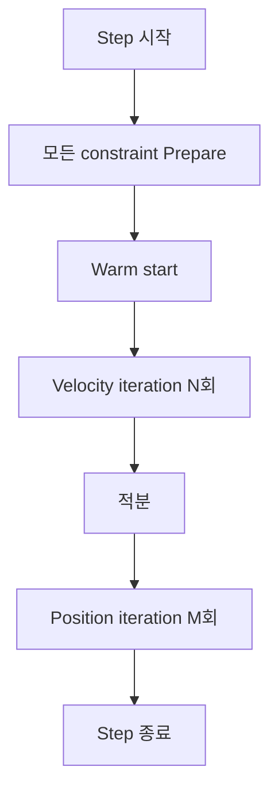

## 들어가며

충돌 응답은 normal impulse + friction impulse + position correction 으로 직접 처리할 수 있다. 하지만 이 방식만 쓰면 코드가 *충돌 전용* 으로 작성된다.

게임의 *다른 응답* — 관절 (joint), 모터, 거리 제약 (rope), 각도 제한 (hinge) — 도 비슷한 패턴 : *상태에 대한 제약 + 그 제약을 만족시키는 임펄스*. 매번 별도 코드를 작성하는 대신 *공통 추상화* 가 필요.

그 추상화가 *제약 (Constraint) 시스템*. 제약을 위치 제약 $C(\vec{q}, t) = 0$ 또는 그 시간 미분인 속도 제약으로 표현하고, 그 도함수의 *Lagrangian 미정승수법* 으로 *제약력 (constraint force) 의 크기* 를 결정. 충돌은 부등식 제약, 모터·마찰은 속도 수준 제약으로 *같은 솔버에서 풀린다*.

이 글의 목표.

1. **제약의 분류** — 등식 / 부등식, holonomic / non-holonomic.
2. **속도 제약과 Jacobian** — 위치 제약의 시간 미분.
3. **Lagrangian 미정승수법** — 제약력 = $J^T \lambda$.
4. **Effective mass** — $JM^{-1}J^T$ 의 역할.
5. **LCP / MLCP** — 부등식 제약의 일반화.
6. **Constraint 인터페이스 설계** — 코드 추상화.
7. **충돌을 제약으로 환원** — 모든 응답이 한 틀.
8. **이 일반론의 산업 적용**.

이 글이 마치면 *모든 강체 응답 (충돌, 관절, 모터, …)* 을 *Constraint 한 추상* 으로 다룰 토대가 정리된다.


---

## 목차
1. [제약의 분류](#1-제약의-분류)
2. [속도 제약과 Jacobian](#2-속도-제약과-jacobian)
3. [Lagrangian 미정승수법](#3-lagrangian-미정승수법)
4. [Effective mass](#4-effective-mass)
5. [LCP와 MLCP](#5-lcp와-mlcp)
6. [Constraint 인터페이스 설계](#6-constraint-인터페이스-설계)
7. [충돌을 제약으로 표현](#7-충돌을-제약으로-표현)
8. [일반론의 산업 적용](#8-일반론의-산업-적용)


---

## 1. 제약의 분류

물리 시뮬레이션의 제약을 *몇 가지 범주* 로 나눈다.

### 1.1 Holonomic vs Non-holonomic

*Holonomic*: 위치만의 함수(시간 명시 가능)로 표현 가능. $C(\vec{q}, t) = 0$.

예: distance joint — 두 객체의 거리가 일정.

$$
C(\vec{q}) = |\vec{x}_B - \vec{x}_A| - L = 0
$$

*Non-holonomic*: 적분 불가능한 속도 수준 제약. 위치만의 함수로 표현하거나 적분해 위치 제약으로 되돌릴 수 없다.

예: rolling without slipping (구가 미끄러지지 않고 구름). *접촉점에서 속도 0* — 위치만으로는 표현 안 됨.

게임의 *대부분 제약이 holonomic*. non-holonomic 은 *차량 시뮬* 같은 특수 케이스.

### 1.2 Equality vs Inequality

| 종류 | 형태 | 예시 |
|---|---|---|
| Equality (=) | $C(\vec{q}) = 0$ | distance joint, hinge |
| Inequality (≥) | $C(\vec{q}) \ge 0$ | 비관통 (충돌), 한도 |

등식 제약의 *수학적 목표* 는 $C(\vec{q})=0$ 을 양방향으로 강제하는 것이다. 유한 반복·유한 timestep의 게임 솔버에서는 허용오차와 drift가 남을 수 있다. 부등식은 *한쪽만* 제한한다. 비관통은 분리되는 운동은 허용하고 더 깊이 들어가는 운동만 막는다.

### 1.3 Bilateral vs Unilateral

다른 표현이지만 같은 의미.
- *Bilateral* = equality (양방향).
- *Unilateral* = inequality (한쪽만).

### 1.4 게임의 흔한 제약

| 종류 | 제약 식 |
|---|---|
| Distance joint | $|x_A - x_B| - L = 0$ |
| Hinge (revolute) | $x_A^{world} - x_B^{world} = 0$ (점 일치) |
| Slider (prismatic) | 한 축 외 운동 제거 |
| Motor | 각속도 = 목표 |
| Limit | 각도 / 거리 한도 $\theta_{min} \le \theta \le \theta_{max}$ |
| 비관통 (contact) | $d \ge 0$ (분리 거리 음수 안 됨 = 침투 금지) |
| 마찰 (friction) | $|F_t| \le \mu F_n$ (Coulomb cone) |

이 모두가 *같은 솔버에서* 풀린다.

### 1.5 자유도 (DOF) 와 제약

3D 강체는 6 DOF (위치 3 + 회전 3). 독립적인 활성 제약 하나가 *DOF 한 개를 제거* 한다. 실제 감소량은 활성 제약 Jacobian의 *rank* 이며, 중복·특이·비활성 행은 그대로 세면 안 된다.

| 관절 | 제거된 DOF | 남은 DOF |
|---|---|---|
| 고정 (weld) | 6 | 0 |
| 구형 (ball) | 3 (위치만 일치) | 3 (자유 회전) |
| Hinge | 5 (위치 3 + 회전 2) | 1 (한 축 회전) |
| Slider | 5 (위치 2 + 회전 3) | 1 (한 축 이동) |
| 자유 | 0 | 6 |

각 관절을 *제약 식의 개수* 로 표현 — 독립 활성 제약이 많을수록 자유도가 적다. 위 표의 수치는 겹치지 않는 정규 직교 행을 가정한 어림이며, 일반 자유도 수와 저장 성분 수(q의 성분 개수)는 구분한다.

## 2. 속도 제약과 Jacobian

위치 제약의 *시간 미분* 으로 *속도 제약*. 이 형태가 솔버에 적합.

### 2.1 시간 미분

위치 제약 $C(\vec{q}) = 0$ 을 시간 미분:

$$
\dot{C} = \frac{\partial C}{\partial \vec{q}} \dot{\vec{q}} = J \vec{v}
$$

여기서 $J = \partial C / \partial \vec{q}$ 가 *Jacobian* — 제약이 *어느 자유도에 작용* 하는지의 행렬.

속도 제약: $J \vec{v} = 0$. 부등식 제약은 *활성 경계에서만* 부등호가 붙는다. 분리 상태 $C>0$ 에서는 어떤 접근 속도도 허용되고, $C=0$ 인 접촉에서만 비접근 조건을 적용한다. 이산 시간에서는 위치를 예측한 speculative 형태 $C + \Delta t\, J \vec{v} \ge 0$ (즉 $J \vec{v} \ge -C/\Delta t$) 을 쓴다. 모든 상태에 $J \vec{v} \ge 0$ 를 요구하면 분리 중인 물체까지 잘못 막는다.

일반화 좌표의 시간 미분 $\dot{\vec{q}}$ 와 강체의 twist $\vec{v}$ 는 다를 수 있다 (예: 3D 회전 쿼터니언). $J = \partial C/\partial \vec{q}$ 는 저장 좌표에 대한 행렬이므로 twist 좌표에 대한 제약 행은 $J_v = C_q G(q)$, 그리고 $\dot{\vec{q}} = G(q)\vec{v}$ 로 쓴다. 아래 cross-product 형태의 Jacobian은 twist $(\vec{v}, \vec{\omega})$ 좌표에 대한 것이다.

### 2.2 Jacobian 의 의미

$J$ 는 *행 벡터 (또는 행렬)*. 각 성분이 *해당 자유도에 대한 제약의 민감도*.

```math
J = \begin{pmatrix} \partial C / \partial x_1 & \partial C / \partial x_2 & \cdots & \partial C / \partial x_n \end{pmatrix}
```

n 개 일반화 좌표 $q_i$ 에 대해.

### 2.3 예: distance joint (2D)

두 강체의 거리가 *L* 인 제약:

$$
C = |\vec{x}_B - \vec{x}_A| - L = 0
$$

미분:

$$
J = \begin{pmatrix} -\hat{u} & 0 & \hat{u} & 0 \end{pmatrix}
$$

여기서 $\hat{u} = (\vec{x}_B - \vec{x}_A) / |\vec{x}_B - \vec{x}_A|$. 자유도 = $(\vec{v}_A, \omega_A, \vec{v}_B, \omega_B)$.

직관: 거리 제약이 *두 객체의 상대 속도 중 $\hat{u}$ 방향 성분* 만 통제. 회전 자유도엔 직접 영향 없음 (Jacobian 의 회전 성분 0).

### 2.4 회전 포함된 Jacobian

객체 위 *어느 점* (예: hinge 의 회전축이 객체 중심에서 r 떨어진 곳) 에 작용하는 제약은 *회전 성분도 포함*.

$$
J = \begin{pmatrix} -\hat{n} & -(\vec{r}_A \times \hat{n}) & \hat{n} & (\vec{r}_B \times \hat{n}) \end{pmatrix}
$$

회전 성분은 *접촉점과 질량중심의 거리 + 법선의 외적*. 회전 임펄스가 *얼마나 제약에 기여하는가*.

### 2.5 Jacobian 의 차원

m 개 제약, n 개 자유도 (강체 시스템 전체). $J$ 가 m×n 행렬. 강체 한 개만 다루면 *2D 1×3*, *3D 1×6* (또는 6 자유도).

큰 시스템 (수많은 강체 + 관절) 에서 Jacobian 이 *희소 행렬 (sparse)* — 대부분 성분 0, 관절 끝점만 비-0.

### 2.6 위치 제약 → 속도 제약 의 함의

위치 제약을 *직접 풀기 어려움* (비선형). 속도 제약은 *선형* (Jacobian 곱 + 임펄스).

대신 *위치 제약이 만족됨을 보장 안 함* — 매 step 미세한 drift. 해결: *Baumgarte 안정화* 또는 *position correction*.

## 3. Lagrangian 미정승수법

제약을 만족시키는 *제약력 (constraint force)* 의 *크기* 를 결정하는 방법.

### 3.1 가정

제약력이 *Jacobian 의 전치 × 미정승수 (Lagrange multiplier)* 형태.

$$
\vec{F}_c = J^T \lambda
$$

$\lambda$ = 스칼라 (제약 1 개) 또는 벡터 (다중 제약). 의미: *제약을 정확히 강제하는 데 필요한 힘의 크기*.

직관: 제약이 *DOF 의 어느 부분 공간 (Jacobian 의 row space)* 에서만 작용. 그 부분 공간 안의 임의 힘 = $J^T \lambda$.

### 3.2 통합 운동 방정식

뉴턴 제2법칙 + 제약력:

$$
M \dot{\vec{v}} = \vec{F}_{ext} + J^T \lambda
$$

여기에 *속도 제약* $J \vec{v} = 0$.

두 식의 *연립 시스템* — $\dot{\vec{v}}$ 와 $\lambda$ 둘 다 미지수.

### 3.3 풀이

연속계의 정확한 속도 제약은 미분에 $\dot{J}$ 항까지 포함한다:

$$
J \dot{\vec{v}} + \dot{J} \vec{v} = 0
$$

게임 솔버가 실제로 푸는 것은 *한 step 동안의 Jacobian을 고정한* 이산 속도 투영이다. 이 근사에서 $\dot{J}\vec{v}$ 항(회전·자이로스코픽 등)은 step 안에서 무시된다. 외력이 반영된 속도를 $\vec{v}^* = \vec{v} + \Delta t\, M^{-1}\vec{F}_{ext}$ 로 두고 제약력 미정승수를 $\lambda_{force}$ 라 하면:

$$
J \vec{v}^* + \Delta t\, J M^{-1} J^T \lambda_{force} = 0
$$

정리하면:

$$
J M^{-1} J^T \lambda_{force} = -J \vec{v}^* / \Delta t
$$

$\lambda_{force}$ 에 대한 선형 시스템. *제약 1 개* 라면 *스칼라 분수* — 직접 풀이. 이는 힘 단위이며 아래 임펄스 형태와 구분한다.

### 3.4 임펄스 형태

게임 솔버는 *힘이 아닌 임펄스* 로 표현한다. 임펄스 미정승수를 $\Lambda_{impulse} = \Delta t\, \lambda_{force}$ 로 두면,

$$
\vec{P} = J^T \Lambda_{impulse}, \quad \Lambda_{impulse} = -(J M^{-1} J^T)^{-1} (J \vec{v}^* + b)
$$

이때 $\Lambda_{impulse}$ 는 힘 형태의 미정승수 $\lambda_{force}$ 가 아니라 *한 step 동안 적분된 impulse multiplier* 다. 같은 $\lambda$ 기호를 쓰면 단위 혼동이 생기므로 $\lambda_{force}$ 와 $\Lambda_{impulse}$ 로 구분한다.

여기서 $b$ = bias 항 (Baumgarte 또는 restitution).

### 3.5 제약력과 운동량 보존

$\vec{F}_c = J^T \lambda$ 의 효과:

$$
M \Delta \vec{v} = J^T \lambda
$$

두 강체에 분배 — *내부 힘* (action-reaction). 운동량 보존 자연 만족.

### 3.6 미정승수의 의미

$\lambda$ 가 *(반드시 직관적이지 않은) 추상 양*. 단위는 *임펄스 / Jacobian 단위*.

물리적 해석: distance joint 의 $\lambda$ = *그 joint 가 끌어당기는 임펄스의 크기*. 양수면 *압축* (밀어내기), 음수면 *인장* (끌어당김).

부등식 제약은 *λ ≥ 0* 강제 — 비관통 제약은 *밀어내기만*.

## 4. Effective mass

핵심 양 $J M^{-1} J^T$.

### 4.1 의미

m 개 제약, n 개 자유도. $J$ 가 m×n, $K = J M^{-1} J^T$ 가 m×m. 엄밀히는 $K$ 가 *제약 공간의 inverse effective mass matrix* 이고, effective mass 는 $K^{-1}$ 다.

스칼라 제약 (m=1) 이면 $K$ 도 스칼라. 이 값의 역수가 *제약 방향에 대한 등가 질량*.

### 4.2 직관

normal impulse 식의 분모를 다시 보면:

$$
\frac{1}{M_A} + \frac{1}{M_B} + \tfrac{(\vec{r}_A \times \hat{n})^2}{I_A} + \tfrac{(\vec{r}_B \times \hat{n})^2}{I_B}
$$

이게 *$J M^{-1} J^T$ 의 풀어쓴 형태*, 즉 inverse effective mass. 두 강체의 *질량 + 관성 (회전 팔길이 효과)* 의 결합이다.

```cpp
// Jacobian = (-n, -r_A × n, +n, r_B × n)
// M_inv = diag(1/M_A, 1/I_A, 1/M_B, 1/I_B)
// J * M_inv * J^T = invMA + invIA*(rA×n)² + invMB + invIB*(rB×n)²
float effectiveMass_inv = a.invMass + b.invMass
                         + (rACrossN * rACrossN) * a.invInertia
                         + (rBCrossN * rBCrossN) * b.invInertia;
float effectiveMass = 1.0f / effectiveMass_inv;
```

### 4.3 임펄스 계산

$$
\lambda = \text{effectiveMass} \times (-J \vec{v} - b)
$$

normal impulse 식의 *완전한 일반화*. distance joint, hinge, motor 모두 같은 형태.

### 4.4 K matrix

전체 시스템에서 $K = J M^{-1} J^T$ 는 *모든 제약 행* 수 m × m 행렬이다. 반면 개별 관절을 그 관절의 행만 모아 풀 때의 $K_{block}$ 은 1~6행짜리 작은 행렬이다. 관절 하나를 닫힌 형태로 풀면 local $K_{block}$ 의 inverse를 쓴다.

```cpp
// 관절 하나의 local block (예: 3D ball joint, 3행)
mat3 K = J * Minv * transpose(J);
vec3 lambda = inverse(K) * (-J * v - b);
```

### 4.5 단일 제약의 효율성

대부분 게임 제약이 *m = 1 ~ 3*. 작은 행렬 inverse. 직접 풀이 또는 cofactor / Cholesky.

### 4.6 Effective mass 의 캐싱

*pose와 Jacobian을 고정한 velocity pass 안에서* effective mass 는 불변이다. 이 구간의 시작에 *미리 계산 + 캐싱* 한다.

```cpp
struct ConstraintData {
    float effectiveMass;
    float bias;
    // ...
};
```

`PrepareVelocityConstraint` 에서 미리 계산, `SolveVelocityConstraint` 에서 매 iter 재사용. 단 TGS/NGS처럼 sub-step 사이에 pose나 contact arm이 갱신되는 solver는 그 시점마다 effective mass를 다시 계산해야 한다 — step 전체에 걸친 불변량이 아니다.

## 5. LCP와 MLCP

부등식 제약의 일반화.

### 5.1 LCP (Linear Complementarity Problem)

부등식 제약 (비관통) 의 *수학적 정식*.

$$
\lambda \ge 0, \quad J \vec{v} + b \ge 0, \quad \lambda (J \vec{v} + b) = 0
$$

세 조건이 *동시에* 만족. 의미:

- $\lambda = 0$: 임펄스 안 줌 → 자유 운동 ($J\vec{v} + b \ge 0$).
- $\lambda > 0$: 임펄스 줌 → 제약 정확히 만족 ($J\vec{v} + b = 0$).

*complementarity*: 둘 중 하나만 비-0. 둘 다 비-0 안 됨.

### 5.2 통합 형태

위 조건을 *벡터 형식* 으로:

$$
\vec{w} = A \vec{\lambda} + \vec{q}, \quad \vec{\lambda} \ge 0, \quad \vec{w} \ge 0, \quad \vec{\lambda}^T \vec{w} = 0
$$

$A = J M^{-1} J^T$ (inverse effective mass matrix), $\vec{q} = J \vec{v} + b$.

### 5.3 MLCP (Mixed LCP)

등식 + 부등식 제약 혼합. 일부 λ 는 *부호 제약 없음*, 일부는 *λ ≥ 0*. 마찰은 $-\mu \lambda_n \le \lambda_t \le \mu \lambda_n$ (boxed).

게임 시뮬은 *MLCP* 가 더 일반적인 형태.

### 5.4 풀이 방법

- *Pivoting (Lemke's algorithm)*: 정확한 해. 비용은 pivot 횟수·문제 구조·퇴화·종료 조건에 의존하며 O(m³) 하나로 단정할 수 없다. 정확성 우선.
- *Iterative (PGS — Projected Gauss-Seidel)*: 부등식 bound를 투영하며 반복 근사. 한 sweep 비용은 constraint 수 $m$에 비례하고 총비용은 반복 수와 sparsity에 의존한다.
- *Splitting methods*: 위치 / 속도 분리 솔버 (NGS).

게임 엔진은 PGS 가 압도적. 정확성 < 시각적 plausibility + 속도.

### 5.5 LCP 의 해 존재

LCP 가 *항상 해를 가지는 것* 은 아님 — 일부 케이스에서 *해가 없음* 또는 *무한 해*. 게임에서 그런 케이스 드물지만 *수치 안정성 함정*.

$K=JM^{-1}J^T$ 는 역질량 행렬이 양의 준정부호이면 양의 준정부호다. 제약 행이 질량 metric에서 독립이고 각 행에 양의 effective mass가 있을 때 양의 정부호가 될 수 있다. 중복·평행 제약, 잠긴 자유도, 0 effective mass는 특이성과 비유일 해를 만들 수 있다. 마찰까지 포함한 LCP/MLCP의 존재성·유일성과 반복 솔버의 수렴은 이 선형 등식계 조건만으로 보장되지 않는다.

### 5.6 LCP 의 학술 깊이

LCP 가 *최적화·OR (Operations Research) 의 핵심 토픽*. Cottle, Pang, Stone 의 *The Linear Complementarity Problem* (1992) 가 표준 책.

게임은 *PGS 의 직관적 형태* 만 알면 충분.

## 6. Constraint 인터페이스 설계

코드 추상화.

### 6.1 공통 인터페이스

```cpp
class IConstraint {
public:
    virtual ~IConstraint() = default;

    // step 시작에 effective mass · bias 등 미리 계산
    virtual void PrepareVelocityConstraint(float dt) = 0;

    // 이전 step 임펄스로 시작 (수렴 가속)
    virtual void WarmStart() = 0;

    // velocity constraint iteration 의 한 번 — Δλ 적용
    virtual void SolveVelocityConstraint() = 0;

    // position constraint iteration — 위치 보정
    virtual bool SolvePositionConstraint() = 0;
};
```

### 6.2 구현 예: Distance Joint

```cpp
class DistanceJoint : public IConstraint {
public:
    Body2D* a;
    Body2D* b;
    vec2    localA, localB;       // 각 강체 로컬 좌표의 anchor
    float   restLength;

    // 캐시
    vec2    rA, rB;                // 월드 좌표의 anchor (질량중심 기준)
    vec2    u;                      // 방향 단위 벡터
    float   effectiveMass;
    float   bias;
    float   impulse_acc = 0;        // 누적 임펄스 (warm start)

    void PrepareVelocityConstraint(float dt) override {
        rA = Rotate(localA, a->angle);
        rB = Rotate(localB, b->angle);
        vec2 d = (b->position + rB) - (a->position + rA);
        float currentLen = Length(d);
        // restLength>0 인데 anchor가 겹치면 u=0 이 되어 P=u*λ=0 이 된다.
        // 결정적 대체축으로 초기 분리를 만들거나, 생성 시 겹친 anchor를 금지한다.
        u = (currentLen > 1e-6f) ? d / currentLen : vec2{1, 0};

        float rAcrossU = Cross2D(rA, u);
        float rBcrossU = Cross2D(rB, u);
        float invM = a->invMass + b->invMass
                    + rAcrossU * rAcrossU * a->invInertia
                    + rBcrossU * rBcrossU * b->invInertia;
        effectiveMass = (invM > 0) ? 1.0f / invM : 0;

        float C = currentLen - restLength;
        bias = (kBaumgarte / dt) * C;
    }

    void WarmStart() override {
        vec2 P = u * impulse_acc;
        a->linearVelocity -= P * a->invMass;
        b->linearVelocity += P * b->invMass;
        // 회전도 ...
    }

    void SolveVelocityConstraint() override {
        vec2 vRel = (b->linearVelocity + PerpV(rB, b->angularVelocity))
                  - (a->linearVelocity + PerpV(rA, a->angularVelocity));
        float Cdot = dot(vRel, u);
        float lambda = -effectiveMass * (Cdot + bias);
        impulse_acc += lambda;

        vec2 P = u * lambda;
        a->linearVelocity -= P * a->invMass;
        b->linearVelocity += P * b->invMass;
        // 회전 ...
    }

    bool SolvePositionConstraint() override {
        // 위치 직접 보정 (NGS)
        // ... 반환: 길이 오차 |C| 가 허용 오차 안이면 true
    }
};
```

양의 `restLength` 인데 두 anchor가 정확히 겹치면 단위 방향 `u` 가 정의되지 않는다. 위 코드는 결정적 대체축(`{1,0}`)으로 초기 분리를 만들고, 그 외에는 생성 시 겹친 anchor를 금지하는 편이 안전하다. `restLength = 0` 은 방향 제약이 아니라 두 점을 일치시키는 point constraint로 다루는 것이 자연스럽다. 회전·position helper의 구현 생략 자체는 이 문제와 별개다.

### 6.3 다른 제약들도 같은 인터페이스

- `HingeJoint` (회전축 1)
- `PrismaticJoint` (이동축 1)
- `MotorConstraint` (각속도 = 목표)
- `LimitConstraint` (각도 한도)
- `ContactConstraint` (충돌의 normal + friction)

각 클래스가 *자기 Jacobian + bias* 만 구현. 솔버는 *공통 코드*.

### 6.4 솔버 (메인 루프)

```cpp
// 전제: 호출자가 외력/가속도를 속도에 이미 적분했거나, 이 Step 앞에 별도로 적분한다.
// 이 함수의 IntegratePositions 는 pose만 갱신한다.
void Solver::Step(World& world, float dt) {
    // 1. 모든 제약 준비
    for (auto& c : world.constraints) c->PrepareVelocityConstraint(dt);
    for (auto& c : world.constraints) c->WarmStart();

    // 2. velocity iteration
    for (int i = 0; i < kVelocityIters; ++i) {
        for (auto& c : world.constraints) c->SolveVelocityConstraint();
    }

    // 3. 위치 적분 — 속도는 velocity iteration에서 이미 보정됨
    IntegratePositions(world, dt);

    // 4. position iteration
    for (int i = 0; i < kPositionIters; ++i) {
        bool allOk = true;
        for (auto& c : world.constraints) {
            if (!c->SolvePositionConstraint()) allOk = false;
        }
        if (allOk) break;        // 모든 제약 만족 — 조기 종료
    }
}
```

이 한 함수가 *모든 게임 응답을 처리*. 새 제약 추가 = 새 클래스 한 개.

### 6.5 인터페이스의 힘

Constraint 한 인터페이스 뒤로:

- *충돌* (normal + friction 두 제약)
- *관절* (distance, hinge, slider, ball)
- *모터* (각속도 / 각도 driver)
- *한도* (한도 초과 시만 제약)
- *spring-damper* (soft constraint)

모두 *같은 솔버 코드* 로. 코드 유지보수의 *결정적 advantage*.

## 7. 충돌을 제약으로 표현

충돌 응답이 *이 일반론의 특수 케이스*.

### 7.1 비관통 제약

법선 방향 분리 거리 $d$ (침투 시 음수):

$$
C_n = d \ge 0
$$

위치 제약 + inequality. 이 제약을 속도 수준으로 옮길 때는 활성 여부를 구분한다. 분리 상태 $C_n > 0$ 에서는 접근 속도도 허용되므로 $J_n \vec{v}$ 에 부호 조건이 없다. 접촉 경계 $C_n = 0$ 에서만 비접근 조건을 적용하거나, 이산 시간에서는 $C_n + \Delta t\, J_n \vec{v} \ge 0$ (speculative 형태)을 쓴다. 시간 미분으로 모든 상태에 $\dot{C}_n = J_n \vec{v} \ge 0$ 를 부과하면 분리 중인 물체까지 잘못 막는다.

여기서 $J_n = (-\hat{n}, -\vec{r}_A \times \hat{n}, \hat{n}, \vec{r}_B \times \hat{n})$ — normal impulse 식의 그 Jacobian.

### 7.2 normal impulse 의 재유도

$\lambda_n = $ Lagrangian 미정승수. 효과 행렬:

$$
\frac{1}{\text{effM}_n} = \frac{1}{M_A} + \frac{1}{M_B} + \frac{(\vec{r}_A \times \hat{n})^2}{I_A} + \frac{(\vec{r}_B \times \hat{n})^2}{I_B}
$$

restitution 포함 bias:

$$
b = e \cdot v_{rel,n}^{before}
$$

임펄스:

$$
\lambda_n = \text{effM}_n \cdot (-v_{rel,n} - b)
$$

*normal impulse 식* 과 *완전히 동일*. 일반론의 특수 케이스로 재유도.

### 7.3 마찰 제약

두 접선 방향 $\hat{t}_1, \hat{t}_2$ (3D) 또는 한 방향 (2D). Jacobian:

$$
J_{t_1} = (-\hat{t}_1, -\vec{r}_A \times \hat{t}_1, \hat{t}_1, \vec{r}_B \times \hat{t}_1)
$$

목표: $J_t \vec{v} = 0$ (미끄러짐 0). Coulomb 클램프: $|\lambda_t| \le \mu \lambda_n$.

```cpp
// velocity iteration 안에서
{
    // normal 임펄스 갱신 (clamped λ ≥ 0)
    float lambdaN_delta = effM_n * (-vRelN - bias);
    float oldLambdaN = lambdaN_acc;
    lambdaN_acc = std::max(0.0f, lambdaN_acc + lambdaN_delta);
    lambdaN_delta = lambdaN_acc - oldLambdaN;
    ApplyImpulse(n * lambdaN_delta);

    // friction 임펄스 갱신 (clamped |λ_t| ≤ μ λ_n)
    float lambdaT_delta = effM_t * (-vRelT);
    float oldLambdaT = lambdaT_acc;
    float maxFriction = mu * lambdaN_acc;
    lambdaT_acc = std::clamp(lambdaT_acc + lambdaT_delta,
                              -maxFriction, +maxFriction);
    lambdaT_delta = lambdaT_acc - oldLambdaT;
    ApplyImpulse(t * lambdaT_delta);
}
```

*sequential* — 매 iter 마다 *normal 갱신 후 friction 갱신*. 수렴까지.

### 7.4 누적 임펄스 (impulse accumulation)

매 iteration *Δλ 만 적용*, *누적 λ 추적*. 클램프가 *누적값* 기준 — 한 iter 안에서 *역방향 임펄스* 가 *이전 누적을 부분 취소*.

이 패턴이 *Sequential Impulse* 의 핵심.

### 7.5 Warm starting

이전 step 의 *누적 λ* 를 다음 step 의 *초기 추정값* 으로.

```cpp
void WarmStart() {
    // 이전 step λ 를 그대로 적용 (적분된 임펄스)
    vec2 P = n * lambdaN_acc + t * lambdaT_acc;
    a->linearVelocity -= P * a->invMass;
    b->linearVelocity += P * b->invMass;
    // ...
}
```

수렴 가속 — 평균 iter 수 *3~5* 까지 줄어듦.

### 7.6 모든 제약이 같은 코드

`IConstraint` 인터페이스 뒤로:

- contact = normal constraint + friction constraint.
- joint = distance / position / orientation constraint.
- motor = velocity target constraint.
- spring = soft constraint (compliance).

같은 솔버가 *모두 처리*. 게임 엔진의 코드 우아함의 핵심.

## 8. 일반론의 산업 적용

산업 엔진들의 *제약 시스템 디자인*.

### 8.1 Box2D

`b2Joint` (관절들) + `b2Contact` (충돌) 가 *모두 같은 솔버* 안에서 처리.

- `b2Joint::InitVelocityConstraints` ≈ `PrepareVelocityConstraint`.
- `b2Joint::SolveVelocityConstraints` ≈ `SolveVelocityConstraint`.
- `b2Joint::SolvePositionConstraints` ≈ `SolvePositionConstraint`.

이 글의 인터페이스가 *Box2D 의 패턴 그대로*.

### 8.2 Bullet

`btTypedConstraint` (사용자가 만드는 관절 객체) + `btSolverConstraint` (관절·접촉이 모두 변환되어 들어가는 솔버 내부 1D 행) 분리.

- *Multibody* 시스템 (Featherstone articulated body algorithm) + *standard rigid body* (sequential impulse) 두 모드.
- 더 복잡한 *기계 시스템* (robot arms 등) 지원.

### 8.3 PhysX

`PxConstraint` + 내부 *contact constraint*. PCM (Persistent Contact Manifold) 와 통합.

- *Reduced coordinate* (자유도 직접 모델링) + *Maximal coordinate* (강체 + 제약).
- 큰 시뮬 (랙돌 + 충돌) 의 성능 최적화.

### 8.4 Jolt

`Constraint` 기반 + *Island* 분할.

- 독립적 제약 그룹을 *별도 스레드* 로 풀이.
- position-level correction 과 soft-body 기능을 별도 경로로 제공 — sequential impulse 와 함께 엔진 목적에 맞게 조합.

### 8.5 공통 패턴



모든 엔진의 *큰 그림* 이 같다. 차이는 *iteration 수, position 솔버 종류, 병렬화 정도*.

### 8.6 일반론의 가치

*같은 코드 베이스* 에 *충돌 + 관절 + 모터 + 한도* 모두 처리. 새 제약 추가 = 클래스 하나 + Jacobian 식 한 줄.

학습 비용은 *추상화 이해* — 한 번 익히면 *모든 제약을 같은 시각으로*. Erin Catto 의 "Modeling and Solving Constraints" 발표가 이 시각을 *게임 개발자에게 보편화* 한 결정적 작품.


---

## 결론

제약 시스템이 *충돌·관절·모터·한도* 를 모두 *한 추상* 으로 통일. Lagrangian 미정승수법으로 *제약력* 을 *제약 자유도 안의 미정승수* 로 환원, Jacobian 으로 *어느 자유도에 작용하는지* 인코딩.

이 글에서 정리한 핵심.

1. **제약 분류** — Holonomic / Non-, Equality / Inequality, Bilateral / Unilateral.
2. **속도 제약과 Jacobian** — 위치 제약의 시간 미분. $J \vec{v} = 0$.
3. **Lagrangian 미정승수** — 제약력 = $J^T \lambda$. 운동량 보존 자연.
4. **Effective mass** — $J M^{-1} J^T$. 제약 공간의 등가 질량.
5. **LCP / MLCP** — 부등식 제약의 일반화와 projected iterative 해법.
6. **Constraint 인터페이스** — Prepare / WarmStart / SolveVelocity / SolvePosition 4 함수.
7. **충돌을 제약으로** — normal impulse 와 friction 의 일반론 재유도.
8. **산업 적용** — 모든 메이저 엔진이 같은 패턴.

제약 시스템의 핵심은 충돌, 관절, 모터, 한도를 모두 *Jacobian + effective mass + bias + clamp* 로 바라보는 것이다. 이 틀을 잡으면 엔진별 구현 차이도 같은 언어로 비교할 수 있다.

## 더 읽을거리

- Erin Catto, "Modeling and Solving Constraints" (GDC 2009) — 제약 시스템의 게임 친화적 정리.
- Erin Catto, "Iterative Dynamics with Temporal Coherence" (2005) — 본 시스템의 sequential impulse 구현.
- David Baraff, "Linear-Time Dynamics using Lagrange Multipliers" (SIGGRAPH 1996) — Lagrangian 방법의 학술 표준.
- Cottle, Pang, Stone, *The Linear Complementarity Problem* (1992) — LCP 의 표준 책.
- Anitescu, Potra, Stewart, "Time-stepping for three-dimensional rigid body dynamics" (Computer Methods in Applied Mechanics and Engineering, 1999) — LCP 시각으로 강체 시뮬.
- Box2D 소스 (`b2Joint.h`, `b2ContactSolver.cpp`) — 인터페이스 reference.
- Bullet manual, "Constraints" — 다양한 관절 종류 + 다양한 솔버.
- PhysX SDK Guide, "Constraints" — 산업 구현.
