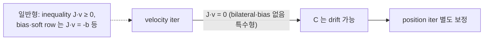
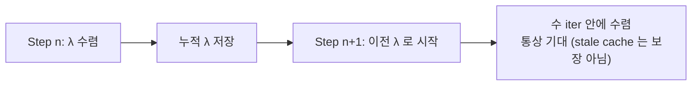
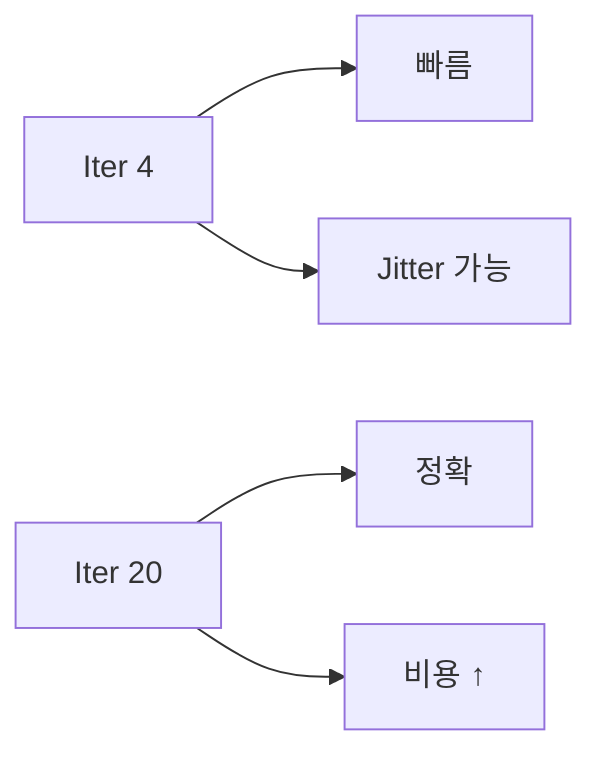
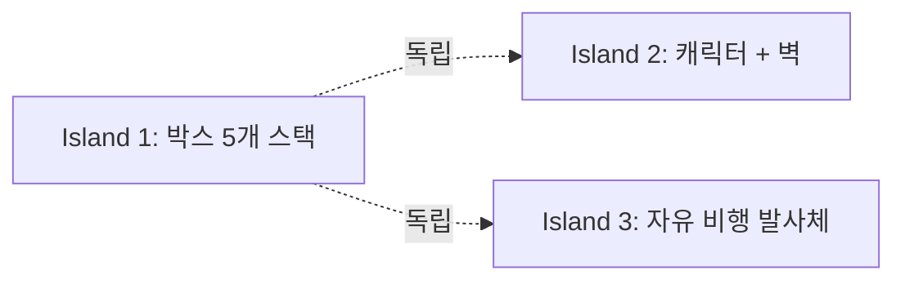

## 들어가며

접촉과 관절은 모두 속도·위치에 대한 *제약식* 으로 표현할 수 있다. Lagrange 승수법이 그 수학적 토대를 제공한다면, *Sequential Impulse(SI)* 는 제약식을 게임의 프레임 예산 안에서 반복적으로 푸는 실용 알고리즘이다.

Erin Catto 가 Box2D 에 도입한 후 게임 물리 솔버의 *사실상 표준*. *모든 제약을 한 번씩 차례로 푸는 Gauss-Seidel 반복*. 단순하면서도 게임 시나리오에 *충분히 빠른 수렴*.

이 글의 목표.

1. **Gauss-Seidel 반복** — 한 제약씩 차례로, 최신 속도로 갱신.
2. **Velocity iteration** — 속도 제약 풀이의 반복.
3. **Position iteration** — 위치 보정의 별도 패스.
4. **Warm starting** — 이전 step 의 누적 임펄스 재사용.
5. **수렴 분석** — Gauss-Seidel 의 수렴 조건.
6. **Iteration count 의 트레이드오프** — 정확성 vs 비용.
7. **Island solver** — 독립적 충돌 그룹의 분리 풀이.
8. **다른 솔버와의 비교** — TGS, PBD, NGS.

이 글이 마치면 *contact + joint 를 통일된 루프에서 푸는* sequential impulse 솔버가 정리된다.


---

## 목차
1. [Gauss-Seidel 반복](#1-gauss-seidel-반복)
2. [Velocity iteration](#2-velocity-iteration)
3. [Position iteration](#3-position-iteration)
4. [Warm starting](#4-warm-starting)
5. [수렴 분석](#5-수렴-분석)
6. [Iteration count의 트레이드오프](#6-iteration-count의-트레이드오프)
7. [Island solver](#7-island-solver)
8. [다른 솔버와의 비교](#8-다른-솔버와의-비교)


---

## 1. Gauss-Seidel 반복

선형 시스템 풀이의 고전 알고리즘. *행 단위 sequential update*.

### 1.1 선형 시스템

m 제약 + n 자유도의 *전체 시스템*:

$$
K \vec{\lambda} = -J \vec{v} - \vec{b}
$$

$K = J M^{-1} J^T$ 가 m×m. *직접 풀이* (행렬 inverse) 는 $O(m^3)$ — 큰 m 에 비쌈.

### 1.2 Gauss-Seidel 의 아이디어

행렬 inverse 대신 *반복 근사*. 매 iteration 마다 *한 행씩* 풀이, *이미 갱신된 변수의 최신 값* 사용.

```math
\lambda_i^{(k+1)} = \frac{1}{K_{ii}} \left( -J_i \vec{v} - b_i - \sum_{j \ne i} K_{ij} \lambda_j^{\text{latest}} \right)
```

여기서 $\lambda_j^{\text{latest}}$ = j > i 면 *이전 iteration 값*, j < i 면 *이번 iteration 갱신된 값*.

### 1.3 Sequential Impulse 의 단순화

게임 솔버는 *명시적 K 행렬을 만들지 않음*. 대신 *속도 자체* 가 *최신 상태를 유지*. 한 제약을 풀 때 *현재 속도를 보고* Δλ 계산.

```cpp
for (int iter = 0; iter < N; ++iter) {
    for (auto& c : constraints) {
        // 현재 (다른 제약들 갱신 후의) 속도를 보고 Δλ 계산
        c->SolveVelocityConstraint();
    }
}
```

`SolveVelocityConstraint` 안에서 *현재 v 읽기 → Δλ 계산 → 두 강체 v 즉시 갱신*. 다음 제약은 *갱신된 v* 를 본다.

### 1.4 누적 임펄스

각 제약이 *자기 누적 λ* 추적. Δλ 가 *적용되지만* 누적값이 *클램프 (예: λ ≥ 0)* 의 기준.

```cpp
void ContactConstraint::SolveVelocityConstraint() {
    float vRelN = ComputeRelativeVelocityNormal();
    float lambdaDelta = effectiveMass * (-vRelN - bias);

    float oldImpulse = impulse_acc;
    impulse_acc = std::max(0.0f, impulse_acc + lambdaDelta);
    lambdaDelta = impulse_acc - oldImpulse;

    ApplyImpulse(n * lambdaDelta);
}
```

Δλ 가 *누적이 0 미만으로 가지 못하게 clamp*. *역방향 Δλ* 가 *이전 누적의 부분 취소* 로 동작.

### 1.5 왜 게임에 맞는가

- *행렬 inverse 없음*: $O(m^3)$ 대신 $O(m \cdot \text{iter})$. iter 작으면 빠름.
- *Frame-to-frame coherence* 활용: warm starting 으로 평균 iter ↓.
- *Incremental* 갱신: *클램프* 자연 — 부등식 제약 (λ ≥ 0) 한 줄.
- *수렴 안 해도 OK*: 게임은 *그럴듯한 결과* 우선. 완벽 수렴 강요 없음.

게임의 *연성 (forgiving) 요구사항* 과 Gauss-Seidel 의 *근사 수렴* 이 잘 맞는다.

### 1.6 Jacobi vs Gauss-Seidel

*Jacobi*: 모든 λ 를 *동시* 갱신. 이전 iteration 의 값만 사용해 병렬화가 쉽다. 수렴률은 행렬의 성질과 preconditioner에 의존한다.

*Gauss-Seidel*: 한 λ 씩 순차로 최신 값을 사용한다. 의존성이 생기지만 많은 접촉 graph에서 같은 sweep 수의 Jacobi보다 잔차가 빨리 줄 수 있다.

island 간 병렬과 island 내 GS를 조합할 수 있고, 큰 island에는 graph coloring이나 block/Jacobi 계열을 사용할 수 있다.

## 2. Velocity iteration

속도 제약을 *반복 풀이*.

### 2.1 메인 루프

```cpp
const int kVelocityIters = solverQuality.velocityIterations;

for (int i = 0; i < kVelocityIters; ++i) {
    for (auto& c : world.contacts) c->SolveVelocityConstraint();
    for (auto& j : world.joints)   j->SolveVelocityConstraint();
}
```

매 iteration 마다 *모든 contact + 모든 joint* 를 한 번씩. 한 contact 의 갱신이 *다음 contact 의 입력*.

### 2.2 Contact 의 velocity constraint

normal + friction impulse 식.

```cpp
void ContactConstraint::SolveVelocityConstraint() {
    // === Normal impulse ===
    {
        vec2 vRel = ComputeRelativeVelocityAtContact();
        float vRelN = dot(vRel, normal);
        float lambdaN_delta = effMassN * (-vRelN - bias);

        // 누적 λ ≥ 0 클램프
        float oldImpulse = impulseN_acc;
        impulseN_acc = std::max(0.0f, impulseN_acc + lambdaN_delta);
        lambdaN_delta = impulseN_acc - oldImpulse;

        ApplyImpulseN(lambdaN_delta);
    }

    // === Friction impulse ===
    {
        vec2 vRel = ComputeRelativeVelocityAtContact();   // 다시 — normal 후 갱신됨
        float vRelT = dot(vRel, tangent);
        float lambdaT_delta = effMassT * (-vRelT);

        // Coulomb clamp: |누적 λ_t| ≤ μ λ_n
        float maxFriction = friction * impulseN_acc;
        float oldImpulse = impulseT_acc;
        impulseT_acc = std::clamp(impulseT_acc + lambdaT_delta,
                                    -maxFriction, +maxFriction);
        lambdaT_delta = impulseT_acc - oldImpulse;

        ApplyImpulseT(lambdaT_delta);
    }
}
```

normal 먼저, friction 나중. 마찰의 Coulomb 한도가 *방금 갱신된 normal 누적값* 에 의존.

### 2.3 Joint 의 velocity constraint

같은 패턴, *equality 제약* 이면 clamp 없음.

```cpp
void DistanceJoint::SolveVelocityConstraint() {
    float Cdot = dot(vRel, u);
    float lambdaDelta = -effMass * (Cdot + bias);
    impulse_acc += lambdaDelta;    // clamp 없음
    ApplyImpulse(u * lambdaDelta);
}
```

부등식 joint (motor 한도, prismatic 한도) 는 *contact 와 같은 클램프* 패턴.

### 2.4 Pre-step 준비

매 step 시작에 *effective mass, bias, warm start* 미리 계산.

```cpp
void PreStep(float dt) {
    for (auto& c : world.contacts) c->PrepareVelocityConstraint(dt);
    for (auto& j : world.joints)   j->PrepareVelocityConstraint(dt);

    // Warm start
    for (auto& c : world.contacts) c->WarmStart();
    for (auto& j : world.joints)   j->WarmStart();
}
```

`PrepareVelocityConstraint` 가 *r_A, r_B, effective mass, bias* 등 *step 내 불변량* 캐싱.

### 2.5 Velocity iteration 의 수렴

iter 수가 늘면 일반적으로 residual이 감소하지만 수렴률은 stack 높이, 질량비, constraint 순서와 warm start 품질에 따라 달라진다. 고정 권장값 대신 품질 단계별 최대 penetration과 joint error를 측정한다.

### 2.6 적분 시점

velocity iteration *후* 적분 — 보정된 속도로 위치 갱신.

```cpp
PreStep(dt);
for (int i = 0; i < kVelocityIters; ++i) { /* velocity iter */ }
Integrate(world, dt);                       // x += v * dt
for (int i = 0; i < kPositionIters; ++i) { /* position iter */ }
```

순서: pre-step → velocity 반복 → 적분 → position 반복.

## 3. Position iteration

속도만 풀어선 침투가 안 사라짐. 위치 직접 보정.

### 3.1 왜 필요한가

velocity 반복이 *속도 제약* ($J \vec{v} = 0$) 을 만족시킴. 하지만 *위치 제약* ($C = 0$) 은 *드리프트* 누적.



특히 *충돌 시작 시 초기 침투* 는 velocity iter 만으로 해소되지 않는다. 별도 position pass 나 위치-속도를 결합한 implicit 구성에서 다룬다 — position pass는 모든 솔버의 필수 단계가 아니라 선택한 solver 구성이다.

### 3.2 NGS (Non-linear Gauss-Seidel)

위치 좌표를 *직접 수정* 하는 GS 반복.

```cpp
for (int i = 0; i < kPositionIters; ++i) {
    bool allOk = true;
    for (auto& c : world.contacts) {
        bool ok = c->SolvePositionConstraint();
        allOk &= ok;
    }
    for (auto& j : world.joints) {
        bool ok = j->SolvePositionConstraint();
        allOk &= ok;
    }
    if (allOk) break;       // 모든 제약 만족 — 조기 종료
}
```

각 제약이 *자기 위치 보정* 을 매 iter 적용. `ok` = 침투 깊이가 threshold 이하면 true.

### 3.3 Contact 의 position constraint

```cpp
bool ContactConstraint::SolvePositionConstraint() {
    // 현재 침투 깊이 (위치 기반 재계산)
    float depth = ComputeCurrentPenetration();
    if (depth <= kLinearSlop) return true;        // 작은 침투 무시

    // 위치 보정량
    float correction = std::clamp(
        kBaumgarte * (depth - kLinearSlop),
        0.0f, kMaxLinearCorrection);

    float invSum = a->invMass + b->invMass;
    if (invSum <= 0) return true;
    vec2 impulse = normal * (correction / invSum);
    a->position -= impulse * a->invMass;
    b->position += impulse * b->invMass;

    return depth <= kLinearSlop * 3.0f;            // "충분히 풀렸나" 신호
}
```

`kBaumgarte`, `kLinearSlop`, `kMaxLinearCorrection` 은 단위계와 dt에 맞춘 solver 파라미터다. 특정 숫자를 복사하기보다 허용 penetration과 최대 보정 속도로 의미를 정의한다.

### 3.4 위치 보정의 운동량 모델

velocity 와 *별도* 의 패스 — *속도는 안 바꿈*. 운동량 모델의 시각에선 *외부 개입* 이지만 *시각적 안정* 이 우선.

pseudo-velocity나 split impulse는 실제 운동 속도와 위치 안정화 채널을 분리한다. 이 역시 위치를 외부 보정하는 수치 기법이며 전체 운동량·에너지를 자동으로 정확히 보존한다는 뜻은 아니다.

### 3.5 Position iteration 의 비용

position pass는 최대 penetration이 slop 아래로 내려가면 조기 종료할 수 있다. 필요한 반복 수는 velocity pass와 별개로 측정한다.

### 3.6 Position 솔버 대안

이들을 *하나의 explicit/implicit 축* 으로 나누면 부정확하다. 실제로는 서로 다른 축이 섞여 있다.

- *시간 이산화*: PGS와 TGS 모두 PhysX 5.4.1 문서에서는 implicit discretization의 근사로 설명된다. TGS만 implicit이라고 대조하지 않는다.
- *제약 재선형화·소단계*: TGS는 작은 sub-step마다 pose와 contact arm을 갱신해 비선형성을 반영한다. PGS는 한 step의 Jacobian을 고정한다.
- *위치 오차 보정*: NGS(Box2D)는 위치를 직접 수정하고, pseudo-velocity(Bullet)는 별도 위치 보정 속도 채널을 둔다. PBD는 속도 자체를 위치 변경에서 도출한다.

각 방법의 *정확성·안정성·비용* 트레이드오프 다름.

## 4. Warm starting

이전 step 의 누적 λ 를 재사용 — 수렴 가속.

### 4.1 Frame-to-frame coherence

물리 시뮬은 *연속적* — 한 step 의 상태가 다음 step 과 *거의 같음*. 매 step *처음부터 풀지 않고* 이전 답에서 시작.



### 4.2 적용

```cpp
void ContactConstraint::WarmStart() {
    // 이전 step 의 누적 임펄스를 그대로 적용 (이미 적분된 효과)
    vec2 P = normal * impulseN_acc + tangent * impulseT_acc;
    a->linearVelocity  -= P * a->invMass;
    b->linearVelocity  += P * b->invMass;
    a->angularVelocity -= a->invInertia * Cross2D(rA, P);
    b->angularVelocity += b->invInertia * Cross2D(rB, P);
}
```

step 시작에 *이전 누적 λ 의 impulse 를 강체 속도에 적용*. velocity iteration 의 *시작 상태* 가 *이전 step 의 수렴 상태* 에 가깝다.

warm start 캐시는 다음 계약을 만족할 때만 유효하다.

- *접촉 항등성*: body/feature ID가 같고 normal basis가 이전과 일치(또는 재투영)해야 한다. shape/body generation 변경, teleport, 접선 기준 회전 시 캐시를 무효화한다.
- *dt 처리*: 지속 하중의 누적 impulse는 substep dt 비율로 scaling하거나 재초기화한다. 충돌성(impact) target은 substep dt 변화에 그대로 carry하지 않는다.
- *λ 초기화*: 새 contact는 `λ = 0` 으로 시작하고, 사라진 contact는 캐시에서 제거한다.
- *restitution snapshot*: impact restitution target은 warm start로 속도를 바꾸기 *전* 의 상대 속도로 고정해 반복 재반발을 막는다.

### 4.3 효과

| | warm start 없음 | warm start 있음 |
|---|---|---|
| 평균 iter 수 (예시) | 8~10 | 3~5 |
| 큰 시뮬 (수백 contact) | 느림 | 안정 |
| 시각적 부드러움 | jitter 가능 | 부드러움 |

iter 수 절반 — 핫 패스 비용 절감.

### 4.4 Contact persistence

warm starting 가 *contact ID 추적* 에 의존. 같은 두 강체가 *프레임 간 같은 접촉점* 인지 식별.

```cpp
struct ContactKey {
    int featureA, featureB;       // 어느 vertex / face 의 충돌
};
```

narrow phase 가 *contact feature ID* 를 제공. 매 step *(bodyA, bodyB, featureA, featureB) 4 튜플 비교* — 같으면 이전 λ 사용.

### 4.5 새 contact

처음 발견되는 contact 는 warm start 불가. λ_init = 0 으로 시작. *몇 frame 뒤* 충분히 수렴.

### 4.6 사라지는 contact

분리되는 contact 는 λ 저장 불필요. *N frame (예: 5) 안 갱신* 되면 캐시에서 제거.

## 5. 수렴 분석

Gauss-Seidel 의 수렴 조건과 *게임 시나리오에서의 실용성*.

### 5.1 일반 GS 수렴 조건

선형 시스템 $K \vec{\lambda} = \vec{q}$ 의 GS 수렴은:

- $K$ 가 *strict diagonal dominance* (또는 irreducibility를 포함한 적절한 약 대각 조건)를 만족하거나,
- $K$ 가 *symmetric positive definite* (실수 대칭 PD).

$M^{-1}$이 양의 준정부호라면 $K = J M^{-1} J^T$도 양의 준정부호다. $K$가 양의 정부호가 되려면 제약 행들이 역질량이 정의하는 metric에서 독립이고 0 effective mass 행이 없어야 한다. 중복 제약, 잠긴 자유도와 정적 강체 조합은 singular $K$를 만들 수 있다.

이 조건은 *클램프 없는 선형 등식계* 에 대한 고전적인 Gauss-Seidel 설명이다. 접촉의 $\lambda_n \ge 0$, 마찰 원뿔 근사와 누적 임펄스 clamp가 들어간 PGS는 complementarity 문제를 푸는 투영 반복이다. 일반 SPD 정리만으로 모든 접촉 집합의 수렴·유일성을 주장할 수 없으며, 엔진은 반복 한도·정규화·warm start·실패 정책과 함께 운용한다.

### 5.2 수렴 속도

수렴 속도는 *GS 반복 행렬의 spectral radius* $\rho(G)$ 에 의존 ($G = -(D+L)^{-1}U$, $K = D + L + U$ 분해). $\rho(G) < 1$ 이면 수렴하고, 1 에 가까울수록 느리다. $K$ 의 대각 우세가 강할수록 $\rho(G)$ 가 작아 빠른 수렴.

게임에서 *효과 mass 가 자유도별로 비슷* 하면 수렴 빠름. *극단적 mass 비율* (큰 박스 + 작은 박스 stacking) 에서 수렴 느림.

### 5.3 큰 mass ratio 의 함정


GS는 같은 sweep 안에서 이미 갱신된 값을 재사용하므로, 행 순서가 연결 방향과 같으면 한 sweep 안에 여러 이웃으로 영향이 전파된다. 반대 방향이면 한 이웃씩 지연될 수 있다. 따라서 정보 전달 거리는 *행 순서와 sweep 방향* 에 의존한다.

첫 영향이 도달하는 sweep 수와 목표 residual까지의 수렴은 별개다. 질량비·condition 수·재정렬(reordering)이 수렴 속도를 좌우하며 “100단계 = 100 iter”처럼 항상 일정하다고 일반화할 수 없다.

해결: *더 많은 iter*, *substepping*, *island reordering* (가까운 강체 먼저).

### 5.4 게임 수렴의 정의

게임은 *수학적 수렴* 이 아니라 *시각적 안정*. 침투가 *눈에 안 띌 정도면* 충분.

```cpp
constexpr float kVisuallyTolerable = 0.01f;        // 1 cm
```

게임 객체가 *1 cm 침투해도* 시각적으로 무시 가능 — *완벽 수렴 강요 안 함*.

### 5.5 발산 방지

GS 가 *발산* 하는 경우는 드물지만 *수치 함정* 으로 가능. 안전 장치.

- iteration cap (예: 50).
- 누적 λ clamp (역방향 임펄스 한도).
- 큰 임펄스 detection + 격리.

### 5.6 다중 충돌의 수렴 어려움

복잡한 충돌 시나리오 (랙돌 + 환경) 에서 *완전 수렴 불가능*. *N iter 가 충분치 않을* 때 *시각적 jitter / soft penetration* 발생.

해결: substep (dt 자체를 줄임) 또는 *고급 솔버* (TGS).

## 6. Iteration count의 트레이드오프

iter 수가 결정하는 *정확성 vs 비용*.

### 6.1 비용 / 정확성



iter 가 *N → 2N* 이면 시간 *2 배*. 오차는 GS 의 선형 수렴 특성상 iter 당 *일정 비율로 기하급수 감소* ($\|e^{(k)}\| \approx \rho(G)^k \|e^{(0)}\|$) — 다만 mass ratio 가 클수록 감소 비율이 1 에 가까워 체감 효과가 작다.

### 6.2 반복 종료 기준

고정 반복 수는 실행 시간을 예측하기 쉽지만 장면별 오차가 달라진다. 각 constraint의 velocity residual, 최대 penetration과 joint drift를 계산해 목표 오차 아래에서 조기 종료할 수 있다. 병렬 환경에서는 residual reduction 자체의 비용과 결정적 순서도 고려한다.

### 6.3 품질 단계

품질 단계는 장르가 아니라 `subSteps`, `velocityIterations`, `positionIterations`, contact reduction과 sleep 정책의 묶음으로 정의한다. 각 단계가 만족하는 stack 높이, 질량비, 최대 joint error와 frame-time percentile을 회귀 장면으로 기록한다.

### 6.4 동적 iteration 조정

게임에 따라 *iter 수를 동적 변경* 할 수 있다. 단 *동일 입력·동일 step 에서 같은 solver 횟수* 를 보장해야 하는 서버·리플레이·결정론 모드에서는 wall-clock 기반 조정을 쓰지 않는다. 그런 모드에서는 고정 반복 수를 쓰거나 조정에 쓴 결정값을 기록한다.

```cpp
int desiredIters = std::min(
    kMinIters + activeContacts / 50,    // contact 많을수록 더 많이
    kMaxIters);
```

비결정적 로컬 품질 모드에서만 *복잡도 자동 감지* — 침투가 큰 frame 에 *iter 증가* — 를 허용한다.

### 6.5 Substepping 의 대안

iter 늘리는 대신 *dt 자체를 작게*. 같은 N iter 이라도 *작은 dt 의 결과* 가 *큰 dt 보다 정확*.

```cpp
// 240 Hz substep 으로 60 Hz frame 시뮬
const float kSubDt = 1.0f / 240.0f;
const int   kSubSteps = 4;
for (int i = 0; i < kSubSteps; ++i) {
    Step(world, kSubDt);
}
```

4 sub-step + iter 8 = 효과적으로 32 iter 의 dt. 더 안정적이지만 *4 배 충돌 검사 비용* 도.

### 6.6 측정 기반 튜닝

게임의 *실제 frame budget* 안에서 최대한 iter. profile 측정 후 조정.

```cpp
constexpr float kPhysicsFrameBudget = 4.0f;   // 4 ms
if (lastFrameTime > kPhysicsFrameBudget) iter = std::max(iter - 1, 4);
else if (lastFrameTime < kPhysicsFrameBudget * 0.5f) iter = std::min(iter + 1, 20);
```

`lastFrameTime` 은 PC 부하·스케줄러에 따라 달라지므로 같은 입력에서도 solver 횟수가 바뀌고, 최소 반복으로도 frame budget을 넘으면 조정만으로 frame drop을 보장 회피하지 못한다. 측정 기반 adaptive 정책에는 *최소 정확성 하한*, *최악 작업량 한도*, *부채 처리 정책*(반복을 다음 frame으로 이월하거나 품질을 낮춤)을 함께 둔다.

## 7. Island solver

독립적 충돌 그룹을 *별도 풀이*. 큰 시뮬의 *cache friendly + 병렬화 가능*.

### 7.1 Island 의 정의

*상호 접촉 / joint 로 연결된 강체 그룹*. 한 island 안의 강체끼리는 직접 또는 *전이* 충돌. island 끼리는 *독립*.



### 7.2 Island 식별

매 step *연결 컴포넌트 (connected component)* 찾기. Union-find 자료구조.

```cpp
std::vector<int> parent(world.bodies.size(), -1);
int Find(int x) { /* path compression */ }
void Union(int x, int y) { parent[Find(x)] = Find(y); }

// 정적 body 는 island 연결점으로 쓰지 않는다.
// 정적 body 를 통해 서로 다른 동적 집합이 한 island 로 합쳐지면
// 병렬 분할과 sleep 단위가 나빠진다 (물리 결과가 틀리거나 island 간 race 가 나는 것은 아니다).
for (auto& c : world.contacts) {
    if (world.bodies[c.bodyA].isStatic || world.bodies[c.bodyB].isStatic) continue;
    Union(c.bodyA, c.bodyB);
}
for (auto& j : world.joints) {
    if (world.bodies[j.bodyA].isStatic || world.bodies[j.bodyB].isStatic) continue;
    Union(j.bodyA, j.bodyB);
}

// 같은 부모 = 같은 island
std::map<int, std::vector<int>> islands;
for (int i = 0; i < world.bodies.size(); ++i) {
    islands[Find(i)].push_back(i);
}
```

read-only 정적 body 는 여러 동적 island 에 *읽기 참조* 로 참여시키고, island 경계는 동적/kinematic 연결로만 만든다. dynamic/kinematic body 를 island 간에 공유해야 한다면 쓰기와 깨우기 정책을 별도로 정한다. 정적 ground 를 통해 합쳐진 큰 island 도 유효한 계산 단위이므로, 이는 정확성 오류가 아니라 병렬성·sleep 품질 문제다.

### 7.3 Island별 솔버

```cpp
for (auto& [id, bodies] : islands) {
    // 이 island 만의 contact + joint 수집
    auto islandContacts = FilterContactsByIsland(bodies);
    auto islandJoints   = FilterJointsByIsland(bodies);

    // 별도 솔버 실행
    Solver solver;
    solver.Solve(bodies, islandContacts, islandJoints, dt);
}
```

island를 나누면 무관한 body를 함께 순회하지 않고 독립 작업으로 배치할 수 있다. 한 island 내부의 스택 높이와 constraint graph가 같다면 분리 자체가 그 island의 수렴률을 높이지는 않는다.

### 7.4 Sleep 와의 결합

한 island 의 *모든 강체가 정지* 면 island 전체 *Sleep* — 시뮬 자체 스킵.

```cpp
bool islandAllSleeping = std::all_of(bodies.begin(), bodies.end(),
    [&](int i) { return world.bodies[i].IsSleepCandidate(); });
if (islandAllSleeping) {
    for (int i : bodies) world.bodies[i].isSleeping = true;
    continue;     // 이 island 솔버 안 돌림
}
```

sleep island는 적분과 constraint solve를 건너뛰지만 proxy 유지와 wake-up 검사는 남는다.

### 7.5 병렬화

island 끼리 *독립* — *별도 스레드로 병렬 풀이* 가능.

```cpp
std::for_each(std::execution::par, islands.begin(), islands.end(),
    [dt](auto& island) {
        SolveIsland(island, dt);
    });
```

Jolt physics 같은 현대 엔진은 island 단위 병렬화를 적극 활용한다. 큰 시뮬에서는 코어 수와 island 분포에 따라 의미 있는 속도 향상을 얻을 수 있다.

### 7.6 Island reordering

GS 의 수렴이 *순서 의존*. island 안의 contact 를 *gravity 방향 정렬*, *그래프 거리 정렬*, 또는 constraint graph coloring 으로 재배치하면 정보가 *효과적으로 전파* 되거나 병렬화가 쉬워진다.

산업 엔진의 미세 최적화 영역이다. 어떤 엔진은 island 구축 순서를 그대로 쓰고, 어떤 엔진은 안정성이나 병렬성을 위해 constraint 순서를 재배치한다.

## 8. 다른 솔버와의 비교

산업의 *대안 솔버* 들.

### 8.1 Temporal Gauss-Seidel 계열

큰 step 하나에서 여러 번 같은 Jacobian을 반복하는 대신 작은 sub-step에서 body pose와 contact arm을 갱신하며 제약을 푼다. 시간에 따른 기하 변화가 반복에 반영되지만, 같은 비용에서 항상 더 안정하다는 보장은 없으므로 collision update 범위와 총 constraint evaluation 수를 맞춰 비교한다.

### 8.2 PBD (Position-Based Dynamics)

cloth / soft body 의 표준. 속도가 아닌 *위치를 직접 조작*.

- 제약 위반을 위치 수준에서 반복 보정.
- stiff force의 명시적 적분 발산을 피하지만 큰 dt의 충돌 누락과 iteration-dependent stiffness는 남음.
- *정확한 동역학 모델 아님* — 가벼운 *plausible* 시뮬.

PBD 의 *XPBD (Extended PBD)* 가 *동역학 정밀도* 보강 — 강체에도 적용 가능.

### 8.3 Featherstone (Reduced coordinates)

기계 시뮬의 표준. 자유도 자체로 시뮬레이션.

- *Maximal coordinate (강체 6 DOF 전부)* 대신 *minimum coordinate (관절 각도 등)*.
- 정확하지만 *코드 복잡*.
- Robotics 시뮬, Bullet 의 *btMultiBody*.

### 8.4 LCP solver (Lemke's)

Lemke 알고리즘은 조건을 만족하는 유한 차원 LCP의 해를 찾는 pivoting 방법이다. 접촉 LCP가 해를 갖지 않거나 퇴화할 수 있고, friction cone을 다면체로 근사하는 순간 원래 Coulomb 문제와도 달라진다. 최악 시간과 메모리가 커 예측 가능한 실시간 예산에 넣기 어렵다.

### 8.5 Direct solver

큰 *결합 시스템* 을 factorization으로 직접 푼다. 실제 구현은 역행렬을 만들지 않고 Cholesky, LDLT, LU factorization으로 선형계를 푼다.

- 작은 시스템 (m ~ 10) 에 적합.
- 큰 게임 시뮬엔 비용 폭증.

### 8.6 선택 기준

접촉이 많은 자유 강체에는 projected iterative impulse solver가 구현 복잡도와 sparse contact 처리에서 유리하다. tree 관절계에는 reduced coordinates, 변형체에는 PBD/XPBD나 FEM이 더 자연스러울 수 있다. solver 이름보다 보존할 불변량, 허용 잔차, 접촉·관절 graph와 최악 실행 시간을 기준으로 선택한다.


---

## 결론

Sequential Impulse 가 *Constraint 일반론을 게임에서 실용화* 하는 표준 솔버.

이 글에서 정리한 핵심.

1. **Gauss-Seidel 반복** — 한 제약씩 차례로, 최신 속도 사용. 행렬 없음.
2. **Velocity iteration** — 속도 제약 반복. contact + joint 같은 루프.
3. **Position iteration** — 위치 직접 보정. NGS / pseudo-velocity 변형.
4. **Warm starting** — feature가 지속되는 접촉에서 이전 step의 누적 $\lambda$를 초기값으로 재사용.
5. **수렴 분석** — 대다수 게임 접촉에서는 충분히 수렴. 큰 mass ratio, 과제약, 나쁜 순서가 함정.
6. **iteration 트레이드오프** — 잔차 감소와 비용의 균형을 장면별로 측정.
7. **Island solver** — 독립 그룹 분리. sleep + 병렬화.
8. **다른 솔버** — TGS / PBD / Featherstone / LCP. SI 가 게임 default.

Sequential Impulse 의 핵심은 *누적 임펄스 + warm starting + 반복 보정* 이다. 이 패턴을 이해하면 접촉, 관절, 모터가 같은 solver 안에서 어떻게 함께 수렴하는지 읽을 수 있다.

## 더 읽을거리

- Erin Catto, "Fast and Simple Physics using Sequential Impulses" (GDC 2006) — SI 의 원전 발표.
- Erin Catto, "Iterative Dynamics with Temporal Coherence" (2005) — SI 의 논문 버전.
- Erin Catto, "Understanding Constraints" (GDC 2014) — SI 의 직관적 설명.
- Box2D 소스 (`b2ContactSolver.cpp`, `b2Island.cpp`) — 산업 reference.
- Dirk Gregorius, "Robust Contact Creation for Physics Simulations" (GDC 2015) — contact manifold 의 안정성.
- PhysX SDK Guide, "Temporal Gauss-Seidel" — TGS 산업 구현.
- Bullet 소스 (`btContactSolverInfo.h` 의 `m_splitImpulse`, `btSequentialImpulseConstraintSolver.cpp`) — split impulse (pseudo-velocity) 패턴.
- Jorrit Rouwé, Jolt physics 소스 — island-parallel solver.
