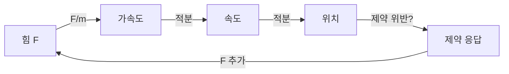
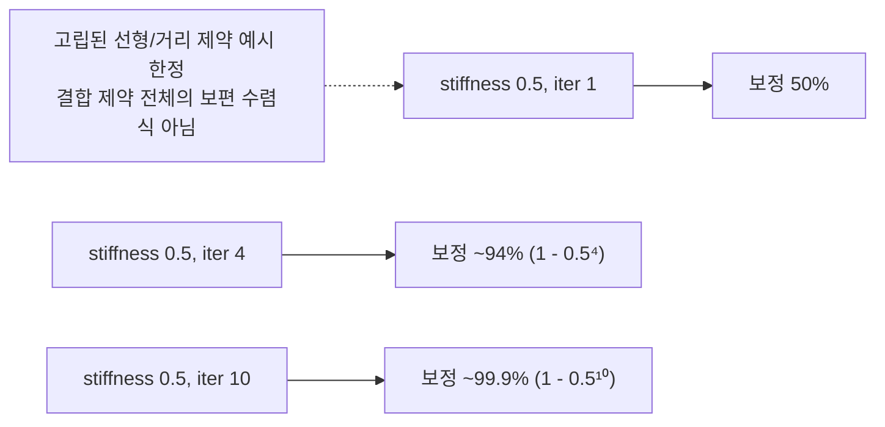

## 들어가며

*Sequential Impulse* 는 접촉과 joint의 속도 제약을 반복해 푸는 방식이다. cloth와 soft body처럼 많은 기하 제약을 재료 authoring 값으로 직접 다루려면 위치 수준 표현이 더 편리할 수 있다.

*Position-Based Dynamics (PBD)* 는 외력으로 위치를 예측한 뒤 위치 제약을 직접 투영하고, 보정된 위치 차이에서 속도를 재구성한다. 단순 PBD의 겉보기 stiffness는 iteration count와 timestep에 의존한다. *XPBD* (Extended PBD)는 compliance와 누적 multiplier를 도입해 이 의존성을 줄인다.

이 글의 목표.

1. **PBD 의 핵심 아이디어** — 속도 우회 + 위치 직접 투영.
2. **Predict-Project-Correct 루프** — PBD 의 표준 흐름.
3. **거리 제약** — 두 입자 사이 거리 유지 (가장 기본).
4. **다른 제약들** — 부피, 굽힘, 충돌.
5. **PBD 의 stiffness 의존성** — 핵심 한계.
6. **XPBD 의 도입** — compliance 로 timestep / iteration 의존성 감소.
7. **Substepping vs Iteration** — XPBD 가 favor 하는 패턴.
8. **다른 solver와의 결합 계약**.

이 글이 마치면 PBD/XPBD constraint의 투영식, compliance와 시간 간격·반복 수의 관계가 정리된다.


---

## 목차
1. [PBD의 핵심 아이디어](#1-pbd의-핵심-아이디어)
2. [Predict-Project-Correct 루프](#2-predict-project-correct-루프)
3. [거리 제약](#3-거리-제약)
4. [다른 제약들](#4-다른-제약들)
5. [PBD의 stiffness 의존성](#5-pbd의-stiffness-의존성)
6. [XPBD의 도입](#6-xpbd의-도입)
7. [Substepping과 iteration](#7-substepping과-iteration)
8. [다른 solver와의 결합 계약](#8-다른-solver와의-결합-계약)


---

## 1. PBD의 핵심 아이디어

전통 시뮬레이션 vs PBD.

### 1.1 전통 흐름



힘 → 가속도 → 속도 → 위치. *제약은 속도 / 위치 보정* 으로 만족.

### 1.2 PBD 흐름


힘 → 예측 위치 → *제약으로 직접 위치 투영* → 수정된 위치에서 속도 역추산.

*속도가 아니라 위치를 푼다*. 단단한 위치 제약을 명시적 spring force보다 큰 timestep에서 다루기 쉬운 경우가 많다.

### 1.3 왜 안정한가

전통의 명시적 spring 적분은 큰 dt에서 발산하기 쉽다. PBD는 예측 위치를 직접 수정해 이 강성 제약을 다루기 쉽지만, 큰 dt에서도 정확하거나 무조건 안정하다는 뜻은 아니다. 충돌 누락, 제약 순서 의존성, 과도한 수치 감쇠와 형상 뒤집힘은 여전히 생긴다.

cloth / soft body 의 *수많은 제약* 이 *큰 dt 에서도 안정 시뮬*. 게임의 시각 효과로 충분.

### 1.4 단점

- *동역학 모델 부정확*. 정확한 운동량 / 에너지 모델 아님.
- *Stiffness 가 implicit* — 매개변수 튜닝 어려움.
- *물리 정밀 시뮬엔 부적합* (자동차, 항공).

cloth 같은 *plausible 시뮬* 에는 압도적 우위. 정밀 시뮬엔 SI / TGS.

### 1.5 PBD 와 Verlet 의 친화성

PBD 는 *위치를 직접 투영* 한다는 점에서 *position Verlet 의 확장*. 다만 position Verlet 과 달리 *속도를 상태로 보관* 하며, 매 step 끝에서 `(predicted - position) / dt` 로 재구성한다.

### 1.6 Müller 의 원전

Müller, Heidelberger, Hennix, Ratcliff, "Position Based Dynamics" (2007) — 알고리즘의 원전. cloth 시뮬에서 시작 + 일반 동역학으로 확장.

## 2. Predict-Project-Correct 루프

PBD 의 *step 구조*.

### 2.1 골격

```cpp
struct Particle {
    vec3  position;
    vec3  velocity;
    vec3  predicted;
    float invMass;
};

void PBD_Step(World& world, float dt) {
    // 1. Predict — 외력으로 예측 위치
    for (auto& p : world.particles) {
        // 고정/kinematic 입자도 제약이 predicted 를 읽으므로 매 step 먼저 동기화한다.
        // (kinematic anchor 는 단순 position 복사 대신 target pose/anchor velocity 계약이 필요하다.)
        p.predicted = p.position;
        if (p.invMass <= 0) continue;               // 힘 적분만 생략
        p.velocity += gravity * dt;                 // gravity 는 가속도
        p.predicted = p.position + dt * p.velocity;
    }

    // 2. Project — 제약 만족하도록 예측 위치 수정 (반복)
    for (int iter = 0; iter < kIterations; ++iter) {
        for (auto& c : world.constraints) {
            c.Project(world.particles);
        }
    }

    // 3. Correct — 수정된 위치에서 속도 역추산
    for (auto& p : world.particles) {
        if (p.invMass <= 0) continue;
        p.velocity = (p.predicted - p.position) / dt;
        p.position = p.predicted;
    }
}
```

### 2.2 Predict

외력 (중력, 사용자 입력) 으로 *속도 갱신 + 예측 위치 계산*. semi-implicit Euler 의 한 step. 중력은 이미 가속도이므로 질량을 곱하지 않는다. 힘으로 들어온 항만 inverse mass 를 곱한다.

```cpp
p.velocity += gravity * dt;                  // acceleration
p.velocity += dt * p.invMass * forceExt;     // force / mass
p.predicted = p.position + dt * p.velocity;
```

여기까지는 *제약 무시*. *원하는 곳* 에 도달할 거라는 예측.

### 2.3 Project

예측 위치가 *제약 위반* — 수정. 제약별 *위치 보정량* 계산 + 적용.

```cpp
for (int iter = 0; iter < kIterations; ++iter) {
    for (auto& c : constraints) {
        // 각 제약이 자기 입자들의 predicted 를 수정
        c.Project(particles);
    }
}
```

반복으로 *모든 제약을 점진적 만족* — Gauss-Seidel.

### 2.4 Correct

수정된 위치에서 *실제 속도 역추산* + 위치 commit.

```cpp
p.velocity = (p.predicted - p.position) / dt;
p.position = p.predicted;
```

속도가 *위치 차분 / dt* — Verlet 의 속도 정의. 다음 step 의 입력.

### 2.5 흐름의 함의

- *적분기와 일관된 위치·속도 규약 필요* — predict 단계 적분기를 임의로 바꿀 수 없다. 속도를 `velocity = (predicted - position) / dt` 로 재구성하므로, exact constant-acceleration predictor $x^* = x + h v + \tfrac{1}{2}h^2 a$ 를 그대로 넣으면 $\Delta v = \tfrac{1}{2}h a$ 가 되어 가속도가 절반만 반영된다. 적분기가 반환한 $v_{pred}$ 를 유지하고 제약 보정 $\Delta x / h$ 를 더하는 등 위치·속도 갱신 규약을 함께 바꾼다. Verlet 계열도 상태 정의부터 맞춘다.
- *제약 수가 많아도* project 단계가 모두 처리.
- *iteration 수* 가 *stiffness 결정* — 많이 반복할수록 단단.

### 2.6 마찰 / 감쇠

PBD 에 마찰 추가는 *predict 단계 또는 별도 단계*. 게임 엔진의 *Velocity damping*:

```cpp
p.velocity *= std::exp(-damping * dt);
```

cloth 가 *공기 저항* 받는 시뮬에 필요.

## 3. 거리 제약

PBD 의 *가장 기본* 제약. cloth 의 *spring* 을 대체.

### 3.1 제약 식

두 입자 $\vec{p}_1, \vec{p}_2$ 사이 거리가 *target d* 와 같음:

$$
C(\vec{p}_1, \vec{p}_2) = |\vec{p}_1 - \vec{p}_2| - d = 0
$$

### 3.2 보정량 도출

PBD 의 *질량 가중 그래디언트 투영*. 위치 보정 $\Delta \vec{p}_i$:

$$
\Delta \vec{p}_1 = -\frac{w_1}{w_1 + w_2} (|\vec{p}_1 - \vec{p}_2| - d) \hat{n}
$$
$$
\Delta \vec{p}_2 = +\frac{w_2}{w_1 + w_2} (|\vec{p}_1 - \vec{p}_2| - d) \hat{n}
$$

여기서 $w_i = 1 / m_i$ (inverse mass), $\hat{n} = (\vec{p}_1 - \vec{p}_2) / |\vec{p}_1 - \vec{p}_2|$.

직관: *위반 양만큼* 두 입자를 *질량 비율* 로 분배한다. 단일 거리 제약이고 `stiffness = 1` 이면 한 번의 project 로 그 제약은 만족하지만, 여러 제약이 서로 얽히면 반복으로 절충한다.

### 3.3 코드

```cpp
struct DistanceConstraint {
    int   p1, p2;
    float restLength;
    float stiffness;       // 0~1

    void Project(std::vector<Particle>& particles) {
        Particle& a = particles[p1];
        Particle& b = particles[p2];
        vec3 d = a.predicted - b.predicted;
        float L = length(d);
        vec3 n;
        if (L < 1e-8f) {
            // restLength>0 인데 두 입자가 겹친 경우 — 결정적 대체축으로 분리한다.
            n = vec3{1, 0, 0};
            L = 0.0f;
        } else {
            n = d / L;
        }
        float invSum = a.invMass + b.invMass;
        if (invSum <= 0) return;

        float diff = L - restLength;
        vec3 correction = n * (diff / invSum) * stiffness;

        a.predicted -= correction * a.invMass;
        b.predicted += correction * b.invMass;
    }
};
```

스칼라 한 줄 + 위치 두 줄. 매우 단순.

### 3.4 무한 질량 입자

`invMass = 0` 인 입자는 *움직이지 않음* (고정점). 다른 입자 *혼자 보정*.

```cpp
// invSum = 0 + w_2 = w_2
// correction = ...
// a (invMass=0) 안 움직임, b 만 이동
```

cloth 의 *상단 고정 행*, 깃발의 *깃발 봉* 등. 자연 처리.

### 3.5 한 step 의 의미

한 project 호출이 *완전한 거리 제약 만족*. 다른 제약 (다른 입자 페어) 의 효과로 *다시 위반* 가능 — 반복으로 점진적 수렴.

cloth 의 *대각선 spring* + *수평·수직 spring* 의 *서로 경쟁* — iteration 으로 절충.

### 3.6 Stretchy cloth

stiffness < 1 이면 *부분 보정* — *늘어남 허용*. 부드러운 천 효과.

```cpp
correction *= stiffness;   // stiffness ∈ [0, 1]
```

stiffness 의존성이 *iteration count* 에 따라 변함 — 5절의 문제.

## 4. 다른 제약들

거리 외의 PBD 제약.

### 4.1 부피 보존

3D soft body 의 *부피 일정* 제약. 사면체 (tetrahedron) 의 부피:

$$
V = \frac{1}{6} (\vec{p}_2 - \vec{p}_1) \cdot ((\vec{p}_3 - \vec{p}_1) \times (\vec{p}_4 - \vec{p}_1))
$$

$C = V - V_0 = 0$. 그래디언트로 보정 — 4 입자 모두 이동.

soft body 의 *압축 방지* 에 필수. 인체 모델, 젤리.

### 4.2 굽힘 (bending) 제약

cloth 의 *두 인접 삼각형 사이 각도* 유지. 면 법선의 *상대 각도* 가 *rest angle* 과 같도록.

```cpp
struct BendingConstraint {
    int   p1, p2, p3, p4;     // 두 인접 삼각형의 4 입자
    float restAngle;
};
```

수식이 복잡 (4 입자의 그래디언트). 자세한 도출은 Müller et al. (2007) 원전.

### 4.3 충돌 제약

PBD 의 *비관통 충돌* — 두 입자 사이 거리 ≥ 합반지름.

```cpp
struct ParticleCollisionConstraint {
    int   p1, p2;
    float minDist;          // r1 + r2

    void Project(std::vector<Particle>& particles) {
        Particle& a = particles[p1];
        Particle& b = particles[p2];
        vec3 d = a.predicted - b.predicted;
        float L = length(d);
        if (L >= minDist) return;        // 분리됨 — 보정 안 함
        vec3 n;
        if (L < 1e-8f) {
            // minDist>0 인데 겹친 경우 — 결정적 대체축으로 분리한다.
            n = vec3{1, 0, 0};
            L = 0.0f;
        } else {
            n = d / L;
        }
        float invSum = a.invMass + b.invMass;
        if (invSum <= 0) return;
        vec3 correction = n * ((L - minDist) / invSum);
        a.predicted -= correction * a.invMass;
        b.predicted += correction * b.invMass;
    }
};
```

거리 제약의 *one-sided 버전* (멀어지는 건 OK). 거리·충돌 제약 모두 `L ≈ 0` 에서 조기 반환하면 양의 `restLength`/`minDist` 를 해소하지 못하므로, 초기 겹침을 금지하거나 위처럼 결정적 대체축을 제공한다. 고정·동적 입자의 weight 합이 0인 경우(`invSum <= 0`)는 제약을 비활성화한다.

### 4.4 환경 충돌

PBD 입자 vs 정적 환경 (바닥, 벽). 침투 깊이 보정 + 마찰.

```cpp
void GroundCollision(Particle& p) {
    if (p.predicted.y < 0) {
        p.predicted.y = 0;
        // 마찰: predicted - position 의 접선 성분을 일부 줄임 (위치 기반 마찰)
    }
}
```

### 4.5 고정 거리 + 라이트 / 헤비 spring

게임의 *rope (밧줄)* 가 distance constraint 의 *체인*. 각 노드 사이 거리 일정.

```cpp
// 10 노드 rope
for (int i = 0; i < 9; ++i) {
    constraints.push_back(DistanceConstraint{i, i+1, segmentLength, 1.0f});
}
```

9 거리 제약 + 끝점 고정 = rope 시뮬. cloth 의 1D 버전.

### 4.6 관절 제약

PBD 로 강체 관절도 가능. *XPBD with rigid bodies* (Müller et al., SCA 2020).

- Hinge: 두 강체의 위치 + 한 회전축 일치.
- Ball: 위치 일치만.
- Slider: 회전 정렬 (고정) + 한 이동축만 자유.

쿼터니언으로 회전 제약 표현. 자세한 건 XPBD 논문.

## 5. PBD의 stiffness 의존성

PBD 의 *핵심 한계*.

### 5.1 stiffness 매개변수

```cpp
correction *= stiffness;     // [0, 1]
```

stiffness 가 *제약 보정의 비율*. 1 = 한 project 로 완전 만족, 0 = 보정 없음.

직관: stiffness 는 *제약 보정 비율* 이다. 천을 부드럽게 보이게 하려면 작게, 단단하게 보이게 하려면 크게 둔다. 다만 실제 물리 단위의 spring stiffness 는 아니다.

### 5.2 iteration 의존성

같은 stiffness 라도 *iteration 수에 따라 효과 다름*.



iter ↑ → 효과 stiffness ↑. 게임의 *iteration 옵션* 변경이 *시각 효과 자동 변경* — 사용자가 *iter 와 stiffness 를 함께 튜닝* 해야.

### 5.3 timestep 의존성

dt 가 바뀌면 *한 step 의 제약 위반량* 과 *초당 projection 횟수* 가 함께 바뀐다. 같은 stiffness 값이라도 보이는 강성이 달라질 수 있다.

dt 와 stiffness 의 *관계가 implicit* — 두 매개변수 분리 안 됨.

### 5.4 cloth 디자이너의 고통

cloth 디자이너가 *천의 단단함 (cloth A 보다 단단)* 만 조정하고 싶다 — 하지만 *stiffness, iter, dt 셋의 조합* 이 결정. *iter 변경 후 모든 cloth 재튜닝* 필요.

이 *튜닝 어려움* 이 PBD 의 가장 큰 비판. XPBD 가 해결.

### 5.5 발산에 강함

stiffness 의존성에도 PBD 는 일반적인 명시적 힘 기반 spring 보다 발산에 강하다. 다만 잘못된 제약, 큰 timestep, 충돌/마찰 결합에서는 jitter, 과도한 damping, 형상 뒤집힘이 생길 수 있다.

이게 PBD 의 *결정적 advantage* — 미세 시뮬도 비교적 *큰 dt 에서 안정적으로 보이기 쉽다*.

### 5.6 1 - (1 - k)^n 모델

iter n 회의 *effective stiffness*:

$$
k_{eff} = 1 - (1 - k)^n
$$

iter 만 늘어도 같은 k 의 *effective 가 1 에 접근*. 분석적이지만 *해법은 아님* — XPBD 가 본질 해결.

## 6. XPBD의 도입

eXtended PBD (Macklin, Müller, Chentanez, 2016). compliance 로 timestep / iteration 의존성을 줄인다.

### 6.1 compliance 매개변수

XPBD는 PBD의 무차원 stiffness slider 대신 compliance $\alpha$를 사용한다. 적절히 scale된 거리 제약에서는 물리 강성의 역수로 해석할 수 있지만, 임의의 제약 함수를 상수배하면 $\alpha$의 수치도 함께 바뀌므로 `1 / PBD stiffness`로 단순 치환할 수는 없다.

$\alpha$ 의 *단위는 제약 함수에 따라 다르다* — 제약 에너지 $E = \frac{1}{2} \alpha^{-1} C^2$ 에서 $\alpha$ 는 강성의 역수이고 $[C]$ 에 의존한다. 거리 제약에서 $[\alpha] = \text{m/N}$ (spring 강성 $k$ [N/m] 의 역수) 인 것은 맞지만, 이 값을 모든 제약에 일반화하면 안 된다. 위치 기반 $\lambda$ 의 일반 단위는 $[\lambda] = \text{kg}\cdot\text{m}^2 / [C]$ 이다.

| 제약 | $C$ 단위 | compliance $[\alpha]$ | 누적 $[\lambda]$ |
|---|---|---|---|
| 거리 | m | m/N | kg·m |
| 각도 | rad (무차원) | 1/(N·m) | kg·m² |
| 부피 | m³ | m⁵/N | kg/m (kg·m²/m³) |

위치 기반 $\lambda$ 는 일반화 힘 $J^T\lambda / \Delta t^2$, 임펄스 $J^T\lambda / \Delta t$ 로 해석해야 하며, scalar $\lambda/\Delta t$ 를 곧바로 3D impulse 로 쓰지 않는다.

### 6.2 도출

PBD 의 보정은 *위치를 직접 수정*. 이를 *implicit Euler 적분* 으로 재유도하면:

$$
M (\vec{x}^{n+1} - \tilde{\vec{x}}) = J^T \lambda
$$
$$
C + \tilde{\alpha} \lambda = 0
$$

여기서 $\tilde{\alpha} = \alpha / \Delta t^2$. 두 식을 연립해 $\lambda$ 와 $\vec{x}^{n+1}$ 동시 풀이.

이 $\lambda$ 는 $\Delta t^2$ 를 흡수한 값이라 제약 단위에 따라 $[\lambda]$ 가 달라진다. 거리 제약($C$가 길이)에서는 $\text{kg} \cdot \text{m}$ 이며, sequential impulse 의 임펄스 $\lambda$ (단위 $\text{N} \cdot \text{s}$) 와 다르다. 임펄스로 환산하려면 일반적으로 $J^T\lambda / \Delta t$ 를 쓴다.

### 6.3 lambda 갱신

Gauss-Seidel 풀이의 한 iter 에서 *Δλ*:

$$
\Delta \lambda = \frac{-C(\vec{x}) - \tilde{\alpha} \lambda}{\sum_i w_i |\nabla_i C|^2 + \tilde{\alpha}}
$$

위치 보정:

$$
\Delta \vec{x}_i = w_i \nabla_i C \cdot \Delta \lambda
$$

PBD 와 비슷하지만 *$\tilde{\alpha}$ 항* 으로 *compliance* 효과.

### 6.4 코드

```cpp
struct XpbdDistanceConstraint {
    int   p1, p2;
    float restLength;
    float compliance;       // α (역강성)
    float lambda_acc;       // 누적 λ

    void Project(std::vector<Particle>& particles, float dt) {
        Particle& a = particles[p1];
        Particle& b = particles[p2];
        vec3 d = a.predicted - b.predicted;
        float L = length(d);
        if (L < 1e-8f) return;
        float invSum = a.invMass + b.invMass;
        if (invSum <= 0) return;

        vec3 n = d / L;
        float C = L - restLength;
        float alphaTilde = compliance / (dt * dt);
        float dLambda = (-C - alphaTilde * lambda_acc)
                       / (invSum + alphaTilde);
        lambda_acc += dLambda;

        vec3 correction = n * dLambda;
        a.predicted += correction * a.invMass;
        b.predicted -= correction * b.invMass;
    }

    void ResetLambda() { lambda_acc = 0; }     // solve window 시작에 호출
};
```

매 solve window 시작에 *lambda_acc = 0 으로 리셋* 하고, 그 window 안의 iteration 동안 누적한다. substep 을 독립 step 으로 취급하면 substep 마다 리셋하고, 한 step 내부 반복으로 취급하면 반복 동안 유지한다.

### 6.5 compliance 의 직관

| α (compliance) | 의미 |
|---|---|
| 0 | 무한 강성 — PBD 의 stiffness=1 같은 효과 |
| 작은 양수 | 해당 제약 scale에서 더 단단함 |
| 큰 양수 | 해당 제약 scale에서 더 부드러움 |

compliance는 timestep 보정을 식에 명시해 PBD보다 일관된 재질 매개변수를 제공한다. 그러나 유한 iteration의 수렴 오차, substep 수, 제약 정규화와 solver 순서의 영향까지 사라지는 것은 아니다.

### 6.6 효과

- *Iteration 의존성 감소*: 같은 α 에서 iter 변경에 따른 시각 변화가 PBD 보다 작다.
- *Timestep 의존성 감소*: dt 변경에 따른 강성 변화가 PBD 보다 작다.
- *물리적 단위 명확*: 디자이너 튜닝 쉬움.

XPBD 는 현대 cloth / soft body 에서 널리 쓰이는 선택지다. PBD 의 stiffness 튜닝 문제를 명시적으로 줄인다.

## 7. Substepping과 iteration

XPBD 가 favor 하는 *substepping* 패턴.

### 7.1 두 접근

같은 정확도 달성을 위한 두 방법.

- *큰 dt + 많은 iteration*: 한 step 에 더 많이 풀이.
- *작은 dt + 적은 iteration*: 여러 sub-step 으로 분할.

Macklin et al., "Small Steps in Physics Simulation" (SCA 2019) 이 *후자 추천* — 동일한 총 비용에서 *substepping 이 더 정확*.

### 7.2 Substep 구조

```cpp
const float kSubDt = dt / kSubSteps;       // dt = 1/60, kSubSteps = 8 → kSubDt ≈ 2ms

for (int s = 0; s < kSubSteps; ++s) {
    Predict(particles, kSubDt);
    for (auto& c : constraints) c.ResetLambda();   // substep = 독립 solve window
    for (int iter = 0; iter < 1; ++iter) {   // iter = 1 권장
        for (auto& c : constraints) c.Project(particles, kSubDt);
    }
    Correct(particles, kSubDt);
}
```

`kSubSteps = 8, iter = 1`이 `kSubSteps = 1, iter = 8`보다 정확했던 조건은 Small Steps 논문의 여러 실험에서 관찰된 결과다. 모든 제약 그래프와 충돌 workload에 대한 정리는 아니므로 같은 총 project 횟수뿐 아니라 collision detection과 integration 비용까지 포함해 비교한다.

### 7.3 왜 그런가

XPBD 의 *compliance 항* 은 $\alpha / \Delta t^2$ 로 들어간다. 작은 substep 은 한 번에 생기는 위치 예측 오차와 충돌 관통량을 줄이고, 제약을 더 자주 적용하게 만든다.

반면 큰 dt 의 PBD/XPBD 는 *한 step 의 제약 위반량이 크다* — 같은 비용이라도 많은 iteration 보다 작은 substep 이 더 안정적으로 보이는 경우가 많다.

### 7.4 비용 비교

| 패턴 | sub × iter | 총 project 호출 |
|---|---|---|
| 큰 dt + 많은 iter | 1 × 8 | 8 |
| 작은 dt + 적은 iter | 8 × 1 | 8 |

표의 constraint projection 횟수만 같다. substep마다 예측·속도 갱신·충돌 검출을 다시 하면 전체 비용은 더 크며, 작은 dt가 줄이는 비선형화·충돌 오차와 그 추가 비용을 함께 평가한다.

### 7.5 충돌 검사와 substepping

각 sub-step 마다 *충돌 검사 재실행* 할 수 있다. substep은 이동 거리를 줄여 discrete overlap을 잡기 쉽게 만들 뿐, 빠른 작은 물체의 비관통을 단독으로 보장하지 않는다.

```cpp
for (int s = 0; s < kSubSteps; ++s) {
    // 현재 위치의 discrete overlap 뿐 아니라 swept bounds/segment query,
    // 또는 predicted 위치의 접촉을 생성·재생성한다.
    DetectCollisions(world);
    PBD_Substep(world, kSubDt);
}
```

Predict 이전에 현재 위치의 overlap만 만들면 이번 substep에서 새로 생기는 접촉을 놓친다. 보장 범위 밖은 CCD(continuous collision detection)로 연결한다.

비용: *충돌 검사 N 배*. broad phase 캐싱으로 일부 절감.

### 7.6 GPU 입자 solver의 설정

GPU 입자 솔버도 substep과 iteration을 함께 제공한다. 한 프레임의 권장 숫자는 재질 강성, 충돌 속도, solver 구조와 플랫폼 예산에 따라 달라지므로 고정값으로 두지 않는다.

## 8. 다른 solver와의 결합 계약

### 8.1 소유권 경계

강체 (SI) + cloth (PBD) 의 *상호 작용* 이 어려움. 캐릭터가 *cloth 입은* 채로 강체 충돌:

- cloth 가 강체에 *영향* — cloth 입자 → 강체 임펄스.
- 강체가 cloth 에 *영향* — 강체 위치 → cloth 입자 보정.

one-way coupling은 kinematic collider pose를 PBD에 제공한다. two-way coupling은 입자 보정에서 얻은 반작용을 강체 impulse로 환산해야 한다. 두 solver가 같은 위치를 직접 수정하지 않도록 sub-step 순서와 소유자를 고정한다.

### 8.2 시간과 multiplier

두 solver의 sub-step 수가 다르면 contact impulse와 XPBD multiplier를 어느 시간 구간에 누적하는지 정의해야 한다. frame 단위 힘과 sub-step 단위 impulse를 혼용하면 dt에 따라 coupling 강도가 달라진다.

### 8.3 병렬 제약

한 PBD constraint의 입자 쓰기가 다른 constraint와 겹친다. 직렬 Gauss-Seidel, graph coloring, Jacobi correction buffer와 atomic accumulation은 서로 다른 수렴·결정성·메모리 비용을 가진다. GPU라는 이유만으로 모든 제약을 한 dispatch에서 안전하게 in-place 수정할 수는 없다.

### 8.4 검증량

- 거리·부피 constraint의 최대/평균 residual
- compliance가 같은 재질의 dt·iteration 변화 민감도
- contact에서 생성·소실된 운동량과 에너지
- self-collision 후보 수와 누락 여부
- LOD 전환 시 위치·속도·multiplier 상태 이전


---

## 결론

PBD / XPBD 가 *위치 직접 조작* 으로 *안정성 우수한 제약 풀이* 를 제공한다. cloth / rope / soft body 에서 널리 쓰이는 게임 물리 패턴이다.

이 글에서 정리한 핵심.

1. **PBD 의 핵심** — 위치 예측, 제약 투영과 속도 재구성.
2. **Predict-Project-Correct** — PBD 의 표준 step 구조.
3. **거리 제약** — 두 입자 사이 거리. 한 줄 식.
4. **다른 제약** — 부피, 굽힘, 충돌, 관절.
5. **stiffness 의존성** — PBD 의 핵심 한계. iter / dt 와 결합된 stiffness.
6. **XPBD compliance** — α 매개변수로 iter / dt 의존성을 줄임.
7. **Substepping** — XPBD favor 패턴. 작은 dt + 적은 iter.
8. **solver 결합** — 상태 소유권, 시간 단위와 반작용 전달.

PBD 계열의 핵심은 *위치 예측 → 제약 투영 → 속도 재구성* 이다. 힘을 정밀하게 보존하기보다 안정적인 시각 결과를 우선하는 시스템에서 특히 강하다.

## 더 읽을거리

- Müller, Heidelberger, Hennix, Ratcliff, "Position Based Dynamics" (2007) — PBD 의 원전.
- Macklin, Müller, Chentanez, "XPBD: Position-Based Simulation of Compliant Constrained Dynamics" (2016) — XPBD 원전.
- Müller, Macklin, Chentanez, Jeschke, Kim, "Detailed Rigid Body Simulation with Extended Position Based Dynamics" (SCA 2020) — 강체 XPBD.
- Macklin, Müller, Chentanez, Kim, "Unified Particle Physics for Real-Time Applications" (SIGGRAPH 2014) — Flex 의 통합 입자 솔버.
- Macklin, Storey, Lu, Terdiman, Chentanez, Jeschke, Müller, "Small Steps in Physics Simulation" (SCA 2019) — substepping > iteration 의 근거.
- NVIDIA Flex SDK 문서 — 산업 PBD/XPBD 구현.
- Bender, Müller, Otaduy, Teschner, Macklin, "A Survey on Position-Based Simulation Methods in Computer Graphics" (Computer Graphics Forum 33(6), 2014) — survey.
- Jakobsen, "Advanced Character Physics" (GDC 2001) — Verlet + 제약 (PBD 의 전신).
- Unity / Unreal 의 cloth 문서 — 산업 적용 사례.
