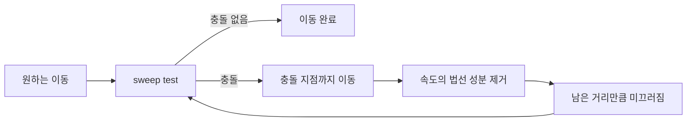

## 들어가며

강체 시뮬레이션은 *물리적으로 정확한* 응답을 만든다. 박스가 부딪히면 *튕기고 회전*, 마찰로 *서서히 정지*. 게임의 *환경 오브젝트* (잔해, 박스) 에는 적합.

하지만 *플레이어 / 적 캐릭터* 는 다르다. 사용자가 *조이스틱* 으로 입력하면 *즉시 응답* 해야 한다. 물리 강체 위에 *입력 force* 를 줘서 캐릭터를 움직이면:

- *느린 반응*: 가속까지 시간.
- *멈추기 어려움*: 마찰만으로 정지 — 끈적함.
- *외력 흔들림*: 폭발 / 충돌이 *원치 않게* 캐릭터를 흔듦.
- *경사면에서 미끄러짐*: 마찰만으론 가파른 경사 위 자연 정지 어려움.

게임의 표준 해법: *Kinematic 캡슐 + Move-and-slide*. 캐릭터 위치를 *물리 시뮬이 아닌 사용자 코드* 가 직접 갱신, *충돌만 해소*. 입력 즉시 응답 + 부자연 동작 회피.

이 글의 목표.

1. **Kinematic vs Dynamic** — 캐릭터 컨트롤러 선택의 이유.
2. **캡슐 형상** — 박스 / 구 대신 캡슐을 쓰는 이유.
3. **Move-and-slide 알고리즘** — 벽 따라 미끄러짐.
4. **Step height** — 작은 턱 자동 오르기.
5. **Slope limit 과 ground snap** — 경사 처리.
6. **Push out** — 침투 직접 해소.
7. **Jumping 과 중력** — 수직 운동의 별도 처리.
8. **이동 상태 계약과 검증**.

이 글이 마치면 *플레이어 / 적 캐릭터의 표준 컨트롤러* — 게임에서 가장 자주 등장하는 물리 시스템 — 가 정리된다.


---

## 목차
1. [Kinematic vs Dynamic 캐릭터](#1-kinematic-vs-dynamic-캐릭터)
2. [캡슐 형상 선택](#2-캡슐-형상-선택)
3. [Move-and-slide 알고리즘](#3-move-and-slide-알고리즘)
4. [Step height](#4-step-height)
5. [Slope limit과 ground snap](#5-slope-limit과-ground-snap)
6. [Push out](#6-push-out)
7. [Jumping과 중력](#7-jumping과-중력)
8. [이동 상태 계약과 검증](#8-이동-상태-계약과-검증)


---

## 1. Kinematic vs Dynamic 캐릭터

두 접근의 장단점.

### 1.1 Dynamic rigid body 캐릭터

```cpp
// 입력 → force
if (keyW) body.forceAccum += vec3{0, 0, -movePower};
// 솔버가 처리
Step(world, dt);
```

물리 솔버가 *모든 것* 처리. 외부 force (폭발, 다른 강체 충돌) 자연 응답.

문제:

- *반응 지연*: force 가 가속도 → 속도 → 위치. 입력 시점과 이동 시작 시점이 다름.
- *멈추기 어려움*: 입력 없으면 마찰만 의존. 너무 미끄러우면 stop 못 함.
- *외력 흔들림*: 폭발이 *원치 않게* 캐릭터를 회전·날림.
- *경사 미끄러짐*: 마찰 부족이면 *그냥 굴러내림*.

### 1.2 Kinematic 컨트롤러

```cpp
// 입력 → 직접 desired velocity
vec3 desiredVel = inputDir * moveSpeed;
// 사용자 코드가 위치 직접 갱신 + 충돌 해소
character.position = MoveAndSlide(character.position,
                                     desiredVel * dt, character.shape);
```

물리 시뮬이 *위치 변경 안 함*. 사용자 코드가 *직접 제어*. 충돌은 *별도 함수* 로 해결.

장점:

- *즉시 반응*: 입력 = 즉시 속도. 가속 / 감속 사용자 제어.
- *외력 차단*: 폭발 force 가 *영향 없음*. 게임플레이 결정에 따라.
- *경사 / 점프 / 사다리* 같은 *특수 동작 처리 자연*.
- *Determinism*: 같은 월드 상태 + 같은 입력 = 같은 결과 (다른 강체 영향 최소화).

단점:

- *물리 응답 부자연*: 캐릭터가 *환경에 영향* 줘야 하는 시뮬은 추가 코드.
- *수동 코드*: 솔버가 안 해주는 일이 많음. 점프·중력·경사·계단 등 모두 별도.

### 1.3 게임의 표준 선택

대부분 게임이 *Kinematic*. 캐릭터의 *제어감* 이 *물리적 정확성* 보다 우선.

물리 응답이 필요한 케이스 — *ragdoll death*, *환경 상호작용* — 은 *kinematic / dynamic 동적 전환*. 평소엔 kinematic, 죽으면 dynamic ragdoll.

### 1.4 Hybrid 접근

일부 게임은 *kinematic + force 부분 적용*. 예: *Mario Galaxy* — 평소 kinematic, 특수 상황 (강풍, 폭발) 에만 외력 적용.

직접 위치 조작이 *주*, 외력은 *옵션*. 결정론 + 제어감 + 부자연 회피.

### 1.5 적 (enemy) AI 캐릭터

같은 컨트롤러 적용. 적이 *kinematic capsule* — pathfinding 결정한 desired velocity 를 *즉시 적용*. 외력에 안 흔들림.

특수 AI (boss 의 ragdoll fall, 잔해 던지기) 만 dynamic.

### 1.6 정적 콜라이더와 충돌

kinematic 도 *환경 충돌* 검사. 벽·바닥과의 *충돌 해소* — Move-and-slide 알고리즘.

다른 *dynamic 강체* 와의 충돌은 *부드러운 효과* 만 — kinematic 캐릭터가 박스를 *밀어내지만* 박스 응답은 *작게* (또는 무시).

## 2. 캡슐 형상 선택

캐릭터 콜라이더의 *형상* 결정.

### 2.1 후보

| 형상 | 장단점 |
|---|---|
| 박스 | 단순. 모서리 끼는 함정 (corner stuck). |
| 구 | 미끄럼 자연. 직립 캐릭터에 부적합 (구 = 짧고 둥금). |
| 캡슐 (실린더 + 양 끝 반구) | 직립 캐릭터에 적합. 미끄럼 자연. |

직립 인간형에는 캡슐이 흔한 출발점이다. 모서리가 없어 벽을 따라 미끄러지기 쉽지만, 발바닥 면적과 crouch 전환을 정확히 나타내지는 못한다. 작은 구형 캐릭터, 차량형 pawn, 축을 기울여야 하는 캐릭터에는 다른 shape나 복합 collider가 더 적합할 수 있다.

### 2.2 캡슐의 정의

```cpp
struct Capsule {
    vec3  bottom;       // 하단 반구 중심
    vec3  top;          // 상단 반구 중심
    float radius;
};

// 또는 정렬된 형태
struct UprightCapsule {
    vec3  center;       // 캡슐 중심 (질량중심)
    float halfHeight;   // bottom 에서 center 까지 거리 (실린더 부분 반)
    float radius;
};
```

`upright` 가정 — 캡슐 축이 항상 *world up* 과 일치. 캐릭터가 *회전해도 콜라이더는 직립*.

### 2.3 캐릭터 회전과 콜라이더 회전

*비주얼 캐릭터* 가 회전 / 기울임 — 콜라이더는 *항상 직립*. 분리.

```cpp
struct Character {
    UprightCapsule  collider;       // 항상 직립
    float            visualYaw;       // 캐릭터 향한 방향 (렌더만)
    // ...
};
```

이 분리가 *물리 동작 일관 + 시각 자연*.

### 2.4 캡슐 사이즈

| 캐릭터 | 높이 | 반지름 |
|---|---|---|
| 일반 인간 (Mario, 일반 FPS) | 1.8 m | 0.3 m |
| 작은 캐릭터 | 0.8 m | 0.2 m |
| 큰 보스 | 3 ~ 5 m | 1 m |

게임 단위 (1 unit = 1 m) 기준. 너무 작은 반지름은 *작은 환경 결함 (cracks)* 통과 위험.

### 2.5 두 캡슐 충돌

캐릭터 vs 캐릭터 (모두 캡슐) 충돌은 *간단*. 두 *직립 캡슐 사이 최단 거리* < 합 반지름.

```cpp
float DistanceCapsuleCapsule(const UprightCapsule& a, const UprightCapsule& b) {
    vec3 a_top    = a.center + vec3{0, a.halfHeight, 0};
    vec3 a_bottom = a.center - vec3{0, a.halfHeight, 0};
    vec3 b_top    = b.center + vec3{0, b.halfHeight, 0};
    vec3 b_bottom = b.center - vec3{0, b.halfHeight, 0};
    return SegmentSegmentDistance(a_top, a_bottom, b_top, b_bottom);
}
```

거리 < `a.radius + b.radius` 면 충돌.

### 2.6 sweep 검사

Move-and-slide 가 *sweep test* 에 의존. 캡슐을 한 step 동안 이동시키며 *처음 만나는 충돌*.

`SweepCapsule(capsule, fromPos, toPos, world) → hit info`. 산업 엔진 (PhysX `sweep`, Bullet `convexSweepTest`) 의 표준 함수.

## 3. Move-and-slide 알고리즘

캡슐을 *원하는 거리만큼 이동*. 벽 만나면 *남은 거리는 벽 따라 미끄러짐*.

### 3.1 핵심 아이디어

직진 시도 → 벽 만남 → 벽까지만 이동 → 남은 속도의 *벽 법선 성분 제거* → 다시 시도. 최대 N (보통 4) 회 반복.



### 3.2 코드

```cpp
vec3 MoveAndSlide(UprightCapsule cap, vec3 displacement, const World& world) {
    constexpr int kMaxIters = 4;
    constexpr float kSkin   = 0.001f;     // 살짝 띄움 — 침투 방지

    for (int iter = 0; iter < kMaxIters; ++iter) {
        float maxDist = length(displacement);
        if (maxDist < 1e-5f) break;
        vec3 dir = displacement / maxDist;

        SweepHit hit = SweepCapsule(cap, dir, maxDist, world);
        if (!hit.hit) {
            cap.center += displacement;
            break;
        }

        // 충돌점까지 이동 (skin 만큼 띄움)
        float travel = std::max(hit.t * maxDist - kSkin, 0.0f);
        cap.center += dir * travel;
        // 남은 변위
        vec3 remaining = displacement - dir * (hit.t * maxDist);
        // 법선 성분 제거
        displacement = remaining - dot(remaining, hit.normal) * hit.normal;
    }
    return cap.center;
}
```

### 3.3 Skin (cushion)

`kSkin` 만큼 충돌점에서 *떨어뜨려 정지*. 정확히 닿게 정지하면 *다음 step 의 충돌 검사* 가 *이미 침투* 상태로 시작 — 부정확.

skin 으로 *분리 상태를 유지하려고* 한다. 다음 step 의 충돌 검사 신뢰성이 올라간다.

### 3.4 다중 벽 case

좁은 구석 (벽 두 개의 corner) 으로 들어가는 케이스. 한 벽에 부딪힌 후 미끄러짐이 *다른 벽에 부딪힘*. 반복.


4 회 iteration 으로 *대부분 케이스 처리*. 더 복잡한 case 는 *iter 늘림* 또는 *벽 사이 stuck 감지*.

### 3.5 미끄러지지 않는 경우

벽이 *진행 방향과 너무 가까운 각도* — 미끄러짐 후 *거의 안 움직임*. 이게 자연 — 코너에서 멈춤.

문제는 *매우 작은 미끄러짐* 이 매 step 반복되어 *jitter*. epsilon 검사로 차단.

```cpp
if (length(displacement) < 1e-5f) break;
```

### 3.6 Quake / Doom 의 전통

이 알고리즘이 *Quake 의 `PM_FlyMove`* 와 같음. 1996 년부터의 FPS 표준. *id Tech 엔진* 의 reference 구현.

```c
// Quake3 의 cm_trace.c + bg_pmove.c
// pm->velocity 를 따라 sweep, hit normal 로 clip, 반복
```

수십 년 동안 *FPS 캐릭터 컨트롤* 의 표준.

## 4. Step height

낮은 턱 / 계단을 *점프 없이 자동 오르기*.

### 4.1 문제

캐릭터가 *작은 턱* (0.2 ~ 0.4 m) 에 부딪히면 *수직 면* 이라 Move-and-slide 가 *멈춤*. 사용자는 *점프 안 누르고도 오르고 싶다*.

### 4.2 3 단계 sweep


아래 코드는 일반 이동 결과와 step 후보를 모두 계산한 뒤, 실제로 더 전진한 후보만 선택한다. `SweepHit::t`는 요청 거리에서 충돌 직전까지 이동 가능한 정규화 비율 $[0,1]$ 이라고 가정한다.

```cpp
vec3 MoveWithStep(UprightCapsule cap, vec3 horizDisplacement, const World& world,
                  float stepHeight, float groundSnapDistance) {
    const vec3 up{0, 1, 0};
    const vec3 originalCenter = cap.center;
    const float requestedDistance = length(horizDisplacement);

    // 1. step을 쓰지 않은 정상 이동을 항상 유효한 fallback으로 보관한다.
    UprightCapsule baseCap = cap;
    baseCap.center = MoveAndSlide(baseCap, horizDisplacement, world);
    if (requestedDistance <= kMoveEpsilon) return baseCap.center;

    vec3 moveDir = horizDisplacement / requestedDistance;
    float baseProgress = dot(baseCap.center - originalCenter, moveDir);
    if (baseProgress >= requestedDistance - kMoveEpsilon) {
        return baseCap.center;  // 앞이 막히지 않았다.
    }

    // 2. 캡슐 전체가 stepHeight만큼 올라갈 공간이 있어야 한다.
    SweepHit upHit = SweepCapsule(cap, up, stepHeight, world);
    if (upHit.hit && upHit.t < 1.0f - kSweepEpsilon) {
        return baseCap.center;
    }
    cap.center += up * stepHeight;

    // 3. 올라간 위치에서 같은 수평 변위를 시도한다.
    cap.center = MoveAndSlide(cap, horizDisplacement, world);

    // 4. 원래 높이 아래의 작은 ground snap까지 탐색한다.
    float downDistance = stepHeight + groundSnapDistance;
    SweepHit downHit = SweepCapsule(cap, -up, downDistance, world);
    if (!downHit.hit || !IsWalkable(downHit.normal)) {
        return baseCap.center;  // 절벽 또는 오를 수 없는 경사다.
    }
    cap.center -= up * (downHit.t * downDistance);

    // step이 실제 전진을 개선하지 않으면 일반 이동을 선택한다.
    float stepProgress = dot(cap.center - originalCenter, moveDir);
    return stepProgress > baseProgress + kMoveEpsilon
         ? cap.center
         : baseCap.center;
}
```

### 4.3 stepHeight 매개변수

`stepHeight` 는 보편적인 인체 상수가 아니라 충돌 메시의 계단 높이, 캐릭터 크기, 이동 속도, 애니메이션이 감당할 수 있는 수직 변화로 정한다. 실제 단위를 미터로 쓰는 인간형 게임에서는 수십 cm가 출발점이 될 수 있지만, 캡슐 반지름의 고정 배수나 특정 숫자를 모든 게임에 적용할 수는 없다. 너무 크면 높은 장애물을 순간 이동하듯 넘고, 너무 작으면 시각적으로 낮은 턱에도 걸린다.

### 4.4 stair climbing

계단은 *연속된 step* — 각 step 마다 step-up + slide + step-down. 자연스럽게 오른다.

step 사이 *짧은 시간에 여러 stair 통과* — Move-and-slide 의 iteration 안에서 *한 번에 처리*.

### 4.5 후보를 버리는 조건

위 sweep 이 `stepHeight` 전체를 확보하지 못하거나, 아래 sweep 이 보행 가능한 면을 찾지 못하거나, step 후보의 수평 전진량이 일반 이동보다 낫지 않으면 후보를 버린다. 임의의 충돌 비율을 기준으로 부분 상승을 허용하면 천장이 낮은 통로에서 캡슐이 장애물을 완전히 넘지 못한 채 옆으로 파고들 수 있다. step 시도는 보통 지면에 있고 수평 장애물에 막힌 프레임에만 수행한다.

### 4.6 step 의 시각 부드러움

step 으로 *순간 점프* 하는 효과 — 카메라가 함께 점프하면 부자연. *카메라 보간* 으로 부드럽게.

```cpp
float alpha = 1.0f - std::exp(-cameraStepResponse * dt);
camera.position.y = Lerp(camera.position.y, character.position.y, alpha);
```

지수 응답을 사용하면 가변 프레임에서도 비슷한 시간 상수를 유지한다. 충돌 캡슐은 즉시 유효 위치로 이동하고 카메라나 렌더 루트만 부드럽게 따라가야 한다.

## 5. Slope limit과 ground snap

경사면 처리.

### 5.1 Slope limit

너무 가파른 경사는 *오를 수 없음*. ground normal 의 *up 과의 각도* 가 한도 이내면 *지면*, 아니면 *벽*.

```cpp
bool IsWalkable(vec3 groundNormal,
                vec3 up = vec3{0, 1, 0},
                float maxSlopeRadians = 0.78539816339f) {
    float slopeCos = std::cos(maxSlopeRadians);
    return dot(normalize(groundNormal), normalize(up)) >= slopeCos;
}
```

한도는 이동 능력과 레벨 collision mesh의 경사 설계로 정한다. walkable 판정에는 접촉 normal의 노이즈와 edge에서 섞인 normal도 고려해 hysteresis나 stable ground probe를 둘 수 있다.

### 5.2 경사면에서의 이동

평지에서는 *수평 desired velocity*. 경사면에서는 *경사를 따라*.

```cpp
if (onGround) {
    // 입력의 수평 성분만 사용 (수직 분리)
    vec3 horizInput = vec3{inputDir.x, 0, inputDir.z};
    // 지면 평면에 투영
    vec3 alongGround = horizInput - dot(horizInput, groundNormal) * groundNormal;
    if (length_squared(alongGround) > 1e-8f) {
        desiredVel = normalize(alongGround) * moveSpeed;
    } else {
        desiredVel = vec3{0, 0, 0};
    }
}
```

경사면을 따라 *수평 같은 속도* 로 이동. 자연 동작.

### 5.3 Ground snap

캐릭터가 *내리막* 을 내려갈 때. 단순 이동 = 공중에 *작은 점프* (지면 추적 못 함).

해결: *매 step 마지막에 아래로 sweep* — 지면 발견 시 즉시 *snap to ground*.

```cpp
if (onGround && downwardMovement) {
    SweepHit hit = SweepCapsule(cap, vec3{0,-1,0}, kSnapDistance, world);
    if (hit.hit && IsWalkable(hit.normal)) {
        cap.center.y -= hit.t * kSnapDistance;
    }
}
```

`kSnapDistance` ~ 0.3 m. 내리막 / 작은 단차에서 *지면 추적*.

### 5.4 점프와 ground snap

점프 중에는 *snap 안 함* — 의도된 *공중 상태*.

```cpp
if (!isJumping && wasOnGround) {
    GroundSnap();
}
```

`wasOnGround` = 이전 frame 에 지면. 점프 직후 frame 만 snap 비활성.

### 5.5 미끄러짐과 활강

경사 한도를 *살짝 넘는* 경사면 — 캐릭터가 *천천히 미끄러져 내림*.

```cpp
if (onGround && !IsWalkable(groundNormal)) {
    // 경사 너무 가파름 — 아래 방향을 경사면에 투영해 활강 방향 계산
    vec3 slideDir = vec3{0,-1,0} - dot(vec3{0,-1,0}, groundNormal) * groundNormal;
    if (length_squared(slideDir) > 1e-8f) {
        desiredVel += normalize(slideDir) * kSlideSpeed;
    }
}
```

스키 / 미끄럼 효과. 게임플레이로 활용.

### 5.6 절벽 가장자리

캐릭터가 *절벽 가장자리* 에 서 있을 때 — 캡슐 일부가 *허공*. 일반 충돌은 안 떨어짐 (캡슐 중심이 *지면 위*).

미세 조정으로 *자연스러운 떨어짐* — 캡슐 중심의 *지면 위 비율* 계산 후 절반 미만이면 떨어짐.

## 6. Push out

이전 frame 의 잔여 침투를 *직접 해소*.

### 6.1 왜 필요한가

Move-and-slide 가 *완벽 sweep* 라도, *부동소수점 오차* + *kinematic 외부 객체 (플랫폼) 이동* 으로 매 frame 시작에 *작은 침투* 가능.

침투 상태에서 Move-and-slide 가 *예측 못 함* — 안에서 빠져나오는 경로 못 찾음.

### 6.2 알고리즘

매 frame 시작에 *침투 검사 + 직접 push*.

```cpp
void PushOutFromOverlaps(UprightCapsule& cap, const World& world) {
    for (int iter = 0; iter < kMaxPushIters; ++iter) {
        auto overlaps = OverlapCapsule(cap, world);
        if (overlaps.empty()) break;

        for (auto& o : overlaps) {
            vec3 pushOut = o.normal * (o.penetration + kSkin);
            cap.center += pushOut;
        }
    }
}
```

각 overlap 에 대해 *법선 방향 + 침투 깊이 + skin* 만큼 이동.

### 6.3 다중 침투의 해소

여러 객체와 동시 침투 — 한 침투 해소가 *다른 침투 만듦* 가능. iteration.

corner 에 끼는 케이스에서 *여러 iter* 후도 못 빠져나옴 — *fallback*: 이전 valid 위치로 복원.

```cpp
if (overlaps.size() > 0 && iter == kMaxPushIters - 1) {
    cap.center = lastSafePosition;
}
```

### 6.4 비용

overlap 질의 비용은 캐릭터 수뿐 아니라 broad phase 후보 수, 겹친 형상 수, 반복 상한에 비례한다. 캐릭터가 적어도 복잡한 정적 메시나 군중 장면에서는 프로파일링 대상이다.

대안: *예측 (predict)* — 다음 frame 의 *예상 충돌* 미리 회피.

### 6.5 sweep with skin

push out 없이 *sweep 자체 skin* 으로 해결.

```cpp
SweepHit hit = SweepCapsule(cap, dir, dist + kSkin, world);
if (hit.hit) {
    cap.center += dir * std::max(hit.t * (dist + kSkin) - kSkin, 0.0f);
}
```

매 sweep 가 *skin 만큼 안전* — push out 거의 불필요. 대부분 산업 컨트롤러가 이 패턴.

### 6.6 kinematic 플랫폼 처리

플랫폼이 *kinematic 이동* (사용자 코드로 위치 직접 갱신) 하면 캐릭터를 *치고 들어옴*. 침투 발생.

플랫폼이 캐릭터를 함께 운반하려면 선속도만 더해서는 부족하다. 회전 플랫폼에서는 접촉점이 중심 주위를 움직이기 때문이다. 접지 시점의 플랫폼 로컬 앵커를 저장하고, 이전·현재 플랫폼 변환으로 같은 앵커의 월드 위치 차이를 구하면 병진과 회전을 함께 전달할 수 있다.

```cpp
if (onPlatform) {
    vec3 previousAnchor =
        previousPlatformTransform.TransformPoint(platformLocalAnchor);
    vec3 currentAnchor =
        currentPlatformTransform.TransformPoint(platformLocalAnchor);
    vec3 inheritedDisplacement = currentAnchor - previousAnchor;

    // 다른 벽을 통과하지 않도록 직접 위치 대입 대신 sweep한다.
    cap.center = MoveAndSlide(cap, inheritedDisplacement, world);
}
```

플랫폼 변위를 먼저 적용한 뒤 플레이어 입력 변위를 푸는 등 업데이트 순서를 고정한다. 플랫폼이 옆이나 아래에서 캐릭터를 밀어 침투시킨 경우에는 overlap 복구도 필요하다. 접지를 잃은 뒤 플랫폼 속도를 관성으로 넘길지는 게임의 이동 규칙으로 별도 결정한다.

## 7. Jumping과 중력

수직 운동의 *별도 처리*.

### 7.1 수평 vs 수직 분리

캐릭터 속도를 *수평 + 수직* 두 성분 분리.

```cpp
struct CharacterState {
    vec3  horizVelocity;   // y = 0
    float verticalVelocity;
    bool  onGround;
};
```

각각 다른 로직.

- *수평*: 입력 → desired horizontal velocity. Move-and-slide.
- *수직*: gravity + jump impulse. 별도 적분.

### 7.2 중력

매 frame 수직 속도에 *gravity * dt* 더함.

```cpp
state.verticalVelocity -= gravity * dt;
```

지면에 있으면 *수직 속도 0*. 공중에 있으면 *gravity 누적*.

### 7.3 점프

점프 키 누를 때 *즉시 수직 속도 + jumpPower*.

```cpp
if (jumpPressed && state.onGround) {
    state.verticalVelocity = jumpPower;
    state.onGround = false;
}
```

`jumpPower` = *원하는 최대 점프 높이* 에 따라.

$$
h = \frac{v_0^2}{2g}, \quad v_0 = \sqrt{2 g h}
$$

높이 2 m + g = 10 m/s² → $v_0 \approx 6.3$ m/s.

### 7.4 다중 점프 (double jump)

```cpp
int  jumpsRemaining = 2;
if (jumpPressed && jumpsRemaining > 0) {
    state.verticalVelocity = jumpPower;
    jumpsRemaining--;
}
// 지면 도달 시 리셋
if (state.onGround) jumpsRemaining = 2;
```

### 7.5 가변 점프 높이

가변 점프 높이는 platformer와 일부 action controller에서 사용하는 입력 정책이다.

```cpp
if (jumpReleased && state.verticalVelocity > 0) {
    state.verticalVelocity *= 0.5f;        // 키 떼면 즉시 감속
}
```

마리오 류 점프. 사용자 *제어감* 결정적 요소.

### 7.6 Wall jump / Coyote time / Jump buffer

게임 친화적 추가.

- *Coyote time*: 절벽 떨어진 후 *짧은 시간 (예: 0.1s) 안에 점프 키* — 점프 가능. 사용자 reaction 여유.
- *Jump buffer*: 점프 키를 *지면 도달 직전 (예: 0.1s) 에 누름* — 도달 즉시 점프. 정밀 timing 부담 줄임.
- *Wall jump*: 벽 닿은 상태에서 점프 — 반대 방향으로 튕김.

```cpp
// Coyote
float coyoteTimer = 0;
if (state.onGround) coyoteTimer = kCoyoteTime;
else coyoteTimer -= dt;
bool canJump = state.onGround || coyoteTimer > 0;

// Jump buffer
float jumpBuffer = 0;
if (jumpPressed) jumpBuffer = kJumpBufferTime;
else jumpBuffer -= dt;
if (canJump && jumpBuffer > 0) {
    Jump();
    jumpBuffer = 0;
}
```

작은 코드지만 *체감 platformer 품질* 결정.

## 8. 이동 상태 계약과 검증

컨트롤러는 sweep 함수 하나가 아니라 상태 전이 시스템이다.

### 8.1 권위 상태

```cpp
struct CharacterState {
    vec3 position;
    vec3 horizontalVelocity;
    float verticalVelocity;
    GroundState ground;
    EntityHandle supportBody;
    uint32_t movementMode;
};
```

`ground`에는 walkable normal, 접촉 거리와 확인한 physics tick을 저장한다. “바닥에 있음”을 렌더 프레임의 단일 ray 결과로 추론하지 않는다.

### 8.2 입력과 결과 계약

한 physics tick의 입력은 desired displacement, jump command, stance와 외부 impulse다. 출력은 새 상태와 `Landed`, `LeftGround`, `HitCeiling`, `Blocked` 같은 이벤트다. query 중 월드를 수정하지 않고 모든 sweep이 같은 collision snapshot을 보게 한다.

### 8.3 필수 회귀 장면

- 두 벽이 만나는 안쪽·바깥쪽 corner
- step 위의 낮은 천장과 계단 끝 절벽
- walkable 한도 근처의 triangle seam
- 아래로 움직이거나 회전하는 platform
- 큰 frame hitch 뒤 최대 sub-step 정책
- crouch 해제 시 머리 공간 부족
- spawn overlap과 마지막 유효 위치 복구
- 동일 입력 replay와 상태 hash

각 장면에서 최종 위치뿐 아니라 sweep 수, 최대 penetration, ground-state 전이와 실패 이유를 기록한다.


---

## 결론

캐릭터 컨트롤러가 *게임 플레이의 가장 중요한 물리 시스템*. 강체 시뮬레이션과 다른 *kinematic + Move-and-slide* 패턴이 표준.

이 글에서 정리한 핵심.

1. **Kinematic vs Dynamic** — pose 소유권, 입력 응답과 외력 결합의 선택.
2. **캡슐 형상** — 직립 인간형에 유리한 흔한 근사.
3. **Move-and-slide** — sweep + clip + slide 반복.
4. **Step height** — up / forward / down 3 단계 sweep.
5. **Slope limit + Ground snap** — 경사 처리 + 내리막 추적.
6. **Push out** — 잔여 침투 직접 해소. skin 으로 회피.
7. **점프 + 중력** — 수직 운동 분리. 가변 점프, coyote, jump buffer.
8. **상태와 검증** — 권위 상태, 이벤트 계약과 퇴행 장면.

캐릭터 컨트롤러의 핵심은 *플레이어 입력을 우선하면서 충돌 제약만 안정적으로 해소하는 것* 이다. 그래서 일반 강체와 다르게 kinematic 이동, sweep, skin, snap, step 처리가 중심이 된다.

## 더 읽을거리

- Quake 3 소스 (`code/qcommon/cm_trace.c`, `code/game/bg_pmove.c`) — Move-and-slide 의 산업 reference.
- Casey Muratori, "Character Movement" — 게임 친화적 컨트롤러 설명.
- PhysX SDK Guide, "Character Controller" — PhysX `PxController` 산업 구현.
- Jolt physics 소스 (`CharacterVirtual.cpp`) — 모던 컨트롤러 reference.
- Unreal Engine 문서, "Character Movement Component" — 산업 풍부 기능.
- Unity Manual, "Character Controller" — built-in CC API.
- Sebastian Lague, "Coding Adventure: Character Movement" — 시각적 설명.
- Gaffer on Games, "Networked Physics" — 네트워크 환경의 캐릭터 컨트롤러.
