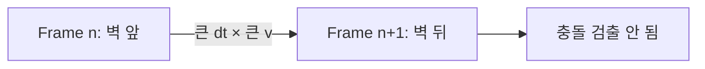
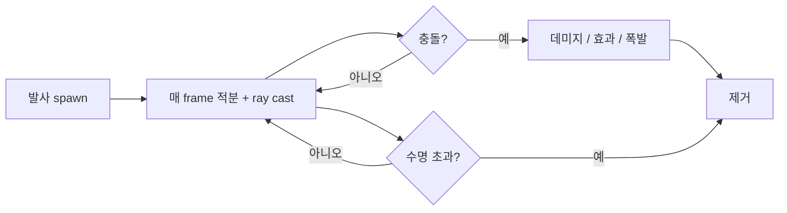

## 들어가며

발사체 (projectile) 는 게임의 *가장 흔한 물리 객체* — 화살, 총알, 마법, 미사일, 던지는 박스. 단순한 운동학으로 보이지만, 실제 게임에서는 *표적 예측, 공기 저항, 충돌 ToI* 등 작은 디테일이 쌓인다.

이 글의 목표.

1. **진공 포물선** — 다수의 게임 발사체가 쓰는 기본 모델.
2. **선형 항력** — 단순 감쇠, 해석해 존재.
3. **이차 항력과 종단 속도** — 현실 공기 저항, 수치 적분 필요.
4. **움직이는 표적 예측** — 적이 미사일을 *미래 위치* 로 발사.
5. **발사각 역산** — 목표 좌표에 도달하는 *발사각 계산*.
6. **충돌 ToI 와 sweep** — 빠른 발사체의 터널링 방지.
7. **궤적 시각화** — 발사 전 예측 궤적 표시.
8. **게임 적용 패턴**.

발사체는 *대부분 게임 코드에서 직접 시뮬* 된다 — 강체 솔버 거치지 않고 *직접 적분*. 단순함과 *예측 가능성* 이 결정적.


---

## 목차
1. [진공 포물선](#1-진공-포물선)
2. [선형 항력 모델](#2-선형-항력-모델)
3. [이차 항력과 종단속도](#3-이차-항력과-종단속도)
4. [움직이는 표적 예측](#4-움직이는-표적-예측)
5. [발사각 역산](#5-발사각-역산)
6. [충돌 ToI와 swept test](#6-충돌-toi와-swept-test)
7. [궤적 시각화](#7-궤적-시각화)
8. [게임 적용 패턴](#8-게임-적용-패턴)


---

## 1. 진공 포물선

가장 단순한 발사체 모델. *중력만* — 공기 저항 무시.

### 1.1 운동 방정식

위치, 속도, 가속도:

$$
\vec{r}(t) = \vec{r}_0 + \vec{v}_0 t + \tfrac{1}{2} \vec{g} t^2
$$
$$
\vec{v}(t) = \vec{v}_0 + \vec{g} t
$$
$$
\vec{a}(t) = \vec{g} = \text{const}
$$

중력 $\vec{g}$ 가 *유일한 외력*. 게임 단위에서 $|\vec{g}| \approx 9.8 \text{ m/s}^2$ — 또는 *게임 톤에 맞춰* 더 큰 값 (15 ~ 30 m/s²) 으로 *빠른 떨어짐*.

### 1.2 2D 포물선

xy 평면에서. 수평 / 수직 분리:

$$
x(t) = x_0 + v_{0x} t
$$
$$
y(t) = y_0 + v_{0y} t - \tfrac{1}{2} g t^2
$$

수평은 *등속*, 수직은 *등가속*.

### 1.3 코드

```cpp
struct Projectile {
    vec3 position;
    vec3 velocity;
};

void StepProjectile(Projectile& p, vec3 gravity, float dt) {
    p.velocity += gravity * dt;
    p.position += p.velocity * dt;
}
```

semi-implicit Euler. 두 줄. 다수의 게임 발사체는 이 정도 모델로도 충분하다.

### 1.4 닫힌 형식

매 step 적분 안 하고 *시간 t* 에서 *직접 평가* 가능.

```cpp
vec3 ProjectilePosAt(vec3 r0, vec3 v0, vec3 g, float t) {
    return r0 + v0 * t + g * (0.5f * t * t);
}
```

*미래 위치 예측* 에 유용. AI 가 *발사 시점에 표적 시간 t 후 위치* 를 한 줄로 계산.

### 1.5 최대 높이, 도달 시간, 사거리

수직 운동의 기본 양들.

```math
\text{최대 높이 시간:} \quad t_{peak} = \frac{v_{0y}}{g}
\text{최대 높이:} \quad h_{max} = \frac{v_{0y}^2}{2g}
\text{공중 체공 시간:} \quad t_{air} = \frac{2 v_{0y}}{g}  (\text{지면 출발 / 도착})
\text{사거리:} \quad R = \frac{v_0^2 \sin(2\theta)}{g}
```

마지막 식이 *발사각 + 초기 속력으로 사거리*. 45° 가 최대 사거리.

### 1.6 게임 단순화

게임은 보통 *진공 포물선만*. 화살 / 총알 / 폭탄. 사용자가 *기대* 하는 단순한 동작 + 예측 가능성. 공기 저항은 *시각 디테일* 일 뿐 게임플레이에 큰 영향 없음.

## 2. 선형 항력 모델

공기 저항의 가장 단순한 모델.

### 2.1 식

$$
\vec{F}_d = -k \vec{v}
$$

속도에 비례. 항상 *속도 반대 방향*. 작은 속도에 적합 (느린 객체).

운동 방정식:

$$
m \dot{\vec{v}} = m \vec{g} - k \vec{v}
$$

### 2.2 해석해

선형 ODE — *닫힌 형식 해* 존재.

수직 성분 (낙하):

$$
v_y(t) = -v_{term} + (v_{0y} + v_{term}) e^{-t/\tau}
$$

여기서 $v_{term} = mg/k$ (종단 속도), $\tau = m/k$ (시간 상수).

직관: *시간 흐를수록 종단 속도에 지수적 접근*. $\tau$ 가 *수렴 시간*.

### 2.3 수평 성분

수평은 *중력 없음* — 순수 지수 감쇠.

$$
v_x(t) = v_{0x} e^{-t/\tau}
$$

*시간 흐를수록 0 으로 수렴*. 수평 거리 적분:

$$
x(t) = x_0 + v_{0x} \tau (1 - e^{-t/\tau})
$$

t → ∞ 에서 *수평 거리 $v_{0x} \tau$ 로 수렴*. 무한대 못 감.

### 2.4 코드

```cpp
void StepProjectileLinearDrag(Projectile& p, vec3 gravity,
                                float dragPerMass, float dt) {
    vec3 dragAccel = p.velocity * (-dragPerMass); // = -(k/m) v
    p.velocity += (gravity + dragAccel) * dt;     // 진공보다 한 항 추가
    p.position += p.velocity * dt;
}
```

진공 모델에 *drag acceleration 항 한 줄 추가*. 물리식의 $k$ 를 그대로 쓰려면 `dragPerMass = k / m` 으로 변환한다.

### 2.5 단점

선형 항력은 낮은 Reynolds 수의 Stokes regime에서 물리적 모델이 될 수 있고, 게임에서는 조절하기 쉬운 감쇠 근사로도 쓴다. 일반적인 공기 중 빠른 발사체에는 이차 항력이 더 적합하지만 경계는 속도 하나가 아니라 유체 밀도·점성·물체 길이 scale에 좌우된다.

게임에서 *시각적 부드러움* 위주면 OK. 정확한 시뮬은 이차 항력.

### 2.6 게임 활용

- *깃털, 종이* 같은 *매우 느린* 객체.
- *부드러운 감쇠 효과* — 던진 폭탄이 *너무 멀리 안 나가게*.

대부분 게임이 *진공 또는 이차*. 선형은 *간단한 감쇠* 가 필요할 때.

## 3. 이차 항력과 종단속도

현실 공기 저항의 표준 모델.

### 3.1 식

$$
\vec{F}_d = -\tfrac{1}{2} \rho C_d A |\vec{v}| \vec{v}
$$

$\rho$ = 공기 밀도, $C_d$ = 항력 계수 (drag coefficient, 도형 형태), $A$ = 단면적, $|\vec{v}| \vec{v}$ = 속도 크기 × 속도 벡터.

크기는 *속도 제곱*, 방향은 *속도 반대*.

### 3.2 종단 속도

수직 낙하의 *평형 속도*:

$$
v_{term} = \sqrt{\frac{2 m g}{\rho C_d A}}
$$

물리적 의미: *항력이 중력과 정확히 균형* — 가속도 0. 충분히 떨어지면 *이 속도로 수렴*.

| 객체 | 종단 속도 (m/s) |
|---|---|
| 사람 (자유 낙하) | 50 |
| 사람 (paratrooper, 펼친 옷) | 5 |
| 깃털 | 0.4 |
| 골프공 | 32 |
| 빗방울 | 9 |

### 3.3 닫힌 형식 없음

이차 항력은 비선형 ODE다. 일정 중력과 한 축 운동처럼 제한된 경우에는 `tanh` 등을 이용한 닫힌 해가 있지만, 중력에 수직인 속도 성분까지 있는 일반 2D/3D 궤적은 단순 포물선 형태의 닫힌 해가 없어 수치 적분을 주로 사용한다.

```cpp
void StepProjectileQuadDrag(Projectile& p, vec3 gravity,
                                float dragCoef, float dt) {
    float vMag = length(p.velocity);
    vec3  drag = -dragCoef * vMag * p.velocity;
    p.velocity += (gravity + drag) * dt;
    p.position += p.velocity * dt;
}
```

이 한 줄 *비선형* 추가. semi-implicit Euler 로 충분.

### 3.4 작은 dt 권장

명시적 update는 큰 $c|\vec{v}|dt$에서 항력만으로 속도 방향을 뒤집을 수 있다. 하지만 전체 `newVel`과 이전 속도의 내적을 보고 0으로 clamp하면 발사체의 정상적인 apex나 중력에 의한 방향 전환까지 지워 버린다.

```cpp
// 1차 operator split 예시:
// 중력을 먼저 적용하고, dv/dt = -c |v| v의 radial 감쇠를
// 한 step 동안 해석적으로 적용해 항력 자체의 방향 반전을 막는다.
vec3 vStar = p.velocity + gravity * dt;
float speed = length(vStar);
p.velocity = vStar / (1.0f + dragCoef * speed * dt);
p.position += p.velocity * dt;
```

이는 결합된 중력+항력 ODE의 정확해가 아니라 first-order splitting이다. 더 높은 정확도가 필요하면 적응형 RK, implicit 방법 또는 충분히 작은 substep을 기준 해와 비교한다.

### 3.5 게임에서의 사용

대부분 게임은 *이차 항력 사용 안 함*. 이유:

- *예측 어려움*: 닫힌 형식 없어 *AI 의 표적 계산* 복잡.
- *시각 차이 미미*: 짧은 발사체 (총알) 는 *공기 저항 효과 안 보임*.
- *게임플레이 단순함* 우선.

긴 거리 발사체 (저격수 시뮬, 항공 시뮬) 만 이차 항력. *Sniper Elite*, *War Thunder* 등.

### 3.6 항력 계수 매개변수

$C_d$ 값.

| 도형 | $C_d$ |
|---|---|
| 구 | 0.47 |
| 큐브 | 1.05 |
| 유선형 | 0.04 |
| Drag 만 (Disc) | 1.2 |

게임은 *단순 곱셈 상수* 로 — $-c \cdot |\vec{v}| \vec{v}$. 디자이너 튜닝.

## 4. 움직이는 표적 예측

AI 가 *움직이는 표적* 을 미사일로 맞추기.

### 4.1 문제 설정

- 발사 위치 $\vec{p}_s$, 발사체 속력 $s$ (스칼라).
- 표적 위치 $\vec{p}_t$, 표적 속도 $\vec{v}_t$ (등속 직선 가정).

*발사체와 표적이 만나는 시간 $t$* 와 *발사 방향* 찾기.

### 4.2 만남 조건

$$
|\vec{p}_t + \vec{v}_t t - \vec{p}_s| = s \cdot t
$$

발사체가 *거리 = 속력 × 시간* 이동. 표적의 *t 후 위치* 와 같음.

### 4.3 이차 방정식

양변 제곱:

$$
|\vec{p}_t - \vec{p}_s + \vec{v}_t t|^2 = s^2 t^2
$$

$\vec{d} = \vec{p}_t - \vec{p}_s$ 두면:

$$
|\vec{d}|^2 + 2 (\vec{d} \cdot \vec{v}_t) t + |\vec{v}_t|^2 t^2 = s^2 t^2
$$

정리:

$$
(|\vec{v}_t|^2 - s^2) t^2 + 2 (\vec{d} \cdot \vec{v}_t) t + |\vec{d}|^2 = 0
$$

표준 이차 방정식 $at^2 + bt + c = 0$.

### 4.4 풀이

```cpp
bool PredictHitTime(vec3 ps, float s, vec3 pt, vec3 vt, float& tOut) {
    vec3 d = pt - ps;
    float a = dot(vt, vt) - s * s;
    float b = 2.0f * dot(d, vt);
    float c = dot(d, d);

    if (std::fabs(a) < 1e-8f) {
        // 발사체 속력 = 표적 속력 — 선형
        if (std::fabs(b) < 1e-8f) return false;
        tOut = -c / b;
        return tOut > 0;
    }

    float disc = b * b - 4 * a * c;
    if (disc < 0) return false;            // 해 없음 — 발사체로 못 따라잡음

    float sqrtD = std::sqrt(disc);
    float t1 = (-b + sqrtD) / (2 * a);
    float t2 = (-b - sqrtD) / (2 * a);

    // 양의 가장 작은 t (가장 빨리 만남)
    if (t1 > 0 && t2 > 0) tOut = std::min(t1, t2);
    else if (t1 > 0) tOut = t1;
    else if (t2 > 0) tOut = t2;
    else return false;

    return true;
}
```

### 4.5 발사 방향

$t$ 결정되면 *발사 위치 + 발사체 속력 × t* 후 *표적이 그 자리에 있어야*. 표적의 미래 위치 $\vec{p}_t + \vec{v}_t t$ 가 발사체의 목표.

```cpp
vec3 aimAt = pt + vt * tOut;
vec3 toAim = aimAt - ps;
vec3 fireDir = (length_squared(toAim) > 1e-8f)
             ? normalize(toAim)
             : vec3{1, 0, 0};
vec3 initialVel = fireDir * s;
```

### 4.6 중력 포함

발사체가 *중력 영향* 받으면 위 식이 더 복잡 — *4차 방정식*. 닫힌 형식 풀이 어려움.

해결: *반복 풀이*. 진공 가정으로 t 추정 → 그 t 의 *중력 보정 후 미래 위치* → 새 t. 수렴까지.

또는 *수치 풀이* (Newton's method).

### 4.7 해 없는 경우

해 없음의 실제 조건은 *양의 실근이 없음* 이다. 표적이 발사체보다 빠르더라도 표적이 발사체 쪽으로 오고 있으면 맞출 수 있다. `disc < 0` 이거나 계산된 두 근이 모두 `t <= 0` 이면 실패다.

AI 처리: *예측 실패 → 가까운 미래 위치 추정 후 발사* (놓치더라도 시도).

## 5. 발사각 역산

목표 좌표 + 초기 속력 → 발사각.

### 5.1 2D 식

발사 위치 (0, 0), 목표 (x, y), 초기 속력 $v_0$, 발사각 $\theta$.

수평·수직 운동:

$$
x = v_0 \cos\theta \cdot t
$$
$$
y = v_0 \sin\theta \cdot t - \tfrac{1}{2} g t^2
$$

t 소거:

$$
y = x \tan\theta - \frac{g x^2}{2 v_0^2 \cos^2\theta} = x \tan\theta - \frac{g x^2 (1 + \tan^2\theta)}{2 v_0^2}
$$

$\tan\theta = u$ 두면 *u 에 대한 이차 방정식*:

$$
\frac{g x^2}{2 v_0^2} u^2 - x u + \left( y + \frac{g x^2}{2 v_0^2} \right) = 0
$$

### 5.2 풀이

```cpp
struct LaunchAngles {
    float low;       // 직접 사격 (낮은 각)
    float high;      // 곡사 (높은 각)
    bool  exists;
};

LaunchAngles ComputeLaunchAngles2D(float x, float y, float v0, float g) {
    LaunchAngles r{};
    if (v0 <= 0 || g <= 0) return r;

    float v2 = v0 * v0;
    if (std::fabs(x) < 1e-6f) {
        if (y >= 0 && v2 >= 2.0f * g * y) {
            r.low = r.high = kPi * 0.5f;      // 거의 수직 위
            r.exists = true;
        } else if (y < 0) {
            r.low = r.high = -kPi * 0.5f;     // 거의 수직 아래
            r.exists = true;
        }
        return r;
    }

    float disc = v2 * v2 - g * (g * x * x + 2.0f * y * v2);
    if (disc < 0) { r.exists = false; return r; }    // 사거리 부족

    float sqrtD = std::sqrt(disc);
    r.low  = std::atan((v2 - sqrtD) / (g * x));
    r.high = std::atan((v2 + sqrtD) / (g * x));
    r.exists = true;
    return r;
}
```

두 해 — *낮은 각 (직사)* 과 *높은 각 (곡사)*. 게임에 따라 선택.

### 5.3 사거리 부족

$\text{disc} < 0$ — 초기 속력이 목표 도달에 *부족함*. AI 처리:

- 더 가까이 이동 후 발사.
- 더 큰 발사체 사용.
- 발사 포기.

### 5.4 최대 사거리

낮은 각과 높은 각이 *같을 때* (disc = 0) — 최대 사거리.

$$
v_0^4 = g (g x^2 + 2 y v_0^2)
$$

수평 발사 ($y = 0$):

$$
x_{max} = \frac{v_0^2}{g}, \quad \theta_{max} = 45°
$$

물리 교과서의 표준 결과.

### 5.5 3D 일반화

3D 는 *수평 방향* 결정 (수평면 위 각도) + *수직 발사각*. 수평은 *목표 향한 방향*, 수직각은 위 2D 풀이.

```cpp
vec3 ComputeLaunchVelocity3D(vec3 from, vec3 to, float speed, float g) {
    vec3 horizDir = to - from;
    horizDir.y = 0;
    float horizDist = length(horizDir);
    if (horizDist < 1e-6f) {
        // 바로 위/아래 — 수직 발사 케이스 별도 처리
        float sign = (to.y >= from.y) ? 1.0f : -1.0f;
        return vec3{0, sign * speed, 0};
    }
    horizDir /= horizDist;

    float verticalDist = to.y - from.y;
    auto angles = ComputeLaunchAngles2D(horizDist, verticalDist, speed, g);
    if (!angles.exists) return vec3{0, 0, 0};

    float theta = angles.low;
    return horizDir * (speed * std::cos(theta))
         + vec3{0, 1, 0} * (speed * std::sin(theta));
}
```

### 5.6 게임 활용

- *AI 미사일*: 적이 *플레이어 위치에 발사각 계산* + 발사.
- *NPC 던지기*: 캐릭터가 *목표 위치에 폭탄 던짐*.
- *Aim assist*: 자동 조준의 *예상 궤적*.

표적이 *움직이면* 4절의 *표적 예측* 으로 *미래 위치* 계산 후, 그 위치에 *발사각 역산*. 두 단계 결합.

## 6. 충돌 ToI와 swept test

빠른 발사체의 *터널링* 방지.

### 6.1 터널링 문제

발사체가 *한 프레임 안에 큰 거리 이동* — 벽보다 빠른 속도면 *벽 두께를 한 step 에 통과*. 충돌 검출 못 함.



총알 (수백 m/s) 이 *얇은 벽 (10 cm)* 을 *60 fps* 에 — 매 프레임 *수 m 이동* > 벽 두께. 터널링.

### 6.2 ToI (Time of Impact)

해결: *연속 충돌 검출 (CCD)*. 발사체의 *경로* 를 광선 / 캡슐로 *sweep*. 처음 닿는 *시각 t* (Time of Impact).

```cpp
struct RaycastHit {
    bool  hit;
    float t;          // 0 ~ 1, 발사체 경로 비율
    vec3  point;
    vec3  normal;
};

RaycastHit Sweep(vec3 from, vec3 to, const World& world);
```

t < 1 이면 *프레임 안에 충돌*. 그 시점에서 *발사체 정지 / 반사 / 폭발*.

### 6.3 광선 (ray) sweep

작은 발사체 (총알) 는 *광선 (점) 으로 모델*. broad phase + ray vs AABB → narrow ray vs 삼각형.

```cpp
RaycastHit RayCastBullet(vec3 from, vec3 dir, float maxDist, const World& world) {
    // ... BVH 트래버설 + ray-triangle test ...
}
```

매 step:

```cpp
vec3 newPos = bullet.position + bullet.velocity * dt;
vec3 segment = newPos - bullet.position;
float segmentLen = length(segment);
RaycastHit hit{};
if (segmentLen > 1e-6f) {
    hit = RayCastBullet(bullet.position,
                         segment / segmentLen,
                         segmentLen, world);
}
if (hit.hit) {
    bullet.position = hit.point;
    bullet.alive = false;
    // 데미지 처리 등
} else {
    bullet.position = newPos;
}
```

### 6.4 캡슐 sweep

큰 발사체 (로켓, 폭탄) 는 *점이 아님* — 부피 가짐. 캡슐 sweep.

```cpp
RaycastHit SweepCapsule(Capsule cap, vec3 disp, const World& world);
```

캡슐 형상이 *경로 따라 휩쓸리며* 처음 만나는 충돌. 비용 ray 보다 큼 — 충돌 형상이 더 복잡.

### 6.5 빠른 발사체의 *연속 다중 충돌*

발사체가 *한 step 에 여러 객체* 통과 가능. 예: 화살이 *적 3 명을 일렬로 관통*.

```cpp
constexpr float kMinToiAdvance = 1e-5f;
constexpr float kSkin = 0.001f;

while (remainingTime > 0) {
    RaycastHit hit = Sweep(bullet, remainingTime);
    if (!hit.hit) {
        bullet.position += bullet.velocity * remainingTime;
        break;
    }
    bullet.position = hit.point;
    OnHit(bullet, hit);
    if (!bullet.canPenetrate) break;
    float usedTime = std::min(remainingTime,
                              std::max(hit.t * remainingTime, kMinToiAdvance));
    remainingTime -= usedTime;
    if (length_squared(bullet.velocity) > 1e-8f) {
        bullet.position += normalize(bullet.velocity) * kSkin; // 같은 표면 재충돌 방지
    }
    // 관통 — 계속
}
```

관통 발사체 (화살, 큰 총알) 의 자연 처리.

### 6.6 산업 패턴

대부분 엔진의 *hit-scan vs projectile* 구분.

- **Hit-scan**: 즉시 ray cast. 무한 속도 가정. 빠른 총 (현대 FPS).
- **Projectile**: 실제 시뮬. 느린 발사체 (RPG, 화살).

hit-scan 은 *총알 비행 시간 0* — 게임플레이 단순. 일부 게임이 *시각 효과만 발사체* (총알이 실제로 보이지만 hit 는 즉시 결정).

## 7. 궤적 시각화

발사 전 *예측 궤적* 표시.

### 7.1 왜 필요한가

플레이어가 *발사 방향 + 강도* 를 정할 때 *결과를 미리 봄* — 정확한 조준 가능. *Worms*, *Angry Birds*, *grenade indicator* 등.

### 7.2 시각화 방법

미리 *시뮬을 마음 속에 돌려* — N step 의 *발사체 위치* 를 점으로 그리기.

```cpp
void DrawTrajectory(vec3 from, vec3 v0, vec3 gravity,
                     int numPoints, float dtPerPoint) {
    vec3 pos = from;
    vec3 v   = v0;
    for (int i = 0; i < numPoints; ++i) {
        DrawSphere(pos, 0.05f);
        v   += gravity * dtPerPoint;
        pos += v * dtPerPoint;
    }
}
```

또는 *닫힌 형식 평가*:

```cpp
for (int i = 0; i < numPoints; ++i) {
    float t = i * dtPerPoint;
    vec3 pos = from + v0 * t + gravity * (0.5f * t * t);
    DrawSphere(pos, 0.05f);
}
```

후자가 *오차 누적 없음* (각 점 독립).

### 7.3 충돌 종료

궤적이 *벽 / 지면에 닿으면 거기서 끊김*. 매 점마다 *이전 점에서 ray cast*.

```cpp
vec3 prev = from;
for (int i = 1; i <= numPoints; ++i) {
    float t = i * dtPerPoint;
    vec3 curr = from + v0 * t + gravity * (0.5f * t * t);
    vec3 segment = curr - prev;
    float segmentLen = length(segment);
    if (segmentLen < 1e-6f) continue;
    RaycastHit hit = RayCast(prev, segment / segmentLen, segmentLen);
    if (hit.hit) {
        DrawSphere(hit.point, 0.1f, /* hit 색 */);
        break;
    }
    DrawSphere(curr, 0.05f);
    prev = curr;
}
```

벽에 닿는 지점 *명확 표시* — 플레이어가 조준 정확성 판단.

### 7.4 점선 / 실선

| 표현 | 효과 |
|---|---|
| 점 (10~30 개) | 가벼움, 발사 가능성 |
| 실선 | 명확하지만 다소 무거움 |
| 짧은 dash | 발사체 속도 감각 |
| 색 그래디언트 | 시작 = 밝음, 끝 = 어둠 (시간 감각) |

게임 톤에 맞춰. 캐주얼 게임은 *밝은 점*, 진지 시뮬은 *얇은 실선*.

### 7.5 발사 매개변수 UI

궤적 시각화 + *발사각 / 강도 슬라이더* 또는 *마우스 드래그*:

- 마우스를 *목표 방향으로 끌면* 발사각 결정.
- *드래그 거리* 가 강도.
- 실시간으로 *궤적 갱신*.

Worms / Angry Birds 의 *조준 UI*.

### 7.6 항력 모델의 시각 비교

진공 vs 선형 vs 이차 항력의 *세 궤적을 동시* — 같은 발사 조건에 *모델별 차이*.

진공: 완벽한 포물선.
선형 항력: 짧은 사거리, 더 빨리 떨어짐.
이차 항력: 종단 속도까지 가속 후 떨어짐.

세 곡선이 *서서히 갈라짐* — 어떤 모델 선택할지 사용자가 직접 비교.

## 8. 게임 적용 패턴

발사체의 *전형적 게임 시스템*.

### 8.1 발사체 라이프사이클



### 8.2 발사체 자료구조

```cpp
struct Projectile {
    vec3   position;
    vec3   velocity;
    float  lifetime = 5.0f;       // 5 초 후 자동 제거
    float  damage   = 10.0f;
    int    ownerId;                // 발사자 (자기 자신엔 피해 X)
    bool   alive    = true;
    // 시각 / 효과 매개변수
};

std::vector<Projectile> projectiles;
```

게임의 *수십 ~ 수백 발사체* 가 array.

### 8.3 매 frame 업데이트

```cpp
void UpdateProjectiles(std::vector<Projectile>& projectiles,
                         const World& world, float dt) {
    for (auto& p : projectiles) {
        if (!p.alive) continue;

        // 시뮬레이션
        vec3 newPos = p.position + p.velocity * dt + 0.5f * gravity * dt * dt;
        p.velocity += gravity * dt;

        // 충돌
        vec3 segment = newPos - p.position;
        float segmentLen = length(segment);
        RaycastHit hit{};
        if (segmentLen > 1e-6f) {
            hit = RayCast(p.position, segment / segmentLen,
                          segmentLen, world, p.ownerId);
        }
        if (hit.hit) {
            p.position = hit.point;
            OnProjectileHit(p, hit);
            p.alive = false;
            continue;
        }

        p.position = newPos;
        p.lifetime -= dt;
        if (p.lifetime <= 0) p.alive = false;
    }

    // 죽은 발사체 정리
    projectiles.erase(
        std::remove_if(projectiles.begin(), projectiles.end(),
                        [](const Projectile& p) { return !p.alive; }),
        projectiles.end());
}
```

### 8.4 폭발 (area damage)

발사체가 *폭발* 하면 *주변 적에게 데미지*. 폭발 중심 + 반경.

```cpp
void Explode(vec3 center, float radius, float damage, const World& world) {
    auto victims = SphereCast(center, radius, world);
    for (auto& v : victims) {
        float dist = length(v.position - center);
        float damageFalloff = std::max(0.0f, 1.0f - dist / radius);
        v.health -= damage * damageFalloff;
    }
}
```

거리 따른 *데미지 감쇠* 자연.

### 8.5 발사체 풀

발사체가 *지속 생성 / 제거* — `new` / `delete` 비용. *오브젝트 풀* 패턴.

```cpp
struct ProjectilePool {
    std::vector<Projectile> data;
    std::vector<int>         freeList;

    int Acquire() {
        if (freeList.empty()) {
            data.push_back({});
            return data.size() - 1;
        }
        int idx = freeList.back();
        freeList.pop_back();
        return idx;
    }

    void Release(int idx) {
        data[idx].alive = false;
        freeList.push_back(idx);
    }
};
```

게임의 *수천 발사체* (탄막 슈터) 의 핫 패스. *할당 0*.

### 8.6 발사체 종류별 디자인

| 종류 | 모델 |
|---|---|
| 총알 / hit-scan | 즉시 ray cast |
| 화살 | 진공 포물선 + 광선 sweep |
| 로켓 | 등속 직선 + 캡슐 sweep + 폭발 |
| 마법 / homing missile | 표적 추적 (steering force) |
| 폭탄 / 수류탄 | 진공 포물선 + 바닥 충돌 + 타이머 폭발 |
| 산탄 (shotgun) | 여러 ray cast 동시 |

각 종류가 *기본 모델 + 특수 동작*. 게임 코드의 *Projectile 인터페이스* 위에서.

### 8.7 네트워크 동기화

멀티플레이의 발사체 — *클라이언트가 발사 시점 + 방향만 전송*. 서버가 *권위 시뮬*. 클라이언트는 *예측 표시*.

```cpp
// 클라이언트
SendFireMessage(server, fireDir, fireSpeed);
CreateLocalPredictedProjectile(...);

// 서버
OnFireMessage(client, fireDir, fireSpeed);
CreateAuthoritativeProjectile(...);
BroadcastProjectileState(...);
```

발사체가 *진공 포물선* 같은 *deterministic* 모델이면 동기화 쉽다. 항력 모델이 더 복잡하면 동기화 어려움.


---

## 결론

발사체가 *게임의 가장 흔한 물리 시스템* — 단순한 운동학 위의 *예측·항력·터널링·시각화* 디테일.

이 글에서 정리한 핵심.

1. **진공 포물선** — $\vec{r}(t) = \vec{r}_0 + \vec{v}_0 t + \tfrac{1}{2} \vec{g} t^2$. 가장 흔한 기본 모델.
2. **선형 항력** — 닫힌 해 존재 (지수 감쇠). 단순 시각 효과.
3. **이차 항력** — 종단 속도 + 수치 적분. 정밀 시뮬.
4. **표적 예측** — 등속 표적 + 이차 방정식 풀이.
5. **발사각 역산** — 목표 좌표 + 초기 속력 → 두 발사각 (낮음 / 높음).
6. **ToI + sweep** — 빠른 발사체 터널링 회피. ray / capsule sweep.
7. **궤적 시각화** — 발사 전 예측. UI 친화 게임의 표준.
8. **게임 패턴** — 라이프사이클, pool, 폭발, hit-scan vs projectile.

발사체 물리는 *운동학 + 예측 + 연속 충돌 검출* 의 결합이다. 단순한 포물선도 표적 예측, 항력, sweep, 네트워크 동기화와 만나면 게임플레이 품질을 크게 좌우한다.

## 더 읽을거리

- Kain Shin, "Predictive Aim Mathematics for AI Targeting" (Game Developer/Gamasutra) — 움직이는 표적 예측의 게임 친화적 정리.
- Kyle Pittman, "Math for Game Programmers: Building a Better Jump" (GDC 2016) — 포물선 매개변수 (높이·시간) 역산 설계.
- Halliday, Resnick, Walker, *Fundamentals of Physics*, Ch. 4 — 포물선의 학술 기초.
- Real-Time Rendering, 4th ed., online Ch. 25 "Collision Detection" — ray / sweep 검사 기초.
- Quake 소스 — 미사일 prediction 의 산업 reference.
- Sebastian Lague, "Projectile Prediction" 비디오 — 시각적 설명.
- Eric Lengyel, *Mathematics for 3D Game Programming*, 발사체 챕터.
- Erin Catto, GDC 발표 — 강체 + 발사체의 통합.
- Glenn Fiedler, "Networked Physics" — 발사체 네트워크 동기화.
