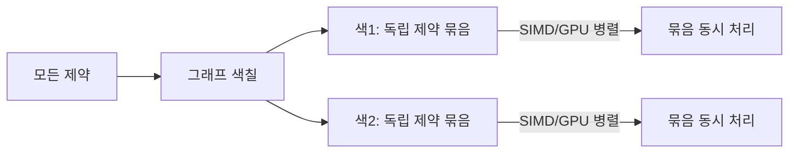
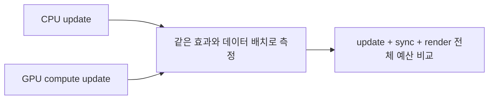
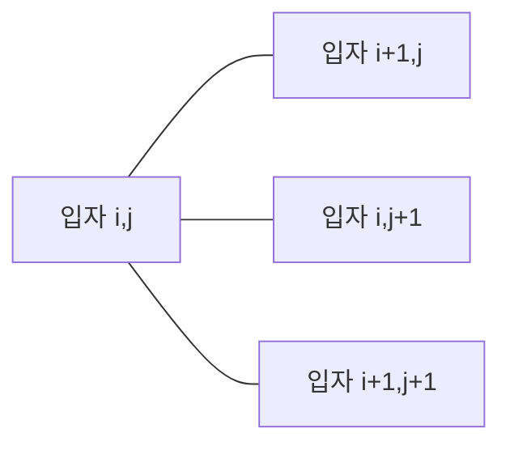

## 들어가며

게임의 *파티클 시스템*은 많은 수의 단순 상태를 같은 연산으로 갱신한다. 폭발 파편, 연기, 핏자국과 마법 효과가 대표적이다. 모든 입자 쌍이 상호작용하면 후보 수가 $O(N^2)$ 로 증가하므로 강체와 다른 데이터·이웃 검색 전략이 필요하다.

파티클은 *별도 시뮬레이션 시스템*. 강체와 *데이터 모델 + 알고리즘 + 하드웨어* 모두 다르다.

- *SoA (Structure of Arrays)* 데이터 — SIMD 친화.
- *단순 적분기* (Verlet) — 분기 없음, 캐시 친화.
- *GPU compute shader* — 큰 batch를 병렬 처리.
- *Grid hash* 또는 *spatial 분할* — 이웃 검색 효율.

이 글의 목표.

1. **SoA vs AoS** — 파티클 데이터 레이아웃의 결정적 차이.
2. **Verlet 적분의 SIMD 친화성** — 왜 파티클에 표준.
3. **GPU compute shader 시뮬** — 수만 입자의 병렬 처리.
4. **입자 간 상호작용** — grid hash 로 N² 회피.
5. **Cloth 시뮬** — 입자 + 거리 제약의 첫 응용.
6. **Self-collision 의 어려움** — cloth 가 자기 자신과 충돌.
7. **파티클 충돌과 외부 환경** — 환경 SDF, 강체와의 약결합.
8. **시스템 경계와 검증**.

이 글이 마치면 *수만 입자 시뮬* 의 데이터 / 알고리즘 / 하드웨어 결정 패턴이 정리된다.


---

## 목차
1. [SoA 데이터 레이아웃](#1-soa-데이터-레이아웃)
2. [Verlet 적분의 SIMD 친화성](#2-verlet-적분의-simd-친화성)
3. [GPU compute shader 시뮬](#3-gpu-compute-shader-시뮬)
4. [입자 간 상호작용](#4-입자-간-상호작용)
5. [Cloth: 입자 + 거리 제약](#5-cloth-입자--거리-제약)
6. [Self-collision의 어려움](#6-self-collision의-어려움)
7. [환경 충돌과 약결합](#7-환경-충돌과-약결합)
8. [시스템 경계와 검증](#8-시스템-경계와-검증)


---

## 1. SoA 데이터 레이아웃

대량 파티클의 데이터 *배치* 가 *성능 결정*.

### 1.1 AoS vs SoA

전통 OO 패턴 — *Array of Structures (AoS)*:

```cpp
struct Particle {
    vec3  position;
    vec3  velocity;
    float invMass;
    // ... (더 많은 필드)
};
std::vector<Particle> particles;
```

한 파티클의 *모든 필드* 가 메모리 인접. *한 객체* 처리 시 캐시 친화.

대안 — *Structure of Arrays (SoA)*:

```cpp
struct ParticleSystem {
    std::vector<float> px, py, pz;       // position 의 x / y / z 별 array
    std::vector<float> vx, vy, vz;
    std::vector<float> invMass;
};
```

*같은 필드끼리* 메모리 인접. 한 *필드를 모든 파티클에* 처리할 때 SIMD 친화.

### 1.2 SIMD 효과

`px[i] += vx[i] * dt` 의 N 회 반복. SIMD 가 *4 또는 8 개를 한 번에*.

```cpp
// SoA + AVX2 (8 float 동시)
for (int i = 0; i < N; i += 8) {
    __m256 px_vec = _mm256_loadu_ps(&px[i]);
    __m256 vx_vec = _mm256_loadu_ps(&vx[i]);
    px_vec = _mm256_fmadd_ps(vx_vec, dt_vec, px_vec);
    _mm256_storeu_ps(&px[i], px_vec);
}
```

8 배 속도 향상 *이론*. 실제로는 *메모리 대역폭* 이 한계라 *3~5 배* 일반.

### 1.3 AoS 의 SIMD 가능성

AoS 도 *struct 의 한 필드* 를 SIMD 로 처리 가능하지만:

- *stride* 가 sizeof(Particle) — 큰 stride 의 *gather load* 가 비쌈.
- 캐시 line (64 byte) 안의 일부만 사용 — *대역폭 낭비*.

SoA 가 *SIMD + 캐시 효율* 둘 다 우위.

### 1.4 SoA 의 단점

- *한 파티클의 모든 필드 접근* 이 *여러 array touch* — 캐시 라인 여러 개. 개별 작업엔 AoS 가 빠를 수도.
- *코드 가독성 낮음* — `particles.px[i]` vs `particles[i].position.x`.
- *디버깅 어려움* — 한 파티클의 상태를 *여러 array 흩어진 위치* 에서 봐야.

### 1.5 AoSoA (절충)

큰 그룹의 AoS + 그룹 안 SoA. 캐시 라인 한 개에 *여러 파티클 + SIMD 친화* 둘 다.

```cpp
struct ParticleBlock {
    float px[8], py[8], pz[8];
    float vx[8], vy[8], vz[8];
    float invMass[8];
};
std::vector<ParticleBlock> blocks;        // 한 block = 8 파티클
```

SIMD 한 명령이 *한 block 안 8 파티클* 처리. 캐시 라인 한 개 안. *최적*.

복잡함이 단점 — 인덱싱이 *블록 index + offset*.

### 1.6 선택 기준

전체 update가 일부 필드만 순차 접근하면 SoA가 cache와 vector load에 유리하다. 생성·삭제와 객체별 모든 필드 접근이 지배적이면 AoS나 AoSoA가 더 단순할 수 있다. 최종 선택은 update kernel별 bytes/load, cache miss, vectorization report와 compaction 비용으로 검증한다.


## 2. Verlet 적분의 SIMD 친화성

파티클 적분기로 *Verlet 이 표준* 인 이유.

### 2.1 Verlet 식

Position Verlet — 이전 위치 + 현재 위치 만으로 다음:

$$
\vec{x}_{n+1} = 2 \vec{x}_n - \vec{x}_{n-1} + \vec{a}_n \Delta t^2
$$

속도 없음. 메모리 절약 + 코드 단순.

### 2.2 분기 없음

가속도 $\vec{a}$ 가 *외력 / 질량* — 외력이 *위치만의 함수* 면 분기 없는 단순 곱셈. semi-implicit Euler 처럼 *순서 의존성* 도 없음 — 매 입자가 *독립*.

```cpp
// SoA Verlet step — 정렬·별칭·루프 의존성을 관리하면 벡터화하기 좋은 형태
for (int i = 0; i < N; ++i) {
    float ax = forces_x[i] * invMass[i];
    float ay = forces_y[i] * invMass[i];
    float ax_dt2 = ax * dt * dt;
    float ay_dt2 = ay * dt * dt;

    float new_px = 2.0f * px[i] - prev_px[i] + ax_dt2;
    float new_py = 2.0f * py[i] - prev_py[i] + ay_dt2;
    prev_px[i] = px[i];
    prev_py[i] = py[i];
    px[i] = new_px;
    py[i] = new_py;
}
```

분기 0, SIMD 친화, GPU 친화.

### 2.3 외력의 함수 가정

Verlet 이 *외력 = 위치 함수* 라 가정. 게임의 흔한 외력:

- 중력: $\vec{F} = m \vec{g}$ — 상수.
- Spring: $\vec{F} = -k (\vec{x} - \vec{x}_0)$ — 위치 함수.
- 충돌 응답 (impulse): 별도 처리 (predict-project-correct 단계).

속도 의존 외력 (drag) 은 *직접 안 맞음* — Velocity Verlet 변형 또는 단계 분리.

### 2.4 속도의 암묵적 정의

position Verlet 가 *속도 명시적 저장 안 함*. 필요시 *차분으로 추정*:

$$
\vec{v}_n \approx \frac{\vec{x}_{n+1} - \vec{x}_{n-1}}{2 \Delta t}
$$

또는 *current - prev*:

```cpp
float vx_estimate = (px[i] - prev_px[i]) / dt;
```

drag / damping 같은 *속도 의존 처리* 가 이 estimate 로 가능.

### 2.5 PBD 와의 통합

PBD 의 *Predict-Project-Correct* 가 Verlet 의 자연 확장.

```cpp
for (int i = 0; i < N; ++i) {
    predicted[i] = position[i] + velocity[i] * dt + acceleration[i] * dt * dt;
}
// 제약 project ...
for (int i = 0; i < N; ++i) {
    velocity[i] = (predicted[i] - position[i]) / dt;
    position[i] = predicted[i];
}
```

cloth / soft body 시뮬의 *기본 구조*.

### 2.6 PBD 의 SIMD

PBD 의 *project 단계* 가 *제약별 순차 처리* — SIMD 직접 적용 어려움. *제약 그래프 색칠 (graph coloring)* 로 *독립 제약 묶음* 을 *동시 처리* 하면 SIMD 가능.



각 색의 제약끼리는 *공유 입자 없음* — 동시 수정 안전.


## 3. GPU compute shader 시뮬

수만 ~ 수십만 입자의 *GPU 시뮬*.

### 3.1 왜 GPU

입자 update가 독립적이고 데이터가 연속이면 GPU의 대량 병렬 실행과 메모리 대역폭을 활용하기 좋다. 다만 작은 입자 수, 복잡한 분기, CPU readback, synchronization이 있으면 dispatch 비용이 이득을 상쇄할 수 있다.



시각 효과가 GPU에서 생성·시뮬·렌더까지 머물 수 있으면 CPU readback을 피할 수 있다.

### 3.2 Compute shader 패턴

DirectCompute / Vulkan compute / OpenGL compute. 입자 1 개 당 *thread 1 개*.

```glsl
// GLSL compute shader
#version 450
layout(local_size_x = 256) in;

layout(std430, binding = 0) readonly  buffer Buf0 { Particle inP[]; };
layout(std430, binding = 1) writeonly buffer Buf1 { Particle outP[]; };

void main() {
    uint i = gl_GlobalInvocationID.x;
    if (i >= inP.length()) return;

    Particle p = inP[i];
    p.velocity.y -= 9.8 * dt;
    p.position   += p.velocity * dt;

    outP[i] = p;
}
```

`gl_GlobalInvocationID.x` = 파티클 인덱스. 256 thread 가 *한 워크그룹*.

### 3.3 Double buffer

읽기·쓰기 동시 buffer 면 *race condition*. 두 buffer (in / out) — 한 프레임이 *in 에서 읽고 out 에 씀*, 다음 프레임이 *swap*.

```cpp
GLuint particleBuffers[2];
int currentBuf = 0;
// 매 프레임
DispatchCompute(particleBuffers[currentBuf],          // in
                 particleBuffers[1 - currentBuf]);    // out
currentBuf = 1 - currentBuf;
```

### 3.4 인덱스 매핑

GPU thread 수가 *입자 수와 정확히 같지 않음* — 보통 *256 의 배수* 로 dispatch.

```cpp
const int N = 12345;
const int workgroupSize = 256;
const int groups = (N + workgroupSize - 1) / workgroupSize;     // ceil
glDispatchCompute(groups, 1, 1);
```

shader 안에서 *인덱스 범위 검사*:

```glsl
if (gl_GlobalInvocationID.x >= numParticles) return;
```

### 3.5 GPU 의 한계

- *지연 시간 (latency)*: GPU 가 *batch 처리* — 작은 N (수백) 에서 *GPU dispatch 비용 > 시뮬 비용*.
- *CPU-GPU 동기화 비용*: GPU 결과 *CPU 로 읽으면 stall* — 시뮬 결과를 *CPU 게임플레이* 에 쓰면 안 됨 (충돌 트리거 등).
- *디버깅 어려움*: GPU 코드 디버깅 도구 제한.

해결: *시각 효과만* GPU, *게임플레이 영향 객체* CPU.

### 3.6 GPU pass 경계

emission, simulation, compaction, sorting과 indirect draw는 서로 다른 pass가 될 수 있다. 앞 pass가 쓴 alive count와 particle buffer를 뒤 pass가 읽기 전에 API에 맞는 memory barrier가 필요하다. CPU가 개수를 읽어 draw call을 만들기보다 GPU가 indirect argument를 생성하면 readback을 피할 수 있다.


## 4. 입자 간 상호작용

N 입자의 *서로 충돌 / 영향*.

### 4.1 Naive N²

모든 페어:

```cpp
for (int i = 0; i < N; ++i) {
    for (int j = i + 1; j < N; ++j) {
        if (DistSq(i, j) < interactionRadius_sq) {
            ApplyInteraction(i, j);
        }
    }
}
```

N=1000이면 499,500쌍, N=10000이면 49,995,000쌍이다. 단순 cycle 곱셈은 cache miss, SIMD, branch, 병렬화와 결과 기록을 설명하지 못하므로 실행 시간을 고정해서 제시하지 않는다. 중요한 사실은 pair 수가 $N(N-1)/2$로 증가해 N을 10배 늘리면 검사 수가 약 100배가 된다는 점이다.

### 4.2 Grid hash

공간을 *균일 그리드* 분할. 각 셀에 *그 셀의 입자 ID 리스트*. 한 입자의 *이웃 검색* 이 *주변 9 또는 27 셀만*.

```cpp
struct GridHash {
    float cellSize;
    std::unordered_map<int64_t, std::vector<int>> cells;
};

int64_t HashCell(int cx, int cy, int cz) {
    // 각 좌표가 signed 21-bit 범위 안인지 먼저 검증해야 한다.
    return ((int64_t)(cx & 0x1FFFFF) << 42)
         | ((int64_t)(cy & 0x1FFFFF) << 21)
         | ((int64_t)(cz & 0x1FFFFF));
}

void Insert(GridHash& g, int particleId, vec3 pos) {
    int cx = (int)std::floor(pos.x / g.cellSize);
    int cy = (int)std::floor(pos.y / g.cellSize);
    int cz = (int)std::floor(pos.z / g.cellSize);
    g.cells[HashCell(cx, cy, cz)].push_back(particleId);
}
```

### 4.3 이웃 검색

한 입자 주변 *27 셀 (3x3x3)* 검사 + 셀 안의 입자들과 거리.

```cpp
void FindNeighbors(GridHash& g, vec3 pos, float radius,
                     std::vector<int>& out) {
    int cMinX = (int)std::floor((pos.x - radius) / g.cellSize);
    int cMaxX = (int)std::floor((pos.x + radius) / g.cellSize);
    // ... 비슷하게 cy, cz ...
    for (int cz = cMinZ; cz <= cMaxZ; ++cz) {
        for (int cy = cMinY; cy <= cMaxY; ++cy) {
            for (int cx = cMinX; cx <= cMaxX; ++cx) {
                auto it = g.cells.find(HashCell(cx, cy, cz));
                if (it == g.cells.end()) continue;
                for (int id : it->second) {
                    // 거리 정밀 검사
                    if (DistSq(pos, particles[id].position) < radius * radius) {
                        out.push_back(id);
                    }
                }
            }
        }
    }
}
```

셀 점유가 제한되면 구축과 이웃 순회가 기대 $O(N + P)$에 가깝다. $P$는 실제 검사한 후보 pair 수다. 좌표 packing은 범위를 벗어나면 서로 다른 셀이 같은 key로 alias되므로 삽입 전에 범위를 검사하거나 더 넓은 key·일반 hash를 사용한다.

### 4.4 셀 크기 선택

| 셀 크기 | 효과 |
|---|---|
| 너무 작음 | 더 많은 셀 검사 |
| 상호작용 반지름과 같은 규모 | 셀 수와 점유의 균형 후보 |
| 너무 큼 | 한 셀의 입자 많음 — 재 N² 같은 |

셀 크기가 상호작용 반지름 이상이고 입자가 한 셀에만 속하면 현재 셀과 인접 셀을 포함한 $3^3=27$개로 충분하다. 셀이 더 작으면 `FindNeighbors` 코드처럼 `floor((p±r)/cellSize)` 범위 전체를 순회해야 한다. 최적 크기는 입자 밀도와 반지름 분포로 측정한다.

### 4.5 GPU 의 grid hash

GPU에서도 atomic append를 사용할 수 있지만 고정 `maxPerCell`은 overflow 정책이 필요하다.

```glsl
// GPU 의 atomic insertion
uint cellIdx = HashCell(int(p.position.x / cellSize), ...);
uint slot = atomicAdd(cellCounts[cellIdx], 1);
cellEntries[cellIdx * maxPerCell + slot] = particleId;
```

`slot >= maxPerCell`이면 쓰기를 버리거나 overflow buffer에 기록해야 한다. 정확한 이웃이 필요하면 cell key 정렬 + prefix sum으로 가변 길이 범위를 만드는 방식이 더 안전하다.

### 4.6 SPH (Smoothed Particle Hydrodynamics)

유체 시뮬레이션의 표준 — *grid hash 활용 입자 시스템*. 각 입자가 *주변 입자들과 평균* 으로 *밀도·압력*. 그리드 hash 가 *이웃 검색 토대*.

게임의 *수면 / 유체 효과* (물웅덩이 스플래시, 폭포 파편 등) 가 SPH 의 단순화 버전.


## 5. Cloth: 입자 + 거리 제약

cloth 시뮬 — *입자 격자 + 거리 제약* 으로 *천 같은 동작*.

### 5.1 cloth 의 모델

천을 *격자 입자 + spring* 으로 모델. 각 입자가 *이웃과 거리 spring*.



- *Structural*: 수평·수직 이웃 — 천의 *늘어남 방지*.
- *Shear*: 대각 이웃 — 천의 *비틂* 방지.
- *Bending*: 두 칸 떨어진 이웃 — 천의 *접힘* 방지.

### 5.2 자료구조

```cpp
struct Cloth {
    int rows, cols;
    std::vector<Particle>            particles;        // rows * cols
    std::vector<DistanceConstraint>  constraints;
};
```

격자 입자 + 거리 제약 리스트. 정렬:

```cpp
int IndexOf(Cloth& c, int row, int col) { return row * c.cols + col; }

void BuildCloth(Cloth& c, int rows, int cols, float spacing) {
    c.rows = rows;
    c.cols = cols;
    c.particles.resize(rows * cols);
    for (int r = 0; r < rows; ++r)
        for (int col = 0; col < cols; ++col) {
            int idx = IndexOf(c, r, col);
            c.particles[idx].position = vec3{col * spacing, 0, r * spacing};
            c.particles[idx].velocity = vec3{0, 0, 0};
            c.particles[idx].invMass  = 1.0f;
        }

    // Structural (수평·수직)
    for (int r = 0; r < rows; ++r)
        for (int col = 0; col < cols; ++col) {
            if (col + 1 < cols) c.constraints.push_back(
                {IndexOf(c, r, col), IndexOf(c, r, col+1), spacing, 1.0f});
            if (r + 1 < rows) c.constraints.push_back(
                {IndexOf(c, r, col), IndexOf(c, r+1, col), spacing, 1.0f});
        }
    // Shear (대각) ...
    // Bending (두 칸 떨어진 이웃) ...
}
```

### 5.3 시뮬레이션

PBD 루프 — 거리 제약 project + Verlet 적분.

```cpp
void StepCloth(Cloth& c, vec3 gravity, float dt) {
    // 1. Predict
    for (auto& p : c.particles) {
        if (p.invMass <= 0) continue;
        p.velocity += gravity * dt;
        p.predicted = p.position + p.velocity * dt;
    }

    // 2. Project — 모든 거리 제약을 N 회 반복
    for (int iter = 0; iter < kIter; ++iter) {
        for (auto& cstr : c.constraints) cstr.Project(c.particles);
    }

    // 3. Correct
    for (auto& p : c.particles) {
        if (p.invMass <= 0) continue;
        p.velocity = (p.predicted - p.position) / dt;
        p.position = p.predicted;
    }
}
```

### 5.4 고정점

천의 *상단 행* 또는 *4 코너* 를 고정 → `invMass = 0`.

```cpp
// 상단 행 고정 — 깃발
for (int col = 0; col < c.cols; ++col) {
    c.particles[IndexOf(c, 0, col)].invMass = 0;
}
```

자연스럽게 *깃발이 매달림*. 다른 입자들이 *중력 + 제약* 으로 *부드럽게 흔들림*.

### 5.5 바람

매 step 입자에 *바람 force*. 입자의 *normal* (인근 입자들로 계산) 과 바람의 *dot product* 가 효과.

```cpp
vec3 wind = vec3{5, 0, 0};      // x 방향 바람
for (auto& p : c.particles) {
    vec3 normal = ComputeNormal(c, p);
    float windEffect = dot(wind, normal);
    p.velocity += normal * windEffect * windStrength * dt;
}
```

깃발이 *바람에 펄럭임*.

### 5.6 표현 풍부함

- *Mass per particle* — 천의 *무게 분포*. 비균일 천.
- *Stretching stiffness* — *얼마나 늘어나는가*.
- *Bending stiffness* — *얼마나 잘 접히는가*.
- *Damping* — *진동 감쇠*.

XPBD compliance 로 *명확한 매개변수*. cloth 디자이너가 *재질별 다른 값*.


## 6. Self-collision의 어려움

cloth 가 *자기 자신과 충돌* — 접혔다 펴질 때 *겹침 안 됨*.

### 6.1 문제

천이 *반으로 접힘* → 두 부분이 같은 공간 점유 → *비현실적*. 펴질 때 *서로 통과* (또는 영원히 갇힘).


해결: *self-collision* — 같은 cloth 의 입자 페어가 *너무 가까워지면* 분리.

### 6.2 N² 의 한계

cloth 가 *N = 50×50 = 2500 입자* 면 페어 = *3M*. 매 step 모두 검사 — *큰 비용*.

해결: grid hash. 같은 cloth 안의 입자도 *grid hash* 로 이웃 검색.

```cpp
GridHash g;
g.cellSize = particleRadius * 2;
for (auto& p : c.particles) Insert(g, p.id, p.position);

for (auto& p : c.particles) {
    std::vector<int> neighbors;
    FindNeighbors(g, p.position, particleRadius * 2, neighbors);
    for (int n : neighbors) {
        if (n == p.id) continue;
        // 다른 cloth 위치 검사 → 가까우면 분리 제약
    }
}
```

### 6.3 인접 입자 무시

구조적 이웃 (격자에서 가까운) 은 rest pose 에서 이미 가까운 관계 — self-collision 후보에서 제외한다. 보통 *2~3 셀 이상 떨어진* 입자만 검사한다.

```cpp
if (std::fabs(p1.row - p2.row) + std::fabs(p1.col - p2.col) < 3) continue;
```

### 6.4 Sphere 근사

입자별 *반지름* 가정. 두 입자 거리 < 2r 이면 *충돌* — 분리 제약.

```cpp
void ParticleParticleCollision(Particle& a, Particle& b, float radius) {
    vec3 d = a.predicted - b.predicted;
    float dist = length(d);
    float minDist = 2 * radius;
    if (dist >= minDist) return;
    if (dist < 1e-8f) return;
    vec3 n = d / dist;
    float invSum = a.invMass + b.invMass;
    if (invSum <= 0) return;
    vec3 correction = n * ((dist - minDist) / invSum);
    a.predicted -= correction * a.invMass;
    b.predicted += correction * b.invMass;
}
```

PBD project 의 추가 단계.

### 6.5 Continuous self-collision

빠른 cloth (큰 dt 또는 큰 속도) 에서 *입자가 한 step 에 다른 층 통과*. 정적 검사 못 잡음.

해결: *continuous collision* — 입자의 *현재 ~ predicted* 경로를 segment 로 보고 *segment-segment 거리* 검사.

비용 더 큼. 대부분 게임이 *small dt + 정적 검사* 로 충분.

### 6.6 산업 처리

PhysX cloth, Unreal Chaos cloth 모두 *self-collision option 으로 노출* — 비용 부담 큼. 게임에서 *눈에 띄게 접히는 천* 만 활성.

기본 cloth (캐릭터 의류, 깃발) 는 *self-collision off* + *시각적으로 거의 안 보임* — 비용 절감.


## 7. 환경 충돌과 약결합

입자 시뮬 vs 환경 (강체, 정적 콜라이더) 의 상호 작용.

### 7.1 입자 → 환경 충돌

입자가 *환경에 부딪힘*. 환경은 *kinematic / static* — 사용자 코드가 처리.

```cpp
void HandleParticleVsEnvironment(Particle& p, const World& world) {
    for (auto& collider : world.staticColliders) {
        float depth;
        vec3  normal;
        if (TestPenetration(p.predicted, particleRadius, collider, depth, normal)) {
            p.predicted += normal * depth;
            // 마찰 적용
            vec3 vAlong = p.velocity - dot(p.velocity, normal) * normal;
            p.velocity -= vAlong * friction;
        }
    }
}
```

입자 위치를 *직접 보정* + 속도 *마찰*.

### 7.2 SDF 환경

복잡한 환경의 *Signed Distance Field*. 각 입자가 *SDF 평가* 후 *gradient 따라 분리*.

```cpp
float d = SampleSDF(p.predicted);
if (d < particleRadius) {
    vec3 grad = SampleSDFGradient(p.predicted);
    p.predicted += grad * (particleRadius - d);
}
```

SDF sampling은 형상별 분기를 줄일 수 있지만 위 코드에도 접촉 분기가 있고, texture fetch·gradient 품질·격자 범위와 비균일 scale 문제가 있다. $\|\nabla d\|$가 0에 가까운 곳에서는 fallback normal이 필요하다.

### 7.3 환경 → 입자

환경 강체가 *입자 시뮬에 영향* 안 받음 (one-way). 차량이 *지나가도 입자 시뮬이 안 흔들리는* 자연.

one-way coupling은 시각 입자가 권위 강체에 영향을 주지 않게 만드는 비용·소유권 선택이다. 물리적으로 자연스러운 것은 양방향 운동량 전달이지만, 이를 쓰려면 입자 contact impulse를 강체별로 안정하게 누적하고 질량비와 동기화를 처리해야 한다.

### 7.4 약결합 (loose coupling)

입자 시뮬 vs 강체 시뮬이 *독립* — 같은 frame 에 *별도 시뮬* 후 *서로 약하게 영향*.

```cpp
void Step(World& world, float dt) {
    StepRigidBodies(world.bodies, dt);          // 강체 솔버
    UpdateParticleEnvironment(world);            // 강체 → 입자 SDF 갱신
    StepParticles(world.particles, world, dt);   // 입자 시뮬
}
```

강체가 *결정* 한 위치를 *입자가 SDF 로* 사용. 입자가 *강체 시뮬에 안 영향*.

### 7.5 강체 → 입자 임펄스 (선택)

특수 케이스 — *큰 폭발* 이 입자 시스템을 *흔들기*. 일회성 임펄스.

```cpp
void ExplosionImpulse(vec3 center, float strength, float radius,
                        std::vector<Particle>& particles) {
    for (auto& p : particles) {
        vec3 d = p.position - center;
        float L = length(d);
        if (L >= radius || L < 1e-6f) continue;
        float falloff = 1.0f - L / radius;
        p.velocity += d / L * strength * falloff;
    }
}
```

특수 효과 — 일반 시뮬엔 없음.

### 7.6 cloth 와 캐릭터의 통합

캐릭터 (강체 / kinematic) 가 입은 cloth (입자 시뮬). 캐릭터의 *애니메이션 변형* 이 cloth 에 *영향*.

해결: 캐릭터 본의 *kinematic skinning* 으로 cloth 의 *고정 입자 위치* 매 frame 갱신. cloth 의 다른 입자들이 *그 고정점에서 자유롭게 흔들림*.

```cpp
for (int i : c.attachedToBone) {
    c.particles[i].position = boneTransform * c.localPositions[i];
    c.particles[i].invMass = 0;
}
```

캐릭터의 *옷·머리카락* 의 표준 통합.


## 8. 시스템 경계와 검증

### 8.1 권위 수준

| 상태 | 적합한 위치 | 복구 정책 |
|---|---|---|
| 순수 시각 입자 | GPU 전용 가능 | drop·LOD 허용 |
| hit·trigger를 만드는 입자 | 권위 CPU 또는 검증 가능한 GPU 결과 | 누락 불가 |
| cloth·hair의 시각 변형 | CPU/GPU, skeleton과 명시적 coupling | pose fallback |
| 유체·변형체 gameplay | 전용 solver와 상태 serialization | 오차·실패 계약 필요 |

렌더링 입자와 gameplay projectile을 같은 “particle” 타입으로 묶으면 readback과 결정성 요구가 전체 시스템으로 번진다.

### 8.2 측정 항목

- alive 수, emitted/killed 수와 compaction 비용
- update·sort·collision·draw pass별 GPU timestamp
- 셀 최대/평균 점유와 overflow 수
- constraint residual, cloth stretch와 self-collision 후보 수
- CPU-GPU barrier·readback stall
- quality tier별 drop·LOD가 gameplay 상태를 바꾸지 않는지

### 8.3 실패 정책

capacity를 넘으면 메모리를 침범하지 않고 오래된 시각 입자를 제거하거나 emission을 줄인다. gameplay 입자는 silent drop하지 않고 별도 고정 용량 pool과 오류 telemetry를 사용한다. NaN 입자는 compaction 단계에서 격리하고 emitter ID와 마지막 유효 상태를 기록한다.


---

## 결론

파티클 시뮬은 많은 단순 상태의 데이터 병렬성과 제한 반경 상호작용을 활용한다. SoA, Verlet/PBD, GPU와 grid hash는 요구에 따라 조합하는 선택지다.

이 글에서 정리한 핵심.

1. **SoA 레이아웃** — SIMD / GPU 친화. 큰 N 의 핵심.
2. **Verlet 적분** — 분기 없음, SIMD 친화. PBD 와 자연 통합.
3. **GPU compute shader** — 큰 batch 병렬 처리와 pass 간 barrier.
4. **Grid hash** — 입자 간 상호작용 O(N) 평균.
5. **Cloth = 입자 + 거리 제약** — PBD 기반의 가장 흔한 응용.
6. **Self-collision** — 비싸지만 필수. grid hash + sphere 근사.
7. **약결합** — 강체 → 입자 (one-way) 통합. SDF 환경.
8. **시스템 경계** — 시각·권위 상태 분리, capacity와 overflow 정책.

파티클 시뮬의 핵심은 *데이터 병렬성 + 이웃 검색 + 약결합* 이다. 이 조합은 cloth, 유체, 시각 효과처럼 많은 작은 객체가 동시에 움직이는 시스템의 공통 기반이 된다.

## 더 읽을거리

- Thomas Jakobsen, "Advanced Character Physics" (GDC 2001) — Verlet + 제약의 게임 원전.
- Müller, "Real Time Physics" (SIGGRAPH course) — 입자 시뮬 종합.
- NVIDIA Flex 논문 + 문서 — GPU 통합 솔버.
- Unity Manual, "VFX Graph" — 산업 GPU 파티클.
- Unreal, "Niagara" 문서 — 모던 파티클 시스템.
- Macklin et al., "Position-Based Fluids" (2013) — PBD + fluid.
- Müller et al., "Position-Based Dynamics" (2007) — cloth 의 학술 토대.
- Houdini documentation, "POPs" — 오프라인 파티클 reference.
