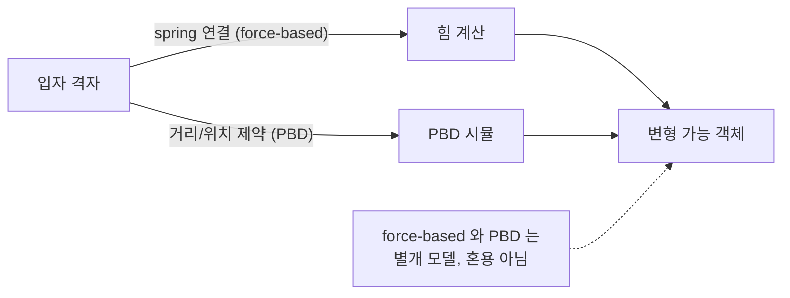
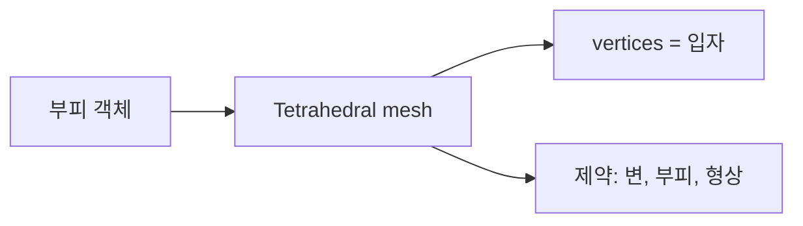
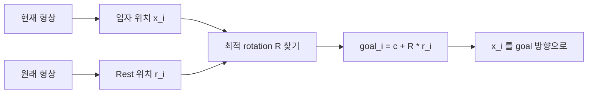
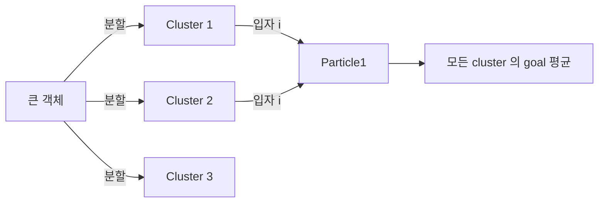
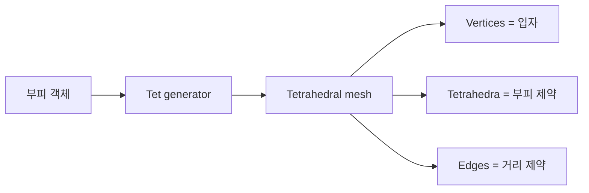

## 들어가며

게임의 *Jelly 같은 객체* — 누르면 들어가고 놓으면 돌아오는 변형 가능한 객체. 강체로는 표현 불가능 — 강체 가정의 *완전 강성* 을 깨야 *fold / squish / dent* 표현.

*Soft body* 시뮬레이션 — 객체가 *변형 가능*. 게임에서 *jelly enemy, deformable rubber, stretchy ball, organic mass* 가 핵심 응용.

핵심 패턴.

- **입자 + 거리 제약** — 가장 단순한 이산 모델.
- **부피 제약** — *전체 부피 보존*. jelly 의 핵심.
- **shape matching** — *원래 형상으로 복귀하는 force*. 강성과 부드러움 사이.
- **Tetrahedral mesh** — 부피 내부의 변형장을 표현하는 3D 이산화.
- **FEM (Finite Element Method)** — 재료의 구성 방정식과 변형 gradient를 요소 단위로 푸는 방법.

이 글의 목표.

1. **Soft body 의 모델링 선택** — 입자, mesh, FEM.
2. **거리 + 부피 제약** — jelly 의 기본 구조.
3. **Shape matching** — 형상 복귀의 우아한 방법.
4. **Tetrahedral mesh** — 3D 부피 객체.
5. **렌더링 mesh 와의 결합** — 시뮬레이션 mesh vs 시각 mesh.
6. **충돌 처리** — soft body 의 표면 충돌.
7. **성능 트레이드오프** — 강성 / 비용 / 안정성.
8. **구현 선택** — solver 계약과 기능 경계.

이 글이 마치면 *jelly enemy* 같은 객체를 *어떤 모델 / 어떤 제약 / 어떤 비용* 으로 구현할지 결정 가능하다.


---

## 목차
1. [Soft body 의 모델링 선택](#1-soft-body-의-모델링-선택)
2. [거리 + 부피 제약](#2-거리--부피-제약)
3. [Shape matching](#3-shape-matching)
4. [Tetrahedral mesh](#4-tetrahedral-mesh)
5. [렌더링 mesh 와의 결합](#5-렌더링-mesh-와의-결합)
6. [Soft body 충돌](#6-soft-body-충돌)
7. [성능 트레이드오프](#7-성능-트레이드오프)
8. [구현 선택](#8-구현-선택)


---

## 1. Soft body 의 모델링 선택

soft body 의 *기하학적 모델*. 정밀성 vs 비용 의 결정.

### 1.1 입자 + spring 격자

가장 단순 — 객체를 *3D 입자 격자* 로 모델. 인접 입자 사이에 *spring*.



장점: 구현 단순. 단점: *모서리 가까이서 깍둑* — 표면이 *입자 해상도* 에 묶임.

### 1.2 표면 mesh + 내부 입자

표면 *triangle mesh* + 내부 *입자 cloud*. mesh 의 *vertex 가 입자 역할* + 내부 *볼륨 입자*. 표면이 자연스럽고 *부피 보존* 가능.

### 1.3 Tetrahedral mesh

부피를 *작은 tetrahedron 들로 분할*. 각 vertex가 자유도를 갖고, 각 tetrahedron에서 부피 제약이나 변형 에너지를 계산한다.



장점: 부피 내부의 국소 변형과 재료장을 표현할 수 있다. 단점: 양질의 tet mesh 생성, 퇴화 요소 제거, 큰 자유도와 접촉 처리가 필요하다. tetrahedral 이라는 사실만으로 정확도가 보장되지는 않는다.

### 1.4 FEM (Finite Element)

각 tetrahedron에서 rest pose와 현재 pose로 deformation gradient를 구하고, 구성 방정식에서 응력이나 탄성 에너지를 계산한다. 결과의 물리적 의미는 재료 모델, 요소 차수, mesh 품질, 시간 적분과 선형·비선형 솔버의 수렴 허용 오차에 달려 있다.

실시간에서도 규모와 요구에 따라 FEM을 사용할 수 있고, PBD·XPBD·shape matching을 선택할 수도 있다. 전자는 재료 파라미터와 응력 해석에 유리하고, 후자는 제약 기반 제작과 제한된 반복 예산에서의 강건성에 유리하다. 여기서 FEM은 공간 이산화와 구성 에너지의 선택이고, PBD/XPBD는 그 에너지나 제약을 어떤 solver로 최소화하는지의 선택이다. 두 축은 직교에 가까워 같은 구성 에너지를 PBD/XPBD로 풀 수도 있으므로, 아래 비용·정밀도 표를 두 방법의 배타적 정확도 순위로 읽지 않는다.

### 1.5 산업 결정

| 모델 | 비용 | 정밀도 | 게임 사용 |
|---|---|---|---|
| 입자 격자 + spring | 낮음 | 낮음 | jelly enemy, 단순 효과 |
| 표면 + 내부 입자 | 중 | 중 | 캐릭터 신체 일부, 부드러운 무기 |
| Tetrahedral PBD | 높음 | 높음 | 고급 캐릭터, 변형 환경 |
| Tetrahedral FEM | 매우 높음 | 매우 높음 | 영화, R&D |

“게임 대 영화”가 아니라 **관측할 물리량과 오차 계약**으로 고른다. 단순한 눌림과 복원만 필요하면 shape matching으로 충분할 수 있고, 절개·응력·재료 이방성이 필요하면 volumetric mesh와 연속체 모델의 가치가 커진다.

### 1.6 모델 선택 기준

- *제약 횟수* — N 입자, M 제약 → 매 iter O(M). 비용.
- *입자 밀도* — 표면 해상도와 변형 정밀도 결정.
- *연결성* — 격자 정규? mesh 비정규? tetrahedral 비정규? 솔버 안정성 영향.

절대 입자 수만으로 비용을 예측할 수 없다. 제약 수와 graph coloring, 접촉 수, 반복 횟수, sparse solve 방식, CPU/GPU 전송이 함께 비용을 결정한다.


## 2. 거리 + 부피 제약

soft body 의 *기본 제약 두 종류*.

### 2.1 거리 제약 (스프링의 PBD 버전)

두 입자 사이 거리 = 상수.

$$
C(\vec{x}_1, \vec{x}_2) = \|\vec{x}_1 - \vec{x}_2\| - d_0 = 0
$$

PBD project 가 *늘어남 / 축소를 보정*. 가장 단순한 soft body 의 핵심 제약.

### 2.2 mass-spring 의 명시적 힘

거리 제약을 *PBD project 없이 명시적 force* 로 풀면 mass-spring 모델:

$$
\vec{F}_s = -k_s (\|\vec{r}\| - L_0) \hat{\vec{r}} - k_d (\dot{\vec{r}} \cdot \hat{\vec{r}}) \hat{\vec{r}}
$$

stiffness $k_s$ 가 *높을수록 단단함* — 하지만 명시적 적분에서는 *큰 $k_s$ → 작은 dt 필요* (stiff ODE). PBD는 위치 제약을 반복 투영해 이 발산 양상을 피하지만, 겉보기 강성이 dt·sub-step·iteration 수에 의존한다. XPBD는 compliance를 도입해 이 의존성을 줄인다.

### 2.3 mass-spring 의 한계

- *부피 보존 안 됨* — edge 길이를 제어해도 독립적인 부피 불변량은 없다.
- *비등방성 (anisotropic)* — mesh 위상 따라 *움직임이 달라짐*. 격자 정렬 잘된 곳은 단단, 비균일 곳은 부드러움.
- *큰 stiffness → 작은 dt* — 명시적 적분 한계.

부피 제약은 압축을 직접 제어하지만 mesh 방향에 따른 이방성과 시간 간격 의존성을 자동으로 모두 해결하지는 않는다.

### 2.4 부피 제약 — tetrahedron

4 입자가 정의하는 *tetrahedron* 의 부피:

$$
V = \tfrac{1}{6} (\vec{x}_2 - \vec{x}_1) \cdot ((\vec{x}_3 - \vec{x}_1) \times (\vec{x}_4 - \vec{x}_1))
$$

제약:

$$
C = V - V_0 = 0
$$

PBD project 가 *부피를 V₀ 로 유지*. jelly 가 *눌리면 옆으로 부풀어 오름* — 부피 일정.

### 2.5 부피 제약 gradient

$$
\nabla_{\vec{x}_1} C = -\tfrac{1}{6} (\vec{x}_3 - \vec{x}_2) \times (\vec{x}_4 - \vec{x}_2)
$$

(다른 3 vertex 가 대칭으로 gradient 만든다.)

PBD 의 표준 project 식 적용.

### 2.6 거리 vs 부피의 의미

- *거리 제약만* — cloth 같은 표면. 부피 보존 안 됨.
- *거리 + 부피 제약* — jelly. *눌렀을 때 옆으로 부풀어 오름*.

부피 제약 없는 조밀한 spring 격자도 topology 때문에 압축에 저항해 jelly처럼 보일 수 있다. 그러나 보존되는 부피가 명시되어 있지 않으므로 찌그러짐과 해상도에 따라 손실량이 달라진다.

### 2.7 다중 제약 균형

거리 + 부피의 *경합* — 거리 stiffness 가 너무 강하면 부피 변형 어려움. 반대도.

- *고급 jelly*: 거리 stiffness 중, 부피 stiffness 높음. 모양 부드럽지만 부피 단단.
- *연한 jelly*: 거리 stiffness 약, 부피 stiffness 중. 둘 다 변형 쉬움.
- *단단 rubber*: 둘 다 높음.

XPBD compliance 로 *재질별 다른 값*.


## 3. Shape matching

PBD 기반 우아한 *형상 복귀* 방법.

### 3.1 아이디어

객체의 *현재 입자 분포* 가 *원래 분포의 회전 변환* 에서 얼마나 떨어졌나? 그 *최적 회전* 을 찾아 *입자들을 그 방향으로 끌어당김*.



### 3.2 알고리즘

1. 원래 형상의 *rest 위치* $\vec{r}_i$ 저장.
2. 매 step:
 - 질량중심: $\vec{c} = \frac{\sum m_i \vec{x}_i}{\sum m_i}$.
 - 최적 회전 $R$ — *상대 위치* $\vec{x}_i - \vec{c}$ 와 $\vec{r}_i$ 사이를 SVD 또는 polar decomposition 으로.
 - Goal: $\vec{g}_i = \vec{c} + R \vec{r}_i$.
 - 입자를 $\vec{x}_i \leftarrow \vec{x}_i + \alpha (\vec{g}_i - \vec{x}_i)$ 로 보정.

데이터 계약으로 rest shape의 질량 가중 중심 $\vec{c}^{\,0} = \sum_i m_i \vec{x}_i^{0} / \sum_i m_i$ 을 먼저 정의하고, 저장하는 rest 좌표를 $\vec{q}_i = \vec{x}_i^{0} - \vec{c}^{\,0}$ 로 고정한다. 즉 `restRelative`는 이미 rest COM을 뺀 데이터여야 한다. 고정 입자($invMass=0$)도 질량 가중치로 $A_{pq}$ fitting에는 참여하되 위치 보정 $\vec{x}_i \leftarrow \vec{x}_i + \alpha (\vec{g}_i - \vec{x}_i)$ 에서는 제외한다. $R$은 $\det(R)=+1$ 로 강제한다.

단순 $\alpha$ 는 호출 횟수와 dt에 따른 보정 비율이다. 재료의 시간 단위 강성처럼 사용하려면 지수 응답으로 변환하거나 XPBD compliance와 결합해야 한다.

### 3.3 최적 회전 찾기

행렬 $A_{pq} = \sum m_i (\vec{x}_i - \vec{c}) \vec{r}_i^T$.

Polar decomposition $A_{pq} = R S$ — $R$ 가 *최적 회전*. $S = \sqrt{A_{pq}^T A_{pq}}$.

```cpp
mat3 ComputeOptimalRotation(const std::vector<vec3>& restRelative,
                              const std::vector<vec3>& currentRelative,
                              const std::vector<float>& masses) {
    mat3 Apq = mat3::Zero();
    for (size_t i = 0; i < restRelative.size(); ++i) {
        Apq += masses[i] * Outer(currentRelative[i], restRelative[i]);
    }
    return PolarDecomposition(Apq).rotation;
}
```

SVD 또는 반복 polar decomposition으로 $R$을 구한다. $A_{pq}$가 거의 특이하거나 반사를 포함하면 회전이 불안정할 수 있으므로, 최소 singular value 처리와 $\det(R)=+1$ 보정이 필요하다. 3×3 분해 자체는 작지만 객체·cluster 수와 반복 빈도만큼 누적된다.

### 3.4 장점

- *발산에 강함*: 입자가 멀리 가도 목표 형상 쪽으로 복귀하려는 보정이 생김.
- *단순*: 한 객체에 *한 step 한 번* 의 SVD.
- *시각적 우수*: jelly 같은 *생물적 움직임*.

### 3.5 단점

- *부드러움 부족*: alpha 가 결국 *Lerp* 라 stiff 처럼 보일 수 있음.
- *고해상도엔 비싸짐*: 입자 수 N 의 *Apq 계산*.
- *모든 입자가 한 rest 만 가짐*: *국소 변형* (한 부분만 누름) 표현 약함.

### 3.6 cluster shape matching

객체를 *여러 cluster 로 분할*. 각 cluster 가 *자기 rest + 자기 R*. 한 입자가 *여러 cluster 에 속함* (overlap).



국소 변형 표현 가능. 비용은 cluster 수 배.

### 3.7 회전 vs 변형

shape matching 의 *최적 R 가 rigid*. 변형 (stretch) 은 *S 에 들어감* — 무시. 단단한 객체엔 좋지만 *늘어남 표현* 약함.

해결: *linear shape matching* — $R$ 대신 일반 $A$ 사용. *늘어남 허용*. 안정성 단점.


## 4. Tetrahedral mesh

3D 부피 객체의 정밀 모델.

### 4.1 모델

객체의 부피를 *tetrahedron 들로 채움*. 각 vertex 가 입자. 각 tet 이 *부피 + 형상 제약*.



### 4.2 Tet mesh 생성

소프트웨어:

- *TetGen* — 오픈소스, 무료.
- *fTetWild* — 모던 학술 / 무료.
- *NetGen* — 학술 / 무료.
- *Houdini* — tetrahedralization 도구를 제공하는 상용 DCC.

Triangle mesh → Tet mesh 자동 생성. 게임은 *수동 + sanity 검사*.

### 4.3 자료 구조

```cpp
struct TetSoftBody {
    std::vector<Particle>            particles;
    std::vector<DistanceConstraint>  edgeConstraints;
    std::vector<VolumeConstraint>    volumeConstraints;
    std::vector<int>                 tetrahedra;     // 4 vertex per tet
};
```

부피 제약 + 거리 제약 (tet 의 edge 들).

### 4.4 시뮬레이션

PBD 표준 루프. predict → project (모든 거리 + 부피) → correct.

```cpp
void StepTetSoftBody(TetSoftBody& body, vec3 gravity, float dt) {
    // 1. Predict
    for (auto& p : body.particles) {
        p.predicted = p.position;                 // 고정 입자도 predicted 가 있어야 제약이 앵커로 읽는다
        if (p.invMass <= 0) continue;
        p.velocity += gravity * dt;
        p.predicted = p.position + p.velocity * dt;
    }

    // 2. Project (kIter 회)
    for (int iter = 0; iter < kIter; ++iter) {
        for (auto& c : body.edgeConstraints)   c.Project(body.particles);
        for (auto& c : body.volumeConstraints) c.Project(body.particles);
    }

    // 3. Correct
    for (auto& p : body.particles) {
        if (p.invMass <= 0) continue;
        p.velocity = (p.predicted - p.position) / dt;
        p.position = p.predicted;
    }
}
```

고정 입자도 예측 위치를 가지며 constraint geometry에는 앵커로 참여하되 적분·위치 보정에서는 제외한다. 움직이는 anchor, teleport, 재고정 시에는 현재 position 복사만으로 속도·반작용을 모두 모델링하지 못하므로 target pose·anchor velocity·양방향 결합 정책을 별도 계약으로 둔다.

### 4.5 표면 vertex vs 내부 vertex

- *표면 vertex* (외피) — 충돌 / 렌더링 mesh 와 연결.
- *내부 vertex* — 부피 / 형상 유지에 필요한 추가 입자.

내부 vertex 가 많으면 *변형 자유도 높음* + *비용 큼*.

### 4.6 인버전 처리

tet이 뒤집히면 signed volume의 부호가 바뀌고 deformation gradient의 determinant가 0을 지나 음수가 된다. 이때 임의의 vertex를 평면 반대편으로 순간 이동시키는 `FlipInversion` 같은 처리는 운동량을 깨고 인접 tet을 다시 뒤집을 수 있으므로 일반 해법이 아니다.

예방에는 더 작은 sub-step, 연속 충돌 검출, 양질의 rest mesh, 최대 보정량이 사용된다. 재료 solver는 singular value를 제한한 inversion-robust 에너지, barrier potential, 또는 뒤집힘 구간을 정의한 제약 모델을 사용할 수 있다. 이미 심하게 뒤집힌 상태를 복구할 수 없는 경우에는 마지막 유효 상태 복원이나 객체 파괴처럼 명시적인 실패 정책이 필요하다.

### 4.7 corotational FEM (한 발 앞서)

PBD/XPBD와 마찬가지로 FEM도 *deformation gradient* $F = \partial \vec{x} / \partial \vec{X}$ 에서 응력을 계산하는 구성 모델을 쓸 수 있다. *선형 소변형(linear small-strain)* strain $S - I$ 를 그대로 쓰면 큰 회전에서 객관성(objectivity)이 깨져 비물리적 응력이 생긴다. polar decomposition $F = R S$ 에서 $R$ 을 분리해 회전을 제거한 *corotational FEM* 은 이 문제를 줄이는 한 가지 모델이다.

따라서 “회전 시 stress 발산”은 일반 FEM 전체의 한계가 아니라 선형 소변형 strain 모델의 한계다. 선형 FEM, corotational FEM, 비선형 hyperelastic FEM은 서로 다른 에너지를 정의하고, 그 에너지를 어떤 solver로 최소화하는지는 별도 축이다. PBD + shape matching이 corotational과 근사적으로 유사한 시각 효과를 줄 수 있지만, corotational FEM은 PBD의 자연 확장이나 동의어가 아니다.


## 5. 렌더링 mesh 와의 결합

시뮬레이션 mesh ≠ 렌더링 mesh. 둘의 결합.

### 5.1 시뮬레이션 vs 렌더링

| 측면 | 시뮬레이션 mesh | 렌더링 mesh |
|---|---|---|
| 해상도 | 낮음 (수십 ~ 수백) | 높음 (수천 ~ 수만 vertex) |
| 위상 | tetrahedral / 입자 격자 | triangle |
| 사용 | 물리 솔버 | GPU 렌더 |

두 mesh 가 *서로 보완* — 시뮬은 가벼움, 렌더는 정밀.

### 5.2 결합 방법

렌더 mesh 의 각 vertex 가 *시뮬 mesh 의 어느 tet 안* — barycentric coordinate.

```cpp
struct RenderVertex {
    int   tetIdx;            // 어느 tet 안
    vec4  barycentric;       // 그 tet 안 위치
};

vec3 ComputeRenderPos(const RenderVertex& v,
                       const std::vector<vec3>& simParticles,
                       const std::vector<int>& tets) {
    const int* idx = &tets[v.tetIdx * 4];
    return simParticles[idx[0]] * v.barycentric.x
         + simParticles[idx[1]] * v.barycentric.y
         + simParticles[idx[2]] * v.barycentric.z
         + simParticles[idx[3]] * v.barycentric.w;
}
```

매 frame 렌더 vertex 위치 = *시뮬 vertex 의 가중합*.

### 5.3 Barycentric 사전 계산

객체 생성 시 (rest pose) 렌더 vertex 마다:

1. *어느 tet 안* — point-in-tet 검사.
2. *그 tet 의 barycentric* — 4 vertex 의 가중치 (합 = 1).

런타임은 단순 가중합.

### 5.4 normal 의 처리

렌더 normal 은 *변형된 mesh* 에서 *동적 계산* 또는 *변형 행렬 적용*.

```cpp
// 정점별 normal 동적 계산 (느리지만 정확)
for (auto& tri : renderTriangles) {
    vec3 v0 = ComputeRenderPos(verts[tri.a], ...);
    vec3 v1 = ComputeRenderPos(verts[tri.b], ...);
    vec3 v2 = ComputeRenderPos(verts[tri.c], ...);
    vec3 nRaw = cross(v1 - v0, v2 - v0);
    if (length_squared(nRaw) < 1e-12f) continue;  // 퇴화 삼각형
    vec3 n = normalize(nRaw);
    // 정점 평균 ...
}
```

GPU compute shader 로 병렬 처리.

### 5.5 Skinning 통합

soft body 의 *vertex 를 본 본의 변형 + soft body 변형* 둘 다 따르게. 캐릭터의 *살* 이 본의 변형 (기본 skinning) + 추가 jelly 흔들림.

이중 변환 — *본의 변환 → soft body 변환* 합성.

### 5.6 LOD

거리 멀어지면 *시뮬 mesh 해상도 낮춤*. 렌더 mesh 와는 무관 — 시뮬만 단순화.

가까이서 *고해상도 부드러운 변형*, 멀리서 *저해상도 빠른 시뮬*.


## 6. Soft body 충돌

변형 객체의 충돌 검출 / 응답.

### 6.1 표면 입자 vs 환경

표면 입자가 환경 콜라이더와 충돌. 각 입자가 *점 vs 환경* 검사.

```cpp
for (auto& p : softBody.surfaceParticles) {
    for (auto& env : environment.colliders) {
        float depth;
        vec3  normal;
        if (TestPenetration(p.predicted, p.radius, env, depth, normal)) {
            p.predicted += normal * depth;
        }
    }
}
```

PBD project 의 추가 단계. 비용 = *표면 입자 수 × 환경 콜라이더 수*.

### 6.2 강체와 soft body

강체가 soft body 누를 때 — 표면 입자가 *강체에 의해 밀려남*.

| 방향 | 처리 |
|---|---|
| 강체 → soft (soft 가 밀려남) | 입자 위치 보정 |
| soft → 강체 (강체에 영향) | 표면 입자의 반작용 force 가 강체에 |

대부분 게임이 *one-way* — 강체 → soft 만. *두 방향* 통합은 *복잡 / 비용 큼*.

### 6.3 Soft body 간 충돌

두 soft body 가 서로 부딪힘. 표면 입자 vs 표면 입자 + grid hash.

```cpp
GridHash g;
for (auto& body : softBodies)
    for (auto& p : body.surfaceParticles) Insert(g, p);

for (auto& body : softBodies)
    for (auto& p : body.surfaceParticles) {
        std::vector<int> neighbors;
        FindNeighbors(g, p.predicted, kRadius, neighbors);
        for (int n : neighbors) {
            // 다른 body 의 입자와 분리 제약
        }
    }
```

cloth 의 self-collision 패턴과 같음.

### 6.4 표면 vs 부피

표면 입자만 충돌 검사 — *얇은 콜라이더가 부피 안 침투* 가능. 작은 환경 콜라이더가 *큰 jelly 안* 으로 들어옴.

해결에는 volumetric collision proxy, 표면 triangle의 swept collision, 내부 샘플, 충돌 형상 inflation이 있다. 내부 입자만 더 검사한다고 표면 사이의 연속 충돌이 정확해지는 것은 아니다.

### 6.5 CCD 의 어려움

soft body 의 *continuous collision* — 변형 중 *모든 입자 경로* 검사. 매우 비쌈.

CCD 필요성은 입자 속도와 최소 feature 두께의 비율로 판단한다. 한 step 이동량이 얇은 collider나 표면 triangle 두께에 가까우면 정적 검사만으로 tunneling이 가능하다.

### 6.6 마찰

아래 코드는 접선 속도를 일정 비율로 줄이는 시각적 damping heuristic이다. Coulomb 마찰이라면 접선 보정 또는 접선 임펄스의 크기를 법선 보정·임펄스의 $\mu$ 배로 제한해야 하며, 정마찰과 동마찰 상태를 구분한다.

```cpp
vec3 vAlong = p.velocity - dot(p.velocity, normal) * normal;
p.velocity -= vAlong * std::clamp(tangentDamping, 0.0f, 1.0f);
```


## 7. 성능 트레이드오프

soft body 의 핵심 트레이드오프.

### 7.1 비용 모델

예측과 속도 갱신은 $O(N)$, 제약 반복은 $O(kM)$, 충돌은 broad phase 후보와 실제 접촉 수에 비례한다. 여기서 $N$은 입자 수, $M$은 제약 수, $k$는 반복 횟수다. tet 해상도를 한 축에서 두 배로 높이면 3D에서는 요소 수가 대략 여덟 배로 늘 수 있으므로 “입자 두 배 = 비용 두 배”도 일반식이 아니다.

### 7.2 반복 수와 재료

Gauss-Seidel식 PBD에서는 반복 수가 늘수록 제약 잔차가 줄어 보통 더 단단해 보이지만, 효과는 constraint ordering과 topology에 의존한다. 반복 수를 재료 파라미터로 쓰면 성능 설정이 재질을 바꾸는 문제가 생긴다. XPBD compliance를 재료 계약으로 두고, 반복 수는 목표 잔차와 시간 예산을 만족시키는 solver 품질 설정으로 관리한다.

### 7.3 LOD 전략

- 멀리: 시뮬 mesh 저해상도, kIter 적음, *시각만* 보임.
- 가까이: 시뮬 mesh 고해상도, kIter 많음, *정밀 변형*.
- 화면 밖: 게임플레이에 영향을 주지 않을 때만 sleep 또는 낮은 빈도로 갱신.

해상도를 전환할 때는 위치뿐 아니라 질량, 속도, 제약 multiplier와 접촉 상태를 새 mesh로 전달해야 한다. 그렇지 않으면 에너지와 부피가 갑자기 바뀌어 popping이 생긴다.

### 7.4 GPU vs CPU

GPU는 많은 독립 제약에 유리하지만, 연결 제약의 동시 쓰기 충돌 때문에 graph coloring, Jacobi 누적, atomic 또는 gather 방식이 필요하다. CPU는 낮은 지연과 게임 상태 접근이 쉽고, GPU는 큰 batch와 렌더 데이터 공유에 유리하다. 경계는 고정 입자 수가 아니라 제약 topology, 전송과 동기화, 대상 하드웨어의 측정값으로 정한다.

### 7.5 시각만 vs 시뮬

| 목적 | 솔루션 |
|---|---|
| 그냥 흔들림 효과 | Skeletal animation + jiggle bone |
| 진짜 변형 효과 | soft body 시뮬 |
| 응력·재료 파라미터가 필요한 변형 | 검증된 FEM 또는 연속체 모델 |

대부분 jiggle bone (애니메이션 변형) 이 충분 — 진짜 soft body 보다 *훨씬 빠름 + 안정*.

### 7.6 성능 계약

고정된 밀리초 배분이나 캐릭터 수는 플랫폼과 게임에 이식할 수 없다. `predict`, 각 제약 종류, broad/narrow phase, contact solve, skinning update를 따로 계측한다. 평균뿐 아니라 최대 이웃 수, solver 잔차의 상위 percentile, 최악 프레임 시간을 함께 기록하고 품질 단계별 상한을 정한다.


## 8. 구현 선택

제품 이름보다 필요한 solver 계약을 먼저 정한다.

### 8.1 기능 체크리스트

- volumetric mesh와 surface embedding을 어떻게 생성·검증하는가?
- PBD/XPBD, shape matching, FEM 중 어떤 재료 모델을 제공하는가?
- self-collision, CCD, friction, rigid-body 양방향 결합을 지원하는가?
- CPU와 GPU 중 어디서 풀며 readback 없이 렌더링까지 연결할 수 있는가?
- topology 변경, 절개, LOD 상태 이전과 serialization이 필요한가?
- solver residual, inversion, volume error를 관측할 수 있는가?

### 8.2 게임 디자인 결정

soft body 가 게임플레이에 *필요한가*?

- *그냥 시각*: jiggle bone, 애니메이션 — 가성비 최고.
- *상호작용 (눌리기)*: 단순 PBD soft body 적당.
- *상호작용 + 국소 변형*: tetrahedral PBD/XPBD 또는 shape matching cluster.
- *응력과 재료 파라미터가 게임 규칙*: 검증된 FEM과 명시적 오차 기준.

시각적 목표를 본 애니메이션으로 충족할 수 있다면 volumetric solver는 불필요하다. 반대로 변형 상태가 충돌·파괴·게임 규칙에 쓰이면 저해상도라도 상태가 보존되는 물리 모델이 필요하다.


---

## 결론

Soft body는 연속체를 유한한 자유도와 재료·제약 모델로 이산화한다. PBD/XPBD, shape matching과 FEM은 서로 다른 오차와 제작 방식을 제공한다.

핵심 결정 패턴.

1. **모델링** — 입자 격자 (단순) / 표면+내부 (균형) / tetrahedral (정확).
2. **제약** — 거리 + 부피 + shape matching 의 조합.
3. **Shape matching** — 전역 또는 cluster별 목표 형상으로 복원.
4. **렌더링 mesh** — barycentric 으로 시뮬 mesh 에 연결. 시뮬과 렌더 해상도 분리.
5. **충돌** — 표면 입자 vs 환경. cloth 의 self-collision 와 동일 패턴.
6. **트레이드오프** — 입자 수 $N$, 제약 수 $M$, 반복 횟수 $k$ 를 조정. 기본 갱신은 $O(N + kM)$ 이고 이웃 탐색·충돌 비용은 별도. budget 안에서 조정.
7. **통합** — 상태 이전, 충돌 결합, 계측과 실패 정책.

Soft body 의 핵심은 *변형 자유도* 를 어떻게 제한하느냐다. 거리, 부피, shape matching, tetrahedral mesh 는 모두 시각적 그럴듯함과 계산 비용 사이의 선택지다.

## 더 읽을거리

- Müller et al., "Position-Based Dynamics" (2007) — soft body 의 학술 기반.
- Müller et al., "Meshless Deformations Based on Shape Matching" (2005) — shape matching 원전.
- Macklin et al., "XPBD: Position-Based Simulation of Compliant Constrained Dynamics" (2016) — compliance 의 일반화.
- Sifakis & Barbic, "FEM Simulation of 3D Deformable Solids" (SIGGRAPH course) — FEM 학술 표준.
- Bender, Müller, Macklin, "A Survey on Position Based Dynamics" (2017).
- Unreal Chaos Documentation, "Soft Body" — 산업 통합.
- NVIDIA Flex Documentation — GPU PBD 통합 솔버.
- Bullet Physics, "Soft Body" — 오픈소스 reference.
- Bridson, "Fluid Simulation for Computer Graphics" — fluid 와 비교용 학습.
