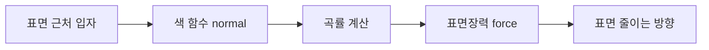

## 들어가며

게임의 *유체* — 물, 슬라임, 용암, 폭포, 핏자국. 유체는 연속체 모델로 압력과 속도장을 다루며, 자유 표면 (free surface) 은 시간에 따라 모양이 바뀐다.

유체 시뮬레이션의 *두 큰 패러다임*:

- **Eulerian (grid 기반)**: 공간을 *고정 grid 로 분할*, 각 셀에서 *유체 속성 (속도, 압력, 밀도)* 의 시간 변화를 푼다. 압력 투영으로 비압축성을 다루기 좋고, 자유 표면에는 level set, VOF 같은 별도 추적법이 필요하다.
- **Lagrangian (입자 기반)**: 유체를 *입자들의 집합* 으로 본다. 각 입자가 *자신의 위치, 속도, 질량* 을 들고 다님. *자유 표면 자연스러움*.

**SPH (Smoothed Particle Hydrodynamics)** 는 대표적인 Lagrangian 유체 기법이다. 자유 표면과 이동 경계를 입자로 표현하기 쉽고 병렬화할 수 있지만, 이웃 검색·밀도 오차·인장 불안정·경계 처리 비용을 지불한다. 게임 유체에는 SPH 외에도 height field, shallow water, Eulerian grid, FLIP, 화면 공간 효과가 사용되며 요구사항에 따라 선택한다.

이 글의 목표.

1. **SPH 의 핵심 아이디어** — 연속 양의 *입자 가중합* 근사.
2. **Smoothing kernel** — 가중치 함수 의 종류.
3. **밀도와 압력** — 유체 *비압축성* 표현.
4. **점성과 표면장력** — 유체의 *다른 두 핵심* 효과.
5. **CFL 시간 stepping 제약**.
6. **PCISPH / IISPH / PBF** — 큰 dt 가능 변종.
7. **표면 추출과 렌더링**.
8. **표현 방식 선택** — 요구에 맞는 수치 모델과 근사.

수식과 코드는 3D compact-support kernel 을 기준으로 한다. 2D 구현에서는 위치 벡터만 줄이는 것으로 끝나지 않으며 kernel 정규화 상수를 2D에 맞게 바꿔야 한다.


---

## 목차
1. [SPH 의 핵심 아이디어](#1-sph-의-핵심-아이디어)
2. [Smoothing kernel](#2-smoothing-kernel)
3. [밀도와 압력](#3-밀도와-압력)
4. [점성과 표면장력](#4-점성과-표면장력)
5. [Time step 제약 (CFL)](#5-time-step-제약-cfl)
6. [PCISPH / IISPH / PBF](#6-pcisph--iisph--pbf)
7. [표면 추출과 렌더링](#7-표면-추출과-렌더링)
8. [표현 방식 선택](#8-표현-방식-선택)


---

## 1. SPH 의 핵심 아이디어

유체의 *임의 양* (밀도, 압력, 속도) 을 *입자의 가중합* 으로 근사.

### 1.1 보간 식

연속 양 $A(\vec{r})$:

$$
A(\vec{r}) \approx \sum_j m_j \frac{A_j}{\rho_j} W(\vec{r} - \vec{r}_j, h)
$$

- $m_j$: 입자 $j$ 의 질량.
- $A_j$: 입자 $j$ 의 양 값.
- $\rho_j$: 입자 $j$ 의 밀도.
- $W(\vec{r} - \vec{r}_j, h)$: 거리 $\|\vec{r} - \vec{r}_j\|$ 와 *smoothing radius* $h$ 에 의존하는 *kernel 가중 함수*.

먼 입자는 가중 작음, 가까운 입자는 가중 큼. $h$ 가 *영향 반경*.

### 1.2 핵심 관찰

연속 적분 $\int f(\vec{r}') W(\vec{r} - \vec{r}', h) d\vec{r}' \approx f(\vec{r})$ — kernel 이 *Dirac delta 의 부드러운 근사*.

위 식은 kernel 적분을 입자 합으로 이산화한 것이다. 단순히 $h \to 0$ 으로 보내면 이웃이 사라지므로 정확해지는 것이 아니다. 해상도를 높여 입자 간격 $\Delta x$ 도 함께 줄이고, 지지 영역 안의 이웃 수와 입자 분포 규칙성을 유지하며, kernel consistency 조건을 만족해야 연속장에 수렴할 수 있다.

### 1.3 gradient 와 Laplacian

물리 식 (Navier-Stokes) 은 *공간 미분* 들. SPH 가 *미분도 입자 합* 으로 근사:

$$
\nabla A(\vec{r}) \approx \sum_j m_j \frac{A_j}{\rho_j} \nabla W(\vec{r} - \vec{r}_j, h)
$$

$$
\nabla^2 A(\vec{r}) \approx \sum_j m_j \frac{A_j}{\rho_j} \nabla^2 W(\vec{r} - \vec{r}_j, h)
$$

핵심: *kernel 의 미분* 이 *닫힌 형태* — 해석적 계산.

### 1.4 입자의 의미

각 입자가 *유체의 작은 조각*. 질량 $m_j$ 가 고정. 위치 $\vec{r}_j$, 속도 $\vec{v}_j$, 밀도 $\rho_j$, 압력 $p_j$ 가 *시간에 따라 갱신*.


### 1.5 N² 의 회피

각 입자가 *모든 입자와 가중합* — 단순하면 N². 큰 N (수만 입자) 에서 *치명적 비용*.

해결: 입자 시뮬의 **grid hash**. 셀 크기를 kernel 지지 반경에 맞추고 셀 점유가 제한되면, 구축은 $O(N)$, 이웃 순회는 실제 후보 쌍 수에 비례한다.

```cpp
for (auto& p : particles) {
    std::vector<int> neighbors;
    FindNeighborsInGridHash(g, p.position, h, neighbors);
    // neighbors 만 사용
}
```

균일 분포에서는 입자당 후보 수가 거의 일정해 전체가 기대 $O(N)$ 에 가깝다. 한 셀에 입자가 몰리면 후보 쌍이 $O(N^2)$ 까지 증가할 수 있으므로 최대 점유, 입자 최소 간격, 정렬·prefix-sum 기반 셀 목록을 함께 관리한다. 그리드는 공간 검색용 가속 구조일 뿐, 유체 상태가 격자에 저장되는 Eulerian 해법으로 바뀌는 것은 아니다.

### 1.6 $h$ 선택

$h$ 와 입자 간격의 비율은 kernel 정의와 목표 이웃 수로 정한다. 문헌에 따라 $h$ 를 kernel length scale 로 부르고 지지 반경을 $2h$ 로 두기도 하며, Müller 계열처럼 $h$ 자체를 지지 반경으로 쓰기도 한다.

너무 작음 → 이웃 적음, 밀도 추정 불안정.
너무 큼 → 이웃 많음, 계산 비용 큼.

따라서 구현과 데이터에 **kernel 식, 차원, $h$ 의 의미, 목표 이웃 수**를 함께 명시해야 한다. 고정 배수 하나를 모든 kernel 에 적용하면 밀도 스케일과 비용이 달라진다.


## 2. Smoothing kernel

가중 함수 $W$ 의 *종류*.

### 2.1 kernel 조건

- $W(\vec{r}, h) \ge 0$ — 비음수.
- $\int W \, dV = 1$ — 정규화.
- $r > h$ 에서 $W = 0$ — *컴팩트 지지 (compact support)*. 멀리는 무시.
- 매끄러움 — 미분 가능 (차수 적당).

대칭 함수가 일반 — $W(\vec{r}, h) = W(\|\vec{r}\|, h)$.

### 2.2 Poly6 (Müller 2003)

밀도 추정에 표준.

$$
W_{poly6}(r, h) = \begin{cases}
\frac{315}{64 \pi h^9} (h^2 - r^2)^3, & 0 \le r \le h \\
0, & r > h
\end{cases}
$$

3D 정규화. 매끄러움 좋음. 압력 gradient 에는 부족 (특이점 근처 약함).

### 2.3 Spiky (Desbrun 1996)

압력 gradient 용. 중심에 가까워질수록 gradient 크기가 0으로 약해지는 커널에서 생길 수 있는 입자 군집을 줄이기 위해 사용한다.

$$
W_{spiky}(r, h) = \frac{15}{\pi h^6} (h - r)^3
$$

gradient의 크기는 입자가 가까워질수록 강해지지만, 정확히 $r=0$ 에서는 방향 벡터 $\hat{r}$를 정의할 수 없다. 구현은 같은 위치의 쌍을 건너뛰거나 별도의 겹침 처리 규칙을 둔다.

### 2.4 Viscosity kernel

점성 항 (Laplacian) 용. Laplacian 이 *부드러운 양수* 가 되도록 설계.

$$
W_{visc}(r, h) = \frac{15}{2 \pi h^3} \left( -\frac{r^3}{2h^3} + \frac{r^2}{h^2} + \frac{h}{2r} - 1 \right)
$$

$\nabla^2 W_{visc} = \frac{45}{\pi h^6} (h - r)$ — 단순 양의 값. 점성 마찰의 표준.

### 2.5 Cubic spline

compact support 가 $2h$ 인 cubic spline 의 한 표현은 다음과 같다.

$$
W_{cs}(q, h) = \frac{\sigma}{h^d} \begin{cases}
\tfrac{2}{3} - q^2 + \tfrac{1}{2} q^3, & 0 \le q < 1 \\
\tfrac{1}{6} (2 - q)^3, & 1 \le q < 2 \\
0, & q \ge 2
\end{cases}
$$

$q = r/h$ 이며 $\sigma$ 는 차원별 정규화 상수다. 위 다항식 기준으로 1D는 $1$, 2D는 $15/(7\pi)$, 3D는 $3/(2\pi)$ 를 사용한다. Poly6 식의 $h$ 는 지지 반경이지만 이 cubic spline 의 $h$ 는 지지 반경의 절반이므로 같은 이름만 보고 값을 공유하면 안 된다.

### 2.6 어떤 kernel 을 쓸까

| 양 | kernel |
|---|---|
| 밀도 | Poly6 |
| 압력 gradient | Spiky |
| 점성 Laplacian | Viscosity |
| 표면장력 | Poly6 또는 cubic |

*양마다 다른 kernel* — 일관되게 보이지만 *각 양의 특성에 맞춤*.


## 3. 밀도와 압력

SPH 유체의 *핵심 두 양*.

### 3.1 밀도 추정

식 1.1 의 특수 케이스 ($A = \rho$, $A_j = \rho_j$ → cancel):

$$
\rho_i = \sum_j m_j W_{poly6}(\vec{r}_i - \vec{r}_j, h)
$$

자신도 포함 ($j = i$). 입자가 많이 모여 있으면 *큰 $\rho$*.

```cpp
void ComputeDensity(std::vector<Particle>& ps, float h, float m) {
    for (auto& pi : ps) {
        float density = 0.0f;
        for (int j : pi.neighbors) {
            vec3 r = pi.position - ps[j].position;
            float r2 = LengthSq(r);
            if (r2 < h * h) density += m * W_poly6(r2, h);
        }
        pi.density = density;
    }
}
```

### 3.2 압력 (State equation)

밀도에서 압력 계산 — *상태 방정식*.

가장 단순: 선형.

$$
p_i = k (\rho_i - \rho_0)
$$

$\rho_0$ = rest density. $k$ = stiffness. $\rho > \rho_0$ → 압력 양수 → 밀어냄.

또는 약한 압축성 SPH에서 자주 사용하는 *Tait 계열 상태 방정식*:

$$
p_i = B \left[ \left( \frac{\rho_i}{\rho_0} \right)^\gamma - 1 \right]
$$

$\gamma$ 는 EOS 지수이며 물을 흉내 내는 WCSPH 예제에서는 흔히 7을 사용한다. 기준 상태에서 원하는 인공 음속을 $c_0$ 라 하면

$$
B = \frac{\rho_0 c_0^2}{\gamma}
$$

가 되도록 둘 수 있다. $c_0$ 를 크게 잡으면 밀도 오차는 줄지만 acoustic CFL 제한이 강해진다. 실제 물의 음속을 그대로 쓰기보다 허용할 밀도 변화와 시간 간격에 맞춘 인공 음속을 사용한다.

$\rho_i < \rho_0$ 이면 선형식과 Tait 식 모두 음압을 만들 수 있다. 자유 표면의 이웃 부족으로 생긴 음압은 입자를 뭉치게 하는 tensile instability 를 유발한다. 압력을 0 아래로 내리지 않거나, tensile correction·보정 kernel·경계 입자를 사용하는 방법이 있지만 각각 응집성 및 압력장 정확도를 바꾸므로 명시적인 모델 선택이다.

### 3.3 압력 acceleration

입자에 가해지는 pressure acceleration.

$$
\vec{a}_i^{pressure} =
-\sum_j m_j
\left(
\frac{p_i}{\rho_i^2} + \frac{p_j}{\rho_j^2}
\right)
\nabla W_{spiky}(\vec{r}_i - \vec{r}_j, h)
$$

쌍대칭 형태라 pairwise momentum 보존에 유리하다. 실제 구현은 density 가 0 에 가까워지지 않도록 하한을 둔다.

코드:

```cpp
void ComputePressureAcceleration(std::vector<Particle>& ps, float h, float m) {
    for (size_t i = 0; i < ps.size(); ++i) {
        Particle& pi = ps[i];
        vec3 accel = {0, 0, 0};
        for (int j : pi.neighbors) {
            if ((size_t)j == i) continue;
            Particle& pj = ps[j];
            vec3 r = pi.position - pj.position;
            float rLen = Length(r);
            if (rLen < 1e-6f || rLen >= h) continue;
            vec3 grad = GradWSpiky(r, h);
            float rhoI = std::max(pi.density, kMinDensity);
            float rhoJ = std::max(pj.density, kMinDensity);
            float term = pi.pressure / (rhoI * rhoI)
                       + pj.pressure / (rhoJ * rhoJ);
            accel -= m * term * grad;
        }
        pi.acceleration += accel;
    }
}
```

`kMinDensity` 는 0 나눗셈을 막기 위한 작은 하한값이다. 실제 구현에서는 rest density 의 작은 비율로 둔다.

### 3.4 비압축성 vs 약압축성

진짜 물은 거의 비압축성에 가깝다. 위 방법은 *약압축성* — 밀도가 조금 변해도 허용한다.

*약압축성* 으로 *대부분 시각 효과* 충분. 밀도 오차를 더 작게 유지하려면 IISPH / PBF 계열을 쓴다.

### 3.5 stiffness $k$ 의 트레이드오프

큰 $k$ → 더 비압축, *작은 dt* 필요. 작은 $k$ → 큰 dt 가능, 압축 보임.

허용할 최대 밀도 오차를 먼저 정하고 $k$ 또는 $c_0$ 를 조절한 뒤, 실제 최대 속도·가속도·점성까지 포함해 안정한 시간 간격을 측정한다. CFL 식 하나가 모든 불안정을 자동으로 막아 주지는 않는다.

### 3.6 rest density 추정

$\rho_0$ 를 *처음 입자 배치에서 측정*:

```cpp
void InitRestDensity(std::vector<Particle>& ps, float h, float m, float& rho0) {
    rho0 = 0;
    int sampleCount = 0;
    for (auto& p : ps) {
        ComputeDensitySingle(p, ps, h, m);
        if (IsInteriorParticle(p)) {
            rho0 += p.density;
            sampleCount++;
        }
    }
    if (sampleCount == 0) {
        throw std::runtime_error("rest-density sample has no interior particle");
    }
    rho0 /= static_cast<float>(sampleCount);
}
```

표면 근처는 *이웃 적어서 밀도 낮음* — 내부 입자만 평균.


## 4. 점성과 표면장력

유체의 *나머지 두 핵심 항*.

### 4.1 점성 acceleration

이웃과 *속도 차이가 작아지려는* acceleration 항. 유체 내부 마찰.

$$
\vec{a}_i^{viscosity} = \frac{\mu}{\rho_i} \sum_j m_j
\frac{\vec{v}_j - \vec{v}_i}{\rho_j}
\nabla^2 W_{visc}(\vec{r}_i - \vec{r}_j, h)
$$

$\mu$ = 점성 계수.

코드:

```cpp
void ComputeViscosityAcceleration(std::vector<Particle>& ps,
                                  float h, float m, float mu) {
    for (size_t i = 0; i < ps.size(); ++i) {
        Particle& pi = ps[i];
        vec3 accel = {0, 0, 0};
        float rhoI = std::max(pi.density, kMinDensity);
        for (int j : pi.neighbors) {
            if ((size_t)j == i) continue;
            Particle& pj = ps[j];
            vec3 r = pi.position - pj.position;
            float rLen = Length(r);
            if (rLen < 1e-6f || rLen >= h) continue;
            float lap = LaplacianWVisc(rLen, h);
            float rhoJ = std::max(pj.density, kMinDensity);
            accel += mu * m * (pj.velocity - pi.velocity) / (rhoI * rhoJ) * lap;
        }
        pi.acceleration += accel;
    }
}
```

### 4.2 점성의 의미

- 작은 $\mu$ (물): 부드럽게 흐름. 빠른 전파.
- 큰 $\mu$ (꿀, 슬라임): 느리게 흐름. 형태 유지.

게임의 *재질 차이* 가 주로 *$\mu$ 와 $\rho_0$* 변화.

### 4.3 인공 점성 (artificial viscosity)

수치 안정성을 위한 *추가 점성*. 입자 충돌의 *에너지 흩뜨림*.

Monaghan 계열의 한 형태는 다음과 같다.

$$
\mu_{ij} = \frac{h\,\vec{v}_{ij}\cdot\vec{r}_{ij}}
{|\vec{r}_{ij}|^2 + \epsilon h^2}, \qquad
\Pi_{ij} = \frac{-\alpha \bar{c}_{ij}\mu_{ij}
+ \beta\mu_{ij}^2}{\bar{\rho}_{ij}}
$$

$\vec{v}_{ij}\cdot\vec{r}_{ij}<0$ 일 때만 $\Pi_{ij}$ 를 적용하고, 그 밖에는 0으로 둔다. $\bar{c}_{ij}$ 와 $\bar{\rho}_{ij}$ 는 두 입자의 평균 음속과 밀도이며, $\alpha$, $\beta$ 는 선형·이차 인공 점성 계수다. 운동량 방정식에는 $-\sum_j m_j\Pi_{ij}\nabla W_{ij}$ 형태로 들어간다. 밀도 분모를 생략하면 $\Pi_{ij}$ 의 차원이 맞지 않는다.

학술 / 정확한 SPH 표준. 게임은 *기본 점성으로 대체* 가능.

### 4.4 표면장력

자유 표면 (water-air 경계) 에서 *표면을 줄이려는 force*. 작은 물방울이 *공 모양* 으로 모임.



### 4.5 색 함수 (color field) 방법

각 입자에 *색 = 1* 부여. 보간으로 *연속 색 함수*:

$$
c(\vec{r}) = \sum_j m_j \frac{1}{\rho_j} W(\vec{r} - \vec{r}_j, h)
$$

$\nabla c$ 가 *표면 normal* — 표면에서 큼, 내부에서 거의 0.

색 함수의 gradient를 $\vec{n}=\nabla c$, 단위 법선을 $\hat{\vec{n}}=\vec{n}/|\vec{n}|$ 라 하면 곡률의 한 근사는

$$
\kappa = -\nabla\cdot\hat{\vec{n}}
$$

이다. Continuum Surface Force 형태의 체적 힘 밀도는

$$
\vec{f}^{tension} = \sigma\kappa\,\hat{\vec{n}}\,\delta_s
\approx \sigma\kappa\,\nabla c
$$

로 쓴다. $\sigma$ 는 표면장력 계수이고 $\delta_s$ 는 표면에 집중된 delta를 유한 두께로 근사한 값이다. $\kappa\approx-\nabla^2c/|\nabla c|$ 를 쓰는 단순 color-field 구현도 있지만, 이때도 $\nabla c$ 또는 이에 대응하는 표면 delta가 힘에 포함되어야 한다. 단위 법선만 곱하면 체적 힘의 크기와 차원이 빠진다.

### 4.6 게임의 표면장력

표면장력이 장면 규모에서 보이지 않으면 생략할 수 있다. 그러나 색 함수의 gradient와 Laplacian을 추가로 누적하므로 비용은 이웃 쌍 수에 비례하며, 곡률 추정의 노이즈를 줄이는 처리도 필요하다. 작은 물방울·젖음·응집이 게임플레이나 화면에 필요한 경우에만 비용과 안정성을 검증해 추가한다.

### 4.7 총 acceleration

각 입자에 *압력 + 점성 + 표면장력 + 외력 (중력)* 에서 나온 acceleration 을 합산:

$$
\vec{a}_i =
\vec{a}_i^{pressure}
+ \vec{a}_i^{viscosity}
+ \vec{a}_i^{tension}
+ \vec{g}
$$

pressure / viscosity 식에서 이미 density 항을 반영했으므로 적분 단계에서 다시 density 로 나누지 않는다.

semi-implicit Euler 적분:

```cpp
for (auto& p : ps) {
    p.velocity += p.acceleration * dt;   // a_i 에 중력이 이미 들어 있다 (위 식) — 다시 더하면 중력을 두 번 적분한다
    p.position += p.velocity * dt;
}
```


## 5. Time step 제약 (CFL)

SPH 가 *명시적 적분* → *dt 제약*. 크면 *발산*.

### 5.1 Acoustic CFL 조건

Courant-Friedrichs-Lewy 조건. *정보가 한 dt 에 한 셀 넘어가면 안 됨*.

$$
\Delta t \le C \frac{h}{|\vec{v}_{max}| + c_s}
$$

$C_{\mathrm{CFL}}$ 은 적분기와 이산화에 의존하는 안전 계수이며 고정된 보편 상수가 아니다. $c_s$ 는 EOS에서 얻는 인공 음속이다. 선형 EOS에서는 대략 $c_s^2 = k$, 위 Tait EOS에서는 기준 밀도에서 $c_s^2 = B\gamma/\rho_0$ 다.

### 5.2 음속의 영향

$k$ 가 크면 $c_s$ 도 큼 → dt 작음 → 계산 비쌈.

| $k$ | $c_s$ | $\Delta t$ |
|---|---|---|
| 작음 | 작음 | 큼 — 빠른 시뮬 |
| 큼 | 큼 | 작음 — 비싸지만 비압축 |

비압축성 vs 비용 의 트레이드오프.

### 5.3 다른 시간 간격 제한

명시적 WCSPH는 acoustic CFL 외에도 큰 가속도와 점성 확산의 제한을 받는다. 구현에 따라 다음 후보의 최솟값을 사용한다.

$$
\Delta t_v \le C_v \frac{h}{c_s + \|\vec{v}\|_{\max}}
$$

$$
\Delta t_a \le C_a \sqrt{\frac{h}{\|\vec{a}\|_{\max}}}
$$

$$
\Delta t_\nu \le C_\nu \frac{h^2}{\nu}
$$

$\nu$ 는 동점성 계수다. 표면장력, 경계 충돌, 특정 점성 이산화가 더 작은 제한을 추가할 수도 있다. 각 $C$ 는 논문이나 참조 구현의 정의를 그대로 가져오되 자신의 kernel·차원·적분기에서 검증한다.

### 5.4 안정성 vs 정확성

- 너무 큰 dt: 발산. NaN. 시뮬 폭발.
- 적정 dt: 안정. 약압축 OK.
- 너무 작은 dt: 비용 폭증. 비압축 정확하지만 frame budget 초과.

절대 시간 간격은 단위계, 입자 간격, 인공 음속과 점성에 따라 달라진다. 특정 초 단위 범위를 게임 전체의 표준으로 사용할 수 없다. 한 프레임의 sub-step 수는 위 제한식과 프레임 예산을 함께 만족하도록 정한다.

### 5.5 Sub-stepping

게임 frame 의 *고정 1/60 s* 안에서 *여러 SPH step*. accumulator 패턴.

```cpp
float fluidAccumulator = 0;
void Update(float frameDt) {
    fluidAccumulator += frameDt;
    while (fluidAccumulator >= fluidDt) {
        StepFluid(fluidDt);
        fluidAccumulator -= fluidDt;
    }
}
```

누적 시간이 한 프레임에 과도하게 쌓일 때는 최대 sub-step 수, 시간 부채 유지 여부, 시뮬레이션 감속 정책을 명시해야 한다.

### 5.6 Adaptive dt

매 frame *현재 vmax + cs* 측정 → *적정 dt* 동적 결정. 시뮬 의 *현재 상태* 에 맞춤.

느린 상태에서는 더 큰 dt를 선택할 수 있지만, 압력 반복 수와 렌더 보간까지 포함한 전체 비용을 측정해야 한다.

### 5.7 결정론

adaptive dt 자체가 결정론을 논리적으로 불가능하게 만들지는 않는다. 다만 최대값 reduction, 부동소수점 반올림, 임계값 분기가 다음 dt를 바꾸므로 작은 차이가 이후 스케줄 전체로 증폭되기 쉽다. 재현이 필요하면 reduction 순서, dt 양자화, sub-step 상한, kernel과 컴파일 설정을 모두 고정해야 한다. 고정 dt 역시 병렬 합산 순서와 부동소수점 환경이 다르면 충분하지 않다.


## 6. PCISPH / IISPH / PBF

WCSPH의 강한 acoustic 제한을 완화하고 밀도 오차를 줄이기 위한 반복형 변종.

### 6.1 표준 SPH 의 한계

- 약압축성만 — 정확한 비압축 위해 *큰 k*.
- 큰 k → *작은 dt*.
- 작은 dt → 비용 크다.

해결: *암시적 / 반암시적 / position-based*.

### 6.2 PCISPH (Predictive-Corrective)

Solenthaler 2009. *밀도 오차 예측 + 보정 반복*.

1. Predict: 압력 0 가정으로 위치 예측.
2. 예측 위치에서 *밀도 계산* → $\rho^*$ 가 $\rho_0$ 와 다름.
3. 보정 압력 계산:

$$
\Delta p = -\frac{\rho^* - \rho_0}{\beta}
$$

$\beta$ 는 압력 변화가 예측 밀도에 미치는 영향을 근사한 계수다. 균일한 입자 배치, 고정 질량·시간 간격·kernel 을 가정한 구현에서는 대표값을 미리 계산할 수 있다. 불규칙한 이웃 분포, 경계, 적응적 해상도에서는 하나의 전역 상수가 같은 보정 정확도를 보장하지 않으므로 국소 계수나 보수적인 기준값이 필요하다.

4. 보정 압력 → 보정 force → 보정 위치.
5. 수렴 검사 → 미수렴 시 반복.

WCSPH보다 낮은 밀도 오차를 허용하는 dt에서 얻을 수 있지만, 예측·압력 보정을 여러 번 수행하는 비용과 수렴 기준이 추가된다.

### 6.3 IISPH (Implicit Incompressible SPH)

Ihmsen 2014. 시간 step 전체가 아니라 **압력 항**을 암시적으로 다루는 선형계 형태다.

$$
\sum_j \frac{\partial \rho_i}{\partial p_j} p_j = -\rho_i^* + \rho_0
$$

행렬 식을 *relaxed Jacobi iter* 로 푼다. 밀도 오차를 작게 유지하므로 큰 dt 에서도 표준 SPH 보다 안정적이다.

압력 반복의 수렴 허용 오차와 최대 반복 수가 밀도 오차와 프레임 비용을 결정한다.

### 6.4 PBF (Position-Based Fluids)

Macklin 2013. SPH 를 *PBD 의 제약 형태* 로 표현.

제약: $C_i = \frac{\rho_i}{\rho_0} - 1 = 0$.

PBD project 로 풀이 — 매 iter 입자 위치 직접 보정 → 밀도가 $\rho_0$ 에 가까워짐.

```cpp
for (int iter = 0; iter < kIter; ++iter) {
    ComputeDensities();
    ComputeLambdas();              // 제약 Lagrangian multiplier
    ComputePositionCorrections();  // delta position
    ApplyCorrections();
}
```

PBD 계열 솔버와 데이터 구조를 공유하기 쉽다. 다만 position correction만으로 점성, 와도, 에너지 손실, 자유 표면 응집이 자동으로 정확해지는 것은 아니어서 인공 압력, vorticity confinement, 속도 갱신 정책 등을 함께 설계한다.

### 6.5 산업 선택

| 변종 | 압력 처리 | 주요 장점 | 주요 비용·오차 |
|---|---|---|---|
| WCSPH | 명시적 EOS | 구현이 단순하고 병렬화가 직접적 | acoustic dt 제한, 밀도 진동 |
| PCISPH | 예측-보정 반복 | 밀도 오차를 반복으로 제어 | 매 반복의 이웃 합, 계수 근사 |
| IISPH | 암시적 압력 반복 | 낮은 압축률을 큰 dt에서 추구 | 선형 반복의 수렴과 경계 처리 |
| PBF | 위치 기반 밀도 제약 | PBD 계열 효과와 통합하기 쉬움 | 비물리적 감쇠와 보정 항 조율 |

선택은 “게임 대 학술”로 나뉘지 않는다. 허용 밀도 오차, 상호작용 정확도, 기존 솔버, GPU 메모리, 반복 예산으로 결정한다.

### 6.6 GPU 가속

SPH의 입자별·이웃별 연산은 GPU 병렬화에 적합하다. 그러나 grid 구축, 밀도, 압력, 힘, 적분 사이에는 전체 입자가 앞 단계를 마쳐야 하는 의존성이 있다. 하나의 invocation에서 모든 단계를 연속 실행해서는 전역 동기화가 되지 않는다.

```glsl
// CPU-side dispatch graph의 의사 코드다.
DispatchClearGrid();
DispatchBuildGrid();
MemoryBarrier();

DispatchDensity();
MemoryBarrier();

DispatchPressure();
MemoryBarrier();

DispatchForces();
MemoryBarrier();

DispatchIntegrate();
```

반복형 압력 솔버는 압력 계산과 보정 dispatch를 수렴할 때까지 반복한다. barrier 종류, 읽기/쓰기 buffer의 ping-pong 여부, 원자 연산 또는 sort/prefix-sum 방식은 사용하는 그래픽 API의 메모리 모델에 맞춰야 한다. 처리 가능한 입자 수는 이웃 수, 반복 횟수, 해상도, GPU와 프레임 예산에 따라 측정한다.


## 7. 표면 추출과 렌더링

입자 → *시각적 유체 표면*.

### 7.1 문제

입자가 *점들* 이지만 시각은 *연속 표면 (water surface)*. 어떻게 *입자로부터 표면* 을 만드나?

### 7.2 Marching cubes

3D grid 의 각 셀에서 *입자 영향 합* (스칼라 field) → *iso-surface 추출*.


장점: 깔끔한 mesh. 단점: *큰 grid 비용 + 매 frame 갱신* — 비쌈.

### 7.3 Metaball field

각 입자가 *부드러운 구* — 인접 입자끼리 *연결*. metaball 의 *iso-level* 이 표면.

metaball은 표면을 정의하는 스칼라장 개념이며, 그 표면을 mesh로 추출할지 ray-march할지에 따라 비용이 달라진다.

### 7.4 Screen-space fluid

입자를 *sphere sprites* 로 렌더 → *depth buffer* 에 깊이 저장 → *edge-aware smoothing* → *normal 추정* → *환경 + 라이팅 계산*.


격자 전체에서 mesh를 만들지 않고 보이는 픽셀을 중심으로 처리할 수 있다는 장점이 있다. 반면 화면 밖 정보, 다중 깊이층, 얇은 표면과 경계 보존이 어렵고 비용은 화면 해상도·overdraw·필터 반경에 민감하다.

### 7.5 ray-marching

GPU shader 에서 *raymarching* — 각 픽셀이 *광선 따라 입자 영향 평가*. 부드러운 자유 표면.

게임의 *부드러운 슬라임 / 점성 유체* 에 적합. 일반 물은 *screen-space* 가 빠름.

### 7.6 후처리

*Foam (거품)* — 입자가 *충돌 / 가속* 곳에 거품 입자. 별도 입자 + 알파 텍스처.

*Spray (물보라)* — 표면 근처 *고속 입자*. 작은 GPU 파티클 추가.

```cpp
for (auto& p : particles) {
    if (IsTurbulent(p) && IsNearSurface(p)) {
        SpawnFoamParticle(p.position, p.velocity);
    }
}
```

시각적 풍부함 — 진짜 물 같음.

### 7.7 caustic, reflection, refraction

*Caustic* 은 굴절되거나 반사된 빛이 바닥과 물체에 집중되어 생기는 조도 패턴이다. 실시간에서는 투영 텍스처, 표면 법선 기반 근사, 별도 light-space 누적 등으로 흉내 낼 수 있으며 환경 맵 자체와는 다른 효과다.

*Refraction* 은 Snell 법칙과 매질 경계를 다뤄야 한다. 화면 색 버퍼를 법선으로 offset하는 방식은 뒤쪽 장면 정보가 화면에 존재할 때만 동작하는 근사다.

*Reflection* 은 환경 맵, planar reflection, screen-space reflection, ray tracing 등으로 근사할 수 있다.

이 모든 게 *시각 효과* — 시뮬은 입자만. 시뮬과 렌더의 *분리*.


## 8. 표현 방식 선택

유체라는 시각적 대상이 항상 3D Navier-Stokes 해법을 요구하지는 않는다. 시뮬레이션의 관측 가능한 결과와 게임플레이 질의를 먼저 정의한다.

### 8.1 선택 행렬

| 요구 | 적합한 출발점 | 핵심 한계 |
|---|---|---|
| 넓은 수면의 파동과 부력 | height field 또는 shallow water | 뒤집힘·분리·수직 파괴 표현이 어려움 |
| 연기·불 같은 체적장 | Eulerian grid | 3D 격자 메모리와 advection 오차 |
| 작은 자유 표면과 이동 용기 | SPH, PBF, FLIP 계열 | 이웃 검색·압력 반복·경계 처리 |
| 화면 장식용 물보라·피 | ballistic GPU particles | 연속 유체의 부피·압력 보존 없음 |
| 고품질 반복 재생 | 오프라인 bake와 캐시 재생 | 동적 상호작용 제한 |

### 8.2 도구 이름과 수치 모델

통합 입자 프레임워크, VFX graph, DCC 유체 도구는 서로 다른 수치 모델을 제공할 수 있다. “입자를 렌더한다”는 사실만으로 SPH나 PBF라고 판단할 수 없고, grid 기반 가스·FLIP·단순 ballistic particle도 같은 편집기에서 보일 수 있다. 사용 전 solver 문서에서 상태 변수, 압력 처리, 시간 적분, 경계 조건을 확인해야 한다.

### 8.3 게임 디자인 결정

유체가 게임플레이에 *필요한가*?

- *시각 효과 (피, 폭발 잔해)*: 작은 SPH 또는 *GPU 파티클* (시뮬 없이).
- *수면 효과*: shader 만 (시뮬 없음). 큰 풀.
- *상호작용 가능 유체*: 필요한 질의가 부력·유속·부피 보존 중 무엇인지에 따라 height field, SPH, grid 기반을 선택.
- *복잡한 자유 표면*: 비용 매우 큼, *드문 응용*.

시각만 필요한 곳에 shader나 입자를 사용하고, 플레이어 행동으로 상태가 달라져야 하는 범위에만 유체 solver를 배치하면 계산 영역과 검증 범위를 줄일 수 있다.


---

## 결론

SPH는 유체장을 이동 입자의 kernel 합으로 이산화하는 방법이다. 자유 표면과 병렬화에 장점이 있지만, 정확한 결과에는 kernel 차원, 이웃 분포, 압력 모델, 경계 조건과 시간 간격이 함께 맞아야 한다.

이 글에서 정리한 핵심.

1. **SPH 의 아이디어** — 연속 양을 *입자 가중합* 으로 근사.
2. **kernel** — 양에 맞게 Poly6 / Spiky / Viscosity.
3. **밀도 + 압력** — 비압축성 표현. 상태 방정식.
4. **점성 + 표면장력** — 유체의 나머지 두 effect.
5. **시간 간격 제약** — acoustic CFL뿐 아니라 가속도와 점성 제한도 검사.
6. **PCISPH / IISPH / PBF** — 압축률을 낮추는 서로 다른 반복 전략.
7. **렌더링** — mesh 추출과 screen-space 표면은 서로 다른 품질·비용 구조.
8. **표현 선택** — height field, grid, 입자, bake를 관측 가능한 요구에 맞춰 선택.

SPH 구현의 핵심은 *이웃 검색 + 차원에 맞는 kernel + 밀도/압력 계산 + 경계 처리 + 검증된 timestep* 이다. 어떤 유체 기법이든 질량·밀도 오차, 운동량, 에너지 변화, 최대 이웃 수와 프레임 비용을 장면별로 측정해야 한다.

## 더 읽을거리

- Müller, Charypar, Gross, "Particle-Based Fluid Simulation for Interactive Applications" (2003) — 게임 SPH 의 토대.
- Macklin, Müller, "Position Based Fluids" (2013) — PBF 원전.
- Solenthaler, Pajarola, "Predictive-Corrective Incompressible SPH" (2009) — PCISPH.
- Ihmsen et al., "SPH Fluids in Computer Graphics" — survey 논문.
- Bridson, "Fluid Simulation for Computer Graphics" — 유체 시뮬 책 표준.
- NVIDIA Flex 문서 — 산업 GPU 통합.
- Unreal Niagara, "Fluid Simulation" 문서 — 산업 게임 통합.
- Houdini, "FLIP solver" 문서 — 영화 시뮬 reference.
