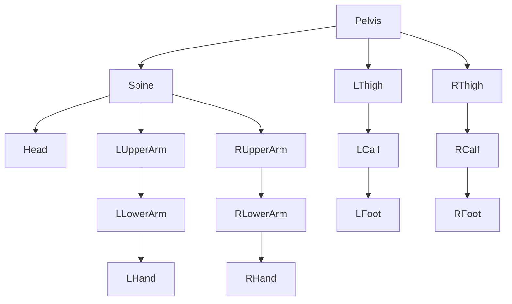
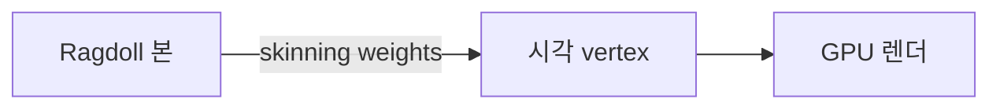
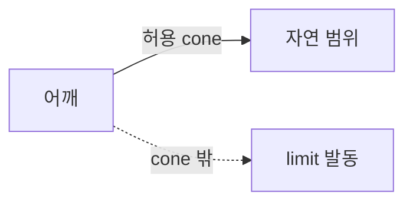

## 들어가며

게임의 *캐릭터 사망 장면*. 적이 쓰러진다. 단순한 *애니메이션 (스크립트 된 fall)* 은 *어색* — 어느 방향에서 맞았는지, 환경 (계단, 절벽) 이 어떤지 *반영 안 됨*.

해결: *Ragdoll* — 죽는 순간 *캐릭터를 다관절 강체 시스템* 으로 전환. 환경 / 충돌 / 외력 (폭발 임펄스) 이 *물리적으로* 반영. 모든 사망이 *고유한 모습*.

Ragdoll 의 핵심 구성:

- *본 (bone)* = 강체. 보통 15 ~ 20 개.
- *관절 (joint)* = 본 사이의 제약. ball-socket / hinge / 등.
- *limit* = 본의 *각도 범위*. 무릎이 *뒤로 안 꺾이게*.
- *blending* = 애니메이션 ↔ ragdoll 의 *부드러운 전환*.

이 글의 목표.

1. **본 계층 (skeleton)** — 캐릭터의 강체 모델.
2. **본별 형상과 관성** — 인체 비례.
3. **Joint 종류** — 부위별 적합한 joint.
4. **Joint limit** — 자연 각도 범위.
5. **Self-collision** — 본끼리 부딪힘 처리.
6. **Animation ↔ ragdoll blend** — 부드러운 전환.
7. **Articulation vs joint 모델** — 안정성의 두 패러다임.
8. **도구와 통합 요구**.

이 글이 마치면 *적이 자연스럽게 쓰러지는 ragdoll* 의 구성 / 알고리즘 / 안정성 트레이드오프가 결정 가능하다.


---

## 목차
1. [본 계층 (skeleton)](#1-본-계층-skeleton)
2. [본별 형상과 관성](#2-본별-형상과-관성)
3. [Joint 종류 선택](#3-joint-종류-선택)
4. [Joint limit](#4-joint-limit)
5. [Self-collision 처리](#5-self-collision-처리)
6. [Animation ↔ ragdoll blend](#6-animation--ragdoll-blend)
7. [Articulation vs joint 모델](#7-articulation-vs-joint-모델)
8. [도구와 통합 요구](#8-도구와-통합-요구)


---

## 1. 본 계층 (skeleton)

Ragdoll 의 *강체 구성*. 본 = 강체, joint = 본 사이 연결.

### 1.1 표준 본 구성

아래는 몸통과 사지의 큰 질량 분포를 표현하는 한 가지 축소 예다. 필요한 접촉 부위와 joint 자유도에 따라 본을 합치거나 나눈다.



총 15 본. 손가락 / 발가락은 *시각 본만* — ragdoll 시뮬에는 안 포함.

### 1.2 본의 root

*Pelvis* 가 일반적 root (다리·척추·팔이 *pelvis 에서 분기*).

또는 *Spine 의 base*. 캐릭터 디자인 따라 다름.

root 가 *애니메이션 → 물리 전환 시 기준*. root 의 *현재 위치 / 회전* 이 ragdoll 의 *현재 위치 / 회전*.

### 1.3 본 vs 시각 mesh

ragdoll 본 = *물리 시뮬용 강체*. 시각 mesh = *render 용 vertex*.

연결: *Skinning* — 시각 vertex 가 *본의 가중치 변형* 따라감.



물리 시뮬은 *15 본* 만, 렌더는 *수만 vertex*. 둘이 *분리*.

### 1.4 추가 본 (선택)

세부 표현 필요할 때:

- *손가락* — finger flick 효과. 추가 5 본 × 2 손.
- *얼굴 본* — 표정 변화. 시각만, 시뮬은 보통 없음.
- *머리카락* — 별도 cloth / soft body 시뮬.

추가 본 = *비용 + 안정성 부담*. 게임은 *시각 임팩트 큰 곳만*.

### 1.5 본의 좌표계

각 본이 *부모 본 좌표계의 local transform*:

```cpp
struct Bone {
    int      parentIdx;       // -1 if root
    quat     localRotation;
    vec3     localPosition;   // pivot offset
    // ...
};
```

세계 transform = *부모의 world transform × local*. forward kinematics.

### 1.6 본 데이터의 두 모드

| 모드 | 데이터 출처 |
|---|---|
| 애니메이션 | 본 transform = 키프레임 보간 |
| Ragdoll (물리) | 본 transform = 강체 시뮬 결과 |

전환 순간 *애니메이션의 마지막 본 상태* → *물리의 초기 상태*. 자연스러운 *현재 자세 유지*.


## 2. 본별 형상과 관성

각 본의 *충돌 형상 + 관성 텐서*.

### 2.1 충돌 형상

본별 *단순 형상*:

| 본 | 형상 | 이유 |
|---|---|---|
| Pelvis | Box 또는 Capsule | 단단하고 큼 |
| Spine, Chest | Box | 직사각형 모양 |
| Head | Sphere | 둥글음 |
| Upper / Lower Arm | Capsule | 긴 원통 |
| Hand | Box (작음) | 단순화 |
| Thigh, Calf | Capsule | 긴 원통 |
| Foot | Box | 평평 |

총 15 ~ 20 콜라이더. 강체 솔버의 *부담 적당*.

### 2.2 형상 크기

본 크기 = *시각 mesh 외피의 평균*. 너무 작으면 *잘못된 충돌* (mesh 가 환경 밖으로 삐져나옴). 너무 크면 *부자연스러운 충돌* (가까이 못 감).

도구로 *자동 생성* — *Unity Ragdoll Wizard*, *Unreal PhAT* — 본 위치 + mesh 외피 → 자동 capsule.

### 2.3 인체 비례

다음은 성인 인체측정 자료를 둥글게 합친 시작점이다. 자료 집단과 분절 정의에 따라 값이 달라진다.

| 부위 | 비율 |
|---|---|
| 머리 (+목) | 8% |
| 몸통 (chest + pelvis + spine) | 50% |
| 팔 (upper + lower + hand) | 5% 각 = 10% 양팔 |
| 다리 (thigh + calf + foot) | 16% 각 = 32% 양다리 |

총 100% (Winter 의 인체측정 표준 데이터 근사). 게임의 *어색한 비율 (큰 머리 hero)* 는 *디자인적 조정*.

### 2.4 관성 텐서

각 본의 *주축 관성 텐서* — capsule / box 형식별 공식.

```cpp
// 실린더 근사 — 정확한 캡슐 관성은 실린더 + 양 끝 반구를 따로 합산
mat3 ComputeCapsuleInertia(float mass, float radius, float halfLength) {
    float r2 = radius * radius;
    float L  = halfLength * 2;
    float Iz  = 0.5f * mass * r2;                  // long axis
    float Itrans = mass * (3 * r2 + L * L) / 12.0f;  // 횡축 (Ixx = Iyy, 실린더 공식)
    return mat3{Itrans, 0, 0,  0, Itrans, 0,  0, 0, Iz};
}
```

각 본의 *로컬 관성 텐서* — world 에선 *회전 변환*.

### 2.5 invMass = 0 (kinematic) 모드

ragdoll 의 일부 본만 *동적*, 나머지는 *kinematic*. 예: *손이 잡힌 상태* (다른 캐릭터 또는 환경 에 잡힘) — 손이 kinematic, 나머지 자유.

```cpp
if (bone.attached) {
    bone.body.SetMotionType(MotionType::Kinematic);
    bone.body.SetKinematicTarget(handTarget);
} else {
    bone.body.SetMotionType(MotionType::Dynamic);
}
```

kinematic body는 단순히 `invMass = 0`인 정적 body와 다르다. 목표 pose에서 선속도·각속도를 계산해 접촉 상대 속도에 반영해야 동적 본을 올바르게 밀 수 있다.

### 2.6 mass ratio 위험

본별 mass 차이가 큰 경우 (head 8 vs hand 1) → *큰 mass ratio*. joint 솔버가 *수치적으로 불안정*.

해결: *mass 분포 조정* — 차이 줄임. *articulation* (섹션 7) 사용. *iter 늘림*.


## 3. Joint 종류 선택

본별 *적절한 joint 타입*.

### 3.1 인체 관절의 자유도

| 관절 | DoF | 게임 joint |
|---|---|---|
| 어깨 | 3 (회전 모두) | Ball / Cone limit |
| 팔꿈치 | 1 (굽힘) | Hinge |
| 손목 | 2 ~ 3 | Ball + 좁은 limit 또는 Universal |
| 엉덩이 | 3 | Ball / Cone limit |
| 무릎 | 1 (굽힘) | Hinge |
| 발목 | 2 ~ 3 | Ball + 좁은 limit |
| 척추 | 다관절 | 여러 Ball + 좁은 limit |
| 목 | 3 | Ball + 좁은 limit |

### 3.2 어깨 / 엉덩이 — Ball + Cone

3 DoF 회전. *cone limit* 으로 *팔이 너무 뒤로 안 가게*.

```cpp
struct BallSocketWithConeLimit {
    int     a, b;             // 본 두 개
    vec3    anchorA, anchorB; // 각 본 local 의 joint 위치
    vec3    twistAxisA, twistAxisB;
    float   coneHalfAngle;    // 허용 swing 각
    float   minTwist, maxTwist;
};
```

*swing-twist decomposition* — 회전을 *swing + twist* 로 분해, 각각 limit.

### 3.3 팔꿈치 / 무릎 — Hinge

1 DoF. 단일 축 회전.

```cpp
struct HingeJoint {
    int     a, b;
    vec3    anchorA, anchorB;
    vec3    axisA, axisB;     // hinge 축
    float   minAngle, maxAngle;  // 굽힘 범위
};
```

*무릎의 -10° ~ 150°* 정도. 너무 곧추서거나 *반대로 꺾이는 방지*.

### 3.4 손목 / 발목 — Ball + 좁은 limit

작은 범위의 3 DoF. 또는 *Universal* (2 DoF).

### 3.5 척추 — 다중 Ball

척추를 *3 ~ 5 본 + 각 본 사이 Ball + 좁은 limit*. 부드러운 척추 흔들림.

비용 증가 — *간단 시뮬에선 단일 Spine* 강체.

### 3.6 joint 의 비활성 motor

게임 ragdoll = *수동* — 모터 (적극 자세 유지) 없음. 죽은 시체가 *환경에 의해서만 움직임*.

```cpp
joint.motorEnabled = false;
```

살아있는 캐릭터의 active ragdoll (R&D 영역) 은 *모터로 자세 유지* — 죽은 ragdoll 과 다른 시스템.

### 3.7 active ragdoll (참고)

캐릭터가 *살아있는 상태에서도 물리적으로 움직임*. PD controller / muscle / 모터 — 각 joint 가 *목표 자세* 향해 토크. 환경과 *진짜 상호작용*.

active ragdoll은 애니메이션 정확도, 접촉 반응과 제어 안정성 사이를 조율해야 하는 별도 제어 문제다.


## 4. Joint limit

본의 *자연 각도 범위*. limit 없으면 *팔이 한 바퀴 돌고 부자연*.

### 4.1 cone limit

어깨 / 엉덩이의 *swing 제한*. *팔이 등 뒤로 너무 안 가게*.



각도 계산:

```cpp
vec3 currentSwing = ComputeSwingDirection(boneA, boneB);
float c = std::clamp(dot(currentSwing, restSwing), -1.0f, 1.0f);
float angle = std::acos(c);
if (angle > coneHalfAngle) {
    // 제약 발동 — boneB 를 cone 안으로 끌어당김
}
```

### 4.2 hinge angle limit

팔꿈치 / 무릎의 *굽힘 각도*. 1 DoF 의 *min / max* — 단순.

```cpp
float currentAngle = ComputeHingeAngle(boneA, boneB, axis);
if (currentAngle < minAngle) {
    // boneB 를 +방향 토크
} else if (currentAngle > maxAngle) {
    // boneB 를 -방향 토크
}
```

### 4.3 limit 의 stiffness

limit 가 *완벽 단단* — 발동 즉시 *0 진행*. 또는 *부드러움* — limit 근처에서 *점진적 저항*.

soft limit (부드러움) 이 *시각적으로 자연스러움*. spring-like.

```cpp
if (angle > maxAngle) {
    float overshoot = angle - maxAngle;
    float torqueMag = overshoot * springStiffness;
    ApplyTorque(boneB, -axis * torqueMag);
}
```

### 4.4 twist limit

ball joint 의 *twist 제한* — 어깨가 *손을 너무 비틀지 못함*.

```cpp
float twistAngle = ComputeTwistAngle(boneA, boneB);
if (twistAngle < minTwist || twistAngle > maxTwist) {
    // 제약 발동
}
```

### 4.5 sample limit 값

| Joint | swing limit | twist limit |
|---|---|---|
| Shoulder | 90° ~ 120° | -60° ~ 60° |
| Hip | 80° ~ 100° | -30° ~ 30° |
| Neck | 30° ~ 45° | -45° ~ 45° |
| Elbow | -10° ~ 150° (hinge) | — |
| Knee | -5° ~ 160° (hinge) | — |
| Wrist | 30° ~ 60° | -15° ~ 15° |
| Ankle | 30° ~ 45° | -15° ~ 15° |

캐릭터 디자인 따라 *조정*.

### 4.6 limit 의 안정성

limit 발동 시 *큰 보정* 의 *시뮬 폭발* 가능. iter 와 보정량 조정 필요.

| 트레이드오프 | |
|---|---|
| hard limit + 적은 iter | 빠른 시뮬, 시각 약함 |
| soft limit + 많은 iter | 자연스러움, 비용 큼 |

반복 횟수와 soft-limit 파라미터는 질량비, dt, 관절 사슬 길이와 solver 잔차를 기준으로 정한다. 해부학적 한도 표 역시 의료 데이터가 아니라 authoring 시작점이며, joint local frame과 캐릭터 rig에 맞춰 검증해야 한다.


## 5. Self-collision 처리

본끼리 부딪히는 처리.

### 5.1 문제

15 본 → 15 × 14 / 2 = 105 페어. 모든 페어 검사 = 비용 + *원치 않는 충돌* (어깨와 가슴이 *자연스럽게 가까움*).

### 5.2 충돌 그룹 mask

각 본을 *그룹* 으로 분류. *어떤 그룹은 충돌 무시*.

```cpp
struct CollisionMask {
    uint16_t group;       // 본의 그룹 (bit)
    uint16_t collideWith; // 충돌 검사할 그룹들
};
```

검사 시:

```cpp
bool ShouldCollide(const Bone& a, const Bone& b) {
    return (a.mask.collideWith & b.mask.group) != 0
        && (b.mask.collideWith & a.mask.group) != 0;
}
```

### 5.3 표준 그룹

| 그룹 | 본 |
|---|---|
| Torso | Pelvis, Spine, Chest |
| Head | Head |
| LArm | LShoulder, LUpperArm, LLowerArm, LHand |
| RArm | RShoulder, RUpperArm, RLowerArm, RHand |
| LLeg | LThigh, LCalf, LFoot |
| RLeg | RThigh, RCalf, RFoot |

규칙: 같은 그룹 안의 본끼리는 *대부분 충돌 무시*. 다른 그룹끼리는 충돌 검사.

### 5.4 인접 본 무시

joint 로 연결된 *두 본* 은 자연스럽게 가까움 → 충돌 안 함.

```cpp
if (BonesAreConnectedByJoint(a, b)) return false;
```

추가 — *2 hop* (joint 두 개 거리) 본도 *경계* 라 충돌 무시 흔함.

### 5.5 충돌 검사 알고리즘

15 본의 충돌 검사. SAP / spatial hash — 강체 솔버의 broad phase 가 *그대로 적용*.

가까이 (월드의 한 위치) 모인 본들이라 *broad phase 효과 약함* — 단순 페어 체크가 *대부분 빠름*.

### 5.6 충돌 응답

본끼리 충돌 시 *임펄스 응답* — 강체 솔버의 표준. joint 제약과 *함께 풀이*.

joint 가 *본 위치 강제* + 충돌이 *분리 강제* — 두 제약 경합. iter 로 균형.


## 6. Animation ↔ ragdoll blend

캐릭터의 *애니메이션 → 물리 전환*.

### 6.1 사망 순간

캐릭터가 죽는 순간:

1. 애니메이션 시스템 정지.
2. 마지막 frame 의 *본 위치 / 회전* → ragdoll 초기 상태.
3. 마지막 frame 의 *본 속도* (이전 frame 과의 차이) → ragdoll 초기 속도.
4. 충격 임펄스 (피격 방향) 적용.

```cpp
void TransitionToRagdoll(Character& c, vec3 hitImpulse,
                         vec3 hitPoint, int hitBone) {
    for (int i = 0; i < c.bones.size(); ++i) {
        c.bones[i].body.transform = c.animator.GetBoneTransform(i);
        // pose history의 유한 차분으로 구한 초기 속도다.
        c.bones[i].body.linearVel  = c.animator.GetBoneVelocity(i);
        c.bones[i].body.angularVel = c.animator.GetBoneAngularVelocity(i);
    }
    c.animator.Stop();
    c.bones[hitBone].body.AddImpulseAtPoint(hitImpulse, hitPoint);
}
```

### 6.2 부드러운 blend

동적 강체의 transform을 애니메이션 pose와 매 프레임 보간해 덮어쓰면 충돌 솔버가 만든 속도와 접촉을 파괴한다. 전환 방식은 두 가지다.

```cpp
// 시각 blend: 물리 body는 그대로 시뮬하고 렌더 skeleton만 혼합한다.
void BuildRenderPose(float physicsWeight) {
    for (int i = 0; i < bones.size(); ++i) {
        Transform animPose = animator.GetBoneTransform(i);
        Transform physicsPose = bones[i].body.transform;
        renderPose[i] = BlendTransform(animPose, physicsPose, physicsWeight);
    }
}
```

시각 blend는 초기 자세 차이를 숨기지만 물리 상태를 애니메이션으로 끌지는 않는다. 실제 body를 점진적으로 애니메이션에 맞추려면 body별 pose motor를 켜고 목표 회전과 최대 토크를 서서히 바꾸는 active-ragdoll 방식이 필요하다.

### 6.3 ragdoll → animation (역방향)

ragdoll 이 끝나고 *다시 일어남 (getup)* — 어렵다. 본 위치가 *임의* 라 *애니메이션 의 시작 자세* 와 다름.

해결:

1. ragdoll 의 *현재 자세* 확정.
2. getup 애니메이션의 *시작 자세* 와 비교.
3. *IK + blend* 로 부드럽게 매칭.

학술 / 고급 게임의 영역. 인디는 *ragdoll → 단순 fade-out* (다시 일어남 없음).

### 6.4 partial blend

상체만 ragdoll, 하체는 애니메이션. 캐릭터가 *맞아도 발은 계속 걷는*.

```cpp
for (int i = 0; i < bones.size(); ++i) {
    if (IsUpperBody(i)) bones[i].mode = Ragdoll;
    else                  bones[i].mode = Animation;
}
```

joint 의 *kinematic 경계* — 상체 본은 자유, 하체 본은 kinematic. *상체가 하체에 의해 끌려감*.

게임의 *피격 반응* (hit reaction) 패턴.

### 6.5 결정론

ragdoll 이 *물리 시뮬* — 외력 + iter + 부동 소수점 → *재현 어려움*. replay 또는 멀티플레이어 동기화 어려움.

해결: *시각만 ragdoll, 게임 상태는 단순 dead flag*. 서로 다른 클라이언트가 *조금씩 다른 ragdoll 모습* 봐도 *게임플레이엔 영향 없음*.

### 6.6 sleep

ragdoll 이 *멈춤* — 일정 시간 동안 모든 본의 선속도와 각속도가 각자의 임계값 아래면 island를 sleep 상태로 전환할 수 있다.

```cpp
bool AllBonesAtRest(const Character& c) {
    for (auto& b : c.bones) {
        if (LengthSq(b.body.linearVel) > linearSleepSpeedSq
         || LengthSq(b.body.angularVel) > angularSleepSpeedSq) return false;
    }
    return true;
}
```

sleep은 적분과 제약 풀이를 건너뛰지만 broad-phase proxy, 메모리와 wake-up 검사는 남는다. 실제 절감량은 깨어 있는 island 수와 주변 동적 객체에 따라 측정한다.


## 7. Articulation vs joint 모델

ragdoll 의 *두 솔버 패러다임*.

### 7.1 Joint 기반 (maximal coordinates)

각 본이 *독립 강체* + joint 가 *제약*. 강체 솔버 + Sequential Impulse / PGS.

```cpp
struct Bone {
    RigidBody body;          // 자유 강체
};
struct Joint {
    int a, b;
    void Project(Bones&);    // PBD style 또는 impulse
};
```

장점: 구현 단순. 강체 솔버 그대로 사용.
단점: *큰 mass ratio 에서 수치 불안정* — head 8 vs hand 1.

### 7.2 Articulation (reduced coordinates)

본의 자유도를 *joint 각도* 만으로 표현. *부모-자식 계층* 의 *generalized coordinates*. Featherstone 알고리즘.

```cpp
struct ArticulatedBody {
    int       parentIdx;
    JointType jointType;
    float     jointAngle;  // 또는 quaternion (3 DoF)
    // 본 위치는 부모와 jointAngle 로부터 도출
};
```

장점: joint 자유도를 좌표에 직접 반영하므로 maximal-coordinate joint의 위치 drift와 일부 conditioning 문제를 줄인다.
단점: 구현 복잡. *Featherstone 알고리즘* (다소 어려운 수학).

reduced coordinates도 접촉, joint limit, actuator stiffness, 긴 사슬과 큰 질량비에서 conditioning 문제가 사라지는 것은 아니다. “mass ratio 무관”한 해법이 아니라, tree 구조의 동역학을 더 직접 풀 수 있는 표현이다.

### 7.3 Articulation API의 계약

articulation API는 보통 tree topology, link별 관성, joint axis와 자유도, position/velocity limit, drive stiffness·damping·force limit을 받는다. 각도 단위, joint frame 방향, spherical joint parameterization과 contact coupling 방식은 구현마다 다르므로 제품별 타입을 그대로 일반 알고리즘으로 간주하면 안 된다.

### 7.4 비교

| 측면 | Joint 기반 | Articulation |
|---|---|---|
| 구현 | 단순 | 복잡 |
| 안정성 | 반복 솔버와 질량비에 민감 | tree 동역학에는 유리, 접촉 조건은 별도 |
| 비용 | contact·constraint 수에 의존 | topology와 접촉 결합 방식에 의존 |
| 모터 | 단순 | 단순 |
| 산업 채택 | 인디 / Bullet / Box2D | PhysX / Unreal 일부 |

단순한 사망 ragdoll은 maximal-coordinate joint로도 충분할 수 있다. 강한 motor, 큰 질량비와 긴 사슬이 핵심이면 reduced-coordinate articulation을 비교할 가치가 커진다.

### 7.5 reduced coordinates (학술)

자유도를 *최소 필요한 수만 명시* — 일반화된 좌표. Lagrangian 역학.

15 본 ragdoll 의 maximal coordinates 는 본당 6 = 90 DoF. reduced coordinates 는 *root 6 DoF + joint 자유도 합* — 예를 들어 14 joint 가 모두 ball (3 DoF) 이면 6 + 42 = 48 DoF. articulation 이 이 형태의 일종.

엔진의 *MuJoCo* (학술 / 로봇 시뮬) 가 reduced coordinates 표준.

### 7.6 결정

게임 ragdoll 결정:

| 게임 | 추천 |
|---|---|
| 인디 / 단순 | Joint 기반 (Box2D / Bullet) |
| AAA | PhysX articulation 또는 자체 articulation |
| 실험 (active ragdoll) | articulation + 모터 |


## 8. 도구와 통합 요구

ragdoll 품질은 런타임 solver뿐 아니라 authoring과 검증 도구에 크게 좌우된다.

### 8.1 필요한 도구

- skeleton에서 collider와 joint frame을 생성하고 수동 조정하는 기능
- swing/twist/hinge limit의 3D 시각화
- mass와 inertia 분포, 연결 body의 질량비 검사
- 인접 bone collision exclusion 편집
- animation pose와 physics pose의 동시 표시
- contact impulse, joint error, motor saturation과 sleep 상태 기록

### 8.2 런타임 표현

```cpp
struct Ragdoll {
    std::vector<RigidBody>   bones;
    std::vector<BallJoint>   ballJoints;
    std::vector<HingeJoint>  hingeJoints;
};
```

handle에는 generation을 포함하고, bone과 body의 대응은 skeleton asset revision과 함께 versioning한다. 애니메이션 graph는 render pose의 소유자이고 physics world는 dynamic body pose의 소유자라는 경계를 유지한다.

### 8.3 게임 디자인 결정

ragdoll 이 게임에 *얼마나 중요한가*?

- *단순 사망*: 제한된 bone과 joint 기반 ragdoll.
- *시체가 게임플레이 객체*: 안정한 self-collision, sleep/wake, 저장과 네트워크 정책.
- *Active ragdoll*: pose motor, 접촉 상태 추정, 제어기 saturation과 recovery.

중요도에 따라 authoring과 검증 범위를 정하며, 팀 규모나 장르 이름만으로 solver를 선택하지 않는다.


---

## 결론

Ragdoll은 skeleton의 일부를 강체와 joint로 모델링한 다관절 물리 시스템이다.

이 글에서 정리한 핵심.

1. **본 계층** — 필요한 접촉과 자유도만 남긴 물리 skeleton.
2. **본별 형상** — capsule / box, 인체 비례 mass.
3. **Joint 종류** — ball (어깨/엉덩이), hinge (팔꿈치/무릎).
4. **Limit** — cone swing + twist + hinge angle. soft limit 권장.
5. **Self-collision** — 그룹 mask. 인접 본 무시.
6. **Animation ↔ ragdoll blend** — 부드러운 전환. partial blend.
7. **Articulation** — tree 동역학에는 유리하지만 접촉·joint limit·큰 mass ratio의 conditioning은 별도 검증 — Featherstone 기반.
8. **도구** — collider·joint authoring, pose 소유권과 오차 계측.

Ragdoll 의 핵심은 *본별 강체 + 관절 limit + animation blend* 의 결합이다. 물리적으로 자연스러운 쓰러짐과 애니메이션 제어 사이의 균형이 품질을 결정한다.

## 더 읽을거리

- Featherstone, "Rigid Body Dynamics Algorithms" (2008) — articulation 의 수학 표준.
- Mirtich, "Impulse-Based Dynamic Simulation of Rigid Body Systems" (1996) — ragdoll 의 원전 토대.
- PhysX SDK Documentation, "Articulations" — 산업 articulation reference.
- Unreal Engine Documentation, "Physics Asset" — PhAT 가이드.
- Unity Manual, "Ragdoll" — Unity ragdoll wizard.
- Jolt Physics Documentation, "Skeletal Animation" — 모던 ragdoll.
- GDC talks, "Naughty Dog Ragdoll" 등 — 산업 노하우.
- Coros et al., "Locomotion Skills for Simulated Quadrupeds" — active ragdoll 의 학술 reference.
