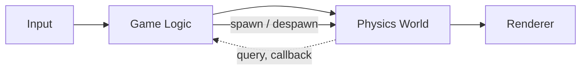
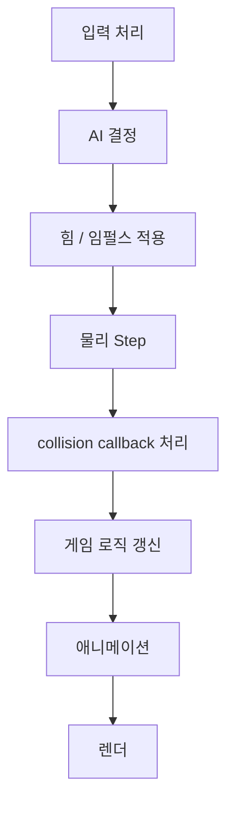
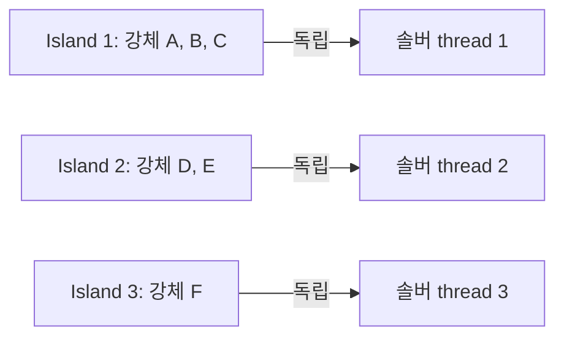

## 들어가며

게임 물리 엔진은 *적분 / broad·narrow phase / constraint / character / 입자 / fluid / ragdoll* 같은 개별 모듈을 하나의 frame loop 안에 통합한다. 핵심은 모듈 자체보다 *시간 순서, 데이터 경계, 이벤트 전달, 결정론* 을 어떻게 관리하느냐다.

핵심 질문.

- 물리 *시뮬* 과 *게임 로직* 이 어떻게 *결합* 하나?
- *자체 구현* 과 검증된 물리 backend의 경계를 어디에 둘 것인가?
- 물리 시뮬과 *렌더* 의 *time stepping 정합*?
- *결정론 (determinism)* 의 필요와 실현?
- *멀티스레드* + *island 분할* 의 패턴은?

이 글의 목표.

1. **자체 구현 vs backend 채택** — 소유할 코드와 검증 범위.
2. **Backend 계약** — 기능, 오차, 생명주기와 적합성 테스트.
3. **통합 아키텍처** — 게임 모듈 사이의 물리 위치.
4. **물리 ↔ 렌더 동기화** — fixed step + interpolation.
5. **물리 ↔ 게임 로직** — collision callback, query.
6. **결정론** — 필요, 깨뜨리는 요인, 보장 방법.
7. **멀티스레드 + island 분할**.
8. **디버그 + 시각화 + 도구**.

이 글이 마치면 *완성된 물리 엔진* 의 *모듈 배치 / 결정 패턴* 이 명확하다.


---

## 목차
1. [자체 구현 vs backend 채택](#1-자체-구현-vs-backend-채택)
2. [Backend 계약과 적합성](#2-backend-계약과-적합성)
3. [통합 아키텍처 패턴](#3-통합-아키텍처-패턴)
4. [물리 ↔ 렌더 동기화](#4-물리--렌더-동기화)
5. [물리 ↔ 게임 로직](#5-물리--게임-로직)
6. [결정론](#6-결정론)
7. [멀티스레드와 island 분할](#7-멀티스레드와-island-분할)
8. [디버그 + 시각화 + 도구](#8-디버그--시각화--도구)


---

## 1. 자체 구현 vs backend 채택

결정은 “모두 직접 구현”과 “외부 엔진에 모두 맡김”의 양자택일이 아니다. 게임이 소유해야 하는 **의미 계약**과 backend가 소유할 **수치 구현**을 나누는 일이다.

### 1.1 직접 소유할 가치가 큰 영역

- 좌표·단위·collision layer와 gameplay tag
- body/entity handle의 수명과 serialization ID
- 고정 step, command/event buffer와 rollback 경계
- 캐릭터 이동, hit 판정처럼 게임 규칙과 강하게 결합한 query
- 성능·오차 telemetry와 실패 정책

이 영역은 backend를 바꿔도 게임 규칙이 유지되어야 한다.

### 1.2 검증된 backend가 유리한 영역

- convex/mesh 형상의 강건한 narrow phase와 manifold 관리
- CCD, joint graph, sleep/wake와 island solver
- SIMD·멀티스레드 broad phase
- shape cooking, platform별 최적화와 오랜 edge-case 회귀 테스트

직접 구현하면 알고리즘뿐 아니라 퇴화 형상, NaN 격리, handle 재사용, callback 재진입과 도구까지 검증 범위에 들어온다.

### 1.3 교육용 구현과 제품용 구현

교육용 solver는 구·박스·convex, 단일 contact, sequential impulse처럼 범위를 제한해 불변량을 관찰하는 데 가치가 있다. 이를 제품 backend로 승격하려면 지원하지 않는 형상과 실패 조건, 오차 한계, stress test를 먼저 문서화해야 한다. 기능 수보다 **정의한 범위에서 틀리지 않는가**가 기준이다.

### 1.4 하이브리드의 경계

캐릭터 controller와 projectile query는 게임이 소유하고, 일반 강체·ragdoll은 library가 푸는 식의 분할이 가능하다. 서로 다른 solver가 같은 body를 동시에 소유하면 운동량과 접촉 순서가 불명확해지므로, coupling은 힘·임펄스·kinematic target·snapshot 중 하나의 명시된 경계로만 전달한다.


## 2. Backend 계약과 적합성

제품명 비교표보다 게임이 의존하는 동작을 executable contract로 만든다.

### 2.1 기능 계약

| 축 | 확인할 내용 |
|---|---|
| 형상 | primitive, convex, height field, static/dynamic triangle mesh |
| 동역학 | body motion type, mass/inertia, CCD, sleep/wake |
| 제약 | joint 종류, limit, motor, break threshold |
| 질의 | ray/sweep/overlap 결과 순서, initial overlap, backface 규칙 |
| 접촉 | manifold 수명, normal 방향, trigger와 sensor 의미 |
| 시간 | 허용 dt, sub-step, interpolation snapshot |
| 실행 | thread safety, callback 시 허용 연산, job-system 통합 |
| 재현 | 같은 빌드와 플랫폼에서 보장할 결정성 범위 |
| 데이터 | cooking 결과의 버전·endianness·platform 호환성 |

### 2.2 수치 계약

같은 장면이라도 backend마다 penetration slop, friction combine, restitution threshold, sleep 조건과 solver iteration이 다르다. wrapper가 타입만 같게 만드는 것으로 행동이 같아지지 않는다. 허용 penetration, joint drift, 에너지 증가, query tolerance와 최대 step 시간을 수치 기준으로 둔다.

### 2.3 적합성 테스트

- 얇은 벽을 향한 고속 body의 CCD 통과 여부
- box stack의 최대 penetration과 sleep 도달 시간
- 경사면 위 character의 정지·미끄럼 경계
- joint chain의 길이 오차와 motor saturation
- 동일 입력 replay의 state hash
- create/destroy 반복 뒤 stale handle 거부
- callback 중 예약한 명령의 적용 순서
- cooked asset revision 불일치 거부

backend 업그레이드와 compiler/platform 변경은 이 suite를 통과해야 한다. 성능 비교도 동일 장면, 동일 품질 기준과 동일 계측 경계에서만 의미가 있다.


## 3. 통합 아키텍처 패턴

엔진 vs 게임 로직 의 *모듈 배치*.

### 3.1 표준 아키텍처



물리는 *한 모듈로 격리*. 게임 로직이 *wrapper interface* 만으로 접근.

### 3.2 Wrapper 패턴

상용 엔진을 *자체 interface 뒤로* 숨김. 엔진 교체 가능.

```cpp
class PhysicsWorld {
public:
    virtual ~PhysicsWorld() = default;          // owning base pointer 로 삭제할 때 필수
    virtual BodyHandle CreateBox(const vec3& size, float mass) = 0;
    virtual void       Destroy(BodyHandle h) = 0;
    virtual void       Step(float dt) = 0;
    virtual Transform  GetTransform(BodyHandle h) const = 0;
    virtual void       SetTransform(BodyHandle h, const Transform& t) = 0;
    virtual void       SetVelocity(BodyHandle h, vec3 v) = 0;
    // ...
};

class Box2DWorld    : public PhysicsWorld { ... };
class CustomWorld   : public PhysicsWorld { ... };
class JoltWorld     : public PhysicsWorld { ... };
```

owning base pointer로 삭제하는 계약이면 가상 소멸자를 인터페이스 최소 부분에 포함하고, 비소유 인터페이스라면 소유 팩토리/파괴 함수를 명시한다. 인터페이스는 제품 타입의 누출을 줄이지만 백엔드 교체를 자동으로 싸게 만들지는 않는다. contact manifold, shape cooking, joint semantics, query ordering과 determinism 계약이 다르기 때문이다. 공통 interface에는 게임이 실제로 의존하는 최소 의미만 두고, 지원하지 않는 기능과 오차 차이를 backend conformance test로 드러낸다.

### 3.3 ECS 통합

ECS (Entity Component System) 게임의 통합 패턴.

```cpp
struct RigidBodyComponent {
    BodyHandle handle;       // 물리 엔진 핸들
};
struct TransformComponent {
    vec3 position;
    quat rotation;
};

void PhysicsToTransformSystem(World& w) {
    for (auto& [body, transform] : w.View<RigidBodyComponent, TransformComponent>()) {
        Transform t = physicsWorld.GetTransform(body.handle);
        transform.position = t.position;
        transform.rotation = t.rotation;
    }
}
```

동적 body는 physics가 transform을 소유해 ECS와 렌더 snapshot으로 내보낸다. kinematic body는 게임/animation이 목표 transform을 명령 버퍼로 보내고 physics가 속도와 접촉을 계산한다. 양쪽 시스템이 같은 transform을 직접 쓰면 update order에 따라 순간 이동과 유실 갱신이 생긴다.

### 3.4 spawn / despawn

게임의 *동적 객체 생성 / 파괴* 가 물리 엔진에 알림.

```cpp
EntityHandle SpawnEnemy(World& w, vec3 pos) {
    auto e = w.CreateEntity();
    w.Add<TransformComponent>(e, pos);
    BodyHandle bh = physicsWorld.CreateBox({1, 1, 1}, 1.0f);
    physicsWorld.SetTransform(bh, Transform{pos, quat::Identity()});  // 생성 body의 초기 COM 위치
    w.Add<RigidBodyComponent>(e, bh);
    return e;
}

void DespawnEnemy(World& w, EntityHandle e) {
    pendingPhysicsCommands.Destroy(
        w.Get<RigidBodyComponent>(e).handle);
    pendingEntityDestroy.push_back(e);
}
```

동적 body를 생성할 때 spawn 위치는 ECS Transform에만 두지 말고 body의 초기 COM transform으로도 전달해야 한다. 이후 physics→transform 동기화가 ECS를 body 위치로 덮어쓰기 때문이다. ECS transform과 body COM origin이 다르면 offset 변환을 적용한다.

물리 callback이나 병렬 step 도중 즉시 삭제하지 않고 안전한 동기화 지점에서 명령을 적용한다. `BodyHandle`과 `EntityHandle`은 index 재사용 뒤 stale reference가 살아나지 않도록 generation을 포함한다.

### 3.5 Layer 분리

물리 layer = *환경 / 적 / 플레이어 / 투사체 / 트리거*. 각 layer 의 *충돌 mask*.

```cpp
enum Layer {
    Environment, Enemy, Player, Projectile, Trigger
};
// 충돌 가능 페어:
// Environment vs Enemy/Player/Projectile
// Player    vs Enemy/Projectile (자기 트리거 가능)
// Trigger   vs Player (만 — 트리거 콜백)
```

엔진의 *collision filter* 로 설정.

### 3.6 query 시스템

게임 로직이 물리에 *질의*. raycast, overlap, sweep.

```cpp
RaycastHit hit = physicsWorld.Raycast(origin, direction, maxDist, mask);
if (hit) {
    Damage(hit.entity, hit.position);
}
```

총알의 *맞은 적 찾기*. AI 의 *시야 검사*. 게임플레이의 *핵심 모듈*.


## 4. 물리 ↔ 렌더 동기화

물리 timestep ≠ 렌더 timestep.

### 4.1 시간의 두 종류

- **물리 timestep**: 안정성·재현성 계약을 위해 흔히 고정한다. 60 Hz는 한 선택일 뿐이다.
- **렌더 frametime**: *가변* (60 Hz, 120 Hz, 또는 가변).

엔진 간 ratio 가 *frame 마다 다름*. 정합 필요.

### 4.2 Fixed timestep + accumulator

```cpp
const float kPhysicsDt = 1.0f / 60.0f;
float accumulator = 0;

void GameLoop(float frameDt) {
    accumulator += frameDt;
    while (accumulator >= kPhysicsDt) {
        physicsWorld.Step(kPhysicsDt);
        accumulator -= kPhysicsDt;
    }
    float alpha = accumulator / kPhysicsDt;
    Render(alpha);
}
```

한 frame 안에 *0 개 또는 여러 개* 의 물리 step.

### 4.3 Interpolation

남은 accumulator (alpha ∈ [0, 1)) 를 *프레임 사이 보간* 에 사용.

```cpp
struct BodyState {
    vec3  position;
    quat  rotation;
};

BodyState Interpolate(const BodyState& prev, const BodyState& cur, float alpha) {
    return {Lerp(prev.position, cur.position, alpha),
              Slerp(prev.rotation, cur.rotation, alpha)};
}
```

각 본 / 객체의 *이전 step 상태 + 현재 step 상태* 의 *Lerp* — 부드러운 렌더. 이 보간은 현재 실시간 목표보다 물리 step 하나만큼 늦은 시각을 보여준다. 반응 지연과 외삽 오차 사이의 선택이다.

각 body는 이전 step 상태와 현재 step 상태를 함께 보관한다. 생성·teleport·강제 순간 이동 시에는 previous=current 로 맞춰 잘못된 보간(제자리 미끄러짐)을 막는다. pause 중에는 step을 돌리지 않으므로 alpha를 진행시키지 않고, 4.5의 clamp/discard 정책으로 버린 시간은 보간 기준 시간에도 반영하지 않는다. render alpha는 accumulator와 kPhysicsDt로만 정의하며, debt-retain 정책으로 바꾸면 별도 alpha 규약이 필요하다.

### 4.4 Extrapolation (대안)

이전 상태 + 현재 속도 *× alpha* 로 *예측 위치*. 보간보다 *latency 작음* — 입력 반응 빠름.

```cpp
BodyState Extrapolate(const BodyState& cur, vec3 velocity, float alpha) {
    return {cur.position + velocity * (kPhysicsDt * alpha), cur.rotation};
}
```

단점: 충돌 *직후* 외삽 → 벽 안으로 들어감. 시각적 artifact.

### 4.5 spiral of death

frame time 이 *지나치게 길* → accumulator 가 *무한히 쌓임* → 시뮬이 *영원히 따라잡지 못함* → 게임 멈춤.

해결: *최대 step 수* 제한.

```cpp
int stepCount = 0;
while (accumulator >= kPhysicsDt && stepCount < kMaxStepsPerFrame) {
    physicsWorld.Step(kPhysicsDt);
    accumulator -= kPhysicsDt;
    stepCount++;
}
if (stepCount == kMaxStepsPerFrame && accumulator >= kPhysicsDt) {
    // 정책 A: simulation이 늦어지는 것을 허용하고 부채를 유지한다.
    // 정책 B: 아래처럼 완전한 step 단위의 시간 부채를 명시적으로 버린다.
    double droppedSteps = std::floor(accumulator / kPhysicsDt);
    droppedSimulationTime += droppedSteps * kPhysicsDt;
    accumulator = std::fmod(accumulator, kPhysicsDt);
}
```

부채를 유지하면 시뮬레이션이 실시간보다 늦어질 수 있고, 버리면 현실 시간과 게임 시간이 불연속적으로 어긋난다. 네트워크·replay·게임플레이 clock 중 무엇을 우선할지 정해 한 정책을 선택해야 한다.

### 4.6 게임 시간 vs 실시간

게임 시간 = *시뮬 시간*. 실시간 = *실제 경과*. 두 시간이 같을 필요는 없다. solver의 fixed step $h$ 는 그대로 두고, render frame에서 누적기에 더하는 scaled elapsed time만 바꾼다.

- *slow motion / time dilation*: scaled elapsed time을 줄임 → 같은 $h$ 로 도는 tick 수가 줄어 게임이 *느리게* 진행. 실시간은 그대로.
- *fast forward*: scaled elapsed time을 늘림 → tick 수가 늘어 게임이 *빠르게*.
- *pause*: 시뮬 step 안 함 (누적기에도 더하지 않음).

```cpp
float timeScale = 1.0f;                 // 0.5 = slow, 2.0 = fast
float scaledDt  = frameDt * timeScale;  // solver step h 를 바꾸는 값이 아니다
accumulator += scaledDt;
```

timeScale을 낮추면 tick이 0회인 frame이 늘고, 그 사이는 보간 alpha가 채운다. $h$ 자체를 timeScale로 바꾸는 정책과는 구분한다.

### 4.7 카메라 / 입력의 처리

카메라 — *물리 정합 필요*. 카메라가 물리 객체 follow 면 *interpolation 같이 적용*.

입력 — *frame 단위* (마우스). 물리에 *적용 시점* 결정 — 보통 *다음 물리 step 의 시작*.


## 5. 물리 ↔ 게임 로직

게임 로직이 *물리 결과에 반응*.

### 5.1 Collision callback

두 객체가 *부딪힘* — 게임에 알림.

```cpp
struct CollisionEvent {
    EntityHandle a, b;
    vec3         point, normal;
    float        impulse;
};

void OnCollision(const CollisionEvent& e) {
    if (HasComponent<Damageable>(e.b)) {
        DealDamage(e.b, e.impulse * 0.1f);
    }
    if (HasComponent<SoundOnHit>(e.a)) {
        PlaySound(e.point);
    }
}
```

solver 내부 callback에서 body 생성·삭제나 게임 상태 변경을 직접 수행하지 않는다. 접촉 결과를 값 타입 이벤트로 복사하고 물리 step 종료 뒤 안정된 순서로 소비한다.

### 5.2 Begin / End / Stay 이벤트

- *Begin* (OnEnter): 두 객체가 *처음 닿음*.
- *Stay* (OnStay): 각 물리 step 또는 합쳐진 게임 tick에서 *닿아 있음*.
- *End* (OnExit): *분리됨*.

게임의 *트리거 영역* — 캐릭터가 *진입 / 머무름 / 떠남* 의 단계별 반응.

### 5.3 Trigger 객체

물리 시뮬에 *참여하지만 충돌 응답은 없음*. *영역 검출* 용.

```cpp
struct TriggerComponent {
    BodyHandle handle;     // isTrigger = true
};
```

캐릭터가 영역에 *들어옴* 검출. damage zone, checkpoint, item pickup.

### 5.4 Query 종류

- **Raycast** — 한 점에서 한 방향 광선. 충돌 점 / 객체 반환.
- **Sphere cast / capsule cast** — 두꺼운 광선. 캐릭터 이동의 *부피 광선*.
- **Overlap** — 한 형상 영역 안의 *모든 객체*. 폭발 범위 detection.
- **Sweep** — 형상이 *경로 이동* 의 *첫 충돌*. CCD 패턴.

### 5.5 Spatial query 최적화

엔진의 *broad phase* 가 query 에도 활용. *raycast through SAP/BVH*.

```cpp
RaycastHit Raycast(vec3 from, vec3 to) {
    // BVH traversal 로 가능 후보만 검사
    // 또는 SAP 의 sweep 으로 후보 추출
    // 그 다음 narrow ray-vs-shape
}
```

질의 비용은 broad-phase 방문 노드, 후보 shape와 narrow-phase 형식에 따라 달라진다. 평균 시간과 함께 방문 노드 수·후보 수·상위 percentile을 측정한다.

fixed loop에서 한 frame의 physics tick 수는 0회일 수도 여러 회일 수도 있다. 입력을 frame 단위 ApplyForce/ApplyImpulse로 직접 적용하면 한 tick도 안 도는 frame에서 impulse가 유실되거나, 여러 tick 도는 frame에서 반복 적용되고, 지속 force는 step 시작의 누적기 초기화 뒤 사라진다. 입력을 tick-stamped command로 저장하고 one-shot impulse는 정확히 한 tick에서 소비하며 held force는 매 tick 재적용한다. pause·timeScale·rollback에서 command의 소유자와 유효 범위도 함께 정한다.

### 5.6 게임 시뮬 단계의 순서

렌더 frame에서는 입력을 수집하고, 아래의 AI·명령·물리·이벤트 단계는 각 고정 simulation tick마다 수행한다. 애니메이션은 kinematic target 생산과 렌더 pose 생성의 시점을 구분한다:



물리 → callback → game logic 의 *명확한 단계*. 동시 수정 회피.


## 6. 결정론

같은 입력 → 같은 출력. 멀티플레이어 lockstep, replay, 테스트 자동화.

### 6.1 결정론의 필요

- **Lockstep 멀티플레이어**: 클라이언트들이 *같은 입력* → *같은 시뮬*. RTS 표준.
- **Replay**: 입력 시퀀스 저장 → 시뮬 재현.
- **테스트**: 자동 테스트가 *동일 시퀀스 검사*.
- **디버깅**: 버그 *재현 가능*.

### 6.2 결정론 깨뜨리는 요인

- **부동소수점 의 결합법칙 위반**: `(a + b) + c ≠ a + (b + c)`. 컴파일러가 *재정렬* 가능.
- **멀티스레드 의 비고정 작업 순서**: 입자·제약 처리 순서가 run 마다 달라지면 깨진다. 고정 분할·정렬·환원 순서를 쓰면 멀티스레드도 결정적일 수 있다.
- **하드웨어 의존**: x86 vs ARM 의 *부동소수 결과 다름*.
- **컴파일러 옵션**: `-ffast-math` 가 *결합법칙 깸*.
- **시간 의존 (wall-clock dt)**: 외부 시계에서 직접 얻은 가변 dt가 frame 분기와 반올림을 바꿔 재현을 어렵게 한다. 가변 dt 자체가 아니라 재현 불가능한 시계 의존이 문제다.

### 6.3 보장 방법

- **고정 dt** — lockstep / replay 가 필요하면 가변 dt 를 물리 step 에 직접 넣지 않음.
- **순서 고정** — 객체 ID 의 *오름차순* 처리. 입자도 같음.
- **컴파일러 옵션** — `-fno-fast-math` 또는 *strict floating-point*.
- **fixed point (정수)** — 부동소수 대신 *고정소수점*. 동일 구현 안의 결정성을 크게 높임. 비용은 일부.
- **공식 결정 모드** — 엔진의 deterministic mode.
- **재현 계약** — 입력 trace, RNG seed, ID 부여, 처리 순서, 컴파일러·FP 환경을 체크리스트로 고정한다. fixed dt만으로 결정성이 보장되지는 않는다.

### 6.4 결정성의 범위

“결정적”이라는 표시는 충분한 계약이 아니다. 동일 실행 파일·동일 thread 수에서만 같은지, CPU ISA와 운영체제가 달라도 같은지, body 삽입 순서가 달라도 같은지, state serialization 뒤에도 같은지를 구분해야 한다. 채택한 엔진의 특정 버전과 빌드 옵션으로 이 범위를 자동 테스트하고 업그레이드 때 다시 검증한다.

### 6.5 lockstep 의 도전

- 한 클라이언트의 *부동소수 비트 차이* → 시뮬 발산.
- *입자 순서* 가 *다른 클라이언트 다름*.
- *덧셈 누적의 순서* 가 다름.

해결: 매우 *엄격한 결정론* + 정기적인 *상태 hash 검증* (다른 클라이언트와 같으면 OK).

```cpp
uint64_t HashWorldState(const PhysicsWorld& w) {
    StableHasher h;
    for (BodyId id : SortedAuthoritativeBodyIds(w)) {
        const Body& body = w.Get(id);
        h.Write(id);
        h.WriteCanonicalFloat(body.position);
        h.WriteCanonicalQuaternion(body.rotation);
        h.WriteCanonicalFloat(body.linearVelocity);
        h.WriteCanonicalFloat(body.angularVelocity);
    }
    return h.Finish();
}
```

구조체 padding이나 컨테이너 iteration 순서를 그대로 hash하지 않는다. NaN, `-0`, quaternion의 $q$와 $-q$ 같은 동치 표현을 정규화하고, gameplay에 권위가 있는 상태와 solver cache 포함 여부를 protocol version으로 고정한다.

### 6.6 비결정 시뮬 (대안)

대부분 게임 = *결정론 불필요*. 클라이언트-서버 모델에서:

- 서버가 *권위적 시뮬*.
- 클라이언트는 *예측만* — 서버 데이터로 *교정*.
- 클라이언트의 부분 결정성 약해도 OK — 교정 가능.

FPS / 액션 게임의 표준. 결정론은 *RTS, fighting 게임* 표준.


## 7. 멀티스레드와 island 분할

병렬 처리.

### 7.1 island

서로 연결된 (충돌 또는 joint) 강체 그룹. *island 끼리 독립* — 한 island 의 시뮬이 *다른 island 에 영향 없음*.



각 island 가 *독립 thread*. 병렬 처리 자연.

### 7.2 island 찾기

매 frame *연결성 분석*. union-find 또는 BFS.

```cpp
std::vector<std::vector<int>> FindIslands(const ContactList& contacts) {
    UnionFind uf(bodyCount);
    for (auto& c : contacts) uf.Union(c.a, c.b);
    for (auto& j : joints)   uf.Union(j.a, j.b);
    // 같은 root 의 본 한 island
    ...
}
```

매 frame 비용 = *contact 수* 의 union-find — 빠름.

구성 알고리즘은 Part11의 island 구현 하나로 위임하고, Part20은 서로 다른 island가 읽기 전용 static ground를 참조할 수 있다는 점과 job scheduling만 다룬다. static ground를 동적 body와 같은 island로 합치면 서로 독립인 동적 집합들이 한 island로 묶여 병렬성과 독립 sleep을 잃을 수 있다.

### 7.3 thread 분배

island 별 *worker thread* 에 분배. *큰 island* 가 한 thread 의 *병목*.

```cpp
#pragma omp parallel for
for (int i = 0; i < islands.size(); ++i) {
    SolveIsland(islands[i]);
}
```

OpenMP / 자체 thread pool / std::thread.

### 7.4 결정성과 충돌

멀티스레드 → 시뮬 *순서 비결정* → 결정론 깸.

island는 solve 단계에서 독립이지만, broad phase pair 생성, contact 정렬과 island ID 부여가 먼저 결정적이어야 한다. 각 island 내부의 constraint 순서와 병렬 reduction도 고정하고, 결과 이벤트는 stable key로 정렬한다. thread scheduling이 달라도 공유 누적 상태를 만들지 않는 구조가 필요하다.

### 7.5 island sleep

island 내 *모든 body가 정지* → island 전체 *sleep*. 적분과 solver 비용은 줄지만 broad-phase proxy 유지, wake-up 검사와 메모리 비용은 남는다.

```cpp
bool IsInstantaneouslySlow(const Island& isl) {
    for (auto& body : isl.bodies) {
        if (LengthSq(body.linearVel) > kLinearSleepSpeedSq ||
            LengthSq(body.angularVel) > kAngularSleepSpeedSq) return false;
    }
    return true;
}

bool CanEnterSleep(const Island& isl) {
    // 순간 속도만이 아니라 누적 quiet time, 외력·접촉·활성 이웃과 wake 규약을 함께 본다.
    return IsInstantaneouslySlow(isl) && isl.quietTime > kSleepTime;
}
```

순간 선속도·각속도만 낮다고 sleep시키면 포물선 꼭대기의 물체처럼 다음 tick에 다시 움직일 body도 멈출 수 있다. Part03의 누적 quiet time, 외력·접촉·활성 이웃 조건과 wake 규약을 그대로 호출하고, sleep 진입은 별도 state machine에서 결정한다.

월드의 *대부분 객체가 정지 상태* — sleep 으로 *큰 절감*.

깨우는 조건: 외력 적용, 다른 (깬) 객체와 충돌, joint 로 깬 객체와 연결.

### 7.6 broad phase 의 병렬

broad phase 자체도 병렬 가능 — 공간 분할 후 *지역별 thread*.

SAP 의 *멀티 thread* 는 까다로움 — 정렬 / 병합이 *공유 자료구조*.

DBVT나 spatial hash도 삽입 충돌, node allocation과 중복 pair 제거에서 동기화가 필요하다. thread-local 후보 생성 뒤 deterministic merge를 하거나, 공간 구간을 분할하고 경계 객체를 별도로 처리한다.

### 7.7 GPU 가속

GPU solver는 큰 batch와 높은 arithmetic intensity에 유리하지만 dispatch, 데이터 전송, contact graph의 불균형과 CPU gameplay readback 비용이 있다. 이득이 시작되는 body 수는 고정되어 있지 않다. 권위 게임 로직이 매 step 결과를 CPU에서 읽어야 하는지, 렌더·VFX가 GPU 상태를 직접 소비할 수 있는지를 포함해 측정한다.


## 8. 디버그 + 시각화 + 도구

물리 엔진의 *개발자 도구*.

### 8.1 wireframe 시각화

모든 콜라이더의 *wireframe 렌더*. 게임 중 *디버그 모드* 토글.

```cpp
void DebugDraw(const PhysicsWorld& w) {
    for (auto& body : w.bodies) {
        DrawWireframe(body.shape, body.transform);
    }
    for (auto& contact : w.contacts) {
        DrawArrow(contact.point, contact.normal * 0.3f, Color::Red);
    }
    for (auto& joint : w.joints) {
        DrawJoint(joint);
    }
}
```

엔진별 *Debug Draw* — Bullet 의 btIDebugDraw, Jolt 의 DebugRenderer 등.

### 8.2 색깔 코드

```text
초록 = 깬 객체
회색 = sleep 객체
빨강 = 충돌 normal
노랑 = joint
파랑 = 트리거
```

상태 한눈에.

### 8.3 step 별 visualization

한 step 의 *솔버 iter 별 진행 상황* 시각화. 학습 / 디버깅.

```cpp
for (int iter = 0; iter < kIter; ++iter) {
    SolveOnce();
    if (debugStepRecord) RecordStep(iter);
}
ShowVisualization(allSteps);
```

iter 별 *제약 위반 줄어듦* 가시화. 솔버 수렴 이해.

### 8.4 통계

- **body 수** — 깨어있는 vs 잠자는.
- **contact count** — 매 frame 충돌 페어 수.
- **iter convergence** — 솔버 잔차.
- **frame time** — broad / narrow / solve 별.

```cpp
struct PhysicsStats {
    int   awakeBodies;
    int   sleepingBodies;
    int   contactCount;
    float broadPhaseMs;
    float narrowPhaseMs;
    float solveMs;
};
```

매 frame *editor overlay* 로 표시.

### 8.5 시간 여행 (time scrubber)

기록된 *시뮬 step* 의 *시각화 되감기*.

```cpp
struct PhysicsSnapshot {
    int                                 frameNo;
    std::vector<BodyState>              bodies;
    std::vector<ContactPoint>           contacts;
};
std::deque<PhysicsSnapshot> history;  // 최근 N frame

// index 는 저장소 인덱스다 (절대 frame 번호가 아니다).
bool RewindToHistoryIndex(size_t index) {
    if (index >= history.size()) return false;   // 보관 범위 밖
    auto& snap = history[index];
    RestoreBodies(snap);
    ShowVisualization(snap);
    return true;
}

// 절대 frame 번호로 되감으려면 history 에서 frameNo 를 검색한다.
bool RewindToFrameNumber(int frameNo) {
    for (auto& snap : history) {
        if (snap.frameNo == frameNo) {
            RestoreBodies(snap);
            ShowVisualization(snap);
            return true;
        }
    }
    return false;
}
```

history는 deque/ring이라 앞이 잘려 나가면 저장 인덱스와 절대 frame 번호가 어긋난다. 두 함수를 분리하거나 frameNo→snapshot 검색을 제공하고, 보관 범위를 벗어난 번호에는 실패를 반환한다.

물리 버그 *재현 + 디버깅* 의 강력한 도구.

### 8.6 단위 테스트

물리 모듈의 *자동 테스트*.

```cpp
TEST(Physics, BoxFallsAndLandsOnGround) {
    PhysicsWorld w;
    auto box    = w.CreateBox({1,1,1}, 1.0f);
    auto ground = w.CreateStaticPlane(); // y=0, size는 전체 변 길이
    w.SetTransform(box, Transform{{0, 2, 0}, quat::Identity()});
    constexpr float dt = 1.0f / 60.0f;
    for (int i = 0; i < 60; ++i) w.Step(dt);
    auto pos = w.GetTransform(box).position;
    EXPECT_NEAR(pos.y, 0.5f, 0.1f);  // 박스가 지면 위에 안정
}
```

결정론이 있으면 *정밀한 단위 테스트* 가능. Jolt 등이 *광범위한 테스트 셋*.

### 8.7 editor 통합

엔진 editor 의 *물리 도구*:

- *Collider 편집* — 모양 / 크기 / 위치.
- *Joint 시각화* — limit 범위, axis.
- *Layer 매트릭스* — 충돌 페어 설정.
- *시뮬 미리보기* — 게임 외에서 *물리만 시뮬*.

Unity 의 *Physics Debugger*, Unreal 의 *PhAT*, 자체 엔진의 자체 도구.

### 8.8 전체 구조 정리

게임 물리의 큰 그림은 다음 축으로 정리된다.

1. **운동과 적분** — 위치, 속도, 가속도, timestep.
2. **강체 상태** — 질량, 관성, 병진, 회전.
3. **충돌 검출** — broad phase, narrow phase, 접촉 정보.
4. **충돌 응답** — impulse, 마찰, 위치 안정화.
5. **제약 솔버** — Lagrangian, sequential impulse, PBD, joint.
6. **게임 특수 시스템** — 캐릭터, 발사체, 입자, cloth, fluid, ragdoll.
7. **엔진 통합** — 시간 동기화, 이벤트, 결정론, 병렬화, 디버그 도구.

각 축은 독립 주제처럼 보이지만 실제 엔진에서는 하나의 frame loop 안에서 순서와 데이터 경계로 연결된다.


---

## 결론

게임 물리 엔진의 *전체 구조* — 모듈 / 통합 / 결정론 / 멀티스레드 / 도구.

이 글에서 정리한 핵심.

1. **소유권 경계** — 게임 의미 계약과 수치 backend를 분리.
2. **Backend 적합성** — 기능표보다 오차·수명·재현 테스트로 검증.
3. **아키텍처** — Wrapper interface 로 백엔드 격리.
4. **시간 동기화** — fixed dt + accumulator + interpolation.
5. **게임 로직 결합** — callback, query, layer.
6. **결정론** — 필요 시 *고정 dt + 순서 + 컴파일러 옵션 + 엔진 결정성 모드*.
7. **멀티스레드** — island 분할, sleep 활용.
8. **도구** — 시각화 / 통계 / 시간 여행 / 단위 테스트.

물리 통합의 경계는 솔버에서 끝나지 않는다. 렌더링은 보간된 포즈를 소비하고, 게임플레이는 접촉 이벤트와 권위 상태를 소비하며, 네트워크는 물리 상태의 결정성·복제·보정 정책을 요구한다. 각 소비자는 물리 월드의 내부 자료구조가 아니라 명시된 스냅숏과 이벤트 계약에 의존해야 한다.

## 더 읽을거리

- Erin Catto, "Understanding Constraints" (GDC 2014).
- Erwin Coumans, "Bullet Physics" 문서.
- Jorrit Rouwé, "Jolt Physics" 문서 — github.com/jrouwe/JoltPhysics.
- NVIDIA, "PhysX 5 SDK Guide".
- Glenn Fiedler, "Deterministic Lockstep" — gafferongames.com.
- Glenn Fiedler, "Fix Your Timestep!" — fixed dt 의 표준 글.
- Featherstone, "Rigid Body Dynamics Algorithms" (2008) — articulation 의 학술.
- Box2D 문서 — Erin Catto 의 GDC 슬라이드들.
- "Game Engine Architecture" (Jason Gregory) — 책 표준.
