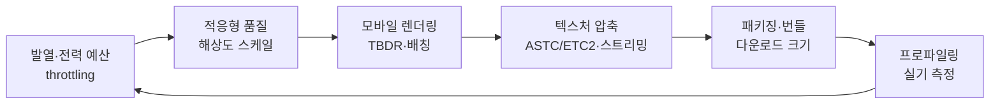
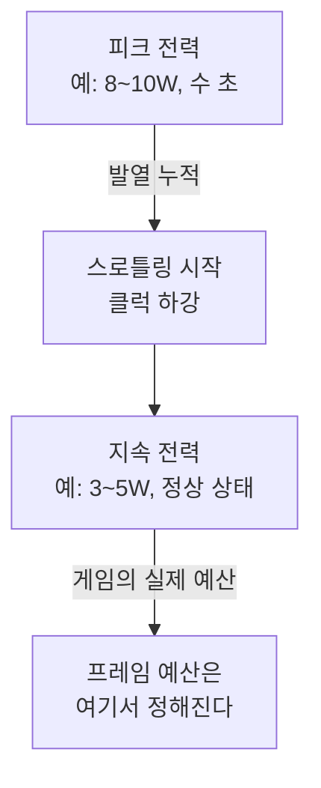
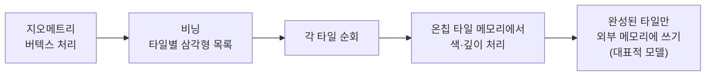
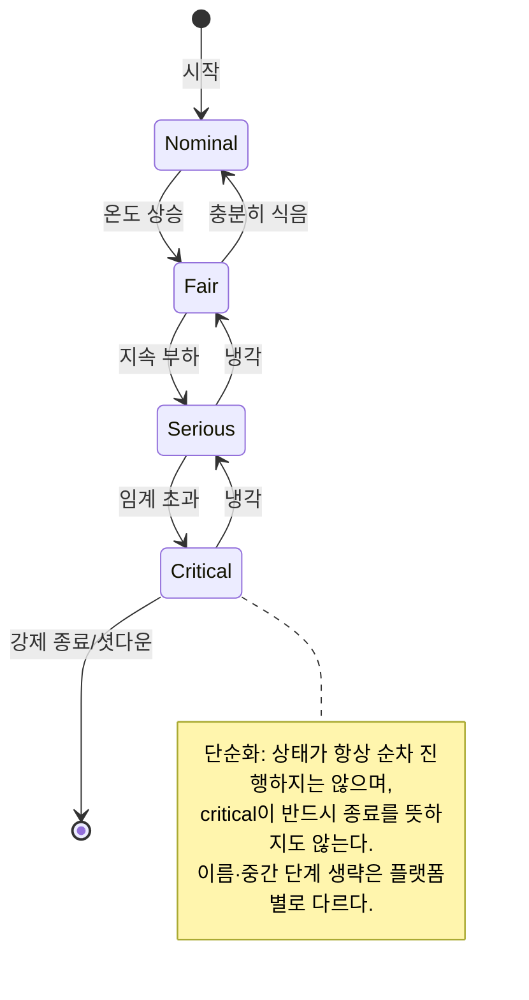
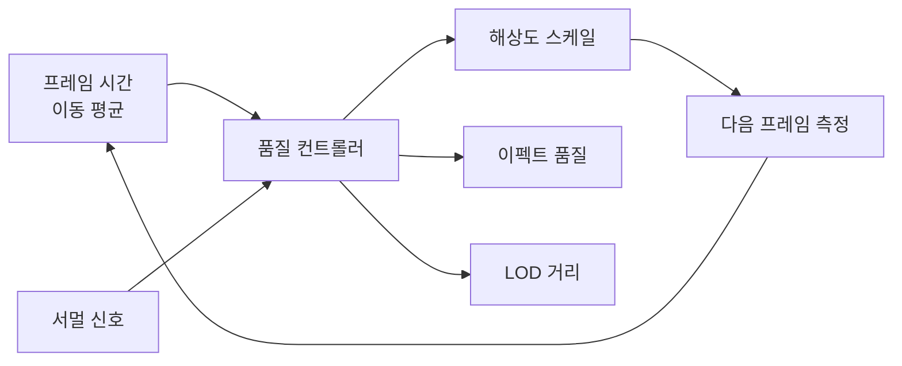
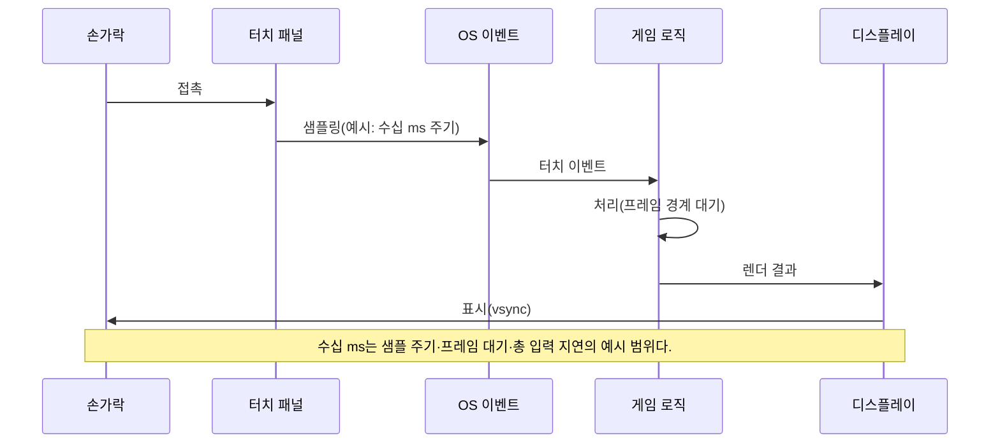
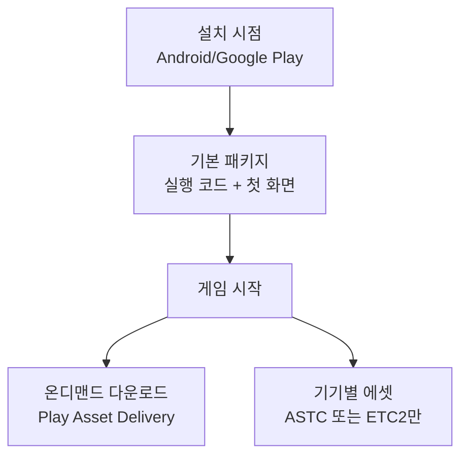
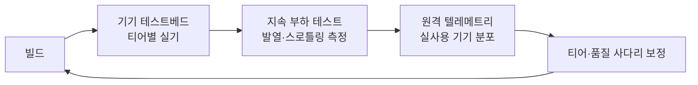

## 들어가며

모바일 게임은 *성능* 과 *발열·배터리* 사이의 끊임없는 줄다리기다. 데스크톱 GPU가 200W를 태우며 능동 냉각으로 식히는 동안, 스마트폰은 *수동 냉각만으로 3~5W* 를 버틴다. 같은 칩이라도 손 안에 쥐고 있으면 몇 분 만에 뜨거워지고, 뜨거워지면 운영체제가 *클럭을 강제로 내린다(thermal throttling)*. 그래서 모바일의 성능 예산은 PC처럼 "이 프레임에 들어가느냐"가 아니라 "*30분 뒤에도 이 프레임에 들어가느냐*"의 문제다.

이 글은 그 제약을 따라 모바일 렌더링·메모리·전력의 결정을 한 흐름으로 정리한다. 모바일 GPU가 왜 *타일 기반* 인지와 그것이 대역폭을 어떻게 아끼는지, 발열이 어떤 단계로 클럭을 깎고 게임이 그것을 어떻게 *감지·대응* 하는지, 한정된 메모리·대역폭 안에서 텍스처를 어떻게 압축(ASTC/ETC2)하고 스트리밍하는지, 해상도와 품질을 *프레임 단위로 적응* 시키는 방법, 터치 입력의 지연을 어떻게 줄이는지, 출시 빌드의 *다운로드 크기* 를 어떻게 묶고 쪼개는지, 그리고 이 모두를 실기에서 어떻게 측정하는지를 다룬다.



이 글의 목표.

1. **모바일 하드웨어와 파편화** — ARM·타일 렌더링·대역폭·기기 티어의 정량.
2. **발열과 전력 예산** — 스로틀링 단계, thermal API, 지속 가능한 프레임 예산.
3. **적응형 품질과 해상도 스케일** — 동적 해상도, 품질 LOD, 프레임 페이싱.
4. **모바일 렌더링 최적화** — 드로우콜 배칭, 컬링, 셰이더 ALU/텍스처 균형.
5. **텍스처 압축과 메모리** — ASTC·ETC2·블록 압축, 밉맵·아틀라스·스트리밍.
6. **터치 입력과 지연** — 입력 파이프라인, 멀티터치, 예측·보간.
7. **패키징과 다운로드 크기** — 앱 번들, 에셋 분할, 압축, 온디맨드.
8. **프로파일링과 실기 검증** — GPU 캡처, 서멀 로그, 기기 테스트베드.


---

## 목차
1. [모바일 하드웨어와 파편화](#1-모바일-하드웨어와-파편화)
2. [발열과 전력 예산](#2-발열과-전력-예산)
3. [적응형 품질과 해상도 스케일](#3-적응형-품질과-해상도-스케일)
4. [모바일 렌더링 최적화](#4-모바일-렌더링-최적화)
5. [텍스처 압축과 메모리](#5-텍스처-압축과-메모리)
6. [터치 입력과 지연](#6-터치-입력과-지연)
7. [패키징과 다운로드 크기](#7-패키징과-다운로드-크기)
8. [프로파일링과 실기 검증](#8-프로파일링과-실기-검증)


---

## 1. 모바일 하드웨어와 파편화

### 모바일 SoC의 전력 봉투

모바일 칩은 *SoC(System on Chip)* 다 — CPU, GPU, NPU, ISP, 메모리 컨트롤러가 한 다이에 들어간다. 데스크톱과 결정적으로 다른 점은 *공유된 전력·발열 예산* 이다. CPU와 GPU가 *같은 열 봉투(thermal envelope)* 를 나눠 쓰므로, 한쪽이 뜨거워지면 다른 쪽이 식어야 한다. 게임이 CPU와 GPU를 동시에 풀로 밀면 둘 다 스로틀링된다.

핵심 수치는 *지속 전력(sustained power)* 이다. 스마트폰은 순간적으로 8~10W를 끌어낼 수 있지만, 수동 냉각만으로 *장시간 유지 가능한 전력은 3~5W* 다. 그 차이가 발열로 쌓인다. 벤치마크 점수는 보통 *처음 몇 초의 피크* 를 재므로, 게임의 실제 성능은 벤치마크보다 한참 낮은 "스로틀링된 정상 상태"에서 결정된다.



### 타일 기반 렌더링(Tile-Based Rendering)

모바일의 대표적인 GPU 계열 — ARM Mali, Qualcomm Adreno, Imagination PowerVR, Apple GPU — 은 *타일 기반(tile-based)* 으로 분류된다(모든 모바일 GPU가 같은 메모리 경로를 쓰는 것은 아니다). 전통적인 *즉시 모드(immediate mode)* 렌더러가 삼각형을 곧바로 프레임버퍼에 그리는 것과 달리, 이상화된 타일 렌더러는 화면을 *작은 타일(예: 16×16 또는 32×32 픽셀)* 로 나눠 한 타일씩 처리한다.

이유는 *메모리 대역폭* 이다. 모바일은 외부 DRAM 대역폭이 좁고(예: 데스크톱 GPU의 1/10 수준), DRAM 접근은 *전력을 가장 많이 먹는 동작* 중 하나다. 타일 렌더러는 *타일 크기의 작은 온칩 메모리(tile memory)* 안에서 색·깊이·스텐실을 처리하고, 타일이 완성되면 *한 번만* 외부 메모리에 쓴다. 픽셀마다 프레임버퍼를 들락거리는 대신, 타일당 한 번의 외부 쓰기로 대역폭을 절약한다.



이 구조는 대표적인 tile-based renderer의 이상화 모델이며, 실제 비용은 타일 storage/load/store·spill·render pass 구조에 따라 달라진다. 이 모델은 두 가지 실무 함정을 만든다. 첫째, *비닝과 타일 처리의 비용* 이 있다 — 지오메트리와 중간 결과를 어떻게 처리·보존하는지는 GPU 구현에 따라 다르다. 과도한 버텍스와 타일별 중복 작업은 실제 기기에서 측정해야 한다. 둘째, *프레임버퍼를 중간에 읽으면(예: 후처리에서 이전 결과 샘플링)* 타일 메모리를 외부로 내보냈다 다시 들여와야 해서 대역폭 이득이 날아간다. 디퍼드 렌더링이 모바일에서 불리한 핵심 이유다(4절).

### 기기 파편화(Fragmentation)

안드로이드만 해도 활성 기기 모델이 *수만 종* 이고, GPU 제조사·드라이버 버전·메모리 용량·화면 비율이 제각각이다. iOS는 상대적으로 좁지만 여전히 수년치 기기가 공존한다. 단일 설정으로는 전 기기를 만족시킬 수 없다 — 최신 플래그십에서 화려하게, 4년 전 보급기에서 끊김 없이 돌아야 한다.

실무 해법은 *기기 티어(device tier)* 다. 기기를 성능 등급으로 분류하고, 티어별로 *기본 품질 프리셋* 을 정한다.

| 티어 | 대표 사양 | 기본 품질 | 목표 |
|---|---|---|---|
| Low | 4년+ 보급기, 2~3GB RAM | 최저 해상도·그림자 끔 | 끊김 없이 동작 |
| Mid | 2~3년 중급기, 4~6GB RAM | 중간 해상도·간단 그림자 | 안정적 30fps |
| High | 1~2년 플래그십, 8GB+ RAM | 풀 해상도·그림자·후처리 | 안정적 60fps |
| Ultra | 최신 게이밍폰 | 최대 + 고프레임 | 90/120fps |

티어 판정은 GPU 모델·RAM·코어 구성 같은 *정적 정보* 로 1차 분류하고, 첫 실행 시 *짧은 벤치마크* 로 보정한다. 그러나 정적 티어는 *시작점일 뿐* 이다 — 같은 티어 기기라도 발열 상태·백그라운드 부하가 다르므로, 런타임에 *적응형 품질* 로 다시 조정한다(3절). 기기 데이터베이스(예: 모델명→GPU 매핑)는 신기종이 계속 나오므로 *원격 업데이트* 가 가능해야 한다.

## 2. 발열과 전력 예산

### 스로틀링의 단계

발열 스로틀링은 한 번에 떨어지지 않고 *단계적* 으로 진행된다. 운영체제는 칩 온도를 감시하다가 임계치를 넘으면 클럭을 단계적으로 내린다. 게임 입장에서 이 과정은 "처음 몇 분은 60fps, 그 뒤 45fps, 더 지나면 30fps"로 체감된다.



각 단계에서 시스템이 취하는 조치와 게임이 받는 영향은 다르다.

| 서멀 상태 | 시스템 조치 | 게임 체감 |
|---|---|---|
| Nominal | 없음 | 풀 성능 |
| Fair | 약한 클럭 제한 | 미세한 프레임 저하 |
| Serious | 강한 클럭 제한, 밝기 하강 | 명확한 프레임 드랍 |
| Critical | 큰 폭 클럭 제한 | 심한 끊김, 곧 셧다운 위험 |

### 서멀 상태를 읽는다

게임은 *서멀 상태를 직접 조회* 해서 능동적으로 대응할 수 있다. iOS는 `ProcessInfo.thermalState`(nominal/fair/serious/critical)를, 안드로이드는 `PowerManager`의 *thermal status* 와 *thermal headroom* API를 제공한다. headroom은 "임계까지 얼마나 남았는가"를 0~1로 주는 *예측적 신호* 라 특히 유용하다 — 이미 뜨거워진 뒤가 아니라, *뜨거워지기 전에* 부하를 낮출 수 있다. 다만 원시 값은 1을 넘거나 미지원 시 NaN일 수 있으므로, 래퍼가 유한성 검사와 정규화(clamp)를 책임져야 한다.

```cpp
// 서멀 상태를 추상화해 품질 컨트롤러에 입력으로 넣는다
enum class ThermalState { Nominal, Fair, Serious, Critical };

struct ThermalSignal {
    ThermalState state;
    bool         headroomValid; // raw API가 유한값을 줬는지. false면 headroom은 미정
    float        headroom;     // 0.0=임계, 1.0=여유 충분 (주의: 안드로이드 getThermalHeadroom은
                               //  반대로 1.0=심각 임계·클수록 위험이므로, 래핑 시 1-x로 뒤집어 통일한다)
};

ThermalSignal QueryThermal();  // 플랫폼별 API 래핑
// 래핑 계약: raw가 finite일 때만 clamp(1-raw, 0.0f, 1.0f)로 정규화하고 headroomValid=true로 둔다.
// raw가 NaN/미지원이거나 1을 넘으면 유한성 검사 후 clamp하고, 유한하지 않으면 state나 보수적 품질 정책으로 처리한다.

// 매 초 폴링(매 프레임은 과함). 상태 변화에 히스테리시스를 둔다.
void UpdateQualityFromThermal(const ThermalSignal& t) {
    if (t.state >= ThermalState::Serious || (t.headroomValid && t.headroom < 0.2f))
        qualityController.RequestLevel(QualityLevel::Reduced);
    else if (t.state == ThermalState::Nominal && t.headroomValid && t.headroom > 0.5f)
        qualityController.AllowLevel(QualityLevel::Full);
    else if (!t.headroomValid)
        qualityController.RequestLevel(QualityLevel::Reduced);  // raw 미지 → 보수적으로
}
```

폴링 주기는 *초 단위* 면 충분하다 — 발열은 분 단위로 움직이는 느린 현상이고, 매 프레임 조회는 낭비다. 그리고 상태 전환에 *히스테리시스(hysteresis)* 를 둔다. 임계 근처에서 품질을 올렸다 내렸다 진동하면 사용자가 더 거슬려한다 — "내릴 때는 빨리, 올릴 때는 천천히"가 원칙이다.

### 지속 가능한 프레임 예산

발열의 근본 해법은 *애초에 덜 태우는 것* 이다. 가장 강력한 단일 레버는 *프레임레이트 상한* 이다. 60fps 대신 *30fps로 고정* 하면 GPU·CPU 작업량이 절반 가까이 줄어 전력과 발열이 크게 내려간다. 많은 모바일 게임이 "전투는 60, 평상시 30" 또는 "고프레임은 옵션"으로 두는 이유다.

```cpp
// 목표 프레임 시간을 발열에 따라 조정 (프레임 페이싱)
// targetFrameMs는 지원 refresh의 정수 divisor(또는 해당 범위 VRR)로 고른다.
// 고정 60Hz에서 45fps는 균등 22.2ms가 아니라 1/2 refresh 간격이 섞이므로,
// 60/30 같은 divisor나 90Hz 2 refresh·VRR에서만 균등 표시가 보장된다.
struct FramePacer {
    float targetFrameMs = 33.3f;   // 30fps 기본

    void OnThermal(ThermalState s) {
        switch (s) {
            case ThermalState::Nominal: targetFrameMs = 16.6f; break;  // 60 허용 (60Hz 1 divisor)
            case ThermalState::Fair:    targetFrameMs = 22.2f; break;  // 45: 90Hz 2 divisor 또는 VRR 한정
            default:                    targetFrameMs = 33.3f; break;  // 30으로 후퇴 (60Hz 2 divisor)
        }
    }
};
```

핵심은 *불필요하게 빠른 프레임이 발열로 직결된다* 는 것이다. 메뉴 화면에서 200fps를 뽑는 것은 배터리만 태운다 — 어차피 화면 갱신률을 넘는 프레임은 버려진다. 화면에 변화가 없으면 *프레임 생성 자체를 멈추거나 늦추는* 것도 유효한 전략이다. 정적 UI 화면, 일시정지, 백그라운드 진입 시 렌더링을 *능동적으로 줄인다*.

또 다른 함정은 *busy-wait* 다. 프레임을 일찍 끝낸 뒤 다음 vsync까지 *바쁜 대기* 로 CPU를 돌리면, 아무 일도 안 하면서 전력을 태운다. 남는 시간에는 *CPU를 재운다(sleep)*. 프레임 페이싱은 "정확한 타이밍에 제출"하면서 "남는 시간엔 칩을 식히는" 두 목적을 동시에 달성한다.

## 3. 적응형 품질과 해상도 스케일

### 적응이 정적 티어보다 나은 이유

1절의 기기 티어는 *시작점* 이고, 2절의 발열은 *런타임에 변하는* 제약이다. 같은 기기라도 게임을 막 켰을 때와 30분 뒤는 성능이 다르고, 한 장면 안에서도 폭발 이펙트가 터지는 순간과 빈 복도는 부하가 다르다. *적응형 품질(adaptive quality)* 은 매 프레임의 측정값으로 품질을 *연속적으로 조정* 한다.

입력은 두 가지다. *최근 프레임 시간* (성능이 마감을 지키는가)과 *서멀 신호* (지속 가능한가). 출력은 *해상도 스케일·이펙트 품질·LOD 거리* 같은 조절 가능한 파라미터다.



### 동적 해상도 스케일링

가장 효과적인 단일 레버는 *동적 해상도(dynamic resolution)* 다. GPU 부하는 대체로 *픽셀 수에 비례* 하므로, 렌더 타깃 해상도를 낮추면 부하가 곧바로 떨어진다. 핵심은 *렌더 해상도와 표시 해상도를 분리* 하는 것이다 — 게임 월드는 낮은 해상도로 그리고, 마지막에 화면 해상도로 *업스케일* 한다. UI는 풀 해상도로 그려 선명함을 유지한다.

```cpp
// 프레임 시간을 목표에 맞추는 폐루프 해상도 제어
struct DynamicResolution {
    float scale = 1.0f;            // 1.0=풀, 0.5=가로·세로 절반(픽셀 1/4)
    float minScale = 0.5f, maxScale = 1.0f;
    float targetMs = 16.6f;

    void Update(float gpuFrameMs) {
        float error = gpuFrameMs - targetMs;
        // 느리면 줄이고, 여유 있으면 천천히 키운다 (비대칭 반응)
        if (error > 1.0f)        scale -= 0.05f;   // 마감 초과 → 빠르게 축소
        else if (error < -2.0f)  scale += 0.01f;   // 충분히 빠름 → 천천히 복귀
        scale = std::clamp(scale, minScale, maxScale);
    }

    int RenderWidth(int displayW) const { return int(displayW * scale); }
};
```

측정값은 반드시 *GPU 프레임 시간* 이어야 한다 — 전체 프레임 시간은 CPU·vsync 대기를 포함해 오해를 부른다. 해상도를 줄였는데도 GPU 시간이 줄지 않으면 픽셀 수에 크게 좌우되지 않는 작업이 병목일 수 있다. CPU 제한 여부와 지오메트리·고정 비용 등은 별도 측정으로 구분한다. 그리고 스케일 변화는 *부드럽게* 적용한다. 해상도가 매 프레임 출렁이면 화면이 *호흡하듯 번지는* 아티팩트가 보인다 — 변화 폭에 상한을 두고, 업스케일 단계에 시간적 안정화(temporal upscaling)를 쓰면 완화된다.

### 품질 LOD 사다리

해상도 외에 조절할 파라미터는 *사다리(ladder)* 로 묶는다. 각 단계는 "이만큼 부하를 줄인다"가 정량화된 *순서 있는 목록* 이다. 컨트롤러는 마감을 못 지키면 사다리를 *한 칸 내려가고*, 여유가 생기면 *한 칸 올라간다*.

| 사다리 단계 | 조절 항목 | 대략 부하 절감 |
|---|---|---|
| 0 (최고) | 풀 해상도, 그림자, 후처리 전부 | 기준 |
| 1 | 후처리(블룸·DOF) 간소화 | ~10% |
| 2 | 그림자 해상도 절반 | ~15% |
| 3 | 동적 해상도 0.8배 | ~20% |
| 4 | 파티클·이펙트 밀도 축소 | ~15% |
| 5 (최저) | 그림자 끔, 해상도 0.6배 | 누적 최대 |

조절 항목의 순서가 중요하다. *눈에 덜 띄는 것부터* 깎는다 — 멀리 있는 그림자 해상도나 후처리는 게임플레이에 영향이 적지만, 캐릭터 모델 LOD나 입력 반응성은 마지막까지 지킨다. 그리고 *프레임 페이싱(frame pacing)* 을 함께 본다. 평균 60fps라도 *간헐적 스파이크* 로 끊기면 체감이 나쁘다 — 평균보다 *꼬리(tail)* 를 관리하는 편이 부드러움에 직결된다. 다만 집계 정의를 명시해야 한다. *p99 프레임 시간(nearest-rank percentile)* 과 *1% low FPS(가장 느린 1% 프레임 시간 평균의 역수)* 는 같은 값이 아니며, p99의 역수를 1% low FPS로 쓰면 안 된다. 표본 window와 프레임 제외 규칙도 함께 고정한다.

## 4. 모바일 렌더링 최적화

### 드로우콜 배칭(Draw Call Batching)

드로우콜 하나는 *CPU 측 비용* 이 있다 — 상태 설정, 드라이버 검증, 명령 제출. 모바일 CPU는 약하고 드라이버 오버헤드가 크므로, *드로우콜 수* 가 모바일에서 흔한 CPU 병목이다. 수백 개 오브젝트를 개별 드로우콜로 그리면 CPU가 GPU를 못 따라간다.

해법은 *배칭(batching)* — 같은 머티리얼을 쓰는 오브젝트를 *하나의 드로우콜로 묶는다*. 정적 지오메트리는 빌드 타임에 메시를 합치고(static batching), 같은 메시의 반복은 *인스턴싱(instancing)* 으로 한 번에 그린다.

```cpp
// 인스턴싱: 같은 메시 N개를 1드로우콜로. 인스턴스별 변환만 버퍼로 전달
struct InstanceData { Mat4 transform; Color tint; };

void DrawTrees(const Mesh& treeMesh, const std::vector<InstanceData>& instances) {
    UploadInstanceBuffer(instances);                  // GPU 버퍼 1회 업로드
    DrawInstanced(treeMesh, instances.size());        // 드로우콜 1회
    // 나무 1,000그루 = 드로우콜 1,000 → 1
}
```

배칭의 전제는 *머티리얼·상태 공유* 다. 머티리얼이 다르면 배치가 깨지므로, *텍스처 아틀라스* (5절)로 머티리얼 수를 줄이는 것이 배칭과 직결된다. 다만 1절에서 본 대로 *과도한 버텍스* 는 타일 렌더러에서 비싸므로, 배칭으로 드로우콜을 줄이되 *전체 삼각형 수* 는 LOD로 따로 관리해야 한다.

### 컬링 — 안 그릴 것을 거른다

가장 빠른 드로우콜은 *제출하지 않은 드로우콜* 이다. *프러스텀 컬링(frustum culling)* 은 카메라 시야 밖 오브젝트를 거르고, *오클루전 컬링(occlusion culling)* 은 다른 물체에 가려 안 보이는 것을 거른다. 모바일은 오버드로우(같은 픽셀을 여러 번 칠하는 것)에 특히 약하므로 — 타일 메모리·대역폭 압박 — 컬링의 이득이 데스크톱보다 크다.

```cpp
// 프러스텀 컬링: 바운딩 구가 절두체 안인지 검사 (드로우 전 단계)
// 계약: Plane::Distance는 노멀이 unit length이고 내부(양의 반공간)가 양수인 signed geometric
// distance를 반환한다. n·p+d 형태의 일반식이라면 |n|으로 나눈 뒤 써야 하며 zero normal은 거부한다.
// bounds.center·radius와 평면은 같은 월드 좌표계·같은 단위여야 하고 radius >= 0이어야 한다.
bool InFrustum(const Sphere& bounds, const Plane planes[6]) {
    for (int i = 0; i < 6; ++i)
        if (planes[i].Distance(bounds.center) < -bounds.radius)
            return false;       // 완전히 한 평면 밖 → 컬링
    return true;
}
```

오클루전 컬링은 모바일에서 *보수적* 으로 쓴다 — 정밀한 GPU 오클루전 쿼리는 그 자체로 비싸고 지연이 있다. 실내처럼 가림이 강한 구조에서는 *포털·셀(portal/cell)* 기반 정적 컬링이 효율적이고, 개방 월드에서는 거리 컬링과 LOD가 더 실용적이다.

### 셰이더 — ALU와 텍스처 페치의 균형

모바일 프래그먼트 셰이더의 두 비용 축은 *ALU(산술 연산)* 와 *텍스처 페치(texture fetch)* 다. 텍스처 페치는 메모리 접근이라 *대역폭·지연* 을 쓰고, ALU는 *연산 유닛* 을 쓴다. 모바일에서는 *대역폭이 더 귀하므로*, "텍스처 룩업으로 미리 계산해 두기"가 데스크톱에서는 이득이어도 모바일에서는 손해일 수 있다 — 차라리 *셰이더에서 직접 계산(ALU)* 하는 편이 빠른 경우가 많다.

| 기법 | 데스크톱 | 모바일 |
|---|---|---|
| 룩업 텍스처(LUT)로 함수 근사 | 흔히 이득 | 대역폭 부담, 종종 손해 |
| 셰이더에서 직접 계산 | ALU 부담 | 대역폭 절약, 종종 이득 |
| 고정밀(highp) 연산 | 기본 | 비싸므로 mediump 우선 |
| 의존 텍스처 페치(좌표를 계산해 샘플) | 허용 | 캐시·지연 악화, 회피 |

모바일 셰이더의 추가 원칙은 *정밀도(precision)* 다. GLSL ES는 `highp`/`mediump`/`lowp`를 구분하고, *낮은 정밀도가 더 빠르고 전력을 덜 쓴다*. 색·노멀처럼 정밀도가 덜 중요한 값은 `mediump`로 두고, 위치·깊이처럼 정밀도가 중요한 값만 `highp`로 쓴다. 그리고 *분기(branch)* 와 *동적 루프* 는 모바일 GPU에서 비싸므로 가능한 한 정적으로 푼다.

### 포워드 대 디퍼드

데스크톱에서 인기 있는 *디퍼드 렌더링(deferred rendering)* 은 모바일에서 보통 *불리* 하다. 디퍼드는 G-버퍼(여러 장의 전체 화면 텍스처)를 외부 메모리에 쓰고 다시 읽는데, 이것이 1절의 *타일 메모리 이점을 무너뜨린다* — 대역폭이 폭증한다. 그래서 모바일은 주로 *포워드(forward) 또는 포워드+* 를 쓴다.

타일 렌더러의 강점을 살린 변종도 있다. *타일 기반 디퍼드(tile-based deferred)* 나 *서브패스(subpass)* 를 이용해 G-버퍼를 *외부로 내보내지 않고 타일 메모리 안에서* 라이팅까지 끝내는 방식이다. 최신 모바일 API(Vulkan의 서브패스, Metal의 메모리리스 어태치먼트)가 이를 지원한다. 다만 render pass 경계·load/store action·attachment 보존 여부에 따라 외부 메모리 접근 횟수는 달라진다. 어느 경우든 핵심 원칙은 같다 — *전체 화면 텍스처를 불필요하게 외부 메모리로 왕복시키지 마라*.

## 5. 텍스처 압축과 메모리

### 왜 GPU 텍스처 압축인가

텍스처는 *메모리와 대역폭을 가장 많이 먹는 에셋* 이다. 압축하지 않은 RGBA 텍스처는 *픽셀당 4바이트* 다 — 2048×2048 한 장이 16MB. 수백 장이면 수 GB로 폭발한다. 그래서 *GPU가 직접 읽는 압축 포맷* 을 쓴다.

여기서 중요한 구분이 있다. JPEG/PNG는 *디스크 압축* 이라 *GPU가 못 읽는다* — 로드 시 압축을 풀어 비압축 텍스처로 메모리에 올린다. 반면 ASTC/ETC2 같은 *GPU 텍스처 압축* 은 *압축된 채로 GPU 메모리에 상주* 하고, 셰이더가 샘플링할 때 *하드웨어가 즉석에서 블록을 푼다*. 즉 GPU 텍스처 압축은 *디스크 크기뿐 아니라 런타임 메모리와 대역폭까지* 줄인다.

| 포맷 | 지원 | 비트/픽셀(대략) | 특성 |
|---|---|---|---|
| ETC2 | 모든 OpenGL ES 3.0+ (안드로이드 기준) | 4 또는 8 | 호환성 최고, 품질 보통 |
| ASTC | 최신 안드로이드·iOS | 2–8 bpp (8×8–4×4 blocks) | 품질·크기 조절 자유, 권장 |
| PVRTC | 구형 iOS·PowerVR | 2 또는 4 | 레거시, 신규 회피 |
| BCn(S3TC) | 데스크톱, 일부 모바일 | 4~8 | 데스크톱 표준, 모바일 지원 제한적 |

### ASTC와 블록 크기

*ASTC(Adaptive Scalable Texture Compression)* 는 품질과 bitrate를 폭넓게 선택할 수 있어 지원 기기에서 강한 기본 포맷이다. 그러나 모든 모바일 GPU의 공통 최소 기능은 아니므로 runtime capability와 배포 대상별 포맷 세트를 확인한다. 2D ASTC block은 4×4부터 12×12까지 여러 정사각·직사각 크기를 제공하고 block당 128bit를 쓴다. 따라서 4×4는 8bpp, 8×8은 2bpp다. LDR/HDR profile 지원도 API·GPU별로 구분한다.

```cpp
// 텍스처 용도별 ASTC 블록 크기 선택 (빌드 파이프라인)
ASTCBlock ChooseBlock(TextureUsage usage) {
    switch (usage) {
        case TextureUsage::AlbedoHero:  return ASTC_4x4;   // 주인공 등 고품질
        case TextureUsage::AlbedoProp:  return ASTC_6x6;   // 일반 소품
        case TextureUsage::Normal:      return ASTC_5x5;   // 노멀맵은 손실에 민감
        case TextureUsage::UIBackground:return ASTC_8x8;   // 약한 디테일
        default:                        return ASTC_6x6;
    }
}
```

블록 크기 선택은 *품질↔메모리* 의 직접 거래다. 노멀맵은 압축 아티팩트가 라이팅에 증폭되므로 작은 블록을 쓰고, 배경·UI는 큰 블록으로 줄인다. 파편화 문제도 있다 — *구형 안드로이드 보급기는 ASTC를 지원하지 않을 수 있어*, ETC2 폴백을 함께 굽거나, 빌드를 ASTC/ETC2로 나눠 *기기별로 다른 텍스처 세트* 를 내려받게 한다(7절).

### 밉맵과 텍스처 스트리밍

*밉맵(mipmap)* 은 텍스처를 절반씩 줄인 사전 계산된 축소본의 사슬이다. 축소되어 보이는 표면에 작은 밉을 샘플링하면 minification aliasing과 불필요한 텍셀 대역폭을 줄인다. 이상적인 2D 정사각 텍스처의 완전한 밉 체인은 원본 대비 $1/4+1/16+\cdots=1/3$만큼의 texel을 추가하지만, 블록 압축과 작은 레벨 padding에서는 실제 비율이 달라진다. 원근 공간에서 여러 크기로 보이는 표면 텍스처에는 대개 이득이지만, 화면과 1:1인 UI, 절대 축소되지 않는 데이터, 일부 렌더 타깃은 밉 체인이 불필요할 수 있다.

큰 게임은 *텍스처 스트리밍(texture streaming)* 으로 한발 더 나간다. 모든 텍스처의 최고 밉을 항상 들고 있지 않고, *카메라가 가까이 갈 때만 고해상도 밉을 메모리에 올린다*. 메모리 예산을 정해 두고, 예산을 넘으면 *덜 중요한(먼) 텍스처의 고밉을 버린다*.

```cpp
// 텍스처 스트리밍: 예산 안에서 필요한 밉만 상주
struct StreamableTexture {
    int   loadedMip;          // 현재 메모리에 올라온 최고 밉 (0=풀)
    int   desiredMip;         // 카메라 거리로 계산한 필요 밉
    float lastUsedTime;
};

void UpdateStreaming(std::vector<StreamableTexture>& texs, size_t budget) {
    for (auto& t : texs) t.desiredMip = ComputeDesiredMip(t);  // 거리 기반
    // 예산 초과 시 desiredMip이 큰(낮은 품질로 충분한) 것부터 고밉 해제.
    // eviction이 매회 진전하지 못하면(모두 pinned/in-flight) while을 빠져나와 적재를 보류한다.
    while (CurrentUsageIncludingPending(texs) > budget)
        if (!EvictHighestMip(LeastImportant(texs))) break;   // 공간을 못 줄임 → 실패/보류
    LoadMissingMips(texs);    // committed+pending+신규 bytes를 검사해 예산 안에서만 채움
    // 필수 밉까지 합쳐 budget보다 크면 품질 강등 또는 적재 실패 정책을 명시한다.
}
```

스트리밍의 함정은 *팝인(pop-in)* — 고밉이 늦게 도착해 텍스처가 한순간 흐릿하다 또렷해지는 현상이다. *미리 예측 로드(가는 방향의 텍스처 선반입)* 와 *최소 밉 보장(절대 너무 흐려지지 않게)* 으로 완화한다. 메모리는 *풀(pool)* 로 관리해 매번 할당/해제하지 않고 고정 버퍼를 재사용한다 — 모바일은 메모리 할당 자체가 비싸고 단편화에 취약하다.

### 아틀라스와 메모리 운영

*텍스처 아틀라스(atlas)* 는 작은 텍스처 여럿을 *한 장에 모은다*. 이점은 두 가지다 — *드로우콜 배칭*(4절, 같은 텍스처를 공유하면 배치가 안 깨짐)과 *메모리 정렬*(텍스처마다의 패딩·정렬 낭비 감소). UI 스프라이트, 작은 소품 텍스처가 주 대상이다.

모바일 메모리 운영의 추가 제약은 *OS가 메모리 압박 시 앱을 죽인다* 는 것이다. 안드로이드·iOS 모두 메모리가 부족하면 백그라운드 앱부터, 심하면 포그라운드 게임도 종료한다. 그래서 *메모리 경고 콜백(memory warning)* 을 받아 *캐시·스트리밍 밉을 능동적으로 비우는* 대응이 필요하다. 메모리 예산은 "쓸 수 있는 최대"가 아니라 "*안전하게 유지할 수 있는 정상 상태*"로 잡는다.

## 6. 터치 입력과 지연

### 터치 입력 파이프라인

터치는 콘솔 패드나 마우스와 다른 *지연 특성* 을 가진다. 손가락이 화면에 닿으면 터치 패널이 신호를 샘플링하고(보통 *수십~120Hz*), OS가 이벤트로 변환해 앱에 전달하고, 게임이 처리해 다음 프레임에 반영하고, 디스플레이가 갱신한다. 각 단계가 *지연(latency)* 을 쌓는다 — 화면에 보이는 반응은 손가락 동작보다 *수십 ms 뒤* 다.



총 지연을 줄이는 레버는 여러 곳에 있다. *입력을 프레임 경계가 아니라 가능한 늦게 읽기*(렌더 직전에 최신 터치를 반영), *높은 터치 샘플링·디스플레이 갱신률 활용*(120Hz 화면은 입력 지연도 함께 줄인다), *불필요한 입력 버퍼링 제거* 다. 액션·리듬 게임에서는 이 지연이 *조작감의 핵심* 이라, 입력→화면 지연을 *실측* 해서 관리한다(고속 카메라로 손가락과 화면 반응의 프레임 차를 센다).

### 멀티터치와 제스처

모바일 입력은 *멀티터치* 가 기본이다 — 여러 손가락이 동시에 닿고, 각 터치는 *고유 ID* 로 추적된다(begin/move/end). 가상 조이스틱·핀치 줌·회전 같은 제스처는 이 다중 포인터를 *상태 머신* 으로 해석한다.

```cpp
// 터치를 ID로 추적. 가상 조이스틱은 첫 터치를 고정점으로 잡는다.
// 계약: touches가 활성 터치만 담는 snapshot이면 아래 active 검사는 방어적이다.
// ended/canceled 터치가 같은 ID로 남는 모델에서는 active=false를 즉시 중립으로 처리하고,
// focus loss·ID 재사용 시에는 추적 상태를 초기화한다.
struct Touch { int id; Vec2 pos, startPos; bool active; };

struct VirtualStick {
    int   trackingId = -1;
    Vec2  center;
    float maxRadius = 120.0f;
    void  Reset() { trackingId = -1; center = Vec2(0, 0); }   // focus loss·취소 시
    Vec2  Output(const std::vector<Touch>& touches) {
        for (auto& t : touches) {
            if (trackingId == -1 && t.active) { trackingId = t.id; center = t.pos; }
            if (t.id == trackingId) {
                if (!t.active) { Reset(); return Vec2(0, 0); }    // ended/canceled → 중립
                Vec2 v = (t.pos - center) / maxRadius;
                return Vec2(std::clamp(v.x, -1.0f, 1.0f), std::clamp(v.y, -1.0f, 1.0f));
            }
        }
        Reset();                     // 추적하던 터치가 떨어짐 → 중립
        return Vec2(0, 0);
    }
};
```

제스처 인식의 함정은 *모호성* 이다 — 탭과 드래그, 스와이프와 핀치가 초기 몇 프레임에 구분되지 않는다. *임계 거리·시간* 으로 분기하되, 잘못 분류하면 사용자가 답답해하므로 *보수적 임계* 와 *취소 가능한 제스처(시작했다 임계 안 넘으면 탭으로 처리)* 를 둔다.

### 예측과 보간으로 지연 숨기기

물리적 지연을 완전히 없앨 수는 없으므로, *체감* 을 줄인다. *터치 예측(touch prediction)* 은 최근 이동 궤적으로 *다음 위치를 외삽* 해, 손가락이 닿기 전에 미리 반응을 시작한다(드로잉 앱·일부 게임의 커서). *보간(interpolation)* 은 저주파 입력을 부드럽게 이어 *떨림* 을 없앤다.

햅틱 피드백(haptic feedback)도 *체감 반응성* 에 기여한다 — 시각 반응이 늦어도 *촉각이 즉시* 오면 "닿았다"는 확신이 생긴다. 다만 햅틱 모터는 *전력을 쓰므로*, 과하게 진동시키면 배터리·발열 예산을 갉아먹는다. 의미 있는 순간에만 짧게 쓴다.

## 7. 패키징과 다운로드 크기

### 다운로드 크기가 곧 전환율

앱 스토어의 *다운로드 크기* 는 직접적인 사업 지표다. 큰 앱은 설치 전환율이 떨어지고, 일부 네트워크에서는 *셀룰러 다운로드 상한* 에 걸려 와이파이가 있어야만 받을 수 있다. 그래서 *초기 다운로드를 작게, 나머지는 필요할 때* 가 패키징의 대원칙이다.



### 앱 번들과 기기별 분할

Google Play 등 Android 스토어는 *앱 번들(app bundle)* 형식을 권장한다 — 개발자는 모든 변종을 담은 번들을 올리고, 스토어가 *각 기기에 맞는 부분만 잘라* 내려보낸다. 이로써 한 기기는 *자기 화면 밀도·CPU 아키텍처·텍스처 포맷에 해당하는 에셋만* 받는다. 이 절의 ASTC/ETC2 선택과 배포 모드는 Android 배포 맥락이며, iOS/Metal 산출물과 같은 규칙으로 일반화하지 않는다.

| 분할 축 | 변종 | 효과 |
|---|---|---|
| ABI(CPU) | arm64, armeabi-v7a | 자기 아키텍처 코드만 |
| 화면 밀도 | mdpi~xxxhdpi | 맞는 해상도 리소스만 |
| 텍스처 포맷 | ASTC / ETC2 | 지원 포맷만(5절) |
| 언어 | 지역별 문자열·음성 | 쓰는 언어만 |

5절에서 본 ASTC/ETC2 파편화가 여기서 해결된다 — 두 포맷을 다 구워 번들에 넣되, *각 기기는 한쪽만* 받는다. 모든 변종을 한 패키지에 담으면 다운로드가 부풀지만, 분할하면 *기기가 받는 실제 크기* 가 절반 가까이 줄 수 있다.

### 에셋 분할과 온디맨드

코드와 첫 진입에 필요한 에셋만 *기본 패키지* 에 넣고, 나머지 레벨·컷신·고해상도 텍스처는 *에셋 팩(asset pack)* 으로 분리해 *필요할 때 다운로드* 한다. 아래 세 모드는 Google Play Asset Delivery의 분류다. 분할 전략은 *접근 패턴* 을 따른다.

| 에셋 팩 유형 | 다운로드 시점 | 예 |
|---|---|---|
| install-time | 설치 시 함께 | 튜토리얼·첫 레벨 |
| fast-follow | 설치 직후 백그라운드 | 초반 콘텐츠 |
| on-demand | 게임 내 진입 시 | 후반 레벨·DLC |

온디맨드의 함정은 *대기 시간* 이다 — 필요한 순간 다운로드가 안 끝나 있으면 사용자가 멈춰 기다린다. *선반입(prefetch)* 으로 가까운 콘텐츠를 미리 받고, 다운로드 중에는 *진행 표시와 대체 콘텐츠* 로 빈 시간을 메운다. 그리고 *재시도·재개* 를 견고하게 만든다 — 모바일 네트워크는 자주 끊기므로, 부분 다운로드를 *이어받기(resume)* 하고 *체크섬* 으로 무결성을 검증한다.

### 빌드 크기를 줄이는 실무 레버

| 레버 | 절감 대상 |
|---|---|
| 텍스처 GPU 압축(ASTC/ETC2) | 가장 큰 단일 절감(에셋 대부분이 텍스처) |
| 오디오 압축(Vorbis/Opus) | BGM·음성 |
| 메시·애니메이션 압축·양자화 | 지오메트리 데이터 |
| 코드 축소·미사용 제거(strip) | 실행 바이너리 |
| 중복 에셋 제거·참조 공유 | 빌드 전반 |
| 미사용 로케일·리소스 제거 | 다국어 리소스 |

가장 큰 덩어리는 보통 *텍스처와 오디오* 다. 빌드 크기 분석 도구로 *무엇이 용량을 차지하는지* 먼저 측정하고 — 추측으로 줄이면 효과 없는 곳을 깎는다 — 큰 항목부터 압축·분할한다. 이것은 5절 텍스처 압축과 같은 결정이 *디스크·다운로드 관점에서* 반복되는 것이다.

## 8. 프로파일링과 실기 검증

### 무엇을 측정하는가

모바일 프로파일링은 *발열이라는 시간 축* 때문에 데스크톱과 다르다. "이 장면이 60fps냐"만이 아니라 "*30분 뒤에도 60fps냐*"를 본다. 측정 항목이 명확하다.

| 지표 | 의미 | 위험 신호 |
|---|---|---|
| CPU 프레임 시간 | 게임 로직·드로우콜 제출 | 마감 초과 → 드랍 |
| GPU 프레임 시간 | 렌더링 부하 | 마감 초과, 해상도 조절 대상 |
| 메모리 대역폭 | 외부 DRAM 접근량 | 발열·전력의 숨은 주범 |
| 서멀 상태/headroom | 발열 여유 | 스로틀링 임박 |
| 메모리 사용량 | 텍스처·버퍼·힙 | OS 종료 위험 |
| 전력(mW) | 순간 소비 전력 | 지속 예산 초과 |
| 다운로드/설치 크기 | 패키지 용량 | 전환율 하락 |

```cpp
// 실기에서 수집하는 프레임 단위 텔레메트리
struct MobileFrameSample {
    float  cpuMs, gpuMs;          // 분리 측정 (병목 판별에 필수)
    float  bandwidthMBps;         // 외부 메모리 대역폭 추정
    ThermalState thermal;
    float  thermalHeadroom;
    size_t memoryBytes;
    float  powerMilliWatts;       // 가능한 기기에서
    float  resolutionScale;       // 동적 해상도 현재 값(3절)
};
```

핵심은 *CPU와 GPU 시간을 분리* 하는 것이다. 둘을 합친 프레임 시간만 보면 *어느 쪽이 병목인지* 알 수 없다 — CPU 병목인데 해상도를 낮추면 효과가 없고, GPU 병목인데 드로우콜만 줄이면 헛수고다. 그리고 *대역폭* 을 본다. 모바일에서 발열의 숨은 주범이 대역폭인 경우가 많은데, 프레임 시간만 보면 놓친다.

### 도구 — GPU 캡처와 시스템 트레이스

- *GPU 캡처(frame capture)*: 한 프레임의 드로우콜·상태·텍스처를 통째로 떠서 *어떤 패스가 비싼지* 분석한다. 벤더 도구(Adreno·Mali·PowerVR의 프로파일러)와 범용 캡처 도구가 있다. 오버드로우·과도한 텍스처·불필요한 프레임버퍼 왕복(1절)을 찾는 데 결정적이다.
- *시스템 트레이스(system trace)*: CPU 코어별 스케줄링, GPU 큐, 메모리, 전력을 *시간축으로* 본다. CPU·GPU 중 어디가 노는지, 프레임 페이싱이 깨지는 지점을 짚는다.
- *셰이더 프로파일러*: 셰이더별 *ALU·텍스처 페치* 비용을 분해해 4절의 균형 결정을 데이터로 뒷받침한다.

### 실기 테스트베드

*에뮬레이터·고사양 기기만으로는 부족하다*. 발열 스로틀링, 드라이버 버그, 파편화는 *실기에서만* 드러난다. 그래서 *기기 테스트베드(device test bed)* 를 둔다 — 티어별 대표 기기 묶음(저·중·고사양, 주요 GPU 벤더, 구형 OS 포함)을 두고, *지속 부하 테스트(soak test)* 를 돌려 "30분 뒤"의 성능을 잰다.



마지막 축은 *원격 텔레메트리(remote telemetry)* 다. 실험실 기기는 한정적이지만, *실사용자 기기는 수만 종* 이다. 익명화된 프레임 시간·서멀·크래시 데이터를 모으면, *실제 기기 분포에서 어디가 느린지* 가 보인다. 이 데이터로 1절의 기기 티어와 3절의 품질 사다리를 *원격으로 보정* 한다 — 새 기기가 출시되거나 특정 모델에서 문제가 발견되면, 빌드를 다시 내보내지 않고 *설정만 갱신* 한다. 크래시 리포팅도 같은 파이프라인에 묶어, 특정 GPU·OS 조합의 드라이버 문제를 *모집단 규모로* 포착한다.


---

## 결론

모바일 게임의 모든 결정은 *성능 ↔ 발열·배터리 ↔ 메모리* 의 삼각 트레이드오프 위에 놓인다. 데스크톱이 "이 프레임에 들어가느냐"를 묻는다면, 모바일은 "*수동 냉각 안에서 지속 가능하느냐*"를 묻는다. 타일 렌더링이 대역폭을 아끼는 이유도, 동적 해상도가 첫 번째 레버인 이유도, 텍스처를 ASTC로 압축하는 이유도, 모두 이 봉투 안에 머물기 위해서다.

이 제약을 다루는 구조는 일관된다. 기기 티어가 시작점을 잡고, 서멀 신호와 프레임 측정이 *적응형 품질* 을 움직이며, 동적 해상도와 품질 사다리가 부하를 연속 조절하고, GPU 텍스처 압축과 스트리밍이 메모리·대역폭을 묶고, 앱 번들과 에셋 분할이 다운로드를 작게 유지한다. 그 바닥에는 *지속 가능한 프레임 예산* 이라는 원칙 — 필요 이상으로 빠른 프레임은 발열로 직결되므로, 충분한 만큼만 그린다 — 이 깔려 있다.

어느 결정이든 성패는 *측정 가능성* 에 달렸다. CPU·GPU 시간을 분리해 병목을 짚고, 대역폭과 서멀을 함께 보고, 실기 테스트베드에서 "30분 뒤"를 재고, 원격 텔레메트리로 수만 종 기기의 실제 분포를 보정하는 것 — 이것이 화려함과 지속성을 한 손 안에서 양립시키는 마지막 도구다.

## 더 읽을거리

- Arm Mali GPU Best Practices — 타일 렌더링·대역폭·셰이더 정밀도의 공식 가이드(개별 문서·절은 미확인).
- Qualcomm Adreno GPU 문서 — Snapdragon Profiler와 모바일 GPU 캡처 도구(정확한 현행 문서는 미확인).
- Android Developers — `PowerManager.getThermalHeadroom`과 Frame Pacing library 문서 — thermal 신호와 페이싱 계약의 직접 근거.
- Apple Developer — `ProcessInfo.thermalState` — iOS 서멀 상태(상태 전이 순서·성능 수치 전체의 근거는 아님).
- Khronos `KHR_texture_compression_astc_hdr` 명세 및 ARM astc-encoder — 2D 128-bit 블록 산술과 블록 크기 범위.
- Android App Bundle / Google Play Asset Delivery 문서 — Android 기기별 분할과 온디맨드 다운로드(PAD 배포 모드 한정).
