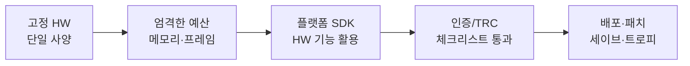
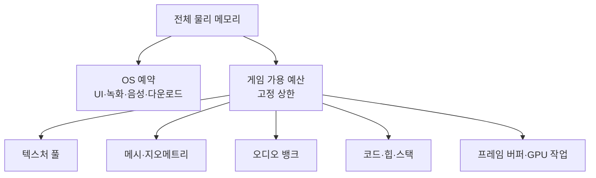
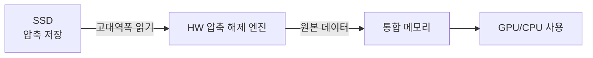
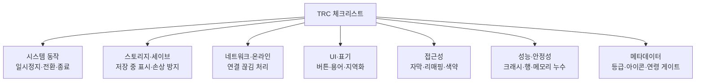

## 들어가며

콘솔은 *고정된 하드웨어* 라는 한 가지 사실에서 출발한다. PC가 무한히 많은 GPU·CPU·메모리 조합을 상대해야 하는 반면, 콘솔은 *플랫폼 홀더가 정의한 소수의 고정 하드웨어 프로파일* 만 상대한다. 이 사실은 양날의 검이다 — 한쪽 날은 *단일 사양에 모든 것을 갈아 넣는 최적화의 자유* 이고, 다른 쪽 날은 *예산을 1바이트도 넘길 수 없는 엄격함* 과 *플랫폼 홀더의 인증을 통과해야만 출시할 수 있다는 관문* 이다.

이 글은 그 고정 하드웨어 위에서 게임을 짜는 일을 한 흐름으로 정리한다. 고정 사양이 왜 최적화의 출발점이자 종착점인지, 메모리 예산을 어떻게 바이트 단위로 관리하는지, 플랫폼 SDK와 하드웨어 디코더·스토리지·컨트롤러 기능을 어떻게 끌어 쓰는지, TRC(Technical Requirements Checklist)라 불리는 인증 체크리스트가 무엇을 강제하는지, 패치와 배포·세이브·트로피를 어떻게 다루는지, 그리고 인증에서 반복적으로 미끄러지는 함정이 무엇인지를 다룬다. 특정 콘솔의 마케팅 명칭보다 *세대를 관통하는 구조* 에 무게를 둔다 — 사양 숫자는 세대마다 바뀌지만, 고정 하드웨어가 강제하는 사고방식은 그대로다.



이 글의 목표.

1. **고정 하드웨어와 단일 사양 최적화** — 왜 고정 사양이 최적화의 전제인지, 세대·SKU 변종 대응.
2. **메모리 예산** — 통합 메모리, OS 예약, 단편화, OOM 인증 실패.
3. **플랫폼 SDK와 저수준 API** — 저수준 그래픽스 API, 하드웨어 디코더, 비동기 컴퓨트.
4. **스토리지와 로딩** — 초고속 SSD, 하드웨어 압축 해제, 스트리밍, Quick Resume.
5. **하드웨어 입력·오디오 기능** — 햅틱·적응형 트리거, 공간 오디오, 컨트롤러 표기.
6. **TRC와 인증** — 체크리스트 구조, 필수 대 권장, 인증 함정, 거부 사례.
7. **온라인·세이브·트로피** — 플랫폼 서비스, 클라우드 세이브, 실적 시스템.
8. **패치·배포와 실무 트레이드오프** — Day-one 패치, 해상도·프레임 절충, 운영.


---

## 목차
1. [고정 하드웨어와 단일 사양 최적화](#1-고정-하드웨어와-단일-사양-최적화)
2. [메모리 예산](#2-메모리-예산)
3. [플랫폼 SDK와 저수준 API](#3-플랫폼-sdk와-저수준-api)
4. [스토리지와 로딩](#4-스토리지와-로딩)
5. [하드웨어 입력·오디오 기능](#5-하드웨어-입력오디오-기능)
6. [TRC와 인증](#6-trc와-인증)
7. [온라인·세이브·트로피](#7-온라인세이브트로피)
8. [패치·배포와 실무 트레이드오프](#8-패치배포와-실무-트레이드오프)


---

## 1. 고정 하드웨어와 단일 사양 최적화

### 고정 사양이라는 전제

PC 최적화는 넓은 hardware·driver·OS 분포를 상대한다. 콘솔은 platform holder가 정의한 소수의 hardware profile과 고정 API/OS 계약을 상대하므로 탐색 공간이 훨씬 좁다. 다만 세대 내 SKU, 휴대/거치 모드, thermal·전력 상태, system software 예약량과 개발·출시 모드는 남는다. “모든 기기가 완전히 동일”이 아니라 **열거 가능하고 인증할 수 있는 target profile 집합**이라는 점이 최적화의 성질을 바꾼다.

구체적으로 다음이 가능해진다.

- *표시 모드별 deadline을 고정* 한다. 60Hz 목표면 표시 구간은 약 16.67ms, 30Hz면 약 33.33ms다. VRR·120Hz mode와 frame generation 정책이 있으면 profile별 deadline을 별도로 둔다.
- *캐시·메모리 레이아웃을 실제 칩에 맞춰* 짠다. L2 캐시 크기, 메모리 대역폭, GPU의 셰이더 코어 구성이 알려져 있으므로 데이터 구조를 그 형상에 끼워 맞춘다.
- *측정 대상을 닫힌 집합으로 만들 수 있다*. 각 retail-equivalent profile, cold/warm 상태, worst-case scene을 반복할 수 있다. 개발 킷의 추가 메모리, debug runtime·validation, instrumentation과 clock 설정 때문에 devkit의 5ms가 retail에서 그대로 5ms라는 보장은 없다. platform profiler와 최종 소비자 하드웨어 조건에서 다시 측정한다.

이 전제가 이후 모든 절의 바탕이다. 메모리 예산이 엄격한 것도, 저수준 API로 드라이버 오버헤드를 걷어내는 것도, 하드웨어 디코더에 의존하는 것도 전부 *고정 사양을 알고 있기 때문에 가능* 하다.

### 세대 안의 변종 — 단일 사양의 균열

"단일 사양"은 이상이고, 현실에는 *틈* 이 있다. 같은 세대 안에서도 플랫폼 홀더는 보통 *고사양·저사양 두 개의 SKU(Stock Keeping Unit)* 를 낸다. 고사양기는 메모리·GPU 성능이 높고, 저사양기는 가격을 낮춘 보급형이다. 휴대·거치 겸용기는 *모드 전환* 으로 클럭과 해상도가 달라진다. 세대 중반에 나오는 중간 업그레이드 기기는 또 다른 성능 구간을 추가한다.

그래서 실제 출시 빌드는 *소수의 고정 타깃 집합* 을 상대한다 — PC처럼 연속 분포는 아니지만, 단 하나도 아니다. 대응 전략은 *프로파일(profile)* 이다.

```cpp
// 하드웨어 프로파일: SKU/모드별 고정 설정 묶음
struct HardwareProfile {
    int    targetFps;            // 30 또는 60
    int    renderWidth, renderHeight;   // 내부 렌더 해상도
    bool   dynamicResolution;    // 동적 해상도 허용 여부
    int    shadowResolution;     // 그림자 맵 크기
    size_t streamingPoolBytes;   // 텍스처 스트리밍 풀 크기
    bool   rayTracing;           // RT 효과 on/off
};

// 부팅 시 기기 식별 → 프로파일 선택 (런타임 분기 아님, 시작 시 1회)
const HardwareProfile& SelectProfile(SkuId sku, DockMode mode);
```

핵심은 이 분기가 *부팅 시 1회* 라는 점이다. PC처럼 프레임마다 "지금 사양이 뭐지"를 묻지 않는다. 기기를 식별해 프로파일을 한 번 고르고, 그 뒤로는 *그 프로파일 안에서 고정 최적화* 한다. 저사양기 프로파일은 내부 해상도와 그림자 품질을 낮춰 같은 프레임 예산을 맞춘다. 각 프로파일은 그 자체로 하나의 단일 사양 타깃이 된다.

### 이전 세대 동시 지원

신작이 신·구 세대에 동시 출시되는 경우, 사양 격차가 SKU 변종보다 훨씬 크다. 구세대는 메모리가 절반 이하, 스토리지는 SSD가 아닌 기계식 디스크일 수 있다. 이때는 같은 게임이 사실상 *두 개의 다른 예산 위에서 돌아간다*. 에셋 자체를 LOD 묶음으로 분리하고(구세대는 저해상도 텍스처 세트만 로드), 스트리밍 전략을 갈아 끼우며, 일부 효과는 구세대에서 통째로 비활성화한다. 구세대 지원을 어디까지 끌고 갈지는 *판매량과 개발 비용* 의 트레이드오프다 — 깎아 맞추는 비용이 그 플랫폼의 매출을 넘으면 지원을 접는다.

### 개발 킷과 리테일 킷

콘솔 개발은 플랫폼이 제공하는 개발·테스트 하드웨어와 소프트웨어 모드를 사용한다. 정확한 메모리, 성능, 디버그 기능 차이는 세대와 플랫폼의 비공개 SDK 계약에 따라 다르므로 “DevKit은 항상 메모리가 더 많고 TestKit은 리테일과 물리적으로 동일하다”로 일반화할 수 없다. 중요한 원칙은 디버그 편의를 켠 개발 환경의 결과를 소비자 환경 성능으로 간주하지 않는 것이다. 플랫폼이 제공하는 retail-equivalent 메모리·성능 프로파일과 테스트 환경에서 반복 측정하고, 실제 소비자 하드웨어 경로도 출시 기준에 포함한다.

## 2. 메모리 예산

### 통합 메모리와 OS 예약

현대 콘솔은 CPU와 GPU가 공유 주소 공간 또는 물리 메모리 풀을 사용하는 통합형 구성이 흔하다. 별도 PCIe VRAM으로 옮기는 구조보다 데이터 공유가 단순해질 수 있지만 “같은 메모리이므로 복사·동기화 비용이 0”은 아니다. CPU/GPU 캐시 가시성, 자원 상태 전환, 타일링·압축 레이아웃, 서로 다른 대역폭 구역을 API 계약에 맞춰 다뤄야 한다. CPU와 GPU가 메모리 대역폭을 공유하므로 양쪽 부하의 합을 캡처한다.

전체 메모리가 전부 게임 몫은 아니다. *시스템 소프트웨어(OS)* 가 상당 부분을 예약한다 — 시스템 UI, 백그라운드 다운로드, 음성 채팅, 스크린샷·녹화 버퍼, 빠른 전환 기능 등. 그래서 게임이 실제로 쓸 수 있는 메모리는 *전체에서 OS 예약을 뺀 고정값* 이다.



이 게임 가용 예산이 *인증에서 검사하는 상한* 이다. 넘으면 출시 자체가 막힌다.

### 유연 메모리와 우선순위

일부 플랫폼은 OS 예약의 일부를 *조건부로 게임에 빌려주는* 메커니즘을 둔다. 시스템이 당장 안 쓰는 메모리를 게임이 *유연 메모리(flexible memory)* 로 받아 쓰되, OS가 필요해지면 *반납* 해야 한다. 이걸 잘 쓰면 평상시 예산을 늘릴 수 있지만, 반납 요청이 오면 *즉시 일부를 비울 수 있어야* 한다. 그래서 유연 메모리에는 *언제든 버려도 되는 데이터* — 재생성 가능한 캐시, 선택적 고해상도 텍스처 — 만 올린다. 반납 못 하면 시스템 기능이 깨지고, 이는 인증 실패로 직결된다.

### 예산 분할과 추적

가용 예산은 *카테고리별로 미리 쪼갠다*. "텍스처 N MB, 메시 M MB, 오디오 K MB" 식으로 *고정 풀* 을 두고, 각 시스템은 자기 풀 안에서만 할당한다. 풀이 차면 그 시스템이 *스스로 줄인다* — 텍스처 스트리밍이 저해상도 밉으로 떨어지는 식. 이 분할이 없으면 한 시스템이 메모리를 폭식해 다른 시스템을 굶기고, *어디서 새는지 추적이 불가능* 해진다.

```cpp
// 카테고리별 고정 예산 풀 — 합이 게임 가용 예산을 넘지 않게 설계
struct MemoryBudget {
    size_t textures   = 0;
    size_t meshes     = 0;
    size_t audio      = 0;
    size_t animation  = 0;
    size_t gameplay   = 0;
    size_t renderTargets = 0;
    // 빌드 시 검증: 합 ≤ 가용 예산. 넘으면 빌드 실패로 막는다.
};

// 모든 할당은 카테고리 태그를 단다. 어느 풀이 넘쳤는지 즉시 안다.
void* AllocTagged(size_t bytes, MemCategory cat);
```

운영의 핵심은 *상시 추적* 이다. 모든 할당에 카테고리 태그를 달아, 어느 시스템이 예산을 얼마나 쓰는지 *런타임 HUD와 자동 리포트* 로 본다. 메모리 초과는 특정 콘텐츠(고밀도 레벨, 특정 컷신)에서만 터지는 경우가 많아서, *최악 케이스 씬* 을 자동 순회하며 피크 메모리를 기록하는 회귀 테스트를 둔다.

### 단편화와 장시간 안정성

고정 예산만큼 무서운 것이 *단편화(fragmentation)* 다. 가용 메모리 총합은 충분한데, *연속된 큰 블록* 이 없어 할당이 실패하는 상황이다. 레벨을 수십 번 로드·언로드하면 힙에 구멍이 송송 뚫리고, 어느 순간 큰 텍스처 하나를 못 올려 죽는다. 대응은 다음과 같다.

- *전용 할당자* 를 쓴다. 크기별 풀 할당자(같은 크기 객체를 한 풀에서), 프레임 단위 선형 할당자(매 프레임 통째로 리셋), 레벨 단위 스택 할당자. 범용 `malloc`을 줄이고 *수명이 같은 것끼리 모은다*.
- *압축(compaction)* 가능한 힙을 둔다 — 핸들 기반으로 객체를 참조하면, 할당자가 객체를 옮겨 구멍을 메울 수 있다.
- *레벨 전환 시 풀을 리셋* 한다. 레벨 메모리를 통째로 스택 프레임처럼 다루면 단편화가 누적되지 않는다.

콘솔 인증은 *장시간 가동(soak) 테스트* 를 요구한다 — 게임을 수 시간에서 수십 시간 켜 둔 채 메모리가 *서서히 새지 않는지* 본다. PC라면 "재시작하면 되지"로 넘어갈 누수가, 콘솔에서는 *인증 실패 사유* 가 된다. 단편화로 인한 점진적 OOM이 여기서 가장 자주 잡힌다.

## 3. 플랫폼 SDK와 저수준 API

### 저수준 그래픽스 API

콘솔의 큰 매력은 *얇은 그래픽스 API* 다. PC의 그래픽스 API는 수많은 GPU·드라이버를 추상화하느라 *검증·상태 추적·동기화* 오버헤드를 짊어진다. 콘솔은 GPU가 하나로 고정이므로, 그 추상화를 걷어낸 *저수준 API* 를 제공한다 — 명령 버퍼를 직접 짜고, 메모리를 직접 배치하며, 동기화를 직접 건다.

```cpp
// 콘솔 저수준 API의 성격(의사 코드): 드라이버가 대신 안 해 준다
CommandBuffer cmd = AllocCommandBuffer();
cmd.SetRenderTarget(gbuffer);
cmd.BindPipeline(pso);                 // PSO는 미리 컴파일됨
cmd.SetDescriptor(0, materialTable);   // 디스크립터를 직접 채운다
cmd.DrawIndexed(mesh.indexCount);
// 자원 상태 전이·캐시 플러시·동기화를 명시적으로 건다
cmd.Barrier(gbuffer, RTState, ShaderReadState);
Submit(cmd, fence);                    // 펜스로 GPU 완료를 직접 추적
```

대가는 *책임* 이다. 드라이버가 알아서 해 주던 자원 상태 전이, 캐시 플러시, GPU-CPU 동기화를 *전부 직접* 건다. 하나 빼먹으면 화면이 깨지거나 GPU가 멈춘다. 그 대신 같은 GPU에서 PC보다 *드로우 콜당 오버헤드가 훨씬 작아* 더 많은 객체를 그릴 수 있다. 이것이 고정 하드웨어에서만 가능한 거래다 — 추상화를 포기한 만큼 성능을 가져온다.

### 셰이더 사전 컴파일

저수준 API는 *PSO(Pipeline State Object)* — 셰이더 + 렌더 상태의 묶음 — 를 *빌드 타임에 미리 컴파일* 한다. PC는 드라이버가 런타임에 셰이더를 컴파일해서 *첫 등장 시 끊김(hitching)* 이 생기지만, 콘솔은 GPU가 고정이라 *오프라인에서 최종 GPU 명령까지* 굽는다. 런타임 컴파일이 없으니 셰이더 끊김도 없다. 단점은 *모든 PSO 조합을 미리 알아야* 한다는 것 — 빠진 조합을 런타임에 마주치면 끊기거나 실패하므로, *PSO 캐시를 수집하는 파이프라인* 을 빌드 과정에 둔다.

### 하드웨어 디코더와 고정 기능 블록

콘솔에는 범용 CPU·GPU 외에 *고정 기능 하드웨어 블록* 이 박혀 있다. 오디오 디코더, 비디오 디코더, 데이터 압축 해제 엔진, 공간 오디오 처리 유닛 등이다. 이들은 *CPU를 전혀 안 쓰고* 특정 작업을 처리한다.

| 고정 기능 블록 | 하는 일 | CPU 절감 효과 |
|---|---|---|
| 오디오 디코더 | 플랫폼 네이티브 압축 오디오 해제 | 다수 효과음 디코딩을 CPU에서 분리 |
| 압축 해제 엔진 | 디스크 데이터 실시간 압축 해제 | 로딩 시 CPU 점유 거의 0 |
| 공간 오디오 유닛 | HRTF 기반 3D 오디오 처리 | 오브젝트 기반 공간화를 HW로 |
| 비디오 디코더 | 컷신·배경 영상 디코딩 | 영상 재생 CPU 비용 제거 |

이걸 쓰려면 *에셋을 플랫폼 네이티브 포맷으로 구워야* 한다. 같은 원본 오디오를 플랫폼 디코더가 이해하는 인코딩으로 변환하면, 수백 개 효과음을 하드웨어가 디코딩해 CPU를 비운다. 그래서 출시 빌드는 보통 *플랫폼마다 다른 인코딩* 을 굽는다. 이 블록들을 안 쓰면 그만큼 CPU·GPU 시간을 직접 태워야 하고, 고정 예산 안에서 그 손해는 곧 품질 하락이다.

### 비동기 컴퓨트와 병렬화

콘솔은 고정된 GPU와 queue 계약을 대상으로 async compute overlap을 정밀하게 튜닝할 수 있다. 그래픽 작업이 일부 실행 자원을 덜 쓰고 compute 작업과 데이터 의존성이 없을 때 겹치면 idle slot을 채울 수 있다. 반대로 둘이 shader core, cache, memory bandwidth를 동시에 포화시키면 단독 실행보다 느려지고 frame tail이 길어진다. queue를 나눈 사실이 병렬 실행을 보장하지 않으므로 GPU timestamp와 hardware counter로 overlap 구간·occupancy·대역폭을 함께 본다.

CPU topology와 플랫폼이 게임에 허용한 hardware thread 수가 고정되어 있다는 점은 worker 수와 affinity 실험을 단순화한다. 그래도 worker를 논리 코어 수와 같게 두거나 모든 주요 thread를 고정 pin하는 것이 항상 최적은 아니다. SMT 자원 공유, OS·driver 작업, interrupt, job의 blocking 비율과 audio deadline을 고려하고 플랫폼 SDK가 허용한 affinity·QoS API 안에서 측정한다.

## 4. 스토리지와 로딩

### 초고속 SSD와 설계 전환

SSD는 기계식 디스크보다 random access latency와 throughput이 크게 개선되어 더 세밀한 streaming 요청을 가능하게 한다. 그러나 request setup, 압축 해제, 검증, 메모리 publish와 GPU 사용 시점까지의 deadline은 남는다. 플레이어가 필요로 한 뒤 요청해도 항상 따라오는 것이 아니므로 이동 속도와 worst-case I/O를 기반으로 prefetch horizon과 priority를 계산한다.

이 변화가 메모리 예산에도 영향을 준다. 데이터를 *미리 메모리에 다 올려둘* 필요가 줄어든다. 플레이어 주변 한 화면 분량만 메모리에 두고, 이동하면 *실시간으로 새 데이터를 끌어오는* 스트리밍이 현실적이 된다. 즉 SSD 속도가 *메모리 예산을 간접적으로 늘려* 준다 — 디스크가 빠른 만큼 메모리에 덜 들고 있어도 된다.

### 하드웨어 압축 해제

일부 콘솔은 특정 포맷을 처리하는 hardware decompression 경로를 제공한다. 지원 포맷과 정렬·queue 조건을 맞추면 범용 CPU의 decode 작업과 저장 byte 수를 줄일 수 있다. 그렇더라도 I/O 제출, metadata·무결성 처리, destination memory, cache/resource visibility와 완료 동기화 비용은 남고, 압축률과 decode throughput도 데이터에 따라 달라진다. 비지원 코덱이나 작은 요청은 CPU 경로가 더 나을 수 있다.



플랫폼에 따라 storage 요청 결과를 GPU가 사용할 수 있는 자원으로 옮기는 과정에서 중간 복사와 CPU 관여를 줄이는 경로도 있다. “직접”은 API가 숨긴 staging과 ownership transition이 물리적으로 모두 사라진다는 뜻이 아니다. 이런 경로는 로딩 시간과 CPU 사용량을 줄이는 수단이며, 로딩 화면 없는 설계는 콘텐츠 working set, 예측 실패, worst-case 이동과 fallback까지 budget 안에 들어올 때 성립한다.

### 스트리밍 시스템

큰 월드를 끊김 없이 돌아다니게 하려면 *스트리밍* 이 필수다. 월드를 *타일·셀 단위로 분할* 하고, 플레이어 위치를 중심으로 *반경 안의 셀만 로드, 벗어난 셀은 언로드* 한다.

```cpp
// 셀 기반 스트리밍: 플레이어 주변만 메모리에 유지
struct StreamingCell {
    AABB     bounds;
    LoadState state;           // Unloaded / Loading / Loaded
    int      refDistance;      // 이 셀을 로드 유지할 거리
};

void UpdateStreaming(const Vec3& player) {
    for (StreamingCell& c : cells_) {
        float d = DistanceToCell(player, c);
        if (d < loadRadius_  && c.state == Unloaded) RequestLoad(c);   // 비동기 로드
        if (d > unloadRadius_ && c.state == Loaded)  RequestUnload(c); // 히스테리시스
    }
}
```

핵심은 *히스테리시스* 다. 로드 반경과 언로드 반경을 다르게 둬 경계에서 왕복할 때 반복 로드·언로드를 막는다. 플레이 중 스트리밍 I/O와 압축 해제는 프레임 스레드를 기다리게 하지 않도록 비동기 작업으로 보내고, 메인 스레드에는 예산이 제한된 publish 단계만 둔다. 명시적인 로딩 화면처럼 진행을 의도적으로 멈춘 상태에서는 동기 대기를 선택할 수 있으므로 “모든 로드는 항상 비동기”가 규칙은 아니다. 스트리밍이 이동을 따라오지 못할 때는 중요한 셀 우선순위, 품질 강등, 이동 제한 같은 명시적 폴백을 둔다.

### 빠른 재개와 상태 보존

일부 콘솔의 빠른 재개 기능은 프로세스·메모리 상태를 보존하거나 시스템이 정한 suspend/resume 수명주기로 게임을 멈췄다가 복원한다. 정확한 보존 범위와 동시에 유지되는 타이틀 수는 플랫폼별 계약이다. 게임은 복원 이벤트와 장시간 정지를 정상 수명주기로 취급해야 한다.

- *복원 후 시간 점프*: 게임이 수 시간 잠들었다 깨면, 게임 내 시계나 타이머가 큰 점프를 본다. 델타 타임을 그대로 쓰면 물리·애니메이션이 폭발한다. 복원 직후 델타를 *클램프* 한다.
- *외부 상태 무효화*: 잠든 사이 네트워크 세션이 끊기고, 컨트롤러가 바뀌고, 외부 저장 매체가 빠질 수 있다. 복원 시 이 모든 외부 상태를 *재검증* 한다.
- *세이브 일관성*: 빠른 재개로 복원된 세션과 디스크 세이브가 어긋나지 않도록 한다.

이 복원 정합성은 *인증 항목* 에 포함되는 경우가 많다 — 빠른 재개 후 게임이 깨지면 거부된다.

## 5. 하드웨어 입력·오디오 기능

### 컨트롤러 고급 기능

콘솔 컨트롤러는 단순 입력 장치를 넘어선다. 세대마다 디테일은 다르지만 공통 축은 *고해상도 진동, 트리거의 가변 저항, 모션 센서, 터치·스피커* 다.

- *고해상도 햅틱*: 단순 진동 모터 대신, 넓은 주파수 대역의 진동을 *파형으로* 재생한다. 빗방울, 모래 위 발걸음, 금속 긁힘의 질감을 진동으로 구분한다. 오디오 파형을 햅틱 채널로 보내는 방식이 흔하다.
- *적응형 트리거*: 트리거를 당길 때의 *저항* 을 동적으로 바꾼다. 활시위의 장력, 총의 격발 저항, 가속 페달의 뻑뻑함을 손가락으로 느끼게 한다.
- *모션·자이로*: 자이로로 미세 조준을 보정하거나, 기기를 기울여 조작한다.

```cpp
// 햅틱: 진폭이 아니라 파형/이펙트로 표현
struct HapticEffect {
    const float* waveform;   // 진동 파형 (오디오처럼)
    int   sampleCount;
    float frequency;         // 저주파 = 묵직, 고주파 = 날카로움
};

// 적응형 트리거: 저항 프로파일
struct TriggerResistance {
    enum Mode { Off, Continuous, SectionStop };
    Mode  mode;
    float startPosition;     // 저항 시작 지점 (0~1)
    float strength;          // 저항 세기
};
```

이 기능들은 *플랫폼 독점* 이라, 크로스 플랫폼 게임에서 *추상화 계층* 뒤에 둔다. 햅틱·트리거를 추상 이벤트("강한 격발", "활시위 당김")로 발행하면, 각 플랫폼 백엔드가 자기 하드웨어로 번역한다. 안 그러면 플랫폼별 코드가 게임플레이 곳곳에 번진다.

### 컨트롤러 표기와 입력 인증

인증이 강하게 검사하는 입력 항목이 둘 있다. 첫째, *버튼 표기* 다. UI에 "확인/취소"를 어느 버튼으로 표기하는지가 플랫폼·지역마다 *규정* 으로 정해져 있다. 같은 위치의 버튼이라도 플랫폼별 아이콘과 의미가 다르고, 일부 지역은 확인·취소 버튼이 *반대* 다. 게임은 *현재 플랫폼·지역에 맞는 버튼 아이콘과 매핑* 을 써야 하며, 이를 어기면 인증에서 떨어진다.

둘째, *입력 리매핑* 이다. 접근성 요구로, 많은 플랫폼이 *버튼 재배치를 게임이 지원* 하거나 *OS 차원의 리매핑을 방해하지 않을 것* 을 요구한다. 게임이 물리 버튼을 하드코딩하면 OS 리매핑이 깨진다. 그래서 입력을 *물리 버튼이 아닌 추상 액션* 으로 받는다 — "점프 액션"을 구독하고, 그 액션이 어느 버튼인지는 매핑 테이블이 정한다.

```cpp
// 물리 버튼이 아니라 추상 액션을 구독한다 (리매핑·플랫폼 독립)
enum class Action { MoveX, MoveY, Jump, Confirm, Cancel, /* ... */ };

float GetAction(Action a);          // 매핑 테이블이 물리 버튼으로 해석
bool  WasActionPressed(Action a);

// Confirm/Cancel은 플랫폼·지역 규정에 따라 버튼이 달라진다 → 절대 하드코딩 금지
```

### 공간 오디오와 출력

콘솔은 *공간 오디오* 를 하드웨어로 가속한다. 오브젝트마다 3D 위치를 주면, 공간 오디오 유닛이 *HRTF 기반으로 헤드폰·서라운드에 위치감* 을 입힌다. 보이스마다 직접 컨볼루션하지 않고 하드웨어에 위임하므로 CPU가 가볍다. 게임은 *오디오 오브젝트의 위치만 갱신* 하고 나머지를 맡긴다.

출력 환경은 *동적* 이다. 사용자가 헤드폰을 꽂고 빼고, TV 스피커와 사운드바를 오가고, 채널 구성(스테레오~서라운드)이 바뀐다. 게임은 *출력 장치 변경 이벤트* 를 받아 믹스를 다시 구성해야 한다 — 인증은 장치 전환 시 *오디오가 끊기거나 깨지지 않는지* 본다. 또 *음성 채팅* 은 OS의 파티 시스템과 통합되며, 게임 사운드와 음성이 *서로 다른 버스* 로 라우팅돼 사용자가 따로 조절할 수 있어야 한다.

## 6. TRC와 인증

### 체크리스트의 정체

콘솔 출시는 *플랫폼 홀더의 인증(certification)* 을 통과해야만 가능하다. 그 기준이 *TRC(Technical Requirements Checklist)* — 플랫폼마다 이름은 다르지만 성격은 같은 *수백 개 항목의 체크리스트* 다. 게임이 *플랫폼의 표준 동작* 을 지키는지, *사용자 경험의 최소선* 을 보장하는지, *시스템과 충돌하지 않는지* 를 항목별로 검사한다. PC·웹에는 없는, 콘솔 특유의 관문이다.

TRC 항목은 대략 다음 영역에 걸친다.



### 필수와 권장

TRC 항목은 *필수(required)* 와 *권장(recommended)* 으로 나뉜다. 필수는 *하나라도 위반하면 인증 거부* — 출시 불가다. 권장은 위반해도 통과는 되지만, 리뷰어가 지적하고 다음에 고치기를 기대한다. 개발 일정에서는 *필수를 먼저, 빠짐없이* 처리하고 권장은 여유에 맞춰 채운다. 함정은 필수 항목이 *기능이 아니라 동작 정합성* 인 경우가 많다는 점이다 — "세이브 중에는 본체 전원을 끄지 말라는 안내를 띄울 것" 같은, 개발 막판까지 잊기 쉬운 항목들이다.

대표적인 필수 항목 유형을 정리하면 다음과 같다.

| 영역 | 대표 필수 항목 | 위반 시 증상 |
|---|---|---|
| 세이브 | 저장 중 표시, 저장 중 전원 차단 안내 | 데이터 손상 → 거부 |
| 종료·일시정지 | 시스템 메뉴 호출 시 게임 일시정지 | 시스템 충돌 → 거부 |
| 컨트롤러 | 연결 해제 시 일시정지 및 안내 | 멋대로 진행 → 거부 |
| 네트워크 | 연결 끊김 시 우아한 처리 | 무한 대기·크래시 → 거부 |
| 메모리 | 가용 예산 초과 금지, 누수 없음 | OOM·점진 크래시 → 거부 |
| 표기 | 플랫폼·지역 규정에 맞는 버튼·용어 | 규정 위반 → 거부 |
| 안정성 | 인증 테스트 중 크래시·행 없음 | 즉시 거부 |

### 접근성과 지역화

접근성은 *권장에서 필수로 이동* 하는 추세다. 자막 지원, 자막 크기·배경 조절, 입력 리매핑, 색약 모드, 화면 흔들림 옵션 등이 항목으로 들어온다. 게임 후반에 끼워 넣기 어려운 것들이라 *초기 설계부터* 자막 파이프라인과 추상 입력을 깔아 둔다.

지역화는 *문자열 분리* 와 *문화적 검수* 두 축이다. 모든 사용자 노출 문자열을 코드에서 분리해 *외부 테이블* 로 빼고, 폰트가 해당 언어 글자를 모두 포함하는지(특히 한중일 글리프), 문자열 길이가 늘어나도 UI가 깨지지 않는지 검증한다. 등급 심사(연령 등급)는 지역마다 기관과 기준이 다르고, 게임은 *현재 지역 등급에 맞는 표시* 와 *연령 게이트* 를 갖춰야 한다.

### 인증 함정

인증에서 반복적으로 미끄러지는 함정을 모으면 다음과 같다.

- *개발 킷 메모리에 안주*: 개발 킷의 넉넉한 메모리에서만 검증하고 리테일 한도를 안 잰다. 제출 직전 OOM으로 거부.
- *세이브 손상 안내 누락*: 저장 중 표시·전원 안내를 빼먹는다. 기능은 멀쩡한데 *규정 미준수* 로 거부.
- *컨트롤러 분리 미처리*: 게임 중 컨트롤러가 빠졌을 때 일시정지·안내를 안 한다. 흔한 거부 사유.
- *버튼 표기 하드코딩*: 확인·취소 버튼을 한 플랫폼·지역에 맞춰 박는다. 다른 지역에서 *반대로* 동작해 거부.
- *네트워크 끊김 무한 대기*: 온라인 끊김 시 로딩 스피너에서 영원히 멈춘다. *우아한 실패* 가 없어 거부.
- *장시간 누수*: 단편화·누수로 수 시간 가동 후 크래시. soak 테스트에서 잡힘.
- *제출 빌드의 디버그 잔존*: 디버그 로그·치트·개발용 메뉴가 리테일 빌드에 남는다.

거부는 *비용* 이다. 재제출은 시간이 걸리고, 출시일이 정해진 상황에서 한 번의 거부가 *마케팅·동시 출시 계획 전체* 를 흔든다. 그래서 *자체 사전 인증(pre-cert)* 을 둔다 — 내부 QA가 TRC 항목을 *제출 전에 통째로 한 번 돌려* 필수 위반을 걸러낸다. 인증 항목을 *자동화 테스트* 로 묶을 수 있는 것(메모리 한도, 크래시, 누수)은 CI에서 매일 돌린다.

## 7. 온라인·세이브·트로피

### 플랫폼 온라인 서비스

콘솔의 온라인은 *플랫폼 홀더의 서비스* 위에 얹힌다. 사용자 인증, 친구 목록, 초대, 파티, 매치메이킹, 실적, 클라우드 세이브가 *플랫폼 SDK* 로 제공된다. 게임이 자체 서버를 두더라도, *사용자 신원과 권한* 은 플랫폼 서비스를 거친다 — 누가 로그인했고, 온라인 권한이 있고, 어떤 콘텐츠를 소유했는지.

이 서비스 사용에는 *규약* 이 따른다. 연령·등급에 따른 온라인 기능 제한, 부모 통제 존중, 사용자 차단 목록 반영, 음성·텍스트 채팅의 신고 기능 연동 등이다. 이것도 인증 항목이다 — 플랫폼의 안전·통제 기능을 게임이 *우회하지 않을 것*.

### 세이브 데이터

세이브는 인증이 가장 깐깐하게 보는 영역 중 하나다. *데이터 손상* 은 사용자에게 가장 치명적인 사고이기 때문이다.

```cpp
// 안전한 세이브: 임시 파일에 쓰고 검증 후 원자적 교체
bool SaveGame(const SaveData& data) {
    BeginSaveIndicator();                 // "저장 중" 표시 (인증 필수)
    if (!WriteToTemp(data, "save.tmp")) { EndSaveIndicator(); return false; }
    if (!Verify("save.tmp")) { EndSaveIndicator(); return false; }   // 체크섬 검증
    AtomicRename("save.tmp", "save.dat");  // 원자적 교체: 중간에 죽어도 기존 세이브 보존
    EndSaveIndicator();
    return true;
}
```

핵심 원칙은 다음과 같다.

- *원자적 쓰기*: 임시 파일에 다 쓰고 검증한 뒤 *원자적으로 교체* 한다. 쓰는 도중 전원이 나가도 기존 세이브가 살아남는다.
- *손상 감지와 복구*: 세이브에 *체크섬·버전* 을 넣어 손상·구버전을 감지하고, 백업 슬롯으로 복구한다.
- *저장 중 표시*: 디스크 쓰기 중에는 *명확한 표시* 를 띄우고, 전원·매체 제거를 *경고* 한다. 인증 필수.
- *버전 마이그레이션*: 패치로 세이브 포맷이 바뀌면 *구버전 세이브를 신버전으로 변환* 한다. 패치 후 기존 세이브가 안 열리면 대형 사고다.

*클라우드 세이브* 는 플랫폼 서비스가 세이브를 서버에 백업·동기화한다. 게임은 *로컬과 클라우드의 충돌* 을 다뤄야 한다 — 두 기기에서 따로 플레이해 세이브가 갈라지면, *최신을 고르거나 사용자에게 선택* 을 묻는다. 동기화 실패를 우아하게 처리하는 것도 인증 대상이다.

### 실적과 트로피

플랫폼마다 *실적(achievement)·트로피(trophy)* 시스템이 있다. 게임이 특정 조건 달성 시 *플랫폼 서비스에 잠금 해제를 통보* 하면, 시스템이 알림을 띄우고 사용자 프로필에 기록한다. 구현은 단순해 보이지만 함정이 있다.

- *멱등성*: 같은 실적을 두 번 잠금 해제해도 문제없어야 한다. 네트워크 재시도로 중복 호출이 흔하다.
- *오프라인 큐*: 오프라인에서 달성한 실적은 *로컬에 큐* 했다가 온라인 복귀 시 동기화한다. 인증은 *오프라인 달성이 유실되지 않는지* 본다.
- *서버 권위 검증*: 온라인 게임은 클라이언트가 보고한 실적을 그대로 믿지 않고 *서버가 검증* 해 치트를 막는다.
- *완전성*: 일부 플랫폼은 *모든 실적이 정상 작동* 하고 *최고 등급 실적이 실제로 달성 가능* 한지 검사한다. 버그로 못 따는 실적이 있으면 거부될 수 있다.

```cpp
// 실적 잠금 해제: 멱등 + 오프라인 큐
void UnlockAchievement(AchievementId id) {
    if (localState_.IsUnlocked(id)) return;     // 멱등: 이미 해제됨
    localState_.MarkUnlocked(id);               // 로컬 먼저 기록
    if (IsOnline()) PlatformUnlock(id);         // 온라인이면 즉시 동기화
    else            pendingQueue_.push(id);     // 아니면 큐 → 복귀 시 전송
}
```

크로스 플레이 게임에서는 *플랫폼별 실적이 서로 다른 정책* 을 가져, 같은 게임이라도 플랫폼마다 실적 구성을 따로 관리해야 한다.

## 8. 패치·배포와 실무 트레이드오프

### Day-one 패치와 업데이트

인증은 시간이 걸린다. 제출 빌드를 굽고, 인증을 통과하고, 디스크를 찍고 유통하는 데 *수 주* 가 든다. 그사이 개발은 계속되므로, *디스크에 담긴 빌드* 와 *출시일의 최신 빌드* 사이에 격차가 생긴다. 이 격차를 메우는 것이 *Day-one 패치* — 출시 당일 다운로드되는 업데이트다.

이 구조는 운영에 제약을 건다. *물리 디스크판* 은 패치 없는 초기 상태에서도 인증 가능한 기본 사용 경험을 요구받을 수 있다. 정확한 요구사항은 플랫폼별 인증 문서를 따른다. 동시에 패치가 *디스크 빌드의 버그를 덮어쓸* 수 있어야 한다. 패치 크기는 작을수록 좋으므로 *델타 패치* — 바뀐 데이터 블록만 전송 — 를 쓴다. 패치가 세이브 포맷을 바꾸면 *마이그레이션* 을 반드시 넣는다(7절). 각 패치도 *그 자체로 재인증* 을 거친다 — 패치라고 검사를 건너뛰지 않는다.

### 다운로드 가능 콘텐츠

추가 콘텐츠(DLC)·시즌 패스는 *소유권 검사* 와 *콘텐츠 분리* 가 핵심이다. 본편과 DLC는 별개 패키지로 배포되고, 게임은 *플랫폼 서비스로 사용자의 소유권을 확인* 한 뒤 해당 콘텐츠를 활성화한다. 함정은 *DLC 미소유 사용자와 멀티플레이* 다 — DLC 맵을 가진 사용자와 안 가진 사용자가 같은 세션에 들어가면 콘텐츠가 어긋난다. 흔한 해법은 *호스트의 콘텐츠를 모두에게 임시 허용* 하거나, 미소유자에게 *구매 안내* 를 띄우는 것이다.

### 해상도·프레임 트레이드오프

고정 GPU 예산 안에서 *해상도, 프레임레이트, 그래픽 품질* 은 서로를 잡아먹는다. 셋 다 최고로 둘 수는 없으므로 *둘을 고르고 하나를 양보* 한다.

| 선택 | 얻는 것 | 양보 |
|---|---|---|
| 네이티브 고해상도 + 고품질 | 선명함·디테일 | 프레임레이트(30fps) |
| 동적 해상도 + 고프레임 | 부드러움(60fps 유지) | 순간 해상도 하락 |
| 고프레임 + 고해상도 | 부드러움·선명함 | 그래픽 효과 축소 |

널리 쓰는 절충이 *동적 해상도(dynamic resolution)* 다. *프레임 시간이 예산을 넘을 것 같으면 내부 렌더 해상도를 그 프레임만 낮추고*, 여유가 생기면 다시 올린다. 출력은 항상 화면 해상도로 업스케일하므로, 사용자는 *프레임 드랍 대신 미세한 선명도 변동* 만 본다. 고정 하드웨어라 이 조절 곡선을 칩에 맞춰 정밀하게 튜닝할 수 있다.

```cpp
// 동적 해상도: 프레임 시간 측정 → 다음 프레임 렌더 스케일 조정
float UpdateDynamicResolution(float lastFrameMs, float targetMs) {
    static float scale = 1.0f;
    if (lastFrameMs > targetMs * 1.05f) scale -= 0.05f;   // 초과 → 해상도 ↓
    else if (lastFrameMs < targetMs * 0.95f) scale += 0.02f; // 여유 → 천천히 ↑
    scale = std::clamp(scale, 0.5f, 1.0f);                // 하한을 둬 과도한 흐림 방지
    return scale;
}
```

많은 게임이 *성능 모드(고프레임)* 와 *품질 모드(고해상도)* 를 사용자 선택으로 동시에 제공한다 — 고정 사양 위에서 *두 개의 사전 튜닝된 프로파일* 을 굽는 것이다(1절의 프로파일과 같은 발상).

### 독점 기능과 크로스 플랫폼

플랫폼 독점 기능(고급 햅틱, 적응형 트리거, 공간 오디오, 빠른 스토리지)을 *깊이 쓸수록* 그 플랫폼에서의 경험이 좋아지지만, *크로스 플랫폼 통일성* 과 유지보수 비용이 늘어난다. 실무 해법은 *추상화 계층 + 플랫폼 백엔드* 다 — 게임 로직은 추상 인터페이스만 알고, 각 플랫폼이 자기 기능으로 구현한다. 공통 경험을 보장하면서 *여력이 되는 플랫폼만 독점 기능을 더한다*. 어디까지 독점 기능에 투자할지는 *그 플랫폼의 비중과 차별화 가치* 로 정한다.

### 운영과 측정

콘솔 운영의 마지막 도구도 *측정* 이다. 고정 하드웨어라 측정 대상이 닫힌 집합이어서 반복 측정의 신뢰도가 높다. 단 개발 킷 수치를 그대로 리테일 수치로 간주하지 말고 retail-equivalent 프로파일에서 재측정한다. 상시 추적할 핵심 지표는 다음과 같다.

| 지표 | 의미 | 위험 신호 |
|---|---|---|
| 프레임 시간(ms) | GPU·CPU 프레임 비용 | 예산(16.6/33.3ms) 초과 → 끊김 |
| 메모리 사용량 | 가용 예산 대비 점유 | 예산 근접 → OOM 위험·인증 실패 |
| 메모리 단편화 | 최대 연속 블록 크기 | 점진 축소 → 장시간 크래시 |
| 스트리밍 적중률 | 셀이 제때 로드되는 비율 | 미스 → 팝인·빈 공간 |
| 크래시·행 빈도 | 안정성 | 0이 아니면 인증 거부 |
| 동적 해상도 스케일 | 평균 렌더 스케일 | 상시 하한 → 항상 흐림 |

이 지표들을 *최악 케이스 씬을 자동 순회* 하며 매 빌드 기록하면, 어느 변경이 예산을 넘겼는지 즉시 안다. 인증 거부의 다수가 *측정만 잘했으면 사전에 잡혔을* 항목(메모리 초과, 누수, 프레임 붕괴)이라는 점이 이 측정 체계의 존재 이유다.


---

## 결론

콘솔 개발의 모든 결정은 *고정 하드웨어* 라는 한 사실에서 갈라져 나온다. 단일 사양은 *하나의 목표를 향해 끝까지 깎는 최적화의 자유* 를 주는 동시에, *1바이트도 넘길 수 없는 예산* 과 *인증을 통과해야만 출시할 수 있는 관문* 을 강제한다. 저수준 API로 드라이버를 걷어내고, 하드웨어 디코더·압축 해제·공간 오디오 블록에 일을 떠넘기고, 셰이더를 미리 굽고, 비동기 컴퓨트로 GPU 유닛을 채우는 것 — 모두 *하드웨어를 정확히 알기에* 가능한 거래다.

그 자유의 반대편에 엄격함이 있다. 메모리 예산은 카테고리별로 쪼개 상시 추적해야 하고, 단편화와 누수는 장시간 가동 테스트에서 잡힌다. TRC는 기능이 아니라 *동작 정합성* — 세이브 손상 방지, 컨트롤러 분리 처리, 버튼 표기, 네트워크 끊김의 우아한 실패 — 를 수백 항목으로 검사하고, 하나의 필수 위반이 출시 전체를 막는다. 세이브는 원자적 쓰기와 마이그레이션으로 손상을 막고, 실적은 멱등성과 오프라인 큐로 유실을 막는다.

결국 콘솔의 성패도 *측정 가능성* 으로 수렴한다. 고정 하드웨어라 측정 대상이 열거 가능한 프로파일 집합으로 닫혀 있어 반복 측정과 회귀 비교가 가능하다. 프레임 시간, 메모리 예산과 단편화, 스트리밍 적중, 안정성을 *최악 케이스 씬에서 자동으로 기록* 하는 체계가, 인증 거부의 다수를 사전에 걸러 내고 고정된 예산 안에서 약속한 품질을 지키는 마지막 도구다. 고정 사양의 반대편에는 다양한 PC 사양 분포가 있다. 같은 성능 문제라도 그 환경에서는 테스트 매트릭스와 런타임 스케일링으로 풀어야 한다.

## 더 읽을거리

- 각 플랫폼 홀더의 개발자 문서 — TRC/인증 체크리스트, SDK API, 메모리·스토리지 가이드(NDA 하 제공).
- "Game Engine Architecture" (Jason Gregory) — 콘솔 메모리 관리·할당자·잡 시스템·렌더링 아키텍처의 실무.
- GDC 발표 아카이브 — 콘솔 메모리 예산, 동적 해상도, 비동기 컴퓨트, 스트리밍 사례 발표 다수.
- "Real-Time Rendering" — GPU 파이프라인·동적 해상도·업스케일링의 이론적 배경.
- 플랫폼별 그래픽스 API 레퍼런스 — 저수준 명령 버퍼·PSO·동기화 모델(NDA 하 제공).
