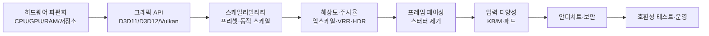
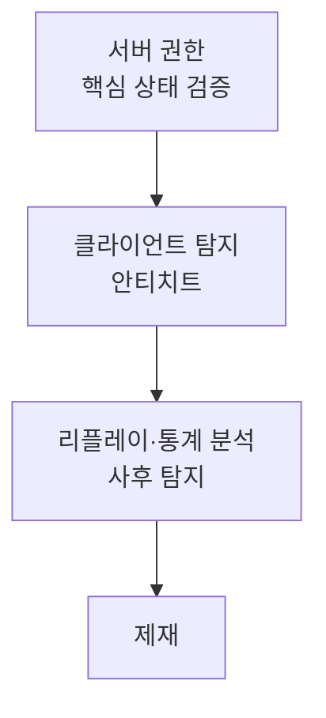

## 들어가며

PC는 게임 플랫폼 중 *유일하게 표준 하드웨어가 없는* 환경이다. 콘솔은 소수 SKU·mode profile에 묶여 검증할 하드웨어 조합이 제한적이고, 모바일도 세대별 레퍼런스 스펙이 좁다. PC는 그렇지 않다. 한 게임이 통합 그래픽이 달린 5년 전 노트북과 최신 플래그십 GPU를 *동시에* 굴려야 하고, 그 사이에 수천 가지 CPU·GPU·드라이버·해상도·주사율·입력장치 조합이 흩어져 있다. 그래서 PC 개발의 거의 모든 결정은 *호환성(얼마나 많은 기기에서 돌아가는가) ↔ 최적화 깊이(상위 기기에서 얼마나 잘 도는가)* 의 줄다리기 위에 놓인다.

이 글은 그 줄다리기를 따라 PC 대응의 구성요소를 한 흐름으로 정리한다. 어떤 하드웨어 축이 파편화를 만드는지, 그래픽 API와 셰이더 파이프라인을 어떻게 추상화할지, 무한한 기기를 어떻게 *스케일러빌리티* 로 흡수할지, 해상도·주사율·업스케일링을 어떻게 다룰지, 프레임을 어떻게 안정적으로 페이싱할지, 키보드/마우스와 패드의 입력 다양성을 어떻게 통합할지, 안티치트와 보안이 어디서 비용을 치르는지, 그리고 이 모두를 어떻게 테스트하고 운영하는지를 다룬다.



이 글의 목표.

1. **하드웨어 파편화** — CPU·GPU·메모리·저장소·OS 축이 만드는 조합 폭발의 정량.
2. **그래픽 API와 셰이더 파이프라인** — D3D11/D3D12/Vulkan 선택, PSO 캐싱, 셰이더 스터터.
3. **스케일러빌리티 시스템** — 프리셋·개별 옵션·VRAM 예측·재시작 없는 적용.
4. **해상도·주사율·업스케일링** — 종횡비, HDR, VRR, DLSS/FSR/XeSS.
5. **프레임 페이싱과 동적 스케일** — V-Sync, 페이싱, 동적 해상도, 프레임 한계.
6. **입력 다양성** — Raw Input, XInput/Steam Input, 핫스왑, 리매핑.
7. **안티치트와 보안** — 커널 드라이버, 서버 권한, DRM, 비용.
8. **호환성 테스트와 운영** — 매트릭스 테스트, 텔레메트리, 크래시 분류, 장기 패치.


---

## 목차
1. [하드웨어 파편화](#1-하드웨어-파편화)
2. [그래픽 API와 셰이더 파이프라인](#2-그래픽-api와-셰이더-파이프라인)
3. [스케일러빌리티 시스템](#3-스케일러빌리티-시스템)
4. [해상도·주사율·업스케일링](#4-해상도주사율업스케일링)
5. [프레임 페이싱과 동적 스케일](#5-프레임-페이싱과-동적-스케일)
6. [입력 다양성](#6-입력-다양성)
7. [안티치트와 보안](#7-안티치트와-보안)
8. [호환성 테스트와 운영](#8-호환성-테스트와-운영)


---

## 1. 하드웨어 파편화

### 조합 폭발

PC 대응의 어려움은 단일 축이 아니라 *축의 곱* 에서 온다. CPU 세대·코어 수, GPU 벤더·세대·VRAM, 메모리 용량·세대, 저장소 종류, OS 버전·드라이버 버전이 각각 수십 갈래로 갈라지고, 이들이 *독립적으로 조합* 된다.

| 축 | 대표 분기 | 게임에 미치는 영향 |
|---|---|---|
| CPU | 4코어 ~ 16코어+, Intel/AMD | 잡 시스템 스케일링, 게임 로직 헤드룸 |
| GPU | 통합그래픽 / 구세대 / 신세대, NVIDIA/AMD/Intel | 셰이더 기능 수준, 렌더 예산 |
| VRAM | 2GB ~ 24GB+ | 텍스처·버퍼 상주 한계, 스트리밍 압박 |
| 시스템 RAM | 8GB ~ 64GB+ | 에셋 캐시, 백그라운드 스왑 |
| 저장소 | HDD / SATA SSD / NVMe | 로딩 시간, 스트리밍 대역폭 |
| OS·런타임 | Windows 버전, 그래픽 드라이버 | API 가용성, 버그 표면 |

축이 6개고 각 축이 평균 4갈래만 잡아도 조합은 수천 단위다. 모든 조합을 따로 최적화하는 것은 불가능하다. 그래서 PC 대응의 전략은 *조합마다 손보는 것* 이 아니라, *연속적으로 조절되는 스케일* 을 만들어 하드웨어가 알아서 적절한 지점에 앉게 하는 것이다(3절).

### CPU — 코어 수에 따른 스케일링

PC의 코어 수는 4개에서 16개 이상까지 흩어진다. 문제는 *고정 스레드 수로 설계하면 양쪽 끝에서 모두 실패* 한다는 점이다. 8개 스레드를 가정하면 4코어 기기에서는 *과구독(oversubscription)* 으로 컨텍스트 스위칭이 폭증하고, 16코어 기기에서는 절반이 논다.

해법은 *잡 시스템(job system)* 이다. 작업을 코어 수와 무관한 *잡* 단위로 쪼개고, 워커 스레드 수를 *런타임에 논리 hardware concurrency 힌트로* 결정한다.

```cpp
// hardware_concurrency()는 물리 코어 수가 아니라 논리 hardware thread 수의 힌트이고 0도 반환할 수 있다.
// 워커 수는 최소/최대·예약 스레드 정책으로 조정할 초기값이다.
unsigned hint = std::thread::hardware_concurrency();
unsigned workers = (hint > 2) ? hint - 1 : 1;   // 게임 로직·엔진 예약 몫은 별도 정책
JobSystem::Init(workers);

// 작업은 코어 수와 무관한 잡 단위로 표현된다
JobHandle h = JobSystem::ParallelFor(0, particleCount, 256,
    [&](int begin, int end) {
        for (int i = begin; i < end; ++i) UpdateParticle(i);  // 256개 청크
    });
JobSystem::Wait(h);
```

이렇게 하면 같은 코드가 논리 thread 4개에서는 3워커로, 16개에서는 15워커로 *초기값을 삼아 펼쳐진다*(최적 수는 workload·예약 스레드·측정으로 조정한다). 핵심은 *잡 입도(granularity)* 다. 청크가 너무 작으면 스케줄링 오버헤드가 일을 잡아먹고, 너무 크면 코어가 놀게 된다. 보통 *수백~수천 요소* 단위 청크가 무난하다.

### GPU — 벤더·세대·기능 수준

GPU는 벤더(NVIDIA/AMD/Intel)마다 드라이버 동작과 성능 특성이 다르고, 세대마다 지원하는 *기능 수준(feature level)* 이 다르다. 레이트레이싱·메시 셰이더·웨이브 인트린식 같은 기능은 신세대에만 있다. *기능을 컴파일 시점에 가정하면 구세대에서 실행 자체가 막힌다*. 그래서 기능은 *런타임에 질의* 하고 없으면 *대체 경로* 로 우회한다.

```cpp
struct GpuCaps {
    bool rayTracing;        // DXR / VK_KHR_ray_tracing_pipeline 지원 여부
    bool meshShaders;
    int  maxFeatureLevel;   // D3D 기능 수준
    size_t vramBudget;      // 드라이버가 보고한 가용 VRAM
};

// 기능은 가정하지 않고 질의한다
if (caps.rayTracing && settings.rtReflections)
    RenderRTReflections();
else
    RenderSSRReflections();   // 화면 공간 반사로 대체
```

벤더별 성능 역전도 흔하다. 어떤 효과는 한 벤더에서 싸고 다른 벤더에서 비싸다. 그래서 *벤더별 기본 프리셋* 을 다르게 잡거나, 특정 효과를 벤더별로 끄는 운영이 들어간다.

### VRAM과 저장소 — 메모리 절벽과 로딩

GPU 메모리(VRAM)는 *절벽형 비용* 을 가진다. 텍스처·버퍼가 VRAM에 들어가는 동안은 빠르지만, 넘치는 순간 드라이버가 시스템 RAM으로 *스왑* 하면서 프레임타임이 수 배로 튀고 *극심한 스터터* 가 난다. 그래서 VRAM은 "쓸 수 있는 만큼"이 아니라 *예산 안에 머물도록 능동 관리* 해야 한다(3절의 VRAM 예측).

저장소는 로딩 시간과 *스트리밍 대역폭* 을 좌우한다. HDD는 *탐색 지연(seek latency)* 이 커서 무작위 읽기가 느리고, NVMe는 순차·무작위 모두 빠르다. 게임이 월드를 *백그라운드로 스트리밍* 한다면, HDD 환경에서는 스트리밍이 플레이어를 못 따라와 *텍스처 팝인* 이나 *로딩 정지* 가 생긴다. 대응은 *저장소 속도를 측정해 스트리밍 거리(프리페치 반경)를 조절* 하는 것이다 — 느린 저장소에서는 더 멀리, 더 일찍 읽는다.

## 2. 그래픽 API와 셰이더 파이프라인

### 추상화 대 제어

PC에서 게임이 GPU와 대화하는 통로는 그래픽 API다. 선택지는 *추상화 수준* 의 스펙트럼 위에 있다.

| API | 추상화 수준 | 특성 | 비용 |
|---|---|---|---|
| Direct3D 11 | 높음 | 드라이버가 자원·동기화 관리, 구현 쉬움 | 멀티스레드 제출 약함, 오버헤드 큼 |
| Direct3D 12 | 낮음 | 명령 버퍼·동기화·메모리 직접 관리 | 구현 복잡, 버그 표면 큼 |
| Vulkan | 낮음 | D3D12와 유사, 크로스 플랫폼 | 가장 장황, 검증 레이어 필수 |

D3D11은 드라이버가 많은 일을 대신 해줘 *구현이 빠르지만*, 모든 자원 상태 추적을 드라이버가 단일 스레드에서 처리해 *멀티코어 제출* 이 약하다. D3D12와 Vulkan은 *명령 버퍼를 여러 스레드에서 동시에 기록* 하고 자원 상태·동기화를 앱이 직접 관리해 CPU 오버헤드를 줄이지만, *그만큼 직접 틀릴 여지* 가 많다. 잘못된 배리어 하나가 특정 벤더에서만 깨지는 식이다.

### 멀티 API 폴백

호환성 관점에서는 *하나의 API를 강제* 하면 그 API를 못 쓰는 기기를 잃는다. 그래서 큰 게임은 *추상 렌더 백엔드* 를 두고 여러 API를 *폴백* 으로 깐다. 렌더러 상위는 백엔드 종류를 모르고, 같은 명령을 각 백엔드가 자기 API로 번역한다.

```cpp
// 렌더러 상위는 추상 인터페이스만 본다
class IRenderBackend {
public:
    virtual void BeginFrame() = 0;
    virtual void Draw(const DrawCmd&) = 0;
    virtual void EndFrame() = 0;
};

// 후보를 우선순위대로 시도하고, 실제 device 생성과 필수 기능/한계 검증까지 통과해야 확정한다.
// caps의 API/기능 수준은 후보 존재를 알릴 뿐, "생성 성공"이 아니다.
IRenderBackend* TryCreateD3D12();   // device 생성 + 필수 기능 검증, 실패 시 nullptr
IRenderBackend* TryCreateD3D11();   // 실패 시 nullptr

IRenderBackend* CreateBackend(const GpuCaps& caps) {
    // D3D12 API 지원 여부와 앱의 최소 Feature Level 정책은 별개다(API는 FL11_0 장치도 지원).
    if (caps.maxFeatureLevel >= FL_12_0) {
        if (IRenderBackend* b = TryCreateD3D12()) return b;   // 생성 실패 시 다음 후보
    }
    if (IRenderBackend* b = TryCreateD3D11()) return b;
    return nullptr;   // 모든 후보 실패 → 명시적 unsupported UI
}
```

핵심은 *가용성과 생성 성공의 분리* 다. `caps`는 후보 API가 존재한다는 신호일 뿐이고, 실제 백엔드는 adapter/device 생성과 필수 기능·한계 검증을 통과해야 확정된다. 후보가 실패하면 다음 후보로 내려가고, 모두 실패하면 조용히 잘못된 경로로 가는 대신 *명시적 unsupported UI* 를 띄운다.

폴백은 *공짜가 아니다*. 백엔드마다 셰이더를 따로 컴파일하고 따로 테스트해야 하므로, 검증 매트릭스가 곱으로 늘어난다. 그래서 실무는 보통 *2개 백엔드* (저수준 하나 + 폴백 하나)로 제한한다.

### PSO 캐싱과 셰이더 스터터

D3D12/Vulkan에서 가장 악명 높은 PC 문제는 *셰이더 컴파일 스터터* 다. 이 API들은 셰이더·블렌드·래스터라이저 상태를 *파이프라인 상태 객체(PSO, Pipeline State Object)* 로 묶어 미리 컴파일하게 한다. PSO 컴파일은 *드라이버가 GPU 네이티브 코드로 번역* 하는 무거운 작업이라 수 ms~수십 ms가 걸린다. 새 효과가 *처음 화면에 등장하는 순간* PSO를 컴파일하면, 그 프레임이 통째로 멈춰 *눈에 띄는 끊김* 이 난다.

대응은 *사전 컴파일(PSO precompilation)* 이다. 게임이 쓸 PSO 조합을 미리 모아두고, *로딩 화면이나 첫 실행 시* 백그라운드 스레드에서 전부 컴파일해 디스크에 캐시한다.

```cpp
// 첫 실행: 알려진 PSO 조합을 워커 스레드에서 미리 컴파일해 캐시한다
void WarmPipelineCache(const std::vector<PsoDesc>& known) {
    // ParallelFor가 job handle을 돌려주는 비동기 API라면 완료를 기다린 뒤에만 캐시를 직렬화한다.
    // (호출이 blocking join을 보장하는 helper라면 Wait는 불필요하다.)
    JobHandle job = JobSystem::ParallelFor(0, (int)known.size(), 1, [&](int b, int e) {
        for (int i = b; i < e; ++i) {
            PSO pso = device.CreatePipelineState(known[i]);  // 무거움
            if (pso) cache.Store(Hash(known[i]), pso);       // 다중 워커 호출 → thread-safe 필요
        }
    });
    JobSystem::Wait(job);
    cache.SaveToDisk();   // 컴파일 완료 후에만 저장해야 미완성 캐시가 남지 않는다
}
```

핵심은 *컴파일 완료와 캐시 직렬화의 선후* 다 — `ParallelFor`가 비동기라면 반드시 완료를 기다린 뒤 저장한다. `cache.Store`는 여러 워커가 동시에 호출하므로 thread-safe해야 하고, lambda가 참조로 캡처한 `known`·`device`·`cache`와 저장한 PSO GPU 객체는 job이 끝날 때까지 수명이 보장되어야 한다. 다만 함수 이름이 `ParallelFor`라는 이유만으로 비동기·경쟁이라고 단정하지 않는다 — blocking helper라면 이 순서가 이미 보장된다.

캐시는 *드라이버 버전·GPU 모델에 종속* 적이라, 드라이버가 갱신되면 무효화되어 다시 데워야 한다. 그래서 PSO 캐시 키에 *드라이버 버전* 을 포함하고, 불일치 시 첫 실행처럼 재워밍한다. PSO 조합을 빠짐없이 모으는 것도 과제다 — 빠진 조합은 인게임에서 처음 컴파일되어 스터터를 남기므로, *플레이스루를 자동 캡처* 해 조합 목록을 채우는 파이프라인을 둔다.

## 3. 스케일러빌리티 시스템

### 프리셋과 개별 옵션

무한한 하드웨어를 *조합마다* 대응할 수 없으니, 게임은 *조절 가능한 품질 축* 을 노출하고 플레이어·자동 감지가 적절한 지점을 고르게 한다. 이것이 *그래픽 설정* 이다. 구조는 두 층이다.

- *프리셋(preset)*: Low/Medium/High/Ultra 같은 묶음. 수십 개 개별 옵션을 한 번에 세팅한다. 대부분의 플레이어는 프리셋만 만진다.
- *개별 옵션*: 텍스처 품질, 그림자 해상도, 후처리, 안티에일리어싱, 뷰 거리 등. 프리셋은 이들의 *조합* 일 뿐이다.

```cpp
struct GraphicsSettings {
    int textureQuality;   // 0=Low ... 3=Ultra
    int shadowResolution; // 512 ~ 4096
    int viewDistance;     // 미터
    bool ssao, bloom, motionBlur;
    int  msaaSamples;     // 1/2/4/8
};

// 프리셋은 개별 옵션의 묶음이다
GraphicsSettings PresetHigh() {
    return { /*tex*/2, /*shadow*/2048, /*view*/300, true, true, false, /*msaa*/2 };
}
```

각 옵션은 *비용-품질 곡선* 이 다르다. 그림자 해상도는 VRAM과 채움률을 크게 먹지만 체감 품질 향상은 상한이 빨리 온다. 텍스처 품질은 주로 VRAM·대역폭 예산을 먹고 프레임타임 영향은 상대적으로 작은 편이지만, 밉 수준·필터링·캐시 지역성에 따라 비용이 달라질 수 있으므로 단정하지 말고 프로파일로 확인한다. 이 곡선의 차이를 알아야 프리셋을 잘 묶는다. "성능 대비 체감이 좋은 옵션은 높게, 비싼데 티 안 나는 옵션은 낮게"가 프리셋 설계의 핵심이다.

### 자동 감지와 벤치마크

처음 실행하는 플레이어에게 *합리적 기본값* 을 주려면 하드웨어를 보고 프리셋을 추정해야 한다. 두 방식이 있다.

- *정적 감지*: GPU 모델·VRAM·코어 수를 *룩업 테이블* 과 대조해 프리셋을 고른다. 빠르지만 테이블 유지보수가 필요하고 신규 하드웨어를 모른다.
- *동적 벤치마크*: 게임 안에서 *대표 장면을 짧게 렌더* 해 실제 프레임타임을 재고 그 결과로 프리셋을 정한다. 정확하지만 첫 실행이 길어진다.

실무는 보통 *정적 감지로 시작값을 잡고, 인게임 측정으로 보정* 한다. 벤치마크 모드는 그 자체로 *재현 가능한 측정 도구* 로도 쓰인다 — 동일 장면·동일 카메라 경로를 돌려 패치 전후 성능을 비교하고, 플레이어가 자기 기기 점수를 공유하게 한다.

### VRAM 예측과 예산

1절에서 봤듯 VRAM은 절벽형 비용이다. 설정 화면에서 *현재 설정의 VRAM 추정치* 를 보여주고, 가용량을 넘으면 경고하는 것이 표준이다. 추정은 옵션별 메모리 기여를 더해서 만든다.

```cpp
size_t EstimateVram(const GraphicsSettings& s, int width, int height) {
    size_t bytes = 0;
    bytes += TexturePoolBytes(s.textureQuality);          // 텍스처 풀
    bytes += ShadowMapBytes(s.shadowResolution);          // 그림자 맵
    bytes += (size_t)width * height * 4 * RenderTargetCount(s);  // RT·G버퍼
    bytes += BackbufferBytes(width, height, s.msaaSamples);
    return bytes;
}
// 가용 VRAM 대비 예측치를 슬라이더 옆에 표시한다 (초과 시 경고)
```

이 추정은 *완벽하지 않다* — 드라이버 오버헤드, 단편화, 다른 앱의 VRAM 사용을 모른다. 그래서 *여유 마진* 을 두고, 런타임에 실제 사용량을 모니터링해 초과가 임박하면 *텍스처 밉을 낮추는* 동적 강등을 건다.

### 재시작 없는 적용

옛 게임은 옵션을 바꾸면 재시작을 요구했다. *재시작 없는 적용* 은 변경된 옵션만 골라 *해당 자원만 재구성* 한다. 해상도 변경은 스왑체인·렌더 타깃 재생성, 그림자 해상도 변경은 그림자 맵만 재할당, 텍스처 품질 변경은 풀만 다시 채우는 식이다. 핵심은 *변경 델타를 분류* 해 *전면 재초기화를 피하는* 것이다.

```cpp
// 해상도는 GraphicsSettings 밖의 값이므로 따로 받는다
struct DisplayConfig { int width, height; };

void Apply(const GraphicsSettings& next, const DisplayConfig& display) {
    auto delta = Diff(current_, next);
    if (display.width != display_.width || display.height != display_.height)
        RecreateSwapchainAndTargets(display);
    if (delta.shadowResolution)  ReallocShadowMaps(next);
    if (delta.textureQuality)    RestreamTexturePool(next);   // 비동기로
    // 손대지 않은 자원은 그대로 둔다
    current_ = next;
    display_ = display;
}
```

일부 변경(텍스처 풀 재스트리밍)은 *시간이 걸리므로 비동기* 로 처리하고, 완료 전까지는 *저해상도 밉으로* 우아하게 메운다. 모드·INI 수정 지원도 이 층에 얹힌다 — 설정 값을 외부 파일로 노출하면 플레이어가 프리셋 너머의 값까지 만질 수 있으나, *검증 없는 입력* 이 들어오므로 범위 클램프와 폴백이 필요하다.

## 4. 해상도·주사율·업스케일링

### 해상도와 종횡비

PC 디스플레이는 1080p부터 4K·8K까지, 그리고 21:9·32:9 *울트라와이드* 와 멀티 모니터까지 흩어진다. 렌더 비용은 *픽셀 수에 비례* 하므로 4K는 1080p의 *4배 픽셀* 이고 그만큼 무겁다. 그래서 해상도는 스케일러빌리티의 핵심 축이며, *렌더 해상도와 출력 해상도를 분리* 하는 것이 기본 무기다(아래 업스케일링).

종횡비 대응은 *FOV(시야각)* 와 UI 레이아웃을 건드린다. 잘못 구현하면 울트라와이드에서 *수직 FOV가 줄어드는 (Vert-) 현상* 으로 화면이 잘려 보이거나, UI가 화면 가장자리로 흩어진다. 올바른 대응은 *수평 FOV를 종횡비에 따라 늘리는 (Hor+)* 방식과, UI를 *앵커 기반* 으로 배치해 중앙 정렬을 유지하는 것이다.

### HDR

HDR(High Dynamic Range)은 더 넓은 휘도·색역을 표현한다. 구현의 핵심은 게임이 *선형 HDR 색공간으로 렌더* 한 뒤, 출력 단계에서 디스플레이가 보고한 *최대 휘도(nits)* 에 맞춰 *톤매핑* 하는 것이다. SDR과 HDR 경로가 톤매퍼에서 갈라진다.

```cpp
// 출력 톤매핑: 디스플레이 능력에 맞춰 매핑한다
float3 ToneMap(float3 hdrLinear, DisplayInfo disp) {
    if (disp.hdr)
        return TonemapHDR(hdrLinear, disp.maxNits);   // 넓은 휘도 보존
    else
        return TonemapSDR(hdrLinear);                 // 표준 다이내믹 레인지로 압축
}
```

함정은 *플랫폼·드라이버마다 HDR 메타데이터 처리가 제각각* 이라는 점이다. 같은 코드가 한 디스플레이에서는 정확하고 다른 디스플레이에서는 과포화되거나 뿌옇게 나온다. 그래서 *인게임 HDR 보정 화면* (최대 휘도·페이퍼 화이트를 눈으로 맞추는 슬라이더)을 제공해 기기 편차를 플레이어가 흡수하게 한다.

### 가변 주사율 (VRR)

고정 주사율 디스플레이는 프레임을 *주사율 박자에 맞춰* 만 갱신한다. 게임 프레임타임이 그 박자와 어긋나면 *테어링(찢김)* 이나 *스터터* 가 난다. *가변 주사율(VRR)* (G-SYNC/FreeSync)은 디스플레이가 *게임 프레임 완성 시점에 맞춰* 갱신해 이 어긋남을 없앤다.

게임 쪽 대응은 비교적 단순하다 — VRR 환경에서는 *V-Sync를 끄거나 VRR 친화 모드* 로 두어 프레임을 즉시 표시하되, VRR 범위(예: 48~144Hz)를 벗어나지 않도록 *프레임 한계를 VRR 상한 약간 아래* 로 잡는다. 범위를 넘으면 VRR이 풀려 테어링이 돌아오기 때문이다.

### 업스케일링 (DLSS/FSR/XeSS)

업스케일링은 *낮은 해상도로 렌더하고 고해상도로 복원* 해 픽셀 비용을 줄이는 기술이다. 4K 출력을 1440p로 렌더하면 픽셀이 절반 이하로 줄어 큰 성능 이득이 난다.

| 기술 | 벤더 | 동작 | 특성 |
|---|---|---|---|
| DLSS | NVIDIA | 시간 누적 + 신경망 | 품질 높음, 특정 세대 GPU 한정 |
| FSR 2/3 업스케일러 | AMD | 시간 누적(개방형) | 폭넓은 GPU 지원, 세대·API 요구조건 확인 |
| FSR 4 업스케일러 | AMD | ML 기반 | 가속 조건이 있는 별도 경로 |
| FSR 프레임 생성 | AMD | 업스케일러와 별개 기능 | 대상 세대·드라이버 조건 확인 |
| XeSS | Intel | 시간 누적 + ML | 인텔 GPU 가속, 타 벤더 폴백 |

이들 대부분은 *시간 기반(temporal)* 이라 *모션 벡터와 깊이* 를 입력으로 요구한다. 그래서 통합 시 렌더러가 *정확한 모션 벡터* 를 만들어 넘겨야 하고, 안 그러면 *고스팅(잔상)* 이나 *번짐* 이 생긴다. 또한 *UI는 업스케일 후 합성* 해야 선명하다 — 저해상도로 렌더한 UI를 같이 늘리면 텍스트가 뭉개진다.

세 기술이 *입력·인터페이스가 비슷* 하므로, 추상 업스케일러 계층을 두고 런타임에 가용한 것을 고르는 것이 표준이다. 벤더 종속을 피하려면 *특정 세대의 FSR 업스케일러(예: FSR 2/3 시간 누적 경로)* 를 공통 폴백으로 깔되, 제품군명이 아니라 실제 구현·세대와 대상 GPU/API 요구조건을 명시하고, 가속 가능한 기기에서만 DLSS/XeSS로 승격한다.

## 5. 프레임 페이싱과 동적 스케일

### 평균이 아니라 일관성

PC 성능 논의는 흔히 평균 FPS로 말하지만, *체감 부드러움은 프레임타임의 일관성* 에서 온다. 평균 60FPS여도 프레임타임이 *10ms와 30ms를 오가면* 끊겨 보인다. 이 들쭉날쭉함이 *스터터* 다. 그래서 측정도 평균이 아니라 *1% 최저(1% low)* 와 *프레임타임 분산* 으로 본다. 여기서 P99 frame time과 1% low FPS는 다른 집계다 — 전자는 느린 프레임의 상위 tail percentile 경계값이고, 후자는 가장 느린 1% 프레임타임 *평균* 의 역수이며, 일반적으로 두 값은 서로 역수가 아니다(집계 규칙을 문서에서 고정한다).

```cpp
// 프레임타임 히스토리에서 평균이 아니라 꼬리를 본다
struct FrameStats {
    float avgMs;
    float p99FrameTimeMs;    // 느린 프레임 상위 tail의 percentile 경계값
    float low1PercentFps;    // 가장 느린 1% 프레임타임 평균의 역수 (체감 직결)
    float maxMs;             // 최악의 한 프레임 (스터터)
};
```

스터터의 출처는 다양하다 — 2절의 PSO 컴파일, 1절의 VRAM 스왑, 저장소 스트리밍 지연, GC·할당 스파이크, 백그라운드 잡의 메인 스레드 침범. *각 출처를 따로 제거* 해야 한다. PSO는 사전 컴파일, VRAM은 예산 관리, 스트리밍은 프리페치, 할당은 풀링으로 막는다.

### V-Sync와 프레임 한계

V-Sync는 테어링을 없애지만 *프레임이 박자를 놓치면 통째로 한 박자 대기* 해 *프레임타임이 배수로 튄다*. 그래서 PC에서는 V-Sync 단독보다 *VRR + 프레임 한계* 조합이 선호된다(4절). 프레임 한계는 *상한을 두어 프레임타임을 균일화* 하고, 발열·전력·코일 노이즈도 줄인다.

```cpp
// 프레임 한계: 목표 주기까지 정밀 대기로 페이싱을 평탄화한다
void PaceFrame(double targetMs) {
    double elapsed = timer.ElapsedMs();
    if (elapsed < targetMs) {
        double remain = targetMs - elapsed;
        double guard = pacingModel.SleepOvershootP99Ms();
        if (remain > guard)
            WaitUntil(timer.Deadline() - guard);  // platform waitable timer/event
        while (timer.ElapsedMs() < targetMs)
            CpuRelax();                           // 짧은 마지막 구간만
    }
    timer.Reset();
}
```

일반 `Sleep`은 요청 시간보다 늦게 깨어날 수 있지만 “마지막 1ms를 항상 spin”도 정답은 아니다. scheduler quantum, timer resolution, 전원 정책과 시스템 부하에 따라 필요한 guard가 달라지고, 긴 busy wait는 worker/render thread를 굶기며 전력과 thermal 상태를 악화시킨다. 고해상도 waitable timer·event와 짧은 `CpuRelax` 구간을 조합하고, 실제 wake-up overshoot 분포로 guard를 적응시킨다. VSync/present queue가 frame pacing을 소유하는 모드에서는 CPU limiter가 그 계약과 중복 대기하거나 latency를 더하지 않는지도 확인한다.

### 동적 해상도 스케일링

성능이 흔들리는 장면에서 *목표 프레임타임을 지키는* 가장 강력한 도구가 *동적 해상도 스케일링(DRS)* 이다. 프레임타임을 매 프레임 재고, 마감을 넘기면 *렌더 해상도를 낮추고* 여유가 있으면 올린다. 출력 해상도는 그대로 두고 *업스케일* 로 채운다(4절).

```cpp
// 측정된 GPU 시간으로 렌더 스케일을 조절한다 (출력 해상도는 고정)
void UpdateDynamicResolution(float gpuMs, float targetMs) {
    float err = gpuMs - targetMs;
    if (err > 0.5f)      renderScale_ -= 0.02f;   // 느림 → 해상도 ↓
    else if (err < -0.5f) renderScale_ += 0.01f;  // 빠름 → 천천히 ↑
    renderScale_ = std::clamp(renderScale_, 0.5f, 1.0f);  // 절반까지만
}
```

상승은 천천히, 하강은 빠르게 하는 *비대칭 조절* 이 중요하다 — 마감을 넘기면 즉시 내려 끊김을 막고, 올릴 때는 진동을 피하려 조금씩 올린다. 하한(예: 0.5)을 두어 *너무 흐려지지 않게* 막고, 스케일 변화가 *눈에 띄게 펄럭이지 않도록* 변화율을 제한한다.

## 6. 입력 다양성

### 키보드/마우스와 Raw Input

PC 입력의 두 축은 *키보드/마우스* 와 *게임패드* 이고, 둘은 처리 경로가 다르다. 키보드/마우스에서 중요한 것은 *Raw Input* 이다. 일반 윈도우 메시지로 받는 마우스 입력은 *OS의 포인터 가속·감속과 화면 경계 클램프* 를 거쳐 *원본 이동량이 왜곡* 된다. 조준이 중요한 게임은 *Raw Input* 으로 *가속되지 않은 원본 델타* 를 직접 받는다.

```cpp
// Raw Input: OS 가속을 거치지 않은 원본 마우스 델타를 받는다
void OnRawMouse(const RAWMOUSE& m) {
    // 주의: MOUSE_MOVE_RELATIVE는 값이 0이라 & 검사가 항상 거짓이 된다.
    // 상대 이동 여부는 MOUSE_MOVE_ABSOLUTE 비트가 꺼져 있는지로 판별한다.
    if ((m.usFlags & MOUSE_MOVE_ABSOLUTE) == 0) {
        mouseDelta_.x += m.lLastX;   // 원본 카운트, 가속 없음
        mouseDelta_.y += m.lLastY;
    }
}
```

폴링 레이트(마우스가 초당 보고하는 횟수)도 입력 지연에 영향을 준다. 고폴링 장치는 더 잦은 보고를 보내므로, 입력을 *프레임당 한 번이 아니라 누적된 델타로* 합산해 모든 보고를 반영해야 한다 — 마지막 값만 읽으면 중간 이동이 버려진다.

### 게임패드 — XInput과 Steam Input

게임패드는 API가 갈라진다. 구형 *DirectInput*, 표준화된 *XInput*, 그리고 *Steam Input* 이 있다. XInput은 표준 패드를 단순하게 다루지만 *버튼·트리거·스틱 구성이 Xbox 패드 레이아웃으로 고정* 되어 비표준 컨트롤러를 표현하지 못한다. Steam Input은 *컨트롤러 종류를 추상화* 하고 플레이어가 클라이언트에서 매핑을 바꾸게 해, 게임이 *논리적 액션* 만 다루면 다양한 패드를 흡수한다.

핵심 설계는 *물리 입력과 논리 액션의 분리* 다. 게임 로직은 "점프 버튼"이 아니라 *논리 액션 `Jump`* 를 본다. 어떤 물리 키·버튼이 그 액션에 묶이는지는 *매핑 테이블* 이 정한다.

```cpp
enum class Action { MoveX, MoveY, Jump, Fire, Reload };

struct InputMap {
    // 논리 액션 → 물리 바인딩 (장치 무관)
    std::unordered_map<Action, Binding> bindings;
};

// 게임 로직은 장치를 모른다 — 액션만 질의한다
if (input.IsPressed(Action::Jump)) DoJump();
float move = input.GetAxis(Action::MoveX);   // 키보드든 스틱이든 동일
```

이 분리가 *입력 리매핑* 의 토대다. 플레이어가 키를 바꾸면 매핑 테이블만 바뀌고 게임 로직은 그대로다. 레이싱 휠·플라이트 스틱 같은 특수 장치도 *축·버튼을 논리 액션에 매핑* 하는 같은 틀로 흡수된다.

### 핫스왑과 동시 입력

PC에서는 장치가 *플레이 중에 바뀐다* — 패드를 뽑고 키보드를 잡거나, 무선 패드가 잠들거나, USB가 재연결된다. 게임은 *장치 연결/해제를 런타임에 감지* 하고 *입력 프롬프트(화면의 버튼 아이콘)를 현재 활성 장치에 맞춰 전환* 해야 한다.

```cpp
void OnDeviceChange(DeviceEvent e) {
    if (e.type == Disconnected && e.id == activeGamepad_) {
        PauseIfSinglePlayer();          // 플레이어가 의도치 않게 조작 불능 방지
        activeScheme_ = LastUsedScheme();
    }
    RefreshInputPrompts(activeScheme_); // 버튼 아이콘을 KB/M ↔ 패드로 전환
}
```

마지막으로 *동시 입력* 문제가 있다. 한 플레이어가 키보드와 패드를 *번갈아* 쓰거나, 로컬 멀티플레이에서 *여러 장치를 동시* 에 쓴다. 활성 스킴을 *마지막으로 입력이 들어온 장치* 로 추적하되, 프롬프트가 *깜빡이며 오가지 않도록* 작은 데드존(짧은 무입력 후에만 전환)을 둔다.

## 7. 안티치트와 보안

### 위협 모델과 계층

PC는 *플레이어가 자기 기기를 완전히 통제* 하는 개방 플랫폼이라, 클라이언트는 *신뢰할 수 없는 환경* 에서 돌아간다. 메모리 변조, 패킷 조작, 자동 조준 같은 치트가 가능하다. 방어는 단일 기술이 아니라 *계층* 이다.



이 도식은 방어 *계층* 의 논리적 예시이지, 사건마다 강제되는 고정 순서가 아니다.

가장 견고한 층은 *서버 권한(server authority)* 이다. 게임의 핵심 상태(체력·위치·점수)를 *서버가 결정* 하고 클라이언트는 *입력만 보낸다*. 클라이언트가 "내 체력은 9999"라고 주장해도 서버가 무시한다. 클라이언트 탐지 안티치트는 *서버 권한을 보완* 하는 것이지 대체가 아니다 — 자동 조준처럼 *합법적 입력으로 위장한 치트* 는 서버가 구분하기 어려워, 클라이언트·통계 분석이 필요하다.

### 클라이언트 안티치트와 비용

상용 안티치트(Easy Anti-Cheat, BattlEye 등)는 클라이언트에서 *메모리 변조·인젝션·알려진 치트 시그니처* 를 탐지한다. 강한 탐지를 위해 일부는 *커널 드라이버* 로 동작해 시스템 깊숙이 본다. 이 깊이가 *비용* 을 만든다.

| 비용 축 | 내용 |
|---|---|
| 성능 | 상시 스캔·후킹이 CPU·메모리를 소비 |
| 호환성 | 커널 드라이버가 특정 OS·하드웨어와 충돌 |
| 신뢰·프라이버시 | 시스템 전역 접근에 대한 플레이어 우려 |
| 운영 | 치트 진화에 맞춘 지속 업데이트 |

핵심 함정은 *안티치트가 게임 자체의 안정성을 깎을 수 있다* 는 점이다. 커널 수준 컴포넌트가 드라이버·OS 업데이트와 충돌해 *크래시나 부팅 문제* 를 일으키면, 치트보다 큰 운영 비용이 된다. 그래서 안티치트는 *별도 채널로 빠르게 갱신* 할 수 있게 분리한다. 충돌·미지원 시 클라이언트는 게임을 죽이지 않고 우아하게 비활성될 수 있지만, 이는 *로컬 UX의 완화* 일 뿐이다 — 보호되는 온라인 세션은 서버가 attestation/안티치트 상태를 확인해 실패 시 fail-closed로 막거나 별도 pool로 분리한다. 클라이언트에서 끄고 계속 실행한다는 것과 보호된 매치메이킹에 접근할 권한은 별개다.

### DRM·난독화와 성능

DRM(Denuvo 등)과 코드 난독화는 *복제·역공학* 을 막는다. 이들도 성능·호환성 비용을 가진다 — 무거운 DRM은 *실행 경로에 검증을 끼워* 로딩·스터터를 늘릴 수 있다. 그래서 보호 강도와 성능·플레이어 경험 사이에서 균형을 잡고, *핫 패스(매 프레임 코드)에는 보호 검증을 넣지 않는* 것이 원칙이다.

사후 방어로 *리플레이 시스템과 통계 분석* 이 있다. 의심 플레이어의 입력·결과를 기록해 *비정상 패턴* (인간 불가능한 조준 속도, 벽 너머 반응)을 탐지한다. 실시간 탐지를 우회한 치트도 *통계적으로는 드러나므로*, 이 층이 정밀 자동 조준 같은 위장 치트의 마지막 그물이다.

## 8. 호환성 테스트와 운영

### 매트릭스 테스트

1절의 조합 폭발은 테스트에서 다시 나타난다. 모든 조합을 테스트할 수 없으니, *대표 매트릭스* 를 정의한다 — 벤더(NVIDIA/AMD/Intel) × 세대(저/중/고) × OS·드라이버 × 저장소 종류의 *작은 교차 집합* 을 골라 *각 셀을 실제 기기에서 검증* 한다.

| 셀 | 무엇을 확인하나 |
|---|---|
| 최소 사양 기기 | 목표 프레임에서 실행, VRAM 초과 없음 |
| 각 GPU 벤더 | 렌더 정확성(벤더별 버그), 드라이버 충돌 |
| 구드라이버 | API 폴백 경로 동작 |
| HDD 환경 | 스트리밍 따라옴, 로딩 시간 허용치 |
| 울트라와이드·멀티모니터 | FOV·UI 레이아웃 정상 |

매트릭스의 가치는 *완전성이 아니라 분산* 이다. 각 셀이 *서로 다른 실패 모드* 를 짚도록 고르는 것이 핵심이다 — 같은 실패를 잡는 셀 둘은 하나로 줄이고, 안 잡히는 실패 모드를 위한 셀을 추가한다.

### 텔레메트리 — 출시 후가 진짜 매트릭스

아무리 매트릭스를 넓혀도 *실제 플레이어의 하드웨어 분포* 를 다 덮을 수 없다. 그래서 출시 후 *익명 텔레메트리* 로 진짜 분포를 본다 — 어떤 GPU·해상도·프리셋이 많은지, 어디서 프레임이 떨어지는지, 어떤 조합에서 크래시가 몰리는지.

```cpp
struct SessionTelemetry {
    GpuModel gpu; uint32_t driverVersion;
    int width, height; int presetIndex;
    float avgFps, low1PercentFps, p99FrameTimeMs;   // 5절의 일관성 지표(별도 정의)
    int   crashCode;                    // 0 = 정상 종료
    size_t peakVramBytes;
};
// 익명 집계 → 어느 조합이 느리고 어디서 깨지는지 분포로 본다
```

핵심은 *크래시·성능 데이터에 하드웨어 컨텍스트를 묶는* 것이다. "특정 드라이버 버전 + 특정 GPU에서만 크래시"라는 패턴은 매트릭스 테스트로는 못 잡아도 *수만 세션의 분포* 에서는 또렷이 드러난다. 이 분포가 *패치 우선순위* 를 정한다 — 점유율 높은 조합의 문제를 먼저 고친다.

### 크래시 분류와 우아한 실패

PC는 통제 불가능한 변수(불량 드라이버, 오버클럭, 백그라운드 앱, 변조 파일)가 많아 *크래시는 발생한다는 전제* 로 설계한다. 크래시 핸들러가 *콜스택·GPU·드라이버·설정을 캡처* 해 자동 분류하면, 같은 시그니처의 크래시가 *집계* 되어 빈도순으로 정렬된다.

우아한 실패 경로도 곳곳에 둔다 — VRAM 초과 시 텍스처 강등(3절), 스트리밍 실패 시 저해상도 폴백(1절), 안티치트 충돌 시 비활성(로컬 한정, 7절), API 초기화 실패 시 폴백 백엔드(2절). 공통 원칙은 *복구 가능한 실패에서 게임을 죽이지 않는* 것이다.

### 출시 시점 대 장기 패치

마지막 트레이드오프는 *언제 어디까지 최적화할지* 다. 출시 시점에 모든 조합을 완벽히 다듬는 것은 불가능하다 — 출시 후에야 텔레메트리로 진짜 분포가 보이고, 신규 드라이버·GPU가 계속 나온다. 그래서 *출시 = 끝* 이 아니라 *출시 = 측정의 시작* 으로 본다.

| 결정 | 호환성 쪽 | 최적화 쪽 |
|---|---|---|
| 최소 사양 | 낮게 → 시장 넓음, 개발 부담 ↑ | 높게 → 개발 단순, 시장 ↓ |
| API 폴백 | 폴백 유지 → 구기기 포함 | 신 API 전용 → 단순·고성능 |
| 레이트레이싱 | 선택 기능 | 필수 → 구기기 배제 |
| 모드 지원 | 개방 → 수명 ↑ | 제한 → 안정성·밸런스 보호 |

각 행에서 어디에 무게를 둘지가 *목표 시장과 개발 자원* 으로 정해진다. 정답은 없고, 텔레메트리가 그 선택을 *사후에 보정* 한다 — 최소 사양 기기가 실제로는 거의 없으면 다음 패치에서 기준을 올리고, 특정 폴백 경로를 쓰는 플레이어가 많으면 그 경로를 더 다듬는다.


---

## 결론

PC 대응의 모든 결정은 *호환성 ↔ 최적화 깊이* 의 줄다리기 위에 놓인다. API 선택(폴백을 깔수록 호환성↑·검증 매트릭스↑), 스케일러빌리티(프리셋과 동적 스케일로 무한한 기기를 연속 축에 흡수), 업스케일링(낮은 렌더 해상도를 고해상도로 복원), 안티치트(서버 권한을 클라이언트 탐지로 보완하되 안정성 비용을 감수), 최소 사양(시장 넓이와 개발 부담의 교환) — 모두 이 줄 위에서 어디에 설지의 선택이다.

이 줄다리기를 다루는 기반 구조는 일관된다. 잡 시스템이 코어 수에 자동으로 펼쳐지고, 추상 렌더 백엔드와 PSO 캐싱이 API 파편화와 셰이더 스터터를 흡수하며, 프리셋·VRAM 예측·재시작 없는 적용이 품질을 연속적으로 조절하고, 동적 해상도와 프레임 페이싱이 마감을 지키며, 물리 입력과 논리 액션의 분리가 입력 다양성을 통합한다. 그 바닥에는 *우아한 실패* 의 원칙 — 복구 가능한 문제에서 게임을 죽이지 않는다 — 이 깔린다.

PC에서는 *출시가 끝이 아니라 측정의 시작* 이다. 통제할 수 없는 하드웨어 분포는 테스트 매트릭스로 다 덮이지 않고, 진짜 분포는 텔레메트리로만 드러난다. 호환성과 최적화의 균형점은 *출시 전에 완벽히 정해지는 값이 아니라, 측정과 패치로 계속 보정되는 곡선* 이다. 그 보정을 가능하게 하는 텔레메트리·크래시 분류·벤치마크가, 무한한 기기 위에서 "잘 도는 게임"을 지키는 마지막 도구다.

## 더 읽을거리

- Microsoft Learn — Direct3D 12 프로그래밍 가이드: D3D12CreateDevice·PSO·resource barrier(개별 절 지정).
- Khronos Vulkan 명세(docs.vulkan.org)와 검증 레이어 문서 — 동기화·메모리 모델(사용한 명세 버전·extension 절 명시).
- AMD GPUOpen FidelityFX/FSR SDK — 업스케일·프레임 생성·후처리의 개방형 구현(사용 세대·SDK 버전 명시; 일부만 확인).
- NVIDIA Developer DLSS·Reflex 문서 — 시간 업스케일러와 입력 지연 측정(통합 가이드 판본 명시; 전체 API 순서 미확인).
- GDC Vault "Frame Pacing" 관련 발표 아카이브 — 특정 발표·주장을 지정하지 않은 탐색 시작점(개별 세션은 직접 확인 필요).
- Easy Anti-Cheat / BattlEye 개발자 통합 문서 — 클라이언트 안티치트와 서버 권한의 결합 구조(개발자 등록·NDA 문서 확인 필요; 일부 미확인).
