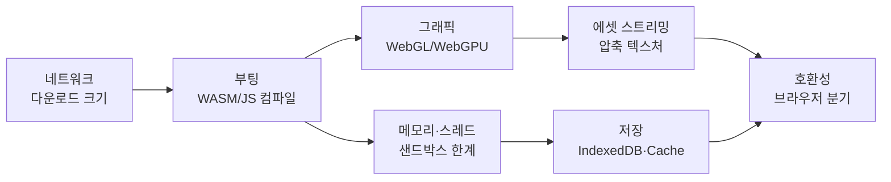
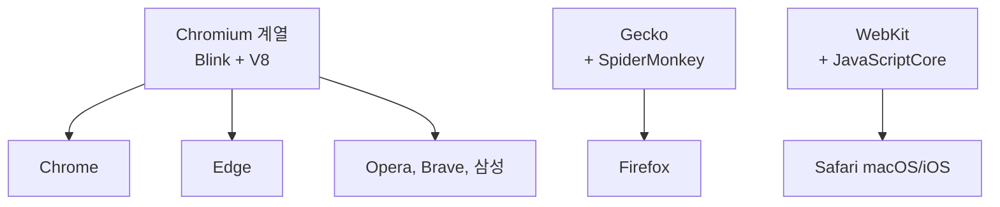
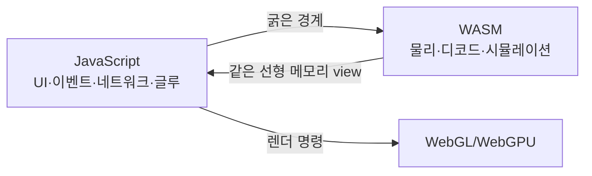
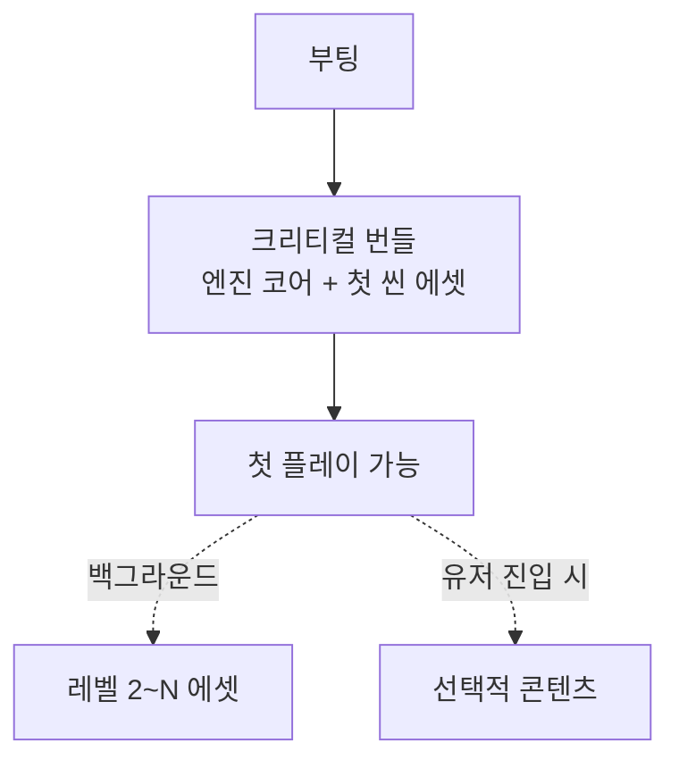
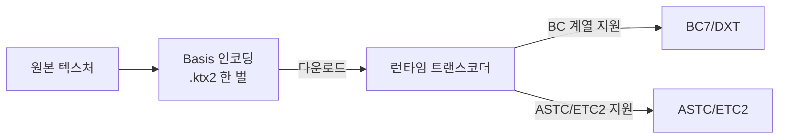
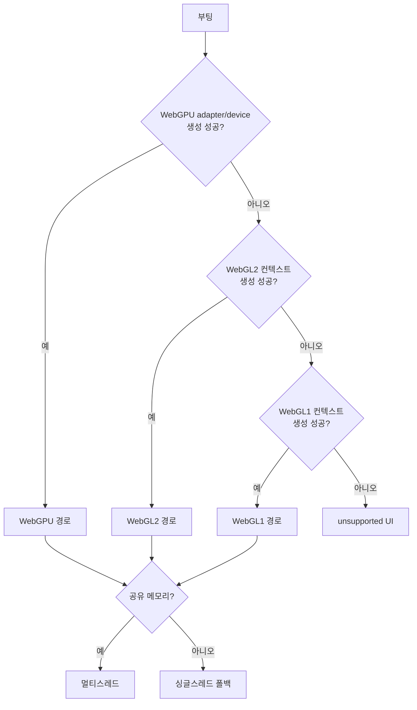

## 들어가며

웹 플랫폼은 *즉시성* 과 *제약* 사이의 거래다. 링크 하나를 누르면 설치도, 스토어 심사도, 다운로드 대기도 없이 게임이 시작된다 — 이 마찰 제로의 접근성이 웹의 유일무이한 강점이다. 그 대가로 게임은 *브라우저 샌드박스* 안에서 돈다. 파일 시스템도, 임의의 스레드도, 무제한 메모리도 없고, 첫 화면을 띄우기까지 *모든 바이트를 네트워크로 받아야* 한다. 네이티브에서는 공짜인 것들이 웹에서는 협상 대상이 된다.

이 글은 그 협상을 따라 웹 게임의 구성요소를 한 흐름으로 정리한다. 브라우저라는 실행 환경이 무엇을 허용하고 무엇을 막는지, 그래픽을 WebGL과 WebGPU 중 무엇으로 그릴지, 성능 크리티컬 코드를 WebAssembly로 어떻게 내리고 그 경계 비용은 얼마인지, 첫 플레이까지의 다운로드 크기를 어떻게 줄이는지, 탭 하나에 걸린 메모리·스레드 한계 안에서 어떻게 버티는지, 에셋을 어떻게 스트리밍하고 IndexedDB에 어떻게 캐시·저장하는지, 그리고 갈라진 브라우저들에서 어떻게 일관되게 돌리는지를 다룬다.



이 글의 목표.

1. **브라우저라는 실행 환경** — 샌드박스, 엔진 분기, 즉시성의 정체.
2. **그래픽 API** — Canvas 2D·WebGL·WebGPU, 셰이더 언어, 프레임워크.
3. **JavaScript와 WebAssembly** — JIT, WASM 이식, JS↔WASM 경계 비용.
4. **다운로드와 로딩 크기** — 첫 플레이 시간, 코드 스플리팅, 압축.
5. **메모리와 스레드 제약** — 주소 공간, OOM, Worker·SharedArrayBuffer.
6. **에셋 스트리밍과 텍스처 압축** — Basis/KTX2, 우선순위, 프리페치.
7. **저장과 캐싱** — IndexedDB, Cache API, Service Worker, 영속성.
8. **호환성과 운영** — 브라우저 분기, 능력 탐지, 디버깅·텔레메트리.


---

## 목차
1. [브라우저라는 실행 환경](#1-브라우저라는-실행-환경)
2. [그래픽 API](#2-그래픽-api)
3. [JavaScript와 WebAssembly](#3-javascript와-webassembly)
4. [다운로드와 로딩 크기](#4-다운로드와-로딩-크기)
5. [메모리와 스레드 제약](#5-메모리와-스레드-제약)
6. [에셋 스트리밍과 텍스처 압축](#6-에셋-스트리밍과-텍스처-압축)
7. [저장과 캐싱](#7-저장과-캐싱)
8. [호환성과 운영](#8-호환성과-운영)


---

## 1. 브라우저라는 실행 환경

### 샌드박스가 정의하는 것

웹 게임은 운영체제가 아니라 *브라우저 위에서* 돈다. 이 한 줄이 모든 제약의 출발점이다. 브라우저는 보안을 위해 각 탭을 *샌드박스* 에 가둔다 — 임의 파일 읽기·쓰기 불가, 임의 포트 열기 불가, 임의 네이티브 스레드 생성 불가, 직접 GPU 명령 제출 불가. 게임은 브라우저가 *명시적으로 노출한 API* 만 쓸 수 있고, 그 API는 한 겹의 검증·변환을 거친다.

| 네이티브에서 공짜인 것 | 웹에서의 형태 | 제약 |
|---|---|---|
| 파일 시스템 | IndexedDB, Cache API, OPFS | 비동기, origin별 격리, 용량 한도 |
| 스레드 | Web Worker | 메모리 공유 제한, 메시지 패싱 |
| 직접 GPU | WebGL / WebGPU | 검증 계층, 제한된 기능 집합 |
| 소켓 | WebSocket / WebRTC | TCP/UDP 직접 불가, 핸드셰이크 강제 |
| 무제한 메모리 | WASM 선형 메모리 | 주소 공간·탭 할당량 한계 |
| 즉시 실행 | 다운로드 후 컴파일 | 첫 바이트부터 네트워크 |

이 표의 오른쪽 칸이 이 글 전체의 목차나 다름없다. 웹 게임 엔지니어링은 *왼쪽을 오른쪽으로 번역* 하는 작업이다.

### 즉시성의 정체 — 마찰 대 신뢰

웹의 강점은 *설치 마찰이 0* 이라는 점 하나로 요약된다. 스토어 심사(수 일~수 주), 다운로드(수백 MB), 설치 권한 동의가 전부 사라지고, URL 클릭에서 첫 인터랙션까지가 *몇 초* 다. 광고를 누른 사람이 그 자리에서 플레이하고, 친구가 보낸 링크가 곧바로 게임이 된다. 이 즉시성이 *유입 퍼널* 전체를 짧게 만든다.

대가는 *모든 비용이 앞으로 당겨진다* 는 것이다. 네이티브 앱은 한 번 설치하면 그 뒤로는 디스크에서 즉시 로드한다. 웹은 (캐시가 비어 있다면) *매번 첫 진입에 코드와 에셋을 네트워크로 받는다*. 그래서 네이티브에서 "용량"은 한 번의 설치 결정이지만, 웹에서 "다운로드 크기"는 *매 신규 유저가 이탈을 저울질하는 순간* 이다. 4절의 첫 플레이 시간 최적화가 사업 지표와 직결되는 이유다.

### 엔진 분기 — 하나의 웹이 아니다

"브라우저"는 단일 대상이 아니다. 렌더링·스크립트 엔진이 세 갈래로 갈린다.



핵심 함정은 *iOS* 다. 기존 iOS 배포 조건과 다수 지역에서는 Chrome이든 Firefox든 내부적으로 *WebKit* 을 써 왔다. 다만 EU에는 대체 브라우저 엔진을 허용하는 예외가 생겼으므로, "iOS 브라우저는 전부 WebKit" 이라고 단정하면 현재 정책 변화와 어긋난다. 그래서 "Android Chrome에서 잘 되니 iOS Chrome도 되겠지"는 틀린 전제다. WebGPU 지원 시점, WASM 스레드 가용성, 오디오 정책, 메모리 한계가 *지역·OS 버전·엔진마다* 다르므로, 호환성은 브라우저 이름이 아니라 *엔진과 기능 지원* 으로 따져야 한다(8절).


## 2. 그래픽 API

### Canvas 2D, WebGL, WebGPU의 층위

웹의 그래픽 API는 서로 다른 추상화와 실행 계약을 제공한다. 낮은 수준의 API는 상태와 작업 제출을 더 직접 통제할 수 있지만, 그 자체로 더 빠름을 보장하지 않는다. 장면 구조, 브라우저 구현, driver와 엔진의 batching 품질에 따라 높은 수준 API가 더 적은 CPU 작업으로 끝날 수도 있다.

| API | 추상화 | 적합 | 기능 계약 |
|---|---|---|---|
| Canvas 2D | 높음 | UI, 단순 2D, 프로토타입 | 즉시 모드 2D drawing context |
| WebGL 1.0 | 중간 | 넓은 기기 범위의 2D/3D | OpenGL ES 2.0 계열 programmable pipeline |
| WebGL 2.0 | 중간 | 인스턴싱·MRT가 필요한 3D | OpenGL ES 3.0 계열 기능 |
| WebGPU | 낮음 | 명시적 리소스·컴퓨트가 필요한 렌더링 | pipeline·bind group·command encoder·compute |

백엔드는 목표 브라우저·OS·GPU의 실제 지원 행렬로 정한다. 컴퓨트와 WebGPU의 자원 모델이 제품 요구라면 미지원 환경을 명시적으로 제외할 수 있고, 넓은 호환성이 요구되면 WebGL 기준선이나 검증된 프레임워크 폴백을 둔다. 두 백엔드를 직접 유지하면 renderer와 shader, 리소스 lifetime, QA 비용도 함께 늘어난다. “항상 이중 백엔드”가 아니라 도달 가능한 사용자 비율과 유지 비용을 비교하는 제품 결정이다. 지원 여부는 발행 시점 표보다 runtime feature detection과 실제 device test가 권위 있다.

### WebGL의 한계와 WebGPU의 동기

WebGL은 OpenGL ES를 웹에 옮긴 것이라, *글로벌 상태 머신* 과 *드로우콜당 검증* 이라는 구형 모델을 물려받았다. 객체를 바인딩하고 상태를 바꾸고 그리는 매 호출이 브라우저의 검증을 거치므로, *드로우콜이 많으면 CPU 측 오버헤드* 가 병목이 된다. 컴퓨트 셰이더가 없어 GPU 범용 연산(파티클 시뮬레이션, 컬링)을 정점/프래그먼트 셰이더로 우회해야 한다.

WebGPU는 모던 네이티브 API의 개념을 웹에 맞게 정규화한다 — *명시적 파이프라인 상태 객체*, *커맨드 인코더와 버퍼*, *바인드 그룹*, 그리고 *컴퓨트 셰이더*. 많은 호환성 검사를 pipeline·bind group 생성 시점에 수행하고 커맨드를 묶어 제출할 수 있어 WebGL의 세밀한 상태 변경과 다른 CPU 비용 구조를 갖는다. 브라우저의 안전성 검증과 내부 변환은 여전히 존재하므로 네이티브 API에 직접 명령을 전달한다고 이해해서는 안 된다.

```javascript
// WebGPU: 파이프라인을 미리 굳히고, 커맨드를 배치로 인코딩
const pipeline = device.createRenderPipeline({
  layout: pipelineLayout,
  vertex:   { module: shaderModule, entryPoint: "vs_main", buffers: [vbLayout] },
  fragment: { module: shaderModule, entryPoint: "fs_main", targets: [{ format }] },
  primitive: { topology: "triangle-list", cullMode: "back" },
});

const encoder = device.createCommandEncoder();
const pass = encoder.beginRenderPass({ colorAttachments: [...] });
pass.setPipeline(pipeline);
pass.setBindGroup(0, frameBindGroup);
pass.setVertexBuffer(0, vertexBuffer);
pass.draw(vertexCount);            // 드로우콜마다 반복되던 상태 검증의 상당 부분이 파이프라인·바인드 그룹 생성 시점으로 앞당겨짐
pass.end();
device.queue.submit([encoder.finish()]);   // 한 번에 제출
```

### 셰이더 언어 — GLSL ES와 WGSL

셰이더 언어도 갈린다. WebGL은 *GLSL ES* 를, WebGPU는 새 언어인 *WGSL(WebGPU Shading Language)* 을 쓴다. 이중 백엔드를 두면 셰이더를 두 언어로 유지하거나, 한 소스에서 둘 다 생성하는 트랜스파일 파이프라인을 둬야 한다.

GLSL ES에는 모바일에서 깨지기 쉬운 함정이 있다. *정밀도 한정자(precision)* 다. 모바일 GPU의 `mediump`(반정밀도)는 데스크톱에서 무시되다가 모바일에서만 정밀도 부족으로 깨진다 — 큰 좌표값·UV·시간 누적에서 줄무늬나 떨림이 나타난다. 데스크톱에서만 테스트하면 절대 안 보이는 버그다.

```glsl
// 데스크톱에선 멀쩡, 모바일 mediump에서 시간이 커지면 떨림
precision mediump float;
uniform float uTime;            // 수백 초가 쌓이면 mediump 정밀도 소진
```

완화는 시간을 작게 wrap 하거나, 정밀도에 민감한 값만 `highp` 로 선언하는 것이다.

```glsl
precision mediump float;
uniform highp float uTime;      // 선언에 직접 한정자를 붙인다
```

### 프레임워크 — 직접 그릴 것인가

저수준 API를 직접 다루는 대신 프레임워크를 쓰는 선택지가 있다. *PixiJS* 는 2D 렌더링에, *Three.js* 와 *Babylon.js* 는 3D 씬 그래프에 특화된다. 프레임워크는 WebGL/WebGPU 백엔드 분기, 배칭, 리소스 관리를 대신 해 준다 — 개발 속도가 결정적 이점이다. 대가는 *번들 크기*(프레임워크 자체가 수백 KB)와 *추상화 오버헤드*, 그리고 *통제력의 상실* 이다. 드로우콜 단위로 최적화해야 하는 고밀도 씬에서는 프레임워크의 일반화된 경로가 병목이 되기도 한다. 엔진(Unity WebGL 등)을 통째로 웹으로 빌드하는 경로도 있으나, 그 경우 다운로드 크기와 WASM 부팅 비용이 크게 늘어 4절의 제약이 전면에 온다.


## 3. JavaScript와 WebAssembly

### JIT와 그 변덕

브라우저의 JavaScript 엔진(V8, SpiderMonkey, JavaScriptCore)은 *JIT 컴파일러* 다. 자주 도는 코드(hot path)를 런타임에 기계어로 컴파일해 빠르게 만든다. 잘 최적화된 JS는 네이티브의 상당 비율까지 따라간다. 문제는 *변덕* 이다 — JIT는 코드가 *형태가 일정(monomorphic)* 하다고 가정해 최적화하는데, 그 가정이 깨지면 *역최적화(deoptimization)* 가 일어나 인터프리터로 떨어진다.

```javascript
// 같은 함수에 형태가 다른 객체를 섞으면 inline cache가 불리해질 수 있다 (항상 역최적화가 아님)
function update(e) { e.x += e.vx; }       // e의 "형태"가 일관될수록 유리
update({ x: 0, vx: 1 });
update({ x: 0, vx: 1, hp: 100 });         // shape 다양성 증가 → 최적화에 불리할 수 있음
// 실제 deopt를 주장하려면 engine/version·warmup·trace 결과가 필요하다
// 완화: 엔티티 형태를 통일하거나, SoA(구조 분리 배열)로 형태 자체를 없앤다
```

엔진 내부 동작에 의존하는 이런 최적화는 *깨지기 쉽고 엔진마다 다르다*. 핫 루프의 일관된 성능이 필요하면 다음 수단이 WASM이다.

### WebAssembly — 예측 가능한 성능

*WebAssembly(WASM)* 는 브라우저가 검증하고 JIT 또는 AOT 방식으로 기계어에 내리는 저수준 가상 명령 형식이다. C/C++/Rust를 컴파일해 얻을 수 있고 정적 타입·선형 메모리 덕분에 수치 코드를 비교적 규칙적으로 최적화할 수 있지만, 브라우저 tiering·bounds check·메모리 성장·JS 경계와 target CPU에 따라 성능은 달라진다. 물리 시뮬레이션, 디코더, 경로 탐색처럼 형태가 고정된 수치 코드가 좋은 후보이며, Emscripten 같은 툴체인이 C/C++ 소스를 WASM과 브라우저 API용 glue code로 묶는다.

WASM의 선형 메모리는 큰 byte-addressed buffer이며 C/C++ 계열 빌드는 그 안을 allocator로 직접 관리한다. 선형 메모리 자체의 객체를 tracing GC가 수거하지는 않지만 `malloc` 비용, 파편화와 memory growth 복사는 여전히 존재한다. glue code가 만든 JS 객체와 host API는 JS GC의 영향을 받고, WebAssembly GC 제안을 사용하는 managed-language runtime은 별도 모델을 가진다. “WASM이면 프레임 전체에서 GC pause가 없다”가 아니라 hot data와 allocation을 선형 메모리 안에서 통제할 수 있다는 뜻이다.

### JS↔WASM 경계 비용

WASM의 함정은 *경계 비용* 이다. 일반 JS 객체는 WASM 선형 메모리 안에 직접 놓이지 않지만, JS는 `WebAssembly.Memory.buffer`에 `TypedArray` view를 만들어 같은 bytes를 복사 없이 읽고 쓸 수 있다. 복사가 필요한지는 데이터 소유 위치와 표현에 달려 있다. JS object graph를 WASM용 packed array로 바꾸거나 문자열을 UTF-8로 encode하면 변환·복사가 생기고, scalar 호출을 엔티티마다 반복하면 호출·boxing 비용이 누적된다.

```javascript
// 안티패턴: 매 프레임 경계를 잘게 두드림 (호출 오버헤드 + 변환)
for (const e of entities) wasm.updateOne(e.x, e.y, e.vx, e.vy);

// 권장: 데이터를 공유 메모리에 한 번 펼치고, 경계를 한 번만 넘는다
const view = new Float32Array(wasm.memory.buffer, ptr, count * 4);
// ... JS가 view에 좌표를 채운다 (복사 없이 직접 기록)
wasm.updateAll(ptr, count);        // 호출 1회로 전체 처리
```

view 수명 계약이 빠지면 위 코드는 깨진다. `WebAssembly.Memory.grow()`나 allocator 재배치는 기존 `memory.buffer`를 분리(detach)하므로 이미 만든 view는 length 0·원소 undefined가 된다(공유 버퍼라도 기존 view 길이가 늘지는 않는다). 따라서 grow·재배치 이후에는 `memory.buffer`와 `ptr`를 다시 조회해 view를 재생성해야 하며, 재생성 위치와 스레드 동기화는 helper 계약으로 둔다. 여기서 말하는 공유는 JS와 WASM이 같은 `ArrayBuffer`를 본다는 뜻이고, 반드시 `SharedArrayBuffer`/멀티스레드를 뜻하지는 않는다.

원칙은 *경계는 굵고 드물게* 다. 데이터를 WASM 선형 메모리에 *공유 뷰(typed array view)* 로 펼쳐 두고, JS와 WASM이 *같은 메모리* 를 읽고 쓰게 하면 복사가 사라진다. 호출 횟수를 줄이고 한 번에 큰 작업을 넘긴다.

### 무엇을 WASM으로, 무엇을 JS로

전부 WASM으로 옮기는 것은 답이 아니다. WASM은 DOM·Web API에 직접 접근하지 못해, 결국 *글루 JS* 를 거쳐야 한다 — UI·이벤트·네트워크는 JS가 자연스럽다. 실무의 분담은 다음과 같다.



수치 집약·형태 고정 코드는 WASM으로, 브라우저 API와 맞물리는 코드는 JS로 둔다. 경계는 굵게 설계해 왕복 횟수를 최소화한다. 이 분담이 무너져 경계가 잘게 쪼개지면 WASM이 오히려 느려진다.


## 4. 다운로드와 로딩 크기

### 첫 플레이 시간이 곧 이탈률

웹에서 *첫 플레이 가능 시간(time to first playable)* 은 단순한 성능 지표가 아니라 *이탈률* 이다. 즉시성을 기대하고 들어온 유저는 흰 화면이 몇 초 이어지면 떠난다. 그래서 웹 게임의 로딩 최적화는 "전체 다운로드를 줄이는" 문제가 아니라 *"플레이를 시작하는 데 꼭 필요한 최소 바이트를 먼저 보내는"* 문제다.

다운로드 비용은 세 갈래로 쌓인다.

| 비용 | 정체 | 완화 |
|---|---|---|
| 전송 바이트 | 네트워크로 받는 양 | 압축, 코드 스플리팅, 텍스처 압축 |
| 파싱·컴파일 | JS 파싱, WASM 컴파일 | 스트리밍 컴파일, 코드 분할 |
| 디코드·업로드 | 이미지 디코딩, GPU 업로드 | GPU 압축 텍스처, 지연 업로드 |

전송량만 줄이고 끝나면 안 된다. *큰 WASM 모듈의 컴파일* 과 *수많은 텍스처의 디코딩·GPU 업로드* 도 첫 프레임을 늦춘다.

### 크리티컬 패스만 먼저

핵심 전략은 *에셋을 크리티컬과 비크리티컬로 가르는* 것이다. 첫 화면·첫 인터랙션에 필요한 것만 *초기 번들* 에 넣고, 나머지는 게임이 시작된 뒤 *코드 스플리팅* 과 *지연 로딩* 으로 받는다.



```javascript
// 코드 스플리팅: 무거운 모듈은 필요해질 때 동적 import
async function enterEditor() {
  const { Editor } = await import("./editor.js");   // 부팅 번들에 없음
  return new Editor();
}
```

번들 경계 설계는 에셋 뱅크(예: 사운드 뱅크) 경계 설계와 같은 종류의 판단이다 — 너무 잘게 쪼개면 요청 수와 라운드트립이 늘고, 너무 크게 묶으면 안 쓸 것까지 초기에 받는다.

### 압축 — 전송과 디코드를 함께 본다

전송 압축은 *Brotli* 가 사실상 표준이다(gzip보다 텍스트·WASM에서 압축률이 높다). 서버가 `Content-Encoding: br` 로 보내면 브라우저가 투명하게 푼다. 하지만 *전송 압축과 디코드 비용은 별개* 다. PNG/JPEG는 전송은 작아도, 브라우저가 *디코딩한 픽셀* 을 GPU에 올릴 때 비압축으로 펼쳐진다 — 텍스처는 6절의 *GPU 압축 포맷* 으로 따로 다뤄야 한다.

WASM에는 *스트리밍 컴파일* 이라는 무기가 있다. 모듈을 *받으면서 동시에 컴파일* 하므로, 다운로드가 끝난 뒤 컴파일을 시작하는 것보다 빠르다. 큰 WASM 모듈일수록 이 차이가 크다.

```javascript
// 다운로드와 컴파일을 겹친다 (전체 받은 뒤 컴파일하지 않음)
const { instance } = await WebAssembly.instantiateStreaming(
  fetch("game.wasm"), importObject
);
```


## 5. 메모리와 스레드 제약

### 탭 하나에 걸린 한계

웹 게임은 *탭 하나의 메모리 예산* 안에서 산다. 그 한계는 네이티브보다 낮고 변덕스럽다. WASM 선형 메모리가 *32비트 주소 공간* 을 쓰는 빌드라면 *이론 상한이 4GB* 지만, 실제로는 브라우저·플랫폼별 할당량이 훨씬 먼저 천장을 친다. 특히 *모바일 브라우저* 는 시스템 메모리 압박 시 탭을 통째로 *축출(discard)* 하거나 *OOM 크래시* 시킨다 — 게임이 한순간에 사라진다.

선형 메모리는 한 번 *grow* 하면 거의 줄지 않는다. 피크 사용량이 그 탭의 메모리 점유를 결정하므로, *피크를 누르는 설계* 가 핵심이다.

| 위험 | 증상 | 대응 |
|---|---|---|
| 선형 메모리 grow 폭주 | 점유 메모리가 피크에서 고정 | 풀링, 피크 억제 |
| 텍스처 메모리 과다 | GPU/CPU 메모리 동시 압박 | 압축 텍스처, 다운스케일, 밉맵 |
| 누수 | 시간이 갈수록 점유 증가 | 약참조, 리스너 해제, 풀 반환 |
| 모바일 OOM | 탭 크래시·축출 | 예산 하향, 저사양 프로파일 |

### 누수와 풀링

JS는 GC 언어라 명시적 free가 없지만, *참조가 남아 있으면 수거되지 않는다* — 해제하지 않은 이벤트 리스너, 닫지 않은 클로저, 끊지 않은 타이머가 전형적 누수원이다. 특히 WebGL/WebGPU의 GPU 리소스(텍스처·버퍼)는 GC가 즉시 회수하지 않으므로 *명시적 destroy* 가 필요하다.

프레임마다 객체를 새로 만들면 *GC 압박* 이 커지고, GC 일시정지가 프레임을 끊는다. *오브젝트 풀(object pool)* 로 미리 확보한 객체를 재사용해 반복 할당을 줄인다. 다만 `acquire`가 고갈 시 `new`로 폴백하므로 할당과 GC pause가 완전히 사라지는 것은 아니며, pool 크기·확장 정책·반환 시 객체 reset을 함께 설계해야 한다.

```javascript
// 풀: 반복 할당을 줄여 할당 압박을 낮춘다 (모든 할당·GC pause를 없애지는 못한다)
class ParticlePool {
  constructor(n) { this.free = Array.from({length:n}, () => new Particle()); this.used = []; }
  acquire() { const p = this.free.pop() ?? new Particle(); this.used.push(p); return p; }  // 고갈 시 새 객체
  releaseAll() {                                  // 매 프레임 일괄 반환
    for (let i = 0; i < this.used.length; ++i) this.free.push(this.used[i]);   // spread 대신 loop
    this.used.length = 0;
  }
}
```

OOM은 사후 복구가 어렵다. 그래서 *사전 예방* 이 원칙이다 — 디바이스 능력을 보고 텍스처 해상도·동시 엔티티·버퍼 크기를 *예산 안에 맞추는* 저사양 프로파일을 둔다. 그래도 실패하면 *우아한 강등*(품질 낮추기, 일부 콘텐츠 언로드) 후 진행한다.

### 스레드 — Web Worker와 SharedArrayBuffer

브라우저는 임의 네이티브 thread 생성을 노출하지 않지만 *Web Worker*로 별도 실행 context를 띄울 수 있다. 일반 객체를 `postMessage`하면 structured clone이 일어나므로 큰 object graph의 복제 비용이 생길 수 있다. `ArrayBuffer`는 transferable로 소유권을 옮기거나 `SharedArrayBuffer`로 공유할 수 있으므로 모든 메시지가 복사되는 것은 아니다.

해법은 두 가지다. 첫째 *Transferable* — `ArrayBuffer`의 소유권을 복사 없이 *넘긴다*(넘긴 쪽은 못 쓴다). 둘째 *SharedArrayBuffer* — 여러 워커가 *같은 메모리를 공유* 한다. WASM 멀티스레딩(pthread 빌드)도 SharedArrayBuffer 위에서 돈다.

```javascript
// Transferable: 복사 없이 버퍼 소유권 이전
worker.postMessage({ pixels: buf }, [buf]);   // buf는 이 쪽에서 detached 됨
```

단, SharedArrayBuffer는 보안(Spectre) 이유로 *교차 출처 격리(cross-origin isolation)* 헤더 — `COOP`/`COEP` — 를 요구한다. 이 헤더가 없으면 SharedArrayBuffer가 *비활성화* 되어, WASM 멀티스레딩이 통째로 막힌다. 배포 환경(임베드되는 게임 포털 등)이 이 헤더를 못 보내면 멀티스레드 빌드가 동작하지 않으므로, *싱글스레드 폴백* 을 항상 준비해야 한다.


## 6. 에셋 스트리밍과 텍스처 압축

### GPU 압축 텍스처가 핵심인 이유

4절에서 짚었듯 PNG/JPEG는 *전송* 만 작지, GPU에 올라가면 *비압축 픽셀* 로 펼쳐진다. 1024×1024 RGBA 텍스처 하나가 GPU 메모리에서 *4MB* 다. 텍스처 수십~수백 장이면 GPU 메모리가 금세 천장을 친다. 그래서 웹 게임은 *GPU가 직접 읽는 압축 포맷* — 압축된 채로 메모리에 상주하고 샘플링 시 디코딩되는 포맷 — 을 써야 한다.

문제는 GPU 압축 포맷이 *하드웨어마다 다르다* 는 것이다. 어떤 GPU는 *S3TC(DXT/BC)*, 어떤 GPU는 *ETC2* 또는 *ASTC* 를 지원하고(데스크톱/모바일 이분법으로 정해지지 않으므로 실제 지원 format와 변환 가능 조합으로 고른다), 한 GPU가 다른 포맷을 못 읽기도 한다. 모든 포맷으로 텍스처를 다 굽고 배포하면 *다운로드 크기가 배수로* 늘어난다.

### Basis Universal과 KTX2

해법이 *Basis Universal* 이다. 하나의 중간 표현으로 텍스처를 인코딩해 두고, *런타임에 디바이스가 지원하는 포맷으로 트랜스코딩* 한다. 다운로드는 한 벌, GPU에는 각자에 맞는 압축 포맷으로 올린다. *KTX2* 컨테이너가 이 Basis 데이터를 담는 표준 포맷이다.



```javascript
// 디바이스 지원 포맷을 보고 트랜스코딩 타깃을 고른다
const fmt = gpuSupports("astc") ? "astc"
          : gpuSupports("bc7")  ? "bc7"
          : gpuSupports("etc2") ? "etc2"
          : "rgba32";                         // 최후 폴백: 비압축
const compressed = transcoder.transcode(ktx2Data, fmt);
texture.upload(compressed);                   // 압축된 채 GPU에 상주
```

트레이드오프가 있다. Basis 트랜스코딩은 *런타임 CPU* 를 쓰고(로딩 중 한 번), 압축 텍스처는 비압축보다 *품질이 약간 떨어진다*. 그 대가로 *다운로드 한 벌 + GPU 메모리 대폭 절감* 을 얻는다. 텍스처가 많은 웹 게임에서는 거의 필수다.

### 우선순위와 프리페치

스트리밍의 본질은 *지금 보이는 것을 먼저, 곧 보일 것을 미리* 받는 것이다. 모든 에셋에 *우선순위* 를 매겨, 화면에 보이는 텍스처를 최우선으로 받고, 인접 영역·다음 레벨을 백그라운드로 *프리페치* 한다. 아직 안 받은 에셋 자리에는 *저해상도 플레이스홀더* 를 깔아 점진적으로 교체한다(progressive loading).

운영 관점에서 *실패의 우아한 처리* 가 중요하다. 네트워크가 끊기거나 느리면, 게임은 멈추지 말고 *플레이스홀더로 진행* 하다 재시도해야 한다. CDN 캐싱(에셋을 엣지에 분산)으로 라운드트립을 줄이고, 7절의 Cache API로 *받은 에셋을 영속 캐시* 해 재방문 시 다운로드를 건너뛴다.


## 7. 저장과 캐싱

### 웹의 영속 저장소들

웹에는 파일 시스템이 없으므로, *저장* 은 브라우저가 제공하는 origin별 저장소로 한다. 용도에 따라 갈린다.

| 저장소 | 용도 | 특성 | 한계 |
|---|---|---|---|
| `localStorage` | 작은 설정·플래그 | 동기, 문자열만 | 수 MB, 동기라 블로킹 |
| IndexedDB | 세이브·에셋 캐시 | 비동기, 구조화 객체·바이너리 | 용량 큼(할당량 내) |
| Cache API | 네트워크 응답 캐시 | Service Worker와 연동 | Request/Response 단위 |
| OPFS | 대용량 파일 I/O | 파일 핸들, 워커에서 동기 가능 | 비교적 신기능 |

게임 세이브, 다운로드한 에셋 캐시처럼 *큰 구조화 데이터* 는 *IndexedDB* 가 표준이다. `localStorage`는 동기·문자열·소용량이라 세이브 용도로 부적합하다 — 큰 데이터를 동기로 쓰면 메인 스레드가 멈춘다.

### IndexedDB — 비동기 객체 저장소

IndexedDB는 *비동기 트랜잭션 기반* 의 객체 저장소다. 키로 객체(JSON뿐 아니라 `ArrayBuffer`·Blob 같은 바이너리)를 넣고 뺀다. 세이브 데이터와 다운로드 에셋을 함께 둘 수 있다.

```javascript
// IndexedDB: 세이브와 에셋 캐시를 한 DB에
const db = await openDB("game", 1, {
  upgrade(db) {
    db.createObjectStore("saves");          // 키: 슬롯명 → 세이브 객체
    db.createObjectStore("assets");         // 키: URL → ArrayBuffer
  },
});

await db.put("saves", saveState, "slot1");          // 비동기 쓰기
const cached = await db.get("assets", assetUrl);    // 캐시 히트면 네트워크 생략
```

함정은 *비동기성과 트랜잭션 수명* 이다. 트랜잭션은 IDB 요청이 없는 상태에서 *다른 작업(microtask 경계를 넘는 외부 `await`)을 기다리면 자동으로 닫힌다* — 한 트랜잭션 안에서 네트워크 요청 같은 외부 await를 끼우면 트랜잭션이 끝나 버려 후속 쓰기가 실패한다. 반대로 IDB request promise를 연쇄해 await하는 것은 정상적인 사용이다. 그래서 외부 데이터는 *트랜잭션을 열기 전에 준비* 하고, 트랜잭션 안에서는 IDB 요청만 연쇄하며 `tx.done`으로 commit을 확인한다.

### Service Worker와 오프라인

*Service Worker* 는 페이지와 네트워크 사이에 끼는 프록시 스크립트다. 네트워크 요청을 가로채 *Cache API* 에서 응답을 돌려줄 수 있다 — 이것이 *오프라인 플레이* 와 *재방문 즉시 로딩* 의 토대다. 한 번 받은 엔진 코드·에셋을 캐시해 두면, 다음 방문 때 네트워크 없이도 게임이 뜬다(PWA의 핵심).

```javascript
// Service Worker: 캐시 우선, 없으면 네트워크 → 즉시 로딩 + 오프라인
// 쓰기 promise를 event lifetime에 연결한다 (waitUntil/await 없이는 응답 종료와 함께 취소될 수 있다).
self.addEventListener("fetch", (event) => {
  const request = event.request;
  const url = new URL(request.url);
  // 앱의 정적 versioned assets만 처리한다 (GET + same-origin + 경로 범위).
  if (request.method !== "GET" || url.origin !== self.location.origin ||
      !url.pathname.startsWith("/assets/")) return;

  const result = (async () => {
    const cache = await caches.open("assets-v1");
    const hit = await cache.match(request);
    if (hit) return { response: hit, copy: null, cache };
    const response = await fetch(request);
    // 원본 response가 소비되기 전에 먼저 복제한다.
    return { response, copy: response.ok ? response.clone() : null, cache };
  })();

  event.respondWith(result.then(({ response }) => response));
  event.waitUntil(result.then(async ({ copy, cache }) => {
    if (copy) await cache.put(request, copy);       // 쓰기 완료를 이벤트 수명에 묶는다
  }).catch((error) => {
    console.warn("Asset cache write unavailable", error);   // 캐시 실패는 응답을 망치지 않는다
  }));
});
```

이 예시는 캐시 실패가 정상 응답을 망치지 않도록 쓰기 promise를 `waitUntil`에 연결한 *명세·정적 분석 기반* 코드이며, 실제 브라우저에서 worker 종료·`QuotaExceeded`·오프라인 시나리오로 실행한 것은 아니다. 대상 URL 범위(GET·same-origin·경로)와 캐시 실패 정책(quota, range, `Vary: *`), 버전 업그레이드·오래된 캐시 삭제 정책은 앱이 별도로 정한다. `waitUntil`은 프로세스 crash·OS 종료까지의 디스크 commit primitive가 아니다.

### 영속성은 보장이 아니다

핵심 함정 하나. 브라우저 저장소는 *디스크 압박 시 축출(eviction)* 될 수 있다 — 유저가 저장 공간을 비우거나 브라우저가 공간을 회수하면, IndexedDB 세이브가 *사라질 수 있다*. 이 위험을 줄이려면 *영속 저장 권한(persistent storage)* 을 요청하거나, *중요한 세이브는 서버에 동기화* 해야 한다. "로컬에 저장했으니 안전"은 웹에서 성립하지 않는다. 클라우드 세이브는 편의 기능이 아니라 *데이터 보존의 안전망* 이다.


## 8. 호환성과 운영

### 능력 탐지가 원칙

1절에서 봤듯 브라우저는 엔진·버전으로 갈리고, 기능 지원이 제각각이다. *브라우저 이름이나 User-Agent로 분기하는 것은 깨지기 쉽다* — UA 문자열은 위장되거나 바뀌고, 같은 브라우저도 버전에 따라 능력이 다르다. 원칙은 *능력 탐지(feature detection)* 다 — 이름이 아니라 *그 기능이 실제로 있는지* 를 묻는다.

```javascript
// 이름이 아니라 능력으로 분기하되, "존재 플래그"와 "실제 생성 성공"을 구분한다
const caps = {
  webgpu: "gpu" in navigator,
  webgl2: !!document.createElement("canvas").getContext("webgl2"),
  sharedMem: typeof SharedArrayBuffer !== "undefined",   // COOP/COEP 의존
  wasmSimd: await wasmFeatureDetect.simd(),
};

async function tryCreateWebGPU() {
  if (!caps.webgpu) return null;
  const adapter = await navigator.gpu.requestAdapter();   // navigator.gpu가 있어도 null 가능
  if (!adapter) return null;
  const device = await adapter.requestDevice().catch(() => null);   // device 생성 실패 분기
  return device;   // 필수 feature/limit 검증까지 통과해야 확정
}
const backend =
  (await tryCreateWebGPU()) ? "webgpu" :
  caps.webgl2               ? "webgl2" :
  document.createElement("canvas").getContext("webgl") ? "webgl1" : "unsupported";
```

여기서도 *존재 플래그와 생성 성공은 별개* 다. `navigator.gpu`가 있어도 `requestAdapter()`가 null을 반환할 수 있고, adapter가 있어도 `requestDevice()`나 필수 feature/limit 검증이 실패할 수 있다. WebGL2/WebGL1도 context 생성이 실패할 수 있으므로, 후보를 순서대로 시도해 성공한 것만 확정하고 모두 실패하면 *명시적 unsupported UI* 로 간다.

### 폴백 사다리

호환성은 *단일 분기* 가 아니라 *폴백 사다리* 로 설계한다 — 최선의 경로부터 최후의 보루까지 단계적으로 내려간다. 사다리의 각 칸이 *항상 동작하는 코드 경로* 여야 한다.



공유 메모리 분기는 빌드 산출물과도 연결된다 — pthread 멀티스레딩은 같은 소스의 *별도 WASM 빌드*(pthread 링크 옵션·공유 메모리)와 배포 헤더(COOP/COEP)가 갖춰져야 하며, 런타임 flag만 켠다고 단일 스레드 빌드가 멀티스레드로 바뀌지는 않는다.

각 분기는 *비용* 이다. WebGPU·WebGL 두 백엔드, 멀티·싱글스레드 두 경로를 유지하면 코드와 QA가 배로 든다. 그래서 *목표 시장* 으로 사다리 길이를 정한다 — 데스크톱 위주면 WebGL2 기준선이 충분하고, 모바일·구형 포함이면 WebGL1·싱글스레드 폴백까지 내려가야 한다.

### 환경별 함정 점검표

웹은 *실행 환경이 유저마다 다르다* — 같은 코드가 어떤 기기에서만 깨진다. 빈번한 함정을 모아 둔다.

| 환경 | 함정 | 대응 |
|---|---|---|
| iOS Safari | WebGPU·스레드 지원 시점이 다름, 메모리 한계 낮음 | 능력 탐지, 저사양 프로파일 |
| 임베드(포털 iframe) | COOP/COEP 부재로 SharedArrayBuffer 비활성 | 싱글스레드 폴백 필수 |
| 모바일 일반 | mediump 정밀도, OOM 축출, 발열 스로틀 | highp 선별, 예산 하향 |
| 자동 재생 정책 | 사용자 제스처 전 오디오·일부 기능 차단 | 첫 입력에서 오디오 컨텍스트 resume |
| 저속 네트워크 | 첫 플레이 시간 폭증 | 크리티컬 번들 축소, 플레이스홀더 |

오디오 자동 재생 정책은 특히 자주 놓친다. 브라우저는 *사용자 제스처(클릭·탭) 이전* 의 오디오 재생을 막는다 — 첫 입력 이벤트에서 오디오 컨텍스트를 *resume* 해야 소리가 난다. 데스크톱 키보드 테스트에서는 우연히 통과하고, 모바일 첫 진입에서 무음으로 드러나는 전형적 함정이다.

### 측정과 텔레메트리

네이티브와 달리 웹은 *디버거를 붙일 수 없는 수만 개의 실제 환경* 에서 돈다. 그래서 *원격 텔레메트리* 가 디버깅의 본체다. 첫 플레이 시간, 백엔드별 분포(WebGPU/WebGL2/WebGL1 비율), OOM·언더런·예외 발생률, 디바이스·브라우저 세그먼트별 프레임 시간을 수집해야, "어떤 환경에서 무엇이 깨지는지"가 보인다.

```javascript
// 핵심 운영 지표: 환경 세그먼트와 함께 수집해야 의미가 생긴다
telemetry.report({
  ttfp: timeToFirstPlayable,          // 이탈률과 직결
  backend, sharedMem: caps.sharedMem, // 능력 분포
  oom: false, longFrames: count,      // 안정성·성능
  engine: detectEngine(),             // Blink/Gecko/WebKit
});
```

핵심은 *지표를 환경 세그먼트와 함께* 본다는 것이다. 평균 프레임 시간은 멀쩡한데 *특정 브라우저·기기 세그먼트만* 끊긴다면, 세그먼트 없는 평균값은 그 문제를 영원히 가린다. 1절의 엔진 분기, 5절의 메모리 한계, 8절의 폴백 경로가 모두 *세그먼트별 데이터* 위에서만 검증된다.


---

## 결론

웹 플랫폼의 모든 결정은 *즉시성 ↔ 제약* 의 줄다리기 위에 놓인다. 설치 마찰 0이라는 유일무이한 강점의 대가로, 게임은 브라우저 샌드박스 안에서 — 제한된 메모리·스레드, 검증을 거치는 GPU, 매 진입의 다운로드 — 돌아야 한다. 그래픽 백엔드 선택(WebGPU의 성능 대 WebGL의 호환성), 코드 분담(WASM의 예측 가능성 대 경계 비용), 로딩 전략(크리티컬 번들 대 스트리밍), 텍스처 포맷(Basis 한 벌 대 디바이스별 트랜스코딩) — 모두 이 줄다리기 위에서 어디에 무게를 둘지의 선택이다.

이 제약을 다루는 기반 구조는 일관된다. 능력 탐지와 폴백 사다리가 갈라진 브라우저를 흡수하고, 크리티컬 패스 분리가 첫 플레이 시간을 누르며, GPU 압축 텍스처가 메모리 천장을 늦추고, IndexedDB와 Service Worker가 재방문을 즉시 로딩과 오프라인으로 바꾼다. JS↔WASM·메인↔워커의 경계를 *굵고 드물게* 두는 원칙이 그 바닥에 깔린다 — 잘게 두드리는 경계가 웹 성능을 가장 흔하게 무너뜨린다.

무엇보다 웹은 *통제할 수 없는 실행 환경* 위에서 돈다. 디바이스·브라우저·네트워크가 유저마다 다르고, 그중 다수는 개발자가 손댈 수 없다. 그래서 웹 게임의 성패는 *측정 가능성* 에 달렸다 — 첫 플레이 시간, 백엔드 분포, OOM과 예외를 *환경 세그먼트와 함께* 보이게 만드는 텔레메트리가, 즉시성의 약속을 모든 환경에서 지키는 마지막 도구다.

## 더 읽을거리

- MDN Web Docs — GPU.requestAdapter, WebAssembly.Memory.grow, WebGL/WebGPU, IndexedDB, Service Worker API(확인한 함수 범위).
- W3C WebGPU·WGSL 명세 — 파이프라인·바인드 그룹·컴퓨트 동작(대상 버전·절 미확인).
- Emscripten 공식 문서 — WASM 컴파일, 선형 메모리, pthreads 지원(스레드는 별도 빌드 산출물).
- Khronos KTX2 명세(2.0 rev.4) / Basis Universal 저장소 — 트랜스코딩 가능한 GPU 압축 텍스처(일부 target만 확인).
- web.dev — 로딩 성능, Core Web Vitals, PWA·오프라인 전략(Storage for the web 개요만 확인).
- V8 / SpiderMonkey 블로그 — JIT 최적화와 역최적화, GC 동작(V8 fast properties 확인; SpiderMonkey 특정 글 미확인).
