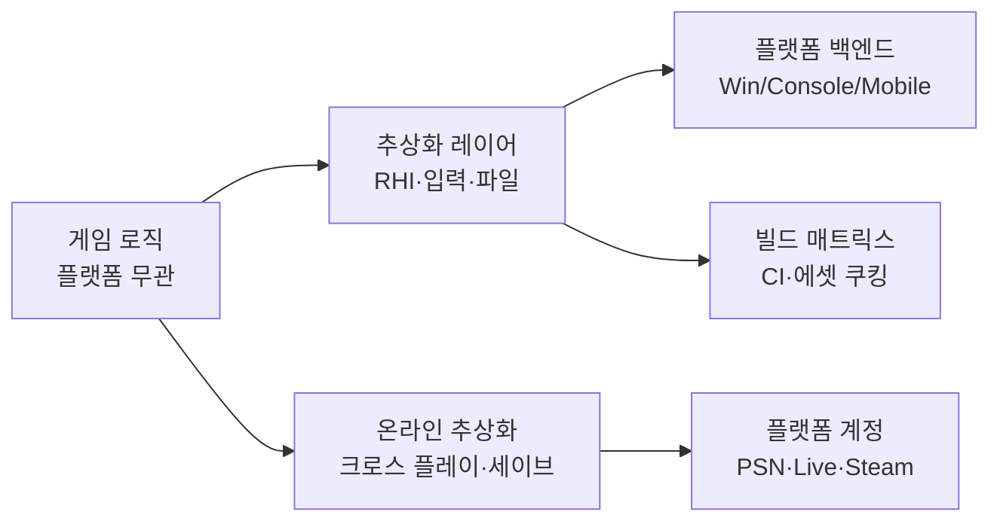
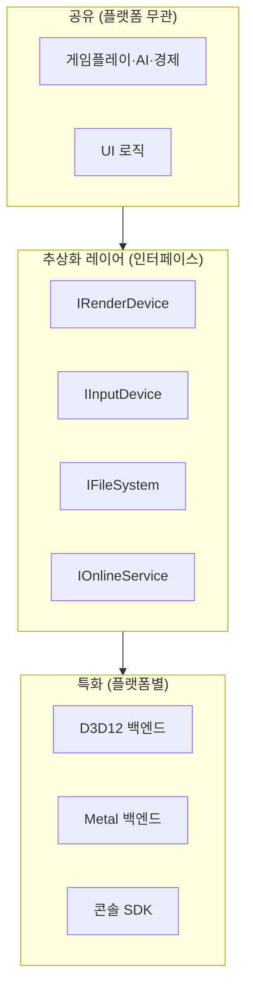
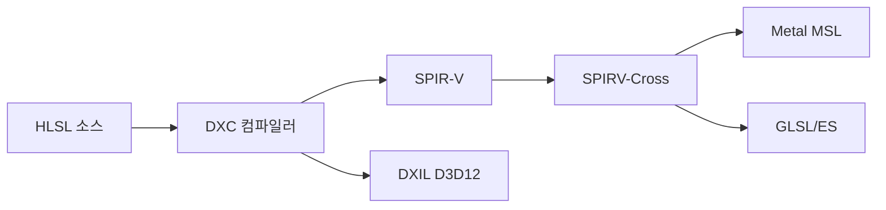
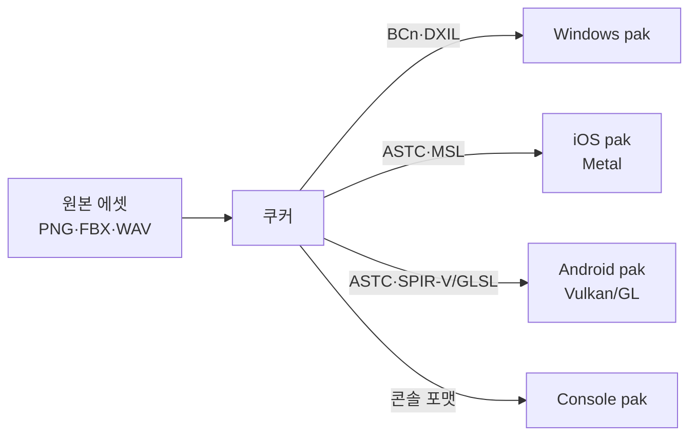
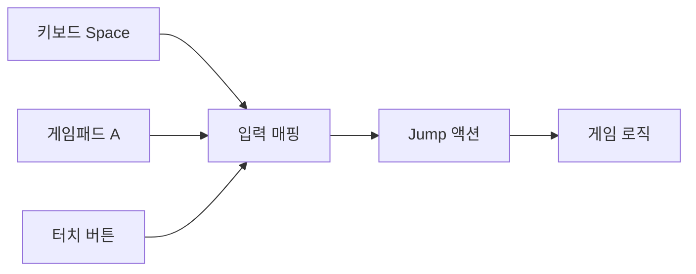
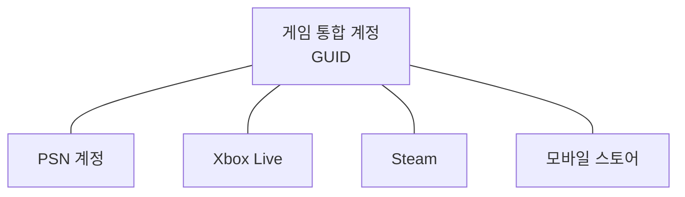
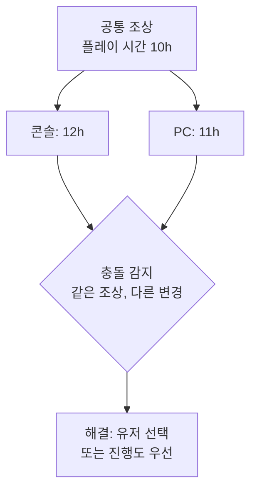
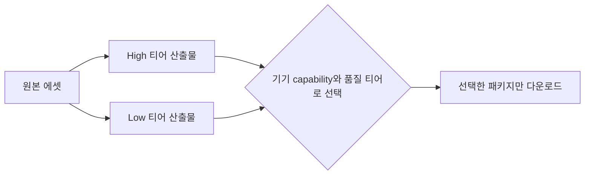
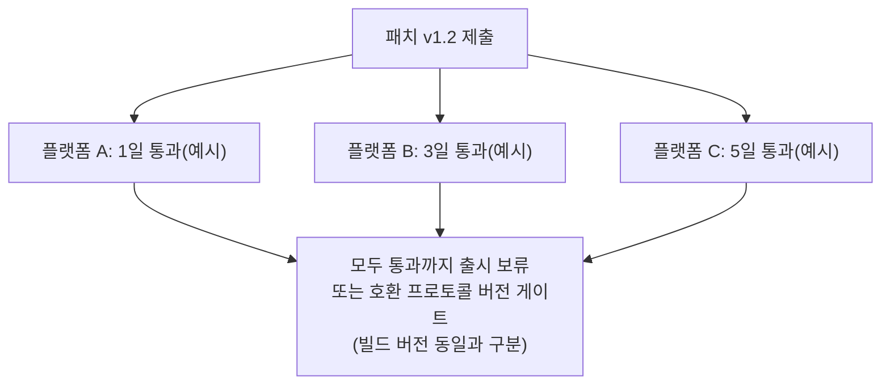

## 들어가며

크로스플랫폼 개발은 *코드 공유* 와 *플랫폼 특화* 사이의 끝없는 줄다리기다. 하나의 코드베이스로 PC·콘솔·모바일을 모두 굽는 쪽으로 기울면 개발·유지보수 비용이 줄지만 각 플랫폼의 고유한 강점(콘솔의 적응형 트리거, 모바일의 터치, PC의 고해상도)을 살리기 어렵다. 반대로 플랫폼마다 따로 최적화하면 품질은 오르지만 코드가 갈라지고 버그가 N배로 늘며 출시가 어긋난다. 그래서 크로스플랫폼 엔지니어링의 거의 모든 결정은 *공유율 ↔ 특화 깊이 ↔ 출시 일정* 의 삼각 트레이드오프 위에 놓인다.

이 글은 그 트레이드오프를 따라 크로스플랫폼 시스템을 한 흐름으로 정리한다. 코드를 어디까지 공유하고 어디서 갈라지게 둘지, 렌더링·입력·파일 같은 플랫폼 의존 표면을 어떻게 추상화 레이어 뒤로 숨길지, 빌드 매트릭스를 어떻게 굽고 CI로 자동화할지, 크로스 플레이와 크로스 세이브를 어떤 데이터 모델로 묶을지, 플랫폼 분기를 어떻게 한곳에 가두어 관리할지, 그리고 이 모두를 어떻게 측정하고 운영할지를 다룬다.



이 글의 목표.

1. **공유 대 특화의 스펙트럼** — 어디까지 공유할지, 레이어 경계 긋기.
2. **추상화 레이어** — RHI·입력·파일 추상화의 구조와 함정.
3. **빌드 매트릭스와 CI** — 멀티플랫폼 빌드 자동화, 에셋 쿠킹, 분기 격리.
4. **입력 통합** — 디바이스 추상화, 동적 아이콘, 재매핑.
5. **크로스 플레이** — 계정 통합, 통합 백엔드, 플랫폼 정책.
6. **크로스 세이브** — 클라우드 세이브, 충돌 해결, 버전 마이그레이션.
7. **플랫폼 티어와 성능 타겟팅** — 티어 시스템, 품질 변형, 메모리 버짓.
8. **운영·인증·디버깅** — TRC/인증, 패치 동기화, 크로스플랫폼 프로파일링.


---

## 목차
1. [공유 대 특화의 스펙트럼](#1-공유-대-특화의-스펙트럼)
2. [추상화 레이어 — RHI·입력·파일](#2-추상화-레이어--rhi입력파일)
3. [빌드 매트릭스와 CI](#3-빌드-매트릭스와-ci)
4. [입력 통합](#4-입력-통합)
5. [크로스 플레이](#5-크로스-플레이)
6. [크로스 세이브](#6-크로스-세이브)
7. [플랫폼 티어와 성능 타겟팅](#7-플랫폼-티어와-성능-타겟팅)
8. [운영·인증·디버깅](#8-운영인증디버깅)


---

## 1. 공유 대 특화의 스펙트럼

### 공유율은 0과 1 사이의 연속값이다

"크로스플랫폼"은 하나의 결정이 아니라 *수백 개의 작은 결정의 합* 이다. 게임 로직(전투 규칙, AI, 경제 시스템)은 플랫폼과 무관하므로 100% 공유가 자연스럽다. 반대로 입력 디바이스 드라이버나 그래픽스 API 호출은 플랫폼마다 다른 SDK를 부르므로 공유가 불가능하다. 그 사이에 거대한 회색지대가 있다 — UI 레이아웃, 저장 위치, 네트워크 계정, 성능 타겟.

핵심은 *공유 코드와 특화 코드 사이에 명확한 경계선을 긋는 것* 이다. 이 경계선이 곧 *추상화 레이어* 다. 경계 위쪽(게임 로직)은 플랫폼을 모르고, 경계 아래쪽(백엔드)은 플랫폼을 안다. 경계가 흐릿하면 `#ifdef PLATFORM_PS5` 가 게임 로직 한복판에 스며들어 코드가 갈라진다.



요점은 *공유 코드는 추상 인터페이스만 보고, 구체 구현은 빌드 타임에 주입* 된다는 것이다. 게임 로직은 `ICommandList::Draw` 를 부를 뿐 그 뒤가 D3D12인지 Metal인지 모른다.

### Lead Platform과 포팅 순서

여러 플랫폼을 동시에 개발해도, 보통 하나를 *Lead Platform(주 개발 플랫폼)* 으로 정한다. 일상 개발·디버깅이 가장 빠른 플랫폼(대개 PC/Windows — 강력한 툴, 빠른 반복)을 Lead로 두고, 거기서 기능을 먼저 완성한 뒤 다른 플랫폼으로 *포팅* 한다.

Lead Platform 선택은 트레이드오프다. Lead가 *가장 제약이 느슨한* 플랫폼이면(PC) 개발은 빠르지만, 나중에 *가장 제약이 빡빡한* 플랫폼(모바일·구형 콘솔)으로 포팅할 때 메모리·성능 초과가 한꺼번에 터진다. 그래서 실무는 *제약이 빡빡한 플랫폼을 일찍, 자주* 빌드해 본다 — 매주 모든 플랫폼을 빌드하는 CI(3절)가 이 "포팅 부채"를 조기에 드러낸다.

| 전략 | 장점 | 함정 |
|---|---|---|
| PC를 Lead, 나중에 콘솔 포팅 | 빠른 반복, 강력한 툴 | 막판 메모리·성능 초과 폭발 |
| 가장 빡빡한 플랫폼을 Lead | 제약을 처음부터 강제 | 일상 개발 느림 |
| 모든 플랫폼 매주 빌드 | 부채 조기 노출 | CI 비용·시간 증가 |

### Day-and-Date 대 순차 출시

모든 플랫폼을 같은 날 출시(*Day-and-Date*)하면 마케팅이 한 번에 집중되지만, 모든 플랫폼이 동시에 인증을 통과해야 해 *가장 느린 플랫폼이 전체 일정* 을 잡는다. 순차 출시는 한 플랫폼씩 완성도를 높여 내보내지만, 후순위 플랫폼 유저의 불만과 *버전 파편화* (8절)를 부른다.

이 선택은 코드 구조에 직접 영향을 준다. Day-and-Date를 노리면 *모든 플랫폼이 항상 빌드 가능* 해야 하므로 추상화 레이어와 CI를 처음부터 갖춰야 한다. 순차 출시는 한 플랫폼을 끝낸 뒤 다음을 시작해도 되지만, 그러면 공유 경계가 무너진 채 진행되기 쉽다.

### Monorepo와 코드 공유 단위

코드베이스를 *하나의 저장소(monorepo)* 에 두면 공유 코드와 플랫폼 코드가 한 트리에서 함께 빌드되어 *원자적 커밋* 이 가능하다 — 인터페이스를 바꾸면 모든 백엔드를 같은 커밋에서 고친다. 멀티레포는 플랫폼 팀의 독립성을 주지만, 공유 인터페이스 변경이 *여러 저장소에 걸친 동기화* 문제가 된다. 크로스플랫폼 게임은 공유 코드 비중이 높아 monorepo가 일반적이다.

## 2. 추상화 레이어 — RHI·입력·파일

### 추상화의 기본 형태

플랫폼 의존 표면을 숨기는 방법은 *인터페이스 + 플랫폼별 구현* 이다. 게임 코드는 추상 인터페이스에만 의존하고, 빌드 타임에 해당 플랫폼 구현이 링크된다.

```cpp
// 공유 코드가 보는 인터페이스 (플랫폼 무관)
class IFileSystem {
public:
    virtual ~IFileSystem() = default;
    virtual File* Open(const char* path, FileMode mode) = 0;
    virtual bool  Exists(const char* path) = 0;
    virtual std::string SaveDir() = 0;   // 플랫폼마다 다른 세이브 위치
};

// 플랫폼별 구현은 각자의 .cpp 에만 존재
IFileSystem* CreateFileSystem();   // 빌드 타임에 한 구현만 링크
```

`SaveDir` 하나만 봐도 추상화의 가치가 드러난다. Windows는 `%APPDATA%`, 콘솔은 *유저별 저장 컨테이너 API*, 모바일은 *샌드박스 경로* 를 쓴다. 게임 로직은 `fs->SaveDir` 만 부르고 이 차이를 전혀 모른다. 분기는 `CreateFileSystem` 한 군데에만 산다.

### RHI — 렌더링 추상화

가장 크고 어려운 추상화가 *RHI(Rendering Hardware Interface)* 다. D3D12, Vulkan, Metal은 개념은 비슷하지만 API 형태·리소스 모델·동기화 규칙이 다르다. RHI는 이 공통분모를 인터페이스로 뽑는다.

```cpp
class IRenderDevice {
public:
    virtual BufferHandle  CreateBuffer(const BufferDesc&) = 0;
    virtual TextureHandle CreateTexture(const TextureDesc&) = 0;
    virtual PipelineHandle CreatePipeline(const PipelineDesc&) = 0;
    virtual ICommandList* BeginCommandList() = 0;
    virtual void Submit(ICommandList*) = 0;
    virtual void Present() = 0;
};
// 백엔드: D3D12Device, VulkanDevice, MetalDevice 가 각각 구현
```

RHI 설계의 난점은 *추상화 수준* 이다. 너무 높으면(OpenGL 1.x 스타일) 최신 API의 명시적 제어(파이프라인 상태 객체, 디스크립터, 명시적 동기화)를 못 살린다. 너무 낮으면(각 API를 그대로 노출) 추상화가 아니라 세 API의 합집합이 되어 공유가 깨진다. 현대 RHI는 *명시적 API(D3D12/Vulkan/Metal)의 공통 모델* 을 기준으로 잡고, 구형 OpenGL은 백엔드 안에서 에뮬레이션한다.

### 셰이더 크로스 컴파일

RHI에서 따라오는 문제가 *셰이더* 다. 각 API는 다른 셰이더 언어를 쓴다 — HLSL(D3D), 바이트코드(SPIR-V, Vulkan), MSL(Metal). 셰이더를 세 번 작성할 수는 없으므로, *하나의 소스에서 모든 타깃을 생성* 한다.



흔한 파이프라인은 HLSL을 하나의 소스로 쓰고, DXC로 SPIR-V를 만든 뒤 SPIRV-Cross로 MSL·GLSL로 역변환하는 것이다. 이 변환은 빌드 타임에 *에셋 쿠킹*(3절)의 일부로 돈다. 함정은 *변환이 완벽하지 않다* 는 것 — 특정 내장 함수나 정밀도 규칙이 플랫폼마다 미묘하게 달라, 셰이더는 *모든 타깃에서 실제로 테스트* 해야 한다.

### 기능 감지와 Fallback

플랫폼마다 지원 기능이 다르다 — 레이트레이싱, 메시 셰이더, 특정 텍스처 포맷. 추상화 레이어는 *기능 질의(capability query)* 를 제공하고, 게임은 *있으면 쓰고 없으면 대체* 한다.

```cpp
if (device->Supports(Feature::RayTracing)) {
    RenderReflectionsRT();
} else {
    RenderReflectionsScreenSpace();   // Fallback: SSR
}
```

이 패턴의 핵심은 *Fallback이 진짜로 동작* 해야 한다는 것이다. "최고 사양에만 켜는 기능"의 Fallback 경로는 *테스트가 소홀해지기 쉽고*, 정작 저사양 플랫폼에서 깨진 채 출시된다. 그래서 Fallback 경로도 CI에서 강제로 빌드·실행한다.

### 추상화의 비용

추상화는 공짜가 아니다. 가상 함수 호출, 핸들 간접 참조, 공통분모로 인한 기능 손실이 따른다. 그래서 *호출 빈도가 높은 경로* 는 추상화를 얇게 유지한다 — 드로우 콜은 커맨드 리스트에 *배치(batch)* 로 기록해 가상 호출 횟수를 줄이고, 핫 루프는 백엔드 안에서 직접 처리한다. 추상화 경계는 *프레임당 수천 번이 아니라 수십 번* 넘는 지점에 긋는 것이 좋다.

## 3. 빌드 매트릭스와 CI

### 빌드 매트릭스

크로스플랫폼 프로젝트의 빌드는 *플랫폼 × 구성(config)* 의 곱이다. 플랫폼(Win/PS/Xbox/Switch/iOS/Android) × 구성(Debug/Development/Shipping)만 해도 수십 개 빌드가 된다. 이 *빌드 매트릭스* 를 사람이 손으로 굽는 것은 불가능하므로 CI가 자동화한다.

| 플랫폼 | 빌드 호스트 | 컴파일러/툴체인 | 산출물 |
|---|---|---|---|
| Windows | Windows 러너 | MSVC | exe + pak |
| 콘솔 A | 전용 빌드 머신 | 콘솔 SDK 툴체인 | 콘솔 패키지 |
| 콘솔 B | 전용 빌드 머신 | 콘솔 SDK 툴체인 | 콘솔 패키지 |
| iOS | macOS 러너 | Xcode/clang | ipa |
| Android | Linux/Win 러너 | NDK clang | apk/aab |

콘솔 SDK는 *NDA로 비공개* 이고 클라우드 CI에 못 올리는 경우가 많아, 콘솔 빌드는 *온프레미스 전용 빌드 머신* 에서 돈다. 그래서 CI는 보통 *하이브리드* 다 — 공개 가능한 플랫폼은 클라우드(GitHub Actions 등), 콘솔은 사내 머신(Jenkins/TeamCity 셀프 호스티드 러너).

### 에셋 쿠킹

코드만 빌드가 다른 게 아니다. *에셋도 플랫폼별로 변환* 해야 한다 — 텍스처를 플랫폼 네이티브 압축 포맷(BCn/ASTC/PVRTC)으로, 셰이더를 타깃 바이트코드로(2절), 오디오를 플랫폼 디코더 포맷으로. 이 과정이 *에셋 쿠킹(cooking)* 이다.



그림의 Mobile은 iOS(Metal)과 Android(Vulkan/GL)로 target이 갈린다 — ASTC·MSL은 모든 모바일 backend의 공통 산출물이 아니므로, 쿠킹 캐시 키에는 target·format·compiler options를 포함한다.

쿠킹은 느리고(텍스처 압축은 CPU 집약) *변경된 에셋만 다시 굽는 증분(incremental)* 캐시가 필수다. CI는 쿠킹 결과를 *공유 캐시(예: 분산 빌드 캐시)* 에 저장해, 같은 에셋을 여러 플랫폼·여러 빌드가 재사용하게 한다. 쿠킹 캐시가 없으면 매 빌드가 수 시간으로 늘어난다.

### 분기 격리 — 플랫폼 코드를 한곳에 가두기

플랫폼 분기를 관리하는 가장 중요한 원칙은 *`#ifdef` 를 게임 로직에 흩뿌리지 않는 것* 이다. 분기는 *추상화 레이어 구현 파일* 안에만 가둔다. 두 가지 패턴이 있다.

```cpp
// 나쁨: 게임 로직에 플랫폼 분기가 스며듦
void ShowStorePage() {
#if defined(PLATFORM_PS)
    PSN::OpenStore(productId);
#elif defined(PLATFORM_XBOX)
    XboxLive::OpenStore(productId);
#endif
}

// 좋음: 인터페이스 뒤로 숨김, 게임 로직은 분기를 모름
void ShowStorePage() {
    platform->Store()->OpenProduct(productId);
}
```

또 하나의 패턴은 *파일 단위 분기* 다. 같은 함수의 플랫폼별 구현을 `_win.cpp`, `_ps.cpp` 처럼 별도 파일에 두고, *빌드 시스템이 해당 플랫폼 파일만 컴파일* 한다. `#ifdef` 가 아예 사라져 각 파일이 깨끗해지고, 비공개 콘솔 코드를 *접근 권한 있는 빌드에서만* 포함할 수 있다.

```text
src/platform/
  filesystem.h          # 인터페이스 (공유)
  filesystem_win.cpp    # Windows 빌드만 컴파일
  filesystem_ps.cpp     # 콘솔 빌드만 컴파일 (NDA, 권한 분리)
  filesystem_mobile.cpp # 모바일 빌드만 컴파일
```

### 빌드 넘버링과 버전 관리

크로스플랫폼에서 *버전 불일치* 는 크로스 플레이를 깨뜨린다(5절) — 호환되지 않는 프로토콜·콘텐츠 버전은 같이 매칭되면 안 된다. 그래서 모든 플랫폼 빌드가 *같은 소스 커밋에서 같은 빌드 넘버* 를 받게 하되, 네트워크 핸드셰이크에는 *빌드 식별자(build ID)* 와 *프로토콜·콘텐츠 호환 ID* 를 별도로 둔다. CI는 커밋 해시 + 빌드 카운터를 빌드 ID에 박고, 런타임에는 호환 ID로 매칭 가능 여부를 판단한다 — 빌드가 달라도 호환 ID가 같으면 같은 세션에 넣을 수 있고, 반대로 빌드가 같아도 콘텐츠 의미가 바뀌면 호환 ID를 올려 매칭을 막는다.

### 자동 테스트

크로스플랫폼 CI는 *빌드 성공* 만 검증해선 부족하다. 빌드된 게임을 실제로 *부팅·스모크 테스트* 해 봐야 한다 — 첫 화면 진입, 5분 자동 플레이, 크래시 없음. 콘솔·모바일은 *실기(devkit/디바이스 팜)* 에서 돌려야 하므로 CI에 디바이스를 연결한다. 회귀 테스트는 *결정론적 시뮬레이션* (같은 입력 → 같은 결과)으로 플랫폼 간 동작 일치를 검증한다 — 이 검증이 필수인 것은 결정론적 락스텝·동일 시뮬레이션 기반 동기화이며, 부동소수점 차이로 플랫폼마다 결과가 갈리면 세션이 어긋난다. 서버 권한 상태 복제는 클라이언트 물리의 bitwise 일치를 요구하지 않으므로, 동기화 방식에 맞춰 검증 범위를 정한다.

## 4. 입력 통합

### 디바이스 추상화

입력은 플랫폼마다 디바이스가 다르다 — PC는 키보드·마우스·게임패드, 콘솔은 전용 컨트롤러, 모바일은 터치·자이로. 게임 로직은 *물리 디바이스가 아니라 추상 액션* 만 알아야 한다. "Space 키"가 아니라 *"점프 액션"* 을 본다.

```cpp
// 게임 로직: 물리 입력이 아니라 액션을 본다
enum class Action { Jump, Fire, MoveX, MoveY, Interact };

class IInputContext {
public:
    virtual bool  Pressed(Action a) = 0;       // 디지털
    virtual float Axis(Action a) = 0;          // 아날로그 (-1~1)
};
```

각 플랫폼 백엔드는 *물리 입력 → 액션* 매핑을 제공한다. 키보드 백엔드는 Space→Jump, 게임패드 백엔드는 A버튼→Jump, 터치 백엔드는 화면 버튼→Jump로 매핑한다. 게임 로직은 이 매핑을 전혀 모른다.



### 동적 UI 아이콘

입력 추상화의 가시적 결과가 *동적 아이콘* 이다. 같은 "Interact" 액션이라도 키보드 유저에겐 "E", 콘솔 유저에겐 해당 버튼 글리프, 모바일 유저에겐 터치 아이콘으로 *현재 활성 디바이스에 맞춰* 표시해야 한다. PC에서 게임패드를 연결하면 *즉시 글리프가 바뀌어야* 한다.

```cpp
// 마지막으로 사용된 디바이스를 추적해 아이콘 세트 전환
Glyph IconFor(Action a) {
    DeviceType active = input->LastUsedDevice();
    return glyphTable[active][input->BindingFor(a)];
}
```

함정은 *디바이스 전환 감지* 다. 유저가 키보드를 치다가 게임패드 스틱을 살짝 건드리면 글리프가 깜빡인다. 그래서 *작은 입력은 무시하고 의미 있는 입력에서만* 활성 디바이스를 바꾸는 디바운스가 필요하다.

### 플랫폼 특수 입력

추상화의 반대편엔 *플랫폼 고유 입력* 이 있다 — 콘솔 컨트롤러의 적응형 트리거·햅틱, 모바일의 모션 센서, 진동. 이건 공통분모에 없으므로 *선택적 확장* 으로 다룬다. 게임은 *있으면 쓰고 없으면 무시* 한다(2절의 기능 감지와 같은 패턴).

```cpp
// 햅틱은 선택적 — 미지원 플랫폼은 Null 구현
input->Haptic()->Play(triggerEffect);   // 항상 호출 — 미지원 플랫폼은 Null 구현이 무시
// Null 구현: 아무것도 안 함 (분기 없이 안전)
```

여기서 *Null Object 패턴* 이 유용하다. 미지원 플랫폼의 `Haptic` 이 nullptr 대신 *아무 일도 안 하는 Null 객체* 를 반환하면, 호출 측이 매번 null 체크할 필요가 없어진다. 분기가 사라지고 코드가 깨끗해진다.

### 재매핑과 접근성

현대 게임은 *키 재매핑* 과 *접근성 옵션* 을 요구한다 — 플랫폼 홀더 인증(8절)이 요구하기도 한다. 액션 기반 추상화가 이걸 자연스럽게 만든다. 재매핑은 *액션→물리 입력 바인딩 테이블만 교체* 하면 되고, 게임 로직은 그대로다. 접근성(홀드를 토글로, 동시 입력을 순차로)도 *매핑 레이어에서* 처리해 게임 로직을 건드리지 않는다.

## 5. 크로스 플레이

### 크로스 플레이의 세 층위

서로 다른 플랫폼의 유저가 함께 플레이하는 *크로스 플레이* 는 세 층위로 나뉜다. 이걸 분리해서 보는 게 설계의 출발점이다.

| 층위 | 의미 | 난이도 |
|---|---|---|
| 크로스 플레이 | 다른 플랫폼끼리 같은 세션 | 매칭·프로토콜 통일 |
| 크로스 프로그레션 | 진행도가 플랫폼 간 이동 (6절) | 계정 연동·세이브 머지 |
| 크로스 매칭 | 통합 매치메이킹 풀 | 백엔드 통합 |

크로스 플레이의 전제는 *모든 플랫폼이 호환되는 게임플레이 프로토콜·콘텐츠 버전* 을 쓰는 것이다 — 같은 빌드 버전(3절)을 강제할 수도 있고, 프로토콜·콘텐츠 호환 ID(3절)가 같으면 다른 빌드도 매칭할 수 있다. 같은 결정론적 시뮬레이션이 필요한 것은 락스텝·동일 시뮬레이션 동기화를 쓰는 경우이며, 서버 권한 상태 복제는 플랫폼별 부동소수점 결과가 갈려도 된다. 호환되는 프로토콜·콘텐츠 버전이 어긋나면 같은 세션에 넣을 수 없다.

### 계정 통합

각 플랫폼은 자체 계정 시스템을 갖는다 — PSN, Xbox Live, Steam, 모바일 스토어 계정. 크로스 플레이를 하려면 이 위에 *게임 자체의 통합 계정* 을 두고, 플랫폼 계정을 거기에 *연결(link)* 한다.



런타임 흐름은 *플랫폼 로그인 → 플랫폼 토큰 획득 → 백엔드에 토큰 제출 → 통합 계정 세션 발급* 이다. 백엔드는 각 플랫폼의 인증 토큰을 *해당 플랫폼 서버에 검증* 한 뒤 통합 계정에 매핑한다. 이 매핑이 크로스 프로그레션(6절)의 토대다.

```cpp
// 플랫폼 인증을 통합 계정으로 교환
auto platformToken = platform->Auth()->GetToken();   // 플랫폼별
auto session = backend->Login(platformToken);        // 통합 세션
// 이후 모든 온라인 호출은 통합 session 사용 (플랫폼 무관)
```

### 통합 백엔드

크로스 플레이는 *모든 플랫폼이 같은 백엔드* 를 봐야 성립한다. 매치메이킹·리더보드·인벤토리가 플랫폼별로 갈라져 있으면 통합이 불가능하다. 그래서 게임 서버는 *플랫폼 무관한 자체 백엔드* (커스텀 또는 PlayFab/Firebase 같은 BaaS)를 두고, 플랫폼 서비스(트로피·도전과제)는 *그 위에 미러링* 한다.

리더보드를 예로 들면, *진실의 원천(source of truth)은 통합 백엔드* 에 두고, 각 플랫폼의 네이티브 도전과제·트로피는 백엔드 이벤트가 트리거할 때 *플랫폼 API로 동기화* 한다. 유저는 통합 순위표를 보지만, 콘솔 유저의 트로피도 정상적으로 찍힌다.

### 플랫폼 정책 제약

크로스 플레이는 *기술 문제이자 정책 문제* 다. 플랫폼 홀더마다 크로스 플레이에 대한 *인증 요구사항* 이 있다 — 크로스 플레이를 끌 수 있는 옵션, 부적절 유저 신고·차단, 보이스 채팅 제한, 미성년자 보호. 또 *교차 결제* (한 플랫폼에서 산 콘텐츠를 다른 플랫폼에서 쓰기)는 각 스토어 정책에 묶인다.

설계 시 이 정책들을 *추상화 레이어 위쪽이 아니라 정책 레이어로 분리* 한다. "이 플랫폼에서 크로스 플레이가 허용되는가", "이 유저가 크로스 플레이를 켰는가" 를 *런타임 플래그* 로 두고, 매칭 단계에서 검사한다. 정책은 *플랫폼별·지역별로 바뀌므로* 하드코딩하지 않고 서버 설정으로 내린다.

## 6. 크로스 세이브

### 진실의 원천을 어디 둘까

*크로스 세이브* 는 한 플랫폼에서 저장한 진행도를 다른 플랫폼에서 이어 하는 것이다. 핵심 질문은 *진실의 원천을 어디 두는가* 다. 두 모델이 있다.

| 모델 | 진실의 원천 | 특성 |
|---|---|---|
| 클라우드 우선 | 게임 백엔드 (클라우드) | 항상 동기화, 오프라인 약함 |
| 로컬 우선 + 동기화 | 로컬, 주기적 업로드 | 오프라인 강함, 충돌 가능 |

크로스 세이브는 *통합 계정* (5절)에 세이브를 묶는다 — 플랫폼별 저장 위치(`SaveDir`, 2절)에 로컬 사본을 두되, *진실의 원천은 통합 계정의 클라우드 세이브* 다. 유저가 플랫폼을 바꾸면 클라우드에서 내려받아 이어 한다.

### 충돌 해결

크로스 세이브의 어려움은 전부 *충돌(conflict)* 에 있다. 유저가 콘솔에서 오프라인으로 플레이하고, 동시에 PC에서도 플레이한 뒤 둘 다 동기화하면 *두 개의 갈라진 세이브* 가 생긴다. 어느 쪽을 살릴 것인가.



자동 해결은 위험하다 — "최신 타임스탬프 우선"은 시계가 어긋나면 진행도를 날린다. 그래서 실무는 *충돌을 감지하면 유저에게 선택지를 보여준다* — "콘솔 세이브(12시간) vs PC 세이브(11시간), 어느 쪽을 쓰시겠습니까". 플레이 시간이나 레벨이 더 높아도 다른 쪽에만 있는 구매·선택·진행을 잃을 수 있으므로, 자동 해결은 데이터별 병합 규칙과 사용자 동의를 검토해야 한다. 선택하지 않은 쪽도 백업으로 남겨 복구 가능하게 한다.

### 세이브 포맷과 마이그레이션

크로스 세이브는 *모든 플랫폼이 같은 세이브 포맷* 을 읽어야 한다. 그래서 세이브는 *플랫폼 중립적 직렬화* (엔디언·정렬 무관, 명시적 버전 헤더)로 쓴다. 게임이 업데이트되면 세이브 스키마가 바뀌므로 *버전 마이그레이션* 이 필수다. 다만 읽는 방향에 따라 보장이 다르다 — migration은 *옛 세이브를 새 앱이 읽는 backward 방향* 만 만들고, *새 세이브를 옛 앱이 읽는 forward 방향* 은 만들지 않는다.

| 상황 | backward migration만으로 처리 가능한가 |
|---|---|
| v3 앱이 v2 세이브를 읽음 | v2→v3 migration이 있으면 가능 |
| 아직 v2인 앱이 v3 세이브를 읽음 | 보장되지 않음 — 공통 write schema나 별도 forward reader 필요 |
| 양 플랫폼의 업데이트 시점이 다름 | 호환 저장 버전 유지, forward-compatible 형식, 구버전 다운로드 차단·업데이트 안내 등 정책 필요 |

```cpp
struct SaveHeader {
    uint32_t magic;       // 포맷 식별
    uint32_t version;     // 스키마 버전 (writer schema)
    uint32_t crc;         // 무결성 (아래)
};

// reader가 받아들이는 version 범위는 kMinReadableVersion ~ kCurrentVersion.
SaveData Load(Reader& r) {
    auto h = r.ReadHeader();
    if (h.magic != kSaveMagic) throw CorruptSave();
    if (h.version < kMinReadableVersion || h.version > kCurrentVersion)
        throw UnsupportedSaveVersion(h.version);   // 미래 version은 ReadBody 전에 거부
    SaveData d = ReadBody(r, h.version);           // 길이·version gate는 helper 계약
    while (d.version < kCurrentVersion) {
        d = Migrate(d);    // v1→v2→v3 순차 변환
        // postcondition: 성공한 Migrate는 version을 정확히 다음 지원 버전으로 증가시킨다
    }
    return d;
}
```

마이그레이션은 *순차적* 으로 쌓는다 — v1→v2, v2→v3 변환을 각각 두면 어떤 옛 버전이든 현재로 올릴 수 있다. 하지만 크로스플랫폼에선 *플랫폼마다 업데이트 시점이 다르므로*(스토어 심사 속도 차이), 새 버전이 *옛 버전 세이브를 읽는 것만으로는* 충분하지 않다 — 먼저 업데이트된 앱이 v3로 저장하면 아직 v2인 플랫폼은 그 세이브를 읽지 못한다. 그래서 업데이트를 원자적으로 동기화하거나, 양쪽이 함께 쓰는 *공통 하위 write schema* 를 유지하거나, 구버전의 다운로드·덮어쓰기를 차단하고 업데이트를 안내하는 운영 정책을 둔다.

### 무결성과 손상 복구

세이브 손상은 유저 신뢰를 직접 깨므로 *무결성 검사* 와 *복구* 를 둔다. 헤더의 CRC/해시로 손상을 감지하고, *다중 슬롯(백업 회전)* 으로 직전 정상 세이브를 보존한다. 클라우드 세이브가 있으면 *마지막 정상 클라우드 사본* 이 최후의 안전망이다.

```cpp
SaveData LoadWithRecovery() {
    // TryLoad: 길이·magic·지원 version 범위·정규 직렬화 payload의 CRC를 하나의 규약으로 검사한다.
    // Crc는 crc 필드와 메모리 padding을 제외한 canonical payload 기준이다(helper가 담당).
    if (auto d = TryLoad("save.dat"); d && d->crc == Crc(*d)) return *d;
    if (auto d = TryLoad("save.bak"); d && d->crc == Crc(*d)) return *d;  // 백업
    return DownloadCloudSave();   // 최후: 클라우드 — 같은 검증 기준을 통과한 사본만 쓴다
}
```

저장 자체도 *원자적* 이어야 한다 — `임시 파일 쓰기 → 검증 → durable replace/commit → 성공 반환 → cleanup` 순으로, 교체 helper의 실패 반환·예외를 성공 반환에 반영하고 indicator는 정상·실패·예외 모든 경로에서 RAII로 정리한다. atomic visibility(교체가 한 번에 보임)와 전원 차단 후 durability(파일/디렉터리 또는 플랫폼 SDK의 commit 완료)는 다른 조건이므로 따로 확인한다. 모바일은 앱이 백그라운드로 갈 때 *강제 종료* 될 수 있어 이 원자성이 특히 중요하다.

## 7. 플랫폼 티어와 성능 타겟팅

### 최소 공통분모의 함정

가장 단순한 크로스플랫폼 성능 전략은 *최소 공통분모(LCD)* — 가장 약한 플랫폼에 맞춰 모든 플랫폼을 똑같이 만드는 것이다. 구현은 쉽지만 *강한 플랫폼의 자원이 낭비* 된다. 고사양 PC가 저사양 모바일과 똑같은 그래픽을 돌리면 유저는 실망한다. 그래서 LCD는 *기능의 하한선* 으로만 쓰고, 품질은 플랫폼별로 *위로 확장* 한다.

### 티어 시스템

플랫폼·기기를 *티어(Low/Medium/High/Ultra)* 로 분류하고, 티어마다 품질 설정 묶음을 둔다. 같은 게임이 티어에 따라 해상도·텍스처·그림자·이펙트 밀도를 다르게 켠다.

```cpp
struct QualityTier {
    int   renderScale;       // 50~100%
    int   textureMip;        // 최상위 밉 스킵 수 (메모리 절감)
    int   shadowResolution;
    bool  rayTracing;
    int   maxParticles;
};
QualityTier TierFor(DeviceProfile p);   // 기기 → 티어 매핑
```

핵심은 *티어를 코드가 아니라 데이터로* 두는 것이다. 새 기기가 나오면 코드 수정 없이 *기기→티어 매핑 테이블만 갱신* 한다. 모바일은 기종이 수천 가지라 이 테이블 운영이 특히 중요하다 — *런타임 벤치마크* 로 첫 실행 시 티어를 자동 추정하고, 유저가 수동 조정할 수 있게 한다.

### 에셋 변형

티어 시스템은 *에셋 변형(variant)* 으로 이어진다. 같은 텍스처를 티어별 해상도로 굽고(쿠킹, 3절), 기기는 *자기 티어에 맞는 변형만 다운로드* 한다. 고해상도 텍스처를 저사양 기기가 받지 않게 해 *다운로드 크기와 메모리를 동시에* 아낀다.



### 메모리 버짓

플랫폼마다 *가용 메모리가 고정* 되어 있고(콘솔은 특히 엄격), 이걸 시스템별로 *버짓 분배* 한다 — 렌더링 N MB, 오디오 M MB, 게임플레이 K MB. 크로스플랫폼에선 이 버짓이 *티어별로 다른 표* 가 된다. 버짓은 soft(초과 시 해당 시스템이 품질을 낮추는 목표치)와 hard(할당 실패·OOM으로 이어지는 한계)를 구분한다. *런타임 버짓 추적* 으로 각 시스템이 soft 한도를 넘는지 감시하고, 넘으면 *해당 시스템이 스스로 품질을 낮춘다*(텍스처 밉 강등, 보이스 수 축소). hard 한계 초과는 콘솔에서 OOM·크래시로 이어질 수 있다.

### 크로스플랫폼 프로파일 비교

성능 회귀를 잡으려면 *같은 장면을 모든 플랫폼에서 측정* 해 비교해야 한다. 자동화된 *벤치마크 장면* 을 CI(3절)가 각 플랫폼 실기에서 돌려 프레임타임·메모리·로딩 시간을 수집하고, *플랫폼 간·빌드 간 추세* 를 추적한다. 한 플랫폼만 갑자기 느려지면 우선 *그 플랫폼 백엔드의 회귀* 를 의심하되, 공유 코드의 캐시 접근·vectorization·ISA/컴파일러 분기가 특정 플랫폼만 악화시킬 수 있으므로 trace로 확인한다.

## 8. 운영·인증·디버깅

### 플랫폼 인증

콘솔·모바일 스토어는 *출시 전 인증(certification)* 을 요구한다 — 콘솔은 TRC/TCR 같은 *기술 요구사항 체크리스트*, 스토어는 심사 정책. 이 체크리스트는 수백 항목이다 — 저장 중 전원 차단 처리, 컨트롤러 분리 처리, 적절한 로딩 표시, 연령 등급, 개인정보 처리. 인증 실패는 *재제출* 을 부르고 일정을 며칠~몇 주 미룬다.

크로스플랫폼에선 인증이 *플랫폼마다 다른 체크리스트* 라, 동시 출시(1절)를 노리면 *가장 까다로운 인증* 이 전체를 잡는다. 그래서 인증 요구사항을 *개발 초기부터 추상화 레이어에 반영* 한다 — "저장 중 전원 차단 안전"(6절의 원자적 저장)은 한 플랫폼 요구지만 모든 플랫폼에 적용하면 막판 수정이 사라진다.

### 동시 심사와 패치 동기화

여러 플랫폼에 *동시 심사(simultaneous submission)* 를 넣으면 같은 날 패치를 내보낼 수 있다. 하지만 *심사 속도가 플랫폼마다 다르므로*, 한 플랫폼이 며칠 빨리 통과하면 *버전 파편화* 가 생긴다 — 크로스 플레이(5절)에서 버전이 다른 유저가 섞일 수 없다.



대응은 두 가지다. *모든 플랫폼 통과까지 출시를 보류* 하거나(동시 출시 유지), *프로토콜 호환* 을 유지해 구버전·신버전이 같이 매칭되게 한다. 후자는 *프로토콜 버저닝* (필드 추가는 호환, 의미 변경은 비호환)을 요구한다 — 게임플레이에 영향 없는 변경은 호환 버전으로, 비호환 변경은 *강제 업데이트 게이트* 로 막는다.

### 플랫폼별 버그 태깅

크로스플랫폼 QA는 버그를 *플랫폼으로 태깅* 한다. "이 버그가 모든 플랫폼인가, 특정 플랫폼인가" 가 곧 *공유 코드 버그인가 백엔드 버그인가* 를 가른다. 모든 플랫폼에서 재현되면 공유 로직을, 한 플랫폼에서만 재현되면 그 플랫폼 백엔드(2절)나 드라이버 차이를 우선 의심하되, 공유 코드의 분기가 플랫폼별로 다르게 최적화될 수 있으므로 trace로 확인한다. 버그 트래커에 플랫폼·티어·빌드 버전 필드를 두고, *플랫폼별 재현율* 을 집계해 우선순위를 정한다.

### 크로스플랫폼 디버깅의 어려움

플랫폼별 버그는 *재현 환경이 그 플랫폼에만* 있어 디버깅이 어렵다. 콘솔 전용 크래시는 Lead Platform(PC)에서 재현되지 않는다. 그래서 *결정론적 리플레이* (입력 로그로 재생)와 *원격 로깅* 이 중요하다 — 디바이스에서 발생한 크래시의 *덤프·로그·입력 트레이스* 를 수집해 분석한다. 추상화 레이어가 잘 그어져 있으면, "이 버그가 인터페이스 위(공유)인가 아래(백엔드)인가" 를 *인터페이스 경계에서 로깅* 해 빠르게 좁힐 수 있다.

### DLC와 콘텐츠 배포

출시 후 *DLC·확장 콘텐츠* 도 플랫폼마다 다른 스토어·결제·다운로드 시스템을 거친다. 이것도 추상화한다 — 게임 로직은 *"콘텐츠 X 소유 여부"* 만 묻고, 각 플랫폼 백엔드가 해당 스토어에 *소유권을 질의* 한다. 크로스 프로그레션(6절)과 묶이면 *한 플랫폼에서 산 DLC를 다른 플랫폼에서 인식* 하는 *교차 권리(entitlement)* 가 필요한데, 이건 통합 계정(5절)에 권리를 묶어야 가능하고 플랫폼 정책의 허용 범위에 달려 있다.


---

## 결론

크로스플랫폼 개발의 모든 결정은 *공유율 ↔ 특화 깊이 ↔ 출시 일정* 의 삼각 트레이드오프 위에 놓인다. 어디까지 공유하고 어디서 갈라지게 둘지(레이어 경계), RHI·입력·파일을 어떤 추상화로 숨길지, 빌드 매트릭스를 어떻게 자동화할지, 크로스 플레이·세이브를 어떤 데이터 모델로 묶을지 — 모두 이 삼각형 위에서 어디에 무게를 둘지의 선택이다.

이 트레이드오프를 다루는 기반 구조는 일관된다. *명확한 추상화 경계* 가 공유 코드를 플랫폼으로부터 격리하고, 플랫폼 분기를 인터페이스 구현 파일 안에 가둔다. *통합 계정과 통합 백엔드* 가 크로스 플레이·프로그레션의 토대가 되고, *버전 통일과 프로토콜 호환* 이 파편화를 막는다. *티어 시스템과 에셋 변형* 이 강한 플랫폼의 자원을 살리면서 약한 플랫폼을 지탱하고, *CI 빌드 매트릭스* 가 모든 플랫폼을 항상 빌드 가능한 상태로 유지한다.

크로스플랫폼의 성패는 *경계의 선명함* 과 *측정 가능성* 에 달렸다. 추상화 경계가 흐릿하면 `#ifdef` 가 게임 로직에 스며들어 코드가 갈라지고, 플랫폼 간 프로파일 비교가 없으면 회귀가 한 플랫폼에서 조용히 쌓인다. 범용 엔진(Unity/Unreal)은 이 추상화와 빌드 파이프라인을 검증된 형태로 제공하고, 커스텀 엔진은 극단적 통제·최적화가 필요할 때의 선택이다. 어느 쪽이든, 하나의 게임이 여러 플랫폼에서 같은 경험을 주려면 *공유와 특화의 경계를 의식적으로 긋고, 그 경계를 자동화로 지키는 것* 이 핵심이다.

## 더 읽을거리

- Unreal Engine RHI 문서 — 멀티 그래픽스 API를 하나의 인터페이스로 추상화한 대표적 구현 사례(유일한 산업 표준은 아님).
- Khronos SPIRV-Cross 저장소 — SPIR-V를 MSL·GLSL·HLSL로 역변환하는 셰이더 크로스 컴파일.
- Microsoft / Sony / Nintendo 플랫폼 인증 가이드 — TRC/TCR 체크리스트와 크로스 플레이 정책(개발자 등록·NDA 필요, 이 문서에서 직접 검증한 자료는 아님).
- "Game Engine Architecture" (Jason Gregory) — 플랫폼 추상화 레이어·빌드 파이프라인·에셋 쿠킹의 구조를 다루는 배경서(판본·장은 사용한 edition에 맞춰 지정; 현재 API 계약의 근거로는 쓰지 않음).
- PlayFab(계정·플레이어 데이터·매치메이킹·리더보드) / Firebase(인증·Firestore·Cloud Functions 중심) 문서 — 플랫폼 무관 통합 백엔드의 기능별 구현 예(두 제품의 기능 집합이 동일하다고 보지 않음).
- GDC Vault — 크로스 플레이·크로스 세이브 구현 사례와 버전 파편화 대응을 찾는 탐색 시작점(특정 발표를 근거로 지정하지 않음).
