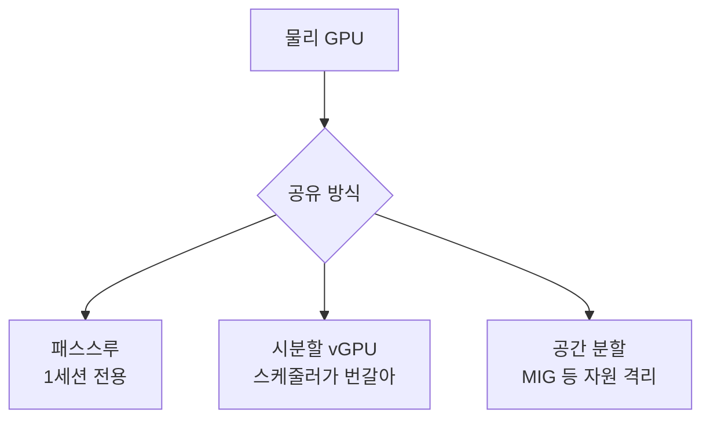
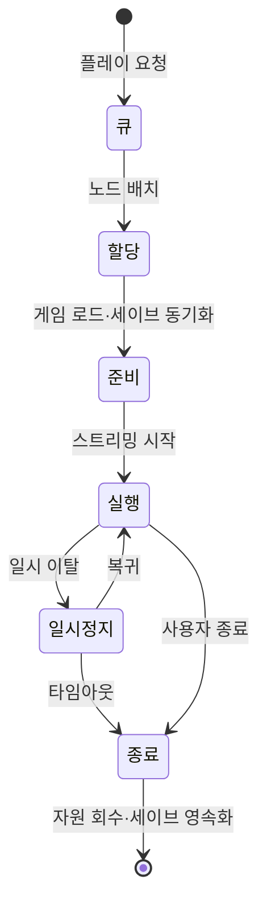

## 들어가며

클라우드 게이밍은 *접근성* 과 *지연* 사이의 줄다리기다. 게임 로직과 렌더링을 데이터센터의 GPU에서 돌리고 그 결과 화면을 영상으로 압축해 사용자에게 흘려보내면, 저사양 기기에서도 AAA 게임이 돌아간다 — 이것이 접근성이다. 그런데 그 대가로 *모든 입력이 데이터센터를 한 바퀴 돌아와야* 화면에 반영된다. 로컬 게임에서 0이던 왕복이 수십 ms로 늘어나고, 거기에 인코딩·디코딩·네트워크 버퍼링이 얹힌다. 이것이 지연이다.

이 글은 그 트레이드오프를 따라 클라우드 게이밍의 구성요소를 한 흐름으로 정리한다. 화면 한 프레임이 사용자에게 닿기까지의 전체 경로(glass-to-glass)가 무엇으로 쪼개지는지, 영상 인코딩이 왜 지연의 핵심 병목이고 하드웨어 인코더가 이를 어떻게 줄이는지, 한정된 대역폭 위에서 비트레이트를 어떻게 적응적으로 조절하는지, 입력 왕복 지연을 줄이거나 숨기는 기법은 무엇인지, 데이터센터의 GPU를 어떻게 여러 세션이 나눠 쓰는지, 세션을 어떻게 띄우고 정리하는지, 그리고 이 모든 것의 비용이 어떻게 결정되는지를 다룬다.


이 글의 목표.

1. **클라우드 게이밍의 구조와 지연 예산** — glass-to-glass 경로, 각 단계의 ms 분해, 입력 왕복.
2. **영상 인코딩과 코덱** — H.264/HEVC/AV1, 하드웨어 인코더, 인트라-리프레시, 인코딩 지연.
3. **대역폭과 적응 비트레이트** — 해상도·프레임레이트·비트레이트의 동적 조절, 혼잡 제어.
4. **네트워크 전송** — UDP/QUIC, FEC, 패킷 손실 복구, 지터 버퍼.
5. **지연 은닉과 클라이언트 보정** — 입력 버퍼, 로컬 프리딕션의 한계.
6. **서버 GPU 풀과 가상화** — vGPU, 세션 밀도, 스케줄링, 오토스케일링.
7. **세션 관리와 운영** — 세션 수명주기, 매치메이킹·지역 할당, 모니터링.
8. **비용 — 무엇이 청구서를 결정하는가** — GPU 인스턴스 비용, 가동률, 데이터 전송, 하이브리드.


---

## 목차
1. [클라우드 게이밍의 구조와 지연 예산](#1-클라우드-게이밍의-구조와-지연-예산)
2. [영상 인코딩과 코덱](#2-영상-인코딩과-코덱)
3. [대역폭과 적응 비트레이트](#3-대역폭과-적응-비트레이트)
4. [네트워크 전송](#4-네트워크-전송)
5. [지연 은닉과 클라이언트 보정](#5-지연-은닉과-클라이언트-보정)
6. [서버 GPU 풀과 가상화](#6-서버-gpu-풀과-가상화)
7. [세션 관리와 운영](#7-세션-관리와-운영)
8. [비용 — 무엇이 청구서를 결정하는가](#8-비용--무엇이-청구서를-결정하는가)


---

## 1. 클라우드 게이밍의 구조와 지연 예산

### 책임의 이동

로컬 게임에서 입력·시뮬레이션·렌더링·표시는 모두 한 기기 안에서 일어난다. 패드 버튼이 화면에 반영되기까지는 입력 폴링, 한 프레임의 게임 로직, GPU 렌더, 디스플레이 스캔아웃뿐이다. 클라우드 게이밍은 이 사슬을 *네트워크로 절단* 한다. 입력은 클라이언트에서 잡지만, 시뮬레이션과 렌더링은 *서버* 가 하고, 그 결과는 *영상* 으로 압축되어 다시 클라이언트로 돌아온다. 클라이언트는 사실상 *입력을 보내고 영상을 받아 디코딩해 띄우는* 얇은 단말이 된다.

이 구조 덕분에 접근성이 생긴다. 클라이언트는 H.264/HEVC/AV1 디코더 하나만 있으면 되므로, 10년 된 스마트폰이나 저가 TV 스틱에서도 최신 게임이 돌아간다. 동시에 이 구조가 모든 지연의 근원이다. *입력 → 서버 → 영상 → 클라이언트* 라는 왕복이 매 프레임의 반응성을 결정한다.

### Glass-to-Glass 지연

체감 지연의 표준 척도는 *glass-to-glass* 다 — 사용자가 버튼을 누른 *그 순간* 부터, 그 입력이 반영된 화면이 디스플레이의 *유리* 에 그려지는 순간까지의 시간. 이것은 단일 숫자가 아니라 여러 단계의 합이다.


각 단계를 정량화하면 지연 예산이 어디에 쓰이는지 분명해진다. 아래 수치는 특정 서비스를 보장하는 사양이 아니라 *양호한 유선 환경을 가정해 측정 계획을 세우기 위한 예시 범위* 다. 장치, 프레임 동기화, 코덱 설정, 데이터센터 거리와 경로 혼잡에 따라 각 항은 범위를 벗어날 수 있다.

| 단계 | 대략 지연 | 줄이는 수단 |
|---|---|---|
| 입력 샘플링·패킷화 | 1~8ms | 폴링 주기·즉시 전송 |
| 업스트림 네트워크 | 5~30ms | 엣지 데이터센터·근접 배치 |
| 서버 입력 대기 | 0~16ms | 프레임 경계와 입력 정렬 |
| 게임 1프레임(시뮬+렌더) | 8~16ms | 프레임레이트·렌더 최적화 |
| 인코딩 | 2~10ms | 하드웨어 인코더·저지연 모드 |
| 다운스트림 네트워크 | 5~30ms | 엣지·대역폭 |
| 지터 버퍼 | 0~30ms | 버퍼 깊이 조절 |
| 디코딩 | 2~10ms | 하드웨어 디코더 |
| 디스플레이 스캔아웃 | 2~16ms | 클라이언트 디스플레이 |

합산 결과는 개별 구간의 독립적인 중간값을 더해 얻을 수 없다. 입력은 업스트림으로 한 번 가고 영상은 다운스트림으로 돌아오므로 네트워크 항은 양방향 경로의 합이지만, 일반적인 ping RTT와 경로·큐·우선순위가 같다고도 보장할 수 없다. 서비스는 입력 캡처 시각과 실제 광자 출력 시각을 계측해 전체 glass-to-glass 분포를 직접 재고, 단계별 타임스탬프로 원인을 분해해야 한다.

### 지연 예산이라는 사고방식

개별 단계를 따로 최적화하는 대신, *전체 예산* 을 목표로 두고 분배하는 것이 실무적이다. 예를 들어 목표 glass-to-glass 상한에서 측정된 양방향 네트워크 경로와 입력·표시 대기를 빼면 서버·인코딩·버퍼·디코딩에 쓸 수 있는 예산이 남는다. 경로 지연이 커질수록 다른 단계가 흡수할 여지는 줄지만, 화질·끊김·프레임 페이싱을 무작정 희생할 수는 없다. 장르별 허용 지연과 품질 guardrail을 함께 둔다.

### 입력 왕복의 비대칭

업스트림(입력)과 다운스트림(영상)은 *데이터 양이 비대칭* 이다. 입력은 작은 지연 민감 메시지이고, 영상은 지속적인 고대역폭 스트림이다. 입력은 불필요한 애플리케이션 대기를 피하되 시퀀스·중복 입력·혼잡 예산을 적용하고, 영상은 가용 대역폭과 디코더 능력에 맞춰 압축률을 조절한다. "작으니 혼잡과 인증을 무시하고 무조건 보낸다"는 뜻은 아니다.

## 2. 영상 인코딩과 코덱

### 왜 영상인가

서버가 렌더한 프레임을 그대로 보내면 1080p 비압축 한 프레임이 *약 6MB*, 60fps면 초당 *약 370MB* 다. 어떤 가정용 회선도 감당 못 한다. 그래서 매 프레임을 *영상 코덱으로 압축* 한다 — 1080p60을 보통 *5~25Mbps* 로 줄인다. 수백 배의 압축이다. 이 압축이 클라우드 게이밍을 가능하게 하지만, 동시에 *지연과 화질의 핵심 트레이드오프* 를 만든다.

### 코덱의 선택

코덱은 *압축 효율 ↔ 인코딩 비용 ↔ 디코더 보급률* 의 삼각 위에 있다.

| 코덱 | 같은 화질 대비 비트레이트 | 인코딩 비용 | 디코더 보급 | 비고 |
|---|---|---|---|---|
| H.264 (AVC) | 기준(1×) | 낮음 | 사실상 보편 | 가장 안전한 기본 |
| H.265 (HEVC) | ~0.6× | 중간 | 넓음(라이선스 복잡) | 4K에 유리 |
| AV1 | ~0.5× | 높음(HW 필요) | 확산 중 | 로열티 프리, 신형 칩 필요 |

표의 효율 비율은 콘텐츠, 해상도, 지연 프리셋, 화질 지표와 인코더 세대에 따라 크게 달라지는 방향성 예시다. 특히 저지연 모드에서는 오프라인 인코딩 벤치마크의 압축 효율이 그대로 나오지 않는다. 신형 코덱의 이득은 실제 게임 장면의 모션·텍스트 가독성·tail encode/decode latency를 같은 조건에서 측정해 판단한다. 클라이언트가 해당 코덱을 하드웨어로 디코딩할 수 있는지도 협상해야 한다. 소프트웨어 디코딩은 장치에 따라 지연·발열·배터리 비용이 커질 수 있다.

### 하드웨어 인코더와 지연

인코딩은 *서버에서 매 프레임* 일어나므로 지연 예산의 한 행을 직접 차지한다(1절 표). CPU 소프트웨어 인코더(`x264` 등)는 화질은 좋지만 *느리고 GPU 한 장당 동시 세션 수를 제한* 한다. 그래서 클라우드 게이밍은 GPU에 내장된 *전용 하드웨어 인코더* 를 쓴다 — NVIDIA의 NVENC, AMD의 VCE/VCN, Intel Quick Sync. 이들은 렌더링과 *별도 하드웨어 블록* 이라, 인코딩이 GPU의 셰이더 자원을 거의 먹지 않고 *프레임당 수 ms* 안에 끝난다.

```cpp
// 저지연 게임 스트리밍을 위한 인코더 설정의 핵심 축
struct EncoderConfig {
    Codec    codec = Codec::H264;     // 클라이언트 능력에 맞춰 협상
    int      width = 1920, height = 1080, fps = 60;
    int      targetBitrateKbps = 12000;
    bool     lowLatencyPreset = true; // 룩어헤드·B프레임 제거
    bool     useBFrames = false;      // B프레임 = 미래 프레임 참조 = 지연
    int      gopSize = 0;             // 0 = 주기적 키프레임 없음(아래 참조)
    bool     intraRefresh = true;     // 키프레임 대신 점진적 갱신
    RateMode rateMode = RateMode::CBR;// 대역폭 안정 우선
};
```

### B프레임과 인트라-리프레시

일반 영상(영화·VOD)은 *B프레임* 을 쓴다 — 과거와 *미래* 프레임을 모두 참조해 압축률을 높인다. 그런데 미래 프레임을 참조하려면 인코더가 *그 미래 프레임이 렌더될 때까지 기다려야* 한다. 이 대기가 지연을 더한다. 게임 스트리밍은 *B프레임을 끈다* — 화질을 조금 포기하고 지연을 줄이는 거래다.

또 하나의 함정이 *키프레임(I프레임)* 이다. 키프레임은 다른 프레임을 참조하지 않는 완전한 한 장이라 *크다* — 보통 P프레임의 수~수십 배. 주기적으로 큰 키프레임을 보내면 그 순간 *비트레이트가 튀어* 네트워크 버퍼를 채우고 지연 스파이크를 만든다. 이를 피하는 기법이 *인트라-리프레시(intra-refresh)* 다. 한 프레임을 통째로 키프레임으로 만드는 대신, 매 프레임 *화면의 일부 영역(슬라이스)만 인트라로 갱신* 해 여러 프레임에 걸쳐 한 바퀴 돌린다. 비트레이트가 평탄해지고, 패킷 손실 복구 시점(4절)에도 유리하다.

### 인코딩과 화질의 트레이드오프

같은 비트레이트라도 *장면의 복잡도* 에 따라 화질이 달라진다. 빠른 카메라 회전·파티클·풀숲처럼 화면 전체가 바뀌는 장면은 압축이 어려운 반면 정적인 메뉴는 적은 비트로도 깨끗하다. 인코더의 rate control은 장면 복잡도와 송신 대역폭·버퍼 지연 제약 사이에서 프레임별 quantizer와 비트 배분을 조정한다. 게임 스트리밍은 화질 변동을 일부 감수하고도 큐 지연을 제한하도록 capped VBR이나 CBR에 가까운 정책을 사용하는 경우가 많다.

## 3. 대역폭과 적응 비트레이트

### 대역폭이라는 천장

다운스트림 대역폭이 클라우드 게이밍 화질의 천장이다. 대략적인 요구는 다음과 같다.

| 해상도·프레임레이트 | 권장 대역폭(H.264 기준) | 비고 |
|---|---|---|
| 720p60 | 5~10Mbps | 모바일·열악 환경 |
| 1080p60 | 10~20Mbps | 표준 목표 |
| 1440p60 | 20~35Mbps | 여유 회선 |
| 2160p(4K)60 | 35~50Mbps+ | 신형 코덱 권장 |

문제는 사용자의 회선이 *고정도 아니고 보장도 안 된다* 는 점이다. 가정 Wi-Fi는 전자레인지·이웃 간섭·거리로 출렁이고, 모바일은 셀 이동마다 변한다. 그래서 비트레이트를 회선에 *고정* 하면 두 가지로 실패한다 — 너무 높으면 패킷이 큐에 쌓여 지연이 폭증하고(버퍼블로트), 너무 낮으면 화질을 낭비한다.

### 적응 비트레이트(ABR)

해법은 *적응 비트레이트(Adaptive Bitrate)* 다 — 가용 대역폭을 *실시간으로 추정* 하고, 인코더의 목표 비트레이트를 그에 맞춰 *매초 또는 매 프레임* 조절한다. VOD의 ABR(여러 화질을 미리 인코딩해두고 청크 단위로 전환)과 달리, 게임 스트리밍은 *실시간 인코딩* 이므로 *인코더 파라미터 자체를 즉시 바꾼다*.

```cpp
// 매 RTT 주기로 대역폭 추정 → 인코더 목표 조절
void AdaptiveController::Update(const NetworkStats& net) {
    // 손실·지연 증가·큐 증가를 종합해 가용 대역폭 추정
    float estimated = bandwidthEstimator_.Estimate(net);

    // 추정치의 일정 비율만 사용(여유 마진) — 너무 꽉 채우면 큐가 쌓인다
    float target = estimated * 0.85f;

    if (net.queuingDelayMs > kQueueHighWatermark) {
        target *= 0.5f;             // 큐가 차오름 → 즉시 강하게 줄인다
    }
    encoder_.SetTargetBitrate(ClampToTier(target));

    // 비트레이트만으로 부족하면 해상도/프레임레이트 단계도 조절
    AdjustResolutionAndFps(target);
}
```

### 무엇을 먼저 희생하는가

목표 비트레이트가 떨어졌을 때, 화질을 어디서 깎을지가 *체감을 좌우* 한다. 선택지는 세 축이다.

- **비트레이트(압축률)**: 같은 해상도·프레임레이트에서 더 세게 압축. 블록 아티팩트가 늘지만 *움직임의 매끄러움* 은 유지된다.
- **해상도**: 720p로 낮춰 인코딩한 뒤 클라이언트에서 업스케일. 선명도는 떨어지지만 *아티팩트는 줄고 프레임레이트 유지*.
- **프레임레이트**: 60→30fps. 대역폭은 크게 절약되지만 *반응성과 매끄러움이 직접 타격* 을 받는다.

게임 스트리밍의 우선순위는 보통 *프레임레이트 > 비트레이트 > 해상도* 다. 60fps의 매끄러움과 반응성은 마지막까지 지키고, 먼저 해상도를 낮춰 픽셀 수를 줄인 뒤 비트레이트로 미세 조정한다. 프레임레이트를 떨어뜨리는 것은 *최후의 수단* 이다 — 입력 반응성이 곧 클라우드 게이밍의 약점인데, 프레임레이트 강하는 그 약점을 더 키운다.

### 혼잡 제어와 버퍼블로트

ABR의 추정이 틀리면 *버퍼블로트* 가 생긴다 — 보내는 양이 병목 용량을 넘으면 큐 대기 시간이 조작 지연으로 변한다. 실시간 미디어의 혼잡 제어는 손실만 기다리지 않고 지연 추세, 전달률, 손실, ECN 같은 신호를 함께 사용한다. GCC는 지연 추세를 적극 사용하고, BBR 계열은 병목 대역폭과 최소 RTT 모델로 pacing과 inflight를 조절하므로 같은 "지연 기반" 한 종류로 묶을 수는 없다. 어떤 알고리즘도 모든 무선·공유 병목에서 큐를 항상 비운다고 보장하지 않으므로 실제 경로와 경쟁 트래픽에서 검증한다.

## 4. 네트워크 전송

### TCP는 왜 부적합한가

하나의 TCP 바이트 스트림에 기한이 짧은 실시간 영상을 계속 싣는 설계는 불리할 수 있다. TCP는 *순서 보장과 재전송* 을 위해, 빠진 바이트 앞의 후속 데이터를 응용에 전달하지 않는다(head-of-line blocking). 재전송이 표시 마감보다 늦으면 오래된 프레임 때문에 최신 프레임의 전달도 막힌다. 다만 TCP가 모든 스트리밍에 부적합하다는 뜻은 아니다. 방화벽 통과성과 구현 단순성이 더 중요하거나 충분한 버퍼를 허용하는 서비스는 TCP 기반 전송도 쓸 수 있다.

낮은 표시 지연을 우선하는 구현은 흔히 UDP 위에서 기한이 지난 데이터를 버리고 필요한 복구만 선택한다. UDP 자체가 지연을 낮춰 주는 것은 아니며, 혼잡 제어·암호화·패킷화·MTU 대응은 상위 계층의 책임이다. QUIC의 신뢰성 있는 스트림은 스트림 내부 순서를 보장하므로 해당 스트림 안의 손실에는 HoL이 남지만, 한 스트림의 손실이 다른 스트림의 전달까지 막지는 않는다. 기한이 지난 영상 조각을 재전송하지 않으려면 QUIC DATAGRAM 같은 비신뢰 메시지나 프레임별 독립 전달 단위가 필요하다.

### 손실을 다루는 두 갈래

영상 패킷이 손실되면 그 부분의 화면이 깨진다. 대응은 두 갈래다.

- **FEC(Forward Error Correction)**: 미리 *여분의 복구 패킷* 을 함께 보낸다. 복구 가능한 손실이면 재전송 왕복을 피하지만 블록을 모으는 대기와 부호화·복호화 비용은 남는다. 여분 트래픽이 병목 큐를 악화시키면 오히려 손실과 지연이 커질 수 있으므로 손실 패턴과 가용 대역폭에 맞춰 보호율을 조절한다.
- **선택적 재전송(NACK)**: 손실된 패킷만 다시 요청한다. 대역폭은 아끼지만 피드백과 재전송 전달 시간이 표시 마감 안에 들어와야 유효하다. 판단 기준은 "엣지인가"가 아니라 남은 playout deadline, 추정 RTT, 참조 프레임 중요도다.

실무는 둘을 섞는다 — 기본은 약한 FEC로 흔한 단발 손실을 메우고, 손실이 몰릴 때만 키프레임 또는 인트라-리프레시(2절)로 *참조를 새로 잡아* 화면을 복구한다. 손실 후 깨진 화면이 *다음 프레임들로 전파* 되는 것을 끊는 것이 인트라-리프레시의 또 다른 이유다.

### 지터 버퍼

네트워크 지연은 일정하지 않다 — 패킷마다 도착 간격이 출렁인다(지터). 도착하는 대로 바로 디코딩·표시하면 *프레임 간격이 들쭉날쭉* 해 화면이 떨린다. 이를 막으려 *지터 버퍼* 에 패킷을 잠깐 쌓아 *고른 간격으로* 꺼낸다.

```cpp
// 지터 버퍼: 지연 안정성 vs 추가 지연의 절충
class JitterBuffer {
    int targetDepthMs_ = 20;          // 버퍼 목표 깊이
public:
    void OnPacket(Packet p, int64_t arrivalUs) {
        observedJitter_.Add(arrivalUs / 1000);   // us → ms 로 단위를 통일해 누적
        // 지터가 크면 버퍼를 늘려 안정성↑(지연↑)
        // 지터가 작으면 버퍼를 줄여 지연↓
        targetDepthMs_ = Clamp(static_cast<int>(observedJitter_.P95() * 1.5f), kMin, kMax);
        queue_.Push(std::move(p));
    }
    bool Pop(Frame& out) { /* targetDepth만큼 찼을 때부터 일정 간격 방출 */ }
};
```

지터 버퍼는 *지연을 사서 안정성을 얻는* 거래다. 버퍼가 깊으면 떨림은 없지만 그만큼 glass-to-glass에 ms가 더해지고(1절 표), 얕으면 반응은 빠르지만 떨림과 끊김이 는다. 게임 스트리밍은 *버퍼를 가능한 얕게* 두고 *측정된 지터에 맞춰 동적으로* 조절한다 — VOD가 수 초의 버퍼를 두는 것과 정반대다.

## 5. 지연 은닉과 클라이언트 보정

### 지울 수 없는 왕복

앞 절들은 지연을 *줄인다*. 그러나 빛의 속도와 데이터센터 거리라는 물리 한계 때문에 왕복을 *0으로 만들 수는 없다*. 그래서 남은 지연을 *체감상 숨기는* 기법이 필요하다. 핵심 함정부터 짚자면, 멀티플레이어 게임에서 흔한 *클라이언트 사이드 프리딕션* 은 클라우드 게이밍에서 *기본적으로 쓸 수 없다*. 클라이언트는 게임 상태를 모르고 *영상만* 받기 때문이다. 클라이언트는 "총을 쐈을 때 어떤 화면이 나올지" 예측할 수 없다. 이 점이 클라우드 게이밍을 일반 네트워크 게임과 구분하는 가장 큰 제약이다.

### 클라이언트가 할 수 있는 것

영상만 받는 얇은 클라이언트가 지연을 숨기는 수단은 제한적이지만 존재한다.

- **즉각적 로컬 피드백**: 입력의 *결과* 는 서버를 기다려야 하지만, 입력을 *받았다는 신호* 는 즉시 줄 수 있다. UI 버튼 눌림, 커서 하이라이트, 조준점 반응 같은 *서버 상태와 무관한 시각 피드백* 을 클라이언트가 직접 그린다. 체감 반응성이 올라간다.
- **마우스 커서 오버레이**: 일부 시스템은 *커서만 클라이언트에서 로컬로* 그린다. 커서의 위치는 입력으로 알 수 있으므로, 영상 속 커서를 끄고 클라이언트가 즉시 반응하는 커서를 덧그려 *포인팅 지연을 숨긴다*.
- **프레임 보간·예측 표시**: 받은 프레임 사이를 보간해 매끄러움을 보강. 다만 *없는 정보를 만들어내는* 것이라 아티팩트 위험이 있어 보수적으로 쓴다.

### 서버 측 입력 정렬

서버에서 줄일 수 있는 숨은 지연이 *입력 대기* 다(1절 표). 입력 패킷은 아무 때나 도착하지만 게임은 *프레임 경계* 에서만 입력을 읽는다. 입력이 프레임 시작 직후 도착하면 *거의 한 프레임을 기다려야* 반영된다. 이를 줄이려 *입력을 프레임 경계 직전까지 최대한 늦게 샘플링* 하거나, 입력 도착에 맞춰 *프레임 시작 타이밍을 미세 조정* 한다. 한 프레임(16ms)을 통째로 절약할 수 있는 지점이다.

### 장르가 지연을 결정한다

같은 지연이라도 장르마다 체감이 다르다. 이것이 클라우드 게이밍의 *현실적 적용 범위* 를 정한다.

| 장르 | 지연 민감도 | 클라우드 적합성 |
|---|---|---|
| 경쟁 FPS·격투·리듬 | 매우 높음 | 낮음(프레임 단위 입력) |
| 액션·플랫포머 | 높음 | 중간 |
| 3인칭 액션·오픈월드 | 중간 | 양호 |
| RPG·전략·시뮬레이션 | 낮음 | 우수 |
| 턴제·퍼즐·내러티브 | 매우 낮음 | 우수 |

지연에 *관대한 장르* 일수록 클라우드의 약점이 드러나지 않는다. 그래서 클라우드 게이밍 라이브러리의 무게중심은 자연히 RPG·전략·내러티브로 기운다. 경쟁 FPS는 *가장 좋은 환경(엣지 근접·유선)에서만* 납득할 만하다. 게임 디자인 단계에서 *입력 버퍼를 넉넉히 두고 시각·청각 피드백을 강화* 하면 같은 지연을 덜 거슬리게 만들 수 있다 — 입력이 즉시 *어떤 반응* 이라도 일으키면 뇌가 지연을 덜 인지한다.

## 6. 서버 GPU 풀과 가상화

### 한 세션 = 한 게임 PC

클라우드 게이밍의 서버는 본질적으로 *원격 게임 PC* 다 — 한 사용자 세션은 GPU·CPU·메모리·스토리지를 점유해 게임을 돌리고 인코딩한다. 비용 구조(8절)가 여기서 갈린다. GPU는 비싸고, 한 세션이 GPU 한 장을 통째로 쓰면 사용자당 원가가 치솟는다. 그래서 핵심 질문은 *GPU 한 장에 몇 세션을 얹을 수 있는가* — 세션 밀도다.

### GPU 가상화

여러 세션이 GPU를 나눠 쓰는 방식은 몇 갈래다.



- **패스스루(passthrough)**: GPU 한 장을 한 가상머신에 *통째로* 할당. 성능 간섭이 없어 가장 안정적이지만 *밀도가 1* 이라 비싸다. 고사양 AAA·경쟁 게임에 쓴다.
- **시분할 vGPU**: 하나의 GPU를 여러 가상 GPU로 쪼개 *스케줄러가 시간순으로 번갈아* 실행. 밀도는 높지만 세션끼리 *서로의 프레임 타이밍에 간섭* 한다. 가벼운 게임·낮은 해상도에 적합.
- **공간 분할**: GPU의 연산 유닛·메모리를 *물리적으로 분할* 해 세션마다 격리된 조각을 준다. 간섭이 적고 밀도와 안정성의 절충이 좋다.

세션 밀도가 곧 단가다. 밀도를 높이면 사용자당 원가가 내려가지만, *프레임 타임 간섭* 으로 일부 세션이 16ms 마감을 놓치면 끊김으로 직결된다. 그래서 밀도는 *게임 등급별로 다르게* 잡는다 — 가벼운 게임은 빽빽이, 무거운 게임은 듬성듬성.

### 인코더 자원도 분할 대상

GPU의 *하드웨어 인코더(NVENC 등)* 도 유한 자원이다. 한 칩의 인코더가 동시에 처리할 수 있는 세션 수에 상한이 있어, *렌더링은 여유가 있어도 인코딩이 먼저 포화* 될 수 있다. 세션 밀도를 계산할 때 *셰이더 연산뿐 아니라 인코더 슬롯* 도 함께 따져야 한다. 이것이 2절에서 소프트웨어 인코더가 "GPU 한 장당 동시 세션 수를 제한"한다고 한 것과 같은 종류의 제약이며, 하드웨어 인코더로 바꿔도 인코더 슬롯이라는 형태로 상한이 남는 이유다.

### 컨테이너와 오케스트레이션

세션은 컨테이너, VM, 프로세스 격리 중 드라이버·보안·시작 시간 요구에 맞는 단위를 쓴다. 오케스트레이터는 새 세션을 여유 있는 GPU 노드에 배치하고 종료 시 자원을 회수한다. 다만 노드 장애 시 실행 중 세션을 자동으로 다른 노드로 "이동"할 수 있는 것은 아니다. 게임 상태·인코더 상태·연결을 체크포인트하거나 외부화하지 않았다면 세션은 끊기고 새 인스턴스에서 저장 지점부터 복구해야 한다. 장애 목표에 맞춰 재접속 토큰, 주기적 상태 저장, 대기 노드 비용을 설계한다.

```cpp
// 세션 배치 결정: 지연·밀도·격리의 균형
NodeId Scheduler::Place(const SessionRequest& req) {
    // 1. 사용자에게 가까운 지역의 노드만 후보로(지연)
    auto candidates = NodesInRegion(req.userRegion);

    // 2. 요청한 게임의 자원 등급에 맞는 노드(무거운 게임=낮은 밀도)
    Filter(candidates, [&](Node& n){ return n.CanHost(req.gameTier); });

    // 3. 인코더 슬롯과 GPU 여유가 모두 있는 노드
    Filter(candidates, [&](Node& n){
        return n.freeEncoderSlots > 0 && n.freeGpuShare >= req.gpuShare;
    });

    // 4. 가동률을 고르게(빈 노드를 채워 다른 노드를 비워 끄도록)
    return BestFit(candidates);   // 8절 비용과 직결
}
```

### 콜드 스타트와 오토스케일링

새 노드를 부팅하고 드라이버를 올리고 게임을 로드하는 *콜드 스타트* 는 수십 초~분 단위다. 사용자가 "플레이" 버튼을 누르고 그만큼 기다리게 할 수는 없다. 그래서 *미리 부팅해둔 노드 풀(warm pool)* 을 유지하고, *수요를 예측* 해 풀 크기를 조절한다. 저녁 피크 전에 노드를 미리 늘리고, 새벽에 줄여 끈다. 이 *오토스케일링* 의 정확도가 비용(8절)을 직접 좌우한다 — 너무 많이 켜두면 유휴 GPU 요금을 태우고, 너무 적게 켜두면 대기열이 생긴다.

## 7. 세션 관리와 운영

### 세션의 수명주기

한 세션은 명확한 상태 기계를 따른다. 각 전이가 자원 할당·회수와 사용자 경험에 직결된다.



운영의 핵심은 *전이의 양 끝* 이다. *준비* 단계에서 클라우드 세이브를 내려받아 게임에 주입해야 사용자가 *자기 진행 상황* 에서 시작한다. *종료* 단계에서 세이브를 *반드시 영속 스토리지에 다시 올려야* 한다 — 세션 노드는 휘발성이라, 회수 전에 세이브를 올리지 못하면 진행이 날아간다. 그래서 세이브 동기화는 *세션 시작·종료의 필수 관문* 이고, 네트워크 단절·노드 장애 시에도 *마지막 세이브를 잃지 않도록* 주기적 체크포인트를 둔다.

### 유휴와 타임아웃

세션은 *실제 플레이* 외의 시간에도 자원을 잡는다. 사용자가 자리를 비우거나 일시정지한 채 방치하면 GPU가 *놀면서 요금* 을 태운다. 그래서 *유휴 타임아웃* 을 둔다 — 입력이 일정 시간 없으면 경고 후 세션을 종료해 자원을 회수한다. 타임아웃이 짧으면 잠깐 자리를 비운 사용자가 쫓겨나 불만이고, 길면 유휴 비용이 는다. 이 값이 사용자 경험과 비용의 직접적 절충점이다.

### 지역 할당과 매치메이킹

지연(1절)은 *데이터센터와 사용자의 물리적 거리* 가 큰 비중을 차지한다. 그래서 세션은 *사용자에게 가장 가까운 지역* 에 배치하는 것이 원칙이다. 멀티플레이어가 끼면 문제가 복잡해진다 — 같은 매치의 플레이어들이 흩어져 있으면, *게임 서버* 는 한 지역에 있어야 하므로 누군가는 먼 지역에 붙는다. 클라우드 클라이언트와 네이티브 클라이언트가 *함께 플레이* 하는 경우, 권위는 항상 *서버* 에 두고(server authority) 클라우드 클라이언트도 일반 클라이언트와 동등하게 검증받게 한다. 클라우드 세션이라고 신뢰해선 안 된다 — 클라이언트 단말의 입력은 어느 쪽이든 조작 가능하다고 가정한다.

### 운영 지표 — 무엇을 보는가

클라우드 게이밍은 *수천 세션이 동시에* 도는 분산 시스템이라, 품질을 *집계 지표* 로 봐야 한다. 개별 세션의 문제가 묻히지 않도록 *분포(특히 꼬리)* 를 본다.

| 지표 | 의미 | 위험 신호 |
|---|---|---|
| glass-to-glass 지연 분포 | 체감 반응성 | P95가 마감 초과 |
| 비트레이트·해상도 분포 | 실제 전달 화질 | 강제 다운그레이드 급증 |
| 패킷 손실·지터 | 네트워크 품질 | 지역별 편중 |
| 버퍼 언더런·프레임 드롭 | 끊김 | 특정 노드·지역 집중 |
| 세션 밀도·GPU 가동률 | 자원 효율 | 가동률 낮음 = 비용 낭비 |
| 콜드 스타트·대기열 시간 | 진입 경험 | 피크 시 큐 폭증 |
| 세션 시작 실패율 | 신뢰성 | 노드·드라이버 문제 |

평균이 아니라 *P95·P99* 를 보는 것이 핵심이다 — 평균 지연이 좋아도 *상위 5%의 사용자가 끊김을 겪으면* 그들은 떠난다. 지표가 *특정 지역·노드에 집중* 되면 인프라 문제로, *특정 게임에 집중* 되면 그 게임의 자원 등급·인코딩 설정 문제로 좁혀 들어간다. 인코딩 설정·버퍼 전략·밀도 같은 파라미터는 *일부 세션에만 변경을 적용해 비교(A/B)* 하며 점진적으로 튜닝한다.

## 8. 비용 — 무엇이 청구서를 결정하는가

### GPU 시간이 지배한다

클라우드 게이밍 원가의 압도적 비중은 *GPU 시간* 이다. 영상 인코딩·세션 관리·네트워크는 모두 무겁지만, 진짜 비싼 것은 *게임을 실제로 렌더하는 GPU* 다. 클라우드 GPU 인스턴스는 시간당 수 달러 규모이고, 한 사용자가 한 세션을 점유하는 *매 분* 이 그 요금을 태운다. 그래서 비용의 두 지렛대는 분명하다 — *세션당 GPU 점유를 줄이거나*(밀도), *유휴 GPU 시간을 줄이거나*(가동률).

### 세션 밀도 × 가동률

원가를 한 줄로 쓰면 다음 꼴이다.

$$\text{사용자당 원가} \approx \frac{\text{GPU 시간당 비용}}{\text{세션 밀도} \times \text{가동률}}$$

세 변수가 모두 트레이드오프를 품는다.

- **세션 밀도**(6절): 높이면 단가가 내려가지만, 간섭으로 일부 세션이 마감을 놓쳐 *품질이 떨어진다*. 품질 보장과 직접 충돌한다.
- **가동률**(6·7절): warm pool과 오토스케일링의 정확도. 피크에 맞춰 켜두면 *피크 외 시간의 유휴* 가 비용이 되고, 빠듯하게 켜면 대기열이 생긴다. 게임 사용은 *저녁·주말에 몰리는* 강한 주기성이 있어, 평균 가동률을 높이기 어렵다.
- **GPU 시간당 비용**: 하드웨어 세대·전력·데이터센터 위치. 전력은 무시 못 할 비중이라 *전력 효율 좋은 칩과 지역* 이 장기 비용을 가른다.

### 데이터 전송 비용

두 번째 비용 축은 *송신 대역폭(egress)* 이다. 클라우드 사업자는 데이터센터에서 *밖으로 나가는* 트래픽에 과금하는데, 게임 스트리밍은 사용자당 *시간당 수 GB* 를 내보낸다. 비트레이트가 곧 데이터 전송 비용이다 — 1080p를 20Mbps로 보내면 시간당 약 9GB다. 신형 코덱(HEVC·AV1)으로 같은 화질을 더 적은 비트레이트로 전달하면 *전송 비용이 직접 절감* 된다(2절). 이것이 인코딩 효율이 화질뿐 아니라 *원가* 와도 직결되는 이유다. CDN·엣지 배치는 지연을 줄이는 동시에 *전송 경로를 짧게* 해 비용에도 영향을 준다.

### 가격 모델이 비용 구조를 따라간다

비용 구조가 곧 사용자 과금 모델을 결정한다.

| 모델 | 사업자 관점 | 사용자 관점 |
|---|---|---|
| 정액 구독 | 헤비 유저가 손해 위험 | 많이 쓸수록 이득 |
| 시간제 | 사용량과 원가 연동 | 적게 쓰면 저렴 |
| 게임별 구매·BYOG | 라이브러리 비용 분리 | 보유 게임만 스트리밍 |

GPU 시간이 곧 원가이므로, *정액 구독* 은 헤비 유저가 많을수록 사업자가 손해를 본다 — 그래서 동시 세션 수 제한·해상도 등급으로 원가를 관리한다. *시간제* 는 원가와 매출이 자연스럽게 연동되지만 사용자에게 심리적 장벽이 있다. 어느 모델이든, 마진은 결국 *밀도와 가동률* 이라는 두 운영 지표로 돌아온다.

### 하이브리드 — 클라우드를 덜 쓰기

비용 압박의 근본 완화책은 *클라우드 GPU를 덜 쓰는* 것이다. *하이브리드 모델* 은 가능한 작업을 *로컬* 로 내린다 — 게임이 클라이언트에서 돌 수 있으면 로컬 실행하고, 클라우드는 *그 기기가 감당 못 하는 게임이나 순간만* 맡는다. "체험판은 클라우드로 즉시 시작하고, 본편은 다운로드해 로컬 실행", "휴대기기에선 클라우드, 데스크톱에선 로컬" 같은 분기가 전형이다. 클라우드는 *접근성의 보완재* 로 두고 모든 플레이를 클라우드에 싣지 않는 것이, 지연·비용 양쪽을 동시에 누그러뜨리는 가장 현실적인 전략이다.


---

## 결론

클라우드 게이밍의 모든 결정은 *접근성 ↔ 지연 ↔ 비용* 의 삼각 트레이드오프 위에 놓인다. 게임을 서버로 옮기면 저사양 기기에서도 돌아가지만(접근성), 입력이 데이터센터를 왕복해야 하고(지연), 사용자마다 GPU 시간이 청구된다(비용). 코덱 선택(효율 대 디코더 보급), 인코딩 설정(화질 대 인코딩 지연), 적응 비트레이트(화질 대 대역폭), 전송(신뢰성 대 지연), 지터 버퍼(안정성 대 지연), 세션 밀도(단가 대 품질) — 모두 이 삼각형 위에서 무게를 어디에 둘지의 선택이다.

이 트레이드오프를 다루는 기반 구조는 일관된다. glass-to-glass 예산이 각 단계의 ms를 가시화하고, 하드웨어 인코더와 인트라-리프레시가 인코딩 지연과 비트 스파이크를 누르며, 적응 비트레이트와 지연 기반 혼잡 제어가 출렁이는 회선 위에서 화질과 반응성을 지킨다. UDP/QUIC와 FEC가 늦은 데이터를 버리고 손실을 메우고, 얇은 클라이언트는 로컬 피드백으로 남은 지연을 숨긴다. 서버 쪽에서는 GPU 가상화와 세션 밀도가 단가를, 오토스케일링과 가동률이 유휴 비용을 결정하고, 세션 수명주기와 세이브 동기화가 진행 상황을 지킨다.

지연은 물리 한계까지만 줄어든다. 그래서 클라우드 게이밍의 성패는 *지연을 줄이는 것* 과 *남은 지연을 견딜 만하게 만드는 것* 의 양쪽에 걸려 있다 — 엣지 배치와 저지연 인코딩으로 왕복을 깎고, 지연에 관대한 장르와 강화된 입력 피드백으로 약점을 가린다. 그리고 이 모두는 *측정 가능성* 위에 선다. P95 glass-to-glass 지연, 강제 다운그레이드율, 세션 밀도와 가동률을 보이게 만드는 모니터링이, "어디서나 즐길 수 있다"는 약속을 *비용 안에서* 지키는 마지막 도구다.

## 더 읽을거리

- NVIDIA Video Codec SDK(NVENC) 문서 — 저지연 인코딩 프리셋, 인트라-리프레시, 동시 세션 제한.
- AV1 / SVT-AV1, AOMedia 명세 — 차세대 코덱의 압축 효율과 하드웨어 디코딩 요건.
- WebRTC 및 GCC(Google Congestion Control) 문서 — 지연 기반 혼잡 제어와 적응 비트레이트의 표준 구현.
- QUIC(RFC 9000) 명세 — UDP 위 신뢰성·다중화 전송 계층.
- NVIDIA vGPU / MIG 문서 — GPU 시분할·공간 분할 가상화와 세션 밀도.
- 주요 클라우드 사업자의 GPU 인스턴스 가격·egress 과금 문서 — 비용 구조의 정량적 근거.
