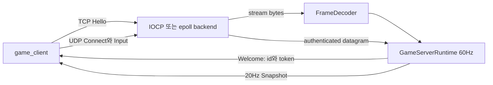

# Game Network Lab

실제 TCP·UDP socket과 권위 simulation을 하나의 실행 경로로 연결하는 미니 프로젝트다. Windows에서는 raw IOCP, Linux에서는 `epoll` backend를 사용한다. 플랫폼 backend 위의 protocol decoder와 game server core는 동일한 C++20 코드다.

이 프로젝트는 화면에서 packet loss를 흉내 내는 모델이 아니다. `game_server`와 `game_client`가 별도 프로세스로 실행되고 loopback socket을 통해 handshake, endpoint binding, input, snapshot을 교환한다.

## 계약과 추적 단위

| 이론 주장 | 조작 변수 | 통제 변수 | 관측값 | 기대 결과 | 실패 주입 | 자동 테스트 |
|---|---|---|---|---|---|---|
| TCP는 byte stream이다. 길이 prefix frame decoder가 header·payload 분할과 여러 frame 병합을 처리한다. | Push 조각 분할(3 / 7 / 나머지), 한 Push에 담긴 frame 수(1 vs 2) | 같은 encoder가 만든 동일 frame byte 열 | 조각 사이 `Pop()` 유무, 완성 frame의 type과 payload | frame이 완성되기 전에는 `Pop()`이 비고 완성 뒤 payload가 원본과 같다 | header만 3byte 넣고 Pop, header 10byte 상태에서 Pop | `game_network_protocol` |
| wire format은 encoder가 아니라 명세가 정한다. control frame 12byte header와 datagram 24byte header는 고정 byte 열이다. | 없음(고정 vector) | 손으로 적은 기대 byte 배열 | `EncodeControl(Hello, {1..5})` 17byte, `EncodeDatagram(Input, 42, 99, {1..5})` 29byte 전 byte | magic `47 4E 4C 31`, version·type·길이·reserved가 big-endian으로 명세와 일치한다 | encoder와 decoder가 같은 상수를 공유하도록 바꿔도 golden 배열이 먼저 깨진다 | `game_network_protocol` |
| 손상된 header는 복구 대상이 아니라 종료 사유다. | 변조 위치(magic, version, 선언 길이, reserved), 누적 push byte 수 | 나머지 byte는 정상 frame·datagram 그대로 | `DecodeDatagram` 반환, `FrameDecoder::Pop`과 `Failed()`, `BufferedBytes()` | 네 종류 모두 거부되고 stream decoder는 영구 실패 상태로 남는다 | 마지막 byte 제거, 선언 길이 ±1, reserved 1, magic 1byte 반전, version 2, 선언 길이 65537, 상한 +1 byte push | `game_network_protocol` |
| 오류 데이터그램이 preposted receive capacity를 영구 소비하지 않는다. | 정상 client 앞에 보내는 oversized UDP 개수(64) | 같은 서버 설정, oversized 뒤 정상 client 1명 | client exit code, decode한 snapshot 수 | `WSAEMSGSIZE` 완료 뒤에도 handshake·binding·snapshot이 성공한다 | 4KiB UDP 데이터그램 64개 | `game_network_process` |
| socket close와 session 해제는 다르다. close 뒤 취소 completion을 회수할 때까지 operation의 `shared_ptr<Session>`이 수명을 유지한다. | `--duration` 종료 시점 | 같은 포트, 같은 client 시나리오 | 서버 process exit code와 종료 소요 시간, 정지한 backend를 다시 Start 했을 때의 `Connected` 이벤트 | drain 뒤 제한 시간 안에 exit 0. 같은 객체를 3회 Start/Stop 해도 매 round에서 loopback 연결이 accept된다 | 없음. 강제 종료 결과는 성공으로 세지 않는다 | `game_network_process`(종료 경로 간접), `game_network_lifecycle`(drain 뒤 재시작) |
| 입력 순서는 wrap될 수 있다. 32bit serial number 비교로 오래된·중복 입력을 버린다. | sequence 쌍 `(0, 0xffffffff)`, `(0xffffffff, 0)`, `(17, 17)`, `(18, 17)`. 적용부는 `0xfffffff0` → 같은 값 → `0xffffffef` → `2` 순서 | 같은 비교 함수, 같은 결합 endpoint | `IsNewerSequence` 반환, snapshot의 ack와 권위 위치 | wrap 뒤 값이 더 새롭고 같은 값은 새롭지 않다. 중복·역행 입력은 `moveX`를 바꾸지 않고 ack도 갱신하지 않는다 | 같은 sequence 재전송, 역행 sequence 재전송 | `game_network_protocol`(순수 함수), `game_network_runtime`(적용부) |
| 권위 상태는 고정 tick에서만 전진하고 snapshot은 3 tick마다 나간다. 긴 정지 뒤 catch-up에는 상한이 있다. | 주입한 `Advance()` 시각 열(1 tick 간격 12회, 10 tick 점프 1회) | 같은 입력 `moveX=+3, moveY=-2`, 결합된 client 1명 | `RuntimeMetrics::ticks`, snapshot payload의 ack와 위치 | 12 tick 뒤 위치가 (36, -24)이고 snapshot이 정확히 4개. 10 tick 점프는 4 tick으로 잘리고 같은 시각 재호출은 0 tick이다 | 위치 적분 무력화, snapshot 주기 10배, ack 상수화, catch-up 상한 확대 | `game_network_runtime` |
| I/O 완료 전 buffer를 재사용하지 않는다. IOCP operation이 `OVERLAPPED`, `WSABUF`, payload와 session 참조를 함께 소유한다. | — | — | operation이 소유하는 buffer 필드 | 완료가 회수될 때까지 buffer 주소와 내용이 유효하다 | 없음 | 구현만 있음 |
| 느린 receiver를 무한 queue로 감추지 않는다. 연결별 queued send byte에 상한을 둔다. | `maxQueuedSendBytesPerConnection` 8KiB, 4KiB 송신을 최대 8192회 | 같은 backend, loopback, 수신 buffer 2KiB | `SendStream` 반환, 해당 connection의 `Disconnected` 이벤트 수와 `error` | 32MiB에 도달하기 전에 정확히 한 번 `kSendQueueOverflowError`로 종료된다. 두 번 이상이면 세션 해제 멱등성 회귀다 | `recv`를 한 번도 호출하지 않는 loopback TCP 피어 | `game_network_send_queue` |
| TCP 신원과 UDP endpoint는 별개다. TCP welcome의 임시 token을 UDP connect datagram에서 검증한 뒤 endpoint를 결합한다. | Connect datagram의 token 값(정상 / 1byte 반전), 송신 endpoint(결합된 것 / 다른 것) | 같은 connection id, 같은 입력 payload | `rejectedPackets`, `ConnectAccepted` 송신 여부, snapshot의 권위 위치 | 위조 token은 `ConnectAccepted`를 만들지 않고, 결합되지 않은 endpoint의 Input은 위치를 움직이지 않으며 각각 reject를 정확히 1 증가시킨다 | token 1byte 반전, 결합 뒤 다른 endpoint에서 보낸 Input | `game_network_runtime` |
| simulation은 network worker에서 실행하지 않는다. backend event queue를 fixed-tick server core가 소비한다. | `--workers` 1 vs N | 같은 tick 수, 같은 입력 열 | 권위 위치, snapshot 수 | worker 수가 달라도 같은 tick 수에서 같은 결과가 나온다 | 없음 | 구현만 있음 |
| client 표시와 권위 상태는 다르다. client가 입력을 먼저 적용하고 snapshot에서 correction을 출력한다. | `--ticks` | 같은 서버 tick·snapshot 주기 | client가 출력하는 correction | 0이 아닌 correction이 나올 수 있으나 발산하지 않는다 | 없음 | 구현만 있음(수동 관측) |

"구현만 있음"은 그 계약이 코드에는 있으나 실행으로 확인되지 않는다는 뜻이다. 이 표는 검증
주장이 아니라 현재 검증 범위를 그대로 적은 것이다.

## 실행 구조



TCP는 control plane이 아니라 실시간 서버 프로세스 안의 control channel이다. 계정 인증과 match allocation은 `live_service_lab`의 책임이다. 현재 임시 token은 로컬 socket 경계를 검증하기 위한 난수 capability이며 암호화된 production credential이 아니다.

## 디렉터리

```text
game_network_lab/
  src/
    protocol.*          wire format, frame decoder, serial arithmetic
    network_types.h     platform backend contract
    server_runtime.*    session handshake, fixed tick, snapshots
    iocp_server.cpp     Windows completion backend
    epoll_server.cpp    Linux readiness backend
    server_main.cpp     headless authoritative server
    client_main.cpp     TCP/UDP client and prediction output
  tests/
    step_cases.h          step tag table and the argv filter every test binary shares
    protocol_tests.cpp    golden vectors, fragmentation, coalescing, rejection paths
    runtime_tests.cpp     handshake, endpoint binding, fixed tick, snapshot cadence
    send_queue_tests.cpp  bounded send queue against a peer that never reads
    lifecycle_tests.cpp   Start/Stop/Start on one backend object, drain included
    process_tests.cpp     two real processes over loopback sockets
  articles/             implementation decisions by step
```

단계별 source copy는 없다. `src/`는 완성 상태 하나만 유지하고 `articles/`는 그 상태에 도달한 결정과 실패 조건을 기록한다.

## Windows 빌드

Visual Studio C++ workload와 CMake가 필요하다.

```powershell
cmake -S projects/mini/game_network_lab `
      -B projects/mini/game_network_lab/build `
      -G "Visual Studio 18 2026" -A x64
cmake --build projects/mini/game_network_lab/build --config Release --parallel
ctest --test-dir projects/mini/game_network_lab/build `
      -C Release --output-on-failure
```

설치된 Visual Studio 버전에 맞춰 generator 이름을 바꿀 수 있다. 프로젝트 자체는 특정 generator를 요구하지 않는다.

## Linux 빌드

```bash
cmake -S projects/mini/game_network_lab \
      -B projects/mini/game_network_lab/build \
      -DCMAKE_BUILD_TYPE=Release
cmake --build projects/mini/game_network_lab/build --parallel
ctest --test-dir projects/mini/game_network_lab/build --output-on-failure
```

Linux backend는 `epoll`, `eventfd`, nonblocking `accept4`를 사용한다. 외부 library는 필요하지 않는다.

## 실행

첫 번째 터미널에서 서버를 실행한다.

```powershell
projects/mini/game_network_lab/build/Release/game_server.exe
```

두 번째 터미널에서 클라이언트를 실행한다.

```powershell
projects/mini/game_network_lab/build/Release/game_client.exe --ticks 300
```

서버 옵션은 다음과 같다.

```text
--tcp-port <1..65535>
--udp-port <1..65535>
--workers <count>
--duration <seconds>
--loopback            (127.0.0.1 에만 bind. 자동 테스트는 항상 이 옵션으로 서버를 띄운다 — 방화벽 알림 없음)
```

클라이언트는 snapshot마다 서버가 마지막으로 적용한 input sequence, 권위 위치, 로컬 prediction correction을 출력한다. correction이 항상 0일 필요는 없다. client input 전송 시점, 60Hz simulation tick, 20Hz snapshot tick이 서로 다른 시계이므로 snapshot 사이의 미확정 입력이 존재한다.

## 자동 검증

CTest 등록은 두 종류다. 실행 파일 하나를 통째로 도는 타깃 다섯 개와, 같은 실행 파일에 step
태그를 넘겨 그 단계가 추가한 case만 도는 타깃이다. 아래 명령이 전부를 실행한다.

```powershell
ctest --test-dir projects/mini/game_network_lab/build `
      -C Release --output-on-failure
```

개별 실행이 필요하면 이름으로 고른다. 계층으로 고를 때는 `game_network_runtime`처럼,
단계로 고를 때는 `game_network_step05`처럼 쓴다.

```powershell
ctest --test-dir projects/mini/game_network_lab/build -C Release `
      -R game_network_runtime --output-on-failure
```

| 단계 타깃 | 실행 파일과 태그 | 확인하는 것 |
|---|---|---|
| `game_network_step01_protocol` | `game_network_tests step01` | wire format, framing, 거부 경로, sequence wrap |
| `game_network_step02_tick_clock` | `game_network_runtime_tests step02` | 고정 틱 catch-up 상한과 시계 재설정 |
| `game_network_step02_send_queue` | `game_network_send_queue_tests step02` | 연결별 queued send byte 상한 |
| `game_network_step03_backend_restart` | `game_network_lifecycle_tests step03` | IOCP drain 뒤 재시작(Windows 빌드에만 등록) |
| `game_network_step03_datagram_recovery` | `game_network_process_tests step03` | `WSAEMSGSIZE` 뒤 receive 재게시(Windows 빌드에만 등록) |
| `game_network_step04_backend_restart` | `game_network_lifecycle_tests step04` | epoll descriptor 수명과 재시작(Linux 빌드에만 등록) |
| `game_network_step04_datagram_recovery` | `game_network_process_tests step04` | 잘린 데이터그램 뒤 receive 유지(Linux 빌드에만 등록) |
| `game_network_step05_authority` | `game_network_runtime_tests step05` | handshake, endpoint 결합, 입력 순서, snapshot 주기 |
| `game_network_step06_process_smoke` | `game_network_process_tests step06` | 오류 입력 없는 두 프로세스 loopback smoke |

플랫폼 backend는 한 번에 하나만 컴파일되므로 `step03`과 `step04` 타깃은 서로 배타적이다.
같은 계약을 두 구현에서 각각 확인한다는 뜻이며, 한쪽 통과를 다른 쪽 통과로 세지 않는다.

실행 파일을 직접 부르면 case마다 관측값이 나온다. 인자 없이 부르면 그 실행 파일의 case가
전부 돈다.

```powershell
projects/mini/game_network_lab/build/Release/game_network_runtime_tests.exe step05
```

```text
[step05] hello_welcome          ok  Welcome payload = 8B id + 16B token, token non-zero; a second Hello -> rejectedPackets=1 disconnects=1
[step05] forged_token           ok  one flipped token byte -> rejectedPackets=2 ConnectAccepted=0 snapshots=0 after 3 ticks
[step05] foreign_endpoint       ok  Input from an unbound endpoint -> rejectedPackets=1 position=(0, 0) ack=0
[step05] stale_input_ack        ok  duplicate and older sequences dropped, ack 0xfffffff0 -> 2 across the wrap, positionX=21
[step05] tick_snapshot_cadence  ok  ticks=12 snapshots=4 ack=7 position=(36, -24)
game_network_runtime_tests: 5 case(s) passed [step05 5]
```

`game_network_protocol`(`tests/protocol_tests.cpp`)은 wire format을 확인한다.

- 손으로 적은 golden byte 배열과 `EncodeControl`·`EncodeDatagram` 출력 전 byte 비교
- 3byte 단위로 잘린 TCP header, header와 payload가 서로 다른 receive에 도착하는 경우
- 여러 frame이 한 receive에 합쳐진 경우
- UDP 거부 경로: 마지막 byte 제거, 선언 payload 길이 위조(+1과 -1), reserved field 변조, magic 반전, version 2, header보다 짧은 datagram
- TCP 거부 경로: magic 반전, version 2, 선언 길이 65537. 모두 decoder를 영구 실패 상태로 만들고 선언 길이만큼 buffer를 늘리지 않는다
- 누적 buffer 상한 `kMaxControlPayload + kFrameHeaderBytes` 초과 push 거부
- `0xffffffff -> 0` sequence wrap과 같은 sequence의 중복 거부

`game_network_runtime`(`tests/runtime_tests.cpp`)은 `GameServerRuntime`을 socket 없이 돌린다.
`IServerBackend`를 구현한 기록용 fake를 주입하고 `NetworkEvent`를 직접 넣으며 `Advance()`에
고정 시각을 준다. 확인 항목은 Hello -> Welcome payload 구조(8byte id + 16byte token), 위조 token
거부, 결합되지 않은 endpoint의 Input 거부, 중복·역행 sequence 폐기, 12 tick 뒤 권위 위치
(36, -24)와 snapshot 정확히 4개, snapshot ack가 마지막으로 적용된 sequence와 같은지, 10 tick
정지가 4 tick catch-up으로 잘리는지다.

`game_network_send_queue`(`tests/send_queue_tests.cpp`)는 `CreatePlatformServer()`로 실제 backend를
띄우고 `recv`를 한 번도 호출하지 않는 loopback TCP 피어에게 계속 송신한다. 연결별 상한을 8KiB로
낮췄으므로 32MiB에 도달하기 전에 그 connection에 대한 `Disconnected` 이벤트가 정확히 1건,
`error == kSendQueueOverflowError`로 나와야 한다. 0건이면 상한이 없는 것이고 2건 이상이면 session
해제가 멱등이 아니다.

`game_network_process` CTest는 서버를 별도 process로 띄우고 preposted receive 수보다 많은 4KiB
UDP 데이터그램을 먼저 보낸다. 오류 데이터그램을 버린 뒤에도 정상 client가 TCP handshake,
UDP endpoint binding, snapshot 수신에 성공해야 한다. 이 검사는 IOCP의 `WSAEMSGSIZE` completion이
receive 슬롯을 영구 소비하는 회귀도 탐지한다.

동작을 수동으로 관측할 때는 서버를 제한 시간으로 띄우고 client 출력을 확인한다.

```powershell
$server = Start-Process `
  projects/mini/game_network_lab/build/Release/game_server.exe `
  -ArgumentList '--duration','8' -PassThru -WindowStyle Hidden
Start-Sleep -Milliseconds 500
projects/mini/game_network_lab/build/Release/game_client.exe --ticks 120
Wait-Process $server.Id
```

## 현재 범위

구현된 범위는 다음과 같다.

- Windows IOCP의 preposted `AcceptEx`, `WSARecv`, `WSARecvFrom`
- Linux `epoll`의 TCP accept/read/write와 UDP receive
- bounded TCP send queue와 partial send
- 실제 TCP framing과 UDP endpoint binding
- 60Hz integer simulation과 20Hz snapshot
- client prediction correction 출력
- 정상 종료 시 in-flight IOCP operation drain

구현하지 않은 범위도 명시한다. 각 항목이 다른 프로젝트에서 검증되는지도 함께 적는다.

- TLS 또는 packet AEAD — 어디서도 검증되지 않음
- 계정 credential과 production token — `projects/mini/live_service_lab`에서 검증
- UDP reliable channel — reliable ordered 전달과 중복 억제는 `projects/mega`에서 검증
- congestion control과 pacing — 어디서도 검증되지 않음
- 손실·고정 지연·재정렬 주입 — `projects/mega`에서 검증
- delta snapshot, baseline, AOI — delta snapshot과 baseline은 `projects/mega`에서 검증, AOI는 어디서도 검증되지 않음
- 입력 history replay 기반 server reconciliation — 어디서도 검증되지 않음
- NAT traversal과 relay — 어디서도 검증되지 않음
- reconnect와 host migration — 어디서도 검증되지 않음
- multi-match process와 fleet allocation — 매치 할당과 server drain은 `projects/mini/live_service_lab`에서 검증, 자동 fleet agent는 어디서도 검증되지 않음

이 기능들은 서버가 실제로 존재한다는 사실을 흐리지 않으면서 별도 불변식이 필요한 범위다. 구현하지 않은 기능을 주석이나 빈 interface로 존재하는 것처럼 표시하지 않는다.
