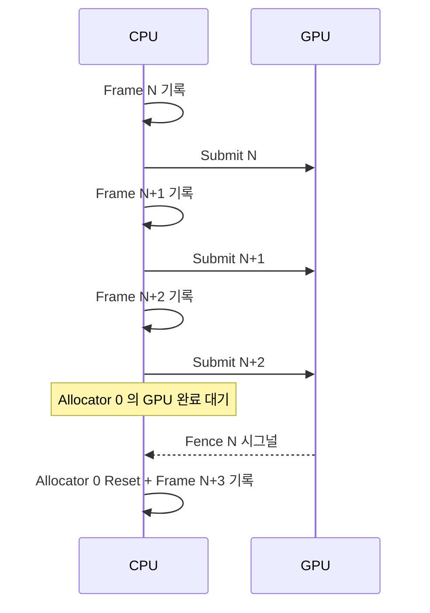

## 들어가며

`graphics_dx_lab` 의 *최소 골격* — Win32 윈도우 + D3D12 Device + Direct Queue + Swap Chain (Flip Discard) + 깊이 버퍼 + 3-frame in flight + 1 만 큐브 + 기본 PSO + ImGui DX12 백엔드.

`graphics_gl_lab` 과 같은 측정 패턴을 *DirectX 12 의 명시적 모델* 로 옮긴 것. 동일한 토글 항목 (드로우콜 / 셰이더 / 바인딩 / 스케일링) 이 *DX12 의 추가 차원* (PSO 변경 빈도 / RootSig / Descriptor Heap / Resource Barrier) 으로 확장.

*시작 상태* — 빈 디렉터리. *종료 상태* — `build\Release\graphics_dx_lab.exe` 가 회전하는 1 만 큐브를 그리고 ImGui 패널이 CPU ms / fps 를 표시한다. 아직 토글은 없고 정책 축은 고정이다.

## 이 step 이 추가·변경하는 파일

| 파일 | 상태 | 역할 |
|---|---|---|
| `CMakeLists.txt` | 신규 | ImGui / ImPlot / DirectXMath FetchContent + 앱 타깃 + `shaders/` 복사 |
| `src/main.cpp` | 신규 | `wWinMain` 진입점 |
| `src/app/app.h` · `src/app/app.cpp` | 신규 | 윈도우 생성, ImGui 초기화, 프레임 루프 |
| `src/device/d3d12_context.h` · `.cpp` | 신규 | 어댑터·디바이스·큐·스왑체인·RTV/DSV·깊이 버퍼·frame in flight·fence |
| `src/device/upload_buffer.h` · `.cpp` | 신규 | Default heap staging 업로드 + Upload heap 영구 map |
| `src/app/frame_cb.h` | 신규 | `FrameCB` (b1) 와 뷰·투영 합성 순수 함수 |
| `src/scene/scene.h` · `scene.cpp` · `scene_record.cpp` | 신규 | 큐브 메시 업로드 + 오브젝트 격자 + 드로우 기록부 |
| `src/rootsig/root_signature.h` · `.cpp` | 신규 | 이 lab 이 쓰는 단일 루트 시그니처 |
| `src/pso/pso_cache.h` · `.cpp` | 신규 | Lambert / Blinn-Phong 두 PSO 컴파일 |
| `src/measure/frame_timer.h` · `.cpp` | 신규 | CPU 프레임 ms · EMA · 240 프레임 히스토리 |
| `src/ui/panel.h` · `.cpp` | 신규 | ImGui 패널 |
| `shaders/cube.hlsl` | 신규 | VS 1 개 + PS 2 개 |

정책 토글(`PsoSwitchPolicy` / `RootSigPolicy` / `HeapPolicy` / `BarrierPolicy`) 은 이 step 의 관심사가 아니다. 이 글의 스니펫은 골격을 세우는 데 필요한 코드만 싣는다.

---

## 목차
1. [DX12 가 OpenGL 과 다른 점](#1-dx12-가-opengl-과-다른-점)
2. [빌드 설정과 진입점](#2-빌드-설정과-진입점)
3. [D3D12Context 의 책임](#3-d3d12context-의-책임)
4. [3-frame in flight 패턴](#4-3-frame-in-flight-패턴)
5. [큐브 메시와 셰이더](#5-큐브-메시와-셰이더)
6. [Win32 + ImGui DX12 백엔드](#6-win32--imgui-dx12-백엔드)
7. [빌드와 실행 결과](#7-빌드와-실행-결과)

---

## 1. DX12 가 OpenGL 과 다른 점

| 항목 | OpenGL | DX12 |
|---|---|---|
| 자원 모델 | Buffer / Texture 핸들 | `ID3D12Resource` + 명시적 Heap |
| 상태 추적 | 드라이버 자동 | 앱이 *Resource Barrier* 명시 |
| 명령 제출 | 즉시 함수 호출 | *CommandList 기록 + Queue 제출* |
| 동기화 | 드라이버 자동 | *Fence* 명시 |
| 셰이더 | runtime GLSL 컴파일 | 별도 *PSO* + HLSL |

이 저장소의 두 lab 실측(`src` + `shaders`)은 `graphics_gl_lab` 2,542 줄, `graphics_dx_lab` 2,340 줄로 코드량 자체는 비슷하다. 명시적 모델의 대가는 줄 수가 아니라 *앱이 직접 다뤄야 하는 개념 수* — PSO / RootSig / Descriptor Heap / Resource Barrier / Fence 가 모두 앱 코드로 올라온다.

## 2. 빌드 설정과 진입점

의존성은 세 개뿐이다. Dear ImGui 는 Win32 + DX12 백엔드를 공식 제공하므로 백엔드 두 파일을 그대로 `imgui` 타깃에 넣는다. D3D12 / DXGI / D3DCompiler 는 Windows SDK 가 제공하므로 내려받지 않는다.

<!-- snippet: CMakeLists.txt@build-setup -->
```cmake
cmake_minimum_required(VERSION 3.20)
project(graphics_dx_lab CXX)

set(CMAKE_CXX_STANDARD 20)
set(CMAKE_CXX_STANDARD_REQUIRED ON)

if(NOT WIN32)
    message(FATAL_ERROR "graphics_dx_lab is Windows-only (DirectX 12).")
endif()

if(NOT CMAKE_BUILD_TYPE AND NOT CMAKE_CONFIGURATION_TYPES)
    set(CMAKE_BUILD_TYPE Release CACHE STRING "Build type" FORCE)
endif()

include(FetchContent)

FetchContent_Declare(
    imgui
    GIT_REPOSITORY https://github.com/ocornut/imgui.git
    GIT_TAG v1.91.5-docking
    GIT_SHALLOW TRUE
)
FetchContent_MakeAvailable(imgui)

add_library(imgui STATIC
    ${imgui_SOURCE_DIR}/imgui.cpp
    ${imgui_SOURCE_DIR}/imgui_draw.cpp
    ${imgui_SOURCE_DIR}/imgui_tables.cpp
    ${imgui_SOURCE_DIR}/imgui_widgets.cpp
    ${imgui_SOURCE_DIR}/imgui_demo.cpp
    ${imgui_SOURCE_DIR}/backends/imgui_impl_win32.cpp
    ${imgui_SOURCE_DIR}/backends/imgui_impl_dx12.cpp
)
target_include_directories(imgui PUBLIC
    ${imgui_SOURCE_DIR}
    ${imgui_SOURCE_DIR}/backends)
target_link_libraries(imgui PUBLIC d3d12 dxgi)

FetchContent_Declare(
    implot
    GIT_REPOSITORY https://github.com/epezent/implot.git
    GIT_TAG v0.16
    GIT_SHALLOW TRUE
)
FetchContent_MakeAvailable(implot)

add_library(implot STATIC
    ${implot_SOURCE_DIR}/implot.cpp
    ${implot_SOURCE_DIR}/implot_items.cpp
    ${implot_SOURCE_DIR}/implot_demo.cpp
)
target_include_directories(implot PUBLIC ${implot_SOURCE_DIR})
target_link_libraries(implot PUBLIC imgui)

FetchContent_Declare(
    directxmath
    GIT_REPOSITORY https://github.com/microsoft/DirectXMath.git
    GIT_TAG dec2023
    GIT_SHALLOW TRUE
)
FetchContent_MakeAvailable(directxmath)
```

앱 타깃은 `WIN32` 서브시스템이다 — `main` 이 아니라 `wWinMain` 이 진입점이므로 이 키워드를 빠뜨리면 링크 단계에서 터진다. HLSL 은 런타임에 `D3DCompileFromFile` 로 읽으므로 빌드 후 `shaders/` 를 실행 파일 옆으로 복사한다.

<!-- snippet: CMakeLists.txt@app-target -->
```cmake
add_executable(${PROJECT_NAME} WIN32
    src/main.cpp
    src/app/app.cpp
    src/device/d3d12_context.cpp
    src/device/upload_buffer.cpp
    src/pso/pso_cache.cpp
    src/rootsig/root_signature.cpp
    src/descriptor/heap_manager.cpp
    src/barrier/barrier_helpers.cpp
    src/scene/scene.cpp
    src/scene/scene_record.cpp
    src/measure/frame_timer.cpp
    src/measure/timestamp_query.cpp
    src/measure/d3d12_debug.cpp
    src/ui/panel.cpp
)

target_include_directories(${PROJECT_NAME} PRIVATE
    src
    ${directxmath_SOURCE_DIR}/Inc)

target_link_libraries(${PROJECT_NAME} PRIVATE
    imgui
    implot
    d3d12
    dxgi
    d3dcompiler
    dxguid)

target_compile_definitions(${PROJECT_NAME} PRIVATE
    UNICODE _UNICODE
    NOMINMAX
    WIN32_LEAN_AND_MEAN
    DXLAB_WINDOWS=1)

if(MSVC)
    target_compile_options(${PROJECT_NAME} PRIVATE /W4 /permissive- /utf-8)
    target_compile_options(${PROJECT_NAME} PRIVATE
        $<$<CONFIG:Release>:/O2>
        $<$<CONFIG:Release>:/Oi>)
endif()

add_custom_command(TARGET ${PROJECT_NAME} POST_BUILD
    COMMAND ${CMAKE_COMMAND} -E copy_directory
            ${CMAKE_CURRENT_SOURCE_DIR}/shaders
            $<TARGET_FILE_DIR:${PROJECT_NAME}>/shaders)
```

`NOMINMAX` 는 `windows.h` 의 `min` / `max` 매크로가 `std::min` 을 깨뜨리는 것을 막는다. 이 lab 은 `std::min` 을 쓰므로 선택이 아니라 필수다.

소스 목록은 lab 이 최종적으로 갖는 TU 전체다. `CMakeLists.txt` 는 파일 하나이므로 목록을 조각내 싣지 않는다. 위 표에 없는 `src/measure/timestamp_query.cpp` · `src/measure/d3d12_debug.cpp` · `src/descriptor/heap_manager.cpp` · `src/barrier/barrier_helpers.cpp` 네 TU 의 본문은 골격의 관심사가 아니라 각각 측정·descriptor·barrier 주제에 속한다.

진입점은 `App` 을 만들고 루프를 돌리는 것이 전부다. 초기화 실패는 예외로 올라오므로 창을 띄우기 전에 죽어도 메시지 박스로 이유가 보인다.

<!-- snippet: src/main.cpp -->
```cpp
#include "app/app.h"

#include <Windows.h>
#include <exception>

int APIENTRY wWinMain(HINSTANCE hInstance, HINSTANCE, PWSTR, int nCmdShow) {
    try {
        dxlab::App app(hInstance, nCmdShow);
        return app.Run();
    } catch (const std::exception& e) {
        MessageBoxA(nullptr, e.what(), "graphics_dx_lab fatal", MB_ICONERROR | MB_OK);
        return 1;
    }
}
```

`App` 의 생성자가 창 → 디바이스 → ImGui → 자원 순서를 고정한다. 이 순서는 뒤집을 수 없다 — 스왑체인이 `HWND` 를 요구하고, ImGui DX12 백엔드가 `ID3D12Device` 를 요구한다.

<!-- snippet: src/app/app.cpp#App::App -->
```cpp
App::App(HINSTANCE hInstance, int nCmdShow)
    : panel_(std::make_unique<Panel>()) {
    g_app = this;
    CreateMainWindow(hInstance, nCmdShow);
    ctx_.Init(hwnd_, width_, height_);
    InitImGui();
    InitResources();
}
```

## 3. D3D12Context 의 책임

한 클래스가 *디바이스 수명 전체* 를 소유한다. 이 lab 의 다른 모듈은 전부 이 클래스가 만든 `ID3D12Device8*` 와 `ID3D12GraphicsCommandList6*` 를 인자로 받는다.

- `IDXGIFactory7` + `IDXGIAdapter4` (디스크리트 GPU 우선).
- `ID3D12Device8` 생성.
- `ID3D12CommandQueue` (Direct) + `ID3D12Fence`.
- `IDXGISwapChain4` (Flip Discard + Allow Tearing).
- RTV / DSV `ID3D12DescriptorHeap`.
- 3 개 BackBuffer + 깊이 버퍼.
- 3 개 CommandAllocator + 1 CommandList.

<!-- snippet: src/device/d3d12_context.h -->
```cpp
#pragma once

#include <d3d12.h>
#include <dxgi1_6.h>
#include <wrl/client.h>

#include <array>
#include <cstdint>

namespace dxlab {

template<class T> using ComPtr = Microsoft::WRL::ComPtr<T>;

constexpr UINT kFramesInFlight = 3;

class D3D12Context {
public:
    void Init(HWND hwnd, int width, int height);
    void Shutdown();

    void Resize(int width, int height);

    UINT  BeginFrame();
    void  EndFrame(bool vsync);
    void  Flush();

    ID3D12Device8*           Device()       { return device_.Get(); }
    ID3D12GraphicsCommandList6* CmdList()   { return cmdList_.Get(); }
    ID3D12CommandQueue*      DirectQueue()  { return directQueue_.Get(); }
    IDXGISwapChain4*         SwapChain()    { return swap_.Get(); }
    ID3D12Resource*          BackBuffer(UINT i) { return backBuffers_[i].Get(); }
    D3D12_CPU_DESCRIPTOR_HANDLE BackBufferRtv(UINT i) const;
    D3D12_CPU_DESCRIPTOR_HANDLE DepthDsv() const;
    DXGI_FORMAT              RtvFormat() const { return rtvFormat_; }
    DXGI_FORMAT              DepthFormat() const { return depthFormat_; }
    UINT                     CurrentFrame() const { return frameIndex_; }
    UINT                     Width()  const { return width_; }
    UINT                     Height() const { return height_; }

private:
    void CreateDevice();
    void CreateQueues();
    void CreateSwapChain(HWND hwnd);
    void CreateRtvHeap();
    void CreateBackBufferRtvs();
    void CreateDepthBuffer();
    void CreateFrameResources();
    void WaitForFrame(UINT frame);

    ComPtr<IDXGIFactory7>            factory_;
    ComPtr<IDXGIAdapter4>            adapter_;
    ComPtr<ID3D12Device8>            device_;
    ComPtr<ID3D12CommandQueue>       directQueue_;
    ComPtr<IDXGISwapChain4>          swap_;
    ComPtr<ID3D12DescriptorHeap>     rtvHeap_;
    ComPtr<ID3D12DescriptorHeap>     dsvHeap_;
    UINT                              rtvIncrement_ = 0;

    std::array<ComPtr<ID3D12Resource>,        kFramesInFlight> backBuffers_{};
    std::array<ComPtr<ID3D12CommandAllocator>, kFramesInFlight> allocators_{};
    ComPtr<ID3D12GraphicsCommandList6> cmdList_;

    ComPtr<ID3D12Resource>            depthBuffer_;

    ComPtr<ID3D12Fence>               fence_;
    HANDLE                             fenceEvent_ = nullptr;
    std::array<UINT64, kFramesInFlight> frameFences_{};
    UINT64                             nextFenceValue_ = 0;

    UINT  width_  = 0;
    UINT  height_ = 0;
    UINT  frameIndex_  = 0;
    DXGI_FORMAT rtvFormat_   = DXGI_FORMAT_R8G8B8A8_UNORM;
    DXGI_FORMAT depthFormat_ = DXGI_FORMAT_D24_UNORM_S8_UINT;
};

}  // namespace dxlab
```

DX12 API 는 `HRESULT` 를 돌려주고 실패해도 아무 일도 일어나지 않는다. 반환값을 버리면 *나중에 null 포인터 역참조로* 죽는다. 그래서 생성 호출 전부를 한 헬퍼로 감싼다.

<!-- snippet: src/device/d3d12_context.cpp#ThrowIfFailed -->
```cpp
void ThrowIfFailed(HRESULT hr, const char* what) {
    if (FAILED(hr)) {
        char buf[256];
        snprintf(buf, sizeof(buf), "%s (hr=0x%08lx)", what, (unsigned long)hr);
        throw std::runtime_error(buf);
    }
}
```

`Init` 은 디버그 레이어를 먼저 켠 뒤 팩토리부터 프레임 자원까지 순서대로 만든다. 디버그 레이어는 *디바이스 생성 전에* 켜야 효과가 있다 — 생성 후에 켜면 이미 만들어진 객체는 검증되지 않는다.

<!-- snippet: src/device/d3d12_context.cpp#D3D12Context::Init -->
```cpp
void D3D12Context::Init(HWND hwnd, int width, int height) {
    width_  = (UINT)width;
    height_ = (UINT)height;

    UINT factoryFlags = 0;
#ifndef NDEBUG
    {
        ComPtr<ID3D12Debug1> dbg;
        if (SUCCEEDED(D3D12GetDebugInterface(IID_PPV_ARGS(&dbg)))) {
            dbg->EnableDebugLayer();
            dbg->SetEnableGPUBasedValidation(FALSE);
        }
        factoryFlags = DXGI_CREATE_FACTORY_DEBUG;
    }
#endif
    ThrowIfFailed(CreateDXGIFactory2(factoryFlags, IID_PPV_ARGS(&factory_)),
                   "CreateDXGIFactory2");

    CreateDevice();
    CreateQueues();
    CreateSwapChain(hwnd);
    CreateRtvHeap();
    CreateBackBufferRtvs();
    CreateDepthBuffer();
    CreateFrameResources();
}
```

어댑터 선택은 `EnumAdapterByGpuPreference` 한 줄이다. 노트북의 Optimus / Switchable 환경에서 인덱스 0 이 내장 GPU 인 경우가 흔하므로 *열거 순서를 믿으면 안 된다*.

<!-- snippet: src/device/d3d12_context.cpp#D3D12Context::CreateDevice -->
```cpp
void D3D12Context::CreateDevice() {
    ThrowIfFailed(factory_->EnumAdapterByGpuPreference(
        0, DXGI_GPU_PREFERENCE_HIGH_PERFORMANCE,
        IID_PPV_ARGS(&adapter_)), "EnumAdapterByGpuPreference");

    ThrowIfFailed(D3D12CreateDevice(adapter_.Get(),
                                     D3D_FEATURE_LEVEL_12_0,
                                     IID_PPV_ARGS(&device_)),
                   "D3D12CreateDevice");
}
```

큐는 Direct 하나뿐이다. Compute / Copy 큐 분리는 이 lab 의 범위가 아니다. Fence 와 이벤트 핸들은 큐와 수명이 같으므로 같은 함수에서 만든다.

<!-- snippet: src/device/d3d12_context.cpp#D3D12Context::CreateQueues -->
```cpp
void D3D12Context::CreateQueues() {
    D3D12_COMMAND_QUEUE_DESC desc{};
    desc.Type = D3D12_COMMAND_LIST_TYPE_DIRECT;
    desc.Priority = D3D12_COMMAND_QUEUE_PRIORITY_NORMAL;
    ThrowIfFailed(device_->CreateCommandQueue(&desc, IID_PPV_ARGS(&directQueue_)),
                   "CreateCommandQueue(Direct)");

    ThrowIfFailed(device_->CreateFence(0, D3D12_FENCE_FLAG_NONE,
                                        IID_PPV_ARGS(&fence_)),
                   "CreateFence");
    fenceEvent_ = CreateEventW(nullptr, FALSE, FALSE, nullptr);
    if (!fenceEvent_) throw std::runtime_error("CreateEventW failed");
}
```

스왑체인은 큐를 받는다 — DXGI 가 Present 를 그 큐에 밀어넣기 때문이다. `FLIP_DISCARD` + `ALLOW_TEARING` 조합이 vsync off 측정의 전제다. `MakeWindowAssociation(DXGI_MWA_NO_ALT_ENTER)` 은 DXGI 가 Alt+Enter 를 가로채 전체화면으로 바꾸는 것을 막는다.

<!-- snippet: src/device/d3d12_context.cpp#D3D12Context::CreateSwapChain -->
```cpp
void D3D12Context::CreateSwapChain(HWND hwnd) {
    DXGI_SWAP_CHAIN_DESC1 sd{};
    sd.Width  = width_;
    sd.Height = height_;
    sd.Format = rtvFormat_;
    sd.BufferUsage = DXGI_USAGE_RENDER_TARGET_OUTPUT;
    sd.BufferCount = kFramesInFlight;
    sd.SampleDesc.Count = 1;
    sd.SwapEffect = DXGI_SWAP_EFFECT_FLIP_DISCARD;
    sd.AlphaMode  = DXGI_ALPHA_MODE_IGNORE;
    sd.Flags = DXGI_SWAP_CHAIN_FLAG_ALLOW_TEARING;

    ComPtr<IDXGISwapChain1> sc1;
    ThrowIfFailed(factory_->CreateSwapChainForHwnd(
        directQueue_.Get(), hwnd, &sd, nullptr, nullptr, &sc1),
        "CreateSwapChainForHwnd");
    factory_->MakeWindowAssociation(hwnd, DXGI_MWA_NO_ALT_ENTER);
    sc1.As(&swap_);
    frameIndex_ = swap_->GetCurrentBackBufferIndex();
}
```

RTV / DSV 힙은 *shader-visible 이 아니다*. 렌더 타깃 뷰와 깊이 뷰는 CPU 핸들로만 쓰이므로 `HEAP_FLAG_NONE` 이면 된다. 핸들 간격은 하드웨어마다 다르므로 `GetDescriptorHandleIncrementSize` 로 물어봐야 한다.

<!-- snippet: src/device/d3d12_context.cpp#D3D12Context::CreateRtvHeap -->
```cpp
void D3D12Context::CreateRtvHeap() {
    D3D12_DESCRIPTOR_HEAP_DESC rtvDesc{};
    rtvDesc.Type = D3D12_DESCRIPTOR_HEAP_TYPE_RTV;
    rtvDesc.NumDescriptors = kFramesInFlight;
    rtvDesc.Flags = D3D12_DESCRIPTOR_HEAP_FLAG_NONE;
    ThrowIfFailed(device_->CreateDescriptorHeap(&rtvDesc, IID_PPV_ARGS(&rtvHeap_)),
                   "CreateDescriptorHeap(RTV)");
    rtvIncrement_ = device_->GetDescriptorHandleIncrementSize(
        D3D12_DESCRIPTOR_HEAP_TYPE_RTV);

    D3D12_DESCRIPTOR_HEAP_DESC dsvDesc{};
    dsvDesc.Type = D3D12_DESCRIPTOR_HEAP_TYPE_DSV;
    dsvDesc.NumDescriptors = 1;
    dsvDesc.Flags = D3D12_DESCRIPTOR_HEAP_FLAG_NONE;
    ThrowIfFailed(device_->CreateDescriptorHeap(&dsvDesc, IID_PPV_ARGS(&dsvHeap_)),
                   "CreateDescriptorHeap(DSV)");
}
```

<!-- snippet: src/device/d3d12_context.cpp#D3D12Context::CreateBackBufferRtvs -->
```cpp
void D3D12Context::CreateBackBufferRtvs() {
    auto cpu = rtvHeap_->GetCPUDescriptorHandleForHeapStart();
    for (UINT i = 0; i < kFramesInFlight; ++i) {
        ThrowIfFailed(swap_->GetBuffer(i, IID_PPV_ARGS(&backBuffers_[i])),
                       "SwapChain::GetBuffer");
        device_->CreateRenderTargetView(backBuffers_[i].Get(), nullptr, cpu);
        cpu.ptr += rtvIncrement_;
    }
}
```

깊이 버퍼는 스왑체인이 만들어 주지 않는다. `CreateCommittedResource` 로 직접 만들고 초기 상태를 `DEPTH_WRITE` 로 둔다. `D3D12_CLEAR_VALUE` 를 넘기면 드라이버가 fast clear 를 쓸 수 있고, 넘긴 값과 실제 `ClearDepthStencilView` 값이 다르면 디버그 레이어가 경고한다.

<!-- snippet: src/device/d3d12_context.cpp#D3D12Context::CreateDepthBuffer -->
```cpp
void D3D12Context::CreateDepthBuffer() {
    D3D12_HEAP_PROPERTIES heap{};
    heap.Type = D3D12_HEAP_TYPE_DEFAULT;

    D3D12_RESOURCE_DESC desc{};
    desc.Dimension = D3D12_RESOURCE_DIMENSION_TEXTURE2D;
    desc.Width  = width_;
    desc.Height = height_;
    desc.DepthOrArraySize = 1;
    desc.MipLevels = 1;
    desc.Format = depthFormat_;
    desc.SampleDesc.Count = 1;
    desc.Layout = D3D12_TEXTURE_LAYOUT_UNKNOWN;
    desc.Flags = D3D12_RESOURCE_FLAG_ALLOW_DEPTH_STENCIL;

    D3D12_CLEAR_VALUE clear{};
    clear.Format = depthFormat_;
    clear.DepthStencil = { 1.0f, 0 };

    ThrowIfFailed(device_->CreateCommittedResource(
        &heap, D3D12_HEAP_FLAG_NONE, &desc,
        D3D12_RESOURCE_STATE_DEPTH_WRITE,
        &clear, IID_PPV_ARGS(&depthBuffer_)),
        "CreateCommittedResource(depth)");

    D3D12_DEPTH_STENCIL_VIEW_DESC dsvDesc{};
    dsvDesc.Format = depthFormat_;
    dsvDesc.ViewDimension = D3D12_DSV_DIMENSION_TEXTURE2D;
    device_->CreateDepthStencilView(depthBuffer_.Get(), &dsvDesc,
                                     dsvHeap_->GetCPUDescriptorHandleForHeapStart());
}
```

## 4. 3-frame in flight 패턴

Allocator 는 프레임마다 하나씩, CommandList 는 하나만 만든다. 이유가 다르다 — allocator 는 *GPU 가 그 메모리를 읽는 동안 Reset 할 수 없고*, list 는 `Reset` 직후부터 다른 allocator 에 기록할 수 있다.

<!-- snippet: src/device/d3d12_context.cpp#D3D12Context::CreateFrameResources -->
```cpp
void D3D12Context::CreateFrameResources() {
    for (UINT i = 0; i < kFramesInFlight; ++i) {
        ThrowIfFailed(device_->CreateCommandAllocator(
            D3D12_COMMAND_LIST_TYPE_DIRECT,
            IID_PPV_ARGS(&allocators_[i])),
            "CreateCommandAllocator");
    }
    ThrowIfFailed(device_->CreateCommandList(0,
        D3D12_COMMAND_LIST_TYPE_DIRECT,
        allocators_[0].Get(), nullptr,
        IID_PPV_ARGS(&cmdList_)),
        "CreateCommandList");
    cmdList_->Close();
}
```

`CreateCommandList` 는 열린 상태의 리스트를 돌려준다. 프레임 루프가 `Reset` 으로 시작하므로 여기서 한 번 `Close` 해 상태를 맞춘다.



3 개 frame in flight = *CPU 가 GPU 보다 3 프레임 앞서 진행*. CPU / GPU stall 최소화. 메모리 비용 — *3 배 (BackBuffer + Allocator + per-frame data)*.

`BeginFrame()` 이 *현재 frame index 의 fence 완료를 기다린 후 allocator + list reset*. `EndFrame()` 이 *ExecuteCommandLists + Present + Signal*.

<!-- snippet: src/device/d3d12_context.cpp#D3D12Context::BeginFrame -->
```cpp
UINT D3D12Context::BeginFrame() {
    frameIndex_ = swap_->GetCurrentBackBufferIndex();
    WaitForFrame(frameIndex_);
    allocators_[frameIndex_]->Reset();
    cmdList_->Reset(allocators_[frameIndex_].Get(), nullptr);
    return frameIndex_;
}
```

<!-- snippet: src/device/d3d12_context.cpp#D3D12Context::EndFrame -->
```cpp
void D3D12Context::EndFrame(bool vsync) {
    cmdList_->Close();
    ID3D12CommandList* lists[] = { cmdList_.Get() };
    directQueue_->ExecuteCommandLists(_countof(lists), lists);

    UINT syncInterval = vsync ? 1 : 0;
    UINT flags = vsync ? 0u : DXGI_PRESENT_ALLOW_TEARING;
    swap_->Present(syncInterval, flags);

    ++nextFenceValue_;
    directQueue_->Signal(fence_.Get(), nextFenceValue_);
    frameFences_[frameIndex_] = nextFenceValue_;
}
```

핵심은 마지막 세 줄이다. *제출한 프레임마다 단조 증가하는 fence 값을 남기고*, 그 값을 프레임 인덱스별로 기억한다. `WaitForFrame` 은 그 값과 `GetCompletedValue()` 만 비교한다 — 프레임 수를 세는 방식이 아니다.

<!-- snippet: src/device/d3d12_context.cpp#D3D12Context::WaitForFrame -->
```cpp
void D3D12Context::WaitForFrame(UINT frame) {
    UINT64 v = frameFences_[frame];
    if (fence_->GetCompletedValue() < v) {
        fence_->SetEventOnCompletion(v, fenceEvent_);
        WaitForSingleObject(fenceEvent_, INFINITE);
    }
}
```

`Flush()` 는 *모든* in-flight 작업을 비운다. 스왑체인 리사이즈나 자원 교체처럼 GPU 가 참조 중인 객체를 놓아야 할 때만 쓴다 — 매 프레임 쓰면 frame in flight 가 1 로 떨어진다.

<!-- snippet: src/device/d3d12_context.cpp#D3D12Context::Flush -->
```cpp
void D3D12Context::Flush() {
    ++nextFenceValue_;
    directQueue_->Signal(fence_.Get(), nextFenceValue_);
    if (fence_->GetCompletedValue() < nextFenceValue_) {
        fence_->SetEventOnCompletion(nextFenceValue_, fenceEvent_);
        WaitForSingleObject(fenceEvent_, INFINITE);
    }
}
```

리사이즈는 `Flush()` → 백버퍼/깊이 참조 해제 → `ResizeBuffers` → 뷰 재생성 순서다. `ComPtr` 하나라도 남아 있으면 `ResizeBuffers` 가 실패한다.

<!-- snippet: src/device/d3d12_context.cpp#D3D12Context::Resize -->
```cpp
void D3D12Context::Resize(int width, int height) {
    if ((UINT)width == width_ && (UINT)height == height_) return;
    if (width <= 0 || height <= 0) return;
    Flush();

    for (auto& b : backBuffers_) b.Reset();
    depthBuffer_.Reset();

    width_  = (UINT)width;
    height_ = (UINT)height;
    ThrowIfFailed(swap_->ResizeBuffers(kFramesInFlight, width_, height_,
                                        rtvFormat_,
                                        DXGI_SWAP_CHAIN_FLAG_ALLOW_TEARING),
                   "SwapChain::ResizeBuffers");

    CreateBackBufferRtvs();
    CreateDepthBuffer();
    frameIndex_ = swap_->GetCurrentBackBufferIndex();
}
```

## 5. 큐브 메시와 셰이더

버퍼 생성 경로는 둘이다. 정적 메시는 *Default heap + staging 복사 한 번*, 매 프레임 바뀌는 데이터는 *Upload heap 영구 map* 이다.

<!-- snippet: src/device/upload_buffer.cpp#CreateBufferStatic -->
```cpp
ComPtr<ID3D12Resource> CreateBufferStatic(
    ID3D12Device* device,
    ID3D12GraphicsCommandList* cmd,
    const void* data,
    size_t bytes,
    D3D12_RESOURCE_STATES finalState,
    ComPtr<ID3D12Resource>& outStagingKeepAlive)
{
    D3D12_HEAP_PROPERTIES heapDefault{}; heapDefault.Type = D3D12_HEAP_TYPE_DEFAULT;
    D3D12_HEAP_PROPERTIES heapUpload{};  heapUpload.Type  = D3D12_HEAP_TYPE_UPLOAD;
    D3D12_RESOURCE_DESC   desc = BufferDesc(bytes);
    // ...
    void* mapped = nullptr;
    D3D12_RANGE rd{0, 0};
    upload->Map(0, &rd, &mapped);
    std::memcpy(mapped, data, bytes);
    upload->Unmap(0, nullptr);

    cmd->CopyBufferRegion(dst.Get(), 0, upload.Get(), 0, bytes);

    D3D12_RESOURCE_BARRIER b{};
    b.Type = D3D12_RESOURCE_BARRIER_TYPE_TRANSITION;
    b.Transition.pResource = dst.Get();
    b.Transition.StateBefore = D3D12_RESOURCE_STATE_COPY_DEST;
    b.Transition.StateAfter  = finalState;
    b.Transition.Subresource = D3D12_RESOURCE_BARRIER_ALL_SUBRESOURCES;
    cmd->ResourceBarrier(1, &b);

    outStagingKeepAlive = upload;
    return dst;
}
```

`outStagingKeepAlive` 가 이 함수의 계약이다. `CopyBufferRegion` 은 *명령을 기록만* 하므로 함수가 돌아온 시점에 복사는 시작도 안 했다. staging 버퍼를 여기서 놓으면 GPU 가 해제된 메모리를 읽는다. 호출자가 fence 완료까지 붙잡아야 한다.

<!-- snippet: src/device/upload_buffer.cpp#CreateBufferUpload -->
```cpp
ComPtr<ID3D12Resource> CreateBufferUpload(
    ID3D12Device* device,
    size_t bytes,
    void** outMapped)
{
    D3D12_HEAP_PROPERTIES heap{}; heap.Type = D3D12_HEAP_TYPE_UPLOAD;
    D3D12_RESOURCE_DESC   desc = BufferDesc(bytes);

    ComPtr<ID3D12Resource> buf;
    if (FAILED(device->CreateCommittedResource(
            &heap, D3D12_HEAP_FLAG_NONE, &desc,
            D3D12_RESOURCE_STATE_GENERIC_READ, nullptr,
            IID_PPV_ARGS(&buf)))) {
        throw std::runtime_error("CreateBufferUpload failed");
    }
    D3D12_RANGE rd{0, 0};
    buf->Map(0, &rd, outMapped);
    return buf;
}
```

메시 업로드는 `Scene::BuildMesh` 가 한 번만 한다. 정점·인덱스 두 버퍼가 각각 staging 을 하나씩 남기고, 그 둘을 호출자의 `keepAlive` 벡터에 넣는다.

<!-- snippet: src/scene/scene.cpp#Scene::BuildMesh -->
```cpp
void Scene::BuildMesh(D3D12Context& ctx,
                      ID3D12GraphicsCommandList* uploadCmd,
                      std::vector<ComPtr<ID3D12Resource>>& keepAlive) {
    ComPtr<ID3D12Resource> stagingVB, stagingIB;
    vb_ = CreateBufferStatic(ctx.Device(), uploadCmd, kCube, sizeof(kCube),
                              D3D12_RESOURCE_STATE_VERTEX_AND_CONSTANT_BUFFER,
                              stagingVB);
    ib_ = CreateBufferStatic(ctx.Device(), uploadCmd, kCubeIdx, sizeof(kCubeIdx),
                              D3D12_RESOURCE_STATE_INDEX_BUFFER,
                              stagingIB);
    keepAlive.push_back(stagingVB);
    keepAlive.push_back(stagingIB);

    vbv_.BufferLocation = vb_->GetGPUVirtualAddress();
    vbv_.SizeInBytes    = sizeof(kCube);
    vbv_.StrideInBytes  = sizeof(Vertex);

    ibv_.BufferLocation = ib_->GetGPUVirtualAddress();
    ibv_.SizeInBytes    = sizeof(kCubeIdx);
    ibv_.Format         = DXGI_FORMAT_R16_UINT;

    indexCount_ = sizeof(kCubeIdx) / sizeof(kCubeIdx[0]);
}
```

오브젝트 격자는 디바이스가 필요 없는 순수 CPU 단계다. 고정 시드 `mt19937` 을 쓰므로 같은 개수에서 항상 같은 장면이 나온다 — 측정을 반복 가능하게 만드는 조건이다.

<!-- snippet: src/scene/scene_record.cpp#Scene::BuildObjects -->
```cpp
void Scene::BuildObjects(int count) {
    objects_.clear();
    objects_.reserve((size_t)count);
    int side = (int)std::ceil(std::cbrt((double)count));
    float spacing = 2.5f;
    float origin  = -0.5f * spacing * (float)(side - 1);

    std::mt19937 rng(12345);
    std::uniform_real_distribution<float> uColor(0.3f, 1.0f);
    std::uniform_real_distribution<float> uAxis(-1.0f, 1.0f);
    std::uniform_real_distribution<float> uSpeed(0.3f, 1.5f);

    int placed = 0;
    for (int z = 0; z < side && placed < count; ++z)
    for (int y = 0; y < side && placed < count; ++y)
    for (int x = 0; x < side && placed < count; ++x) {
        Object o;
        o.position = { origin + x * spacing, origin + y * spacing, origin + z * spacing };
        XMFLOAT3 a{uAxis(rng), uAxis(rng), uAxis(rng)};
        float len = std::sqrt(a.x*a.x + a.y*a.y + a.z*a.z);
        if (len < 1e-4f) { a = {0, 1, 0}; len = 1; }
        o.axis = {a.x/len, a.y/len, a.z/len};
        o.angle = 0;
        o.angularSpeed = uSpeed(rng);
        o.color = {uColor(rng), uColor(rng), uColor(rng)};
        objects_.push_back(o);
        ++placed;
    }
}
```

카메라와 조명은 프레임 상수 하나(`b1`)로 들어간다. 이 헤더는 D3D12 · Win32 에 의존하지 않으므로 뷰·투영 합성 결과를 GPU 없이 검증할 수 있다.

<!-- snippet: src/app/frame_cb.h -->
```cpp
struct FrameCB {
    DirectX::XMFLOAT4X4 viewProj;
    DirectX::XMFLOAT3   cameraPos;
    float               time;
    DirectX::XMFLOAT3   lightDir;
    float               pad;
};

struct CameraSetup {
    DirectX::XMFLOAT3 eye{60.0f, 40.0f, 60.0f};
    DirectX::XMFLOAT3 at{0.0f, 0.0f, 0.0f};
    DirectX::XMFLOAT3 up{0.0f, 1.0f, 0.0f};
    float fovDegrees = 45.0f;
    float nearZ      = 0.1f;
    float farZ       = 1000.0f;
};

inline DirectX::XMFLOAT3 DefaultLightDir() { return {0.4f, 0.8f, 0.2f}; }

inline FrameCB MakeFrameCB(int width, int height, const CameraSetup& cam,
                           DirectX::XMFLOAT3 lightDirRaw, float time) {
    using namespace DirectX;
    FrameCB cb{};
    XMVECTOR camPos = XMLoadFloat3(&cam.eye);
    XMVECTOR camAt  = XMLoadFloat3(&cam.at);
    XMVECTOR up     = XMLoadFloat3(&cam.up);
    XMMATRIX view = XMMatrixLookAtRH(camPos, camAt, up);
    XMMATRIX proj = XMMatrixPerspectiveFovRH(
        XMConvertToRadians(cam.fovDegrees),
        (float)width / (float)(std::max)(height, 1),
        cam.nearZ, cam.farZ);
    XMMATRIX vp = XMMatrixMultiply(view, proj);
    XMStoreFloat4x4(&cb.viewProj, XMMatrixTranspose(vp));
    XMStoreFloat3(&cb.cameraPos, camPos);
    cb.time = time;
    XMVECTOR L = XMVector3Normalize(XMLoadFloat3(&lightDirRaw));
    XMStoreFloat3(&cb.lightDir, L);
    return cb;
}
```

셰이더는 파일 하나에 VS 한 개 + PS 두 개다. 행렬 규약이 이 파일의 가장 미묘한 지점이다 — HLSL 의 기본 선언은 `column_major` 이고, C++ 은 `XMMatrixTranspose` 후 업로드한다. 둘 중 하나만 바꾸면 화면이 무너진다.

<!-- snippet: shaders/cube.hlsl -->
```hlsl
cbuffer FrameCB : register(b1) {
    float4x4 viewProj;
    float3   cameraPos;
    float    time;
    float3   lightDir;
    float    _pad;
};

cbuffer DrawCB : register(b0) {
    uint     useInstancing;
    float4x4 model;
    float4   color;
};

struct Instance {
    float4x4 model;
    float4   color;
};
StructuredBuffer<Instance> instances : register(t0);

struct VSInput {
    float3 pos    : POSITION;
    float3 normal : NORMAL;
};

struct VSOutput {
    float4 pos      : SV_Position;
    float3 normalWS : NORMAL;
    float3 worldPos : POSITION;
    float3 color    : COLOR;
};

VSOutput VSMain(VSInput input, uint iid : SV_InstanceID) {
    VSOutput o;
    float4x4 m;
    float4   c;
    if (useInstancing == 1) {
        m = instances[iid].model;
        c = instances[iid].color;
    } else {
        m = model;
        c = color;
    }
    float4 worldPos = mul(float4(input.pos, 1.0), m);
    o.pos      = mul(worldPos, viewProj);
    o.worldPos = worldPos.xyz;
    o.normalWS = mul(float4(input.normal, 0.0), m).xyz;
    o.color    = c.rgb;
    return o;
}

float4 PSLambert(VSOutput input) : SV_Target {
    float3 N = normalize(input.normalWS);
    float3 L = normalize(lightDir);
    float diff = max(dot(N, L), 0.0);
    return float4(input.color * (0.15 + diff), 1.0);
}

float4 PSBlinnPhong(VSOutput input) : SV_Target {
    float3 N = normalize(input.normalWS);
    float3 L = normalize(lightDir);
    float3 V = normalize(cameraPos - input.worldPos);
    float3 H = normalize(L + V);
    float diff = max(dot(N, L), 0.0);
    float spec = pow(max(dot(N, H), 0.0), 64.0);
    return float4(input.color * (0.15 + diff) + 0.5 * spec, 1.0);
}
```

## 6. Win32 + ImGui DX12 백엔드

`WNDCLASSEXW` 등록 + `CreateWindowExW`. `AdjustWindowRect` 를 거치지 않으면 요청한 크기가 *테두리 포함* 크기로 해석돼 클라이언트 영역이 작아진다.

<!-- snippet: src/app/app.cpp#App::CreateMainWindow -->
```cpp
void App::CreateMainWindow(HINSTANCE hInstance, int nCmdShow) {
    WNDCLASSEXW wc{};
    wc.cbSize = sizeof(wc);
    wc.style = CS_HREDRAW | CS_VREDRAW;
    wc.lpfnWndProc = &App::WndProc;
    wc.hInstance = hInstance;
    wc.hCursor = LoadCursor(nullptr, IDC_ARROW);
    wc.lpszClassName = L"graphics_dx_labCls";
    RegisterClassExW(&wc);

    RECT r{0, 0, width_, height_};
    AdjustWindowRect(&r, WS_OVERLAPPEDWINDOW, FALSE);
    hwnd_ = CreateWindowExW(0, wc.lpszClassName, L"graphics_dx_lab",
                             WS_OVERLAPPEDWINDOW,
                             CW_USEDEFAULT, CW_USEDEFAULT,
                             r.right - r.left, r.bottom - r.top,
                             nullptr, nullptr, hInstance, nullptr);
    if (!hwnd_) throw std::runtime_error("CreateWindowExW failed");
    ShowWindow(hwnd_, nCmdShow);
}
```

`WndProc` 은 정적 함수라 인스턴스를 스스로 알지 못한다. 이 lab 은 창이 하나뿐이므로 파일 지역 포인터 하나로 해결한다. ImGui 의 Win32 백엔드가 입력을 먼저 볼 기회를 줘야 마우스가 패널에 잡힌다.

<!-- snippet: src/app/app.cpp#App::WndProc -->
```cpp
LRESULT CALLBACK App::WndProc(HWND hwnd, UINT msg, WPARAM wp, LPARAM lp) {
    if (ImGui_ImplWin32_WndProcHandler(hwnd, msg, wp, lp)) return true;
    switch (msg) {
    case WM_SIZE:
        if (g_app && wp != SIZE_MINIMIZED) {
            int w = LOWORD(lp), h = HIWORD(lp);
            g_app->width_  = (w > 0) ? w : g_app->width_;
            g_app->height_ = (h > 0) ? h : g_app->height_;
            if (g_app->ctx_.Device()) g_app->ctx_.Resize(g_app->width_, g_app->height_);
        }
        return 0;
    case WM_DESTROY:
        PostQuitMessage(0);
        return 0;
    }
    return DefWindowProcW(hwnd, msg, wp, lp);
}
```

ImGui 의 *Win32 + DX12 백엔드* 는 공식 제공이다. DX12 백엔드는 폰트 텍스처용으로 *shader-visible SRV heap 한 슬롯* 을 요구하며, 애플리케이션 자신의 SRV heap 과 *분리* 해 두는 편이 안전하다.

<!-- snippet: src/app/app.cpp#App::InitImGui -->
```cpp
void App::InitImGui() {
    IMGUI_CHECKVERSION();
    ImGui::CreateContext();
    ImPlot::CreateContext();
    ImGui::StyleColorsDark();

    D3D12_DESCRIPTOR_HEAP_DESC d{};
    d.Type = D3D12_DESCRIPTOR_HEAP_TYPE_CBV_SRV_UAV;
    d.NumDescriptors = 1;
    d.Flags = D3D12_DESCRIPTOR_HEAP_FLAG_SHADER_VISIBLE;
    ctx_.Device()->CreateDescriptorHeap(&d, IID_PPV_ARGS(&imguiHeap_));

    ImGui_ImplWin32_Init(hwnd_);
    ImGui_ImplDX12_Init(ctx_.Device(), kFramesInFlight,
                         ctx_.RtvFormat(), imguiHeap_.Get(),
                         imguiHeap_->GetCPUDescriptorHandleForHeapStart(),
                         imguiHeap_->GetGPUDescriptorHandleForHeapStart());
}
```

자원 초기화는 메시 업로드가 명령 목록을 요구하므로 프레임 하나를 빌려 쓴다. `BeginFrame` / `EndFrame` 한 쌍이 곧 single-shot 업로드 제출이다.

<!-- snippet: src/app/app.cpp#App::InitResources -->
```cpp
void App::InitResources() {
    rootSig_.Init(ctx_.Device());
    psoCache_.Init(ctx_.Device(), rootSig_.Get(),
                    ctx_.RtvFormat(), ctx_.DepthFormat());
    heap_.Init(ctx_.Device(), 100000);
    gpuTimer_.Init(ctx_.Device(), ctx_.DirectQueue());
    debug_.Install(ctx_.Device());

    void* mapped = nullptr;
    frameCB_ = CreateBufferUpload(ctx_.Device(), sizeof(FrameCB) * kFramesInFlight,
                                    &mapped);
    frameCBMapped_ = (FrameCB*)mapped;

    ctx_.BeginFrame();
    scene_.Init(ctx_, ctx_.CmdList(), uploadKeepAlive_);
    ctx_.EndFrame(false);
}
```

메시지 루프는 `PeekMessageW` 폴링이다. `GetMessageW` 로 블로킹하면 메시지가 없을 때 렌더가 멈춘다.

<!-- snippet: src/app/app.cpp#App::Run -->
```cpp
int App::Run() {
    MSG msg{};
    while (msg.message != WM_QUIT) {
        if (PeekMessageW(&msg, nullptr, 0, 0, PM_REMOVE)) {
            TranslateMessage(&msg);
            DispatchMessageW(&msg);
            continue;
        }
        OnFrame();
    }
    return (int)msg.wParam;
}
```

CPU 시간은 `steady_clock` 두 지점의 차다. `BeginFrame` 이 남기는 것은 *이전 프레임 시작과의 간격*(애니메이션용 델타)이고, `EndFrame` 이 남기는 것은 *이번 프레임의 CPU 구간*(측정용 ms)이다. 두 값은 의미가 다르므로 섞어 쓰면 안 된다.

<!-- snippet: src/measure/frame_timer.cpp -->
```cpp
FrameTimer::FrameTimer() { history_.fill(0.0f); }

void FrameTimer::BeginFrame() {
    auto now = Clock::now();
    if (hasPrevFrame_) {
        std::chrono::duration<float> d = now - prevBegin_;
        lastDeltaSeconds_ = d.count();
    } else {
        lastDeltaSeconds_ = 0.0f;
    }
    frameBegin_ = now;
}

void FrameTimer::EndFrame() {
    auto now = Clock::now();
    std::chrono::duration<float, std::milli> ms = now - frameBegin_;
    lastFrameMs_ = ms.count();
    if (emaFrameMs_ <= 0.0f) emaFrameMs_ = lastFrameMs_;
    else emaFrameMs_ = emaFrameMs_ * (1.0f - kEmaAlpha) + lastFrameMs_ * kEmaAlpha;
    history_[(size_t)historyHead_] = lastFrameMs_;
    historyHead_ = (historyHead_ + 1) % kHistorySize;
    prevBegin_ = frameBegin_;
    hasPrevFrame_ = true;
}
```

히스토리는 링 버퍼다. 240 칸을 `historyHead_` 가 순회하므로 그리기 직전에 한 번 선형화해야 시간 순서로 보인다.

종료 순서에도 계약이 있다. ImGui 백엔드를 먼저 내리고, `D3D12Context::Shutdown()` 이 `Flush()` 로 GPU 완료를 보장한 뒤에야 `ComPtr` 들이 풀린다.

<!-- snippet: src/app/app.cpp#App::Shutdown -->
```cpp
void App::Shutdown() {
    ImGui_ImplDX12_Shutdown();
    ImGui_ImplWin32_Shutdown();
    ImPlot::DestroyContext();
    ImGui::DestroyContext();

    debug_.Uninstall();

    gpuTimer_.Shutdown();
    ctx_.Shutdown();
}
```

## 7. 빌드와 실행 결과

```powershell
cmake -S . -B build -G "Visual Studio 17 2022" -A x64
cmake --build build --config Release
build\Release\graphics_dx_lab.exe
```

첫 실행 — *디스크리트 GPU 우선 선택* + Direct queue + Swap Chain + 1 만 큐브 회전. CPU ms 그래프 표시.

관측 항목 — 창 제목이 `graphics_dx_lab` 이고, 패널의 `objects` 가 10000 이며, 큐브 격자가 각자 다른 축으로 회전한다. 검은 화면이 나오면 `shaders/` 복사가 안 됐거나(`D3DCompileFromFile` 실패는 예외 메시지로 뜬다) 어댑터 선택이 실패한 것이다.

Visual Studio 의 *Graphics Debugger* 또는 *PIX on Windows* 로 *드로우 콜 / state 단계별 디버깅* 가능. *RenderDoc* 도 DX12 지원.

---

## 결론

DX12 의 *명시적 모델 + 3-frame in flight + Direct queue + Swap Chain* 의 *최소 골격* 이 완성됐다. 같은 1 만 큐브를 그리는 데 *앱이 직접 다뤄야 하는 개념이 늘어나는* 이유와 *그 대가로 얻는 명시적 제어* 가 분명히 드러난다.

이 step 의 한계 — 측정 수단이 CPU 프레임 시간뿐이다. GPU 가 실제로 몇 ms 를 쓰는지, 어떤 명령이 몇 번 기록됐는지는 아직 화면에 없다. 정책 축도 모두 고정이라 비교할 대상이 없다.

## 더 읽을거리

- Microsoft Learn, [Direct3D 12 Programming Guide](https://learn.microsoft.com/en-us/windows/win32/direct3d12/directx-12-programming-guide) — 명시적 모델의 공식 가이드.
- [DirectX Graphics Samples: D3D12HelloWorld](https://github.com/microsoft/DirectX-Graphics-Samples) — 같은 골격의 공식 최소 예제.
- [PIX on Windows](https://devblogs.microsoft.com/pix/) — DX12 측정·디버깅 1차 도구.
