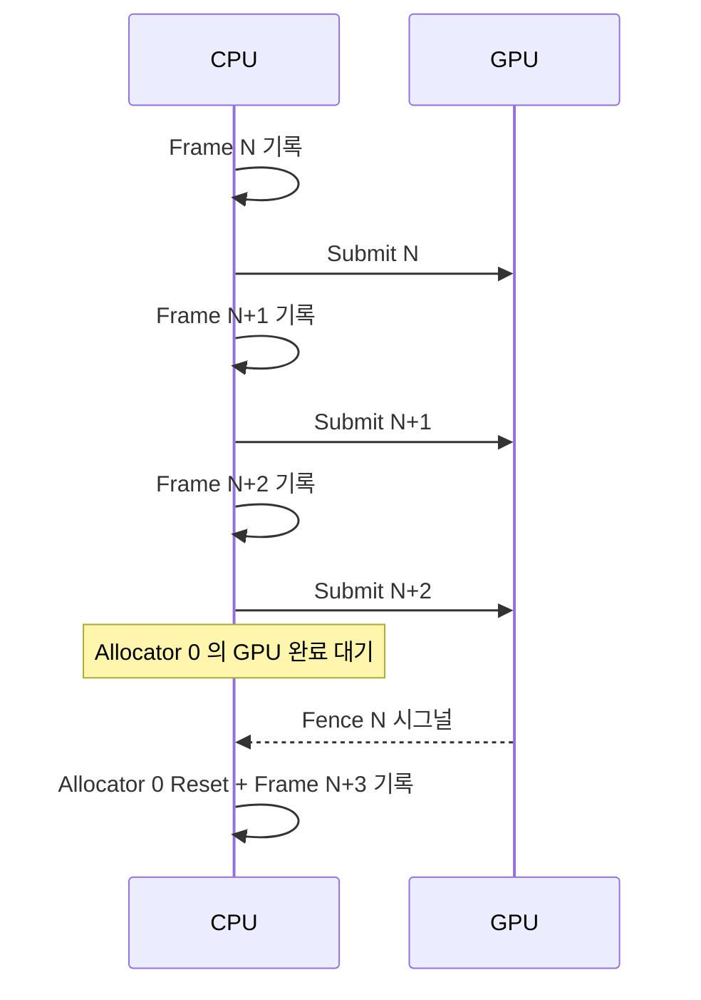

## 들어가며

`graphics_dx_lab` 의 *최소 골격* — Win32 윈도우 + D3D12 Device + Direct Queue + Swap Chain (Flip Discard) + 깊이 버퍼 + 3-frame in flight + 1 만 큐브 + 기본 PSO + ImGui DX12 백엔드.

`graphics_gl_lab` 과 같은 측정 패턴을 *DirectX 12 의 명시적 모델* 로 옮긴 것. 동일한 토글 항목 (드로우콜 / 셰이더 / 바인딩 / 스케일링) 이 *DX12 의 추가 차원* (PSO 변경 빈도 / RootSig / Descriptor Heap / Resource Barrier) 으로 확장.

이 단계의 결과물은 *회전하는 1 만 큐브 + CPU ms / fps 표시*.

---

## 목차
1. [DX12 가 OpenGL 과 다른 점](#1-dx12-가-opengl-과-다른-점)
2. [D3D12Context 의 책임](#2-d3d12context-의-책임)
3. [3-frame in flight 패턴](#3-3-frame-in-flight-패턴)
4. [Win32 + ImGui DX12 백엔드](#4-win32--imgui-dx12-백엔드)
5. [빌드와 실행 결과](#5-빌드와-실행-결과)

---

## 1. DX12 가 OpenGL 과 다른 점

| 항목 | OpenGL | DX12 |
|---|---|---|
| 자원 모델 | Buffer / Texture 핸들 | `ID3D12Resource` + 명시적 Heap |
| 상태 추적 | 드라이버 자동 | 앱이 *Resource Barrier* 명시 |
| 명령 제출 | 즉시 함수 호출 | *CommandList 기록 + Queue 제출* |
| 동기화 | 드라이버 자동 | *Fence* 명시 |
| 셰이더 | runtime GLSL 컴파일 | 별도 *PSO* + HLSL |

이 저장소의 두 lab 실측(`src` + `shaders`)은 `graphics_gl_lab` 2,542 줄, `graphics_dx_lab` 2,340 줄로 코드량 자체는 비슷하다. 명시적 모델의 대가는 줄 수가 아니라 *앱이 직접 다뤄야 하는 개념 수* — PSO / RootSig / Descriptor Heap / Resource Barrier / Fence 가 모두 앱 코드로 올라온다.

## 2. D3D12Context 의 책임

- `IDXGIFactory7` + `IDXGIAdapter4` (디스크리트 GPU 우선).
- `ID3D12Device8` 생성.
- `ID3D12CommandQueue` (Direct) + `ID3D12Fence`.
- `IDXGISwapChain4` (Flip Discard + Allow Tearing).
- RTV / DSV `ID3D12DescriptorHeap`.
- 3 개 BackBuffer + 깊이 버퍼.
- 3 개 CommandAllocator + 1 CommandList.

`BeginFrame()` 가 *현재 frame index 의 fence 완료를 기다린 후 allocator + list reset*. `EndFrame()` 가 *ExecuteCommandLists + Present + Signal*.

## 3. 3-frame in flight 패턴



3 개 frame in flight = *CPU 가 GPU 보다 3 프레임 앞서 진행*. CPU / GPU stall 최소화. 메모리 비용 — *3 배 (BackBuffer + Allocator + per-frame data)*.

## 4. Win32 + ImGui DX12 백엔드

`WinMain` 진입점 + `WNDCLASSEX` 등록 + `CreateWindowExW`. 이벤트 루프는 `PeekMessageW + DispatchMessageW` 로 폴링.

ImGui 의 *Win32 + DX12 백엔드* 가 *공식 제공*. 통합 패턴.

```cpp
ImGui_ImplWin32_Init(hwnd);
ImGui_ImplDX12_Init(device, framesInFlight, rtvFormat,
                     imguiSrvHeap, cpuHandle, gpuHandle);
```

매 프레임.

```cpp
ImGui_ImplDX12_NewFrame();
ImGui_ImplWin32_NewFrame();
ImGui::NewFrame();
// ... UI ...
ImGui::Render();
ID3D12DescriptorHeap* heaps[] = { imguiSrvHeap };
cmd->SetDescriptorHeaps(1, heaps);
ImGui_ImplDX12_RenderDrawData(ImGui::GetDrawData(), cmd);
```

ImGui 가 *별도 SRV heap* 을 요구 (폰트 텍스처용). 애플리케이션 자신의 SRV heap 과 *분리* 유지.

## 5. 빌드와 실행 결과

```powershell
cmake -S . -B build -G "Visual Studio 17 2022" -A x64
cmake --build build --config Release
build\Release\graphics_dx_lab.exe
```

첫 실행 — *디스크리트 GPU 우선 선택* + Direct queue + Swap Chain + 1 만 큐브 회전. CPU ms 그래프 표시.

Visual Studio 의 *Graphics Debugger* 또는 *PIX on Windows* 로 *드로우 콜 / state 단계별 디버깅* 가능. *RenderDoc* 도 DX12 지원.

---

## 결론

DX12 의 *명시적 모델 + 3-frame in flight + Direct queue + Swap Chain* 의 *최소 골격* 이 완성됐다. 같은 1 만 큐브를 그리는 데 *앱이 직접 다뤄야 하는 개념이 늘어나는* 이유와 *그 대가로 얻는 명시적 제어* 가 분명히 드러난다.

## 더 읽을거리

- Microsoft Learn, [Direct3D 12 Programming Guide](https://learn.microsoft.com/en-us/windows/win32/direct3d12/directx-12-programming-guide) — 명시적 모델의 공식 가이드.
- [DirectX Graphics Samples: D3D12HelloWorld](https://github.com/microsoft/DirectX-Graphics-Samples) — 같은 골격의 공식 최소 예제.
- [PIX on Windows](https://devblogs.microsoft.com/pix/) — DX12 측정·디버깅 1차 도구.
