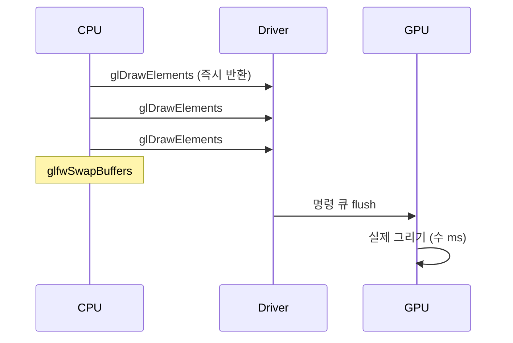

## 들어가며

Step 1 이 *최소 골격 + CPU 프레임 ms* 만 측정했다면, Step 2 는 *GPU 측 시간 / GL 호출 카운터 / 드라이버 디버그 메시지* 를 추가한다. 이 셋이 갖춰져야 렌더 모드를 바꿨을 때 생기는 *차이* 를 *그래프 + 수치 + 로그* 의 세 측면에서 동시에 볼 수 있다.

핵심 — *CPU 시간 만으로는 그래픽스 비용을 모름*. 드라이버가 *명령을 GPU 큐에 던지고 즉시 반환* 하기 때문. *실제 GPU 가 일한 시간* 은 *별도 쿼리* (`GL_TIME_ELAPSED`) 로만 측정 가능. CPU ↔ GPU 의 시간이 *다르다는 점* 자체가 *그래픽스 측정의 첫 번째 사실*.

여기까지의 코드 상태 — Step 1 의 골격 + 1만 오브젝트 × 개별 드로우콜. 이 글에서 도달할 결과물 — *CPU 와 GPU ms 가 동시에 그래프로 보이고, 매 프레임의 드로우콜 수 / 상태 변경 수가 카운터로 표시되고, GL 드라이버 경고가 별도 로그 창에 누적되는 상태*. 네 단계로 쌓는다.

1. `GL_TIME_ELAPSED` 쿼리 + ring buffer 패턴.
2. GL 호출 카운터 — Scene 측에서 직접 증가.
3. `GL_KHR_debug` 콜백 + ImGui 로그 창.
4. 두 ms 그래프 동시 plot + 통합 패널.

---

## 목차
1. [GPU 시간 측정의 함정](#1-gpu-시간-측정의-함정)
2. [GL_TIME_ELAPSED 쿼리 + Ring Buffer](#2-gl_time_elapsed-쿼리--ring-buffer)
3. [GL 호출 카운터](#3-gl-호출-카운터)
4. [GL_KHR_debug 콜백](#4-gl_khr_debug-콜백)
5. [통합 패널 + 그래프](#5-통합-패널--그래프)
6. [실행과 관측](#6-실행과-관측)

---

## 1. GPU 시간 측정의 함정

### 왜 CPU 시간이 거짓말을 하는가

OpenGL 호출은 *대부분 비동기*. `glDrawElements` 가 *즉시 반환* — 명령을 *드라이버 큐에 넣고 끝*. 실제 GPU 작업은 *수 프레임 후* 일어날 수 있다.



CPU 프레임 ms 가 *2ms* 인데 GPU 가 *16ms* 일 수도, 반대일 수도 있다. *둘 다 측정* 해야 *어디가 병목인지* 알 수 있음.

### Bottleneck 판단

| CPU ms | GPU ms | 진단 |
|---|---|---|
| 높음 | 낮음 | CPU 바운드 — 드로우콜 수 / 상태 변경 |
| 낮음 | 높음 | GPU 바운드 — 픽셀 / 정점 처리 |
| 둘 다 높음 | 비슷 | 균형 — 양쪽 최적화 필요 |
| 둘 다 낮음 | Vsync ON 의 경우 | Vsync OFF 로 다시 측정 |

`graphics_gl_lab` 은 *둘 다 측정 + 그래프로 비교* 가 기본.

### CPU 곡선의 해석 한계

이 lab 의 "CPU frame ms" 는 `BeginFrame` ~ `EndFrame` 사이의 *프레임 wall-clock* 이고, 그 구간에 `glfwSwapBuffers` 가 들어 있다. 드라이버 큐가 포화되면 SwapBuffers 가 블록하므로 *GPU 대기 시간이 CPU 곡선에 흡수* 된다. 즉 GPU 바운드 구간에서는 CPU 곡선이 GPU 곡선 근처로 수렴하며, 위 표의 "낮음 / 높음" 판정은 *CPU 가 아직 큐를 채울 여유가 있는 구간* 에서만 곧이곧대로 읽을 수 있다. 순수 제출 비용만 보고 싶으면 드로우 제출 구간만 따로 재는 타이머가 필요하다 — 이 lab 은 그 분리를 하지 않는다.

## 2. GL_TIME_ELAPSED 쿼리 + Ring Buffer

### 단순 사용 — Begin / End

```cpp
GLuint q;
glGenQueries(1, &q);

glBeginQuery(GL_TIME_ELAPSED, q);
// ... draw calls ...
glEndQuery(GL_TIME_ELAPSED);

GLuint64 ns;
glGetQueryObjectui64v(q, GL_QUERY_RESULT, &ns);   // ← 블로킹!
double ms = (double)ns / 1.0e6;
```

함정 — `glGetQueryObjectui64v(GL_QUERY_RESULT)` 가 *GPU 완료까지 CPU 블록*. 같은 프레임에서 결과를 받으려 하면 *CPU 가 GPU 끝나기를 기다림* → *측정이 측정을 망침*.

### Ring Buffer 로 비동기

쿼리를 *N 개* 두고 *돌려 쓰기*. 결과는 *N 프레임 후* 회수 — 이미 GPU 가 완료한 상태라 블록 없음.

```cpp
class GpuTimer {
    static constexpr int kRingSize = 3;
    GLuint queries_[kRingSize];
    int    writeIdx_ = 0;
    int    readIdx_  = 0;
    int    inFlight_ = 0;
    bool   active_   = false;

    void Begin() {
        if (inFlight_ == kRingSize) Poll();
        if (inFlight_ == kRingSize) return;  // 결과가 아직 없으면 이번 프레임 skip
        glBeginQuery(GL_TIME_ELAPSED, queries_[writeIdx_]);
        active_ = true;
    }
    void End()   {
        if (!active_) return;
        glEndQuery(GL_TIME_ELAPSED);
        active_ = false;
        ++inFlight_;
        writeIdx_ = (writeIdx_ + 1) % kRingSize;
    }
    void Poll() {
        if (inFlight_ == 0) return;
        GLuint available = GL_FALSE;
        glGetQueryObjectuiv(queries_[readIdx_], GL_QUERY_RESULT_AVAILABLE,
                            &available);
        if (!available) return;
        GLuint64 ns;
        glGetQueryObjectui64v(queries_[readIdx_], GL_QUERY_RESULT, &ns);
        readIdx_ = (readIdx_ + 1) % kRingSize;
        --inFlight_;
        lastMs_ = (double)ns / 1.0e6;
    }
};
```

3 프레임 ring 이면 *결과가 1~3 프레임 늦게 도착* — 실시간 그래프 입장에선 *눈에 안 보일 정도*. `GL_QUERY_RESULT_AVAILABLE` 을 먼저 확인하므로 CPU 를 강제로 기다리지 않는다. GPU 가 아주 많이 밀려 ring 이 꽉 차면 *그 프레임의 GPU 측정만 건너뛰고* 마지막 값을 유지한다.

### 셰이더 stage 별 시간은 불가

`GL_TIME_ELAPSED` 가 *Begin ~ End 구간 전체 GPU 시간* 만 반환. *vertex / fragment / geometry stage 별 분리는 불가능*. 그게 필요하면 *NVIDIA Nsight Graphics / AMD RGP / RenderDoc* 같은 *벤더 프로파일러* 사용.

학습 단계에선 *패스 (depth pass / color pass) 별 분리* 까지가 한계. 그것만으로도 *대부분의 토글 효과를 식별* 가능.

## 3. GL 호출 카운터

호출 카운트는 *드라이버에 후킹할 수도 있고 (gladHook), Scene 이 자기가 호출한 횟수를 직접 증가시킬 수도 있음*. 학습 단계엔 *직접 증가* 가 단순.

<!-- snippet: src/measure/gl_counters.h#GlCounters -->
```cpp
struct GlCounters {
    int drawCalls         = 0;
    int instancedDraws    = 0;
    int indirectDraws     = 0;
    int stateChanges      = 0;     // glBind* / glUseProgram 등
    int uniformUpdates    = 0;
    int bufferUpdates     = 0;     // glBufferSubData (UBO / SSBO 갱신)
    int barrierCalls      = 0;
    // ... Reset() 이 일곱 개를 모두 0 으로 되돌린다.
};
```

Scene 코드가 명시적으로.

<!-- snippet: src/scene/scene.cpp#Scene::Draw -->
```cpp
glBindVertexArray(vao_);
counters.stateChanges++;
// ...
for (const auto& o : objects_) {
    glm::mat4 model = glm::translate(glm::mat4(1.0f), o.position)
                    * glm::rotate(glm::mat4(1.0f), o.angle, o.axis);
    if (shader.SetMat4("uModel", model))   counters.uniformUpdates++;
    if (shader.SetVec3("uColor", o.color)) counters.uniformUpdates++;
    glDrawElements(GL_TRIANGLES, indexCount_, GL_UNSIGNED_INT, nullptr);
    ++lastDrawCalls_;
    counters.drawCalls++;
}
```

코드 가독성 약간 ↓ 그러나 *각 토글이 어느 카운터를 얼마나 줄이는지* 가 직관적.

카운터 정의는 *실제 GL 호출 수* 다. `ShaderProgram::SetXxx` 는 uniform location 이 -1 (현재 프로그램에 없는 이름) 이면 `glUniform` 을 호출하지 않고 `false` 를 반환하므로, 호출부는 그 반환값이 true 일 때만 `uniformUpdates` 를 증가시킨다. 이렇게 해야 셰이더마다 다른 uniform 집합에서도 카운터가 호출 수와 어긋나지 않는다.

### 매 프레임 리셋

```cpp
void App::Render() {
    counters_.Reset();
    gpuTimer_->Begin();
    /* draw */
    gpuTimer_->End();
}
```

## 4. GL_KHR_debug 콜백

GL 드라이버가 *에러 / 경고 / 성능 힌트 / undefined behavior* 메시지를 줄 수 있다. 디버그 컨텍스트 (`GLFW_OPENGL_DEBUG_CONTEXT`) + `glDebugMessageCallback` 등록 시.

콜백은 `KHRDebug` 의 정적 멤버로 두고 `userParam` 에 인스턴스를 실어 보낸다.

<!-- snippet: src/measure/khr_debug.h -->
```cpp
static void GLAPIENTRY Callback(GLenum source, GLenum type, GLuint id,
                                 GLenum severity, GLsizei length,
                                 const GLchar* message, const void* userParam);
```

등록은 `Install()` 한 곳에서.

<!-- snippet: src/measure/khr_debug.cpp#KHRDebug::Install -->
```cpp
glEnable(GL_DEBUG_OUTPUT);
glEnable(GL_DEBUG_OUTPUT_SYNCHRONOUS);  // 콜백이 *호출 스레드에서* 실행
glDebugMessageCallback(&KHRDebug::Callback, this);
glDebugMessageControl(GL_DONT_CARE, GL_DONT_CARE, GL_DONT_CARE,
                      0, nullptr, GL_TRUE);     // 모든 메시지 활성
```

`GL_DEBUG_OUTPUT_SYNCHRONOUS` 가 핵심 — 콜백이 *호출 즉시* 실행되어 *어느 코드가 메시지를 일으켰는지* 디버거에서 *call stack* 으로 본다. 비동기 모드는 *별도 스레드 + 시간 차이* 라 디버깅 어려움.

### 자주 보이는 메시지

- `GL_INVALID_OPERATION` — 잘못된 상태에서 호출 (예: bound program 없이 draw).
- `Buffer detailed info: Buffer object X (bound to ...) will use VIDEO memory as the source for buffer object operations` — NVIDIA 의 성능 정보.
- `Texture state usage warning: The texture object X bound to texture image unit Y does not have a defined base level` — 미초기화 텍스처 사용.

처음 본 코드에서 *수십 개 메시지가 쏟아짐* — 일반적인 모습. *심각도 (HIGH / MEDIUM / LOW / NOTIFICATION) 별 필터링* 후 해결.

### Ring Buffer 로 누적

콜백이 *수백 메시지 / 초* 를 던질 수 있어 *vector push_back 무한 누적* 은 메모리 위험. *원형 버퍼 (256 슬롯)* 에 가장 최근 256 개만 보관.

<!-- snippet: src/measure/khr_debug.cpp#KHRDebug::Push -->
```cpp
void KHRDebug::Push(const DebugMessage& m) {
    ring_[(size_t)head_] = m;
    head_ = (head_ + 1) % kRingSize;
    if (count_ < kRingSize) ++count_;
}
```

ImGui 로그 창에서 *심각도별 색상* + *자동 스크롤* 로 표시.

## 5. 통합 패널 + 그래프

ImPlot 가 *CPU ms + GPU ms 를 같은 plot* 에 두 line 으로.

<!-- snippet: src/ui/panel.cpp@ms-plot -->
```cpp
ImPlot::PlotLine("CPU", cpuHist.data(), FrameTimer::kHistorySize);
ImPlot::PlotLine("GPU", gpuHist.data(), GpuTimer::kHistorySize);
```

두 선이 *분리되어 그려지면* — 어디가 더 비싼지 *한눈에*. 예 — *CPU 5ms / GPU 12ms* 면 *GPU 바운드*, *CPU 18ms / GPU 3ms* 면 *CPU (드로우콜) 바운드*.

### 카운터 표시

패널이 출력하는 여섯 줄 (1만 오브젝트 · 개별 드로우콜 · uber 셰이더 · 정상 상태).

```text
draw calls:       10000
instanced draws:  0
indirect draws:   0
state changes:    1
uniform updates:  20006
buffer updates:   0
```

*유니폼 업데이트 20006* = 오브젝트당 모델 + 색상 (2 × 10000) + 프레임 공통 6 (`uShadingModel`, `uView`, `uProj`, `uLightDir`, `uCameraPos`, `uUseInstancing`). 이 호출 비용이 *CPU 시간의 대부분* 이다. *state changes 1* 은 VAO 바인딩 한 번이며, 셰이더 프로그램이 바뀐 프레임에만 2 가 된다. *buffer updates* 는 `glBufferSubData` 호출 수이고, 광원 배열을 UBO/SSBO 로 올리는 경로에서만 0 이 아니게 된다.

`GlCounters::barrierCalls` 는 구조체에 자리만 있고 이 lab 의 GL 경로에는 배리어 개념이 없어 패널에 출력하지 않는다.

### 디버그 로그 창

```text
[NOTE]  id=131185  Buffer detailed info: Buffer object 1 ...
[LOW]   id=131218  Program/shader state performance warning ...
[HIGH]  id=131076  GL_INVALID_OPERATION error generated ...
```

색상 분류 — HIGH (빨강) / MEDIUM (주황) / LOW (노랑) / NOTIFICATION (회색). 한눈에 *심각도 분포* 파악.

## 6. 실행과 관측

```bash
# Linux / macOS
cmake -S . -B build -DCMAKE_BUILD_TYPE=Release
cmake --build build -j
./build/graphics_gl_lab
```

```powershell
# Windows (Visual Studio generator)
cmake -S . -B build
cmake --build build --config Release
build\Release\graphics_gl_lab.exe
```

패널에서 확인할 값.

- *Frame* 섹션에 `CPU frame` 과 `GPU pass` 두 줄이 함께 뜨고, ImPlot 그래프에 CPU / GPU 두 곡선이 그려진다.
- *GL counters (this frame)* 섹션의 다섯 줄이 위의 `draw calls: 10000 … uniform updates: 20006` 과 일치한다.
- 디버그 컨텍스트로 빌드된 경우 *GL debug log* 창에 드라이버 메시지가 심각도 색상으로 쌓인다. 메시지가 하나도 없으면 `(no messages)` 가 표시된다.

### 측정 인프라 자체의 검증

세 관측 수단 중 *GPU 시간* 은 값이 기계마다 달라 고정 기대값을 둘 수 없다. 나머지 둘 — *카운터의 프레임 경계* 와 *디버그 메시지 링* — 은 GL 호출이 없는 계산이라 컨텍스트 없이 그대로 검사된다.

```powershell
ctest --test-dir build -C Release -R gl_step02 --output-on-failure
```

```text
    Start 4: gl_step02_measure
1/1 Test #4: gl_step02_measure ................   Passed    0.03 sec

100% tests passed out of 1
```

```powershell
build\Release\graphics_gl_contract_tests.exe step02   # Linux/macOS: ./build/graphics_gl_contract_tests step02
```

```text
[step02] counter_reset ... ok
[step02] debug_message_ring ... ok
graphics_gl_contract_tests: 2/2 passed (filter=step02)
```

`counter_reset` 은 일곱 칸을 전부 0 이 아닌 값으로 채운 뒤 `Reset()` 이 전부 되돌리는지 본다. 한 칸이라도 살아남으면 패널의 수치가 프레임 사이에 누적되어 거짓말을 한다.

`debug_message_ring` 은 원형 버퍼가 *메모리를 늘리지 않고 최근 256 개만* 보관한다는 주장을 그대로 친다.

<!-- snippet: tests/graphics_gl_contract_tests.cpp#TestDebugMessageRing -->
```cpp
constexpr int kOverflow = gllab::KHRDebug::kRingSize + 10;
for (int i = 0; i < kOverflow; ++i)
    debug.PushAppMessage("msg" + std::to_string(i));

// 슬롯 수는 링 크기에서 멈춘다 — push_back 누적이면 여기서 갈린다.
CHECK(debug.Count() == gllab::KHRDebug::kRingSize);
CHECK(debug.RingHead() == (2 + kOverflow) % gllab::KHRDebug::kRingSize);

// 가장 최근 메시지는 머리 바로 앞 칸이고, 가장 오래된 것은 덮여 사라졌다.
const int newest =
    (debug.RingHead() + gllab::KHRDebug::kRingSize - 1) % gllab::KHRDebug::kRingSize;
CHECK(debug.Get(newest).text == "msg" + std::to_string(kOverflow - 1));
```

`Push` 를 `std::vector::push_back` 으로 바꾸면 `Count()` 가 268 이 되어 첫 단언이, 덮어쓰기를 없애면 마지막 단언이 갈린다. `PushAppMessage` 로 넣은 항목의 `source` 가 `GL_DEBUG_SOURCE_APPLICATION` 인지도 같은 함수가 함께 확인한다 — 앱 메시지와 드라이버 메시지가 같은 창에 섞여도 출처가 구분되어야 하기 때문이다.

---

## 결론

여기까지의 코드는 *CPU + GPU 시간 + GL 호출 카운터 + 드라이버 디버그 메시지* 를 동시에 측정하는 *측정 인프라* 를 완성한다. 종료 상태의 렌더 모드는 여전히 *개별 드로우콜* 하나뿐이고, 달라진 것은 *같은 프레임을 네 가지 관측값 (CPU ms / GPU ms / 카운터 / 로그) 으로 볼 수 있다* 는 점이다.

`GL_TIME_ELAPSED` 의 *ring buffer 패턴*, `GL_KHR_debug` 의 *원형 버퍼 + 색상 표시*, *Scene 측 카운터 직접 증가* — 세 패턴 모두 *학습 단계의 단순함* 과 *프로덕션 측정 도구의 정밀성* 사이의 *합리적 균형점*. 더 정밀이 필요하면 *벤더 프로파일러* 로 이행.

## 더 읽을거리

- [OpenGL Wiki: Query Object](https://www.khronos.org/opengl/wiki/Query_Object) — GL_TIME_ELAPSED 의 명세(비동기 회수 규칙).
- [OpenGL Wiki: Debug Output](https://www.khronos.org/opengl/wiki/Debug_Output) — KHR_debug 메시지 소스·심각도 체계.
- [RenderDoc](https://renderdoc.org/) / [Nsight Graphics](https://developer.nvidia.com/nsight-graphics) — 프레임 캡처와 GPU 분석에 사용하는 표준 프로파일러.
