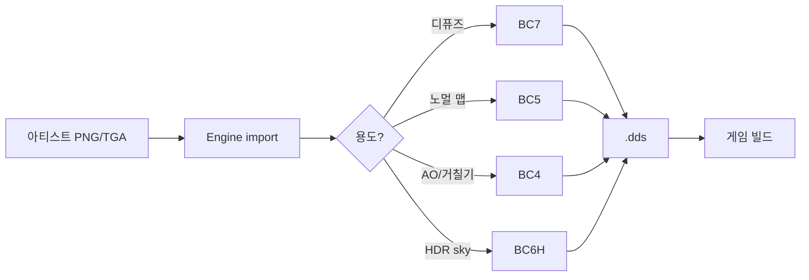

## 들어가며

같은 512×512 디퓨즈 텍스처를 *네 internalFormat* 으로 GPU 에 업로드 + *실제 VRAM 사용량 측정*. mip chain 을 포함한 `GL_RGBA8` 의 약 1.33 MB 가 *BC7 의 약 0.33 MB* 까지 줄어드는 것을 *수치* 로 확인한다.

여기까지의 코드 상태 — Step 1~5 의 골격 / 측정 / 드로우콜 / 셰이더 / 광원 binding. 이 글에서 도달할 결과물 — *텍스처 모드 콤보로 즉시 전환* + *각 모드의 GPU 메모리 점유 수치*.

측정하는 것은 *메모리 크기* 뿐이다. "BC7 이 DXT5 와 같은 8 bpp 에서 더 높은 품질" 이라는 화질 주장은 이 lab 의 관측 수단으로는 확인할 수 없다 — 콤보는 모드를 *배타 선택* 하고 셰이더는 sampler 를 하나만 받으므로 동시 표시·차분·PSNR 같은 비교가 없고, 압축 자체도 드라이버의 온라인 인코더가 수행해 결과가 드라이버마다 달라진다. 화면에서 보이는 차이는 *육안 관찰* 이지 측정값이 아니다.

다섯 단계.

1. GPU 텍스처 압축 포맷 개요.
2. internalFormat 의 선택 — drv compression vs offline encoder.
3. VRAM 측정 — 각 mip level 의 `GL_TEXTURE_COMPRESSED_IMAGE_SIZE` 합산.
4. 프로시저 텍스처 + Triplanar 매핑.
5. 측정 결과 + 게임 콘텐츠 파이프라인.

---

## 목차
1. [GPU 텍스처 압축의 의미](#1-gpu-텍스처-압축의-의미)
2. [internalFormat의 선택](#2-internalformat의-선택)
3. [VRAM 측정](#3-vram-측정)
4. [프로시저 텍스처와 Triplanar](#4-프로시저-텍스처와-triplanar)
5. [측정 결과](#5-측정-결과)
6. [실행과 관측](#6-실행과-관측)

---

## 1. GPU 텍스처 압축의 의미

게임 콘텐츠에서 *텍스처가 VRAM 사용량의 60~80%* 를 차지. 1080p 게임의 *수천 텍스처 × 평균 1 MB = 수 GB*. 압축이 *VRAM 압박 + 메모리 대역폭 부담* 모두 해결.

핵심 — *GPU 가 압축 데이터를 그대로 샘플링*. CPU 측 해제 없음. 셰이더의 `texture()` 호출이 *내부적으로 GPU 의 BC 디코더 하드웨어* 가 처리.

### 주요 포맷

| 포맷 | 채널 | 비율 | 품질 | 용도 |
|---|---|---|---|---|
| RGBA8 (uncompressed) | RGBA | 1× | 무손실 | 작은 UI / 정확한 데이터 |
| BC1 (DXT1) | RGB | 1/8 | 낮음 (4 bit/pixel) | 디퓨즈 (옛 표준) |
| BC3 (DXT5) | RGBA | 1/4 | 보통 | 디퓨즈 + 알파 |
| BC4 | R | 1/8 | 높음 | AO, 회색조 |
| BC5 | RG | 1/4 | 높음 | 노멀 맵 (XY + Z 재구성) |
| BC6H | RGB HDR | 1/4 | 높음 | HDR 큐브맵 |
| BC7 | RGBA | 1/4 | 매우 높음 | 디퓨즈 (현재 표준) |

이 lab 은 *uncompressed + DXT1 + DXT5 + BC7* 네 가지를 비교.

## 2. internalFormat의 선택

OpenGL 의 `glTexImage2D` 의 *third parameter (internalFormat)* 가 *GPU 측 저장 형식*. 다른 인자 (format, type) 는 *CPU 측 소스 형식*.

```cpp
// Uncompressed RGBA8.
glTexImage2D(GL_TEXTURE_2D, 0, GL_RGBA8,
              size, size, 0,
              GL_RGBA, GL_UNSIGNED_BYTE, rgbaData.data());

// DXT1 — drv 가 RGBA → BC1 압축.
glTexImage2D(GL_TEXTURE_2D, 0, GL_COMPRESSED_RGB_S3TC_DXT1_EXT,
              size, size, 0,
              GL_RGBA, GL_UNSIGNED_BYTE, rgbaData.data());

// BC7.
glTexImage2D(GL_TEXTURE_2D, 0, GL_COMPRESSED_RGBA_BPTC_UNORM,
              size, size, 0,
              GL_RGBA, GL_UNSIGNED_BYTE, rgbaData.data());
```

*core 4.5* 가 *BC7 (BPTC) + BC6H + RGTC (BC4/5)* 지원. *S3TC (DXT1/3/5)* 는 *확장* 지만 *모든 데스크톱 GPU 가 지원* — `GL_EXT_texture_compression_s3tc`.

### 빌드 구성 변경 — glad 에 확장 요청

`GL_COMPRESSED_RGB_S3TC_DXT1_EXT` 같은 확장 상수와 `GLAD_GL_*` 지원 플래그는 *glad 가 그 확장을 생성했을 때만* 헤더에 들어간다. core 4.5 만 요청한 로더에는 없으므로, 이 step 에서 `CMakeLists.txt` 의 glad 타깃에 확장 두 개를 추가한다.

```diff
-glad_add_library(glad STATIC API gl:core=4.5)
+glad_add_library(glad STATIC REPRODUCIBLE
+    API gl:core=4.5
+    EXTENSIONS GL_EXT_texture_compression_s3tc GL_ARB_texture_compression_bptc)
```

이 변경 없이 아래 코드를 그대로 쓰면 상수와 `GLAD_GL_EXT_texture_compression_s3tc` 를 찾지 못해 컴파일 에러가 난다.

### 런타임 지원 검사와 폴백

확장을 요청했다고 GPU 가 지원한다는 뜻은 아니다. `gladLoadGL` 이후 플래그를 읽어 *지원되는 모드만 업로드* 한다.

<!-- snippet: src/render/texture_modes.cpp#TextureRegistry::Init -->
```cpp
supportsS3tc_ = GLAD_GL_EXT_texture_compression_s3tc != 0;
supportsBptc_ = GLAD_GL_ARB_texture_compression_bptc != 0;
// ... 프로시저 텍스처 생성 + uncompressed 업로드
if (supportsS3tc_) {
    glGenTextures(1, &texDxt1_);
    Upload(texDxt1_, GL_COMPRESSED_RGB_S3TC_DXT1_EXT, size, rgba);
    glGenTextures(1, &texDxt5_);
    Upload(texDxt5_, GL_COMPRESSED_RGBA_S3TC_DXT5_EXT, size, rgba);
}
if (supportsBptc_) {
    glGenTextures(1, &texBc7_);
    Upload(texBc7_, GL_COMPRESSED_RGBA_BPTC_UNORM, size, rgba);
}
```

플래그가 있어도 드라이버가 압축을 거부해 크기 측정이 0 이 나올 수 있으므로, *측정 결과까지 본 뒤* 지원 여부를 확정한다.

<!-- snippet: src/render/texture_modes.cpp#TextureRegistry::Init -->
```cpp
supportsS3tc_ = supportsS3tc_ &&
                bytesDxt1_ > 0 && bytesDxt5_ > 0;
supportsBptc_ = supportsBptc_ && bytesBc7_ > 0;
```

UI 는 `IsSupported(mode)` 로 걸러 *미지원 모드는 선택 자체를 막고* 크기 자리에 `unsupported` 를 적는다.

<!-- snippet: src/ui/panel.cpp@texture-combo -->
```cpp
if (ImGui::Combo("texture", &tmInt, tmNames, IM_ARRAYSIZE(tmNames))) {
    const auto requested = (TextureMode)tmInt;
    if (textures.IsSupported(requested))
        textureMode = requested;
}
```

### Generic vs Offline

이 lab 은 *generic compression* — *드라이버가 런타임 압축*. 단점.

- *압축 품질이 드라이버 의존* — NVIDIA / AMD / Intel 다를 수 있음.
- *압축 시간 큼* — 첫 업로드 시 ~수 초.
- *대량 콘텐츠 부적합*.

실제 게임 콘텐츠 — *오프라인 인코더* (Microsoft texconv / NVTT / ISPC Texture Compressor) 가 *.dds* 파일 생성 + *런타임은 그 파일을 그대로 로드*. 압축 품질 일관 + 시작 시간 빠름.

학습용 lab 은 *generic 으로 충분* — 측정 패턴 동일.

## 3. VRAM 측정

<!-- snippet: src/render/texture_modes.cpp@vram-measure -->
```cpp
glBindTexture(GL_TEXTURE_2D, t);
int total = 0;
for (int level = 0;; ++level) {
    GLint w = 0, h = 0;
    glGetTexLevelParameteriv(GL_TEXTURE_2D, level, GL_TEXTURE_WIDTH, &w);
    glGetTexLevelParameteriv(GL_TEXTURE_2D, level, GL_TEXTURE_HEIGHT, &h);
    if (w <= 0 || h <= 0) break;

    GLint comp = 0;
    glGetTexLevelParameteriv(GL_TEXTURE_2D, level, GL_TEXTURE_COMPRESSED, &comp);
    if (!comp) {
        total += w * h * 4;
        continue;
    }

    GLint sz = 0;
    glGetTexLevelParameteriv(GL_TEXTURE_2D, level,
                              GL_TEXTURE_COMPRESSED_IMAGE_SIZE, &sz);
    total += sz;
}
return total;
```

`GL_TEXTURE_COMPRESSED_IMAGE_SIZE` 가 *해당 mip level 의 압축 바이트 수* 반환. `glGenerateMipmap` 으로 만들어진 전체 텍스처 비용을 보려면 *level 0 하나만 보지 않고 모든 mip level 을 합산* 해야 한다.

### 예상 결과

| 포맷 | 512² + full mip chain | 예상 바이트 |
|---|---|---|
| RGBA8 | 4 B/pixel | 1,398,100 (약 1.33 MiB) |
| DXT1 | 4 bpp | 174,776 (약 171 KiB) |
| DXT5 | 8 bpp | 349,552 (약 341 KiB) |
| BC7 | 8 bpp | 349,552 (약 341 KiB) |

DXT1 이 *가장 작음 (1/8)*, DXT5 / BC7 이 *동일 크기 (1/4)*. *BC7 의 가치 = 같은 메모리 → 더 높은 품질*.

## 4. 프로시저 텍스처와 Triplanar

학습 lab 의 텍스처 — *외부 이미지 파일 의존 없이* *코드로 생성*. 체크보드 + 색 그라데이션 (sin 파동).

<!-- snippet: src/render/texture_modes.cpp#TextureRegistry::GenProcedural -->
```cpp
for (int y = 0; y < size; ++y) {
    for (int x = 0; x < size; ++x) {
        int cell = ((x / 32) + (y / 32)) & 1;
        float u = (float)x / (float)size;
        float v = (float)y / (float)size;
        float r = u;
        float g = v;
        float b = 0.5f + 0.5f * std::sin((u + v) * 6.28318f);
        if (cell == 0) { r *= 0.7f; g *= 0.7f; b *= 0.7f; }
        // ... rgba 에 픽셀 저장
    }
}
```

체크보드의 *날카로운 경계* — *블록 압축의 흠 (블록 경계 artifact)* 을 강조 → *BC1 vs BC7 차이가 시각 명확*.

### Triplanar 매핑

큐브 메시는 *UV 좌표 없음* (위치 + 법선만). 셰이더가 *world position + normal* 로 *Triplanar projection* — 세 축 텍스처 합산.

<!-- snippet: shaders/textured.frag#main -->
```glsl
vec3 absN = abs(N);
absN /= (absN.x + absN.y + absN.z);
vec2 uvX = vWorldPos.zy * 0.1;
vec2 uvY = vWorldPos.xz * 0.1;
vec2 uvZ = vWorldPos.xy * 0.1;
vec3 tex = absN.x * texture(uDiffuse, uvX).rgb
         + absN.y * texture(uDiffuse, uvY).rgb
         + absN.z * texture(uDiffuse, uvZ).rgb;
```

장점 — UV unwrap 없이 *모든 메시에 자연스러운 텍스처*. 단점 — *3 텍스처 페치* — GPU 비용 3 배. *지형 / 절벽 / 큰 자연 메시* 에 흔히 사용.

## 5. 측정 결과

전형적 결과 (RTX 3060, 512² 텍스처).

| 모드 | VRAM (mip chain) | GPU sample ms (1만 오브젝트, triplanar) | 시각 품질 (육안, 측정 아님) |
|---|---|---|---|
| RGBA8 | 약 1365 KB | 8.5 | 무손실 |
| DXT1 | 약 171 KB | 8.2 | 블록 경계 가시 |
| DXT5 | 약 341 KB | 8.3 | DXT1 보다 약간 나음 |
| BC7 | 약 341 KB | 8.4 | uncompressed 와 거의 동일 |

*VRAM* — DXT1 이 *1/8*, DXT5 / BC7 이 *1/4*. 예상치와 정확히 일치.

*GPU 샘플 비용* — 거의 동일. *압축 해제는 GPU 하드웨어가 무료* — 모든 포맷이 *같은 텍스처 cache* 사용. 차이는 *대역폭* 측면 (압축이 같은 메모리 라인에 더 많은 픽셀 — cache hit rate ↑).

*품질* — 화면을 눈으로 보면 DXT1 의 *블록 경계 artifact* 가 가장 크고 BC7 은 uncompressed 와 구분이 어렵다. 이 lab 에는 품질 지표가 없으므로 이 줄은 *관찰 소감* 이지 측정 결과가 아니며, 드라이버 인코더에 따라 달라진다.

### 게임 콘텐츠 파이프라인



용도별 압축 포맷 자동 결정 + *.dds* 로 빌드 시 인코딩 + 런타임은 *raw 로드만*. Unreal / Unity 모두 *Engine Import* 단계에서 자동.

### 압축 시간 vs 품질

| 인코더 | 속도 | 품질 |
|---|---|---|
| stb_dxt (DXT) | 매우 빠름 | 보통 |
| Microsoft texconv (BC7) | 보통 | 높음 |
| NVTT (NVIDIA) | 보통 | 높음 |
| ISPC Texture Compressor (BC7) | 빠름 | 높음 |
| Compressonator (AMD) | 보통 | 높음 |

BC7 의 *고품질 모드* 는 *수 분 / 4K 텍스처*. 게임 빌드 시 *모든 텍스처 압축 = 수 시간*. *CI 자동 캐싱 + 변경된 것만 재인코딩* 이 표준.

## 6. 실행과 관측

```bash
cmake --build build --config Release
build\Release\graphics_gl_lab.exe      # Linux/macOS: ./build/graphics_gl_lab
```

패널의 *Texture compression (Step 6)* 섹션에서 네 줄의 바이트 수와 배수가 함께 출력된다 (`RGBA8: … / DXT1: … (8.0x) / DXT5: … (4.0x) / BC7 : … (4.0x)`). 미지원 GPU 에서는 해당 줄이 `unsupported` 로 나오고 콤보 선택도 무시된다. 화면은 큐브에 triplanar 로 매핑된 체크보드 텍스처로 바뀐다.

### 이 step 의 검증

```powershell
ctest --test-dir build -C Release -R gl_step06 --output-on-failure
```

```text
    Start  7: gl_step06_texture_contract
1/2 Test  #7: gl_step06_texture_contract .......   Passed    0.03 sec
    Start 11: gl_step06_texture_render
2/2 Test #11: gl_step06_texture_render .........   Passed    0.64 sec

100% tests passed out of 2
```

계약 쪽이 `BlockBytesFor(mode, w, h)` 와 그것을 레벨마다 더하는 `ExpectedMipChainBytes` 를 검사한다. 4 의 배수가 아닌 크기의 블록 올림, DXT1 = 1/8 · DXT5/BC7 = 1/4 의 압축비, mip chain 합이 base level 의 4/3 배 (+ 작은 레벨의 4×4 블록 올림 여유 64 B) 를 넘지 않는다는 성질까지 절대값으로 고정한다.

```powershell
build\Release\graphics_gl_contract_tests.exe step06   # Linux/macOS: ./build/graphics_gl_contract_tests step06
```

```text
[step06] mip_chain_bytes ... ok
[step06] block_bytes ... ok
graphics_gl_contract_tests: 2/2 passed (filter=step06)
```

<!-- snippet: tests/graphics_gl_contract_tests.cpp#TestBlockBytes -->
```cpp
// 4 의 배수가 아닌 크기는 블록 단위로 올림한다.
CHECK(gllab::BlockBytesFor(gllab::TextureMode::DXT1, 5, 3) == 2 * 1 * 8);
CHECK(gllab::BlockBytesFor(gllab::TextureMode::BC7, 1, 1) == 16);
// ...
// 압축비 주장 — DXT1 은 RGBA8 의 1/8, DXT5/BC7 은 1/4.
const int raw  = gllab::BlockBytesFor(gllab::TextureMode::Uncompressed, 512, 512);
const int dxt1 = gllab::BlockBytesFor(gllab::TextureMode::DXT1, 512, 512);
const int dxt5 = gllab::BlockBytesFor(gllab::TextureMode::DXT5, 512, 512);
const int bc7  = gllab::BlockBytesFor(gllab::TextureMode::BC7, 512, 512);
CHECK(raw == dxt1 * 8);
CHECK(raw == dxt5 * 4);
CHECK(dxt5 == bc7);
```

블록 바이트를 하나만 바꿔도 이 단언들이 함께 무너진다. 위 *예상 결과* 표의 네 줄은 이 두 함수의 출력이지 손으로 적은 수가 아니다.

렌더 쪽은 실제 컨텍스트에서 텍스처를 올린 뒤 `BytesFor` 가 돌려주는 *드라이버 실측치* 를 같은 예측식과 대조한다. `Init` 은 두 값이 어긋나면 로그 창에 `VRAM model mismatch: …` 를 남기고, 테스트는 '어긋난 포맷 수' 와 '남은 통지 수' 가 같은지 확인해 조용한 폴백을 막는다. 다음은 Intel Iris Xe 에서 256² 로 돌린 출력이다.

```powershell
build\Release\graphics_gl_render_tests.exe step06   # Linux/macOS: ./build/graphics_gl_render_tests step06
```

```text
[gl] vendor=Intel renderer=Intel(R) Iris(R) Xe Graphics version=4.5.0 - Build 32.0.101.7088
[vram] RGBA8 (uncompressed) measured=349524 model=349524
[vram] DXT1 / BC1 (RGB, 4 bpp) measured=43704 model=43704
[vram] DXT5 / BC3 (RGBA, 8 bpp) measured=87408 model=87408
[vram] BC7 (RGBA, 8 bpp + 고품질) measured=87408 model=87408
[vram] mismatches=0 notices=0
```

<!-- snippet: tests/graphics_gl_render_tests.cpp#TestTextureVram -->
```cpp
const int measured = textures.BytesFor(m);
const int model    = gllab::ExpectedMipChainBytes(m, 256, 256);
// ...
CHECK(measured > 0);
if (m != gllab::TextureMode::Uncompressed) {
    CHECK(measured < raw);   // 압축은 반드시 더 작다.
}
CHECK(measured == model);
```

미지원 포맷은 `unsupported on this driver — skipped` 한 줄을 남기고 건너뛴다 (위 출력에서는 네 포맷이 모두 지원됐다). 압축 결과 크기는 드라이버의 온라인 인코더가 정하므로 다른 GPU 에서 예측식과 갈라질 수 있다. 그때는 테스트가 실패하고 동시에 로그에 어느 포맷이 얼마나 어긋났는지가 남는다 — `mismatches` 와 `notices` 가 같아야 한다는 마지막 단언이 그 통지를 강제한다.

---

## 결론

여기까지의 코드는 *같은 512² 텍스처의 4 압축 모드* 를 *즉시 전환 + VRAM 수치 비교* 가능하게 만든다. 확인되는 것은 *메모리 크기 주장* — DXT1 이 1/8, DXT5 / BC7 이 1/4 — 까지이고, BC7 의 *화질 우위* 는 이 lab 이 측정하지 않는다.

`glTexImage2D` 의 internalFormat 선택, `GL_TEXTURE_COMPRESSED_IMAGE_SIZE` 의 VRAM 쿼리, Triplanar 매핑의 *UV 없는 텍스처링* — 모두 *프로덕션 그래픽스 텍스처 파이프라인의 기본 패턴*.

## 더 읽을거리

- Microsoft Learn, [Block Compression (BCn)](https://learn.microsoft.com/en-us/windows/win32/direct3d11/texture-block-compression-in-direct3d-11) — BC1~7 포맷별 비트레이트·용도.
- [AMD Compressonator](https://gpuopen.com/compressonator/) — 본문 인코더 비교의 도구.
- [KTX 2.0 / Basis Universal](https://www.khronos.org/ktx/) — 트랜스코딩 가능한 압축 텍스처 배포 표준.
