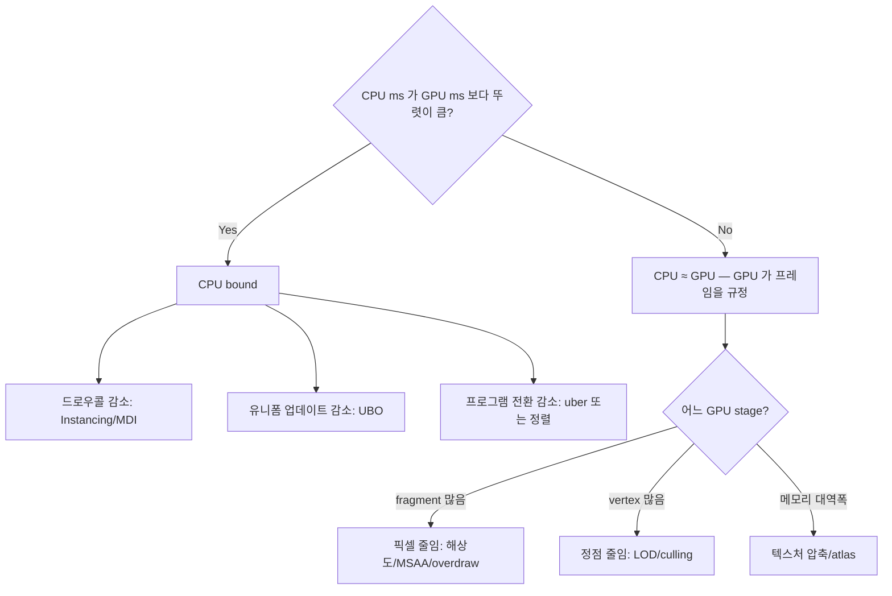

## 들어가며

오브젝트 수와 MSAA 가 *어디서 bottleneck 을 만드는가* 의 측정. 100 / 1,000 / 10,000 / 100,000 의 4 단계 + MSAA off / 2× / 4× / 8× — 총 16 조합의 *CPU / GPU 비용 분포* 를 자유 전환.

여기까지의 코드 상태 — Step 1~6 의 모든 토글 + 측정 인프라. 이 글에서 도달할 결과물 — *graphics_gl_lab 의 완성 형태* + *Step 7 의 두 새 토글 (오브젝트 수 / MSAA)* + *bottleneck 식별 능력*. 학습자가 *"GPU 바운드 시 어떤 토글이 효과 큰가"* 같은 질문에 *측정으로 답*.

네 단계.

1. 오브젝트 수의 스케일링 — Vertex throughput.
2. MSAA — 픽셀 비용 증가.
3. Multisample FBO + Resolve.
4. Bottleneck 식별 — 토글 종합 비교.

---

## 목차
1. [오브젝트 수의 스케일링](#1-오브젝트-수의-스케일링)
2. [MSAA — 픽셀 비용 증가](#2-msaa--픽셀-비용-증가)
3. [Multisample FBO와 Resolve](#3-multisample-fbo와-resolve)
4. [Bottleneck 식별](#4-bottleneck-식별)
5. [실행과 관측](#5-실행과-관측)

---

## 1. 오브젝트 수의 스케일링

`Scene::Rebuild(objectCount)` 가 *기존 GPU 핸들 정리 + 새 오브젝트 격자 생성*. 토글 시 *다음 프레임에 적용*.

| 오브젝트 수 | 격자 변 | 정점 수 (24/cube) | 삼각형 수 |
|---|---|---|---|
| 100 | 5 | 2,400 | 1,200 |
| 1,000 | 10 | 24,000 | 12,000 |
| 10,000 | 22 | 240,000 | 120,000 |
| 100,000 | 47 | 2,400,000 | 1,200,000 |

100,000 에서 *정점 수 240만 + 삼각형 120만*. *현대 GPU (RTX 3060) 의 1 ms 처리량* 안에 들어옴 — *GPU 가 vertex throughput 으로 막히기 어렵다*.

### Bottleneck 이동

| 오브젝트 수 | 모드 | 주 bottleneck |
|---|---|---|
| 100 | 모든 모드 | 거의 모든 GPU idle |
| 1,000 | Individual | CPU 드로우콜 (~3 ms) |
| 1,000 | Instanced | 거의 idle |
| 10,000 | Individual | CPU 압도 (50+ ms) |
| 10,000 | Instanced | GPU 약간 (~3 ms) |
| 100,000 | Individual | CPU 폭주 (수백 ms) |
| 100,000 | Instanced | GPU 약간 (~10 ms — fragment fill) |
| 100,000 | Instanced + MSAA 8× | GPU 명백 (수십 ms) |

100k 오브젝트 + MSAA 8× 가 *처음으로 명백한 GPU bound* 시나리오. 그 전까지는 *CPU 가 항상 짐*.

## 2. MSAA — 픽셀 비용 증가

*Multi-Sample Anti-Aliasing*. 각 픽셀에 *N 개의 색/깊이 샘플* — 삼각형 가장자리가 *부드러운 그라데이션*.

### 비용 모델

| 샘플 수 | 컬러 메모리 | 깊이 메모리 | 픽셀 비용 |
|---|---|---|---|
| 1× (off) | 1× | 1× | 1× |
| 2× | 2× | 2× | ~1.5× |
| 4× | 4× | 4× | ~2× |
| 8× | 8× | 8× | ~3.5× |

*샘플 수에 정비례하지 않음* — fragment shader 자체는 *픽셀당 한 번* (sample shading off 시). 추가 비용은 *Z / 스텐실 N 회 + 메모리 대역폭*.

### 데스크톱 vs 모바일

데스크톱 GPU — MSAA 의 *메모리 대역폭 비용 부담 큼*. 1080p × 4× × RGBA8 = *32 MB framebuffer*. 7~8GB/s 대역폭 소비.

모바일 / 타일 GPU — *온칩 메모리에 multisample 데이터 유지* + *resolve 만 DRAM 쓰기*. *MSAA 4× 가 거의 무료*. *Mali / Adreno / Apple GPU* 의 강점.

이 lab 은 데스크톱 모델. MSAA 비용이 *측정 그래프에 명확*.

## 3. Multisample FBO와 Resolve

기본 framebuffer 는 *single-sample*. MSAA 활성화하려면 *별도 multisample FBO* 에 렌더 + *resolve (blit)* 로 default 에 복사.

### FBO 생성

```cpp
glGenFramebuffers(1, &fbo);
glGenRenderbuffers(1, &colorRb);
glGenRenderbuffers(1, &depthRb);

int samples = 4;     // MSAA 4×
glBindRenderbuffer(GL_RENDERBUFFER, colorRb);
glRenderbufferStorageMultisample(GL_RENDERBUFFER, samples, GL_RGBA8, w, h);

glBindRenderbuffer(GL_RENDERBUFFER, depthRb);
glRenderbufferStorageMultisample(GL_RENDERBUFFER, samples,
                                  GL_DEPTH24_STENCIL8, w, h);

glBindFramebuffer(GL_FRAMEBUFFER, fbo);
glFramebufferRenderbuffer(GL_FRAMEBUFFER, GL_COLOR_ATTACHMENT0,
                           GL_RENDERBUFFER, colorRb);
glFramebufferRenderbuffer(GL_FRAMEBUFFER, GL_DEPTH_STENCIL_ATTACHMENT,
                           GL_RENDERBUFFER, depthRb);
```

`glRenderbufferStorageMultisample` 의 *samples* 인자가 MSAA 레벨.

### 렌더링

```cpp
glBindFramebuffer(GL_FRAMEBUFFER, fbo);
glClear(...);
// ... 모든 드로우 ...
```

이 FBO 에 렌더링된 결과는 *내부 multisample 데이터*. 화면에 표시 불가.

### Resolve

```cpp
glBindFramebuffer(GL_READ_FRAMEBUFFER, fbo);
glBindFramebuffer(GL_DRAW_FRAMEBUFFER, 0);     // default
glBlitFramebuffer(0, 0, w, h,
                   0, 0, w, h,
                   GL_COLOR_BUFFER_BIT, GL_NEAREST);
```

`glBlitFramebuffer` 가 *multisample → single-sample resolve*. 각 픽셀의 *N 샘플 평균* 이 default framebuffer 에 기록.

### 크기 변경 대응

윈도우 크기 / MSAA 옵션 변경 시 *renderbuffer 재할당*.

```cpp
void MsaaTarget::EnsureSize(int width, int height, MsaaSamples samples) {
    if (width == w_ && height == h_ && samples == requested_) return;
    w_ = width; h_ = height; requested_ = samples; current_ = samples;
    if (samples != MsaaSamples::Off) Recreate();
}
```

게이트를 *요청값* (`requested_`) 으로 비교하는 것이 중요하다. FBO 가 불완전하면 `Recreate` 가 실제 사용값 `current_` 를 Off 로 되돌리는데, 게이트가 `current_` 를 본다면 요청값과 영원히 어긋나 *매 프레임 재시도* 하게 된다.

```cpp
if (glCheckFramebufferStatus(GL_FRAMEBUFFER) != GL_FRAMEBUFFER_COMPLETE) {
    current_        = MsaaSamples::Off;
    requested_      = MsaaSamples::Off;
    fallbackNotice_ = true;
}
```

폴백 사실은 `TakeFallbackNotice()` 로 한 번 보고되고, App 이 자기 토글 값도 Off 로 되돌린 뒤 디버그 로그에 남긴다. 그래야 패널이 "4x" 라고 알리면서 실제로는 기본 프레임버퍼에 그리는 상태가 생기지 않는다.

```cpp
msaa_->EnsureSize(windowW_, windowH_, msaa_samples_);
if (msaa_->TakeFallbackNotice()) {
    msaa_samples_ = MsaaSamples::Off;
    khrDebug_->PushAppMessage("MSAA framebuffer incomplete — fell back to Off",
                              DebugMessage::Severity::Medium);
}
```

## 4. Bottleneck 식별

이 lab 의 *최종 사용 시나리오*. 토글 조합으로 *각 bottleneck 상황 재현 + 측정*.

### 표 — 16 조합 결과 (RTX 3060)

| 오브젝트 | DrawMode | MSAA | CPU frame ms | GPU ms | 진단 |
|---|---|---|---|---|---|
| 1k | Individual | off | 2.5 | 0.4 | CPU 제출 지배 |
| 1k | Instanced | off | 0.4 | 0.4 | 여유 |
| 10k | Individual | off | 30 | 2 | CPU 압도 |
| 10k | Instanced | off | 2 | 2 | GPU 가 프레임을 규정 |
| 10k | Instanced | 4× | 5 | 5 | GPU 가 프레임을 규정 |
| 100k | Individual | off | 220 | 8 | CPU 폭주 |
| 100k | Instanced | off | 10 | 10 | GPU 가 프레임을 규정 |
| 100k | Instanced | 8× | 35 | 35 | **GPU 명백** |

*CPU frame ms 열은 `glfwSwapBuffers` 를 포함한 프레임 wall-clock* 이다 (`FrameTimer::BeginFrame` ~ `EndFrame` 이 스왑을 감싼다). 드라이버 큐가 차면 스왑이 블록하므로 GPU 바운드 구간에서 이 값은 GPU ms 로 수렴한다 — 위 표의 아래쪽 행에서 두 열이 같아지는 이유다. 즉 이 lab 의 CPU 곡선은 *순수 제출 비용* 이 아니며, 제출 비용만 분리하려면 `Render()` 구간만 재는 별도 타이머가 필요하다. 그 분리는 이 lab 에 없다.

### 진단 흐름



### 게임 엔진 패턴

| 상황 | 적용 토글 |
|---|---|
| 작은 인디 게임 | Individual + 단순 셰이더 충분 |
| 모바일 게임 | Instanced + UBO + BC1/BC7 + MSAA 4× (타일 GPU 무료) |
| AAA 데스크톱 | MDI + Bindless + BC7 + MSAA off 또는 TAA |
| VR | Instanced (Multiview 변형) + MSAA 4× + 낮은 해상도 |

이 lab 의 *모든 토글* 이 *실제 게임의 렌더링 결정* 의 *축약 모델*. 측정 결과를 통해 *프로덕션 의사결정* 의 정량 근거 형성.

## 5. 실행과 관측

```bash
cmake --build build --config Release
build\Release\graphics_gl_lab.exe      # Linux/macOS: ./build/graphics_gl_lab
```

패널의 *Scale + MSAA (Step 7)* 섹션에서 확인할 값.

- `object count` 를 바꾸면 다음 프레임에 Scene 이 재빌드되고 *Scene* 섹션의 `objects` 수가 그 값으로 바뀐다. Individual 모드라면 `draw calls` 도 같은 수가 된다.
- `MSAA` 를 올리면 `GPU pass` 가 올라가고, ImPlot 의 CPU 곡선이 GPU 곡선에 달라붙는다 (위의 wall-clock 주의 참고).
- 드라이버가 요청한 샘플 수의 FBO 를 만들지 못하면 콤보가 스스로 `Off` 로 돌아가고 *GL debug log* 창에 `MSAA framebuffer incomplete — fell back to Off` 한 줄이 남는다.

```bash
ctest --test-dir build -C Release --output-on-failure
```

`graphics_gl_render_tests` 가 이 두 경로를 실제 컨텍스트에서 밟는다. 스케일 재빌드 쪽은 `Scene::Rebuild` 를 1000 회 반복한 뒤 여섯 개 핸들이 모두 유효하고 드라이버가 발급하는 이름 값이 누적되지 않는지 본다 — 해제가 한 줄만 빠져도 이름이 1000 단위로 올라가 테스트가 죽는다. MSAA 쪽은 4x 정상 생성과, `GL_MAX_RENDERBUFFER_SIZE` 를 넘는 크기를 요청해 renderbuffer storage 를 실패시킨 불완전 FBO 두 경우를 모두 실행해 폴백 후 `Current()` 와 `Requested()` 가 Off 로 맞춰지고 폴백 통지가 정확히 한 번만 소비되는지 확인한다. 폴백을 조용히 삼키도록 바꾸면 이 네 개의 단언이 함께 실패한다.

여전히 자동 검증 밖인 것도 분명하다. 오브젝트 수와 MSAA 샘플 수에 따른 *시간* 변화는 GPU·드라이버마다 달라 고정 기대값을 둘 수 없으므로 패널 그래프로만 읽는다.

---

## 결론

여기까지의 코드는 *graphics_gl_lab 의 완성 형태*. Step 1~7 의 골격 + 측정 + 6 가지 토글 (Draw mode / Shader perm / Shading model / Binding / Texture / Scale / MSAA) 이 모두 갖춰졌다. 관측 대상은 *드로우 제출 수, uniform 갱신 수, 텍스처 mip chain 바이트, CPU frame ms 와 GPU pass ms* 다 — 렌더 결과의 정확성, 자원 수명, 압축 화질은 이 lab 이 측정하지 않는다.

`Scene::Rebuild` 의 *GPU 핸들 정리 + 재초기화*, *Multisample FBO + Resolve* 의 *데스크톱 MSAA 패턴*, *오브젝트 수 × MSAA 의 16 조합 비용 매트릭스* — 실제 프로덕션 코드의 *측정 도구가 갖춰야 할 기능*.

학습자가 이 lab 을 *수십 시간 다루면* — *각 토글이 어떤 시나리오에서 효과적인가* 를 *체감적으로 안다*. 같은 패턴이 *DirectX (graphics_dx_lab)* / *Vulkan (graphics_vk_lab)* 으로 확장 가능. *API 가 다르고 측정 정확도가 더 높지만, 토글 항목 / 측정 인프라 / bottleneck 진단 흐름은 동일*. graphics_gl_lab 이 *세 lab 공통 패턴의 학습 토대*.

## 더 읽을거리

- Matt Pettineo, ["A Sampling of Anti-Aliasing Techniques"](https://therealmjp.github.io/posts/msaa-overview/) — MSAA 비용 구조의 깊은 해설.
- ARM, [Mali GPU Best Practices](https://developer.arm.com/documentation/101897/latest/) — 타일 GPU 에서 MSAA 가 싼 이유.
- [LearnOpenGL: Anti Aliasing](https://learnopengl.com/Advanced-OpenGL/Anti-Aliasing) — Multisample FBO + resolve 실습.
