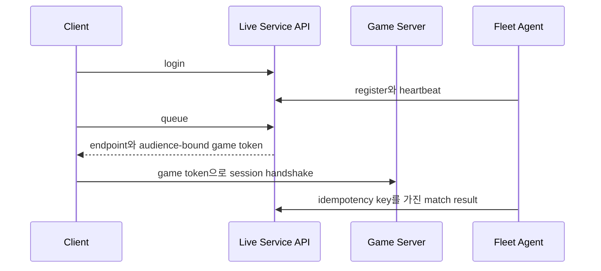

# Live Service Lab

실시간 game server 바깥의 제어 경로를 실제 HTTP API로 구현한다. 로그인 token, match queue, server registration·heartbeat·drain, capacity 기반 allocation, server-bound game token, 멱등 match result를 외부 package 없이 ASP.NET Core와 .NET cryptography API로 구성한다.

## 실시간 서버와의 경계



이 프로젝트는 game tick이나 snapshot을 전송하지 않는다. 반대로 `game_network_lab`과 Mega의
전용 서버는 계정 DB, MMR queue, fleet 상태를 소유하지 않는다. 실행 경로는 endpoint, match
ID, server ID, 짧은 수명의 game token 계약으로 연결된다.

## 검증하는 계약

| 계약 | 구현 | 자동 테스트 |
|---|---|---|
| token 위조를 탐지한다 | HMAC-SHA256과 constant-time signature 비교 | `AccessTokenContract` |
| token은 audience와 만료를 가진다 | game token에 server ID와 expiration 포함 | `TokenAudience`, `TokenExpiry` |
| queue 재시도는 ticket을 중복 생성하지 않는다 | player별 active ticket deduplication | `MatchAllocation` |
| 대기 시간이 길어지면 검색 범위가 넓어진다 | rating gap을 100에서 최대 500까지 확대 | `ProgressiveWidening` |
| unhealthy·draining server에는 새 match를 주지 않는다 | heartbeat timeout과 lifecycle 검사 | `ServerHealth`, `ServerDrain` |
| capacity를 초과하지 않는다 | active match count와 capacity를 원자적 lock 안에서 비교 | `MatchAllocation` |
| region이 다르면 후보가 아니다 | ticket끼리와 server 양쪽의 region 문자열 일치 | `RegionAffinity` |
| assignment는 ticket 소유자만 조회한다 | bearer access token의 player ID와 ticket owner 결합 | `TicketOwnership` |
| match result retry는 한 번만 반영된다 | result ID와 canonical payload fingerprint 비교 | `IdempotentResult` |
| 같은 idempotency key에 다른 payload는 실패한다 | HTTP 409 conflict | `PayloadConflict` |
| server는 자기 match 결과만 제출한다 | `X-Server-Id`와 allocation owner 검증 | `IdempotentResult` |
| 중복 result도 owner만 receipt를 받는다 | recorded server ID를 retry 경로에서 재검증 | `IdempotentResult` |
| 완료된 match는 capacity와 ticket을 해제한다 | result 기록이 active count를 줄이고 ticket을 `Completed`로 전이 | `MatchAllocation`, `TicketLifecycle` |
| 식별자는 ASCII 영숫자와 `.`·`-`·`_`만 허용한다 | 길이 상한이 붙은 `Identifiers.IsValid` | `IdentifierContract` |
| capacity·rating·party size 범위를 강제한다 | register와 enqueue의 범위 가드 | `RangeGuards` |
| 동시 요청도 capacity를 넘기지 못한다 | 후보 필터의 술어와 증가가 같은 lock 안 | `AtomicTransitions` |
| core는 wall clock을 읽지 않는다 | 모든 상태 전이 함수가 `now`를 인자로 받음 | `InjectedClock` |
| 인증 실패는 domain에 닿기 전에 막힌다 | server key와 bearer token 검사 | `HttpAuthBoundary` |
| domain 예외가 서로 다른 status code로 갈린다 | 400·401·404·409 매핑과 중복 receipt 200 | `HttpErrorMapping` |

## 추적 단위

| 항목 | 이 lab의 내용 |
|---|---|
| 이론 주장 | 제어 평면은 audience·만료가 있는 token, ticket 중복 억제, health·capacity 필터, 멱등 result로 잘못된 상태 전이를 거부한다 |
| 조작 변수 | 주입한 `now`, 두 ticket의 rating 차, 대기 시간, server lifecycle, capacity, `X-Server-Id`, result payload |
| 통제 변수 | 32byte 고정 test secret, 단일 region `kr`, party size 1, 2인 매치, in-process 상태 |
| 관측값 | ticket 상태, 배정까지 걸린 가상 초, `ControlPlaneMetrics`의 다섯 계수, 검증 결과와 예외 종류 |
| 기대 결과 | rating 차가 `100 + min(400, 대기초 × 10)` 이하일 때만 배정, `ActiveMatches < Capacity` 유지, 같은 result ID 재시도가 `RecordedResults`를 늘리지 않음 |
| 실패 주입 | 허용되지 않는 식별자, capacity 0·음수 등록, 마지막 문자를 바꾼 token, 만료된 token, 다른 server ID로 검증한 game token, 공백 claim이 든 game token, 남의 ticket 조회, 다른 server의 result 제출, 이미 완료된 match에 두 번째 result, allocation과 다른 player 집합, 같은 result ID에 다른 score·다른 match ID, drain 뒤 queue, heartbeat 공백 뒤 배정 요청, region이 어긋난 ticket·server, capacity를 넘는 큐 |
| 자동 테스트 | contract test가 계약별 18개 검사로 나뉘어 각 계약의 정상 경로와 실패 주입을 함께 검사한다. 위 계약 표의 '자동 테스트' 열이 계약과 검사의 대응이다. 실패 메시지는 검사 이름으로 시작한다 |

## 구조

```text
live_service_lab/
  src/
    LiveService.Core/
      ControlPlane.cs
      TokenService.cs
      Identifiers.cs
      Models.cs
    LiveService.Api/
      Program.cs
  tests/
    LiveService.Tests/
  articles/
```

Core는 HTTP와 wall-clock 전역 상태에 의존하지 않는다. 모든 상태 전이 함수가 `DateTimeOffset now`를 받아 token expiry, heartbeat timeout, progressive widening을 결정적으로 테스트할 수 있다.

## 빌드와 테스트

.NET 10 SDK가 필요하다.

```powershell
dotnet run `
  --project projects/mini/live_service_lab/tests/LiveService.Tests/LiveService.Tests.csproj `
  -c Release
```

테스트 target은 `LiveService.Tests` 하나다. `LiveService.Core`를 project reference로 링크하고,
`LiveService.Api`는 어셈블리를 링크하지 않고 빌드 순서만 잇는다(`ReferenceOutputAssembly=false`).
HTTP 계약 검사가 그 실행 파일을 loopback에 띄우기 때문이다. 그래서 위 한 줄이 Core·Api·Tests를
모두 빌드한다.

전부 통과하면 마지막 줄에 `live_service_tests: all checks passed`를 출력하고 exit code 0으로
끝난다. 실패하면 `검사이름: 깨진 계약` 형태의 메시지를 가진 예외로 즉시 종료한다.

실행 단위는 step 문서 단위로 나뉜다. 인자에 이름을 주면 그 이름의 검사만 돈다. 검사 하나의
이름을 그대로 넣어도 된다.

```powershell
dotnet run `
  --project projects/mini/live_service_lab/tests/LiveService.Tests/LiveService.Tests.csproj `
  -c Release -- step03
```

```text
live_service_tests: filter=step03 -> 6 check(s)
  step03 RangeGuards         ok
  step03 MatchAllocation     ok
  step03 ServerHealth        ok
  step03 ProgressiveWidening ok
  step03 RegionAffinity      ok
  step03 ServerDrain         ok
live_service_tests: step03 6/6 checks passed
```

검출력은 `LiveService.Core` 또는 `LiveService.Api`에 결함을 하나 주입하고 위 명령을 다시 돌려
확인한다. capacity 비교, heartbeat 신선도 필터, `MarkUnhealthyServers`, rating window 확대와
상한, 음수 경과 시간 clamp, ticket 중복 억제, fingerprint 비교와 정렬, ticket 소유자 검사,
player 집합 검사, 이중 완료 검사, 신규 result owner 검사, region 일치 두 곳, active match 감소,
admission token ID 생성, endpoint 전달, game token audience·만료·공백 claim 가드, 식별자 길이
상한, rating 상한, `/results`의 status code 매핑을 각각 무력화하면
대응하는 검사가 실패한다.

## 실행

개발용 secret을 환경 변수로 지정한다. token secret은 최소 32byte를 base64로 인코딩한 값이다.

```powershell
$env:LIVE_SERVICE_TOKEN_SECRET = [Convert]::ToBase64String(
  [Security.Cryptography.RandomNumberGenerator]::GetBytes(32))
$env:LIVE_SERVICE_SERVER_KEY = 'local-server-key'

dotnet run `
  --project projects/mini/live_service_lab/src/LiveService.Api/LiveService.Api.csproj `
  --urls http://127.0.0.1:5088
```

환경 변수가 없으면 local smoke test용 고정값을 사용한다. 이 fallback은 공개 배포용 credential이 아니다.

## Mega 전용 서버 연결

서버를 `ServerId=mega-local-1`, `Endpoint=127.0.0.1:27016`, `Capacity=1`로 등록한다.
여기서 capacity는 플레이어 수가 아니라 동시에 소유할 매치 수다. 두 플레이어가 queue에서
같은 매치에 배정되면 각 assignment의 game token을 클라이언트 실행 인자로 전달한다.

```powershell
.\projects\mega\build\bin\Release\mega_defense_server.exe `
  --port 27016 --server-id mega-local-1

.\projects\mega\build\bin\Release\mega_defense.exe `
  --join 127.0.0.1 27016 --token <GAME_TOKEN>
```

Mega 서버는 토큰의 HMAC, `ServerId`, 만료, `TokenId`, `MatchId`를 오프라인 검증한다. API와
Mega에는 같은 `LIVE_SERVICE_TOKEN_SECRET`을 주입해야 한다. 현재 Mega 프로세스가 HTTP
register·heartbeat·result를 직접 호출하지는 않는다. 그 호출은 배포 에이전트나 운영 스크립트가
담당하며, 이 lab은 해당 API의 상태 전이와 인증 계약을 구현한다.

## API

| Method | Path | 인증 | 역할 |
|---|---|---|---|
| POST | `/login` | 없음 | local lab player ID로 access token 발급 |
| POST | `/servers/register` | `X-Server-Key` | endpoint·region·capacity 등록 |
| POST | `/servers/{id}/heartbeat` | `X-Server-Key` | readiness 유지 |
| POST | `/servers/{id}/drain` | `X-Server-Key` | 신규 할당 중단 |
| POST | `/queue` | Bearer access token | rating·region queue 참가 |
| GET | `/assignments/{ticket}` | Bearer access token | 자기 ticket의 endpoint·game token 조회 |
| POST | `/results` | server key와 server ID | 멱등 match result 제출 |
| GET | `/metrics/state` | 없음 | lab 상태 계수 확인 |

`/login`은 credential 검증 자체를 구현하지 않는다. password hashing, OAuth/OIDC, MFA, recovery는 account provider의 책임이며 이 lab은 인증된 identity 뒤의 session·allocation 계약을 측정한다.
플레이어·서버·리전 식별자는 토큰 소비자와 같은 계약을 유지하기 위해 ASCII 영숫자와
점·하이픈·밑줄만 허용한다.

## 현재 범위

상태는 process memory에 있다. process restart 뒤 queue와 match가 사라지므로 production 저장소가 아니다. 이 선택은 transaction·replication을 구현한 것처럼 가장하지 않고 제어 상태 기계와 API 계약을 독립적으로 검증하기 위한 것이다.

다음 기능은 구현 범위 밖이다.

- durable database와 outbox
- party 단위 queue와 role constraint
- 다중 region ping probe
- server process 실제 기동과 orchestrator
- key rotation과 external KMS
- refresh token·MFA·account recovery
- distributed queue leader election

Mega 통합은 assignment의 endpoint와 token을 실제 UDP `AdmissionHello`에 전달하고, 별도
프로세스 테스트가 두 토큰·두 끝점이 같은 권위 스냅샷을 받는 것까지 검증한다. 자동 fleet
agent와 영속 제어 저장소는 이 계약 위에 놓이는 운영 계층이다.
