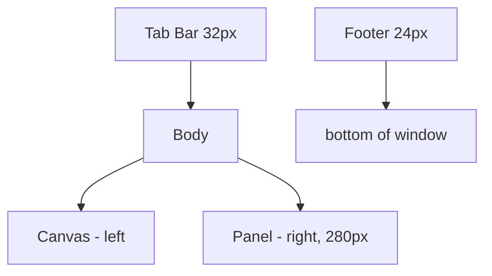

## 들어가며

이 글은 *math 시리즈의 알고리즘들을 인터랙티브하게 시각화* 하는 도구 — `math_lab` — 을 처음부터 만드는 작업의 첫 단계다. 시리즈가 *주장* 이라면 이 lab 은 *직접 조작 가능한 시각적 증거*. *마우스로 점을 끌어 옮기면 회전·보간·노이즈·충돌·공간 분할 알고리즘이 그 변화에 반응* 해 즉시 다시 계산되고, 그 과정이 *단계별로 시각화* 된다.

성격이 *parts_perf_lab / system_kernel_lab* 과 다르다. 그 둘이 *측정 도구* (수치를 뽑는 게 목적) 라면 *math_lab 은 시각화 도구*. *Slerp 가 단위 구 위 호를 따라 움직인다* 는 시리즈의 문장이 lab 에서는 *점이 실제로 호를 따라 이동하는 모습* 으로 보인다. GJK 가 simplex 를 키워가는 과정, BVH 가 median split 으로 분할하는 과정, SDF 가 smooth min 으로 두 도형을 매끄럽게 합치는 과정이 *모두 단계별로 실행 가능*.

이 단계의 결과물은 다음 다섯 가지를 갖춘 *최소 골격*.

1. raylib 윈도우 + 메인 루프.
2. *Scene 인터페이스* — 각 수학 토픽이 한 Scene 으로 구현. 탭으로 전환.
3. *DragHandle* — 마우스로 끌 수 있는 점. 거의 모든 Scene 의 입력 위젯.
4. *프레임 타이머* — ms / fps EMA.
5. *raygui 사이드 패널* — 토글 / 슬라이더 / 라벨.

이 단계가 만드는 것은 *골격뿐* 이다. 회전·보간·노이즈·충돌·공간 분할·SDF·투영 같은 수학 토픽은 하나도 들어 있지 않고, 그 자리에 *Welcome Scene* (드래그 가능한 두 점 + 거리 표시) 한 개만 동작 가능한 형태로 올린다.

---

## 목차
1. [도구의 성격: 측정이 아니라 시각화](#1-도구의-성격-측정이-아니라-시각화)
2. [기술 스택: raylib + raygui](#2-기술-스택-raylib--raygui)
3. [프로젝트 구조와 CMakeLists.txt](#3-프로젝트-구조와-cmakeliststxt)
4. [Scene 인터페이스](#4-scene-인터페이스)
5. [DragHandle 위젯](#5-draghandle-위젯)
6. [화면 chrome (탭 / 패널 / 푸터)](#6-화면-chrome-탭--패널--푸터)
7. [Welcome Scene 과 main 루프](#7-welcome-scene-과-main-루프)
8. [빌드와 실행 결과](#8-빌드와-실행-결과)

---

## 1. 도구의 성격: 측정이 아니라 시각화

`parts_perf_lab` 이 *워크로드 고정 + 토글로 구현 비교 + 수치 측정* 이라면, `math_lab` 은 *알고리즘 한 개를 골라 입력을 마우스로 조작하면서 출력을 시각으로 본다*. 결과물의 *우선순위가 다르다*.

| 차원 | parts_perf_lab | math_lab |
|---|---|---|
| 주 목적 | 측정 (ms, cache miss) | 시각화 (단계별 그림) |
| 입력 | 토글 / 슬라이더 (구현 선택) | 마우스 드래그 (점 위치) |
| 출력 | 수치 + 작은 시각화 | 큰 캔버스 + 작은 수치 |
| 시간 모델 | 매 프레임 측정 | 매 프레임 재계산 |
| Step 진행 | 토글 추가 + 모듈 추가 | Scene 추가 |

이 lab 은 *Scene* 단위로 진행한다. 각 Scene 이 한 토픽을 다룬다 — Rotation, Interpolation, Noise, Collision, Spatial, SDF, Projection. 한 Scene 안에서 *여러 알고리즘 토글* (Lerp vs Slerp 같은) 도 가능. Step 단위로 *Scene 한 개를 추가* 하는 진행이 이후의 패턴.

이 단계에서는 그 *Scene 들이 모두 들어갈 골격* 만 만든다. 골격이 갖춰진 다음에는 *각 Step 이 한 Scene 추가* — 알고리즘 자체에 집중 가능.

## 2. 기술 스택: raylib + raygui

`parts_perf_lab` 과 동일한 스택. 일관성 + 학습 곡선 절감.

| 항목 | 선택 |
|---|---|
| 언어 | C++20 |
| 그래픽 | raylib 5.0 (즉시 모드 2D / 3D, `DrawCircle`, `DrawText`) |
| UI | raygui 4.0 (단일 헤더, 라벨 / 버튼 / 슬라이더 / 토글) |
| 빌드 | CMake 3.20+ + FetchContent (시스템 설치 불필요) |

이 lab 의 시각화는 *2D 가 대부분*. 회전 시각화·SDF 등 일부 3D 가 있을 때만 raylib 의 3D 카메라를 활용. 풀 기능 게임 엔진이 필요 없다.

GLM 같은 외부 수학 라이브러리는 *회전 / 행렬 검증이 필요한 Scene* 에서 *비교 기준* 으로 추가 가능. 하지만 *코어에는 raylib 의 `Vector2/3` + 자체 quaternion 만* 으로 충분 — Step 1 의 골격에는 외부 의존 추가 없이 raylib 한 개.

## 3. 프로젝트 구조와 CMakeLists.txt

이 단계의 디렉토리 구조.

```text
math_lab/
  CMakeLists.txt
  src/
    main.cpp
    scenes/
      iscene.h              Scene 인터페이스
      welcome_scene.h
      welcome_scene.cpp     Step 1 의 placeholder Scene
    ui/
      handle.h
      handle.cpp            DragHandle 위젯
      scene_chrome.h
      scene_chrome.cpp      탭 / 패널 / 푸터 chrome
      raygui_impl.cpp       RAYGUI_IMPLEMENTATION 정의
    measure/
      frame_timer.h
      frame_timer.cpp
  tests/
    core_tests.cpp            GUI 없이 도는 코어 검증 (ctest 타깃)
  articles/
    step01_skeleton.md
```

`CMakeLists.txt` 는 `parts_perf_lab` 의 구조를 그대로 따라간다. *FetchContent* 로 raylib 5.0 + raygui 4.0 을 자동으로 가져온다.

```cmake
cmake_minimum_required(VERSION 3.20)
project(math_lab CXX)

set(CMAKE_CXX_STANDARD 20)
set(CMAKE_CXX_STANDARD_REQUIRED ON)

# raylib 5.0 의 cmake_minimum 이 오래돼 CMake 4.x 에서 정책 경고가 난다.
if(CMAKE_VERSION VERSION_GREATER_EQUAL "4.0")
    set(CMAKE_POLICY_VERSION_MINIMUM 3.5)
endif()

include(FetchContent)
set(BUILD_EXAMPLES OFF CACHE BOOL "" FORCE)
set(SUPPORT_MODULE_RAUDIO OFF CACHE BOOL "" FORCE)  # 오디오 불필요

FetchContent_Declare(
    raylib
    GIT_REPOSITORY https://github.com/raysan5/raylib.git
    GIT_TAG 5.0
)
FetchContent_MakeAvailable(raylib)

FetchContent_Declare(
    raygui
    GIT_REPOSITORY https://github.com/raysan5/raygui.git
    GIT_TAG 4.0
    SOURCE_SUBDIR none
)
FetchContent_MakeAvailable(raygui)

add_executable(${PROJECT_NAME}
    src/main.cpp
    src/measure/frame_timer.cpp
    src/ui/raygui_impl.cpp
    src/ui/handle.cpp
    src/ui/scene_chrome.cpp
    src/scenes/welcome_scene.cpp)

target_include_directories(${PROJECT_NAME} PRIVATE
    src
    ${raygui_SOURCE_DIR}/src)
target_link_libraries(${PROJECT_NAME} PRIVATE raylib)

# GUI 없이 도는 코어 검증 타깃. 창을 띄우지 않으므로 CI 에서도 돈다.
# algo/ 는 헤더온리라 소스가 필요 없고, 화면 분할 계산인 ComputeLayout 만
# scene_chrome.cpp 에 있어 함께 컴파일한다 (그리기 함수는 부르지 않는다).
enable_testing()
add_executable(math_core_tests
    tests/core_tests.cpp
    src/ui/scene_chrome.cpp)
target_include_directories(math_core_tests PRIVATE src)
target_link_libraries(math_core_tests PRIVATE raylib)

# 실행 단위는 step 입도다. 인자는 core_tests.cpp 의 kCases 표에 있는 step 키고,
# ctest 이름은 그 step 의 문서 이름과 같다.
add_test(NAME math_step01_skeleton COMMAND math_core_tests step01)
# 필터 없이 표 전체를 도는 타깃 — step 타깃들의 합집합.
add_test(NAME math_core_tests COMMAND math_core_tests)
```

새 Scene 추가 시 *`add_executable` 의 cpp 목록* 에 추가. Scene 하나당 한 줄씩 늘어난다.

테스트 타깃은 *처음부터* 깔되 껍데기로 두지 않는다. 골격에서 유일하게 raylib 호출이 없는 순수 산술이 `ComputeLayout` 이고, 그것이 첫 검증 대상이다. `tests/core_tests.cpp` 의 구조는 *`CHECK` 매크로 + 실패·검사 카운터 + `{step, 이름, 함수}` 표 + 이름 필터를 받는 `main`*. Scene 이 `algo/` 헤더를 쓰기 시작하면 그 헤더의 검증 함수가 표에 한 줄씩 붙는다. 실행 파일 (`math_lab`) 은 *창을 띄워야* 확인되지만 이쪽은 *헤드리스* 라 빌드마다 돌릴 수 있다.

```cpp
int failures = 0;
int checks   = 0;   // 실행된 CHECK 수 — step 별 출력에 그대로 찍힌다.

#define CHECK(expr)                                                     \
    do {                                                                \
        ++checks;                                                       \
        if (!(expr)) {                                                  \
            std::cerr << "CHECK failed: " #expr << " ("                 \
                      << __FILE__ << ':' << __LINE__ << ")\n";          \
            ++failures;                                                 \
        }                                                               \
    } while (false)

// 검증 함수를 *그것을 들여온 step* 에 묶는다. step 키가 곧 ctest 타깃의 인자다.
struct TestCase {
    const char* step;
    const char* name;
    void (*fn)();
};

const TestCase kCases[] = {
    {"step01", "layout/tab_canvas_footer", TestLayout},
};

int main(int argc, char** argv) {
    const char* filter = (argc > 1) ? argv[1] : nullptr;
    int selected = 0;
    for (const TestCase& testCase : kCases) {
        if (filter && std::strcmp(filter, testCase.step) != 0) continue;
        ++selected;
        testCase.fn();
        // [step] 이름 ..... N checks, M failed 출력
    }
    // selected == 0 이면 2, failures != 0 이면 1, 아니면 0.
}
```

필터가 있으니 *깨진 step 만 골라 다시 돌릴 수 있고*, 무엇보다 각 step 의 문서가 *자기 것만* 부르는 명령을 적을 수 있다.

## 4. Scene 인터페이스

`math_lab` 의 모든 토픽이 *한 Scene* 으로 구현된다. 인터페이스가 단순 — 5개 함수.

<!-- snippet: src/scenes/iscene.h -->
```cpp
namespace mathlab {

class IScene {
public:
    virtual ~IScene() = default;

    // Scene 이 활성화될 때 호출. 자료구조 초기화, 핸들 위치 리셋 등.
    virtual void OnEnter() {}

    // Scene 이 비활성화될 때 호출. 리소스 해제.
    virtual void OnExit() {}

    // 매 프레임 입력·로직 갱신. dt 단위 초.
    virtual void Update(float dt) = 0;

    // 메인 캔버스에 그리기. 렌더 영역은 (canvasX, canvasY, canvasW, canvasH).
    virtual void DrawWorld(int canvasX, int canvasY, int canvasW, int canvasH) = 0;

    // 사이드 패널에 그리기. 패널 영역은 (panelX, panelY, panelW, panelH).
    virtual void DrawPanel(int panelX, int panelY, int panelW, int panelH) = 0;

    // Scene 의 이름 — 탭 라벨에 쓰임.
    virtual std::string_view Name() const = 0;
};

}  // namespace mathlab
```

설계 결정.

- **`OnEnter` / `OnExit`**: Scene 전환 시 호출. 자료구조 초기화·리소스 해제. *생성자에서 안 함* — 처음 활성화될 때까지 *지연 초기화*.
- **`Update(dt)` 와 `DrawWorld` / `DrawPanel` 분리**: 입력·로직 → 한 단계 / 그리기 → 두 단계 (캔버스 + 패널). *입력 처리는 Update 에서, 결과는 Draw 에서*.
- **`canvasX/Y/W/H` 매개변수**: Scene 이 *자기 영역만* 신경 쓰면 된다. 윈도우 크기·탭 바 위치는 *상위 chrome 이 관리*.
- **`Name()`**: 탭 라벨에 쓰임. `string_view` 라 *static 문자열* 을 그대로 반환 가능.

이 인터페이스는 *최소 표면*. 추가 기능 (Scene 간 데이터 공유, 마우스 capture 분배 등) 이 필요해지면 그때 추가.

## 5. DragHandle 위젯

거의 모든 Scene 이 *한 개 이상의 드래그 가능한 점* 을 입력으로 받는다. 회전 Scene 의 회전 축, 보간 Scene 의 control point, 충돌 Scene 의 도형 위치, 공간 분할 Scene 의 객체 위치. 이 *공통 위젯* 을 처음부터 분리해 둔다.

<!-- snippet: src/ui/handle.h#DragHandle -->
```cpp
class DragHandle {
public:
    DragHandle();
    explicit DragHandle(Vector2 initial);

    void SetPosition(Vector2 p) { pos_ = p; }
    Vector2 Position() const   { return pos_; }
    bool    IsDragging() const;

    void Update();
    void Draw(Color fill, const char* label = nullptr) const;

    void SetRadius(float r) { radius_ = r; }

    // 매 프레임 시작 / 끝. main 또는 Scene 이 호출.
    static void BeginFrame();
    static void EndFrame();

private:
    Vector2  pos_    = {0, 0};
    float    radius_ = 7.0f;
    uint32_t id_     = 0;     // 핸들 별 고유 id
};
```

*잡힌 상태를 핸들 자신이 들고 있지 않는다*. `dragging_` 멤버 대신 *모든 핸들이 공유하는 static capture 상태* 를 쓴다 — 그래야 *프로세스 전체에서 한 번에 한 핸들만* 잡힌다는 불변식이 성립한다.

<!-- snippet: src/ui/handle.cpp -->
```cpp
namespace {

// 모든 DragHandle 이 공유하는 capture 상태.
// activeId == 0 은 "잡혀 있는 핸들 없음" 의미.
uint32_t g_activeId          = 0;
uint32_t g_nextId            = 1;

// 현재 프레임의 클릭이 잡힐 후보 (가장 가까운 핸들).
// EndFrame 에서 g_activeId 로 승격.
uint32_t g_pendingId         = 0;
float    g_pendingDistSq     = std::numeric_limits<float>::infinity();
bool     g_clickedThisFrame  = false;

}  // namespace

DragHandle::DragHandle() : id_(g_nextId++) {}
DragHandle::DragHandle(Vector2 initial) : pos_(initial), id_(g_nextId++) {}

bool DragHandle::IsDragging() const {
    return g_activeId == id_;
}

void DragHandle::BeginFrame() {
    g_pendingId         = 0;
    g_pendingDistSq     = std::numeric_limits<float>::infinity();
    g_clickedThisFrame  = IsMouseButtonPressed(MOUSE_BUTTON_LEFT);
    if (IsMouseButtonReleased(MOUSE_BUTTON_LEFT)) {
        g_activeId = 0;
    }
}

void DragHandle::EndFrame() {
    if (g_clickedThisFrame && g_pendingId != 0) {
        g_activeId = g_pendingId;
    }
    g_clickedThisFrame = false;
}

void DragHandle::Update() {
    Vector2 m  = GetMousePosition();
    float   dx = m.x - pos_.x;
    float   dy = m.y - pos_.y;
    float   d2 = dx * dx + dy * dy;
    float   r2 = (radius_ + 4.0f) * (radius_ + 4.0f);   // 약간 여유

    // 이미 잡혀 있으면 마우스 따라옴.
    if (g_activeId == id_) {
        pos_ = m;
        return;
    }

    // 새 클릭의 후보가 될 수 있나 — 핸들 위 + 다른 핸들보다 가까움.
    if (g_clickedThisFrame && d2 <= r2 && d2 < g_pendingDistSq) {
        g_pendingId     = id_;
        g_pendingDistSq = d2;
    }
}
```

호출 순서가 계약이다.

```cpp
DragHandle::BeginFrame();   // 매 프레임 시작 시 한 번
handleA.Update();           // 후보로 등록 + 잡혀 있으면 따라옴
handleB.Update();
DragHandle::EndFrame();     // 후보들 중 가장 가까운 하나만 잡기 시작
```

함정. *`Pressed` 가 클릭이 *시작* 된 프레임만 true*. `IsMouseButtonDown` 을 쓰면 *이미 잡고 있던 다른 핸들* 까지 실수로 잡힘. `Pressed` 검사가 핸들 사이 분리.

여러 핸들이 *겹쳐 있을 때* 어느 게 잡히는가 — `Update` 는 *후보 등록만* 하고 실제 capture 는 `EndFrame` 이 한다. 그래서 *그리는 순서와 무관하게* 클릭 지점에서 *가장 가까운 한 개* 가 잡힌다. 핸들 네 개가 한 점에 겹쳐도 동시에 끌리는 일이 없다.

`Draw` 는 *상태에 따라 외곽 링 색상* 변경 — hover / drag 시 밝게.

<!-- snippet: src/ui/handle.cpp#DragHandle::Draw -->
```cpp
void DragHandle::Draw(Color fill, const char* label) const {
    Vector2 m  = GetMousePosition();
    float   dx = m.x - pos_.x;
    float   dy = m.y - pos_.y;
    bool    hover = (dx * dx + dy * dy)
                     <= (radius_ + 4.0f) * (radius_ + 4.0f);
    bool    dragging = (g_activeId == id_);
    Color   ring = (dragging || hover) ? Color{255, 255, 255, 220}
                                        : Color{60, 60, 60, 255};
    DrawCircleV(pos_, radius_ + 2.0f, ring);
    DrawCircleV(pos_, radius_, fill);
    // ... label 이 nullptr 이 아니면 오른쪽에 DrawText ...
}
```

## 6. 화면 chrome (탭 / 패널 / 푸터)

Scene 이 *자기 영역에만 집중* 하려면 *상하좌우 영역 분할* 이 분리되어야 한다. `scene_chrome` 모듈이 그 역할.

<!-- snippet: src/ui/scene_chrome.h -->
```cpp
struct LayoutRects {
    Rectangle tabBar;   // 상단
    Rectangle canvas;   // 중앙 — Scene 이 그림
    Rectangle panel;    // 우측 — Scene 의 사이드 패널
    Rectangle footer;   // 하단 — 프레임 타이머
};

LayoutRects ComputeLayout(int screenW, int screenH, int panelW);
```



탭 바는 *Scene 라벨들을 균등 분할* 후 클릭 검출.

<!-- snippet: src/ui/scene_chrome.h -->
```cpp
int DrawTabBar(Rectangle bar,
                const std::vector<std::string_view>& labels,
                int currentIdx);
```

반환값이 *클릭으로 결정된 다음 활성 인덱스*. main 루프가 그 값을 받아 *다음 프레임의 활성 Scene* 결정.

푸터는 *프레임 타이머의 ms / fps + 활성 Scene 이름*. 디버그·튜닝에 즉시 보이는 정보.

<!-- snippet: src/ui/scene_chrome.h -->
```cpp
void DrawFooter(Rectangle footer, float frameMs, float fps,
                  std::string_view sceneName);
```

## 7. Welcome Scene 과 main 루프

Step 1 의 placeholder Scene — 두 개의 드래그 핸들 + 그 사이를 잇는 선분 + 거리 표시.

<!-- snippet: src/scenes/welcome_scene.h#WelcomeScene -->
```cpp
class WelcomeScene : public IScene {
public:
    void OnEnter() override;
    void Update(float dt) override;
    void DrawWorld(int canvasX, int canvasY, int canvasW, int canvasH) override;
    void DrawPanel(int panelX, int panelY, int panelW, int panelH) override;
    std::string_view Name() const override { return "Welcome"; }

private:
    DragHandle handleA_{};
    DragHandle handleB_{};
    bool       initialized_ = false;
};
```

`OnEnter` 에서 `initialized_` 플래그를 false 로 — 첫 `DrawWorld` 에서 *실제 캔버스 크기를 알게 되면* 그때 핸들을 적절히 배치. 생성자에선 *캔버스 크기를 모름*.

`DrawWorld` 가 거리 측정 + 시각화.

<!-- snippet: src/scenes/welcome_scene.cpp#WelcomeScene::DrawWorld -->
```cpp
void WelcomeScene::DrawWorld(int canvasX, int canvasY, int canvasW, int canvasH) {
    if (!initialized_) {
        handleA_.SetPosition({(float)(canvasX + canvasW / 3),
                               (float)(canvasY + canvasH / 2)});
        handleB_.SetPosition({(float)(canvasX + 2 * canvasW / 3),
                               (float)(canvasY + canvasH / 2)});
        initialized_ = true;
    }

    // 캔버스 배경
    DrawRectangle(canvasX, canvasY, canvasW, canvasH, Color{20, 22, 28, 255});
    DrawRectangleLines(canvasX, canvasY, canvasW, canvasH, Color{60, 62, 70, 255});

    // 핸들 두 개를 잇는 선분 + 거리
    Vector2 a = handleA_.Position();
    Vector2 b = handleB_.Position();
    DrawLineEx(a, b, 2.0f, Color{180, 200, 220, 255});

    handleA_.Draw(Color{255, 200, 80, 255}, "A");
    handleB_.Draw(Color{120, 200, 255, 255}, "B");

    float dx   = b.x - a.x;
    float dy   = b.y - a.y;
    float dist = std::sqrt(dx * dx + dy * dy);
    char  buf[64];
    std::snprintf(buf, sizeof(buf), "dist = %.1f px", dist);
    Vector2 mid = {(a.x + b.x) * 0.5f, (a.y + b.y) * 0.5f - 12.0f};
    DrawText(buf, (int)mid.x - 50, (int)mid.y, 16, Color{220, 220, 220, 255});
    // ... 캔버스 좌상단 안내 문구 두 줄 ...
}
```

`main` 루프는 *Scene 전환 + Update + Draw + chrome*.

```cpp
int main() {
    SetConfigFlags(FLAG_VSYNC_HINT | FLAG_MSAA_4X_HINT);
    InitWindow(1280, 720, "math_lab");
    SetTargetFPS(60);

    std::vector<std::unique_ptr<IScene>> scenes;
    scenes.emplace_back(std::make_unique<WelcomeScene>());

    int activeIdx = 0;
    int prevIdx   = -1;

    FrameTimer timer;

    while (!WindowShouldClose()) {
        timer.BeginFrame();

        // Scene 전환 시 OnEnter / OnExit
        if (activeIdx != prevIdx) {
            if (prevIdx >= 0) scenes[prevIdx]->OnExit();
            scenes[activeIdx]->OnEnter();
            prevIdx = activeIdx;
        }

        scenes[activeIdx]->Update(GetFrameTime());

        BeginDrawing();
        ClearBackground(Color{12, 14, 18, 255});

        auto layout = ComputeLayout(1280, 720, 280);
        DrawCanvasBackground(layout.canvas);
        DrawPanelBackground(layout.panel);

        scenes[activeIdx]->DrawWorld(/* canvas rect */);
        scenes[activeIdx]->DrawPanel(/* panel rect */);

        std::vector<std::string_view> labels;
        for (auto& s : scenes) labels.push_back(s->Name());
        activeIdx = DrawTabBar(layout.tabBar, labels, activeIdx);

        DrawFooter(layout.footer,
                    timer.SmoothedMs(), timer.Fps(),
                    scenes[activeIdx]->Name());

        EndDrawing();
        timer.EndFrame();
    }

    if (prevIdx >= 0) scenes[prevIdx]->OnExit();
    CloseWindow();
}
```

핵심: *Scene 추가가 한 줄*. 예컨대 `RotationScene` 을 붙인다면 `scenes.emplace_back` 한 줄 + cpp 파일 등록만 하면 된다.

## 8. 빌드와 실행 결과

```bash
cmake -S . -B build -DCMAKE_BUILD_TYPE=Release
cmake --build build --config Release -j
./build/Release/math_lab.exe          # Windows
./build/math_lab                       # Linux/macOS
```

첫 빌드는 *raylib + raygui 다운로드 + 컴파일* 로 1~3분. 이후는 incremental.

실행하면 *상단 탭 (Welcome 한 개), 중앙 캔버스 (두 핸들 + 거리), 우측 패널 (좌표 표시), 하단 푸터 (frame ms, fps)* 가 보인다. 두 핸들을 마우스로 끌면 거리가 즉시 갱신.

창을 띄우지 않는 검증은 `ctest` 로. 골격이 건 계약은 `ComputeLayout` 의 분할 하나다 — 탭 바 / (캔버스 + 패널) / 푸터가 화면을 *빈틈도 겹침도 없이* 나눠 갖는가.

<!-- snippet: tests/core_tests.cpp@step01-layout-partition -->
```cpp
// 세로: 탭 바 아래가 곧 캔버스, 캔버스 아래가 곧 푸터, 푸터 끝이 화면 끝.
CHECK(Near(L.tabBar.y + L.tabBar.height, L.canvas.y));
CHECK(Near(L.canvas.y + L.canvas.height, L.footer.y));
CHECK(Near(L.footer.y + L.footer.height, (float)kH));
// 가로: 캔버스 + 패널 = 화면 폭이고 패널이 오른쪽 끝에 붙는다.
CHECK(Near(L.canvas.width + L.panel.width, (float)kW));
CHECK(Near(L.canvas.x + L.canvas.width, L.panel.x));
CHECK(Near(L.panel.width, (float)kPanel));
```

여기에 *chrome 높이가 화면 크기와 무관한 상수* 라는 것 (화면을 400px 키우면 캔버스만 400px 커진다) 과 *패널을 120px 넓히면 캔버스가 정확히 120px 좁아진다* 는 총합 보존을 더해 19 개.

```text
$ ctest --test-dir build -C Release -R math_step01_skeleton --output-on-failure
    Start 1: math_step01_skeleton
1/1 Test #1: math_step01_skeleton .............   Passed    0.03 sec

100% tests passed out of 1
```

무엇이 몇 개 돌았는지는 실행 파일을 직접 부르면 보인다.

```text
$ ./build/Release/math_core_tests.exe step01
[step01] layout/tab_canvas_footer ........ 19 checks, 0 failed
step01: 1 case(s), 19 check(s), 0 failure(s)
```

이 검증이 자명하지 않다는 근거: `contentH` 에서 `kFooterH` 를 빼는 항을 지우면 `CHECK(Near(L.canvas.y + L.canvas.height, L.footer.y))` 가 그 자리에서 깨진다 — 캔버스가 푸터 아래로 24px 넘어간 상태다. 화면에서는 푸터 글자가 캔버스에 가려지는 정도로만 보여 놓치기 쉬운 종류다.

---

## 결론

Step 1 에서 만든 것.

1. **Scene 인터페이스** — 각 수학 토픽이 한 Scene 으로 캡슐화. 5개 함수 (`OnEnter / OnExit / Update / DrawWorld / DrawPanel / Name`).
2. **DragHandle** — 거의 모든 Scene 의 입력 위젯. 프로세스 전체에서 *한 번에 한 핸들만 잡힘* (BeginFrame / EndFrame 으로 후보 중 가장 가까운 한 개만 capture).
3. **scene_chrome** — 상단 탭 / 우측 패널 / 하단 푸터 + 레이아웃 계산. Scene 은 *자기 영역에만 집중*.
4. **FrameTimer** — `BeginFrame / EndFrame` + EMA 로 ms / fps 안정 표시.
5. **Welcome Scene + main 루프** — 두 드래그 핸들 + 거리. 골격이 동작하는지 검증.

이 단계의 한계도 분명하다. *수학이 하나도 없다* — Welcome Scene 이 하는 계산은 두 점 사이 거리 한 줄이고, 자동 검증이 잡는 것은 `ComputeLayout` 의 사각형 분할 19 개뿐이다. `DragHandle` 의 capture 정책 (겹친 핸들 중 가장 가까운 하나만 잡힘) 도, `FrameTimer` 의 EMA 평활도 raylib 의 입력·시계 전역 상태에 붙어 있어 창 없이는 못 부른다 — 눈으로 끌어 보는 것이 유일한 확인이다. Scene 인터페이스는 *Scene 간 데이터 공유* 와 *마우스 capture 를 Scene 이 조율하는 경로* 를 아직 갖고 있지 않고, 레이아웃은 1280×720 고정 크기를 전제로 계산한다. 골격이 옳은지는 *그 위에 실제 알고리즘 Scene 을 올려봐야* 드러난다.

## 더 읽을거리

- [raylib](https://www.raylib.com/) / [raygui](https://github.com/raysan5/raygui) — 이 lab 의 시각화 스택 공식 문서.
- Robert Nystrom, [*Game Programming Patterns*: State / Update Method](https://gameprogrammingpatterns.com/state.html) — Scene 인터페이스 패턴의 근거.
