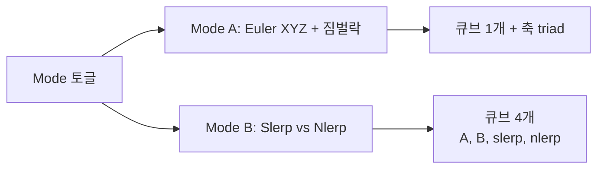

## 들어가며

`math_lab` 의 두 번째 단계. Step 1 에서 깐 *Scene 골격* 위에 첫 본격 토픽 — *회전 (Rotation)* — Scene 을 올린다. math 시리즈의 *part04 (회전 표현 비교)* 와 *part05 (쿼터니언 대수)* 가 이번 Scene 에서 *마우스 슬라이더로 즉시 갱신되는 시각화* 로 살아난다.

이 단계의 결과물.

- **Mode A — Euler XYZ**: pitch / yaw / roll 슬라이더 → 3D 큐브가 즉시 회전. 그리고 *짐벌락* 이 발생하는 순간 (가운데 축인 `yaw ≈ ±90°`) 화면에 빨간 경고 + 두 축이 *겹친다는 것* 을 시각으로 본다.
- **Mode B — Slerp vs Nlerp**: 두 keyframe (Euler 슬라이더로 입력한 시작·끝 회전) 사이를 *t ∈ [0, 1]* 로 보간. *Slerp 의 큐브 (위)* 와 *Nlerp 의 큐브 (아래)* 가 같은 t 에서 미묘하게 다른 자세를 갖는 것을 *나란히* 본다.

수학적 핵심 — *쿼터니언 = (sin(θ/2)·axis, cos(θ/2))*, *Slerp 는 단위 구 위 호*, *짐벌락은 Euler 의 합성 순서가 두 회전을 같은 축에 떨어뜨리는 현상* — 이 모두가 math 시리즈에서 *수식과 도식* 으로 다뤄졌다. 이번 Scene 은 *그 도식이 마우스에 따라 살아 움직이는 형태*.

---

## 목차
1. [Scene 의 두 모드](#1-scene-의-두-모드)
2. [쿼터니언 유틸 헤더](#2-쿼터니언-유틸-헤더)
3. [Euler 입력 → 쿼터니언 변환](#3-euler-입력--쿼터니언-변환)
4. [짐벌락 검출과 표시](#4-짐벌락-검출과-표시)
5. [Slerp 와 Nlerp 의 차이](#5-slerp-와-nlerp-의-차이)
6. [3D 렌더링 — 축 + 큐브](#6-3d-렌더링--축--큐브)
7. [raygui 슬라이더 패널](#7-raygui-슬라이더-패널)
8. [빌드와 실행 결과](#8-빌드와-실행-결과)

---

## 1. Scene 의 두 모드

회전 Scene 은 *목적이 다른 두 모드* 를 같은 Scene 에 묶어 토글로 전환.



- **Mode A 의 목적**: math part04 의 *Euler 의 짐벌락* 을 *움직이는 시각* 으로. 가운데 축인 yaw 슬라이더를 90° 까지 올리면 *pitch 와 roll 이 같은 축으로 합쳐지는* 모습이 보인다.
- **Mode B 의 목적**: math part05 의 *Slerp 와 Nlerp 의 차이* 를 *같은 t 에서 시각으로*. 두 keyframe 회전 사이의 *진짜 호 위 보간 (Slerp) 과 직선 보간 후 정규화 (Nlerp)* 가 *동일한 시작·끝 + 미묘하게 다른 중간 경로* 라는 사실을 둘이 나란히 그려져야 보인다.

토글은 raygui 의 `GuiToggleGroup` 으로. 한 라인의 두 칸짜리 토글.

<!-- snippet: src/scenes/rotation_scene.cpp@mode-toggle -->
```cpp
int   modeIdx  = (mode_ == Mode::Euler) ? 0 : 1;
int   newMode  = GuiToggleGroup(Rectangle{(float)(px + 8), (float)y, 130, 22},
                                 "Euler;Slerp/Nlerp", &modeIdx);
(void)newMode;
mode_ = (modeIdx == 0) ? Mode::Euler : Mode::SlerpVsNlerp;
```

`GuiToggleGroup` 은 반환값도 인덱스로 돌려주지만 이 Scene 은 `&modeIdx` 로 받은 값만 쓴다 — `/W4` 에서 미사용 경고가 나지 않게 `(void)newMode;` 로 명시적으로 버린다.

## 2. 쿼터니언 유틸 헤더

`raylib` 의 `Quaternion` 은 사실상 `Vector4` 별칭. `raymath.h` 에 `QuaternionMultiply` / `QuaternionToMatrix` 같은 함수가 있지만, *쿼터니언 대수 자체가 이 Scene 의 학습 대상* 이라 곱·샌드위치 회전·행렬 변환은 `algo/quaternion.h` 에 직접 쓴다. raymath 는 *정답지* 로만 쓴다.

<!-- snippet: src/algo/quaternion.h -->
```cpp
namespace mathlab {

inline Quaternion QuatIdentity() { return {0, 0, 0, 1}; }

inline Quaternion QuatFromAxisAngle(Vector3 axis, float angleRad) {
    float lenSq = axis.x * axis.x + axis.y * axis.y + axis.z * axis.z;
    if (lenSq < 1e-12f) return QuatIdentity();
    float inv = 1.0f / std::sqrt(lenSq);
    Vector3 a = {axis.x * inv, axis.y * inv, axis.z * inv};
    float half = angleRad * 0.5f;
    float s    = std::sin(half);
    return {a.x * s, a.y * s, a.z * s, std::cos(half)};
}

// Hamilton 곱: w = aw·bw - a⃗·b⃗,  v⃗ = aw·b⃗ + bw·a⃗ + a⃗ × b⃗
inline Quaternion QuatMul(Quaternion a, Quaternion b) {
    return {
        a.w * b.x + a.x * b.w + a.y * b.z - a.z * b.y,
        a.w * b.y - a.x * b.z + a.y * b.w + a.z * b.x,
        a.w * b.z + a.x * b.y - a.y * b.x + a.z * b.w,
        a.w * b.w - a.x * b.x - a.y * b.y - a.z * b.z,
    };
}

// 켤레. 단위 쿼터니언에서는 q⁻¹ 과 같다.
inline Quaternion QuatConjugate(Quaternion q) {
    return {-q.x, -q.y, -q.z, q.w};
}

inline Quaternion QuatFromEulerXYZ(float pitch, float yaw, float roll) {
    Quaternion qx = QuatFromAxisAngle({1, 0, 0}, pitch);
    Quaternion qy = QuatFromAxisAngle({0, 1, 0}, yaw);
    Quaternion qz = QuatFromAxisAngle({0, 0, 1}, roll);
    return QuatMul(QuatMul(qz, qy), qx);
}

// ... QuatNorm / QuatNormalize ...

// v' = q ⊗ (v, 0) ⊗ q⁻¹
inline Vector3 QuatRotateVec(Quaternion q, Vector3 v) {
    Quaternion p{v.x, v.y, v.z, 0.0f};
    Quaternion r = QuatMul(QuatMul(q, p), QuatConjugate(q));
    return {r.x, r.y, r.z};
}

// ... QuatToMatrix / QuatNlerp / QuatSlerp — §5 ...

}  // namespace mathlab
```

설계 결정.

- **Axis-Angle 우선**: 가장 단순하고 *수학 정의에 가까운* 형태. 다른 모든 변환의 빌딩 블록.
- **단위 검사 + ε 폴백**: 0-vector 축 입력에 NaN 안 만든다 (math part20 의 *normalize 가드* 패턴).
- **Euler XYZ extrinsic**: math part04 에서 다룬 여러 Euler convention 중 *고정 월드 축 기준 X→Y→Z 순서로 적용* 하는 Tait-Bryan 형태. *먼저 적용할 회전이 곱의 오른쪽* 이라 합성은 `qz ⊗ qy ⊗ qx`. 같은 회전 행렬은 *intrinsic Z-Y'-X''* 시퀀스와 동치다 (intrinsic 은 적용 순서와 곱 순서가 같고, 순서가 뒤집히는 쪽이 extrinsic).

## 3. Euler 입력 → 쿼터니언 변환

Mode A 의 데이터 흐름.


각 슬라이더는 *radian* 단위 -π ~ π. 한 슬라이더 변경 → 매 프레임 *전체 쿼터니언 재계산*. 비용이 무시 가능 (3 sin/cos + 2 곱).

큐브 그리기는 raylib 의 `DrawCubeV` + 로컬 행렬 변환.

<!-- snippet: src/scenes/rotation_scene.cpp@cube-matrix -->
```cpp
rlPushMatrix();
rlTranslatef(offset.x, offset.y, offset.z);
Matrix m = QuatToMatrix(q);
float t[16] = {
    m.m0,  m.m1,  m.m2,  m.m3,
    m.m4,  m.m5,  m.m6,  m.m7,
    m.m8,  m.m9,  m.m10, m.m11,
    m.m12, m.m13, m.m14, m.m15,
};
rlMultMatrixf(t);
Vector3 size = {scale * 0.9f, scale * 0.55f, scale * 0.35f};
DrawCubeV({0, 0, 0}, size, tint);
DrawCubeWiresV({0, 0, 0}, size, Color{220, 220, 220, 200});
rlPopMatrix();
```

raylib 의 `rlPushMatrix / rlMultMatrixf` 가 *fixed-function 식 행렬 스택* 을 노출한다. 즉시 모드 그래픽이라 가능한 단순화.

## 4. 짐벌락 검출과 표시

Tait-Bryan 시퀀스에서 짐벌락은 *가운데 축* 각도가 ±90° 일 때 발생한다. 이 lab 의 합성은 q = qZ ⊗ qY ⊗ qX (X 먼저 적용) 라 가운데 축이 Y — 즉 `yaw ≈ ±90°` 이면 *바깥 두 축인 X 회전 (pitch) 과 Z 회전 (roll) 이 같은 회전으로 축약* 된다. math part04 가 도식으로 다룬 그 현상.

검출은 단순 — 가운데 축 각도가 ±90° 근처인지만 본다.

<!-- snippet: src/algo/quaternion.h#EulerNearGimbalLock -->
```cpp
inline bool EulerNearGimbalLock(float middleAxisRad) {
    constexpr float kEps = 0.05f;          // 약 3°
    float p     = std::fabs(middleAxisRad);
    float halfPi = 1.5707963f;
    return std::fabs(p - halfPi) < kEps;
}
```

DrawWorld 에서 표시.

<!-- snippet: src/scenes/rotation_scene.cpp@gimbal-warning -->
```cpp
if (mode_ == Mode::Euler && EulerNearGimbalLock(yaw_)) {
    DrawText("GIMBAL LOCK — pitch and roll collapsed onto same axis",
              cx + 10, cy + 30, 14, Color{255, 100, 100, 255});
}
```

사용자가 yaw 슬라이더를 90° 로 올리면 *pitch / roll 슬라이더를 움직여도 큐브의 회전이 한 평면 위 회전으로 보이는* 모습 + 빨간 경고. 이 시각이 *math part04 의 짐벌락 다이어그램* 을 살아 움직이게 만든다.

## 5. Slerp 와 Nlerp 의 차이

math part05 의 핵심 차이.

| | Slerp | Nlerp |
|---|---|---|
| 정의 | 단위 구 위의 *호 (great-circle arc)* | 직선 보간 + 정규화 |
| 비용 | acos + 두 sin | 4 mul + 1 sqrt |
| 각속도 | 일정 (등속) | t 별 변동 |
| 시각 차이 | 부드러운 호 | 호와 약간 어긋난 직선 근사 |

코드.

<!-- snippet: src/algo/quaternion.h#QuatSlerp -->
```cpp
inline Quaternion QuatSlerp(Quaternion a, Quaternion b, float t) {
    a = QuatNormalize(a);          // 비단위 입력 방어
    b = QuatNormalize(b);
    float d = a.x * b.x + a.y * b.y + a.z * b.z + a.w * b.w;
    if (d < 0.0f) {                // 짧은 호 보장
        b = {-b.x, -b.y, -b.z, -b.w};
        d = -d;
    }
    if (d > 0.9995f) {
        return QuatNlerp(a, b, t);   // 거의 같음 — nlerp 가 더 안정
    }
    // 입력이 미세하게 정규화 깨지면 d > 1 → acos NaN. 방어용 clamp.
    if (d > 1.0f)  d = 1.0f;
    if (d < -1.0f) d = -1.0f;
    float theta  = std::acos(d);
    float sinT   = std::sin(theta);
    if (sinT < 1e-6f) return QuatNlerp(a, b, t);
    float wa     = std::sin((1 - t) * theta) / sinT;
    float wb     = std::sin(t * theta)       / sinT;
    return {
        a.x * wa + b.x * wb,
        a.y * wa + b.y * wb,
        a.z * wa + b.z * wb,
        a.w * wa + b.w * wb,
    };
}
```

함정 세 가지 — math part05 회상.

1. **Double cover**: $q$ 와 $-q$ 가 같은 회전. 보간 시 *짧은 호* 를 보장하려면 *내적 부호 검사* 후 b 를 뒤집기.
2. **거의 같은 회전**: $\cos\theta \approx 1$ 이면 *acos / sin* 둘 다 0 근처 — division by zero 위험. nlerp 폴백.
3. **정규화 오차**: 입력 quaternion 이 미세하게 단위 길이를 벗어나면 내적이 1 을 넘을 수 있다. 그래서 *입력을 먼저 정규화* 한다 — 이 두 줄이 없으면 비단위 입력에서 결과가 갈린다. 예를 들어 단위 z90 을 3 배 스케일한 쿼터니언과 항등 사이를 t=0.5 로 보간하면, 정규화하는 쪽은 *45.000°*, 정규화하지 않는 쪽은 내적이 2.12 라 `d > 0.9995` 분기로 새어 나가 *68.402°* 가 된다. 뒤에 남은 `clamp` 두 줄은 그 정규화 이후에는 도달하지 않는 *방어용 잔여 코드* 다 (d > 1 이면 이미 `d > 0.9995` 에서 반환된다).

Mode B 가 매 프레임 두 보간을 *나란히 큐브로 그린다*. autoPlay 가 켜져 있으면 t 가 0↔1 을 왕복 — 큐브 둘이 미묘하게 어긋난 자세를 *반복적으로* 보여준다.

## 6. 3D 렌더링 — 축 + 큐브

각 회전을 시각적으로 보여주려면 *축 표시 + 큐브* 둘 다 필요. 큐브만 있으면 *어떤 축 기준으로 회전했는지* 알기 어렵다.

축은 *quaternion 으로 회전된 단위 벡터* 3 개를 화살표 (실린더) 로.

<!-- snippet: src/scenes/rotation_scene.cpp@axis-triad -->
```cpp
Vector3 ex = QuatRotateVec(q, {scale, 0, 0});   // 회전된 X 축
Vector3 ey = QuatRotateVec(q, {0, scale, 0});
Vector3 ez = QuatRotateVec(q, {0, 0, scale});
DrawArrow3D(offset, Vector3Add(offset, ex), Color{255, 90, 90, 255},  0.04f);
DrawArrow3D(offset, Vector3Add(offset, ey), Color{120, 255, 120, 255}, 0.04f);
DrawArrow3D(offset, Vector3Add(offset, ez), Color{120, 160, 255, 255}, 0.04f);
```

`DrawArrow3D` 는 이 cpp 의 익명 네임스페이스에 있는 한 줄짜리 래퍼로, 안에서 `DrawCylinderEx` 를 부른다. `Vector3` 에는 `operator+` 가 없으므로 끝점은 raymath 의 `Vector3Add` 로 만든다.

색상 컨벤션: *X = 빨강, Y = 초록, Z = 파랑* (math part06 의 표준). 이 컨벤션이 *Maya·Blender·Unity·Unreal 모두 공통* 이라 사용자가 색만 보고 축을 인식 가능.

큐브 자체는 *비대칭 사이즈* (`{0.9, 0.55, 0.35}`) 로 — 회전을 *어떻게 했는지* 보이려면 *축 대칭 큐브* 보다 *길쭉한 박스* 가 효과적.

## 7. raygui 슬라이더 패널

Mode A 의 패널 — 3 슬라이더 + 라이브 쿼터니언 / norm 표시.

<!-- snippet: src/scenes/rotation_scene.cpp#RotationScene::DrawPanel -->
```cpp
std::snprintf(buf, sizeof(buf), "pitch %5.1f deg", pitch_ * 57.2958f);
GuiLabel(Rectangle{(float)(px + 8), (float)y, 220, 18}, buf);
GuiSlider(Rectangle{(float)(px + 8), (float)(y + 18), 220, 16},
           nullptr, nullptr, &pitch_, -kPi, kPi);
y += 42;
// ... 같은 패턴으로 yaw, roll ...
Quaternion q = QuatFromEulerXYZ(pitch_, yaw_, roll_);
std::snprintf(buf, sizeof(buf),
               "q = (%.2f, %.2f, %.2f, %.2f)",
               q.x, q.y, q.z, q.w);
GuiLabel(Rectangle{(float)(px + 8), (float)y, 260, 18}, buf);
y += 18;
std::snprintf(buf, sizeof(buf), "|q| = %.4f (should be 1)", QuatNorm(q));
GuiLabel(Rectangle{(float)(px + 8), (float)y, 260, 18}, buf);
```

`|q|` 표시가 *정규화 검증* — 슬라이더 입력이 *항상 단위 쿼터니언* 임을 사용자가 직접 본다. math part20 의 *비단위 누적* 함정이 *이런 직접 변환에서는 안 일어난다* 는 증거.

Mode B 의 패널 — *t 슬라이더 + autoplay + 키 A·B 의 6 슬라이더*. 슬라이더 수가 많아 화면 공간 빠듯하지만, 모두 한 패널 안에.

## 8. 빌드와 실행 결과

```bash
cmake -S . -B build -DCMAKE_BUILD_TYPE=Release
cmake --build build --config Release -j
./build/Release/math_lab.exe
```

상단 탭이 *Welcome / Rotation* 두 개. Rotation 탭으로 전환 → 3D 큐브가 가운데 + 축 triad + 패널의 슬라이더.

조작.

- *Mode A 토글*: yaw 슬라이더를 ±90° 로 → 빨간 GIMBAL LOCK 경고 + pitch/roll 슬라이더의 효과가 *한 평면으로 축약*.
- *Mode B 토글*: 자동 재생으로 t 가 왕복 → 두 큐브 (slerp 위, nlerp 아래) 가 미묘하게 다른 자세. 키 A·B 슬라이더로 *큰 회전* (예: -π / +π) 을 만들면 차이가 더 눈에 띈다.

빌드 검증: MSVC `/W4`, `cmake --build build --config Release` → 새 Scene 추가 후도 *경고 0* (third-party raygui 만 일부) + `math_lab.exe` 정상.

이 step 이 `tests/core_tests.cpp` 에 추가한 것은 쿼터니언 검증 세 개다.

`quaternion/identities` — 0-vector 축이 항등 쿼터니언이 되는지, 비단위 축 `(0,0,4)` 로 만든 90° 회전이 `(1,0,0)` 을 `(0,1,0)` 으로 보내는지, *3 배 스케일한 비단위 입력* 에도 `QuatSlerp` 결과의 norm 이 1 인지, `QuatMul(z90, x90)` 이 *오른쪽을 먼저 적용* 하는 Hamilton 규약을 지키는지, `EulerNearGimbalLock` 이 ±90° 근처에서만 참인지.

`quaternion/slerp_uniform_speed` — 화면에서 "Slerp 는 호 위, Nlerp 는 현 근처" 로만 보이던 차이를 수치로 못 박는다. 2.6 rad 짜리 큰 호를 100 등분해 *인접 샘플 사이 각도* 의 max/min 비를 잰다. 등각속도면 1 에 붙고, 아니면 튄다.

<!-- snippet: tests/core_tests.cpp@step02-slerp-uniform-speed -->
```cpp
const float slerpRatio = stepRatio(&mathlab::QuatSlerp);
const float nlerpRatio = stepRatio(&mathlab::QuatNlerp);
// ...
CHECK(slerpRatio < 1.05f);
// 대조군 — nlerp 는 같은 호에서 균일하지 않아야 한다.
// (이 CHECK 가 없으면 위 상한이 자명해질 수 있다)
CHECK(nlerpRatio > 1.3f);
```

Nlerp 쪽 하한이 핵심이다. 상한만 있으면 `QuatSlerp` 본문을 `QuatNlerp` 로 바꿔치기해도 *두 값이 같이 움직여* 통과할 수 있다. 두 방향을 함께 잡아야 판별이 된다.

`quaternion/gimbal_lock` — 짐벌락을 *경고 문구* 가 아니라 불변식으로 쓴다. 가운데 축 (yaw) 이 ±90° 면 바깥 두 축이 한 자유도로 축약되므로, pitch 와 roll 을 *같은 양만큼 밀어도* 회전이 변하지 않아야 한다. 175 개 (pitch, roll, 미는 양) 조합에서 최악의 `1-|dot|` 을 잰다.

<!-- snippet: tests/core_tests.cpp@step02-gimbal-lock -->
```cpp
const float locked = worstMismatch(halfPi);
const float free   = worstMismatch(0.0f);
// ...
CHECK(locked < 1e-5f);
CHECK(free > 1e-3f);
```

`free` 쪽이 대조군이다 — yaw=0 에서는 같은 조작이 회전을 *실제로 바꿔야* 한다. 이게 없으면 `QuatFromEulerXYZ` 가 무엇을 돌려주든 (예컨대 곱 순서를 뒤집어도) `locked` 만으로는 통과할 수 있다.

```text
$ ctest --test-dir build -C Release -R math_step02_rotation --output-on-failure
    Start 2: math_step02_rotation
1/1 Test #2: math_step02_rotation .............   Passed    0.04 sec

100% tests passed out of 1
```

```text
$ ./build/Release/math_core_tests.exe step02
[step02] quaternion/identities ........... 9 checks, 0 failed
[step02] quaternion/slerp_uniform_speed .. 6 checks, 0 failed
[step02] quaternion/gimbal_lock .......... 2 checks, 0 failed
step02: 3 case(s), 17 check(s), 0 failure(s)
```

---

## 결론

Step 2 에서 만든 것.

1. **`algo/quaternion.h`** — Axis-Angle / Euler XYZ → Quaternion, Slerp / Nlerp, 짐벌락 검출. 0-vector 가드.
2. **`scenes/rotation_scene.{h,cpp}`** — 두 모드 (Euler, Slerp vs Nlerp) 토글, 3D 카메라, 축 triad + 큐브 렌더, 슬라이더 패널.
3. **3D 시각화 패턴** — `BeginMode3D` + `rlPushMatrix` 행렬 스택 + `DrawCylinderEx / DrawCubeV`. 이후 Scene 들에서 재사용 (SDF, BVH, 카메라 투영).

math 시리즈 part04 (회전 표현 비교) 와 part05 (쿼터니언) 의 *수식과 다이어그램* 이 *마우스에 반응하는 3D 큐브와 빨간 짐벌락 경고* 로 살아 있다.

이 step 의 한계. 입력이 *슬라이더뿐* 이라 회전축을 마우스로 직접 끄는 조작이 없고, 축-각 표현을 따로 보여주는 모드도 없다 (`Mode` 는 `Euler` 와 `SlerpVsNlerp` 둘뿐). 자동 검증이 고정한 것은 *대수적 성질* 이고, Scene 이 실제로 그리는 것 — 큐브의 자세, 축 triad 의 방향, 빨간 경고가 켜지는 순간 — 은 여전히 눈으로만 확인된다. Slerp/Nlerp 판별도 `QuatAngleBetween` 이라는 *같은 파일 안의 보조 함수* 를 기준으로 재므로, 각도 계산 자체가 틀렸다면 두 곡선을 함께 오독한다.

## 더 읽을거리

- Ken Shoemake, "Animating Rotation with Quaternion Curves" (SIGGRAPH 1985) — slerp 의 원전.
- [3Blue1Brown & Ben Eater, Visualizing Quaternions](https://eater.net/quaternions) — 인터랙티브 쿼터니언 직관.
- Jonathan Blow, ["Understanding Slerp, Then Not Using It"](http://number-none.com/product/Understanding%20Slerp,%20Then%20Not%20Using%20It/) — nlerp 가 충분한 경우의 논거.
