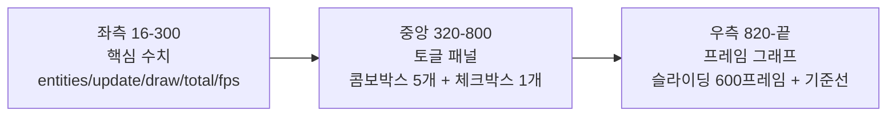

## 들어가며

현재까지의 결과물은 1만 점이 화면을 떠다니고 update/draw ms가 텍스트로 표시되는 *측정 도구의 골격* 이다. 한 가지 구현 경로만 돌고 있어 *비교* 가 불가능하다. 같은 워크로드를 어떤 변형으로 돌리든 같은 수치가 나오고, 토글 같은 인터랙션도 없다.

이 단계의 목표는 *런타임 토글 시스템* 을 얹어 비교의 토대를 만드는 것이다. 콤보박스 한 번 클릭으로 엔티티 수가 1k에서 100k로 바뀌고, 그 순간 update/draw ms가 눈에 띄게 증가하는 모습이 *프레임 그래프* 에 즉시 그려진다. 워크로드와 머신에 따라 update보다 draw 측 변화가 더 크게 보일 수도 있다. 어느 쪽이든 토글이 바뀌는 *그 순간* 의 그래프 변화가 측정 도구의 본질이다.

이 단계의 결과물은 다음 다섯 가지를 갖춘 토글 시스템이다.

1. raygui 라이브러리 통합 (FetchContent 한 번으로 끝나는 단일 헤더 GUI)
2. 모든 토글을 한 구조체에 모은 `Toggles`
3. HUD의 3-zone 레이아웃: 좌측 stats / 중앙 토글 패널 / 우측 그래프
4. 600 프레임 슬라이딩 윈도우 + 60/30fps 기준선이 있는 프레임 그래프
5. 토글 변경 시 시뮬레이션 재시작 처리

이 단계에서 *실제로 동작하는* 토글은 엔티티 수(1k/10k/100k) 한 가지다. 나머지 토글(allocator/layout/container/simd/branchless)은 뒤에 붙을 모듈이 없어 grayed out으로 자리만 잡아 둔다.

---

## 목차
1. [왜 런타임 토글인가](#1-왜-런타임-토글인가)
2. [raygui 선택과 FetchContent 통합](#2-raygui-선택과-fetchcontent-통합)
3. [Toggles 구조체](#3-toggles-구조체)
4. [Hud 클래스의 3-zone 레이아웃](#4-hud-클래스의-3-zone-레이아웃)
5. [raygui 콤보박스의 모달 패턴](#5-raygui-콤보박스의-모달-패턴)
6. [프레임 그래프 그리기](#6-프레임-그래프-그리기)
7. [메인 루프 통합과 재시작 처리](#7-메인-루프-통합과-재시작-처리)
8. [빌드와 실행 결과](#8-빌드와-실행-결과)

---

## 1. 왜 런타임 토글인가

비교 측정에는 두 가지 모델이 있다.

| 모델 | 특징 | 적합한 경우 |
|---|---|---|
| 빌드 시 토글 | 매크로 또는 CMake 옵션으로 분기, 매번 별도 실행 파일 | 자동화 벤치마크, CI |
| 런타임 토글 | 한 실행 안에서 즉시 전환, 그래프가 *그 자리* 에서 갈라짐 | 인터랙티브 측정, 학습 도구 |

이 도구의 목적이 *주장의 시각적 재현* 이라 런타임 토글이 적합하다. 빌드 시 토글은 두 빌드의 결과 그래프를 *나란히 비교* 해야 하지만, 런타임 토글은 *같은 그래프* 위에서 토글 직전과 직후가 한 줄로 이어지며 변화가 드러난다. 사용자가 "이 시점에 토글했고 그 직후 ms가 두 배가 됐다"는 것을 한 눈에 볼 수 있다.

런타임 토글의 비용은 *경로 분기* 다. 같은 함수 안에 `switch` 또는 함수 포인터 디스패치가 들어간다. 1만 점 처리에 드는 마이크로초 단위 안에서 디스패치 한 번은 무시할 수준이지만, 측정 의도에 따라 *분기 자체* 도 측정 대상이 될 수 있어 이 도구는 디스패치를 *프레임 단위* 로 해 핫 루프 밖에 둔다.

이 단계는 토글 *인프라* 만 만든다. 실제 경로 분기는 아직 어디에도 연결되어 있지 않다. 인프라와 콘텐츠를 분리해 한 단계씩 빌드 가능한 결과물을 남기는 게 의도다.

## 2. raygui 선택과 FetchContent 통합

GUI 라이브러리 후보는 다음과 같다.

| 라이브러리 | 모델 | 통합 부담 | 기능 |
|---|---|---|---|
| raygui | raylib 자체 GUI, 단일 헤더 | 매우 작음 | 콤보박스/체크박스/슬라이더 등 기본 |
| Dear ImGui | 별도 라이브러리 | 중간 (rlImGui 어댑터 필요) | 풀 기능 (트리, 도킹, 그래프) |
| Nuklear | 단일 헤더 | 작음 | 중간 기능 |

이 도구의 GUI 요구는 *콤보박스 5개 + 체크박스 1개* 정도다(entities, allocator, layout, container, simd + branchless). ImGui의 풀 기능은 과하다. raygui가 정확히 필요한 만큼이고, raylib과 같은 저자(raysan5)가 만든 거라 통합이 자연스럽다.

raygui는 STB 스타일 단일 헤더 라이브러리다. 정확히 하나의 컴파일 단위에서 `RAYGUI_IMPLEMENTATION`을 정의한 뒤 헤더를 include하면 된다.

### CMakeLists.txt 변경

기존 CMakeLists.txt에 raygui FetchContent 블록과 새 소스 파일을 추가한다.

```cmake
# raygui는 단일 헤더 라이브러리. 소스만 가져와 include path에 추가.
# SOURCE_SUBDIR을 빈 디렉토리로 지정하면 raygui 자체 CMake 빌드는 건너뛰고
# 소스만 다운로드된다. (FetchContent_Populate는 CMake 3.30에서 deprecated)
FetchContent_Declare(
    raygui
    GIT_REPOSITORY https://github.com/raysan5/raygui.git
    GIT_TAG 4.0
    GIT_SHALLOW TRUE
    SOURCE_SUBDIR none
)
FetchContent_MakeAvailable(raygui)

add_executable(${PROJECT_NAME}
    src/main.cpp
    src/sim/simulation.cpp
    src/measure/frame_timer.cpp
    src/ui/raygui_impl.cpp
    src/ui/hud.cpp
)

target_include_directories(${PROJECT_NAME} PRIVATE
    src
    ${raygui_SOURCE_DIR}/src)
target_link_libraries(${PROJECT_NAME} PRIVATE raylib)
```

raygui는 별도 빌드 타깃이 없다. 헤더 경로만 include path에 추가한다. 라이브러리가 컴파일된 형태가 아니라 *프로젝트 코드 안* 에 단일 컴파일 단위가 한 번 정의해 박는다.

`SOURCE_SUBDIR none`은 *raygui의 CMakeLists.txt를 처리하지 않는다* 는 의미다. raygui repo에 그런 디렉토리가 없어 `add_subdirectory`가 호출되지 않고, 소스만 받아 헤더 경로로 쓴다. 이게 CMake 3.20 ~ 3.30+ 모두에서 안전하게 동작하는 패턴이다.

### raygui_impl.cpp

```cpp
// raygui는 STB 스타일 단일 헤더 라이브러리다.
// 정확히 하나의 컴파일 단위에서 RAYGUI_IMPLEMENTATION을 정의한 뒤 include 한다.

#define RAYGUI_IMPLEMENTATION
#include "raygui.h"
```

이 한 파일이 raygui의 모든 함수 정의를 만든다. 다른 어떤 .cpp에서도 `RAYGUI_IMPLEMENTATION`을 정의하면 안 된다. 두 번 정의하면 링크 시 다중 정의 오류가 난다.

## 3. Toggles 구조체

토글 항목들은 enum class로 타입 안전하게 둔다. 모든 토글 상태가 하나의 `Toggles` 구조체에 모인다.

```cpp
#pragma once

#include <cstddef>

namespace ppl {

enum class Allocator : int { Malloc = 0, Arena, Pool, Slab };
constexpr int kAllocatorCount = 4;

enum class Layout : int { SoA = 0, AoS, Archetype };
constexpr int kLayoutCount = 3;

enum class Container : int { Vector = 0, StdList, IntrusiveList };
constexpr int kContainerCount = 3;

enum class SimdWidth : int { Scalar = 0, SSE, AVX2 };
constexpr int kSimdCount = 3;

struct EntityCountPreset {
    const char* label;
    std::size_t count;
};
inline constexpr EntityCountPreset kEntityCountPresets[] = {
    {"1k",   1'000},
    {"10k",  10'000},
    {"100k", 100'000},
};
constexpr int kEntityCountPresetCount = 3;

struct Toggles {
    Allocator allocator = Allocator::Malloc;
    Layout    layout    = Layout::SoA;
    Container container = Container::Vector;
    SimdWidth simd      = SimdWidth::Scalar;
    bool      branchless = false;
    int       entityPresetIdx = 1;  // 10k

    std::size_t EntityCount() const {
        return kEntityCountPresets[entityPresetIdx].count;
    }
};

}  // namespace ppl
```

`int = 0` 명시는 의도적이다. raygui의 콤보박스는 *정수 인덱스* 를 in-out으로 받는다. 0부터 연속하는 정수에 enum 값을 강제로 매핑해 둬야 `static_cast<int>` 가 안전하다. 같은 이유로 `kAllocatorCount` 같은 명시적 카운트도 정의한다.

`branchless`만 `bool`이다. 분기 제거 경로 사용 여부는 두 상태이므로 enum이 과하다. 체크박스로 자연스럽다.

토글 변경 중 일부는 시뮬 *재시작* 이 필요하다. 엔티티 수가 1k에서 100k로 바뀌면 vector를 재할당해야 하고, 레이아웃이 SoA에서 AoS로 바뀌면 데이터 구조 자체를 다시 만든다. 다음 함수가 그 판별을 한다.

```cpp
inline bool RequiresRestart(const Toggles& a, const Toggles& b) {
    return a.entityPresetIdx != b.entityPresetIdx
        || a.layout    != b.layout
        || a.allocator != b.allocator
        || a.container != b.container;
}
```

SIMD 폭과 branchless predication은 *경로 선택* 이라 재시작 없이 다음 프레임부터 적용 가능하다. 그래서 이 함수에 포함하지 않는다.

## 4. Hud 클래스의 3-zone 레이아웃

화면 하단의 HUD 영역(140 px)은 좌·중·우 3-zone으로 나눈다.



각 zone이 독립적으로 그려진다. 좌측은 텍스트, 중앙은 raygui 위젯, 우측은 raylib 직접 그리기.

### Hud 인터페이스

```cpp
#pragma once

#include "measure/frame_timer.h"
#include "ui/toggles.h"

#include <cstddef>

namespace ppl {

class Hud {
public:
    void Init(int windowW, int windowH, int hudHeight);

    // 매 프레임 호출. 토글 상태와 측정값을 받아 HUD를 그리고,
    // 사용자가 토글을 변경했으면 toggles에 반영한다.
    void Draw(Toggles& toggles, const FrameTimer& timer, std::size_t entityCount);

private:
    void DrawStats(const FrameTimer& timer, std::size_t entityCount, int x, int y);
    void DrawTogglePanel(Toggles& toggles, int x, int y);
    void DrawFrameGraph(const FrameTimer& timer, int x, int y, int w, int h);

    int windowW_ = 0;
    int windowH_ = 0;
    int hudY_    = 0;
    int hudH_    = 0;

    // raygui 콤보박스 편집 모드 상태.
    bool allocatorEdit_ = false;
    bool layoutEdit_    = false;
    bool containerEdit_ = false;
    bool simdEdit_      = false;
    bool entityEdit_    = false;
};

}  // namespace ppl
```

`Toggles&` 참조로 받아 *in-out* 으로 갱신한다. raygui 위젯이 사용자 입력을 받아 토글 값을 바꾸면 그 변경이 호출자의 `Toggles` 구조체에 즉시 반영된다.

`*Edit_` 멤버는 raygui 콤보박스의 *모달 상태* 다. 콤보박스 구현에서 이 상태가 열림과 닫힘을 제어한다.

### Init과 스타일 설정

```cpp
void Hud::Init(int windowW, int windowH, int hudHeight) {
    windowW_ = windowW;
    windowH_ = windowH;
    hudH_    = hudHeight;
    hudY_    = windowH_ - hudH_;

    // raygui 기본 스타일 약간 손본다. 어두운 배경에 맞춰 텍스트 밝기.
    GuiSetStyle(DEFAULT, TEXT_SIZE, 14);
    GuiSetStyle(DEFAULT, TEXT_COLOR_NORMAL, 0xE0E0E0FF);
    GuiSetStyle(DEFAULT, BACKGROUND_COLOR,  0x14141CFF);
}
```

`GuiSetStyle`은 raygui의 전역 스타일을 바꾼다. `DEFAULT` 그룹은 모든 위젯이 상속받는 기본값이다. 색상은 0xRRGGBBAA 형식이라 `0xE0E0E0FF`는 거의 흰색.

### Draw 진입점

```cpp
void Hud::Draw(Toggles& toggles, const FrameTimer& timer,
               std::size_t entityCount) {
    // HUD 배경
    DrawRectangle(0, hudY_, windowW_, hudH_, Color{20, 20, 28, 255});
    DrawLine(0, hudY_, windowW_, hudY_, Color{80, 80, 100, 255});

    // 좌측: 핵심 수치
    DrawStats(timer, entityCount, 16, hudY_ + 12);
    // 중앙: 토글 패널
    DrawTogglePanel(toggles, 320, hudY_ + 12);
    // 우측: 프레임 그래프
    const int graphX = 820;
    const int graphY = hudY_ + 12;
    const int graphW = windowW_ - graphX - 16;
    const int graphH = hudH_ - 24;
    DrawFrameGraph(timer, graphX, graphY, graphW, graphH);
}
```

좌·중·우 호출이 한 함수에 모이므로 *어느 zone에 무엇이 들어가는지* 의 구조가 한눈에 보인다.

## 5. raygui 콤보박스의 모달 패턴

raygui의 `GuiDropdownBox`는 *드롭다운이 펼쳐진 상태* 와 *접힌 상태* 를 분리한다. 호출자가 *편집 모드 boolean* 을 들고 있어야 한다. 펼쳐진 동안 다른 위젯이 우연히 클릭되는 것을 막으려면 `GuiLock`/`GuiUnlock` 으로 명시적으로 입력을 잠가야 한다. 이 단계에서는 활성 콤보가 entities 하나뿐이라 잠글 것이 없지만, 뒤 단계에서 콤보가 여럿 활성화되면 반드시 필요해진다 — 펼친 목록의 높이가 `(항목 수 + 1) × (행 높이 + 항목 간격)` 이라 아래 두세 행 위젯을 그대로 덮기 때문이다. 최종 코드의 `Hud::DrawTogglePanel` 이 그 잠금과 "열린 콤보를 마지막에 그리기" 를 담당한다.

```cpp
bool allocatorEdit_ = false;  // 멤버

// Draw 안에서:
int allocIdx = (int)toggles.allocator;
if (GuiDropdownBox({x, y, w, h},
                   "malloc;Arena;Pool;Slab",
                   &allocIdx, allocatorEdit_)) {
    // 사용자가 콤보박스를 클릭함 → 편집 모드 토글
    allocatorEdit_ = !allocatorEdit_;
}
if (!allocatorEdit_) {
    // 편집 모드가 아닐 때만 결과를 반영 (선택이 확정되는 프레임에만 값이 바뀐다)
    toggles.allocator = (Allocator)std::clamp(
        allocIdx, 0, kAllocatorCount - 1);
}
```

핵심은 셋이다.

1. 옵션 목록은 `;`로 구분한 단일 문자열 (`"a;b;c"`).
2. 인덱스는 `int*` 로 in-out 받음.
3. 편집 모드는 호출자 측 `bool`이라 펼친 상태가 프레임 사이에 유지된다.

다른 GUI 라이브러리에 익숙한 사람에게는 어색한 패턴이지만, raygui가 *상태 없는 즉시 모드 함수* 를 지향해 호출자가 모든 상태를 들고 있는 모델이다.

### 비활성화: GuiSetState

이 단계에서 동작하지 않는 토글들은 grayed out으로 보여 줘야 한다. raygui는 *전역 상태* 를 통해 다음 위젯들의 활성·비활성을 제어한다.

```cpp
GuiSetState(STATE_DISABLED);  // 다음 위젯부터 비활성
GuiDropdownBox(/* ... */);     // 비활성 상태로 그려짐
GuiSetState(STATE_NORMAL);     // 활성으로 복귀
```

`GuiSetState(STATE_DISABLED)` 와 `GuiSetState(STATE_NORMAL)` 사이의 모든 위젯이 비활성이다. 사용자 클릭에 반응하지 않고 회색으로 그려진다. 대응 모듈이 생긴 토글은 이 호출 쌍을 빼면 활성화된다.

### 토글 패널 전체 코드

```cpp
void Hud::DrawTogglePanel(Toggles& toggles, int x, int y) {
    constexpr int kRowH    = 22;
    constexpr int kLabelW  = 96;
    constexpr int kFieldW  = 130;
    int row = 0;
    auto rowY = [&](int r) { return y + r * (kRowH + 2); };

    // 1행: 엔티티 수 (활성)
    DrawText("entities :", x, rowY(row), 14, LIGHTGRAY);
    int entityIdx = toggles.entityPresetIdx;
    if (GuiDropdownBox({(float)(x + kLabelW), (float)rowY(row),
                        (float)kFieldW, (float)kRowH},
                       "1k;10k;100k",
                       &entityIdx, entityEdit_)) {
        entityEdit_ = !entityEdit_;
    }
    if (!entityEdit_) {
        toggles.entityPresetIdx = std::clamp(
            entityIdx, 0, kEntityCountPresetCount - 1);
    }
    row++;

    // 2행: 할당자 (대응 모듈 없음, 비활성)
    DrawText("allocator:", x, rowY(row), 14, GRAY);
    int allocIdx = (int)toggles.allocator;
    GuiSetState(STATE_DISABLED);
    if (GuiDropdownBox({(float)(x + kLabelW), (float)rowY(row),
                        (float)kFieldW, (float)kRowH},
                       "malloc;Arena;Pool;Slab",
                       &allocIdx, allocatorEdit_)) {
        allocatorEdit_ = !allocatorEdit_;
    }
    GuiSetState(STATE_NORMAL);
    if (!allocatorEdit_) {
        toggles.allocator = (Allocator)std::clamp(
            allocIdx, 0, kAllocatorCount - 1);
    }
    row++;

    // 3행: 레이아웃 (대응 모듈 없음, 비활성)
    DrawText("layout   :", x, rowY(row), 14, GRAY);
    int layoutIdx = (int)toggles.layout;
    GuiSetState(STATE_DISABLED);
    if (GuiDropdownBox({(float)(x + kLabelW), (float)rowY(row),
                        (float)kFieldW, (float)kRowH},
                       "SoA;AoS;Archetype",
                       &layoutIdx, layoutEdit_)) {
        layoutEdit_ = !layoutEdit_;
    }
    GuiSetState(STATE_NORMAL);
    if (!layoutEdit_) {
        toggles.layout = (Layout)std::clamp(layoutIdx, 0, kLayoutCount - 1);
    }
    row++;

    // 우측 컬럼: 컨테이너 / SIMD / branchless (모두 비활성)
    constexpr int kGap = 8;
    const int x2 = x + kLabelW + kFieldW + kGap * 4;
    int row2 = 0;

    DrawText("container:", x2, rowY(row2), 14, GRAY);
    int containerIdx = (int)toggles.container;
    GuiSetState(STATE_DISABLED);
    if (GuiDropdownBox({(float)(x2 + kLabelW), (float)rowY(row2),
                        (float)kFieldW, (float)kRowH},
                       "vector;std::list;Intrusive",
                       &containerIdx, containerEdit_)) {
        containerEdit_ = !containerEdit_;
    }
    GuiSetState(STATE_NORMAL);
    if (!containerEdit_) {
        toggles.container = (Container)std::clamp(
            containerIdx, 0, kContainerCount - 1);
    }
    row2++;

    DrawText("simd     :", x2, rowY(row2), 14, GRAY);
    int simdIdx = (int)toggles.simd;
    GuiSetState(STATE_DISABLED);
    if (GuiDropdownBox({(float)(x2 + kLabelW), (float)rowY(row2),
                        (float)kFieldW, (float)kRowH},
                       "Scalar;SSE;AVX2",
                       &simdIdx, simdEdit_)) {
        simdEdit_ = !simdEdit_;
    }
    GuiSetState(STATE_NORMAL);
    if (!simdEdit_) {
        toggles.simd = (SimdWidth)std::clamp(simdIdx, 0, kSimdCount - 1);
    }
    row2++;

    bool branchless = toggles.branchless;
    GuiSetState(STATE_DISABLED);
    GuiCheckBox({(float)(x2 + kLabelW), (float)rowY(row2),
                 (float)kRowH, (float)kRowH},
                "branchless", &branchless);
    GuiSetState(STATE_NORMAL);
    toggles.branchless = branchless;
    row2++;
}
```

다섯 개 콤보박스가 모두 같은 패턴이다. 차이는 옵션 문자열, in-out 인덱스, edit 플래그 셋뿐이고, 비활성 토글은 `GuiSetState` 쌍으로 감싸는 것만 다르다.

## 6. 프레임 그래프 그리기

좌측 stats 텍스트는 *현재 프레임* 만 보여 준다. 토글이 바뀌는 *순간* 의 변화를 보려면 *시간축* 이 필요하다. 프레임 그래프는 600 프레임의 update+draw 합산을 라인 차트로 그린다.

```cpp
void Hud::DrawFrameGraph(const FrameTimer& timer, int x, int y, int w, int h) {
    DrawRectangle(x, y, w, h, Color{8, 8, 12, 255});
    DrawRectangleLines(x, y, w, h, Color{60, 60, 80, 255});

    const auto& update = timer.UpdateMs();
    const auto& draw   = timer.DrawMs();
    const std::size_t filled = timer.Filled();
    if (filled == 0) return;

    // 자동 줌: 최근 N 프레임의 max를 기준으로 스케일.
    float maxMs = 0.0f;
    for (std::size_t i = 0; i < filled; ++i) {
        const float total = update[i] + draw[i];
        if (total > maxMs) maxMs = total;
    }
    if (maxMs < 16.67f) maxMs = 16.67f;  // 60fps 기준선이 항상 보이도록 하한

    // 60fps / 30fps 기준선. 패널 안에 들어올 때만 그린다.
    auto drawHline = [&](float ms, Color c) {
        if (ms > maxMs) return;  // 스케일이 작아서 패널 밖에 그려지면 생략
        const float ratio = ms / maxMs;
        const int yLine = y + h - (int)(ratio * (h - 4));
        DrawLine(x, yLine, x + w, yLine, c);
    };
    drawHline(16.67f, Color{80, 200, 80, 100});   // 60fps
    drawHline(33.33f, Color{200, 200, 80, 100});  // 30fps
```

남은 일은 링 버퍼를 오래된 샘플부터 읽어 폴리라인으로 연결하는 것이다.

```cpp
    // 슬라이딩 윈도우 데이터를 가장 오래된 것부터 그린다.
    const std::size_t cap  = FrameTimer::kCapacity;
    const std::size_t head = timer.Head();

    int prevX = x;
    int prevY = y + h;
    const float denom = (filled > 1) ? (float)(filled - 1) : 1.0f;
    for (std::size_t i = 0; i < filled; ++i) {
        const std::size_t idx = (head + cap - filled + i) % cap;
        const float total = update[idx] + draw[idx];
        const float ratio = total / maxMs;

        const int px = x + (int)((float)i * w / denom);
        const int py = y + h - (int)(ratio * (h - 4));

        if (i > 0) {
            DrawLine(prevX, prevY, px, py, Color{200, 220, 255, 220});
        }
        prevX = px;
        prevY = py;
    }

    char label[64];
    std::snprintf(label, sizeof(label), "max %.2f ms", maxMs);
    DrawText(label, x + 6, y + 4, 12, GRAY);
}
```

핵심 결정 셋.

1. **자동 줌**: max ms 값을 매 프레임 다시 계산. 16.67ms(60fps 기준선) 하한을 잡아 매우 짧은 ms만 있을 때도 60fps 선이 보이도록 한다. 30fps(33.33ms) 선은 maxMs가 그보다 작으면 *패널 밖이라 그리지 않는다*.
2. **두 기준선**: 60fps 초록, 30fps 노랑. 토글 변경으로 ms가 두 기준선 위·아래로 움직이는 모습이 한눈에 들어온다.
3. **링 버퍼 순회 순서**: `head`가 *다음에 쓸 위치* 이므로 가장 오래된 데이터는 `(head + cap - filled) % cap` 부터 시작한다. 이걸 left→right로 그리면 시간축이 자연스럽게 흐른다.

`DrawLine`을 폴리라인으로 연결한다. 1만 개 점을 그리는 것에 비하면 600줄짜리 폴리라인은 무시할 비용이다.

## 7. 메인 루프 통합과 재시작 처리

기존 main.cpp에 Hud와 Toggles를 끼우고, 토글 변경 감지 + 재시작 처리를 추가한다.

```cpp
#include "raylib.h"

#include "measure/frame_timer.h"
#include "sim/simulation.h"
#include "ui/hud.h"
#include "ui/toggles.h"

#include <cstdio>

namespace {
constexpr int kWindowW = 1280;
constexpr int kWindowH = 720;
constexpr int kHudH    = 140;
constexpr int kSimH    = kWindowH - kHudH;
}  // namespace

int main() {
    SetConfigFlags(FLAG_MSAA_4X_HINT);
    InitWindow(kWindowW, kWindowH, "parts_perf_lab");
    SetTargetFPS(0);

    ppl::Toggles toggles;
    ppl::Toggles prevToggles = toggles;

    ppl::Simulation sim;
    sim.Init(toggles.EntityCount(), kWindowW, kSimH);

    ppl::FrameTimer timer;

    ppl::Hud hud;
    hud.Init(kWindowW, kWindowH, kHudH);
```

루프는 update와 시뮬 draw를 먼저 측정하고, 샘플을 커밋한 뒤 HUD를 그린다. 이렇게 하면 HUD 자체의 비용은 draw ms에 섞이지 않는다.

```cpp
    while (!WindowShouldClose()) {
        const float dt = GetFrameTime();

        timer.BeginUpdate();
        sim.Update(dt);
        timer.EndUpdate();

        timer.BeginDraw();
        BeginDrawing();
        ClearBackground(Color{10, 10, 14, 255});
        sim.Draw();
        timer.EndDraw();
        timer.CommitFrame();
        hud.Draw(toggles, timer, sim.Count());
        EndDrawing();

        // 토글 변경 처리. 재시작 필요한 변경이면 시뮬 재초기화.
        if (ppl::RequiresRestart(prevToggles, toggles)) {
            sim.Shutdown();
            sim.Init(toggles.EntityCount(), kWindowW, kSimH);
        }
        prevToggles = toggles;
    }

    sim.Shutdown();
    CloseWindow();
    return 0;
}
```

추가된 부분은 다음 셋이다.

1. `Toggles toggles`와 `Toggles prevToggles` 두 인스턴스
2. 메인 루프 안에 `hud.Draw(...)` 호출
3. 루프 끝에서 `RequiresRestart(prev, curr)` 검사

prev/curr 두 개를 들고 *변경 감지* 한다. raygui는 이벤트 콜백을 제공하지 않고 *값을 읽어오는* 폴링 모델이라 호출자 측에서 직접 비교한다.

## 8. 빌드와 실행 결과

CMake로 다시 구성하고 빌드한다. raygui는 처음 빌드 때만 다운로드하고, 이후는 캐시된다.

```bash
cmake -S . -B build
cmake --build build --config Release
```

실행하면 화면 하단 HUD에 토글 패널이 나타난다.

```text
좌측                            중앙                          우측
entities : 10000     entities : [10k ▼]   container: [vector ▼]   ┌──────────┐
update   : 0.087 ms  allocator: [malloc▼] simd     : [Scalar▼]    │   ⎺⎺⎺⎺⎺⎺⎺ │ 60fps
draw     : 1.243 ms  layout   : [SoA ▼]   ☐ branchless             │           │
total    : 1.330 ms                                                 │           │
fps      : 752.0                                                    │           │
                                                                    └──────────┘
                                                                       max 16.67 ms
```

allocator/layout/container/simd/branch는 회색으로 비활성. entities 콤보만 클릭 가능하다.

### 토글 동작 체크

1. entities 콤보를 클릭해 `100k`로 바꾼다.
2. 시뮬이 즉시 재시작 (`Shutdown` → `Init`). 화면이 잠깐 깜박인다.
3. 시뮬이 다시 시작되면서 update ms가 한 자릿수 ms에서 두 자릿수 ms로 점프한다.
4. 우측 그래프에 그 점프가 *세로 절벽* 으로 그려진다. 토글 직전과 직후가 한 줄로 이어진다.
5. 자동 줌이 새 max에 맞춰 스케일을 다시 잡는다. 60fps 기준선이 그래프 하단으로 내려간다.

이 *세로 절벽* 이 측정 도구가 만들어 내는 첫 번째 시각적 사건이다. 토글이 바뀐 정확한 프레임을 그래프에서 손가락으로 짚을 수 있다.

### 자동 검증: `parts_toggles_tests`

토글 시스템에서 사람이 클릭해야만 확인되는 부분과 창 없이 확인되는 부분은 다르다. raygui 위젯이 실제로 눌리는지는 창·입력 컨텍스트가 있어야 알 수 있지만, *어떤 토글이 재시작을 부르는가* 와 *패널의 위젯들이 화면에서 어디에 놓이는가* 는 순수 계산이다. 그 둘이 `toggles` 그룹이고, ctest 이름은 `parts_toggles_tests` 다.

`RequiresRestart` 는 메인 루프가 프레임 끝에서 시뮬을 다시 만들지 말지를 정하는 유일한 근거다. 어느 축이 어느 쪽인지를 못 박아 둔다.

<!-- snippet: tests/core_tests.cpp#TestToggleRestartRules -->
```cpp
// tests/core_tests.cpp — toggles 그룹

void TestToggleRestartRules() {
    const ppl::Toggles base;
    CHECK(base.entityPresetIdx == 1);
    CHECK(base.EntityCount() == 10000);
    // ...
    // 같은 값끼리는 재구성이 없다. 이게 깨지면 매 프레임 시뮬을 새로 만든다.
    CHECK(!ppl::RequiresRestart(base, base));

    // 데이터 구조를 다시 만들어야 하는 축.
    ppl::Toggles entities = base;
    entities.entityPresetIdx = 2;
    CHECK(entities.EntityCount() == 100000);
    CHECK(ppl::RequiresRestart(base, entities));
    CHECK(ppl::RequiresRestart(entities, base));  // 판정은 방향에 무관하다
    // ...
    // 경로 선택만 바꾸는 축은 재구성 없이 적용된다. 여기에 simd/branchless가
    // 끼면 토글할 때마다 화면이 깜박인다.
    ppl::Toggles simd = base;
    simd.simd = ppl::SimdWidth::AVX2;
    CHECK(!ppl::RequiresRestart(base, simd));
    // ...
}
```

패널 기하 쪽은 콤보를 펼쳤을 때의 겹침을 고정한다. `GuiLock` 과 "열린 콤보를 마지막에 그리기" 가 필요한 이유가 곧 이 겹침이므로, 겹침이 사라지면 그 잠금·지연도 다시 판단해야 한다.

<!-- snippet: tests/core_tests.cpp#TestTogglePanelGeometry -->
```cpp
// tests/core_tests.cpp — toggles 그룹

void TestTogglePanelGeometry() {
    // ...
    constexpr int x = 320;
    constexpr int y = 700;

    // 행 간격 24 > 위젯 높이 22. 접힌 위젯끼리는 겹치지 않는다.
    CHECK(ppl::kPanelRowH == 22);
    CHECK(PanelRowY(y, 1) - PanelRowY(y, 0) == 24);
    CHECK(!RectsOverlap(PanelFieldRect(x, y, 0), PanelFieldRect(x, y, 1)));
    // ...
    // entities는 "1k;10k;100k" 세 항목 → 4 * (22+2) = 96.
    const UiRect entitiesOpen = DropdownOpenRect(entities, 3);
    CHECK(entitiesOpen.h == 96);

    // 펼친 목록이 아래 두 행의 필드 자리를 덮는다.
    CHECK(RectsOverlap(entitiesOpen, allocator));
    CHECK(RectsOverlap(entitiesOpen, layout));
    // ...
    // 두 패스 그리기: 모든 위젯이 정확히 한 번, 열린 콤보만 마지막 패스에.
    CHECK(PanelDrawsWidget(/*widgetOpen=*/false, /*openPass=*/false));
    CHECK(!PanelDrawsWidget(/*widgetOpen=*/false, /*openPass=*/true));
    CHECK(!PanelDrawsWidget(/*widgetOpen=*/true, /*openPass=*/false));
    CHECK(PanelDrawsWidget(/*widgetOpen=*/true, /*openPass=*/true));
}
```

여기 쓰인 `kPanelRowH`·`PanelRowY`·`PanelFieldRect` 는 문서용 복제본이 아니라 `ui/hud_layout.h` 의 상수와 수식 그 자체다. 위젯을 그리는 코드가 같은 함수를 부른다.

```bash
cmake -S . -B build
cmake --build build --config Release
ctest --test-dir build -C Release -R parts_toggles_tests --output-on-failure

./build/parts_core_tests toggles              # Linux/macOS
.\build\Release\parts_core_tests.exe toggles  # Windows
```

```text
parts_core_tests: group `toggles`
  toggles/ToggleRestartRules ... 18 check(s) ok
  toggles/TogglePanelGeometry ... 16 check(s) ok
toggles: 2 test(s), 34 check(s), 0 failure(s)
```

두 검사가 각각 18·16개 단언을 돈다. 콤보박스 클릭 자체는 여전히 손으로 확인해야 하지만, 클릭이 *무엇을 부르는지* 와 *어디에 그려지는지* 는 여기서 갈린다.

### 검증 체크리스트

- 콤보박스가 안 펼쳐짐 → `RAYGUI_IMPLEMENTATION` 정의가 빠졌거나 두 곳에 있음, raygui_impl.cpp가 빌드 대상에 들어갔는지 확인
- 콤보박스가 안 닫힘 → `*Edit_` 멤버를 호출자가 들고 있어야 함, 함수 안 지역 변수면 매 프레임 false로 리셋
- 그래프가 빈 박스만 그려짐 → `timer.CommitFrame()` 누락
- 그래프가 화면을 빠져나감 → 자동 줌의 하한(`maxMs < 16.67f`) 누락
- entities 변경 시 재시작 안 됨 → `prevToggles = toggles` 가 `hud.Draw` 와 `RequiresRestart` 사이에 있을 가능성

---

## 결론

이 단계의 결과물은 토글 한 번에 시뮬이 재시작되고 그 직후 ms 변화가 그래프에 *세로 절벽* 으로 그려지는 측정 도구다. 약 400줄의 코드(raygui 통합 + Toggles + Hud + 변경 감지)가 기존 골격 위에 얹혔다.

세 가지 결정이 이 단계의 토대를 만들었다.

1. **토글 인프라와 모듈의 분리** — 비활성 콤보박스도 *자리를 잡아 두면* 모듈이 붙을 때 UI 레이아웃을 다시 짜지 않아도 된다. 인프라 빌드와 모듈 빌드를 분리해 한 단계씩 동작 가능한 결과물을 남긴다.
2. **자동 줌 + 60/30fps 기준선** — 절대 ms 값보다 *기준선과의 비교* 가 의미 있는 정보다. 사용자가 "지금 60fps 위인지 아래인지" 를 한눈에 본다.
3. **prev/curr 비교 폴링** — raygui의 즉시 모드 모델에 맞춰 메인 루프가 직접 변경을 감지한다. 이벤트 콜백이 없어도 *재시작 시점* 이 한 곳에 모인다.

여기까지의 코드는 토글을 인터랙션할 수 있지만, 같은 워크로드에서 *다른 구현 경로* 를 비교하지는 못한다. 시뮬 자체에 경로가 하나뿐이라 그래프가 갈라질 조건이 성립하지 않는다.

## 더 읽을거리

- [raygui 저장소](https://github.com/raysan5/raygui) — 위젯 카탈로그와 예제
- [raygui_examples](https://github.com/raysan5/raygui/tree/master/examples) — 콤보박스/체크박스/슬라이더 사용 패턴
- [raygui controls cheat sheet](https://github.com/raysan5/raygui/wiki) — 위젯별 인자 표
- Casey Muratori, "Immediate-Mode Graphical User Interfaces" (2005) — 즉시 모드 GUI 개념의 기원
- [Dear ImGui](https://github.com/ocornut/imgui) — 더 풀 기능이 필요할 때의 대안
- [rlImGui](https://github.com/raylib-extras/rlImGui) — raylib + ImGui 어댑터
- Bryce Adelstein Lelbach, "Benchmarking C++ Code" (CppCon 2015) — 측정 그래프의 시각적 함정
