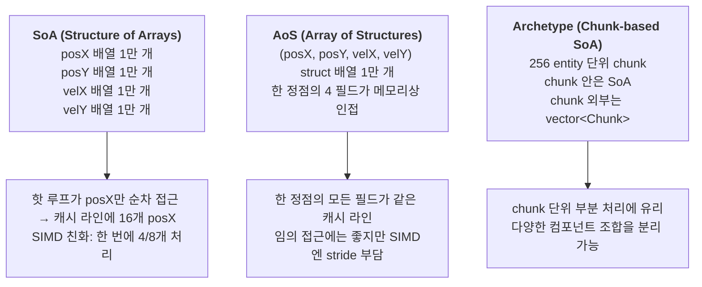

## 들어가며

현재까지의 결과물은 토글 패널과 프레임 그래프가 동작하지만, *실제로 동작하는 토글은 엔티티 수* 한 가지였다. 1k에서 100k로 바꾸면 그래프가 갈라지지만, 그건 *수가 늘어서 느려진* 자명한 결과다. 측정 도구의 진짜 가치는 *같은 수의 엔티티를 다른 방식으로 처리할 때* 어떻게 갈라지는가에 있다. 이 단계가 그 첫 번째 *진짜* 비교 축을 연다.

이 단계의 목표는 *메모리 레이아웃 토글* 을 활성화하는 것이다. 같은 1만 점 시뮬을 SoA, AoS, Archetype 세 레이아웃으로 각각 구현해 두고, 콤보박스 한 번 클릭으로 시뮬 인스턴스 자체가 교체된다. 그 순간 update ms가 갈라지는 모습이 그래프에 그려진다. 결과 차이의 *원인* 은 메모리 접근 패턴과 자동 벡터화 가능성이다.

이 단계의 결과물은 다음 다섯 가지다.

1. `ISimulation` 추상 인터페이스
2. `SoASimulation` — 컴포넌트별 분리 배열
3. `AoSSimulation` — struct 배열
4. `ArchetypeSimulation` — 256-entity chunk 단위 SoA
5. `Layout` enum에서 인스턴스를 만드는 `CreateSimulation` 팩토리

이 단계에서 SIMD 토글은 여전히 grayed out이다. Update가 `simd` 인자를 받지만 모든 경로가 scalar로 폴백한다. 수동 SIMD 경로는 아직 비어 있고, SoA·Archetype에 SSE/AVX2 경로를 채울 여지를 남긴다.

이 글의 코드 스니펫은 *해당 단계의 스냅샷* 이다. 디스크의 통합 코드는 누적되어 더 진행된 상태일 수 있다.

---

## 목차
1. [왜 메모리 레이아웃이 성능을 가르는가](#1-왜-메모리-레이아웃이-성능을-가르는가)
2. [ISimulation 추상 인터페이스와 팩토리](#2-isimulation-추상-인터페이스와-팩토리)
3. [SoA: Structure of Arrays](#3-soa-structure-of-arrays)
4. [AoS: Array of Structures](#4-aos-array-of-structures)
5. [Archetype: Chunk 단위 SoA](#5-archetype-chunk-단위-soa)
6. [main의 다형성 통합과 Hud 활성화](#6-main의-다형성-통합과-hud-활성화)
7. [빌드와 실행 결과](#7-빌드와-실행-결과)

---

## 1. 왜 메모리 레이아웃이 성능을 가르는가

같은 1만 개 엔티티를 *어떻게 메모리에 펼치느냐* 가 처리 속도를 가른다. 핵심은 두 가지다.

### 캐시 라인 활용도

CPU는 메모리에서 한 번에 *캐시 라인 단위* (보통 64 byte)로 데이터를 가져온다. 64 byte는 16개 float 또는 8개 double에 해당한다. 핫 루프가 한 번에 만지는 데이터가 같은 캐시 라인 안에 *조밀하게* 모여 있을수록 메모리 대역폭이 효율적이다.

### 자동 벡터화 가능성

컴파일러는 핫 루프가 *연속된 메모리* 의 *동일 타입 원소* 를 *같은 연산* 으로 처리할 때 SSE/AVX 명령으로 자동 변환할 수 있다. 한 번의 명령이 4개(SSE) 또는 8개(AVX) float을 동시에 처리하면 산술 처리량은 4~8배 늘어날 수 있다. 자동 벡터화의 전제는 데이터 배치가 SIMD 친화적이라는 점이다.

### 세 가지 레이아웃의 차이

같은 *1만 개의 (posX, posY, velX, velY) 정점* 을 다음 셋으로 펼칠 수 있다.



세 레이아웃의 핫 루프 메모리 접근 패턴은 다음 표로 요약된다.

| 레이아웃 | 핫 루프가 한 번에 만지는 위치 | SIMD 연속 로드 | 자동 벡터화 |
|---|---|---|---|
| SoA | `posX[0..15]` 한 캐시 라인 | 인접 4/8개 직접 로드 가능 | 매우 친화 |
| AoS | `entity[0]` 한 정점의 4 필드 (모두 사용) | stride가 sizeof(Entity)라 인접 로드 불가, gather/scatter 필요 | stride 부담 |
| Archetype | chunk 내부에서 SoA와 동일 | 인접 로드 가능 | SoA와 동등 |

핵심은 *캐시 낭비* 가 아니다 — 이 시뮬은 한 정점의 4 필드(posX/posY/velX/velY)를 모두 매 프레임 사용하므로 AoS도 캐시 라인을 거의 다 쓴다. 차이는 *SIMD가 인접 4/8개의 같은 컴포넌트를 한 번에 로드할 수 있느냐* 다. AoS는 stride가 16 byte라 SSE의 `_mm_loadu_ps` 같은 인접 로드가 동작하지 않고, gather/scatter 인트린식이 필요해 SIMD 효과가 크게 줄어든다. 이 단계가 그 차이를 *시각적 사건* 으로 만든다.

## 2. ISimulation 추상 인터페이스와 팩토리

세 레이아웃은 *데이터 배치만 다른 같은 워크로드* 다. 인터페이스를 추상 클래스로 통일하고, 토글에 따라 *인스턴스 자체* 를 교체한다.

```cpp
// src/sim/isimulation.h

#pragma once

#include "ui/toggles.h"

#include <cstddef>
#include <memory>
#include <vector>

namespace ppl {

class ISimulation {
public:
    virtual ~ISimulation() = default;

    virtual void Init(std::size_t entityCount, int viewportW, int viewportH) = 0;
    virtual void Update(float dt, SimdWidth simd, bool branchless) = 0;
    virtual void Draw() const = 0;
    virtual void Shutdown() = 0;

    virtual std::size_t Count() const = 0;

    // GUI와 독립적인 정확성 검증용 스냅숏. 엔티티 순서대로
    // [posX, posY, velX, velY]를 기록한다.
    virtual void CopyState(std::vector<float>& out) const = 0;
};

std::unique_ptr<ISimulation> CreateSimulation(Layout layout);

}  // namespace ppl
```

`Update` 의 인자에 `SimdWidth simd` 와 `bool branchless` 가 미리 들어 있다. 현재 모든 구현이 이 둘을 *무시* 하고 scalar 경로로 동작한다. 시그니처를 처음부터 넓게 잡아 두면 처리 경로가 늘어날 때 인터페이스를 다시 건드리지 않아도 된다.

### 검증용 상태 스냅숏: CopyState

`CopyState` 는 화면 출력과 무관하게 시뮬 상태를 꺼내는 통로다. 세 레이아웃은 내부 저장 방식이 전부 다르지만(분리 배열 / struct 배열 / chunk), `CopyState` 는 모두 *엔티티 순서대로 `[posX, posY, velX, velY]`* 를 이어 붙인 평탄한 `float` 배열을 만든다. 같은 시드·같은 `dt` 로 돌린 두 구현의 출력 벡터를 원소별로 비교하면 레이아웃 변경이 결과를 바꾸지 않았다는 것을 확인할 수 있다.

`tests/core_tests.cpp` 가 이 비교를 수행한다. 정렬 헬퍼(`AlignUp`), 네 할당자, 컨테이너·이벤트 워크로드의 계약, 세 레이아웃의 결과 동등성, scalar·SSE·AVX2 경로의 허용 오차, 그리고 경계 반사 불변식을 한 실행 파일에서 검사한다. CMake가 이 파일과 `sim/`·`alloc/`·`measure/` 소스를 묶어 별도 타깃으로 만들고 `add_test` 로 등록한다.

```cmake
enable_testing()
add_executable(parts_core_tests
    tests/core_tests.cpp
    tests/headless_draw.cpp
    src/sim/soa.cpp
    src/sim/aos.cpp
    src/sim/archetype.cpp
    src/sim/factory.cpp
    src/measure/container_benchmark.cpp
    src/measure/event_benchmark.cpp
    src/alloc/malloc_allocator.cpp
    src/alloc/arena_allocator.cpp
    src/alloc/pool_allocator.cpp
    src/alloc/slab_allocator.cpp
)
target_include_directories(parts_core_tests PRIVATE src)
add_test(NAME parts_core_tests COMMAND parts_core_tests)
```

빌드 후 `ctest --test-dir build -C Release --output-on-failure` 로 실행한다. 이 타깃은 raylib을 링크하지 않는다. 레이아웃 구현의 `Draw()` 는 `src/sim/*_draw.cpp` 라는 별도 번역 단위에 있고, 그 파일들은 앱 타깃에만 들어간다. `Draw()` 가 가상 함수라 vtable에 주소가 필요하므로 테스트 타깃은 대신 빈 정의만 담은 `tests/headless_draw.cpp` 를 링크한다. 그 결과 GLFW·OpenGL 없이 계산 코어만 빌드해 검증할 수 있고, 테스트는 창을 열지 않고 `Update` 와 `CopyState` 만 호출한다.

### 동등성만으로 부족한 지점

세 레이아웃의 출력이 서로 같은지만 보면 워크로드 규칙 자체를 지워도 모든 구현이 여전히 서로 같은 값을 낸다. 그래서 구현 사이 비교와 별개로 *절대 기준* 도 함께 검사한다. 갱신 후 모든 엔티티가 `[0, w-1] x [0, h-1]` 안에 있는가, 반사는 부호만 뒤집으므로 `|velX|`·`|velY|` 가 성분별로 보존되는가, 그리고 좁은 뷰포트에 큰 `dt` 를 주었을 때 실제로 속도 부호가 뒤집힌 엔티티가 나오는가. 마지막 항목은 엔티티별로 확인한다. 총합만 세면 SIMD 주 루프의 반사가 살아 있는 한 잔여(`count % 4`) 구간의 반사가 사라져도 드러나지 않기 때문이다.

팩토리는 단순한 switch다.

```cpp
// src/sim/factory.cpp

#include "sim/aos.h"
#include "sim/archetype.h"
#include "sim/isimulation.h"
#include "sim/soa.h"

namespace ppl {

std::unique_ptr<ISimulation> CreateSimulation(Layout layout) {
    switch (layout) {
        case Layout::SoA:       return std::make_unique<SoASimulation>();
        case Layout::AoS:       return std::make_unique<AoSSimulation>();
        case Layout::Archetype: return std::make_unique<ArchetypeSimulation>();
    }
    return std::make_unique<SoASimulation>();
}

}  // namespace ppl
```

vtable 호출 한 번이 dispatch 비용이지만, 1만 점 처리에 드는 마이크로초에 비하면 nanosecond 수준이라 무시할 수 있다. *프레임 단위 dispatch* 가 핫 루프 밖에 있는 게 핵심이다.

## 3. SoA: Structure of Arrays

SoA는 *컴포넌트별로 분리된 배열* 을 둔다. `posX`, `posY`, `velX`, `velY` 가 각각 별도의 `std::vector<float>` 다.

### 헤더

```cpp
// src/sim/soa.h

#pragma once

#include "sim/isimulation.h"

#include <vector>

namespace ppl {

class SoASimulation final : public ISimulation {
public:
    void Init(std::size_t entityCount, int viewportW, int viewportH) override;
    void Update(float dt, SimdWidth simd, bool branchless) override;
    void Draw() const override;
    void Shutdown() override;
    std::size_t Count() const override { return count_; }
    void CopyState(std::vector<float>& out) const override;

private:
    void UpdateScalar(float dt);

    std::vector<float> posX_, posY_, velX_, velY_;
    std::size_t count_ = 0;
    int viewportW_ = 0;
    int viewportH_ = 0;
};

}  // namespace ppl
```

### 구현

```cpp
// src/sim/soa.cpp (현재 단계, scalar만)

#include "sim/soa.h"

#include "raylib.h"

#include <algorithm>
#include <random>

namespace ppl {

void SoASimulation::Init(std::size_t entityCount, int viewportW, int viewportH) {
    count_ = entityCount;
    viewportW_ = viewportW;
    viewportH_ = viewportH;

    posX_.resize(count_);
    posY_.resize(count_);
    velX_.resize(count_);
    velY_.resize(count_);

    std::mt19937 rng(0xC0FFEEu);
    std::uniform_real_distribution<float> distX(0.0f,
                                                 static_cast<float>(viewportW_));
    std::uniform_real_distribution<float> distY(0.0f,
                                                 static_cast<float>(viewportH_));
    std::uniform_real_distribution<float> distV(-120.0f, 120.0f);

    for (std::size_t i = 0; i < count_; ++i) {
        posX_[i] = distX(rng);
        posY_[i] = distY(rng);
        velX_[i] = distV(rng);
        velY_[i] = distV(rng);
    }
}
```

Update와 Draw는 SoA 배열을 직접 순회한다.

```cpp
void SoASimulation::Update(float dt, SimdWidth /*simd*/, bool /*branchless*/) {
    // 현재 상태: simd/branchless 인자를 받기만 하고 scalar 경로 하나로 처리한다.
    UpdateScalar(dt);
}

void SoASimulation::UpdateScalar(float dt) {
    const float w = static_cast<float>(viewportW_);
    const float h = static_cast<float>(viewportH_);
    const float maxX = w - 1.0f;
    const float maxY = h - 1.0f;

    for (std::size_t i = 0; i < count_; ++i) {
        posX_[i] += velX_[i] * dt;
        posY_[i] += velY_[i] * dt;

        if (posX_[i] < 0.0f || posX_[i] > maxX) {
            velX_[i] = -velX_[i];
            posX_[i] = std::clamp(posX_[i], 0.0f, maxX);
        }
        if (posY_[i] < 0.0f || posY_[i] > maxY) {
            velY_[i] = -velY_[i];
            posY_[i] = std::clamp(posY_[i], 0.0f, maxY);
        }
    }
}

void SoASimulation::Draw() const {
    for (std::size_t i = 0; i < count_; ++i) {
        DrawPixel(static_cast<int>(posX_[i]),
                  static_cast<int>(posY_[i]),
                  WHITE);
    }
}

void SoASimulation::CopyState(std::vector<float>& out) const {
    out.resize(count_ * 4);
    for (std::size_t i = 0; i < count_; ++i) {
        out[i * 4 + 0] = posX_[i];
        out[i * 4 + 1] = posY_[i];
        out[i * 4 + 2] = velX_[i];
        out[i * 4 + 3] = velY_[i];
    }
}

void SoASimulation::Shutdown() {
    posX_.clear(); posY_.clear();
    velX_.clear(); velY_.clear();
    count_ = 0;
}

}  // namespace ppl
```

`UpdateScalar` 의 핫 루프가 SoA의 핵심이다.

```cpp
posX_[i] += velX_[i] * dt;
posY_[i] += velY_[i] * dt;
```

이 두 줄에서 컴파일러는 다음을 본다.

- `posX_[i]` 를 만지는 동안 `posX_[i+1]`, `posX_[i+2]`, ... 도 같은 캐시 라인에 들어와 있다.
- `velX_[i]` 도 마찬가지로 인접 4~16개가 같이 적재된다.
- 인덱스 `i` 는 단조 증가하는 *induction variable* 이다.

이 셋이 모두 만족하면 컴파일러가 *자동 벡터화* 를 시도할 수 있다. 실제 적용 여부는 최적화 레벨, alias 분석, 분기 형태에 달린다. *수동 SIMD* 와 차이는, 자동 벡터화가 주로 *분기 없는 산술 부분* 에서 잘 먹힌다는 점이다. 경계 반사 분기는 자동 벡터화 대상에서 빠질 수 있다.

## 4. AoS: Array of Structures

AoS는 *한 엔티티의 모든 필드가 메모리에 인접* 한 모델이다. C++의 `struct` 배열 그대로다.

### 헤더

```cpp
// src/sim/aos.h

#pragma once

#include "sim/isimulation.h"

#include <vector>

namespace ppl {

class AoSSimulation final : public ISimulation {
public:
    struct Entity {
        float posX, posY;
        float velX, velY;
    };

    void Init(std::size_t entityCount, int viewportW, int viewportH) override;
    void Update(float dt, SimdWidth simd, bool branchless) override;
    void Draw() const override;
    void Shutdown() override;
    std::size_t Count() const override { return entities_.size(); }
    void CopyState(std::vector<float>& out) const override;

private:
    void UpdateScalar(float dt);

    std::vector<Entity> entities_;
    int viewportW_ = 0;
    int viewportH_ = 0;
};

}  // namespace ppl
```

`Entity` 는 16 byte다(4 byte float × 4). 캐시 라인 64 byte에 4개 엔티티가 들어간다.

### 구현 핫 루프

```cpp
void AoSSimulation::UpdateScalar(float dt) {
    const float w = static_cast<float>(viewportW_);
    const float h = static_cast<float>(viewportH_);
    const float maxX = w - 1.0f;
    const float maxY = h - 1.0f;

    for (auto& e : entities_) {
        e.posX += e.velX * dt;
        e.posY += e.velY * dt;

        if (e.posX < 0.0f || e.posX > maxX) {
            e.velX = -e.velX;
            e.posX = std::clamp(e.posX, 0.0f, maxX);
        }
        if (e.posY < 0.0f || e.posY > maxY) {
            e.velY = -e.velY;
            e.posY = std::clamp(e.posY, 0.0f, maxY);
        }
    }
}
```

핫 루프가 한 엔티티의 *4개 필드* 를 차례로 만진다. 같은 캐시 라인 안이라 임의 접근에는 좋다. 하지만 *한 컴포넌트만 순차 처리* 하는 SIMD 모델에는 stride가 16 byte라 인접 4개 `posX` 를 한 번에 못 가져온다.

자동 벡터화는 부분적으로 가능하다 — 컴파일러가 strided load를 인식해 SSE로 묶는 경우도 있지만 SoA처럼 효율적이지는 않다. AoS는 *임의 접근* (예: 특정 ID로 한 엔티티의 모든 필드 한 번에 읽기) 에 강하고, *대량 핫 루프* 에는 손해를 본다.

게임 엔진의 일반 규칙은 *전체 엔티티를 매 프레임 같은 방식으로 처리하면 SoA, 일부 엔티티에 임의 접근하면 AoS* 다. Archetype은 둘을 청크 단위로 결합한다.

## 5. Archetype: Chunk 단위 SoA

Archetype은 *같은 컴포넌트 조합을 가진 엔티티들을 chunk로 묶어 SoA로 저장* 한다. Unity DOTS, Bevy ECS의 모델이다.

### 헤더

```cpp
// src/sim/archetype.h

#pragma once

#include "sim/isimulation.h"

#include <array>
#include <memory>
#include <vector>

namespace ppl {

class ArchetypeSimulation final : public ISimulation {
public:
    static constexpr std::size_t kChunkCapacity = 256;

    struct Chunk {
        std::array<float, kChunkCapacity> posX;
        std::array<float, kChunkCapacity> posY;
        std::array<float, kChunkCapacity> velX;
        std::array<float, kChunkCapacity> velY;
        std::size_t size = 0;
    };

    void Init(std::size_t entityCount, int viewportW, int viewportH) override;
    void Update(float dt, SimdWidth simd, bool branchless) override;
    void Draw() const override;
    void Shutdown() override;
    std::size_t Count() const override { return totalCount_; }
    void CopyState(std::vector<float>& out) const override;

private:
    void UpdateScalar(float dt);

    std::vector<std::unique_ptr<Chunk>> chunks_;
    std::size_t totalCount_ = 0;
    int viewportW_ = 0;
    int viewportH_ = 0;
};

}  // namespace ppl
```

`Chunk` 는 256 entity 단위. 한 chunk 안은 *4개 분리 배열* (`posX[256]`, `posY[256]`, `velX[256]`, `velY[256]`) 로 SoA다. chunk 외부는 `vector<unique_ptr<Chunk>>`.

### 구현 핫 루프

```cpp
void ArchetypeSimulation::UpdateScalar(float dt) {
    const float w = static_cast<float>(viewportW_);
    const float h = static_cast<float>(viewportH_);
    const float maxX = w - 1.0f;
    const float maxY = h - 1.0f;

    for (auto& chunkPtr : chunks_) {
        Chunk& c = *chunkPtr;
        const std::size_t n = c.size;

        for (std::size_t i = 0; i < n; ++i) {
            c.posX[i] += c.velX[i] * dt;
            c.posY[i] += c.velY[i] * dt;

            if (c.posX[i] < 0.0f || c.posX[i] > maxX) {
                c.velX[i] = -c.velX[i];
                c.posX[i] = std::clamp(c.posX[i], 0.0f, maxX);
            }
            if (c.posY[i] < 0.0f || c.posY[i] > maxY) {
                c.velY[i] = -c.velY[i];
                c.posY[i] = std::clamp(c.posY[i], 0.0f, maxY);
            }
        }
    }
}
```

내부 루프(`i = 0..n`)는 SoA와 *문자 그대로 같은 형태* 다. `posX`, `velX` 가 chunk 안에서 인접 메모리에 있다. 컴파일러가 자동 벡터화하기 같은 수준으로 좋다.

차이는 두 가지다.

1. **외부 루프 오버헤드**: chunk마다 메모리 할당과 포인터 추적이 한 번씩 더. 실제 비용은 chunk 수 × 한 번의 indirect access 정도.
2. **chunk 메타데이터**: 각 chunk가 `size_t size` 를 들고 있어 *부분 chunk* 처리가 자연스럽다.

이 시뮬은 *모든 엔티티가 같은 컴포넌트(pos+vel)* 한 archetype이라 측정상 SoA와 *큰 차이 없는* 게 정상이다. Archetype의 진짜 이득은 *여러 컴포넌트 조합이 섞인 게임 월드* 에서 *특정 컴포넌트 조합 chunk만 골라 처리* 할 때 나타난다. 이 도구는 단일 archetype이라 그 이득을 보지는 못한다 — 측정 결과로 SoA ≈ Archetype 이 나오는 게 *옳은* 결과다.

## 6. main의 다형성 통합과 Hud 활성화

main에서 `Simulation` 직접 인스턴스 대신 `unique_ptr<ISimulation>` 을 받는다. Layout 토글이 바뀌면 *인스턴스 자체* 를 새로 만든다.

### main.cpp 변경

```cpp
#include "raylib.h"

#include "measure/frame_timer.h"
#include "sim/isimulation.h"
#include "ui/hud.h"
#include "ui/toggles.h"

#include <memory>

namespace {
constexpr int kWindowW = 1280;
constexpr int kWindowH = 720;
constexpr int kHudH    = 140;
constexpr int kSimH    = kWindowH - kHudH;
}  // namespace

int main() {
    SetConfigFlags(FLAG_MSAA_4X_HINT);
    InitWindow(kWindowW, kWindowH, "parts_perf_lab");
    SetTargetFPS(0);

    ppl::Toggles toggles;
    ppl::Toggles prevToggles = toggles;

    auto sim = ppl::CreateSimulation(toggles.layout);
    sim->Init(toggles.EntityCount(), kWindowW, kSimH);

    ppl::FrameTimer timer;
    ppl::Hud hud;
    hud.Init(kWindowW, kWindowH, kHudH);
```

루프는 시뮬 update와 시뮬 draw를 측정한 뒤 샘플을 커밋하고 HUD를 그린다.

```cpp
    while (!WindowShouldClose()) {
        const float dt = GetFrameTime();

        timer.BeginUpdate();
        sim->Update(dt, toggles.simd, toggles.branchless);
        timer.EndUpdate();

        timer.BeginDraw();
        BeginDrawing();
        ClearBackground(Color{10, 10, 14, 255});
        sim->Draw();
        timer.EndDraw();
        timer.CommitFrame();
        hud.Draw(toggles, timer, sim->Count());
        EndDrawing();

        // 토글 변경 처리. 레이아웃이 바뀌면 시뮬 인스턴스 자체를 교체한다.
        if (ppl::RequiresRestart(prevToggles, toggles)) {
            const bool layoutChanged = (prevToggles.layout != toggles.layout);
            sim->Shutdown();
            if (layoutChanged) {
                sim = ppl::CreateSimulation(toggles.layout);
            }
            sim->Init(toggles.EntityCount(), kWindowW, kSimH);
        }
        prevToggles = toggles;
    }

    sim->Shutdown();
    CloseWindow();
    return 0;
}
```

핵심 변경은 셋이다.

1. `Simulation sim;` → `auto sim = CreateSimulation(layout);` (다형 포인터)
2. `sim.Update(...)` → `sim->Update(toggles.simd, toggles.branchless)` (인자 추가)
3. 재시작 시 *layout 변경* 이면 인스턴스 교체, 아니면 같은 인스턴스에 `Shutdown` + `Init`

### Hud 토글 활성화

기존 코드에서 layout 토글은 `GuiSetState(STATE_DISABLED)` 로 회색이었다. 그 두 줄을 빼고 라벨 색을 회색에서 밝은색으로 바꾼다.

```cpp
// src/ui/hud.cpp 의 layout 토글 부분

// 3행: 레이아웃 — 활성
DrawText("layout   :", x, rowY(row), 14, LIGHTGRAY);
int layoutIdx = (int)toggles.layout;
if (GuiDropdownBox({(float)(x + kLabelW), (float)rowY(row),
                    (float)kFieldW, (float)kRowH},
                   kLayoutOptions, &layoutIdx, layoutEdit_)) {
    layoutEdit_ = !layoutEdit_;
}
if (!layoutEdit_) {
    toggles.layout = (Layout)std::clamp(layoutIdx, 0, kLayoutCount - 1);
}
```

`STATE_DISABLED` ↔ `STATE_NORMAL` 두 호출이 빠지고 라벨 색이 `GRAY` → `LIGHTGRAY` 로 바뀐 게 전부다.

## 7. 빌드와 실행 결과

CMake 재구성, 빌드, 실행한다.

```bash
cmake -S . -B build
cmake --build build --config Release
```

실행하면 layout 콤보박스가 활성화되어 있다. 콤보를 클릭해 SoA → AoS → Archetype 순서로 바꿔 본다.

### 측정 시점에서 보이는 것

10k 엔티티 기준 일반적인 데스크톱 CPU에서 보일 수 있는 경향은 다음과 같다.

- **SoA**: update ms가 가장 작음. 자동 벡터화가 가장 잘 동작.
- **AoS**: SoA 대비 update ms가 *클 수 있다*. 다만 컴파일러가 AoS도 잘 풀거나 워크로드가 작으면 비슷하게 나올 수 있어, 큰 차이를 *반드시 본다고 단정하지 않는다*.
- **Archetype**: SoA와 거의 동등. 차이가 미미한 게 *옳은* 결과 (단일 archetype 시뮬이라).

콤보박스 클릭 직후 그래프에 *세로 절벽* 이 그려진다. 직전 layout의 ms와 직후 layout의 ms가 한 줄로 이어지면서 차이가 시각적 사건이 된다.

100k 엔티티로 늘리면 절대 ms가 커지면서 *비율 차이* 가 더 잘 보인다. 1k에서는 차이가 측정 노이즈 안에 묻힐 수도 있다.

### 검증 체크리스트

- layout 변경 시 화면이 깜박이지만 시뮬 패턴이 *같아 보임* → 결정론적 시드(`0xC0FFEE`)가 모든 layout에서 같으니 정상
- AoS가 SoA보다 *느리지 않음* → 컴파일러가 AoS도 잘 최적화했거나 데이터 크기가 아직 캐시 안에 머무는 케이스. `-O3` 또는 `/O2` 빌드에서 충분히 일어날 수 있다. 더 큰 차이를 보려면 entities를 100k로 늘려 캐시 한계를 넘긴다. `-O0` 빌드는 디버그 참고용이지 성능 판단 기준으로 쓰지 않는다
- Archetype이 SoA보다 *느림* → chunk 수가 너무 많아서 외부 루프 오버헤드가 보이는 경우. 100k에서는 약 391 chunk라 차이가 있을 수 있음
- 시뮬이 멈춤 → 재시작 직후 GetFrameTime()이 비정상적으로 커서 첫 프레임에 모든 점이 화면 밖으로 날아가는 경우. *두 프레임 후* 정상화되니 잠깐 기다림

### 비교 측정의 정직성

이 도구가 보여 주는 차이는 *컴파일러 최적화* 와 *CPU 마이크로아키텍처* 의 결합 결과다. 같은 코드라도:

- GCC vs Clang vs MSVC에 따라 자동 벡터화 결과가 다름
- Skylake vs Zen 4의 캐시 계층이 다름
- L2/L3 크기에 따라 100k에서 다른 절벽이 보일 수 있음

도구는 *재현 환경* 만 제공한다. 절대값은 머신마다 다르고, 비율도 변한다. 결론을 일반화하지 않고 *본인 머신에서 측정* 한 결과로 다룬다.

---

## 결론

이 단계의 결과물은 layout 토글 한 번에 시뮬 인스턴스가 교체되고 그 직후 ms 차이가 그래프에 *세로 절벽* 으로 그려지는 도구다. 약 350줄의 새 코드(ISimulation + 3 layout + factory + main 변경)가 기존 코드 위에 얹혔다.

세 가지 결정이 이 단계의 토대를 만들었다.

1. **추상 인터페이스 + 팩토리** — vtable dispatch 한 번이 핫 루프 밖에 있어 dispatch 비용은 무시할 수 있다. *데이터 배치 차이* 만 측정에 남는다.
2. **인터페이스 시그니처를 넓게 잡아 둠** — `Update(dt, simd, branchless)` 가 이 단계에선 simd/branchless를 무시하지만, 처리 경로가 늘어나도 시그니처를 바꾸지 않고 분기만 추가하면 된다.
3. **Archetype의 측정상 동일성을 *기대치* 로 명시** — 단일 archetype 시뮬에서 SoA ≈ Archetype 이 나오는 게 옳은 결과. 차이가 안 나는 *것* 이 측정 도구가 알려 주는 정보다.

여기까지의 코드는 자동 벡터화에만 의존한다. 컴파일러가 잘 처리하는 부분과 못 처리하는 부분이 섞여 있어 차이가 *예측 가능하지 않다*. 핫 루프를 SSE/AVX2 명령으로 직접 짠 경로가 없어, 지금 측정된 차이 중 어디까지가 레이아웃 때문이고 어디까지가 컴파일러의 벡터화 판단 때문인지 분리할 수 없다.

## 더 읽을거리

- Mike Acton, "Data-Oriented Design and C++" (CppCon 2014) — SoA/AoS 의 게임 엔진 적용
- Michele Caini (skypjack), "ECS back and forth" — sparse set 대 archetype 등 ECS 저장 모델 비교 시리즈
- [Unity Entities Components System](https://docs.unity3d.com/Packages/com.unity.entities@latest)
- [Bevy ECS — 공식 Getting Started 가이드](https://bevy.org/learn/quick-start/getting-started/ecs/) — archetype 기반 컴포넌트 저장의 실물 구현
- Stoyan Nikolov, "OOP is Dead, Long Live Data-Oriented Design" (CppCon 2018)
- [Andrei Alexandrescu, "Speed is found in the minds of people"](https://www.youtube.com/watch?v=FJJTYQYB1JQ) (CppCon 2019) — 자동 벡터화의 한계
- [Compiler Explorer (godbolt.org)](https://godbolt.org/) — 자동 벡터화 결과를 어셈블리로 직접 확인
