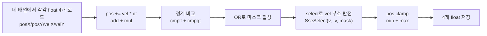

## 들어가며

현재까지의 결과물은 layout 토글로 SoA·AoS·Archetype 세 변종을 *런타임에 교체* 하는 측정 도구다. 핫 루프는 모두 인트린식 없이 일반 C++로 도는 상태다. 컴파일러는 자동 벡터화를 시도할 수 있지만, *경계 반사 분기* 가 있는 루프를 어디까지 벡터화하는지는 최적화 수준·컴파일러 버전·루프 형태에 따라 달라진다. 소스에 `if` 가 있다고 해서 그것이 곧 기계어 분기라는 보장도 없다.

이 단계의 목표는 *수동 SIMD 인트린식* 으로 같은 핫 루프를 직접 작성해 SSE·AVX2 경로를 만드는 것이다. 자동 벡터화에 의존하지 않고 4개(SSE) 또는 8개(AVX2) float을 한 명령으로 처리하는 코드를 직접 작성한다. 경계 갱신은 *마스크 + 비트 select* 로 lane별로 선택하되, 함수 전체의 루프·tail·dispatch 분기까지 사라지는 것은 아니다. SIMD 토글이 활성화되어 콤보박스 한 번 클릭으로 C++ Auto → SSE → AVX2 경로가 즉시 교체되고, 그 차이가 그래프에 그려진다.

> 이 실습은 게임 개발의 모든 CS 주제를 하나의 프로그램에 구현하는 과정이 아니다. 같은 상태를 여러 메모리 배치와 연산 방식으로 처리하고, 할당·순회 비용을 나누어 관찰하는 저수준 성능 실습이다. ECS 는 단일 컴포넌트 조합의 저장 배치까지만 다룬다. query 와 구조 변경, 문자열·인코딩·동시성 등은 별도 실습에서 다룬다.
>
> 실행 결과가 특정 순서로 나와야 성공하는 실습은 아니다. 먼저 같은 입력에 대해 같은 의미의 결과를 계산하는지 확인한다. 그다음 작업량·측정 구간·실행 환경을 맞추고 반복 측정한다. 기대와 다른 성능이 나오면 결과를 숨기거나 구현 오류로 단정하지 않고, 이 실험이 어떤 가정을 충족하지 못했는지 확인한다.
>
> 각 장의 코드는 세 종류로 구분한다. `현재 단계 완성 코드`는 해당 단계의 파일 집합과 함께 빌드할 수 있어야 한다. `발췌 코드`는 생략된 선언과 helper 의 실제 위치를 함께 적는다. `설명용 의사코드`는 의미와 제어 흐름을 보여주며 그대로 붙여 넣는 소스가 아니다. 최종 `src/`와 중간 단계의 함수 시그니처가 다르면 변환 표를 제공한다.

이 단계의 결과물은 다음 여섯 가지다.

1. 플랫폼 가드 헤더 `platform.h` (x86/x64에서만 SIMD 코드 컴파일)
2. CMake 옵션 `PERF_LAB_ENABLE_AVX2` (기본 OFF) 와 별도 옵션 `PERF_LAB_ENABLE_FMA`
3. SoA에 SSE/AVX2 핫 루프 추가
4. Archetype에 SSE/AVX2 핫 루프 추가
5. AoS는 이 lab에서 수동 SIMD 경로를 두지 않음 (자동 벡터화 가능성과는 별개)
6. 요청과 실제 실행 커널을 판정하는 `ppl::ResolveKernel`

---

## 목차
1. [자동 벡터화 vs 수동 SIMD](#1-자동-벡터화-vs-수동-simd)
2. [플랫폼·CPU 기능 가드](#2-플랫폼cpu-기능-가드)
3. [SSE2 안전 select 패턴](#3-sse2-안전-select-패턴)
4. [SoA의 SSE 경로](#4-soa의-sse-경로)
5. [SoA의 AVX2 경로와 FMA](#5-soa의-avx2-경로와-fma)
6. [Archetype의 chunk 단위 SIMD](#6-archetype의-chunk-단위-simd)
7. [AoS는 왜 scalar로 두는가](#7-aos는-왜-scalar로-두는가)
8. [Hud 활성화와 빌드·실행 결과](#8-hud-활성화와-빌드실행-결과)

---

## 1. 자동 벡터화 vs 수동 SIMD

기존 SoA 핫 루프는 다음 형태였다.

```cpp
for (std::size_t i = 0; i < count_; ++i) {
    posX_[i] += velX_[i] * dt;          // (a) 산술
    posY_[i] += velY_[i] * dt;

    if (posX_[i] < 0.0f || posX_[i] > maxX) {  // (b) 분기 + 부호 반전 + clamp
        velX_[i] = -velX_[i];
        posX_[i] = std::clamp(posX_[i], 0.0f, maxX);
    }
    // ...
}
```

`-O3` 또는 `/O2` 빌드에서 컴파일러가 이 루프를 어떻게 낮추는지는 버전·옵션·alias 분석·분기 형태에 달려 있다. 일반적으로 다음을 구분한다.

- (a) 산술 부분은 *SIMD로 자동 변환될 수 있다*. 4개 float을 SSE 한 명령에 묶는 변환이 가능하다.
- (b) 경계 갱신은 *데이터 의존* 이라 자동 벡터화가 막히거나 부분 처리에 그칠 수 있다. 다만 컴파일러가 이 갱신을 blend/select나 masked 명령으로 낮추는 경우도 있으므로, 소스의 `if` 하나가 곧 기계어 conditional branch라고 단정하지 않는다.

이 차이는 *기계어 수준에서* 확인해야 한다. 컴파일러 벡터화 리포트와 disassembly를 실습 산출물로 두고, "분기가 있으니 벡터화가 안 됐다" 같은 추론을 사실로 쓰지 않는다. 수동 SIMD는 경계 갱신을 *마스크 select* 로 명시해 lane별 선택을 고정한다.

수동 SIMD의 트레이드오프는 다음과 같다.

| 항목 | 자동 벡터화 | 수동 SIMD |
|---|---|---|
| 코드 분량 | 동일 (그대로) | 별도 함수 추가 |
| 경계 갱신 처리 | 컴파일러가 select로 낮출 수도, 분기로 남길 수도 있음 | 마스크 select로 명시 |
| 컴파일러 의존 | 큼 (버전·옵션마다 결과 다름) | 인트린식이 특정 명령에 대응하나 스케줄·tail·dispatch 분기는 별개 |
| 가독성 | 일반 C++ | 인트린식 학습 필요 |
| 측정 일관성 | 낮음 | 높음 |

`Scalar` 라는 현재 이름은 수동 SIMD를 작성하지 않은 일반 C++ 구현을 뜻한다. 컴파일러가 자동으로 벡터화할 수 있으므로 HUD에서는 `C++ Auto` 로 부른다(콤보 문자열도 `C++ Auto;SSE;AVX2`). 벡터 명령이 전혀 없는 진짜 기준선을 비교하려면 별도 번역 단위에서 GCC `-fno-tree-loop-vectorize`·`-fno-tree-slp-vectorize`, Clang `-fno-vectorize`·`-fno-slp-vectorize` 로 자동 벡터화를 제한하고 실제 어셈블리를 확인한다. 이 별도 기준선 TU와 어셈블리 대조는 이 lab에 아직 없다 — **보충 구현 목표**.

이 도구는 *측정 일관성* 이 중요하므로 수동 SIMD를 추가한다. 자동 벡터화 결과는 baseline (`C++ Auto` 토글) 으로 남겨 비교한다.

입력 계약도 함께 고정한다. viewport는 `W, H >= 2` 이고 Init과 Update가 같은 상한(`W-1`, `H-1`)을 쓴다. 유효한 `dt` 는 음이 아닌 유한값이며, NaN·무한·음수 `dt` 는 `SanitizeDt` 가 0으로, 작은 viewport는 `SanitizeViewport` 가 2로 올린다. 경계 처리는 큰 `dt` 동안 벽을 여러 번 통과하는 운동을 정확히 재현하는 물리 해법이 아니라 *한 step 후 clamp + 부호 반전* 이라는 이산 규칙이다. 시각적 성능 실험이 목적이며, 물리적으로 정확한 다중 반사가 필요하면 별도 참조 모델을 둔다.

## 2. 플랫폼·CPU 기능 가드

수동 SIMD 코드를 모든 환경에서 그대로 컴파일하면 두 가지 문제가 생긴다.

1. **비-x86 플랫폼**: ARM (Apple Silicon, 모바일 등)에서 `<immintrin.h>` 가 없거나 `__m128` 타입이 정의되지 않는다. 컴파일 자체가 실패.
2. **x86 안에서도 명령 셋 차이**: SSE2는 모든 x86-64에서 보장되지만 AVX2는 추가 옵션 (`/arch:AVX2`, `-mavx2`) 이 필요. 옵션 없이 AVX2 인트린식을 쓰면 GCC/Clang은 *target specific option mismatch* 류 오류를 내고, MSVC는 진단 없이 컴파일해 AVX2 명령을 그대로 방출한다.

해결 방법: *컴파일 시점 매크로 가드*.

<!-- snippet: src/platform.h -->
```cpp
// src/platform.h

#pragma once

// PERF_LAB_X86_SIMD: x86/x64 SSE2 인트린식 사용 가능 여부.
//   - x86_64 / AMD64는 SSE2가 ABI baseline이라 항상 보장.
//   - 32-bit x86은 컴파일 옵션으로 SSE2가 명시적으로 켜진 경우만 정의.
//     (__SSE2__는 GCC/Clang, _M_IX86_FP >= 2는 MSVC의 /arch:SSE2 지표)
#if defined(__x86_64__) || defined(_M_X64) \
    || defined(__SSE2__) \
    || (defined(_M_IX86_FP) && _M_IX86_FP >= 2)
#  define PERF_LAB_X86_SIMD 1
#endif

// PERF_LAB_AVX2: AVX2 인트린식(폭) 사용 가능 여부.
//   - CMake의 PERF_LAB_ENABLE_AVX2 옵션이 ON일 때 정의된다.
//   - PERF_LAB_X86_SIMD가 정의된 경우에만 의미가 있다.
// PERF_LAB_FMA: AVX2 경로의 pos += vel*dt 를 fmadd로 계산할지 여부.
//   - CMake의 PERF_LAB_ENABLE_FMA 옵션이 ON일 때 정의된다(폭과 독립).

#if defined(PERF_LAB_X86_SIMD)
#  include <immintrin.h>
#endif
```

매크로 세 단계로 구분한다.

- `PERF_LAB_X86_SIMD`: 플랫폼 + SSE2 보장 여부. x86_64는 ABI baseline이라 자동 통과, 32-bit x86은 SSE2 활성 빌드에서만 통과해 *SSE2 미지원 빌드에서 SIMD 코드가 컴파일되는* 사고를 막는다.
- `PERF_LAB_AVX2`: 빌드 옵션 기준. CMake가 `target_compile_definitions` 로 설정한다.
- `PERF_LAB_FMA`: 같은 방식의 별도 옵션. AVX2 폭과 FMA 반올림 계약을 독립적으로 켜고 끌 수 있다.

`<immintrin.h>` 한 헤더로 SSE2부터 AVX2까지 모두 들어온다. MSVC도 같은 헤더를 받아들이므로 컴파일러별 분기는 필요 없다.

### CMakeLists.txt

```cmake
# SIMD(AVX2) 활성화 옵션. SIMD step에서 켠다.
# 켜지 않은 채로 빌드해도 scalar 경로는 정상 동작한다.
option(PERF_LAB_ENABLE_AVX2
       "Enable AVX2 compiler flags for SIMD modules" OFF)

# FMA(Fused Multiply-Add) 사용 여부. AVX2 경로에서 pos += vel*dt를 한 번 반올림으로
# 계산할지(fmadd), 곱셈·덧셈으로 나눌지 정한다. 폭(AVX2)과 FMA를 독립 축으로 두어
# 결과 차이를 폭 때문으로 오해하지 않게 한다. OFF면 -mfma를 넘기지 않는다.
option(PERF_LAB_ENABLE_FMA
       "Use FMA in the AVX2 SIMD path (requires FMA-capable CPU)" ON)

set(PERF_LAB_TARGET_X86 OFF)
if(CMAKE_CXX_COMPILER_ARCHITECTURE_ID MATCHES "^(X86|x86|x64|X64)$"
   OR CMAKE_SYSTEM_PROCESSOR MATCHES "^(x86_64|AMD64|amd64|i[3-6]86)$")
    set(PERF_LAB_TARGET_X86 ON)
endif()

if(PERF_LAB_ENABLE_AVX2)
    if(PERF_LAB_TARGET_X86)
        # 앱 타깃과 테스트 타깃에 동일하게 부여한다. 테스트에 주지 않으면
        # UpdateAVX2 가 `#if defined(PERF_LAB_AVX2)` 가드 때문에 테스트 바이너리에서
        # 아예 컴파일되지 않아 AVX2 경로가 무검증으로 남는다.
        target_compile_definitions(${PROJECT_NAME} PRIVATE PERF_LAB_AVX2=1)
        target_compile_definitions(parts_core_tests PRIVATE PERF_LAB_AVX2=1)
        if(MSVC)
            target_compile_options(${PROJECT_NAME} PRIVATE /arch:AVX2)
            target_compile_options(parts_core_tests PRIVATE /arch:AVX2)
            if(PERF_LAB_ENABLE_FMA)
                target_compile_definitions(${PROJECT_NAME} PRIVATE PERF_LAB_FMA=1)
                target_compile_definitions(parts_core_tests PRIVATE PERF_LAB_FMA=1)
            endif()
        else()
            target_compile_options(${PROJECT_NAME} PRIVATE -mavx2)
            target_compile_options(parts_core_tests PRIVATE -mavx2)
            if(PERF_LAB_ENABLE_FMA)
                target_compile_options(${PROJECT_NAME} PRIVATE -mfma)
                target_compile_options(parts_core_tests PRIVATE -mfma)
                target_compile_definitions(${PROJECT_NAME} PRIVATE PERF_LAB_FMA=1)
                target_compile_definitions(parts_core_tests PRIVATE PERF_LAB_FMA=1)
            endif()
        endif()
    else()
        message(WARNING
            "PERF_LAB_ENABLE_AVX2 is ON, but the target is not x86/x64. "
            "AVX2 code is disabled and runtime SIMD selections fall back.")
    endif()
endif()
```

빌드 시 `cmake -DPERF_LAB_ENABLE_AVX2=ON` 으로 켠다. AVX2 경로의 FMA는 별도 옵션 `PERF_LAB_ENABLE_FMA`(기본 ON)가 정한다. AVX2를 켜도 FMA를 끄면 폭은 그대로 두고 `pos += vel*dt` 를 곱셈·덧셈 두 명령으로 계산하므로, 폭과 FMA 반올림 계약을 분리해 비교할 수 있다. 옵션이 꺼진 빌드에서 AVX2를 선택하면 `ResolveKernel` 이 SSE로 폴백하고 그 이유를 HUD에 표시한다. 비-x86/x64 타깃에서 이 옵션을 켜도 CMake는 AVX2 컴파일 플래그를 붙이지 않고, SIMD 선택은 C++ Auto로 폴백한다.

일반 C++(`C++ Auto`) 경로와 SSE 경로가 같은 반올림 계약을 쓰도록, non-MSVC 빌드에는 `-ffp-contract=off` 를 붙여 컴파일러가 곱셈·덧셈을 FMA로 합치는 것을 막는다. AVX2 경로의 FMA는 인트린식으로 명시하므로 이 옵션과 별개다.

### Update 분기 패턴 — 요청과 실제 실행 커널

매크로 가드만으로 `switch` 를 직접 쓰면 요청과 실제 실행이 어긋나기 쉽다. 그래서 `src/sim/kernel_dispatch.h` 의 `ResolveKernel` 이 한 곳에서 판정을 계산하고, HUD·CSV·dispatch가 그 결과를 함께 쓴다.

```cpp
// src/sim/kernel_dispatch.h
enum class KernelFallback : int {
    None = 0,
    LayoutHasNoSimd,  // 선택한 layout에 그 SIMD 구현이 없음 (AoS)
    Avx2NotCompiled,  // AVX2 요청, 이 빌드에 없음
    NoIntrinsics,     // 비-x86 등 인트린식 자체가 없음
};

struct ResolvedKernel {
    SimdWidth      effective;          // 실제로 도는 커널
    bool           branchlessApplied;  // 실제로 predication이 걸리는가
    KernelFallback reason;             // 요청과 다를 때의 이유
};

inline ResolvedKernel ResolveKernel(Layout layout, SimdWidth requested,
                                    bool branchless);
```

`ResolveKernel` 의 규칙은 다음과 같다.

- AoS: 이 lab에 수동 SIMD 경로가 없으므로 요청과 무관하게 `effective = Scalar`(`C++ Auto`). SIMD를 요청하면 이유는 `LayoutHasNoSimd`.
- AVX2 요청 + `PERF_LAB_AVX2` 미정의(x86): SSE로 폴백, 이유 `Avx2NotCompiled`.
- 비-x86: SSE/AVX2 요청 모두 `Scalar`, 이유 `NoIntrinsics`.
- `branchless` 는 `effective == Scalar` 일 때만 적용된다. SIMD는 이미 마스크 select라 영향받지 않는다.

구현은 이 판정 결과를 그대로 분기한다.

```cpp
void SoASimulation::Update(float dt, SimdWidth simd, bool branchless) {
    const ResolvedKernel k = ResolveKernel(Layout::SoA, simd, branchless);
    const float safeDt = SanitizeDt(dt);
    switch (k.effective) {
        case SimdWidth::Scalar:
            UpdateScalar(safeDt, k.branchlessApplied);
            break;
        case SimdWidth::SSE:
#if defined(PERF_LAB_X86_SIMD)
            UpdateSSE(safeDt);   // SIMD는 이미 마스크 처리, branchless 무관
#else
            UpdateScalar(safeDt, k.branchlessApplied);
#endif
            break;
        case SimdWidth::AVX2:
#if defined(PERF_LAB_X86_SIMD) && defined(PERF_LAB_AVX2)
            UpdateAVX2(safeDt);
#elif defined(PERF_LAB_X86_SIMD)
            UpdateSSE(safeDt);
#else
            UpdateScalar(safeDt, k.branchlessApplied);
#endif
            break;
    }
}
```

`branchlessApplied` 와 `reason` 을 HUD에 표시하므로, AoS+AVX2나 AVX2 미빌드처럼 요청과 실제가 다른 경우가 화면에서 바로 보인다. 실행 경로를 수치 차이로 추정하지 않고 이 판정을 테스트가 직접 확인한다.

주의할 점은 *런타임 CPU 기능 검출은 아직 없다는 것* 이다. `PERF_LAB_ENABLE_AVX2=ON` 은 타깃 전체에 `/arch:AVX2` 또는 `-mavx2` 를 붙이므로 scalar·SSE 경로까지 VEX 인코딩으로 컴파일된다. 그래서 이 옵션으로 빌드한 바이너리는 SIMD 토글과 무관하게 실행 CPU가 AVX2를 지원해야 하고, FMA 옵션을 켰다면 FMA도 지원해야 한다. 지원하지 않는 CPU에서는 시작 직후 illegal instruction이 날 수 있다.

- 옵션 OFF 또는 비-x86 빌드: 해당 SIMD 경로를 컴파일하지 않고 `ResolveKernel` 이 대체 커널로 폴백한다. 이 빌드는 범용으로 실행할 수 있다.
- 옵션 ON x86 빌드: AVX2(필요하면 FMA) 지원 CPU/OS 대상 전용이다. 이 실행 파일을 "모든 CPU에서 안전"이라고 부르지 않는다.

모든 CPU에서 안전한 실행 파일이 필요하면 높은 ISA 전용 함수를 별도 번역 단위로 분리하고, 안전한 baseline에서 실행 지원(CPUID/OSXSAVE/XGETBV)을 검사한 뒤 호출해야 한다. 이 lab은 아직 그 범용 런타임 dispatch를 구현하지 않았다 — **보충 구현 목표**.

## 3. SSE2 안전 select 패턴

이 lab의 SIMD 경로는 경계 갱신을 *마스크* 로 처리한다. 비교 결과(`__m128`) 가 *각 lane별로 모든 비트가 1 또는 0* 이라, 그 마스크로 두 값 중 하나를 lane별로 선택한다.

SSE4.1에는 이 동작을 한 명령으로 하는 `_mm_blendv_ps` 가 있다.

```cpp
// SSE4.1: 한 명령으로 lane별 select
__m128 result = _mm_blendv_ps(a, b, mask);  // mask가 1이면 b, 0이면 a
```

문제는 `_mm_blendv_ps` 가 *SSE4.1* 명령이라는 점이다. CMake에 `-msse4.1` 옵션이 없으면 GCC/Clang에서 *target specific option mismatch* 컴파일 오류가 난다. 기본 빌드에서 깨지지 않게 하려면 *SSE2까지만* 사용하는 패턴이 필요하다.

### SSE2 bitwise select

같은 동작을 SSE2 명령 셋으로 풀어 쓰면 다음과 같다.

```cpp
// SSE2 bitwise select: mask 비트가 1인 lane은 b, 0인 lane은 a
inline __m128 SseSelect(__m128 a, __m128 b, __m128 mask) {
    return _mm_or_ps(_mm_andnot_ps(mask, a), _mm_and_ps(mask, b));
}
```

세 비트 연산으로 같은 결과를 얻는다. 명령 수는 늘지만 SSE2가 모든 x86-64 ABI의 baseline이라 추가 옵션 없이 컴파일된다.

수식으로 보면 다음과 같다.

$$
\text{result}_i = (\overline{\text{mask}_i} \wedge a_i) \vee (\text{mask}_i \wedge b_i)
$$

`mask_i` 가 모든 비트 1일 때 `~mask_i` 는 모든 비트 0이므로 `a` 의 lane이 0이 되고 `b` 의 lane이 그대로 OR된다. 반대도 마찬가지. *각 lane이 독립적으로* 선택된다.

AVX2 경로는 `_mm256_blendv_ps` 가 AVX1부터 있어 그대로 쓸 수 있다(AVX2 컴파일 컨텍스트에서 보장됨).

## 4. SoA의 SSE 경로

수동 SIMD 핫 루프의 전체 흐름은 다음과 같다.



코드 전체:

```cpp
#if defined(PERF_LAB_X86_SIMD)

namespace {
inline __m128 SseSelect(__m128 a, __m128 b, __m128 mask) {
    return _mm_or_ps(_mm_andnot_ps(mask, a), _mm_and_ps(mask, b));
}
}  // namespace

void SoASimulation::UpdateSSE(float dt) {
    const float w = static_cast<float>(viewportW_);
    const float h = static_cast<float>(viewportH_);

    const __m128 dtv  = _mm_set1_ps(dt);
    const __m128 zero = _mm_setzero_ps();
    const __m128 wMax = _mm_set1_ps(w - 1.0f);
    const __m128 hMax = _mm_set1_ps(h - 1.0f);

    // 4개 float씩 SoA 핫 루프.
    std::size_t i = 0;
    for (; i + 4 <= count_; i += 4) {
        __m128 px = _mm_loadu_ps(&posX_[i]);
        __m128 py = _mm_loadu_ps(&posY_[i]);
        __m128 vx = _mm_loadu_ps(&velX_[i]);
        __m128 vy = _mm_loadu_ps(&velY_[i]);

        // pos += vel * dt
        px = _mm_add_ps(px, _mm_mul_ps(vx, dtv));
        py = _mm_add_ps(py, _mm_mul_ps(vy, dtv));

        // 경계 마스크: pos < 0 OR pos > max
        const __m128 mX = _mm_or_ps(_mm_cmplt_ps(px, zero),
                                     _mm_cmpgt_ps(px, wMax));
        const __m128 mY = _mm_or_ps(_mm_cmplt_ps(py, zero),
                                     _mm_cmpgt_ps(py, hMax));

        // 마스크 영역만 vel 부호 반전 (SSE2 bitwise select)
        vx = SseSelect(vx, _mm_sub_ps(zero, vx), mX);
        vy = SseSelect(vy, _mm_sub_ps(zero, vy), mY);

        // pos clamp [0, max]
        px = _mm_max_ps(zero, _mm_min_ps(wMax, px));
        py = _mm_max_ps(zero, _mm_min_ps(hMax, py));

        _mm_storeu_ps(&posX_[i], px);
        _mm_storeu_ps(&posY_[i], py);
        _mm_storeu_ps(&velX_[i], vx);
        _mm_storeu_ps(&velY_[i], vy);
    }
```

벡터 폭으로 나누어떨어지지 않는 꼬리 구간은 scalar 루프로 처리한다.

<!-- snippet: src/sim/soa.cpp#SoASimulation::UpdateSSE -->
```cpp
    // 잔여(count % 4) 스칼라.
    const float maxX = w - 1.0f;
    const float maxY = h - 1.0f;
    for (; i < count_; ++i) {
        posX_[i] += velX_[i] * dt;
        posY_[i] += velY_[i] * dt;
        if (posX_[i] < 0.0f || posX_[i] > maxX) {
            velX_[i] = -velX_[i];
            posX_[i] = std::clamp(posX_[i], 0.0f, maxX);
        }
        if (posY_[i] < 0.0f || posY_[i] > maxY) {
            velY_[i] = -velY_[i];
            posY_[i] = std::clamp(posY_[i], 0.0f, maxY);
        }
    }
}
```

핵심 설계 선택 셋.

1. **`_mm_loadu_ps`/`_mm_storeu_ps`**: unaligned load/store. SoA의 `std::vector<float>` 는 16 byte 정렬이 보장되지 않으므로 aligned 변종(`_mm_load_ps`)을 쓰면 segfault 위험이 있다. unaligned 명령은 Nehalem 이후 CPU에서 정렬된 주소에 대해 aligned와 거의 같은 속도다.
2. **`SseSelect` 헬퍼**: SSE2만 쓰는 lane select. SSE4.1을 요구하지 않아 모든 x86-64에서 컴파일된다.
3. **잔여 처리**: `count_ % 4` 가 0이 아니면 마지막 0~3개는 scalar 루프로 처리. SoA에서는 흔한 패턴이다.

SSE 경로의 벡터 본체는 같은 필드의 float 4개, 즉 엔티티 4개를 동시에 처리한다. 한 반복에서 `posX_`, `posY_`, `velX_`, `velY_` 네 배열을 각각 읽으므로, "네 필드 float 하나씩을 합쳐 4개 읽는다"와 다르다. 벡터 폭으로 나누어떨어지지 않는 남는 엔티티는 tail에서 처리한다. 경계 갱신을 마스크로 선택하더라도 함수 전체의 loop/dispatch/tail 분기까지 없어진 것은 아니다.

### 분기를 마스크로 푸는 형태

scalar 코드의 분기:

```cpp
if (posX_[i] < 0.0f || posX_[i] > maxX) {
    velX_[i] = -velX_[i];
}
```

SIMD 코드의 마스크:

```cpp
const __m128 mX = _mm_or_ps(_mm_cmplt_ps(px, zero), _mm_cmpgt_ps(px, wMax));
vx = SseSelect(vx, _mm_sub_ps(zero, vx), mX);
```

벡터 본체 안에서는 경계 갱신이 lane별 조건 분기로 남지 않는다. 모든 lane이 두 경우를 계산하고 마스크로 결과를 고른다. 그 대신 *항상* 최대 연산을 낸다. 다만 이는 마스크를 쓴 벡터 본체에 대한 설명이고, 함수 전체에 conditional branch가 0이라는 뜻은 아니다 — 루프 조건, tail, dispatch 분기는 남는다. 마스크 처리가 유리한지는 분기 빈도·패턴과 CPU에 달려 있어, 시간 차이만으로 원인을 확정하지 않는다.

## 5. SoA의 AVX2 경로와 FMA

AVX2는 `__m256` (8 float)을 다룬다. SSE 대비 처리 폭이 두 배다. FMA(Fused Multiply-Add) 사용 여부는 *별도 빌드 옵션* `PERF_LAB_ENABLE_FMA` 가 정한다. FMA를 켜면 `pos += vel * dt` 를 `_mm256_fmadd_ps` 한 명령으로 계산하고, 끄면 곱셈·덧셈 두 명령으로 계산한다. 즉 *벡터 폭* 과 *FMA 반올림 계약* 은 독립 축이다.

```cpp
#if defined(PERF_LAB_AVX2)
void SoASimulation::UpdateAVX2(float dt) {
    const float w = static_cast<float>(viewportW_);
    const float h = static_cast<float>(viewportH_);

    const __m256 dtv  = _mm256_set1_ps(dt);
    const __m256 zero = _mm256_setzero_ps();
    const __m256 wMax = _mm256_set1_ps(w - 1.0f);
    const __m256 hMax = _mm256_set1_ps(h - 1.0f);

    std::size_t i = 0;
    for (; i + 8 <= count_; i += 8) {
        __m256 px = _mm256_loadu_ps(&posX_[i]);
        __m256 py = _mm256_loadu_ps(&posY_[i]);
        __m256 vx = _mm256_loadu_ps(&velX_[i]);
        __m256 vy = _mm256_loadu_ps(&velY_[i]);

#if defined(PERF_LAB_FMA)
        // FMA 옵션이 켜졌을 때: pos += vel * dt 를 한 명령으로(중간 반올림 1회).
        px = _mm256_fmadd_ps(vx, dtv, px);
        py = _mm256_fmadd_ps(vy, dtv, py);
#else
        // FMA 옵션이 꺼졌을 때: 분리 곱셈·덧셈. 반올림 지점이 FMA 경로와 다르다.
        px = _mm256_add_ps(px, _mm256_mul_ps(vx, dtv));
        py = _mm256_add_ps(py, _mm256_mul_ps(vy, dtv));
#endif

        // 경계 마스크. _CMP_LT_OQ/_CMP_GT_OQ는 ordered + quiet 비교라
        // NaN lane은 이 조건에서 false가 된다. 이것이 커널 전체의 NaN 안전성을
        // 뜻하지는 않는다 — dt는 SanitizeDt로 미리 거르고, NaN/inf 상태는
        // 검증 경계에서 별도로 다룬다.
        const __m256 mX = _mm256_or_ps(_mm256_cmp_ps(px, zero, _CMP_LT_OQ),
                                        _mm256_cmp_ps(px, wMax, _CMP_GT_OQ));
        const __m256 mY = _mm256_or_ps(_mm256_cmp_ps(py, zero, _CMP_LT_OQ),
                                        _mm256_cmp_ps(py, hMax, _CMP_GT_OQ));

        // _mm256_blendv_ps는 AVX1 코어라 AVX2 컴파일에서 항상 사용 가능.
        vx = _mm256_blendv_ps(vx, _mm256_sub_ps(zero, vx), mX);
        vy = _mm256_blendv_ps(vy, _mm256_sub_ps(zero, vy), mY);

        px = _mm256_max_ps(zero, _mm256_min_ps(wMax, px));
        py = _mm256_max_ps(zero, _mm256_min_ps(hMax, py));

        _mm256_storeu_ps(&posX_[i], px);
        _mm256_storeu_ps(&posY_[i], py);
        _mm256_storeu_ps(&velX_[i], vx);
        _mm256_storeu_ps(&velY_[i], vy);
    }

    // 잔여(count % 8) 스칼라.
    const float maxX = w - 1.0f;
    const float maxY = h - 1.0f;
    for (; i < count_; ++i) {
        posX_[i] += velX_[i] * dt;
        posY_[i] += velY_[i] * dt;
        if (posX_[i] < 0.0f || posX_[i] > maxX) {
            velX_[i] = -velX_[i];
            posX_[i] = std::clamp(posX_[i], 0.0f, maxX);
        }
        if (posY_[i] < 0.0f || posY_[i] > maxY) {
            velY_[i] = -velY_[i];
            posY_[i] = std::clamp(posY_[i], 0.0f, maxY);
        }
    }
}
#endif  // PERF_LAB_AVX2
```

SSE 코드와 비교한 주요 차이는 다음 셋이다.

1. **`_mm_*` → `_mm256_*`**: 모든 인트린식이 256비트 변종. 처리 폭 4 → 8.
2. **FMA(옵션)**: `PERF_LAB_ENABLE_FMA` 가 ON일 때 `_mm256_fmadd_ps(a, b, c)` 가 `c + a * b` 를 한 명령으로 계산한다. FMA는 곱셈 결과를 중간 반올림하지 않으므로 분리 곱셈·덧셈과 반올림 계약이 다르다.
3. **`_mm256_cmp_ps` 와 predicate**: AVX의 비교 명령은 *predicate 인자* 가 있어 `_CMP_LT_OQ`(less than, ordered, quiet) 같은 식으로 비교 동작을 명시한다. ordered quiet는 NaN lane이 이 조건에서 false가 된다는 성질이지, 커널 전체의 NaN 안전성을 보장하지 않는다.

폭을 4에서 8로 늘리면 *이론상* 두 배 처리량이지만, FMA를 함께 켜면 수치 계약도 바뀌므로 두 효과를 한 축으로 묶어 "AVX2가 SSE의 몇 배"라고 단정하지 않는다. 실측 비율은 메모리 대역폭·store·tail 비율에 따라 달라진다.

FMA와 분리된 곱셈·덧셈은 반올림 계약이 다르므로 단순한 벡터 폭 비교가 아니다. `pos += vel*dt` 에서 FMA는 한 번만 반올림하고, 분리 연산은 곱셈 뒤 한 번·덧셈 뒤 한 번 반올림한다. 그래서 같은 식도 결과 비트가 달라질 수 있고, 긴 프레임 수를 돌리면 위치가 드리프트할 수 있다. 이때 수치가 다르다는 사실은 실행 경로의 증거가 아니고, 해당 경로가 올바르게 구현됐다는 것과도 별개다. 폭과 FMA를 독립 옵션으로 나눈 이유가 여기 있다(<https://docs.nvidia.com/cuda/floating-point/index.html>).

## 6. Archetype의 chunk 단위 SIMD

Archetype은 *chunk 외부 루프 + chunk 내부 SoA 루프* 라 SIMD 적용 패턴이 SoA와 거의 같다. 차이는 *외부 루프* 에서 chunk마다 한 번 더 indirection이 일어난다는 점이다.

```cpp
#if defined(PERF_LAB_X86_SIMD)
void ArchetypeSimulation::UpdateSSE(float dt) {
    const float w = static_cast<float>(viewportW_);
    const float h = static_cast<float>(viewportH_);
    const __m128 dtv  = _mm_set1_ps(dt);
    const __m128 zero = _mm_setzero_ps();
    const __m128 wMax = _mm_set1_ps(w - 1.0f);
    const __m128 hMax = _mm_set1_ps(h - 1.0f);
    const float maxX = w - 1.0f;
    const float maxY = h - 1.0f;

    // chunk 외부 루프 + chunk 내부 SSE 루프.
    for (auto& chunkPtr : chunks_) {
        Chunk& c = *chunkPtr;
        const std::size_t n = c.size;

        std::size_t i = 0;
        for (; i + 4 <= n; i += 4) {
            __m128 px = _mm_loadu_ps(&c.posX[i]);
            __m128 py = _mm_loadu_ps(&c.posY[i]);
            __m128 vx = _mm_loadu_ps(&c.velX[i]);
            __m128 vy = _mm_loadu_ps(&c.velY[i]);

            px = _mm_add_ps(px, _mm_mul_ps(vx, dtv));
            py = _mm_add_ps(py, _mm_mul_ps(vy, dtv));

            const __m128 mX = _mm_or_ps(_mm_cmplt_ps(px, zero),
                                         _mm_cmpgt_ps(px, wMax));
            const __m128 mY = _mm_or_ps(_mm_cmplt_ps(py, zero),
                                         _mm_cmpgt_ps(py, hMax));

            vx = SseSelect(vx, _mm_sub_ps(zero, vx), mX);
            vy = SseSelect(vy, _mm_sub_ps(zero, vy), mY);

            px = _mm_max_ps(zero, _mm_min_ps(wMax, px));
            py = _mm_max_ps(zero, _mm_min_ps(hMax, py));

            _mm_storeu_ps(&c.posX[i], px);
            _mm_storeu_ps(&c.posY[i], py);
            _mm_storeu_ps(&c.velX[i], vx);
            _mm_storeu_ps(&c.velY[i], vy);
        }
        // 잔여(chunk size % 4) 스칼라.
        for (; i < n; ++i) {
            c.posX[i] += c.velX[i] * dt;
            c.posY[i] += c.velY[i] * dt;
            if (c.posX[i] < 0.0f || c.posX[i] > maxX) {
                c.velX[i] = -c.velX[i];
                c.posX[i] = std::clamp(c.posX[i], 0.0f, maxX);
            }
            if (c.posY[i] < 0.0f || c.posY[i] > maxY) {
                c.velY[i] = -c.velY[i];
                c.posY[i] = std::clamp(c.posY[i], 0.0f, maxY);
            }
        }
    }
}
#endif
```

chunk 크기 256은 4의 배수, 8의 배수라 SSE는 *마지막 chunk 외에는* 잔여 처리가 없다. 마지막 chunk만 0~3 또는 0~7개의 잔여를 처리할 수 있다. 100k 엔티티면 가득 찬 390개 chunk(각 256) + 마지막 chunk 160개로 총 391 chunk다(390×256+160=100,000). 160도 4와 8의 배수라 이 경우엔 마지막 chunk조차 SSE 40패스 / AVX2 20패스로 정확히 떨어지고 scalar 잔여가 없다.

Archetype의 SIMD 측정 결과는 SoA와 비슷할 수 있다. 단일 조합 시뮬에서 chunk 외부 루프 오버헤드는 작을 수 있지만, chunk 수와 tail 비율에 따라 달라지므로 "거의 같아야 한다"를 합격 기준으로 두지 않는다.

## 7. AoS는 왜 scalar로 두는가

AoS의 데이터 배치를 다시 보자.

```text
메모리: [px0 py0 vx0 vy0] [px1 py1 vx1 vy1] [px2 py2 vx2 vy2] ...
        ^16B^             ^16B^             ^16B^
```

핫 루프가 *4개 entity의 posX* (`px0, px1, px2, px3`)를 한 SSE 명령에 모으려면 메모리에서 16 byte 간격으로 *4개의 4-byte 값* 을 읽어야 한다. SSE의 일반 load 명령(`_mm_loadu_ps`)은 *연속된 16 byte* 를 한 번에 읽는 거지, *16 byte 간격으로 4개 4-byte* 를 읽지 못한다.

이를 처리하려면 다음 중 하나를 한다.

1. **gather/scatter 인트린식**: AVX2의 `_mm_i32gather_ps`. 하지만 gather는 일반 load의 4~8배 비싸 SoA 대비 이득이 사라진다.
2. **shuffle/transpose**: 4개 entity를 한 번에 로드한 뒤 SIMD 안에서 transpose. 가능하지만 코드 복잡도 폭증 + transpose 비용.
3. **temporary SoA**: AoS 데이터를 매 프레임 시작에 임시 SoA로 복사. 복사 비용이 SIMD 이득을 상쇄한다.

이 세 가지는 이 lab이 *선택하지 않은* 우회 경로들이다. 컴파일러는 SLP나 shuffle/transpose로 AoS 루프를 부분 벡터화할 수 있으므로, *AoS라서 SIMD가 불가능하다* 는 결론이 아니다. 이 lab의 AoS에 수동 SIMD 경로를 두지 않은 것은 구현 범위이고, 자동 벡터화 가능성과는 별개다. 같은 필드끼리 순차 처리하는 대량 핫 루프에서는 SoA/Archetype 쪽에서 수동 SIMD 이득을 가져가기 쉽다는 것이 일반적인 경향이다.

이 도구의 AoS는 SIMD 요청을 `ResolveKernel` 로 판정해 언제나 `C++ Auto`(`Scalar`) 경로를 돌린다.

```cpp
void AoSSimulation::Update(float dt, SimdWidth simd, bool branchless) {
    // AoS는 이 lab에 수동 SIMD 경로가 없다. 요청과 실제 실행 커널을 분리해 기록한다.
    const ResolvedKernel k = ResolveKernel(Layout::AoS, simd, branchless);
    UpdateScalar(SanitizeDt(dt), k.branchlessApplied);
}
```

`simd` 요청은 `ResolveKernel` 이 `effective = C++ Auto`, 이유 `LayoutHasNoSimd` 로 기록한다. 그래서 AoS에서 SIMD 토글이 그래프를 바꾸지 않는 것은 *이 구현에 수동 SIMD 경로가 없기 때문* 이지, layout 효과를 입증하는 증거가 아니다.

## 8. Hud 활성화와 빌드·실행 결과

기존 코드에서 SIMD 콤보박스는 grayed out이었다. 두 줄(`GuiSetState(STATE_DISABLED)` 와 그 짝)을 빼고 라벨 색을 회색에서 밝은색으로 바꾼다.

```cpp
// src/ui/hud.cpp 의 simd 토글 부분

DrawText("simd     :", x2, rowY2(row2), 14, LIGHTGRAY);
int simdIdx = (int)toggles.simd;
if (GuiDropdownBox(Rect(x2 + kLabelW, rowY2(row2), kFieldW, kRowH),
                   kSimdOptions, &simdIdx, simdEdit_)) {
    simdEdit_ = !simdEdit_;
}
if (!simdEdit_) {
    toggles.simd = (SimdWidth)std::clamp(simdIdx, 0, kSimdCount - 1);
}
```

이제 SIMD 토글이 활성화되어 콤보박스 클릭으로 C++ Auto/SSE/AVX2 경로가 즉시 전환된다. HUD는 요청한 이름과 실제 실행 커널을 `simd 요청>실행` 형태로 함께 보여 주고, 폴백이면 그 이유를 짧은 이름(`no-simd`, `no-avx2`, `no-x86`)으로 표시한다.

### 빌드

기본(SSE만):
```bash
cmake -S . -B build
cmake --build build --config Release
```

AVX2 활성화(기본적으로 FMA도 함께):
```bash
cmake -S . -B build -DPERF_LAB_ENABLE_AVX2=ON
cmake --build build --config Release
```

AVX2를 켜되 FMA는 끄기(폭과 FMA 계약을 분리):
```bash
cmake -S . -B build -DPERF_LAB_ENABLE_AVX2=ON -DPERF_LAB_ENABLE_FMA=OFF
cmake --build build --config Release
```

### 실행 결과

Intel CPU + AVX2 옵션 ON 빌드, 100k 엔티티 기준 일반적인 경향(고정된 정답이 아니라 가설):

- **SoA C++ Auto**: 자동 벡터화로 어느 정도 빠를 수 있음. baseline.
- **SoA SSE**: C++ Auto 대비 update ms가 작아질 수 있음. 정확한 비율은 컴파일러와 CPU에 따라 다르며, 자동 벡터화가 이미 잘 동작했다면 차이가 작을 수 있다.
- **SoA AVX2**: SSE 대비 추가 단축이 날 수 있음. FMA를 켠 빌드라면 폭과 FMA 반올림 계약이 함께 바뀐 것이므로, 차이를 폭 하나의 효과로 단정하지 않는다.
- **AoS C++ Auto / SSE / AVX2**: 이 lab의 AoS에는 수동 SIMD 경로가 없어 *모두 같은 커널* 이 돈다. 그래서 세 요청의 그래프가 같게 나온다.

콤보를 SoA C++ Auto → SoA AVX2 → AoS AVX2 순서로 클릭하면 그래프에 세로 절벽이 그려질 수 있다. 다만 AoS에서 SIMD 토글이 무효인 것은 *이 구현에 그 경로가 없기 때문* 이며, 그 자체가 layout 효과를 증명하지는 않는다. 실제 실행 커널은 HUD의 `요청>실행` 표시로 확인한다.

### 자동 검증: `parts_simd_tests`

"SIMD로 빨라졌다"는 주장은 각 폭이 *같은 계산* 을 할 때만 성립한다. 결과가 달라졌다면 빨라진 게 아니라 덜 한 것이다. `simd` 그룹은 이 정확성과, 요청과 실제 실행 커널의 일치를 함께 본다.

`TestSimdEquivalence` 는 SoA의 C++ Auto·SSE·AVX2 결과가 허용 오차 안에 있는지, AoS에서는 세 요청이 같은 C++ Auto 경로를 돌아 수치적으로 같은지(`NearStates(..., 0.0f)`, `+0`/`-0` 를 구분하지 않는 수치 동등)를 확인한다. `TestKernelResolution` 은 `ResolveKernel` 의 반환값(`effective`, `branchlessApplied`, `reason`)을 직접 검사해, AoS+SIMD 요청이나 AVX2 미빌드 요청이 실제로 어느 커널로 가는지 확인한다.

<!-- snippet: tests/core_tests.cpp#TestSimdEquivalence -->
```cpp
// tests/core_tests.cpp — simd 그룹

void TestSimdEquivalence() {
    constexpr int   kFrames = 240;
    constexpr float kDt     = 1.0f / 144.0f;

    auto scalar = MakeAndInit(ppl::Layout::SoA);
    auto simd   = MakeAndInit(ppl::Layout::SoA);
    // ...
    std::vector<float> a, c;
    scalar->CopyState(a);
    simd->CopyState(c);
    CHECK(NearStates(a, c, 1e-4f));
#if defined(PERF_LAB_AVX2)
    // FMA를 켠 빌드라면 pos += vel*dt 의 중간 반올림이 사라져 결과가 달라질 수 있다.
    // 폭별 허용 오차로 정확성을 보고, 실행 경로는 별도 테스트가 판정한다.
    std::vector<float> d;
    wide->CopyState(d);
    CHECK(NearStates(a, d, ToleranceFor(ppl::SimdWidth::AVX2, kFrames)));
#endif

    // AoS는 SIMD 토글을 통째로 무시하고 언제나 scalar 경로를 돈다.
    std::vector<float> aosState[ppl::kSimdCount];
    const ppl::SimdWidth kWidths[] = {
        ppl::SimdWidth::Scalar, ppl::SimdWidth::SSE, ppl::SimdWidth::AVX2};
    for (int w = 0; w < ppl::kSimdCount; ++w) {
        auto aos = MakeAndInit(ppl::Layout::AoS);
        for (int i = 0; i < kFrames; ++i) aos->Update(kDt, kWidths[w], false);
        aos->CopyState(aosState[w]);
    }
    CHECK(NearStates(aosState[0], aosState[1], 0.0f));
    CHECK(NearStates(aosState[0], aosState[2], 0.0f));
}
```

실행 경로는 수치 차이로 판정하지 않는다. 올바른 FMA도 입력에 따라 스칼라와 같은 값을 낼 수 있고, 잘못된 계산도 다른 값을 낼 수 있기 때문이다. 그래서 `TestSimdEquivalence` 에는 "AVX2 결과가 스칼라와 다르다"는 반대 방향 단언이 없다. 실행 경로는 `TestKernelResolution` 의 `ResolveKernel` 판정으로, 정확성은 폭별 허용 오차 비교로 분리해 확인한다. 옵션을 켜지 않은 빌드에서는 `#if defined(PERF_LAB_AVX2)` 안쪽 AVX2 단언이 컴파일되지 않는다.

```bash
cmake -S . -B build -DPERF_LAB_ENABLE_AVX2=ON
cmake --build build --config Release
ctest --test-dir build -C Release -R parts_simd_tests --output-on-failure

./build/parts_core_tests simd              # Linux/macOS
.\build\Release\parts_core_tests.exe simd  # Windows
```

```text
parts_core_tests: group `simd`
  simd/SimdEquivalence ... 4 check(s) ok
  simd/KernelResolution ... 10 check(s) ok
simd: 2 test(s), 14 check(s), 0 failure(s)
```

`4 check(s)` 는 AVX2를 켠 빌드의 `SimdEquivalence` 수다. 옵션 없이 구성하면 AVX2 비교 한 줄이 빠져 `3 check(s)` 가 되고 그룹 합계는 `13` 이 된다. 이 차이는 "AVX2 경로가 실제로 컴파일됐는가"의 지표일 뿐, 실행 경로 자체의 증거는 아니다. 실행 경로는 `KernelResolution` 의 `ResolveKernel` 판정으로 확인한다.

### 실행 경로와 정확성의 분리 — 보충 구현 목표

현재는 `ResolveKernel` 의 판정(`effective`, `branchlessApplied`, `reason`)과 폭별 허용 오차 비교까지 구현되어 있다. 아래는 실행 경로 관측과 독립 참조를 더 분리하기 위한 설계 의사코드이며, `RunObserved`(검증 전용 커널 진입 기록)와 독립 `Reference`(non-FMA/FMA 참조)는 아직 구현하지 않았다.

```cpp
// 설계 의사코드. ResolveKernel은 구현되어 있고, RunObserved/Reference는 보충 구현 대상이다.
const auto actual = ResolveKernel(layout, request, branchless);
CHECK(actual.effective == expectedKernelForFixture);
const auto run = RunObserved(actual, fixture); // 검증 전용 진입 기록
CHECK(run.enteredKernel == actual.effective);
const auto expected = Reference(actual.numericContract, fixture); // non-FMA/FMA 분리
CHECK(CompareUnderContract(run.state, expected));
```

Scalar와 AVX 결과가 다르다는 단언으로 실제 AVX 실행 여부를 확인하지 않는다. 올바른 FMA도 입력에 따라 같은 값을 낼 수 있고, 잘못된 계산도 다른 값을 낼 수 있다. 실행 경로 검사는 dispatch 관측으로, 정확성 검사는 독립 참조로 수행한다. non-FMA와 FMA 참조를 나눠 쓰고, N=0/1/3/4/5/7/8/9/255/256/257 같은 tail·chunk 경계를 검사한다. AoS와 SIMD가 무조건 특정 배수 차이를 내야 한다는 합격 기준은 두지 않는다.

### 검증 체크리스트

- HUD의 `simd 요청>실행` 이 `AVX2>SSE no-avx2` → AVX2 빌드 옵션이 꺼져 있어 SSE로 폴백 중. `cmake -DPERF_LAB_ENABLE_AVX2=ON` 으로 재빌드.
- HUD가 `SSE>C++ Auto no-x86` → 비-x86 플랫폼이라 인트린식이 없어 `C++ Auto` 로 폴백 중 (Apple Silicon 등).
- HUD가 `AVX2>C++ Auto no-simd` → AoS처럼 수동 SIMD 경로가 없는 layout. 요청과 실행이 다르다는 표시이고 오류가 아니다.
- 컴파일 오류 *target specific option mismatch* → AVX2 코드가 옵션 OFF 빌드에서 컴파일 시도됨. `PERF_LAB_AVX2` 매크로 가드가 빠진 줄 확인.
- 100k에서도 SIMD 차이가 작음 → 컴파일러 자동 벡터화가 이미 SoA `C++ Auto` 코드에 잘 동작한 경우일 수 있다. 엔티티 수나 워크로드를 바꿔 비교하되, 환경 없는 배수를 정답으로 두지 않는다. `-O0` 빌드는 디버그 참고용이지 성능 판단 기준으로 쓰지 않는다.

### 측정의 정직성

수동 SIMD가 *항상 빠르다* 는 단정은 위험하다. 컴파일러가 이미 잘 자동 벡터화한 코드를 인트린식으로 다시 짜면 비슷하거나 살짝 느릴 수도 있다. SIMD 이득은 *분기 마스크 처리* 와 *FMA 같은 명시적 활용* 에서 주로 나온다. 워크로드가 *분기 거의 없는 단순 산술* 이면 자동 벡터화가 이미 한계 근처에 도달해 차이가 작다.

이 도구의 의의는 *비율* 이 아니라 *동일 워크로드에서 토글 전후 변화* 를 *그 자리에서* 본다는 점이다. 머신마다 다르고 워크로드마다 다르지만 *내 머신의 내 워크로드* 에 대한 측정은 도구가 즉각 보여 준다.

---

## 결론

이 단계의 결과물은 SIMD 토글 한 번에 SoA·Archetype의 핫 루프가 SSE 또는 AVX2 경로로 전환되고, AoS는 토글에 무관하게 `C++ Auto` 경로로 도는 도구다. 요청·실행 커널·폴백 이유는 HUD에 함께 표시된다. 약 350줄의 SIMD 코드(SoA SSE/AVX2 + Archetype SSE/AVX2 + 플랫폼 가드 헤더 + `ResolveKernel`)가 기존 코드 위에 얹혔다.

세 가지 결정이 이 단계의 토대를 만들었다.

1. **2단계 가드 + `ResolveKernel`** — 플랫폼 감지(`PERF_LAB_X86_SIMD`)와 빌드 옵션(`PERF_LAB_AVX2`)을 분리하고, 요청·실행 커널·폴백 이유를 `ResolveKernel` 한 곳에서 판정한다. 옵션 OFF 또는 비-x86 빌드는 컴파일 단계에서 대체 커널로 폴백해 범용으로 실행할 수 있다. 다만 `PERF_LAB_ENABLE_AVX2=ON` 빌드는 AVX2 지원 CPU/OS 대상 전용이며, 런타임 CPU 검사가 아니다. 범용 실행 파일용 별도 TU + 런타임 지원 검사는 **보충 구현 목표**다.
2. **SSE2 bitwise select** — `_mm_blendv_ps`(SSE4.1) 의존을 빼고 `_mm_andnot_ps + _mm_and_ps + _mm_or_ps` 세 명령으로 같은 lane select를 구현. 모든 x86-64 baseline에서 추가 컴파일 옵션 없이 동작.
3. **AoS는 이 lab에서 수동 SIMD 미구현** — gather/scatter·shuffle/transpose·SLP 등 여러 우회 전략이 있으나 이 lab은 채택하지 않았다. *AoS의 SIMD 불가능* 이 아니라 구현 범위이고, AoS에서 토글이 무효인 것만으로 layout 효과를 입증하지 않는다.

여기까지의 코드는 자동 벡터화와 수동 SIMD를 같은 시뮬에서 토글로 비교할 수 있다. 다만 *분기 비용* 자체는 아직 측정에 별도 변수로 안 들어와 있다. 분기 처리 방식이 scalar 경로에 고정되어 있어, 분기 예측이 그래프에 어떤 영향을 주는지는 이 상태에서 관측할 수 없다.

## 더 읽을거리

- [Intel Intrinsics Guide](https://www.intel.com/content/www/us/en/docs/intrinsics-guide/index.html) — 모든 x86 SIMD 인트린식의 검색 가능한 레퍼런스
- [Agner Fog, "Optimizing software in C++"](https://www.agner.org/optimize/optimizing_cpp.pdf) — SIMD와 분기 처리 패턴
- [Daniel Lemire, "SIMD-accelerated string and number parsing"](https://lemire.me/blog/) — 실제 SIMD 적용 예
- [Wojciech Muła — articles (optimization, SIMD, algorithms)](http://0x80.pl/notesen.html) — SSE/AVX 실전 패턴 글 색인
- [Compiler Explorer (godbolt.org)](https://godbolt.org/) — 자동 벡터화 결과를 어셈블리로 직접 확인
- [SIMD-everywhere (sse2neon)](https://github.com/DLTcollab/sse2neon) — x86 SSE 인트린식을 ARM NEON으로 매핑하는 어댑터 헤더
- Bryce Adelstein Lelbach, "Benchmarking C++ Code" (CppCon 2015) — SIMD 비교 측정의 함정
