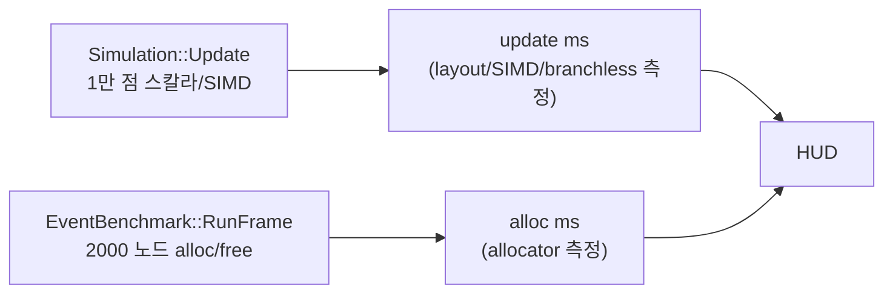

## 들어가며

현재까지의 결과물은 layout · SIMD · branchless 세 축의 비교가 가능한 측정 도구다. 시뮬 자체는 *시작 시 한 번 vector 메모리를 잡고* 매 프레임 정적 데이터로 도는 형태라 *동적 할당* 의 차이가 측정에 들어오지 않는다. 할당자 토글이 grayed out으로 자리만 잡고 있는 상태다.

이 단계의 목표는 매 프레임 *작은 노드 다발 alloc/free* 워크로드를 별도로 추가해 토글된 할당자에 주입하는 것이다. 시뮬 update와 별개의 측정 채널이 한 줄 더 생기고, allocator 콤보박스 클릭으로 그 채널의 ms가 *수십 배* 갈라지는 모습이 HUD에 그려진다. 시뮬 워크로드는 그대로 유지되어 layout/SIMD/branchless 측정에는 영향을 주지 않는다.

이 단계의 결과물은 다음 다섯 가지다.

1. `EventBenchmark` 클래스 — 매 프레임 N개 작은 노드 alloc/free 워크로드.
2. main에서 토글된 `IAllocator` 인스턴스 생성/교체.
3. 시뮬 Update와 별개로 EventBenchmark 호출.
4. HUD가 alloc ms · alloc count · alloc bytes · live bytes 표시.
5. allocator 콤보박스 활성화.

---

## 목차
1. [왜 시뮬과 분리된 워크로드인가](#1-왜-시뮬과-분리된-워크로드인가)
2. [EventBenchmark 워크로드 설계](#2-eventbenchmark-워크로드-설계)
3. [4종 할당자 인스턴스 생성](#3-4종-할당자-인스턴스-생성)
4. [main 루프 통합과 토글 변경 처리](#4-main-루프-통합과-토글-변경-처리)
5. [HUD의 alloc 측정 표시](#5-hud의-alloc-측정-표시)
6. [빌드와 실행 결과](#6-빌드와-실행-결과)

---

## 1. 왜 시뮬과 분리된 워크로드인가

할당자 토글의 측정 의도는 다음 셋이다.

1. malloc이 작은 블록 다발에서 *얼마나 비싼지*.
2. Arena의 *bump pointer + 일괄 회수* 가 얼마나 효율적인지.
3. Pool의 *free list 두 줄* 처리가 malloc 대비 얼마나 작은지.

이 셋을 보려면 *매 프레임 작은 블록을 다발로 alloc/free 하는 워크로드* 가 필요하다. 시뮬의 1만 점은 *시작 시 한 번* 메모리를 잡고 끝까지 그 메모리에서 도는 정적 모델이라 적합하지 않다.

두 가지 설계 선택지가 있었다.

- **A. 시뮬에 동적 spawn/despawn 추가**. 매 프레임 일부 엔티티 생성·소멸. 시뮬 자체에 할당 패턴을 박는다.
- **B. 시뮬과 별개의 워크로드**. EventBenchmark 같은 별도 클래스가 매 프레임 작은 노드 다발을 다룬다.

A가 *현실적 게임 시뮬* 에 가깝지만 시뮬 자체가 복잡해진다. 또한 layout/SIMD 측정에 *동적 spawn 비용* 이 섞여 비교가 흐려진다. B는 *시뮬은 정적, 워크로드는 분리* 라 측정 채널이 깔끔히 갈린다. 측정 도구의 정직성을 우선해 B를 선택한다.



두 ms가 분리되어 HUD에 표시되므로 사용자가 *어떤 토글이 어느 ms에 영향을 주는지* 한눈에 본다. allocator 토글은 alloc ms만 움직이고 시뮬 ms는 거의 건드리지 않는다.

## 2. EventBenchmark 워크로드 설계

워크로드의 핵심은 *작은 블록 다발 alloc + linked list 구성 + 일괄 free* 다.

```cpp
// src/measure/event_benchmark.h

#pragma once

#include "alloc/iallocator.h"

#include <cstddef>
#include <cstdint>

namespace ppl {

class EventBenchmark {
public:
    static constexpr std::size_t kNodeSize  = 24;     // sizeof(Node) ≥ 16 + alignment
    static constexpr std::size_t kNodeAlign = 8;

    void Init(std::size_t targetEventCount);
    void RunFrame(IAllocator* alloc);

    std::size_t   Target()              const { return target_; }
    std::uint64_t LastFrameAllocCount() const { return lastAllocCount_; }
    std::uint64_t LastFrameAllocBytes() const { return lastAllocBytes_; }
    float         LastFrameMs()         const { return lastFrameMs_; }

private:
    struct Node {
        std::uint32_t id;
        float         dist;
        Node*         next;
        std::uint64_t payload;
    };
    static_assert(sizeof(Node) <= kNodeSize, "Node size constant out of date");

    std::size_t   target_         = 0;
    std::uint64_t lastAllocCount_ = 0;
    std::uint64_t lastAllocBytes_ = 0;
    float         lastFrameMs_    = 0.0f;
};

}  // namespace ppl
```

`kNodeSize = 24` byte는 64-bit 기준 `Node` 의 실제 크기다. 32-bit `id` + `float dist` + 8-byte 포인터 `next` + 8-byte `payload` 가 8바이트 정렬에서 24 byte를 채운다. PoolAllocator는 이 크기를 받아 블록을 잡는다.

### RunFrame의 흐름

```cpp
// src/measure/event_benchmark.cpp

#include "measure/event_benchmark.h"

#include <chrono>

namespace ppl {

void EventBenchmark::Init(std::size_t targetEventCount) {
    target_ = targetEventCount;
}

void EventBenchmark::RunFrame(IAllocator* alloc) {
    if (!alloc || target_ == 0) {
        lastAllocCount_ = 0;
        lastAllocBytes_ = 0;
        lastFrameMs_    = 0.0f;
        return;
    }

    using Clock = std::chrono::steady_clock;
    const auto t0 = Clock::now();

    alloc->TickFrame();  // 프레임 단위 통계 카운터 초기화

    // N개 노드 alloc, linked list로 head에 push.
    Node* head = nullptr;
    std::size_t count = 0;
    for (std::size_t i = 0; i < target_; ++i) {
        void* p = alloc->Allocate(sizeof(Node), alignof(Node));
        if (!p) break;  // Pool/Slab 풀 고갈 시 nullptr
        Node* node = static_cast<Node*>(p);
        node->id   = static_cast<std::uint32_t>(i);
        node->dist = 0.0f;
        node->next = head;
        head = node;
        ++count;
    }

    lastAllocCount_ = count;
    lastAllocBytes_ = count * sizeof(Node);
```

할당한 노드는 같은 프레임 끝에서 모두 반환하고, 일괄 회수가 가능한 allocator는 `Reset()`으로 상태를 정리한다.

```cpp
    // 노드별 Deallocate. Arena/Pool은 Reset이 일괄 회수.
    Node* cur = head;
    while (cur) {
        Node* next = cur->next;
        alloc->Deallocate(cur, sizeof(Node));
        cur = next;
    }
    alloc->Reset();

    const auto t1 = Clock::now();
    const auto ns = std::chrono::duration_cast<std::chrono::nanoseconds>(t1 - t0).count();
    lastFrameMs_ = static_cast<float>(ns) / 1.0e6f;
}

}  // namespace ppl
```

세 가지 결정 포인트.

1. **Allocate 실패 시 break**: Pool/Slab은 사전 할당된 블록 수가 한정되어 있어 풀 고갈 시 nullptr 반환. break로 안전 처리하고 lastAllocCount_에 *실제 성공한 수* 만 기록.
2. **노드별 Deallocate + Reset 둘 다 호출**: Malloc은 Reset이 no-op이라 Deallocate가 실제 free 수행. Arena는 Deallocate가 통계만 기록(no-op), Reset이 일괄 회수. Pool은 Deallocate가 free list 갱신, Reset이 list 재구성. 같은 호출 패턴이 모든 allocator에서 안전하게 동작한다.
3. **chrono로 ms 측정**: allocator의 자체 통계(`AllocCount`, `LiveBytes`)와 별개로 *실제 경과 시간* 을 측정한다. allocator 차이가 *수십 배 ms* 로 갈라지는 게 핵심 시각화 데이터다.

### 왜 linked list인가

vector나 array에 N개 노드를 *한 번에 push_back* 하면 사실상 *한 번의 큰 alloc + 한 번의 free* 가 된다. malloc과 Arena의 차이가 거의 안 보인다.

linked list는 *한 노드씩 alloc* 한다. Pool의 free list 두 줄 처리와 일반 힙 allocator의 메타데이터 관리, thread-cache/락 비용이 *N번 반복* 되어 누적 차이가 명확히 드러난다. *작은 블록 다발* 측정의 표준 패턴이다.

## 3. 4종 할당자 인스턴스 생성

main에서 토글에 따라 적절한 allocator 인스턴스를 만든다. 인터페이스는 `IAllocator` 추상 클래스, 구현은 4종.

```cpp
// src/main.cpp

#include "alloc/arena_allocator.h"
#include "alloc/iallocator.h"
#include "alloc/malloc_allocator.h"
#include "alloc/pool_allocator.h"
#include "alloc/slab_allocator.h"
#include "measure/event_benchmark.h"

namespace {

constexpr std::size_t kEventCount = 2000;       // 매 프레임 노드 수
constexpr std::size_t kArenaBytes = 256 * 1024; // 256 KB
constexpr std::size_t kPoolBlocks = 4096;       // 노드 수 + 여유

std::unique_ptr<ppl::IAllocator> CreateAllocator(ppl::Allocator type) {
    using namespace ppl;
    switch (type) {
        case Allocator::Malloc:
            return std::make_unique<MallocAllocator>();
        case Allocator::Arena:
            return std::make_unique<ArenaAllocator>(kArenaBytes);
        case Allocator::Pool:
            return std::make_unique<PoolAllocator>(
                EventBenchmark::kNodeSize,
                EventBenchmark::kNodeAlign,
                kPoolBlocks);
        case Allocator::Slab:
            return std::make_unique<SlabAllocator>(kPoolBlocks);
    }
    return std::make_unique<MallocAllocator>();
}

}  // namespace
```

### 백킹 용량 결정

매 프레임 2000개 × 24 byte = 48 KB가 라이브 메모리의 최대치다. 그 위에 여유를 두고 다음과 같이 잡는다.

| 할당자 | 백킹 크기 | 산출 근거 |
|---|---|---|
| Malloc | (시스템 힙) | 무관. 시스템이 알아서 |
| Arena | 256 KB | 라이브 48 KB의 약 5배 여유 |
| Pool | 4096 블록 × 24 byte ≈ 96 KB | 노드 수의 2배 여유, 풀 고갈 방지 |
| Slab | 클래스당 4096 블록 × 8 클래스 | 교육용으로 넉넉한 설정. 전체 백킹 메모리는 Pool보다 훨씬 큼 |

Pool/Slab은 *고갈* 이 측정 자체를 무효화하므로 *목표 노드 수보다 충분히 큰* 값으로 잡는다. Arena는 일괄 회수라 한 프레임 안에서만 안 넘으면 된다.

### Slab의 노드 라우팅

Slab은 8개 크기 클래스(16/32/64/128/256/512/1024/2048 byte)를 가진 PoolAllocator의 묶음이다. 24 byte 노드 요청은 *32 byte 클래스* 로 라우팅된다.

```text
요청: Allocate(24, 8)
↓
SizeToClass(max(24, 8)) = SizeToClass(24) = 1 (32 byte 클래스)
↓
pools_[1]->Allocate(24, 8)  // 32 byte 슬롯 한 개 차지
```

내부 단편화로 *8 byte가 슬롯당 낭비* 된다. Pool은 정확히 24 byte 블록이라 단편화가 없다. 측정에서 Slab이 Pool보다 *살짝 더 메모리* 를 쓴다는 결과가 나오는 게 정상이다.

Deallocate는 한 가지 주의점이 있다. Allocate는 `max(size, alignment)` 로 class를 고르지만, `IAllocator::Deallocate(ptr, size)` 는 alignment를 받지 않는다. 그래서 SlabAllocator는 size만으로 class를 역산하지 않고, 각 PoolAllocator에 `Owns(ptr)` 를 물어 실제 포인터가 속한 class를 찾은 뒤 반환한다. 이러면 `Allocate(8, 64)` 처럼 alignment가 size보다 큰 요청도 잘못된 class로 반환되지 않는다.

## 4. main 루프 통합과 토글 변경 처리

main 루프에 EventBenchmark 호출과 allocator 변경 감지를 추가한다.

```cpp
int main() {
    SetConfigFlags(FLAG_MSAA_4X_HINT);
    InitWindow(kWindowW, kWindowH, "parts_perf_lab");
    SetTargetFPS(0);

    ppl::Toggles toggles;
    ppl::Toggles prevToggles = toggles;

    auto sim = ppl::CreateSimulation(toggles.layout);
    sim->Init(toggles.EntityCount(), kWindowW, kSimH);

    auto alloc = CreateAllocator(toggles.allocator);

    ppl::EventBenchmark bench;
    bench.Init(kEventCount);

    ppl::FrameTimer timer;
    ppl::Hud hud;
    hud.Init(kWindowW, kWindowH, kHudH);
```

루프에서는 시뮬 update와 allocator 워크로드를 서로 다른 측정 구간으로 둔다.

```cpp
    while (!WindowShouldClose()) {
        const float dt = GetFrameTime();

        timer.BeginUpdate();
        sim->Update(dt, toggles.simd, toggles.branchless);
        timer.EndUpdate();

        bench.RunFrame(alloc.get());

        timer.BeginDraw();
        BeginDrawing();
        ClearBackground(Color{10, 10, 14, 255});
        sim->Draw();
        timer.EndDraw();
        timer.CommitFrame();
        hud.Draw(toggles, timer, sim->Count(), bench, *alloc);
        EndDrawing();

        // 토글 변경 처리.
        if (ppl::RequiresRestart(prevToggles, toggles)) {
            const bool layoutChanged    = (prevToggles.layout    != toggles.layout);
            const bool entityChanged    = (prevToggles.entityPresetIdx != toggles.entityPresetIdx);
            const bool allocatorChanged = (prevToggles.allocator != toggles.allocator);

            if (layoutChanged || entityChanged) {
                sim->Shutdown();
                if (layoutChanged) {
                    sim = ppl::CreateSimulation(toggles.layout);
                }
                sim->Init(toggles.EntityCount(), kWindowW, kSimH);
            }

            if (allocatorChanged) {
                alloc = CreateAllocator(toggles.allocator);
            }
        }
        prevToggles = toggles;
    }

    sim->Shutdown();
    CloseWindow();
    return 0;
}
```

세 가지 변경.

1. **`bench.RunFrame(alloc.get())`** 가 `timer.EndUpdate()` 뒤, draw 측정 전에 호출된다. update ms는 시뮬 비용만 보고, alloc ms는 별도 채널로 표시된다.
2. **allocator 변경 시 인스턴스 재생성**: `RequiresRestart` 가 allocator 변경도 검사하고, 분기에서 새 allocator 인스턴스를 만든다. 시뮬은 layout/entity 변경 때만 재초기화된다. 이전 allocator 인스턴스는 `unique_ptr` 가 자동으로 해제.
3. **Hud::Draw 시그니처 확장**: `bench` 와 `*alloc` 을 추가 인자로 받아 표시.

### bench 호출 위치

`bench.RunFrame` 을 `sim->Update` 와 `sim->Draw` *어디 사이* 에 둘지 결정 사항이다.

| 위치 | 효과 |
|---|---|
| Update 측정 안 | update ms에 alloc 비용 합산 |
| Update와 Draw 사이 (현 선택) | update/draw 어느 쪽에도 섞이지 않는 별도 측정 |
| Draw 측정 안 | draw ms에 alloc 비용 합산 |

이 도구는 *Update와 Draw 사이* 에 둔다. 이유는 allocator 토글이 시뮬 update ms를 오염시키지 않게 하기 위해서다. `alloc ms` 는 allocator 워크로드의 단독 비용으로 해석된다.

## 5. HUD의 alloc 측정 표시

Hud::Draw가 `EventBenchmark&` 와 `IAllocator&` 를 인자로 받아 좌측 stats 영역에 표시한다.

```cpp
// src/ui/hud.h

class Hud {
public:
    void Draw(Toggles& toggles, const FrameTimer& timer,
              std::size_t entityCount,
              const EventBenchmark& bench,
              const IAllocator& alloc);

private:
    void DrawStats(const FrameTimer& timer, std::size_t entityCount,
                   const EventBenchmark& bench, const IAllocator& alloc,
                   int x, int y);
    // ...
};
```

```cpp
// src/ui/hud.cpp

void Hud::DrawStats(const FrameTimer& timer, std::size_t entityCount,
                     const EventBenchmark& bench, const IAllocator& alloc,
                     int x, int y) {
    const float cpuFps = timer.LastTotalMs() > 0.0f
                         ? 1000.0f / timer.LastTotalMs() : 0.0f;
    const int actualFps = GetFPS();

    char buf[512];
    std::snprintf(buf, sizeof(buf),
                  "entities  : %zu\n"
                  "update    : %6.3f ms\n"
                  "draw      : %6.3f ms\n"
                  "cpu fps   : %5.1f   actual: %5d\n"
                  "\n"
                  "alloc ms  : %6.3f  (%llu allocs)\n"
                  "alloc bytes: %llu  live: %llu",
                  entityCount,
                  timer.LastUpdateMs(),
                  timer.LastDrawMs(),
                  cpuFps,
                  actualFps,
                  bench.LastFrameMs(),
                  static_cast<unsigned long long>(alloc.FrameAllocCount()),
                  static_cast<unsigned long long>(alloc.FrameAllocBytes()),
                  static_cast<unsigned long long>(alloc.LiveBytes()));
    DrawText(buf, x, y, 14, RAYWHITE);
}
```

표시 항목 다섯 가지.

| 항목 | 의미 |
|---|---|
| entities | 시뮬 엔티티 수 |
| update / draw / cpu fps / actual fps | 기존 시뮬 측정 |
| **alloc ms** | EventBenchmark 한 프레임 경과 시간 |
| **alloc count** | 이번 프레임 Allocate 호출 횟수 |
| **alloc bytes** | 이번 프레임 alloc 누적 byte |
| **live bytes** | 현재 살아 있는 메모리 (Reset 후 0이 정상) |

`live bytes` 가 `0` 으로 표시되는 이유: `RunFrame` 끝에 `Reset` 호출로 모든 라이브 메모리가 회수된 직후 측정이라 0이다. 만약 0이 아니면 *누수* 또는 *Reset 미동작* 의 신호다 (디버그 가치).

### allocator 콤보박스 활성화

기존 코드에서 grayed out이었던 allocator 콤보박스를 활성화한다.

```cpp
DrawText("allocator:", x, rowY(row), 14, LIGHTGRAY);
int allocIdx = (int)toggles.allocator;
if (GuiDropdownBox(Rect(x + kLabelW, rowY(row), kFieldW, kRowH),
                   kAllocatorOptions, &allocIdx, allocatorEdit_)) {
    allocatorEdit_ = !allocatorEdit_;
}
if (!allocatorEdit_) {
    toggles.allocator = (Allocator)std::clamp(allocIdx, 0, kAllocatorCount - 1);
}
row++;
```

`GuiSetState(STATE_DISABLED)` 두 줄이 사라지고 라벨 색이 `GRAY` → `LIGHTGRAY` 로 바뀐 게 전부다.

## 6. 빌드와 실행 결과

CMake 재구성, 빌드, 실행한다.

```bash
cmake -S . -B build
cmake --build build --config Release
```

실행 후 화면 좌측 stats 영역 하단에 `alloc ms`, `alloc count`, `alloc bytes`, `live bytes` 가 매 프레임 갱신된다. allocator 콤보박스를 클릭해 malloc → Arena → Pool → Slab 순서로 바꾸며 변화를 본다.

### 측정 시점에서 보일 수 있는 경향

일반적인 데스크톱 CPU에서 `kEventCount = 2000` 기준의 거친 추정:

- **malloc**: alloc ms가 가장 큼. 100~500μs 정도가 나올 수 있다. 힙 메타데이터 관리, thread-cache/락, free list 관리 비용이 누적된다.
- **Arena**: bump pointer 증가만이라 가장 빠른 경로. 10~30μs.
- **Pool**: free list head 갱신 두 줄 + Reset 시 list 재구성. Arena와 비슷하거나 약간 더.
- **Slab**: Pool과 거의 동등. 클래스 라우팅 한 번이 추가되지만 한 클래스만 쓰면 차이 미미.

토글을 malloc → Arena로 바꾼 직후 alloc ms가 *세로 절벽* 으로 떨어지는 모습이 가장 큰 시각적 사건이다. 비율로는 5배 ~ 50배까지 차이가 날 수 있다.

`alloc bytes` 는 모든 allocator에서 동일(`2000 × 24 = 48000 byte`). 알고리즘 차이가 *바이트 수* 가 아닌 *호출 비용* 에 있다는 것을 보여 준다.

`live bytes` 는 모든 프레임 끝에서 0이어야 정상이다. malloc은 Deallocate가 실제 free라 0, Arena는 Reset이 일괄 회수라 0, Pool/Slab은 Reset이 free list 재구성이라 0.

### 자동 검증: `parts_allocator_tests`

바로 위 문단이 HUD를 눈으로 읽으라는 요구다. 같은 요구를 창 없이 기계가 하도록 옮겨 놓은 것이 `allocator` 그룹이다. 네 할당자 전부에 대해 프레임 계약을 3프레임 연속으로 확인한다.

<!-- snippet: tests/core_tests.cpp#TestEventBenchmarkContract -->
```cpp
// tests/core_tests.cpp — allocator 그룹

void TestEventBenchmarkContract() {
    constexpr std::size_t kTarget   = 200;
    // ...
    ppl::IAllocator* allocators[] = {&mallocAlloc, &arena, &pool, &slab};
    static_assert(sizeof(allocators) / sizeof(allocators[0]) == ppl::kAllocatorCount,
                  "EventBenchmark contract must cover every allocator toggle");

    for (int a = 0; a < ppl::kAllocatorCount; ++a) {
        const char* label = ppl::AllocatorName(static_cast<ppl::Allocator>(a));
        ppl::IAllocator* alloc = allocators[a];

        ppl::EventBenchmark bench;
        bench.Init(kTarget);
        CHECK_AT(bench.Target() == kTarget, label);

        for (int frame = 0; frame < 3; ++frame) {
            bench.RunFrame(alloc);
            CHECK_AT(bench.LastFrameAllocCount() == kTarget, label);
            CHECK_AT(bench.LastFrameAllocBytes() == kTarget * kNodeSize, label);
            CHECK_AT(alloc->FrameAllocCount() == kTarget, label);
            CHECK_AT(alloc->FrameAllocBytes() == kTarget * kNodeSize, label);
            // HUD의 live bytes가 0이라는 것이 바로 이 줄이다.
            CHECK_AT(alloc->LiveBytes() == 0, label);
        }
        // 누적 카운터는 3프레임 분이 그대로 쌓인다.
        CHECK_AT(alloc->AllocCount() == 3 * kTarget, label);
        CHECK_AT(alloc->FreeCount() == 3 * kTarget, label);
        CHECK_AT(alloc->PeakBytes() == kTarget * kNodeSize, label);
    }

    // 일괄 회수가 실제로 일어났는지는 할당자 고유 상태로 확인한다.
    CHECK(arena.Used() == 0);
    CHECK(pool.InUse() == 0);
    CHECK(pool.Free() == kTarget);
    CHECK(slab.ClassInUse(1) == 0);  // 24바이트 요청 -> 32바이트 클래스
    // ...
}
```

`static_assert` 한 줄이 이 검사를 콤보박스에 묶어 둔다. 할당자 항목을 하나 더 늘리면 배열 길이와 `kAllocatorCount` 가 어긋나 *컴파일이* 멈춘다. 토글에는 보이는데 검증에는 없는 할당자가 생길 수 없다.

풀 고갈은 별도 검사다. HUD에서 `alloc count` 가 `kEventCount` 보다 작아지는 상황의 계약을 그대로 고정한다.

<!-- snippet: tests/core_tests.cpp#TestPoolExhaustion -->
```cpp
// tests/core_tests.cpp — allocator 그룹

void TestPoolExhaustion() {
    constexpr std::size_t kBlocks = 8;
    ppl::PoolAllocator pool(32, 8, kBlocks);
    // ...
    // 블록을 다 쓴 뒤의 요청은 반드시 nullptr.
    CHECK(pool.Allocate(32, 8) == nullptr);
    CHECK(pool.InUse() == kBlocks);

    // 하나 반납하면 그 슬롯이 그대로 재사용된다(free list LIFO).
    pool.Deallocate(slots[3], 32);
    CHECK(pool.InUse() == kBlocks - 1);
    CHECK(pool.Free() == 1);
    void* again = pool.Allocate(32, 8);
    CHECK(again == slots[3]);
    // ...
}
```

```bash
cmake -S . -B build
cmake --build build --config Release
ctest --test-dir build -C Release -R parts_allocator_tests --output-on-failure

./build/parts_core_tests allocator              # Linux/macOS
.\build\Release\parts_core_tests.exe allocator  # Windows
```

```text
parts_core_tests: group `allocator`
  allocator/AlignmentHelpers ... 5 check(s) ok
  allocator/MallocAndArena ... 11 check(s) ok
  allocator/PoolAndSlab ... 15 check(s) ok
  allocator/PoolExhaustion ... 31 check(s) ok
  allocator/EventBenchmarkContract ... 86 check(s) ok
allocator: 5 test(s), 148 check(s), 0 failure(s)
```

`EventBenchmarkContract` 의 86개는 네 할당자 × (Target 1 + 3프레임 × 5 + 누적 3) = 76에, 일괄 회수 확인 4 + 풀 고갈 4 + allocator 없는 프레임 2를 더한 수다. 실패하면 어느 할당자에서 깨졌는지가 `[Arena]` 처럼 라벨로 함께 찍힌다.

### 검증 체크리스트

- alloc ms가 0 → `alloc.get()` 이 nullptr이거나 `kEventCount = 0`. main 초기화 확인.
- live bytes가 0이 아님 → Reset 누락 또는 Deallocate 누락. EventBenchmark::RunFrame 끝의 두 호출 확인.
- Pool에서 alloc count가 `kEventCount` 보다 작음 → 풀 고갈. `kPoolBlocks` 를 늘림.
- malloc과 Arena 차이가 작음 → 플랫폼 malloc의 thread-cache/fast path가 잘 먹는 케이스. Release 빌드에서 가능하며, 측정 노이즈가 크면 `kEventCount` 를 늘려 비교.
- 모든 allocator에서 alloc ms가 비슷하게 큼 → 측정 노이즈에 묻힘. `kEventCount` 를 10000으로 늘려 누적 비용을 키움.

### 시뮬과의 분리 확인

allocator 토글을 바꾸면 `alloc ms` 만 주로 움직이고 `update ms` 는 거의 그대로여야 한다. update ms는 `sim->Update` 만 재고, EventBenchmark는 별도 구간에서 측정하기 때문이다. 만약 update ms까지 같이 크게 움직이면 캐시 상태나 OS 스케줄링 같은 부수 효과를 의심한다.

### 측정의 정직성

이 도구의 alloc 측정은 *작은 블록 다발* 에 한정된 결과다. 실제 게임 엔진의 할당 패턴은 다양하다.

- 한 번에 큰 블록(예: 512 KB 텍스처): 호출 횟수가 적어 작은 블록 다발보다 Arena/Pool 이득이 작다. 구현에 따라 mmap/VirtualAlloc 같은 큰 할당 경로로 들어가 오히려 비쌀 수도 있다.
- 무작위 크기·수명 mix: malloc의 free list가 단편화로 점점 느려진다. Arena는 *일괄 회수가 가능한* 케이스에만 유효.
- 멀티스레드: tcmalloc/jemalloc 같은 thread-cache 할당자가 malloc 대비 큰 이득. Arena는 스레드별로 분리해야.

이 도구는 *작은 블록 다발 + 단일 스레드 + 일괄 회수* 라는 가장 *Arena/Pool에 유리한* 시나리오를 보여 준다. malloc이 무조건 느리다는 결론이 아니라, *이런 패턴에서는* Arena/Pool 이득이 크다는 사실을 직접 보여 주는 게 의도다.

---

## 결론

이 단계의 결과물은 매 프레임 2000개 작은 노드 alloc/free 워크로드를 별도 채널로 두고, 토글된 4종 allocator의 ms 차이를 HUD에 표시하는 도구다. 약 200줄의 새 코드(EventBenchmark + main 통합 + Hud 확장)가 기존 코드 위에 얹혔다.

세 가지 결정이 이 단계의 토대를 만들었다.

1. **시뮬과 워크로드의 분리** — 시뮬은 정적 메모리, EventBenchmark는 동적 alloc. update ms와 alloc ms를 별도 구간에서 재므로 allocator 토글의 효과를 분리해 볼 수 있다.
2. **linked list 패턴** — 한 노드씩 alloc해 *작은 블록 다발* 의 알고리즘 차이를 누적시킨다. vector 한 번 push가 아닌 N번 alloc이 비용 차이를 가장 잘 드러낸다.
3. **노드별 Deallocate + Reset 둘 다** — Malloc은 Deallocate가 실제 free, Arena/Pool은 Reset이 일괄 회수. 같은 호출 패턴이 모든 allocator에서 안전하게 끝난다.

여기까지의 코드는 layout / SIMD / branchless / allocator 네 축의 비교가 가능하다. 시뮬의 *컨테이너 자료구조* 는 아직 `std::vector` 한 가지로 고정이다. `std::list` 나 *intrusive list* 로 같은 워크로드를 처리하는 경로가 없어, *링크 포인터 추적* 의 캐시 미스 비용은 이 도구의 측정 대상 밖에 있다.

## 더 읽을거리

- Andrei Alexandrescu, "Std::Allocator Is to Allocation what std::vector Is to Vexation" (CppCon 2015) — C++ 할당자 모델
- John Lakos, "Local ('Arena') Memory Allocators" (CppCon 2017) — arena 계열 할당자의 체계적 분류와 측정
- [jemalloc 설계 문서](https://jemalloc.net/) — 멀티스레드 할당자
- [tcmalloc 설계 문서](https://google.github.io/tcmalloc/) — Thread-cache 할당자
- [mimalloc 논문 (Microsoft)](https://www.microsoft.com/en-us/research/uploads/prod/2019/06/mimalloc-tr-v1.pdf)
- Chandler Carruth, "Tuning C++: Benchmarks, and CPUs, and Compilers! Oh My!" (CppCon 2015) — 마이크로 벤치마크의 함정
- [Linux 커널 SLUB 할당자](https://www.kernel.org/doc/html/latest/mm/slub.html) — 운영체제 측 Slab
- Jason Gregory, *Game Engine Architecture*, 3rd ed., Ch. 5 "Engine Support Systems" — 게임 엔진의 메모리 관리(할당자·단편화) 패턴
