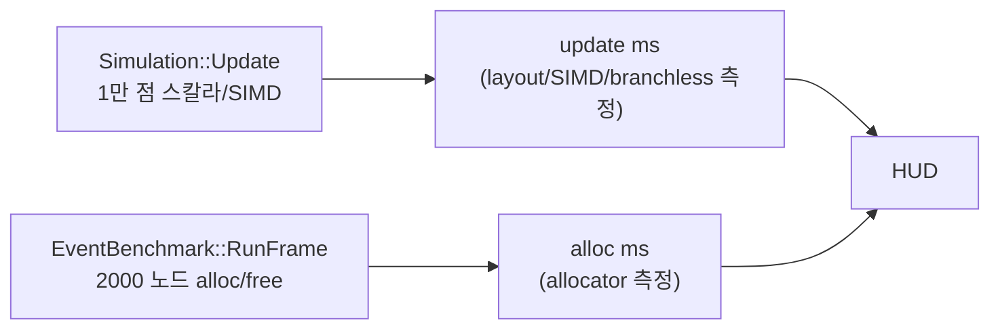

## 들어가며

> 이 실습은 게임 개발의 모든 CS 주제를 하나의 프로그램에 구현하는 과정이 아니다. 같은 상태를 여러 메모리 배치와 연산 방식으로 처리하고, 할당·순회 비용을 나누어 관찰하는 저수준 성능 실습이다. ECS 는 단일 컴포넌트 조합의 저장 배치까지만 다룬다. query 와 구조 변경, 문자열·인코딩·동시성 등은 별도 실습에서 다룬다.
>
> 실행 결과가 특정 순서로 나와야 성공하는 실습은 아니다. 먼저 같은 입력에 대해 같은 의미의 결과를 계산하는지 확인한다. 그다음 작업량·측정 구간·실행 환경을 맞추고 반복 측정한다. 기대와 다른 성능이 나오면 결과를 숨기거나 구현 오류로 단정하지 않고, 이 실험이 어떤 가정을 충족하지 못했는지 확인한다.
>
> 각 장의 코드는 세 종류로 구분한다. `현재 단계 완성 코드`는 해당 단계의 파일 집합과 함께 빌드할 수 있어야 한다. `발췌 코드`는 생략된 선언과 helper 의 실제 위치를 함께 적는다. `설명용 의사코드`는 의미와 제어 흐름을 보여주며 그대로 붙여 넣는 소스가 아니다. 최종 `src/`와 중간 단계의 함수 시그니처가 다르면 변환 표를 제공한다.

현재까지의 결과물은 layout · SIMD · branchless 세 축의 비교가 가능한 측정 도구다. 시뮬 자체는 *시작 시 한 번 vector 메모리를 잡고* 매 프레임 정적 데이터로 도는 형태라 *동적 할당* 의 차이가 측정에 들어오지 않는다. 할당자 토글이 grayed out으로 자리만 잡고 있는 상태다.

이 단계의 목표는 매 프레임 *작은 노드 다발 alloc/free* 워크로드를 별도로 추가해 토글된 할당자에 주입하는 것이다. 시뮬 update와 별개의 측정 채널이 한 줄 더 생기고, allocator 콤보박스 클릭으로 그 채널의 ms가 달라지는 모습이 HUD에 그려진다. 얼마나 달라지는지는 환경·워크로드·수명 프로토콜에 따라 다르며, 문서의 고정 배수는 가설일 뿐 정답이 아니다. 시뮬 워크로드는 그대로 유지되어 layout/SIMD/branchless 측정 채널과 분리되지만, 같은 CPU·cache·메모리·OS를 공유하므로 실행 비용의 상호 영향까지 제거되는 것은 아니다.

이 단계의 결과물은 다음 다섯 가지다.

1. `EventBenchmark` 클래스 — 매 프레임 N개 작은 노드 alloc/free 워크로드와 상태(`Valid`/`Skipped`/`InvalidCapacity`).
2. main에서 토글된 `IAllocator` 인스턴스 생성/교체.
3. 시뮬 Update와 별개로 EventBenchmark 호출.
4. HUD가 alloc ms · succeeded/target · fail · live/peak · slot/back 표시.
5. allocator 콤보박스 활성화.

---

## 목차
1. [왜 시뮬과 분리된 워크로드인가](#1-왜-시뮬과-분리된-워크로드인가)
2. [EventBenchmark 워크로드 설계](#2-eventbenchmark-워크로드-설계)
3. [4종 할당자 인스턴스 생성](#3-4종-할당자-인스턴스-생성)
4. [main 루프 통합과 토글 변경 처리](#4-main-루프-통합과-토글-변경-처리)
5. [HUD의 alloc 측정 표시](#5-hud의-alloc-측정-표시)
6. [빌드와 실행 결과](#6-빌드와-실행-결과)

---

## 1. 왜 시뮬과 분리된 워크로드인가

할당자 토글의 측정 의도는 다음 셋이다.

1. 이 워크로드에서 malloc 경로의 비용이 얼마나 되는지.
2. Arena의 *bump pointer + 일괄 회수* 가 이 워크로드에서 얼마나 효율적인지.
3. Pool의 *free list 두 줄* 처리가 malloc 경로 대비 얼마나 작은지.

이 셋을 보려면 *매 프레임 작은 블록을 다발로 alloc/free 하는 워크로드* 가 필요하다. 시뮬의 1만 점은 *시작 시 한 번* 메모리를 잡고 끝까지 그 메모리에서 도는 정적 모델이라 적합하지 않다.

두 가지 설계 선택지가 있었다.

- **A. 시뮬에 동적 spawn/despawn 추가**. 매 프레임 일부 엔티티 생성·소멸. 시뮬 자체에 할당 패턴을 박는다.
- **B. 시뮬과 별개의 워크로드**. EventBenchmark 같은 별도 클래스가 매 프레임 작은 노드 다발을 다룬다.

A가 *현실적 게임 시뮬* 에 가깝지만 시뮬 자체가 복잡해진다. 또한 layout/SIMD 측정에 *동적 spawn 비용* 이 섞여 비교가 흐려진다. B는 *시뮬은 정적, 워크로드는 분리* 라 측정 채널을 구분하기 쉽다. 측정 도구의 정직성을 우선해 B를 선택한다.



두 ms가 분리되어 HUD에 표시되므로 사용자가 *어떤 토글이 어느 ms에 영향을 주는지* 한눈에 본다. 다만 측정 구간을 나눈 것이 실행 비용의 독립을 뜻하지는 않는다. allocator를 바꾸면 cache 상태·주파수·OS 스케줄링을 통해 시뮬 ms도 함께 움직일 수 있으므로, 한쪽 변화만으로 다른 쪽 타이머가 잘못됐다고 판정하지 않는다.

## 2. EventBenchmark 워크로드 설계

워크로드의 핵심은 *작은 블록 다발 alloc + linked list 구성 + 일괄 free* 다.

```cpp
// src/measure/event_benchmark.h

#pragma once

#include "alloc/iallocator.h"
#include "measure/bench_status.h"

#include <cstddef>
#include <cstdint>

namespace ppl {

class EventBenchmark {
public:
    // 노드 한 개의 크기. main이 PoolAllocator 블록 크기를 잡을 때 사용.
    static constexpr std::size_t kNodeSize  = 24;     // 64-bit 기준 sizeof(Node)
    static constexpr std::size_t kNodeAlign = 8;

    // Init은 이전 결과도 함께 비운다. 직전 프레임의 alloc이 새 결과로 보이면 안 된다.
    void Init(std::size_t targetEventCount);

    // alloc이 nullptr이거나 target이 0이면 워크로드를 건너뛴다(Skipped).
    // 요청량을 다 채우지 못하면 InvalidCapacity — 그 표본은 시간 비교에서 제외한다.
    void RunFrame(IAllocator* alloc);

    std::size_t   Target()              const { return target_; }
    std::uint64_t LastFrameAllocCount() const { return lastAllocCount_; }
    std::uint64_t LastFrameAllocBytes() const { return lastAllocBytes_; }
    float         LastFrameMs()         const { return lastFrameMs_; }
    std::uint64_t AttemptedCount()      const { return attempted_; }
    std::uint64_t FailedCount()         const { return failed_; }
    BenchStatus   Status()              const { return status_; }

private:
    struct Node {
        std::uint32_t id;
        float         dist;
        Node*         next;
        std::uint64_t payload;
    };
    static_assert(sizeof(Node) <= kNodeSize, "Node size constant out of date");

    void ResetLast();

    std::size_t   target_         = 0;
    std::uint64_t lastAllocCount_ = 0;
    std::uint64_t lastAllocBytes_ = 0;
    std::uint64_t attempted_      = 0;
    std::uint64_t failed_         = 0;
    float         lastFrameMs_    = 0.0f;
    BenchStatus   status_         = BenchStatus::Skipped;
};

}  // namespace ppl
```

`kNodeSize = 24` byte는 64-bit 기준 `Node` 의 실제 크기다. 32-bit `id` + `float dist` + 8-byte 포인터 `next` + 8-byte `payload` 가 8바이트 정렬에서 24 byte를 채운다. PoolAllocator는 이 크기를 받아 블록을 잡는다.

### RunFrame의 흐름

```cpp
// src/measure/event_benchmark.cpp

#include "measure/event_benchmark.h"

#include <chrono>
#include <cstdint>

namespace ppl {

void EventBenchmark::ResetLast() {
    lastAllocCount_ = 0;
    lastAllocBytes_ = 0;
    lastFrameMs_    = 0.0f;
    attempted_      = 0;
    failed_         = 0;
    status_         = BenchStatus::Skipped;
}

void EventBenchmark::Init(std::size_t targetEventCount) {
    target_ = targetEventCount;
    // target=0으로 다시 Init한 뒤 RunFrame을 돌려도 직전 프레임 결과가 남지 않는다.
    ResetLast();
}

void EventBenchmark::RunFrame(IAllocator* alloc) {
    // 매 프레임 먼저 비운다. null/0 경로에서도 옛 allocator의 frame 카운터가
    // 새 결과로 보이지 않게 한다.
    ResetLast();
    if (!alloc || target_ == 0) {
        return;  // Skipped
    }

    using Clock = std::chrono::steady_clock;
    const auto t0 = Clock::now();

    alloc->TickFrame();  // 프레임 단위 통계 카운터 초기화

    // N개 노드 alloc, linked list로 연결. 매 호출이 작은 블록 alloc이다.
    Node* head = nullptr;
    std::size_t count = 0;
    for (std::size_t i = 0; i < target_; ++i) {
        ++attempted_;
        void* p = alloc->Allocate(sizeof(Node), alignof(Node));
        if (!p) {
            ++failed_;   // Pool/Slab 고갈 등
            break;
        }
        Node* node = static_cast<Node*>(p);
        node->id   = static_cast<std::uint32_t>(i);
        node->dist = 0.0f;
        node->payload = (static_cast<std::uint64_t>(i) << 32) ^ 0xC0FFEEu;
        node->next = head;
        head = node;
        ++count;
    }

    lastAllocCount_ = count;
    lastAllocBytes_ = count * sizeof(Node);
    status_ = (count == target_) ? BenchStatus::Valid
                                 : BenchStatus::InvalidCapacity;
```

할당한 노드는 같은 프레임 끝에서 모두 반환하고, 일괄 회수가 가능한 allocator는 `Reset()`으로 상태를 정리한다.

```cpp
    // 노드별 Deallocate. Arena는 통계만 기록하고 메모리는 Reset이 회수한다.
    // Pool은 free list에 push하고 Reset이 리스트를 다시 연결한다.
    Node* cur = head;
    while (cur) {
        Node* next = cur->next;
        alloc->Deallocate(cur, sizeof(Node));
        cur = next;
    }
    // Reset: Arena/Pool/Slab은 일괄 회수, Malloc은 no-op.
    alloc->Reset();

    const auto t1 = Clock::now();
    const auto ns = std::chrono::duration_cast<std::chrono::nanoseconds>(t1 - t0).count();
    lastFrameMs_ = static_cast<float>(ns) / 1.0e6f;
}

}  // namespace ppl
```

세 가지 결정 포인트.

1. **Allocate 실패 시 break + 상태 기록**: Pool/Slab은 사전 할당 블록 수가 한정되어 있어 풀 고갈 시 nullptr를 돌려준다. break로 안전 처리하고 `attempted_`/`failed_`를 올린 뒤, 성공 수가 target과 다르면 `InvalidCapacity` 로 표시한다. 이 표본은 시간 비교에서 제외한다.
2. **노드별 Deallocate + Reset 둘 다 호출**: 이 워크로드의 프로토콜이 “alloc + 개별 반환 + 일괄 Reset” 이다. Malloc은 Reset이 no-op이라 Deallocate가 실제 free를 수행한다. Arena는 Deallocate가 통계만 기록하고 Reset이 일괄 회수한다. Pool은 Deallocate가 free list에 push하고 Reset이 리스트를 다시 연결한다. 이 프로토콜의 실행 비용은 잴 수 있지만, 각 allocator에 가장 적합한 수명 전략이나 allocator 자체의 보편 성능을 비교하는 것은 아니다.
3. **chrono로 ms 측정**: allocator의 자체 통계(`AllocCount`, `LiveBytes`)와 별개로 *지정 구간의 경과 시간* 을 측정한다. `ns` 로 cast 해 ms 를 만드는 것은 출력 정밀도이며, 시계 해상도를 1ns 로 만드는 것이 아니다. allocator별 차이는 여러 배가 날 수 있지만, 그 배수는 환경·워크로드·capacity에 따라 달라지는 결과이지 정답 조건이 아니다.

### 왜 linked list인가

vector나 array에 N개 노드를 *한 번에 push_back* 하면 사실상 *한 번의 큰 alloc + 한 번의 free* 가 된다. malloc과 Arena의 차이가 거의 안 보일 수 있다.

linked list는 *한 노드씩 alloc* 한다. Pool의 free list head 갱신과 힙 할당자 경로의 메타데이터·재사용 관리 비용이 *N번 반복* 되어 누적 차이가 드러난다. 여기서 비교 대상은 raw `malloc` 이 아니라 정렬을 맞추는 wrapper(`aligned_alloc`/`_aligned_malloc`)라는 점을 분명히 한다. 이 wrapper와 glibc `malloc` 에는 tcache 같은 사용자 공간 fast path가 있어, “malloc은 매 호출이 syscall”이라는 설명은 틀리다. Pool의 `Allocate` 도 크기·정렬 요구조건과 고갈 분기를 거친 뒤 free list head 를 갱신한다. “두 줄”은 그 분기 뒤의 핵심부를 가리키며, 워크로드를 매 프레임 Reset 하므로 free list 가 “시작 시 한 번만” 연결되는 것도 아니다. *작은 블록 다발* 측정의 표준 패턴이라는 점은 공통이다.

## 3. 4종 할당자 인스턴스 생성

main에서 토글에 따라 적절한 allocator 인스턴스를 만든다. 인터페이스는 `IAllocator` 추상 클래스, 구현은 4종.

```cpp
// src/main.cpp

#include "alloc/arena_allocator.h"
#include "alloc/iallocator.h"
#include "alloc/malloc_allocator.h"
#include "alloc/pool_allocator.h"
#include "alloc/slab_allocator.h"
#include "measure/event_benchmark.h"

namespace {

constexpr std::size_t kEventCount = 2000;       // 매 프레임 노드 수
constexpr std::size_t kArenaBytes = 256 * 1024; // 256 KB
constexpr std::size_t kPoolBlocks = 4096;       // 노드 수 + 여유

std::unique_ptr<ppl::IAllocator> CreateAllocator(ppl::Allocator type) {
    using namespace ppl;
    switch (type) {
        case Allocator::Malloc:
            return std::make_unique<MallocAllocator>();
        case Allocator::Arena:
            return std::make_unique<ArenaAllocator>(kArenaBytes);
        case Allocator::Pool:
            return std::make_unique<PoolAllocator>(
                EventBenchmark::kNodeSize,
                EventBenchmark::kNodeAlign,
                kPoolBlocks);
        case Allocator::Slab:
            return std::make_unique<SlabAllocator>(kPoolBlocks);
    }
    return std::make_unique<MallocAllocator>();
}

}  // namespace
```

### 공통 계약

네 backend 가 공유하는 계약을 먼저 고정한다. 이 표가 HUD·테스트·문서의 기준이다.

| 계약 | 내용 |
|---|---|
| `Allocate(0, ...)` | nullptr, 어떤 카운터도 바꾸지 않는다(no-op) |
| alignment | 0이 아니고 2의 거듭제곱. 아니면 nullptr + `FailureCount()` 증가 |
| 요청 실패 | 크기 초과·고갈·확보 실패 시 nullptr, `FailureCount()` 증가, 논리 live/peak 불변 |
| `Deallocate` | 같은 allocator가 돌려준, 아직 반환하지 않은, 정확한 시작 주소와 원래 요청 size |
| `Reset` | 개별 Deallocate 없이도 논리 live를 0으로 만든다. 이후 모든 포인터 무효 |
| non-trivial 객체 | 생성·소멸(`construct_at`/`destroy_at`)은 저장소를 소유한 호출자 책임 |

`ReservedBacking()` 과 `SlotBytesLive()` 가 예약 저장소와 슬롯 점유를 요청 논리 바이트와 분리해 노출한다. 어느 backend도 이 값을 RSS라고 주장하지 않는다. `PoolAllocator::Owns(ptr)` 는 슬롯 시작 주소이면서 *현재 할당된* 포인터에만 true를 돌려주고, 이미 반환된 포인터는 false다.

### 백킹 용량 결정

매 프레임 2000개 × 24 byte = 48 KB가 요청 기준 라이브 메모리의 최대치다. 그 위에 여유를 두고 다음과 같이 잡는다. 백킹은 allocator가 확보해 유지하는 저장소이고, 요청 live/peak와 다르다. RSS가 아니다.

| 할당자 | 예약 backing | 산출 근거 |
|---|---|---|
| Malloc | (시스템 힙) | wrapper가 요청마다 확보·해제. 고정 용량 없음 |
| Arena | 256 KB | 요청 최대 48 KB에 여유를 둔 단일 버퍼 |
| Pool | 4096 × 24 byte = 96 KB | stride 24 × 블록 4096. 노드 수의 2배 여유 |
| Slab | 4096 × (16+32+…+2048) = 15.9375 MiB | 8개 클래스 각각 4096블록. 요청이 쓰는 class는 소수여도 전체 backing은 크다 |

Pool/Slab은 *고갈* 이 측정 자체를 무효화하므로 *목표 노드 수보다 충분히 큰* 값으로 잡는다. 고갈하면 HUD의 `alloc` 줄에서 `succeeded/target` 과 `fail` 이 드러나고 `WARN invalid sample` 이 표시된다. 그 표본은 시간 비교에서 제외한다. Arena는 일괄 회수라 한 프레임 안에서만 넘지 않으면 된다.

생성자 입력과 정수 오버플로도 계약으로 고정한다. `PoolAllocator` 생성자는 size/count 가 0 이하이거나 alignment 가 2의 거듭제곱이 아니면 `std::invalid_argument` 로 거부한다. 정렬 올림과 용량 곱셈이 넘치면 `std::length_error`, 실제 저장소 확보에 실패하면 `std::bad_alloc` 을 던진다. 이전처럼 잘못된 입력을 조용히 보정하거나 이미 정렬된 total 을 다시 올리는 `AlignedAllocBytes` 보조 함수는 쓰지 않는다. Arena는 `used + padding + size` 를 더해 비교하지 않고 남은 용량에서 padding 을 뺀 값과 요청 크기를 비교한다. Malloc 래퍼는 정렬 배수로 올리기 전에 `size <= SIZE_MAX - (alignment - 1)` 을 확인한다. 네 backend 모두 `Allocate(0, ...)` 은 nullptr 이고 어떤 카운터도 바꾸지 않는다. `TestAllocatorContractGuards` 가 생성자 거부와 0바이트·실패 카운터를 검사한다.

### Slab의 노드 라우팅

Slab은 8개 크기 클래스(16/32/64/128/256/512/1024/2048 byte)를 가진 PoolAllocator의 묶음이다. 24 byte 노드 요청은 *32 byte 클래스* 로 라우팅된다.

```text
요청: Allocate(24, 8)
↓
SizeToClass(max(24, 8)) = SizeToClass(24) = 1 (32 byte 클래스)
↓
pools_[1]->Allocate(24, 8)  // 32 byte 슬롯 한 개 차지
```

이때 *요청 24 byte* 와 *슬롯 32 byte* 가 다르다. 내부 낭비는 8 byte다. Pool도 stride 24 byte 슬롯에 요청 24 byte를 담아 이 예에서는 내부 낭비가 없지만, “Pool/Slab은 단편화가 없다”고 말하지 않는다. 고정 슬롯이라 병합이 필요 없을 뿐, 미사용 슬롯·class별 여유 불균형·예약 backing 은 남는다. 회계를 분리해서 본다.

| 지표 | 뜻 |
|---|---|
| requested live | 요청 크기 기준 점유(예: 24 byte) |
| slot bytes live | class/stride 기준 점유(예: 32 byte) |
| reserved backing | allocator가 확보해 유지하는 저장소 전체(strided capacity) |

`SlotBytesLive()` 와 `ReservedBacking()` 이 이 값을 노출한다. `alloc` 줄의 요청 바이트는 여전히 요청 크기 기준이라 Pool과 Slab의 논리 바이트는 같을 수 있지만, 슬롯 점유와 backing 은 다르다.

Reset 의 대상도 분리해서 본다. `SlabAllocator::Reset()` 은 각 class 의 시점 `AllocCount()` 가 0 인 풀을 건너뛴다. 기본 24 byte 요청은 32 byte class 하나만 쓰므로 기본 실행에서는 나머지 7개 class 의 free list 재구성이 통째로 빠진다. “매 프레임 8개 Pool 전체를 재구성해서 Pool 보다 약 10배 느리다”는 설명은 현재 코드와 맞지 않는다. 과거에 사용한 class 는 누적 `AllocCount()` 가 남아 이후에도 Reset 대상이 될 수 있으므로, 이 재구성 비용은 그때까지 사용한 class 수에 따라 달라진다.

Deallocate는 한 가지 주의점이 있다. Allocate는 `max(size, alignment)` 로 class를 고르지만, `IAllocator::Deallocate(ptr, size)` 는 alignment를 받지 않는다. 그래서 SlabAllocator는 size만으로 class를 역산하지 않고, 각 PoolAllocator에 `Owns(ptr)` 를 물어 실제 포인터가 속한 class를 찾은 뒤 반환한다. `PoolAllocator::Owns` 는 슬롯 시작 주소이면서 *현재 할당된* 포인터에만 true를 돌려준다(슬롯 사용 비트). 이미 반환된 포인터는 Owns 가 false이므로 Slab이 잘못된 class로 반환하지 않는다. 이러면 `Allocate(8, 64)` 처럼 alignment가 size보다 큰 요청도 잘못된 class로 반환되지 않는다.

## 4. main 루프 통합과 토글 변경 처리

main 루프에 EventBenchmark 호출과 allocator 변경 감지를 추가한다.

```cpp
int main() {
    SetConfigFlags(FLAG_MSAA_4X_HINT);
    InitWindow(kWindowW, kWindowH, "parts_perf_lab");
    SetTargetFPS(0);

    ppl::Toggles toggles;
    ppl::Toggles prevToggles = toggles;

    auto sim = ppl::CreateSimulation(toggles.layout);
    sim->Init(toggles.EntityCount(), kWindowW, kSimH);

    auto alloc = CreateAllocator(toggles.allocator);

    ppl::EventBenchmark bench;
    bench.Init(kEventCount);

    // ContainerBenchmark용 별도 Pool. EventBenchmark의 allocator와 분리한다.
    auto containerPool = std::make_unique<ppl::PoolAllocator>(
        sizeof(ppl::ContainerBenchmark::Node),
        alignof(ppl::ContainerBenchmark::Node),
        kContainerCount + 16);

    ppl::ContainerBenchmark cbench;
    cbench.Init(toggles.container, containerPool.get(), kContainerCount);

    ppl::FrameTimer timer;
    ppl::Hud hud;
    hud.Init(kWindowW, kWindowH, kHudH);
```

루프에서는 시뮬 update와 allocator 워크로드를 서로 다른 측정 구간으로 둔다.

```cpp
    while (!WindowShouldClose()) {
        // frame wall은 루프 선두부터 EndDrawing(HUD·flush·swap 포함) 뒤까지다.
        timer.BeginFrame();
        const float dt = GetFrameTime();

        timer.BeginUpdate();
        sim->Update(dt, toggles.simd, toggles.branchless);
        timer.EndUpdate();

        bench.RunFrame(alloc.get());
        cbench.RunFrame();

        timer.BeginDraw();
        BeginDrawing();
        ClearBackground(Color{10, 10, 14, 255});
        sim->Draw();
        timer.EndDraw();
        // HUD는 직전 프레임의 CommitFrame 값을 읽는다(지표가 한 프레임 지연).
        hud.Draw(toggles, timer, sim->Count(), bench, *alloc, cbench);
        EndDrawing();

        timer.EndFrame();
        timer.CommitFrame(bench.LastFrameMs(), cbench.LastFrameMs());

        // 토글 변경 처리.
        if (ppl::RequiresRestart(prevToggles, toggles)) {
            const bool layoutChanged    = (prevToggles.layout    != toggles.layout);
            const bool entityChanged    = (prevToggles.entityPresetIdx != toggles.entityPresetIdx);
            const bool allocatorChanged = (prevToggles.allocator != toggles.allocator);
            const bool containerChanged = (prevToggles.container != toggles.container);

            if (layoutChanged || entityChanged) {
                sim->Shutdown();
                if (layoutChanged) {
                    sim = ppl::CreateSimulation(toggles.layout);
                }
                sim->Init(toggles.EntityCount(), kWindowW, kSimH);
            }

            if (allocatorChanged) {
                alloc = CreateAllocator(toggles.allocator);
            }

            if (containerChanged) {
                cbench.Init(toggles.container, containerPool.get(), kContainerCount);
            }
        }
        prevToggles = toggles;
    }

    sim->Shutdown();
    cbench.Shutdown();
    CloseWindow();
    return 0;
}
```

세 가지 변경.

1. **`bench.RunFrame(alloc.get())`** 가 `timer.EndUpdate()` 뒤, draw 측정 전에 호출된다. update ms는 시뮬 비용만 보고, alloc ms는 별도 채널로 표시된다.
2. **allocator 변경 시 인스턴스 재생성**: `RequiresRestart` 가 allocator 변경도 검사하고, 분기에서 새 allocator 인스턴스를 만든다. 시뮬은 layout/entity 변경 때만 재초기화된다. 이전 allocator 인스턴스는 `unique_ptr` 가 자동으로 해제.
3. **Hud::Draw 시그니처 확장**: `bench` 와 `*alloc`(그리고 container 벤치마크)을 추가 인자로 받아 표시.

### bench 호출 위치

`bench.RunFrame` 을 `sim->Update` 와 `sim->Draw` *어디 사이* 에 둘지 결정 사항이다.

| 위치 | 효과 |
|---|---|
| Update 측정 안 | update ms에 alloc 비용 합산 |
| Update와 Draw 사이 (현 선택) | update/draw 어느 쪽에도 섞이지 않는 별도 측정 |
| Draw 측정 안 | draw ms에 alloc 비용 합산 |

이 도구는 *Update와 Draw 사이* 에 둔다. allocator 토글이 시뮬 update ms에 직접 합산되지 않게 하기 위해서다. 다만 측정 구간을 나눈 것이 실행 비용의 독립을 뜻하지는 않는다. allocator 부하가 바뀌면 cache·주파수·스케줄링을 통해 update ms도 함께 움직일 수 있다. `alloc ms` 는 그 구간에서 EventBenchmark가 측정한 워크로드 비용이다.

## 5. HUD의 alloc 측정 표시

Hud::Draw가 `EventBenchmark&` 와 `IAllocator&` 를 인자로 받아 좌측 stats 영역에 표시한다.

```cpp
// src/ui/hud.h

class Hud {
public:
    void Draw(Toggles& toggles, const FrameTimer& timer,
              std::size_t entityCount,
              const EventBenchmark& bench,
              const IAllocator& alloc,
              const ContainerBenchmark& cbench);

private:
    void DrawStats(const Toggles& toggles, const FrameTimer& timer,
                   std::size_t entityCount,
                   const EventBenchmark& bench, const IAllocator& alloc,
                   const ContainerBenchmark& cbench,
                   int x, int y);
    // ...
};
```

```cpp
// src/ui/hud.cpp

void Hud::DrawStats(const Toggles& toggles, const FrameTimer& timer,
                     std::size_t entityCount,
                     const EventBenchmark& bench, const IAllocator& alloc,
                     const ContainerBenchmark& cbench,
                     int x, int y) {
    const int actualFps = GetFPS();

    // 요청한 SIMD와 실제 실행 커널을 분리해 표시한다.
    const ResolvedKernel kernel =
        ResolveKernel(toggles.layout, toggles.simd, toggles.branchless);

    char buf[1024];
    std::snprintf(buf, sizeof(buf),
                  "ent %zu  simd %s>%s %s\n"
                  "frame %6.3f  sim+sub %6.3f\n"
                  "sim %6.3f  draw %6.3f  fps %d\n"
                  "alloc %6.3f  %llu/%llu fail %llu\n"
                  "live %llu peak %llu\n"
                  "slot %llu back %llu\n"
                  "cont %6.3f  %zu/%zu sum %.2f\n"
                  "build %s cpu-avx2 %s fma %s",
                  entityCount,
                  SimdName(toggles.simd), SimdName(kernel.effective),
                  KernelFallbackShortName(kernel.reason),
                  static_cast<double>(timer.LastFrameWallMs()),
                  static_cast<double>(timer.LastSimDrawSubmitMs()),
                  static_cast<double>(timer.LastUpdateMs()),
                  static_cast<double>(timer.LastDrawSubmitMs()),
                  actualFps,
                  static_cast<double>(bench.LastFrameMs()),
                  static_cast<unsigned long long>(bench.LastFrameAllocCount()),
                  static_cast<unsigned long long>(bench.Target()),
                  static_cast<unsigned long long>(bench.FailedCount()),
                  static_cast<unsigned long long>(alloc.LiveBytes()),
                  static_cast<unsigned long long>(alloc.PeakBytes()),
                  static_cast<unsigned long long>(alloc.SlotBytesLive()),
                  static_cast<unsigned long long>(alloc.ReservedBacking()),
                  static_cast<double>(cbench.LastFrameMs()),
                  cbench.NodeCount(), cbench.RequestedCount(),
                  static_cast<double>(cbench.LastSum()),
#if defined(PERF_LAB_AVX2)
                  "AVX2",
#elif defined(PERF_LAB_X86_SIMD)
                  "SSE",
#else
                  "portable",
#endif
                  CpuReportsAvx2() ? "y" : "n",
                  CpuReportsFma() ? "y" : "n");
    DrawText(buf, x, y, 14, RAYWHITE);

    // 무효 표본 경고: 고갈/용량 부족으로 요청량을 못 채운 결과를 시간 비교에 쓰면 안 된다.
    if (bench.Status() != BenchStatus::Valid || cbench.Status() != BenchStatus::Valid) {
        char warn[160];
        std::snprintf(warn, sizeof(warn),
                      "WARN invalid sample alloc=%s cont=%s",
                      BenchStatusName(bench.Status()),
                      BenchStatusName(cbench.Status()));
        DrawText(warn, x, y + 7 * 15, 14, Color{255, 120, 120, 255});
    }
}
```

표시하는 통계와 그 의미는 다음과 같다.

| 지표 | 의미 |
|---|---|
| target | 계획한 요청 수 |
| attempted | Allocate 를 실제 호출한 수 — 실패 포함 |
| succeeded/completed | 성공해 workload 를 수행한 수 |
| failed | 실패한 호출 수 및 실패 사유 |
| requested live/peak | 요청 크기 기준 논리 사용량/최대치 |
| slot bytes live | class/stride 기준 현재 점유량 |
| reserved backing | allocator 가 확보해 유지하는 저장소 용량 |
| RSS | 별도 OS 관측값. 앞의 값들과 동일하지 않음 |

HUD 의 `alloc` 줄은 `succeeded/target` 과 `fail`, `live/peak`, `slot/back` 을 보여 준다. `RSS` 는 이 도구가 직접 측정하지 않는다.

`WARN invalid sample` 줄은 `bench.Status()` 또는 `cbench.Status()` 가 `Valid` 가 아닐 때, 즉 용량 부족으로 요청량을 못 채웠을 때 뜬다. 이 표본은 순위 비교에서 제외한다.

`live` 가 프레임 끝에 `0` 으로 표시되는 경우가 많다. 이 워크로드는 `RunFrame` 에서 노드를 전부 `Deallocate` 한 뒤 allocator의 `Reset()` 까지 호출하기 때문이다. 여기서 주의할 점이 있다. Arena/Pool/Slab 의 `Reset` 은 `ResetLiveBytes()` 로 논리 live 를 0으로 만든다. 따라서 `live == 0` 만 보고 *모든 개별 Deallocate 가 수행됐다* 거나 누수가 없다고 증명할 수 없다. 누수 여부는 alloc/free id ledger 나 생성·소멸 횟수로, 개별 해제 프로토콜은 별도 실험으로 확인한다.

### allocator 콤보박스 활성화

기존 코드에서 grayed out이었던 allocator 콤보박스를 활성화한다.

```cpp
DrawText("allocator:", x, rowY(row), 14, LIGHTGRAY);
int allocIdx = (int)toggles.allocator;
if (GuiDropdownBox(Rect(x + kLabelW, rowY(row), kFieldW, kRowH),
                   kAllocatorOptions, &allocIdx, allocatorEdit_)) {
    allocatorEdit_ = !allocatorEdit_;
}
if (!allocatorEdit_) {
    toggles.allocator = (Allocator)std::clamp(allocIdx, 0, kAllocatorCount - 1);
}
row++;
```

`GuiSetState(STATE_DISABLED)` 두 줄이 사라지고 라벨 색이 `GRAY` → `LIGHTGRAY` 로 바뀐 게 전부다.

## 6. 빌드와 실행 결과

CMake 재구성, 빌드, 실행한다.

```bash
cmake -S . -B build
cmake --build build --config Release
```

실행 후 화면 좌측 stats 영역에서 `alloc ms`, `alloc succeeded/target`, `fail`, `live/peak`, `slot/back` 이 매 프레임 갱신된다. allocator 콤보박스를 클릭해 malloc → Arena → Pool → Slab 순서로 바꾸며 변화를 본다. capacity 를 못 채우면 `WARN invalid sample` 이 뜬다.

### 측정 시점에서 보일 수 있는 경향

아래는 특정 환경을 가정한 가설이지 합격 조건이 아니다. 실제 순서와 배수는 CPU·컴파일러·빌드 모드·워크로드에 따라 달라진다.

- **malloc**: 이 wrapper(`aligned_alloc`/`_aligned_malloc`)와 시스템 힙 경로를 거친다. tcache 같은 사용자 공간 fast path가 있으면 작은 블록 반복이 생각보다 저렴할 수 있다.
- **Arena**: bump pointer 증가 + 정렬 보정. 이 워크로드에서는 싼 경로다.
- **Pool**: free list head 갱신 + Reset 시 리스트 재연결. Arena와 비슷하거나 다를 수 있다.
- **Slab**: 크기 클래스 라우팅이 한 번 추가된다. 이 워크로드처럼 한 클래스만 쓰면 Pool과 가까울 수 있다.

토글을 malloc → Arena로 바꿨을 때 alloc ms가 계단식으로 떨어질 수 있지만, 배수는 위 가설의 범위를 정답으로 확정하지 않는다. 반대로 차이가 거의 없을 수도 있고, Pool/Slab이 capacity 부족으로 `InvalidCapacity` 가 될 수도 있다.

`live` 와 `peak` 는 요청 크기 기준이다. 모든 allocator에서 논리 live 는 프레임 끝에 0으로 보일 수 있으나, 이는 `ResetLiveBytes()` 때문이며 개별 Deallocate 가 모두 일어났다는 증거가 아니다. 슬롯 점유와 예약 backing 은 `slot/back` 에 따로 표시된다.

### 자동 검증: `parts_allocator_tests`

바로 위 문단이 HUD를 눈으로 읽으라는 요구다. 같은 요구를 창 없이 기계가 하도록 옮겨 놓은 것이 `allocator` 그룹이다. 네 할당자 전부에 대해 프레임 계약을 3프레임 연속으로 확인하고, 생성자 입력 거부·`Owns` 소유권·벤치마크 상태 초기화를 별도 테스트로 고정한다.

<!-- snippet: tests/core_tests.cpp#TestEventBenchmarkContract -->
```cpp
// tests/core_tests.cpp — allocator 그룹

void TestEventBenchmarkContract() {
    constexpr std::size_t kTarget   = 200;
    // ...
    ppl::IAllocator* allocators[] = {&mallocAlloc, &arena, &pool, &slab};
    static_assert(sizeof(allocators) / sizeof(allocators[0]) == ppl::kAllocatorCount,
                  "EventBenchmark contract must cover every allocator toggle");

    for (int a = 0; a < ppl::kAllocatorCount; ++a) {
        const char* label = ppl::AllocatorName(static_cast<ppl::Allocator>(a));
        ppl::IAllocator* alloc = allocators[a];

        ppl::EventBenchmark bench;
        bench.Init(kTarget);
        CHECK_AT(bench.Target() == kTarget, label);

        for (int frame = 0; frame < 3; ++frame) {
            bench.RunFrame(alloc);
            CHECK_AT(bench.LastFrameAllocCount() == kTarget, label);
            CHECK_AT(bench.LastFrameAllocBytes() == kTarget * kNodeSize, label);
            CHECK_AT(alloc->FrameAllocCount() == kTarget, label);
            CHECK_AT(alloc->FrameAllocBytes() == kTarget * kNodeSize, label);
            // 프레임 끝의 논리 live. Reset이 0으로 만들므로 개별 해제의 증거는 아니다.
            CHECK_AT(alloc->LiveBytes() == 0, label);
        }
        // 누적 카운터는 3프레임 분이 그대로 쌓인다.
        CHECK_AT(alloc->AllocCount() == 3 * kTarget, label);
        CHECK_AT(alloc->FreeCount() == 3 * kTarget, label);
        CHECK_AT(alloc->PeakBytes() == kTarget * kNodeSize, label);
    }

    // 일괄 회수가 실제로 일어났는지는 할당자 고유 상태로 확인한다.
    CHECK(arena.Used() == 0);
    CHECK(pool.InUse() == 0);
    CHECK(pool.Free() == kTarget);
    CHECK(slab.ClassInUse(1) == 0);  // 24바이트 요청 -> 32바이트 클래스

    // Pool 고갈: 블록 수가 target보다 적으면 요청량을 못 채운다.
    ppl::PoolAllocator starvedPool(kNodeSize, kNodeAlign, 64);
    ppl::EventBenchmark starved;
    starved.Init(kTarget);
    starved.RunFrame(&starvedPool);
    CHECK(starved.LastFrameAllocCount() == 64);
    CHECK(starved.LastFrameAllocBytes() == 64 * kNodeSize);
    // 요청량을 못 채웠으니 더 빠른 결과로 순위화하면 안 된다.
    CHECK(starved.Status() == ppl::BenchStatus::InvalidCapacity);
    CHECK(starved.AttemptedCount() == 65);
    CHECK(starved.FailedCount() == 1);
    // ...
}
```

`static_assert` 한 줄이 이 검사를 콤보박스에 묶어 둔다. 할당자 항목을 하나 더 늘리면 배열 길이와 `kAllocatorCount` 가 어긋나 *컴파일이* 멈춘다. 토글에는 보이는데 검증에는 없는 할당자가 생길 수 없다.

풀 고갈은 별도 검사다. HUD에서 `succeeded/target` 이 target보다 작아지고 `fail` 이 오르는 상황을 `InvalidCapacity` 로 고정한다.

<!-- snippet: tests/core_tests.cpp#TestPoolExhaustion -->
```cpp
// tests/core_tests.cpp — allocator 그룹

void TestPoolExhaustion() {
    constexpr std::size_t kBlocks = 8;
    ppl::PoolAllocator pool(32, 8, kBlocks);
    // ...
    // 블록을 다 쓴 뒤의 요청은 반드시 nullptr.
    CHECK(pool.Allocate(32, 8) == nullptr);
    CHECK(pool.InUse() == kBlocks);

    // 하나 반납하면 그 슬롯이 그대로 재사용된다(free list LIFO).
    pool.Deallocate(slots[3], 32);
    CHECK(pool.InUse() == kBlocks - 1);
    CHECK(pool.Free() == 1);
    void* again = pool.Allocate(32, 8);
    CHECK(again == slots[3]);
    // ...
}
```

생성자 입력 거부와 0바이트·공간 회계는 `AllocatorContractGuards` 가 맡는다.

<!-- snippet: tests/core_tests.cpp#TestAllocatorContractGuards -->
```cpp
// tests/core_tests.cpp — allocator 그룹

void TestAllocatorContractGuards() {
    // Pool 생성자: 잘못된 입력을 조용히 보정하지 않고 예외로 거부한다.
    bool threw = false;
    try { ppl::PoolAllocator bad(0, 8, 4); } catch (const std::invalid_argument&) { threw = true; }
    CHECK(threw);
    // ...
    // 정렬 올림·용량 곱셈 overflow는 length_error(실측 ASan heap-overflow의 원인).
    threw = false;
    try { ppl::PoolAllocator bad(std::numeric_limits<std::size_t>::max(), 8, 1); }
    catch (const std::length_error&) { threw = true; }
    CHECK(threw);
    // ...
}
```

`Owns` 가 현재 할당된 슬롯 시작만 소유로 인정하는지는 `PoolOwnership` 이, 벤치마크 상태와 마지막 결과 초기화는 `BenchmarkStatusAndReset` 이 검사한다.

```bash
cmake -S . -B build
cmake --build build --config Release
ctest --test-dir build -C Release -R parts_allocator_tests --output-on-failure

./build/parts_core_tests allocator              # Linux/macOS
.\build\Release\parts_core_tests.exe allocator  # Windows
```

```text
parts_core_tests: group `allocator`
  allocator/AlignmentHelpers ... 5 check(s) ok
  allocator/MallocAndArena ... 21 check(s) ok
  allocator/PoolAndSlab ... 15 check(s) ok
  allocator/PoolExhaustion ... 31 check(s) ok
  allocator/AllocatorContractGuards ... 31 check(s) ok
  allocator/PoolOwnership ... 6 check(s) ok
  allocator/BenchmarkStatusAndReset ... 18 check(s) ok
  allocator/EventBenchmarkContract ... 90 check(s) ok
allocator: 8 test(s), 217 check(s), 0 failure(s)
```

위 `check(s)` 수는 현재 테스트 본문의 `CHECK`/`CHECK_AT` 평가 횟수, 즉 실행 통계다. 어떤 불변식을 검증했는지는 이름 있는 테스트가 기준이며 숫자가 대신하지 않는다. `EventBenchmarkContract` 의 90개는 네 할당자 × (Target 1 + 3프레임 × 5 + 누적 3) = 76에, 일괄 회수 확인 4 + Pool 고갈 표본 7 + allocator 없는 프레임 3을 더한 수다. 실패하면 어느 할당자에서 깨졌는지가 `[Arena]` 처럼 라벨로 함께 찍힌다.

### 검증 체크리스트

- alloc ms가 0 → `alloc.get()` 이 nullptr이거나 `kEventCount = 0`. main 초기화 확인.
- `fail` 이 0이 아니고 `succeeded/target` 이 target보다 작음 → 풀 고갈이다. 그 표본에 `WARN invalid sample` 이 뜨면 시간 비교에서 제외한다. `kPoolBlocks` 를 늘리거나 target을 줄인다.
- live 가 0이 아님 → Deallocate 누락. 다만 `live == 0` 이어도 개별 Deallocate 가 모두 일어났다는 증거가 아니다(Reset 이 논리 live 를 0으로 만든다).
- malloc과 Arena 차이가 작음 → 플랫폼 malloc의 tcache 같은 fast path가 잘 먹는 케이스일 수 있다. Release 빌드에서 가능하며, 측정 노이즈가 크면 다른 설정과 함께 반복 측정한다.
- 모든 allocator에서 alloc ms가 비슷하게 큼 → 측정 노이즈에 묻혔을 수 있다. `kEventCount` 를 늘려 누적 비용을 키울 수 있지만, 먼저 모든 backend 의 capacity 를 확인한다. 기본 Pool/Slab 은 4096 슬롯이라 target 10000 은 capacity 부족으로 `InvalidCapacity` 가 된다. capacity 를 맞추기 전에는 그 수치를 malloc/Arena 의 10000 결과와 비교하지 않는다.

### 시뮬과의 분리 확인

allocator 토글을 바꾸면 `alloc ms` 가 주로 움직인다. update ms는 `sim->Update` 만 재고 EventBenchmark는 별도 구간에서 측정하기 때문이다. 다만 측정 구간을 나눈 것이 실행 비용의 독립을 뜻하지는 않는다. 같은 CPU·cache·메모리·OS를 공유하므로 allocator 부하가 바뀌면 update ms도 함께 움직일 수 있다. 그 변화는 곧바로 버그가 아니라 별도 관측 대상이다. headless 단일 워크로드 결과와 GUI 동시 실행 결과를 나누어 비교한다.

### 측정의 정직성

이 도구의 alloc 측정은 *작은 블록 다발* 에 한정된 결과다. 실제 게임 엔진의 할당 패턴은 다양하다.

- 한 번에 큰 블록(예: 512 KB 텍스처): 호출 횟수가 적어 작은 블록 다발보다 Arena/Pool 이득이 작을 수 있다. 구현에 따라 mmap/VirtualAlloc 같은 큰 할당 경로로 들어가 오히려 비쌀 수도 있다.
- 무작위 크기·수명 mix: 힙 할당자의 재사용 구조가 단편화로 불리해질 수 있다. Arena는 *reset 전에 모든 사용이 끝나는* 워크로드에 유효하다. 수명이 서로 달라도 reset 전에 사용이 끝나면 쓸 수 있고, 개별 객체의 소멸과 raw storage 회수는 별개 작업이다.
- 멀티스레드: tcmalloc/jemalloc 같은 thread-cache 할당자가 malloc 대비 큰 이득. Arena는 스레드별로 분리해야.

이 도구는 *작은 블록 다발 + 단일 스레드 + 매 프레임 Reset* 이라는 특정 프로토콜을 보여 준다. malloc이 무조건 느리다는 결론도, 특정 allocator가 항상 수십 배 빠르다는 결론도 아니다.

### 수명 프로토콜 분리 — 보충 구현 목표

현재 EventBenchmark 는 N개 노드를 할당하고 *각 노드를 Deallocate 한 뒤 Reset 까지* 호출한다. 이 프로토콜의 실행 비용은 잴 수 있지만, 개별 수명만 또는 일괄 수명만 재는 실험과는 다르다. Pool 은 이미 반환된 슬롯을 Reset 에서 다시 연결하고, Arena 는 일괄 회수 전에 노드를 순회한다. 다음은 아직 구현하지 않은 보충 목표다.

- **개별 수명 trace**: 객체를 각각 파괴하고 반환한다. Pool 은 Reset 을 측정에서 제외한다.
- **일괄 수명 trace**: 필요한 destructor 를 실행한 뒤 저장소를 한꺼번에 재사용 가능하게 만든다. 소멸자 실행과 raw storage 반환은 같은 작업이 아니다. 살아 있는 객체가 있는 상태에서 그 객체를 무시하고 Reset 해서는 안 된다.
- **혼합 크기·정렬 trace**: `alloc(id, size, align)` / `free(id)` / `reset` 이벤트를 파일로 저장하고 15/16/17/31/32/33 byte 경계와 8B+64정렬을 포함한다. 살아 있는 객체가 reset 을 넘지 않는 batch 와 여러 프레임 유지되는 trace 를 분리한다. class 경계 크기, 고갈·재사용, 요청량과 backing 의 차이도 이 trace 로 본다.
- **고정 fixture·고정 dt·CSV export 를 갖춘 benchmark runner**: fixture load → 정확성 검사 → warmup 제외 → 여러 독립 반복 → JSONL/CSV export. 구현별 실행 순서를 교차하고 raw sample 과 median/p95 를 함께 저장한다.

두 수명 trace 와 runner, mixed trace 는 아직 저장소에 없다. 이 절은 구현 목표이며 완료로 표시하지 않는다.

---

## 결론

이 단계의 결과물은 매 프레임 2000개 작은 노드 alloc/free 워크로드를 별도 채널로 두고, 토글된 4종 allocator의 ms 차이를 HUD에 표시하는 도구다. 약 200줄의 새 코드(EventBenchmark + main 통합 + Hud 확장)가 기존 코드 위에 얹혔다.

세 가지 결정이 이 단계의 토대를 만들었다.

1. **시뮬과 워크로드의 분리** — 시뮬은 정적 메모리, EventBenchmark는 동적 alloc. update ms와 alloc ms를 별도 구간에서 재므로 allocator 토글의 효과를 나누어 볼 수 있다. 다만 구간을 나눈 것이 실행 비용의 독립을 뜻하지는 않는다.
2. **linked list 패턴** — 한 노드씩 alloc해 *작은 블록 다발* 의 알고리즘 차이를 누적시킨다. vector 한 번 push가 아닌 N번 alloc이 비용 차이를 가장 잘 드러낸다.
3. **노드별 Deallocate + Reset 둘 다** — 이 워크로드가 정한 “alloc + 개별 반환 + 일괄 Reset” 프로토콜이다. Malloc은 Deallocate가 실제 free, Arena/Pool/Slab은 Reset이 일괄 회수한다. 이 프로토콜의 실행 비용을 재는 것이지 allocator 일반 성능을 재는 것이 아니다.

여기까지의 코드는 layout / SIMD / branchless / allocator 네 축의 비교가 가능하다. 네 backend 의 공통 계약(0바이트 no-op, 정렬 검사, 실패 카운터, `Owns` 활성 슬롯, `ReservedBacking`/`SlotBytesLive`)과 Pool 생성자의 입력 거부는 테스트로 고정했다. 시뮬의 *컨테이너 자료구조* 는 아직 `std::vector` 한 가지로 고정이다. `std::list` 나 *intrusive list* 로 같은 워크로드를 처리하는 경로가 없어, *링크 포인터 추적* 의 캐시 미스 비용은 이 도구의 측정 대상 밖에 있다.

## 더 읽을거리

- Andrei Alexandrescu, "Std::Allocator Is to Allocation what std::vector Is to Vexation" (CppCon 2015) — C++ 할당자 모델
- John Lakos, "Local ('Arena') Memory Allocators" (CppCon 2017) — arena 계열 할당자의 체계적 분류와 측정
- [jemalloc 설계 문서](https://jemalloc.net/) — 멀티스레드 할당자
- [tcmalloc 설계 문서](https://google.github.io/tcmalloc/) — Thread-cache 할당자
- [mimalloc 논문 (Microsoft)](https://www.microsoft.com/en-us/research/uploads/prod/2019/06/mimalloc-tr-v1.pdf)
- Chandler Carruth, "Tuning C++: Benchmarks, and CPUs, and Compilers! Oh My!" (CppCon 2015) — 마이크로 벤치마크의 함정
- [Linux 6.7: Short users guide for SLUB](https://docs.kernel.org/6.7/mm/slub.html) — 운영체제 측 Slab 할당자의 관측·디버깅. 설명 기준 버전을 고정한 자료.
- Jason Gregory, *Game Engine Architecture*, 3rd ed., Ch. 5 "Engine Support Systems" — 게임 엔진의 메모리 관리(할당자·단편화) 패턴
