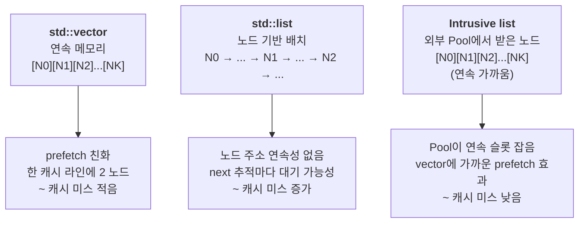
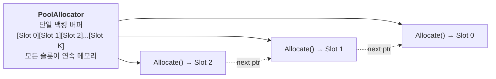

## 들어가며

현재까지의 결과물은 layout · SIMD · branchless · allocator 네 축의 비교가 가능한 측정 도구다. allocator 토글은 *동적 alloc/free 비용* 을 보여 줬다면, 이 단계는 *이미 채워진 컨테이너의 순회 비용* 을 비교한다. 같은 N개 노드를 vector·std::list·Intrusive list 셋에 각각 채워 두고 매 프레임 한 번 순회한다. 같은 작업이지만 ms는 *컨테이너에 따라 수배* 차이가 날 수 있다.

차이의 원인으로 *링크 포인터 추적이 만드는 캐시 미스* 를 가설로 세울 수 있다. vector는 연속 메모리라 prefetch가 잘 동작하고, std::list는 노드 기반 컨테이너라 원소 주소 연속성이 보장되지 않는다. Intrusive list는 외부 allocator(Pool)에서 노드를 받으므로 *연속 메모리에 가깝게* 배치되어 vector에 가까운 캐시 효과를 낼 수 있다. 다만 이 비교는 저장 형태뿐 아니라 할당 방식·노드 크기·포인터 의존성·순회 순서가 함께 바뀌므로, 시간 차이만으로 cache miss가 원인이라고 확정하지 않는다.

> 이 실습은 게임 개발의 모든 CS 주제를 하나의 프로그램에 구현하는 과정이 아니다. 같은 상태를 여러 메모리 배치와 연산 방식으로 처리하고, 할당·순회 비용을 나누어 관찰하는 저수준 성능 실습이다. ECS 는 단일 컴포넌트 조합의 저장 배치까지만 다룬다. query 와 구조 변경, 문자열·인코딩·동시성 등은 별도 실습에서 다룬다.
>
> 실행 결과가 특정 순서로 나와야 성공하는 실습은 아니다. 먼저 같은 입력에 대해 같은 의미의 결과를 계산하는지 확인한다. 그다음 작업량·측정 구간·실행 환경을 맞추고 반복 측정한다. 기대와 다른 성능이 나오면 결과를 숨기거나 구현 오류로 단정하지 않고, 이 실험이 어떤 가정을 충족하지 못했는지 확인한다.
>
> 각 장의 코드는 세 종류로 구분한다. `현재 단계 완성 코드`는 해당 단계의 파일 집합과 함께 빌드할 수 있어야 한다. `발췌 코드`는 생략된 선언과 helper 의 실제 위치를 함께 적는다. `설명용 의사코드`는 의미와 제어 흐름을 보여주며 그대로 붙여 넣는 소스가 아니다. 최종 `src/`와 중간 단계의 함수 시그니처가 다르면 변환 표를 제공한다.

이 단계의 결과물은 다음 다섯 가지다.

1. `ContainerBenchmark` 클래스 — 시작 시 N개 노드 채우고 매 프레임 순회.
2. 세 컨테이너 변종 (vector / std::list / IntrusiveList) 의 분기.
3. IntrusiveList 전용 PoolAllocator (allocator 토글과 분리된 독립 인스턴스).
4. HUD가 container ms, container nodes 표시.
5. container 콤보박스 활성화.

파일 경로 주석이 붙은 스니펫은 저장소의 실제 소스를 그대로 옮긴 것이다. 발췌하느라 가운데를 자른 자리에는 `// ...` 를 남겨 둔다.

---

## 목차
1. [컨테이너 순회의 캐시 차이](#1-컨테이너-순회의-캐시-차이)
2. [ContainerBenchmark 워크로드 설계](#2-containerbenchmark-워크로드-설계)
3. [세 컨테이너의 데이터 채우기](#3-세-컨테이너의-데이터-채우기)
4. [Intrusive list와 외부 Pool의 결합](#4-intrusive-list와-외부-pool의-결합)
5. [main 통합과 HUD 표시](#5-main-통합과-hud-표시)
6. [빌드와 실행 결과](#6-빌드와-실행-결과)

---

## 1. 컨테이너 순회의 캐시 차이

같은 N개 원소의 *순회* 는 컨테이너 종류에 따라 메모리 접근 패턴이 다르다.



세 컨테이너의 핵심 차이는 *데이터 배치* 다. vector는 *주소 연속성* 이 보장되고, std::list는 표준 차원에서 원소 주소 연속성이 보장되지 않는다. Intrusive list는 노드 alloc을 외부 allocator에 맡겨 배치를 *제어 가능* 하다.

순회 시 CPU의 동작은 다음과 같이 갈린다.

| 컨테이너 | 메모리 접근 패턴 | 캐시 미스 | prefetcher 효과 |
|---|---|---|---|
| std::vector | 인접 주소 순차 | 매우 낮음 | 매우 큼 |
| std::list | next 포인터 따라 점프 | 높을 수 있음 | 낮음 |
| Intrusive list (Pool) | 인접 슬롯 순차 (alloc 순서) | 낮음 | 큼 |

*prefetcher 효과* 가 측정의 핵심이다. CPU는 *인접 주소를 잇따라 읽으면 다음 캐시 라인을 미리 가져오는* 하드웨어 prefetcher를 가지고 있다. std::vector는 prefetcher의 가장 좋은 패턴을 보여 주고, std::list는 prefetcher가 *예측하기 어려운* 패턴이라 next 접근에서 메모리 대기 가능성이 커진다.

이 도구는 그 차이를 *같은 N개 원소의 합산 ms* 로 측정한다.

### 왜 합산 작업인가

순회 시 *작업 자체는 가벼울수록* 캐시 미스 비용이 두드러진다. 무거운 산술이 들어가면 *작업 비용이 캐시 미스를 가린다*.

```cpp
// 캐시 미스를 잘 보여 주는 작업
for (auto& n : container) sum += n.dist;
```

`sum += n.dist` 는 한 번의 float load + 한 번의 add. 매우 가볍다. 다음 노드로 넘어가는 *next 추적* 비용이 작업 시간의 대부분이 된다. 컨테이너 종류에 따라 ms가 *수배 갈라지는* 모습이 명확히 드러난다.

## 2. ContainerBenchmark 워크로드 설계

<!-- snippet: src/measure/container_benchmark.h -->
```cpp
// src/measure/container_benchmark.h

#pragma once

#include "alloc/iallocator.h"
#include "measure/bench_status.h"
#include "ui/toggles.h"

#include <cstddef>
#include <list>
#include <vector>

namespace ppl {

// ContainerBenchmark — 같은 N개 노드의 *순회 비용* 을 컨테이너 종류별로 비교.
//
// 시작 시 한 번 N개를 채우고, 매 프레임 *순회* 하며 dist 합산. 결과 sum은 멤버에
// 남겨 컴파일러가 루프를 dead code로 삭제하기 어렵게 한다.
//
//   - Vector:        std::vector<Node>. 연속 메모리, prefetch 친화. baseline.
//   - StdList:       std::list<Node>. 노드 기반 배치, 포인터 추적.
//   - IntrusiveList: 외부 allocator(Pool 등)에서 노드 받아 next 포인터로 연결.
//
// 이 비교는 저장 형태뿐 아니라 allocation 방식·노드 크기·포인터 의존성·순회 순서가
// 함께 바뀐다. 따라서 시간 차이는 "이 세 구현의 순회 비용 차이"로 기록하고,
// 시간만으로 cache miss가 원인이라고 확정하지 않는다.
//
// 소유권: Intrusive 경로는 이 클래스가 노드를 할당하고 직접 반환하므로 노드 수명에
// 대한 소유 책임이 있다. 그래서 복사/이동을 금지하고 소멸자에서 Shutdown한다.
// 주입한 allocator는 borrowed이며 이 객체보다 오래 살아야 한다. 정리 중 호출되는
// Deallocate는 예외를 던지지 않아야 한다(소멸자에서 호출되므로).
class ContainerBenchmark {
public:
    ContainerBenchmark() = default;
    ~ContainerBenchmark() { Shutdown(); }

    ContainerBenchmark(const ContainerBenchmark&) = delete;
    ContainerBenchmark& operator=(const ContainerBenchmark&) = delete;
    ContainerBenchmark(ContainerBenchmark&&) = delete;
    ContainerBenchmark& operator=(ContainerBenchmark&&) = delete;

    struct Node {
        float dist;
        int   pad[5];   // Node를 32 byte로 맞춰 캐시 라인당 2개가 들어가게 한다.
        Node* next;     // intrusive 노드용. vector/list는 무시.
    };
    static_assert(sizeof(void*) != 8 || sizeof(Node) == 32,
                  "ContainerBenchmark::Node should stay 32 bytes on 64-bit builds.");

    // Shutdown을 먼저 호출하므로 이전 설정/측정이 남지 않는다.
    void Init(Container type, IAllocator* intrusiveAlloc, std::size_t count);
    void Shutdown();

    // 매 프레임 호출. 컨테이너를 한 번 순회하며 dist 합산.
    void RunFrame();

    Container Type()             const { return type_; }
    std::size_t NodeCount()      const { return count_; }        // 완성된 노드 수
    std::size_t RequestedCount() const { return requested_; }
    BenchStatus Status()         const { return status_; }
    float LastFrameMs()          const { return lastFrameMs_; }
    float LastSum()              const { return lastSum_; }

private:
    Container   type_         = Container::Vector;
    std::size_t requested_    = 0;
    std::size_t count_        = 0;
    BenchStatus status_       = BenchStatus::Skipped;
    float       lastFrameMs_  = 0.0f;
    float       lastSum_      = 0.0f;

    // Vector 경로
    std::vector<Node> vec_;

    // StdList 경로
    std::list<Node> list_;

    // IntrusiveList 경로 — 외부 allocator에서 받아 직접 link.
    Node*       intrusiveHead_  = nullptr;
    IAllocator* intrusiveAlloc_ = nullptr;
};

}  // namespace ppl
```

세 가지 설계 결정.

1. **Node 크기 32 byte**: `float dist` + `int pad[5]` + `Node* next` = 32 byte (8-byte 정렬). vector와 intrusive list가 같은 노드 크기를 쓰도록 통일한다. std::list는 이 `Node` 위에 구현체 내부 링크와 allocator 메타데이터가 추가될 수 있다.
2. **`pad[5]`**: Node 한 개가 캐시 라인의 절반(64 byte의 절반 = 32 byte)을 차지하도록 맞춘다. 32 byte 슬롯이라 Pool 슬롯 두 개가 캐시 라인 하나 분량을 차지한다. 라인마다 온전히 두 개가 들어가려면 백킹 버퍼가 32 byte 정렬이어야 하는데, Pool은 `alignof(Node)` 인 8 byte만 요구하므로 실제로는 노드가 라인 경계를 걸칠 수 있다.
3. **외부 `intrusiveAlloc`**: IntrusiveList가 사용할 allocator를 외부에서 받는다. 다양한 allocator로 실험 가능 (이 도구는 Pool로 고정).

이 클래스는 Intrusive 노드의 수명을 관리한다. raw head 포인터를 그대로 복사하면 두 객체가 같은 노드를 소유하게 되므로 기본 복사는 허용하지 않는다. 그래서 복사·이동 네 멤버를 `= delete` 로 막았고, 소멸자에서 `Shutdown()` 으로 노드를 정리한다. HUD는 결과를 `const&` 로 읽기만 하고 소유권을 바꾸지 않는다. 주입한 allocator는 borrowed 이며 이 benchmark 보다 오래 살아야 한다. `main` 에서 allocator 인스턴스를 benchmark 보다 먼저 만들어 더 늦게 파괴되도록 두는 이유다. 정리 중 호출되는 `Deallocate` 는 소멸자 경로이므로 예외를 던지지 않아야 한다.

`Init`/`Shutdown` 은 마지막 측정값(`LastSum()`·`LastFrameMs()`)까지 0으로 비운다. `Shutdown` 은 반복 호출해도 안전하고, `Init` 은 항상 `Shutdown` 을 먼저 부른다. Intrusive 경로가 받는 노드는 raw storage 다. allocator는 `Allocate(0)` 에 nullptr 을 돌려주고 alignment 는 0이 아닌 2의 거듭제곱을 요구하며, 이 benchmark 는 POD `Node` 만 쓰므로 `construct_at`/`destroy_at` 은 필요 없다.

### LastSum 노출 이유

`LastSum()` 으로 합산 결과를 객체 상태에 남기는 건 *컴파일러 최적화 방지* 때문이다.

```cpp
// sum을 사용하지 않으면 컴파일러가 루프를 dead code로 삭제할 수 있다.
float sum = 0.0f;
for (...) sum += n.dist;
// sum이 사용되지 않으면 → 루프 자체가 사라짐 → ms = 0
```

`lastSum_` 멤버에 저장하면 측정 루프의 결과가 관측 가능한 객체 상태로 남는다. HUD의 container 줄이 `LastSum()` 을 매 프레임 읽어 표시하므로, 합산 결과가 실제로 프로그램 밖으로 나가는 값이 된다.

## 3. 세 컨테이너의 데이터 채우기

`Init` 이 토글 종류에 따라 분기해 데이터를 채운다.

<!-- snippet: src/measure/container_benchmark.cpp#ContainerBenchmark::Init -->
```cpp
// src/measure/container_benchmark.cpp

void ContainerBenchmark::Init(Container type, IAllocator* intrusiveAlloc,
                              std::size_t count) {
    // 이전 설정의 컨테이너 내용과 마지막 측정값을 모두 비운다. 이걸 빼면 새 설정의
    // 결과와 옛 표본이 같은 조회 창에 섞인다.
    Shutdown();

    type_           = type;
    requested_      = count;
    count_          = 0;
    status_         = BenchStatus::Skipped;
    intrusiveAlloc_ = intrusiveAlloc;

    if (count == 0) return;

    // 결정론적 시드. 같은 바이너리·같은 표준 라이브러리에서 같은 초기 상태를 만든다.
    // 표준 라이브러리가 다르면 uniform_real_distribution의 실수 매핑까지 같다는
    // 보장은 없으므로, 교차 환경 비교에는 생성된 fixture와 hash를 쓴다.
    std::mt19937 rng(0xBADCAFEu);
    std::uniform_real_distribution<float> dist(0.0f, 100.0f);

    switch (type_) {
        case Container::Vector: {
            vec_.reserve(count);
            for (std::size_t i = 0; i < count; ++i) {
                Node n{};
                n.dist = dist(rng);
                vec_.push_back(n);
            }
            count_ = vec_.size();
            break;
        }
        case Container::StdList: {
            // 일반적인 std::list 구현은 기본 allocator로 노드를 개별 힙 할당한다.
            // 원소 주소 연속성을 보장하지 않는다(항상 흩어진다는 뜻은 아니다).
            for (std::size_t i = 0; i < count; ++i) {
                Node n{};
                n.dist = dist(rng);
                list_.push_back(n);
            }
            count_ = list_.size();
            break;
        }
        case Container::IntrusiveList: {
            // 외부 allocator(Pool 권장)에서 노드 N개 받아 next로 link.
            if (!intrusiveAlloc_) {
                status_ = BenchStatus::Skipped;
                return;
            }
            intrusiveHead_ = nullptr;
            for (std::size_t i = 0; i < count; ++i) {
                void* p = intrusiveAlloc_->Allocate(sizeof(Node), alignof(Node));
                if (!p) break;
                Node* node = static_cast<Node*>(p);
                node->dist = dist(rng);
                node->next = intrusiveHead_;
                intrusiveHead_ = node;
                ++count_;
            }
            break;
        }
    }

    status_ = (count_ == requested_) ? BenchStatus::Valid
                                     : BenchStatus::InvalidCapacity;
}
```

### 왜 같은 시드인가

`std::mt19937 rng(0xBADCAFEu)` 시드 고정으로 *세 컨테이너 모두 같은 dist 값* 을 갖는다. 차이가 *데이터 차이* 때문이 아니라 *컨테이너 차이* 때문임을 보장한다.

다만 std::list는 `push_back` 이라 head→tail 순서고 IntrusiveList는 head에 push해 *역순* 으로 쌓인다. 값 집합은 같지만 순회 순서가 다르므로, 부동소수점 합산 결과는 마지막 비트 수준에서 달라질 수 있다. 이 도구는 sum의 정확한 값을 비교하지 않고 루프 제거 방지 용도로만 사용한다.

### Vector의 push_back 비용

`vec_.reserve(count)` 로 미리 용량을 잡아 push_back 시 재할당이 일어나지 않는다. 만약 reserve 없이 push_back을 N번 하면 vector가 *기하급수적 재할당* (16, 32, 64, ...)을 반복해 *시작 시 비용* 이 올라간다. Init은 한 번만 호출되므로 영향이 작지만, 측정 도구의 정직성을 위해 reserve를 명시한다.

### 매 프레임 순회 루프

`RunFrame` 이 컨테이너를 한 번 훑으며 `dist` 를 합산하고, 그 구간만 따로 잰다.

<!-- snippet: src/measure/container_benchmark.cpp#ContainerBenchmark::RunFrame -->
```cpp
// src/measure/container_benchmark.cpp

void ContainerBenchmark::RunFrame() {
    using Clock = std::chrono::steady_clock;
    const auto t0 = Clock::now();

    float sum = 0.0f;
    switch (type_) {
        case Container::Vector: {
            for (const auto& n : vec_) sum += n.dist;
            break;
        }
        case Container::StdList: {
            for (const auto& n : list_) sum += n.dist;
            break;
        }
        case Container::IntrusiveList: {
            for (Node* p = intrusiveHead_; p; p = p->next) sum += p->dist;
            break;
        }
    }

    lastSum_ = sum;

    const auto t1 = Clock::now();
    const auto ns = std::chrono::duration_cast<std::chrono::nanoseconds>(t1 - t0).count();
    lastFrameMs_ = static_cast<float>(ns) / 1.0e6f;
}
```

세 분기가 하는 산술은 똑같다 — float 하나를 읽어 더한다. 갈리는 것은 *원소의 주소를 어떻게 얻는가* 뿐이다. vector는 인덱스 증가, std::list는 노드의 next 포인터, IntrusiveList도 next 포인터지만 그 노드들이 Pool의 연속 슬롯에 놓여 있다.

`steady_clock` 으로 이 루프만 감싸므로 채우기 비용(`Init`)은 측정에 들어오지 않는다. 시간 측정 단위는 나노초로 받아 ms로 환산한다 — 5000 노드 vector 순회는 수십 μs 수준이라 밀리초로 바로 받으면 해상도가 모자란다. 다만 나노초 단위로 세는 것은 출력 정밀도를 유지하기 위한 것이지, `steady_clock` 의 실제 시계 해상도를 1ns 로 만드는 것은 아니다. 실제 사이클 수가 필요하면 지원되는 PMU 로 따로 재야 한다(**보충 구현 목표**).

### Shutdown의 노드 회수

vector와 std::list는 `clear()` 로 끝나지만, IntrusiveList의 노드는 외부 allocator가 준 메모리라 직접 돌려줘야 한다.

<!-- snippet: src/measure/container_benchmark.cpp#ContainerBenchmark::Shutdown -->
```cpp
// src/measure/container_benchmark.cpp

void ContainerBenchmark::Shutdown() {
    vec_.clear();
    list_.clear();

    // Intrusive list 정리. Pool은 Reset으로 일괄 회수도 가능하지만
    // 인터페이스 일관성을 위해 노드별 Deallocate.
    if (intrusiveHead_ && intrusiveAlloc_) {
        Node* cur = intrusiveHead_;
        while (cur) {
            Node* next = cur->next;
            intrusiveAlloc_->Deallocate(cur, sizeof(Node));
            cur = next;
        }
    }
    intrusiveHead_  = nullptr;
    intrusiveAlloc_ = nullptr;
    count_          = 0;
    requested_      = 0;
    status_         = BenchStatus::Skipped;
    // 마지막 측정값도 지운다. count==0 상태에서 옛 sum/ms가 조회되면 안 된다.
    lastFrameMs_ = 0.0f;
    lastSum_     = 0.0f;
}
```

`Node* next = cur->next;` 를 먼저 읽어 두는 순서가 중요하다. `Deallocate` 후에 `cur->next` 를 읽으면 use-after-free다. Pool이 반환된 슬롯을 free list로 재사용하면서 그 자리에 링크를 덮어쓰기 때문에, 실제로 값이 깨진다.

`Shutdown` 이 `intrusiveAlloc_` 까지 null로 되돌리므로, `Init` 은 `Shutdown()` 을 먼저 부른 *뒤에* `intrusiveAlloc_ = intrusiveAlloc;` 을 대입한다. 순서가 뒤집히면 방금 받은 allocator 포인터가 지워진다.

## 4. Intrusive list와 외부 Pool의 결합

IntrusiveList가 *vector에 가까운 캐시 효과* 를 내려면 *연속 메모리* 가 필요하다. PoolAllocator가 이걸 보장한다.



PoolAllocator는 *시작 시 한 번 큰 단일 버퍼* 를 잡고, Allocate 호출마다 *그 버퍼의 슬롯 하나씩* 반환한다. 슬롯이 32 byte 단위로 연속 배치되어 있어 *주소도 연속* 이다.

순회는 next 포인터를 따라가지만 head insert로 만들어진 역순 인접 슬롯을 따라간다. 즉 주소가 단조 감소하는 연속 패턴이라 일반적인 임의 포인터 추적보다 prefetcher가 대응하기 쉽다. 결과적으로 vector 순회와 *주소 패턴이 비슷하다*.

초기 free-list가 slot0 부터 반환하는 현재 구현에서 세 번 head 삽입하면 논리적인 next 순서는 `slot2 → slot1 → slot0`(위 그림의 `N2 → N1 → N0`)이다. 슬롯 주소는 할당 순서대로 연속이므로, 주소 순서와 논리 순회 순서가 반대다. 그림에서 둘을 다른 색/화살표로 표기한다면 반드시 범례를 둔다. `step07_container_diagram_02.png`도 같은 원문에서 다시 생성해 이 순서와 일치시킨다(그림 재생성은 별도 작업).

### 왜 std::list와 다른가

일반적인 std::list 구현은 기본 allocator를 통해 노드를 개별 힙 할당한다. 표준은 노드들의 주소 연속성을 보장하지 않고, 구현체의 노드 링크까지 더해져 vector보다 메모리 밀도가 낮다. 그래서 순회가 next 포인터 추적에 의존하고, 캐시 미스가 커지기 쉽다.

std::list에 *커스텀 allocator* 를 줘서 같은 효과를 낼 수 있다(`std::list<Node, Allocator>`). 다만 std::list의 allocator 모델은 *rebind* 등의 복잡도가 있어, 이 도구에서는 *intrusive list가 외부 allocator를 직접 다루는* 패턴으로 단순화한다.

### Pool 인스턴스 분리

allocator 토글이 EventBenchmark에 영향을 주듯이 ContainerBenchmark에도 영향을 줄 수 있는데, 두 워크로드가 *같은 allocator* 를 공유하면 다음이 어긋난다.

- EventBenchmark는 *매 프레임 alloc + Reset*. allocator의 라이브 메모리가 0으로 돌아간다.
- ContainerBenchmark는 *시작 시 한 번 alloc, 매 프레임 순회*. 라이브 메모리가 *N개 노드* 로 유지된다.

두 워크로드가 같은 allocator를 공유하면 EventBenchmark의 Reset이 ContainerBenchmark의 노드를 *지워 버린다*. 노드 포인터가 invalidate되어 다음 프레임 순회가 use-after-free.

해결: ContainerBenchmark용 *독립 PoolAllocator* 인스턴스. main이 두 개의 allocator 인스턴스를 만들어 각각 다른 워크로드에 주입.

<!-- snippet: src/main.cpp -->
```cpp
// src/main.cpp

    // 토글로 교체되는 인스턴스. EventBenchmark 전용이다.
    auto alloc = CreateAllocator(toggles.allocator);

    // ...

    // ContainerBenchmark용 별도 Pool. EventBenchmark의 allocator와 분리해
    // container 토글이 allocator 토글에 영향받지 않게 한다.
    auto containerPool = std::make_unique<ppl::PoolAllocator>(
        sizeof(ppl::ContainerBenchmark::Node),
        alignof(ppl::ContainerBenchmark::Node),
        kContainerCount + 16);

    // ...

        bench.RunFrame(alloc.get());
        cbench.RunFrame();
```

`bench` 는 프레임마다 주입받은 allocator를 쓰고, `cbench` 는 `Init` 때 받아 둔 `containerPool` 을 계속 쓴다. 그래서 allocator 토글이 *EventBenchmark에만* 영향을 주고 ContainerBenchmark는 항상 동일한 Pool로 동작한다.

## 5. main 통합과 HUD 표시

main에 ContainerBenchmark 인스턴스 + Pool + 토글 변경 처리 추가. 먼저 파일 스코프에 헤더 하나와 노드 수 상수 하나가 늘어난다.

<!-- snippet: src/main.cpp -->
```cpp
// src/main.cpp

#include "measure/container_benchmark.h"

// ... (raylib 및 기존 alloc/measure/sim/ui 헤더)

namespace {

// ... (kWindowW · kHudH · kEventCount 등 기존 상수)

// ContainerBenchmark가 보유할 노드 수 (시작 시 한 번 채우고 매 프레임 순회).
constexpr std::size_t kContainerCount = 5000;

// ... (allocator 백킹 용량 상수와 CreateAllocator 팩토리)

}  // namespace
```

main 본문 전문은 다음과 같다.

<!-- snippet: src/main.cpp#main -->
```cpp
// src/main.cpp

int main() {
    SetConfigFlags(FLAG_MSAA_4X_HINT);
    InitWindow(kWindowW, kWindowH, "parts_perf_lab");
    SetTargetFPS(0);

    ppl::Toggles  toggles;
    ppl::Toggles  prevToggles = toggles;

    auto sim = ppl::CreateSimulation(toggles.layout);
    sim->Init(toggles.EntityCount(), kWindowW, kSimH);

    auto alloc = CreateAllocator(toggles.allocator);

    ppl::EventBenchmark bench;
    bench.Init(kEventCount);

    // ContainerBenchmark용 별도 Pool. EventBenchmark의 allocator와 분리해
    // container 토글이 allocator 토글에 영향받지 않게 한다.
    auto containerPool = std::make_unique<ppl::PoolAllocator>(
        sizeof(ppl::ContainerBenchmark::Node),
        alignof(ppl::ContainerBenchmark::Node),
        kContainerCount + 16);

    ppl::ContainerBenchmark cbench;
    cbench.Init(toggles.container, containerPool.get(), kContainerCount);

    ppl::FrameTimer timer;

    ppl::Hud hud;
    hud.Init(kWindowW, kWindowH, kHudH);

    while (!WindowShouldClose()) {
        // frame wall은 루프 선두부터 EndDrawing(HUD·flush·swap 포함) 뒤까지다.
        timer.BeginFrame();

        // 데모는 wall dt를 쓴다. 서로 다른 설정을 인과 비교하려면 고정 dt·고정 step으로
        // 재생하는 benchmark 모드가 필요하다(보충 구현 목표).
        const float dt = GetFrameTime();

        timer.BeginUpdate();
        sim->Update(dt, toggles.simd, toggles.branchless);
        timer.EndUpdate();

        bench.RunFrame(alloc.get());
        cbench.RunFrame();

        timer.BeginDraw();
        BeginDrawing();
        ClearBackground(Color{10, 10, 14, 255});
        sim->Draw();
        timer.EndDraw();

        // HUD는 직전 프레임의 CommitFrame 값을 읽는다(지표가 한 프레임 지연).
        // frame wall이 EndDrawing을 포함해야 하므로 CommitFrame을 HUD 뒤로 옮겼다.
        hud.Draw(toggles, timer, sim->Count(), bench, *alloc, cbench);
        EndDrawing();

        timer.EndFrame();
        timer.CommitFrame(bench.LastFrameMs(), cbench.LastFrameMs());

        // 토글 변경 처리.
        // - layout 변경: 시뮬 인스턴스 자체를 교체.
        // - entityCount 변경: 시뮬 재초기화.
        // - allocator 변경: EventBenchmark용 allocator 인스턴스를 새로 만든다.
        // - container 변경: ContainerBenchmark 재초기화.
        if (ppl::RequiresRestart(prevToggles, toggles)) {
            const bool layoutChanged    = (prevToggles.layout    != toggles.layout);
            const bool entityChanged    = (prevToggles.entityPresetIdx != toggles.entityPresetIdx);
            const bool allocatorChanged = (prevToggles.allocator != toggles.allocator);
            const bool containerChanged = (prevToggles.container != toggles.container);

            if (layoutChanged || entityChanged) {
                sim->Shutdown();
                if (layoutChanged) {
                    sim = ppl::CreateSimulation(toggles.layout);
                }
                sim->Init(toggles.EntityCount(), kWindowW, kSimH);
            }

            if (allocatorChanged) {
                alloc = CreateAllocator(toggles.allocator);
            }

            if (containerChanged) {
                cbench.Init(toggles.container, containerPool.get(),
                            kContainerCount);
            }
        }
        prevToggles = toggles;
    }

    sim->Shutdown();
    cbench.Shutdown();
    CloseWindow();
    return 0;
}
```

`cbench.Init` 이 시작 시 한 번 + container 토글 변경 시마다 호출된다. Init이 내부에서 `Shutdown()` 을 먼저 호출해 이전 데이터를 정리하므로 *재초기화* 가 안전하다. `Shutdown()` 은 반복 호출해도 안전하고, 소멸자도 같은 함수를 부르므로 명시 종료를 빠뜨려도 노드가 남지 않는다.

`cbench.RunFrame()` 은 `timer.BeginUpdate()`/`EndUpdate()` 밖에 있다. 컨테이너 순회는 시뮬 update가 아니므로 update ms를 오염시키면 안 되고, 자체 `steady_clock` 으로 이미 재고 있다.

프레임 계측 순서는 `BeginFrame → Update → RunFrame → Draw → HUD → EndDrawing → EndFrame → CommitFrame` 이다. frame wall은 루프 선두부터 `EndDrawing`(HUD·flush·swap 포함) 뒤까지라, HUD가 읽는 값은 *직전 프레임* 의 커밋 결과다. `containerPool` 은 `cbench.Shutdown()` 이 노드를 돌려줄 때까지 살아 있어야 한다. `main` 은 `containerPool` 을 `cbench` 보다 먼저 선언하므로 pool 이 더 늦게 파괴된다. 이 선언 순서가 borrowed allocator 수명 계약을 만족시킨다.

### HUD 표시

Hud::Draw 시그니처에 `ContainerBenchmark&` 인자가 추가되고, `DrawStats` 가 container ms를 표시한다.

<!-- snippet: src/ui/hud.h -->
```cpp
// src/ui/hud.h

#include "measure/container_benchmark.h"

// ...

class Hud {
public:
    void Init(int windowW, int windowH, int hudHeight);

    // 매 프레임 호출. 토글 상태와 측정값을 받아 HUD를 그리고,
    // 사용자가 토글을 변경했으면 toggles에 반영한다.
    void Draw(Toggles& toggles, const FrameTimer& timer,
              std::size_t entityCount,
              const EventBenchmark& bench,
              const IAllocator& alloc,
              const ContainerBenchmark& cbench);

private:
    void DrawStats(const Toggles& toggles, const FrameTimer& timer,
                   std::size_t entityCount,
                   const EventBenchmark& bench, const IAllocator& alloc,
                   const ContainerBenchmark& cbench,
                   int x, int y);

    // ...
};
```

`ContainerBenchmark` 를 값이 아니라 `const&` 로 받는다. HUD는 결과를 읽기만 하고 소유권을 바꾸지 않는다. 이 클래스는 Intrusive 노드 수명을 관리하므로 복사·이동은 아예 금지되어 있고, 복사하려 들면 컴파일 단계에서 거부된다. `const&` 경로는 그대로 유지된다.

<!-- snippet: src/ui/hud.cpp#Hud::DrawStats -->
```cpp
// src/ui/hud.cpp — Hud::DrawStats

void Hud::DrawStats(const Toggles& toggles, const FrameTimer& timer,
                     std::size_t entityCount,
                     const EventBenchmark& bench, const IAllocator& alloc,
                     const ContainerBenchmark& cbench,
                     int x, int y) {
    const int actualFps = GetFPS();

    // 요청한 SIMD와 실제 실행 커널을 분리해 표시한다. AoS+AVX2처럼 요청이 실제
    // 경로와 다른 경우가 HUD에서 바로 보인다.
    const ResolvedKernel kernel =
        ResolveKernel(toggles.layout, toggles.simd, toggles.branchless);

    // 8줄로 고정한다. HUD 높이 140px, 기본 line spacing 15px 기준.
    char buf[1024];
    std::snprintf(buf, sizeof(buf),
                  "ent %zu  simd %s>%s %s\n"
                  "frame %6.3f  sim+sub %6.3f\n"
                  "sim %6.3f  draw %6.3f  fps %d\n"
                  "alloc %6.3f  %llu/%llu fail %llu\n"
                  "live %llu peak %llu\n"
                  "slot %llu back %llu\n"
                  "cont %6.3f  %zu/%zu sum %.2f\n"
                  "build %s cpu-avx2 %s fma %s",
                  entityCount,
                  SimdName(toggles.simd), SimdName(kernel.effective),
                  KernelFallbackShortName(kernel.reason),
                  static_cast<double>(timer.LastFrameWallMs()),
                  static_cast<double>(timer.LastSimDrawSubmitMs()),
                  static_cast<double>(timer.LastUpdateMs()),
                  static_cast<double>(timer.LastDrawSubmitMs()),
                  actualFps,
                  static_cast<double>(bench.LastFrameMs()),
                  static_cast<unsigned long long>(bench.LastFrameAllocCount()),
                  static_cast<unsigned long long>(bench.Target()),
                  static_cast<unsigned long long>(bench.FailedCount()),
                  static_cast<unsigned long long>(alloc.LiveBytes()),
                  static_cast<unsigned long long>(alloc.PeakBytes()),
                  static_cast<unsigned long long>(alloc.SlotBytesLive()),
                  static_cast<unsigned long long>(alloc.ReservedBacking()),
                  static_cast<double>(cbench.LastFrameMs()),
                  cbench.NodeCount(), cbench.RequestedCount(),
                  static_cast<double>(cbench.LastSum()),
#if defined(PERF_LAB_AVX2)
                  "AVX2",
#elif defined(PERF_LAB_X86_SIMD)
                  "SSE",
#else
                  "portable",
#endif
                  CpuReportsAvx2() ? "y" : "n",
                  CpuReportsFma() ? "y" : "n");
    DrawText(buf, x, y, 14, RAYWHITE);

    // 무효 표본 경고. 고갈/용량 부족으로 요청량을 못 채운 결과는 시간 비교에 쓰면 안 된다.
    // 마지막 줄(build)을 경고로 대체해 HUD 높이를 넘기지 않는다.
    if (bench.Status() != BenchStatus::Valid || cbench.Status() != BenchStatus::Valid) {
        char warn[160];
        std::snprintf(warn, sizeof(warn),
                      "WARN invalid sample alloc=%s cont=%s",
                      BenchStatusName(bench.Status()),
                      BenchStatusName(cbench.Status()));
        DrawRectangle(x, y + 7 * 15, 300, 15, Color{20, 20, 28, 255});
        DrawText(warn, x, y + 7 * 15, 14, Color{255, 120, 120, 255});
    }
}
```

좌측 stats 영역에 `cont X.XXX  5000/5000 sum NNN.NNN` 한 줄이 추가되고, 요청량을 못 채우면 마지막 줄이 `WARN invalid sample` 로 바뀐다.

container 콤보박스 활성화는 비활성화 표시를 걷어내고 값을 토글에 반영하는 것이 전부다.

<!-- snippet: src/ui/hud.cpp#Hud::DrawTogglePanelPass -->
```cpp
// src/ui/hud.cpp — Hud::DrawTogglePanelPass

DrawText("container:", x2, rowY2(row2), 14, LIGHTGRAY);
int containerIdx = (int)toggles.container;
if (GuiDropdownBox(Rect(x2 + kLabelW, rowY2(row2), kFieldW, kRowH),
                   kContainerOptions, &containerIdx, containerEdit_)) {
    containerEdit_ = !containerEdit_;
}
if (!containerEdit_) {
    toggles.container = (Container)std::clamp(containerIdx, 0, kContainerCount - 1);
}
```

여기 쓰인 `kContainerCount` 는 `Container` enum의 항목 수 3이다. main의 `kContainerCount` (노드 수 5000)와 이름은 같지만 main 쪽은 그 번역 단위의 익명 네임스페이스에 있고, 이쪽은 토글 헤더의 `ppl::kContainerCount` 다. 이름이 겹쳐 헷갈리기 쉬운 지점이라 clamp 상한이 3이라는 사실을 기억해 둔다.

## 6. 빌드와 실행 결과

새 번역 단위가 하나 늘었으므로 두 타깃의 소스 목록에 모두 넣는다. 앱에만 넣으면 링크는 되지만 headless 테스트 타깃에서 `ContainerBenchmark` 심볼이 미해결로 남는다.

<!-- snippet: CMakeLists.txt -->
```cmake
# CMakeLists.txt

add_executable(${PROJECT_NAME}
    src/main.cpp
    # ...
    src/measure/container_benchmark.cpp
    # ...
)

# ...

add_executable(parts_core_tests
    tests/core_tests.cpp
    # ...
    src/measure/container_benchmark.cpp
    # ...
)
```

### 자동 검증: `parts_container_tests`

컨테이너를 바꿔도 *같은 계산* 이라는 전제가 깨지면 ms 비교는 의미가 없다. 그 전제를 `container` 그룹이 확인한다. 세 컨테이너를 같은 시드로 채워 노드 수가 정확히 같은지, 합산 결과가 상대오차 1e-4 안에서 일치하는지, 같은 프레임을 두 번 돌려도 합이 변하지 않는지, `Shutdown` 후 노드 수가 0으로 돌아가는지를 본다.

<!-- snippet: tests/core_tests.cpp#TestContainerEquivalence -->
```cpp
// tests/core_tests.cpp — container 그룹

void TestContainerEquivalence() {
    constexpr std::size_t kNodes = 5000;
    using Node = ppl::ContainerBenchmark::Node;

    // 노드 수보다 약간 넉넉한 풀. intrusive 경로가 여기서 노드를 받는다.
    ppl::PoolAllocator pool(sizeof(Node), alignof(Node), 5016);

    float baseline = 0.0f;
    for (int t = 0; t < ppl::kContainerCount; ++t) {
        const auto type = static_cast<ppl::Container>(t);
        const char* label = ppl::ContainerName(type);

        pool.Reset();
        ppl::ContainerBenchmark bench;
        bench.Init(type, &pool, kNodes);

        CHECK_AT(bench.Type() == type, label);
        CHECK_AT(bench.NodeCount() == kNodes, label);

        bench.RunFrame();
        const float sum = bench.LastSum();

        // 값 자체가 살아 있는지: 5000개 uniform[0,100) 합은 25만 근처다.
        CHECK_AT(std::isfinite(sum), label);
        CHECK_AT(sum > 0.0f, label);

        if (t == 0) {
            baseline = sum;
        } else {
            const float rel = std::fabs(sum - baseline) / std::fabs(baseline);
            CHECK_AT(rel < 1e-4f, label);
        }

        // 순회는 상태를 바꾸지 않으므로 다시 돌려도 합이 같다.
        bench.RunFrame();
        CHECK_AT(bench.LastSum() == sum, label);

        bench.Shutdown();
        CHECK_AT(bench.NodeCount() == 0, label);
        CHECK_AT(bench.LastSum() == 0.0f, label);
        CHECK_AT(bench.Status() == ppl::BenchStatus::Skipped, label);
    }

    // intrusive 경로에 allocator를 주지 않으면 노드를 하나도 만들 수 없다.
    ppl::ContainerBenchmark orphan;
    orphan.Init(ppl::Container::IntrusiveList, nullptr, kNodes);
    CHECK(orphan.NodeCount() == 0);
    CHECK(orphan.Status() == ppl::BenchStatus::Skipped);
    orphan.RunFrame();
    CHECK(orphan.LastSum() == 0.0f);

    // 풀이 요청보다 작으면 노드 수가 풀 용량에서 멈추고, 비교 무효로 표시된다.
    ppl::PoolAllocator tiny(sizeof(Node), alignof(Node), 64);
    ppl::ContainerBenchmark starved;
    starved.Init(ppl::Container::IntrusiveList, &tiny, kNodes);
    CHECK(starved.NodeCount() == 64);
    CHECK(starved.RequestedCount() == kNodes);
    CHECK(starved.Status() == ppl::BenchStatus::InvalidCapacity);
    CHECK(tiny.InUse() == 64);
    starved.Shutdown();
    CHECK(tiny.InUse() == 0);
}
```

`bench.LastSum() == sum` 은 오차 없는 등식이다. 순회가 상태를 바꾸지 않는다는 성질이라, 여기서 부동소수 오차가 끼면 그건 순회가 아니라 갱신을 하고 있다는 뜻이다. 뒤이어 allocator를 주지 않은 intrusive 경로가 노드를 0개로 두는지와, 풀이 모자랄 때 노드 수가 풀 용량에서 멈추고 상태가 `InvalidCapacity` 로 바뀌는지도 같은 검사 안에 있다. 이 그룹은 세 구현이 같은 계산을 하는지와 상태/초기화 계약을 보는 것이지, 캐시 미스 원인을 판정하는 오라클은 아니다. 독립 참조·방문 id 집합·주소 이력(churn trace) 검사는 **보충 구현 목표** 다.

```bash
cmake -S . -B build
cmake --build build --config Release
ctest --test-dir build -C Release -R parts_container_tests --output-on-failure

./build/parts_core_tests container              # Linux/macOS
.\build\Release\parts_core_tests.exe container  # Windows
```

```text
parts_core_tests: group `container`
  container/ContainerEquivalence ... 34 check(s) ok
container: 1 test(s), 34 check(s), 0 failure(s)
```

34는 컨테이너마다 8개(합 finite·양수 검사와 `Shutdown` 후 sum/status 확인 포함)에 나머지 둘의 상대오차 비교 1개씩을 더한 26, allocator 없는 경로 3개, 풀이 모자란 경로 5개를 합한 수다. 컨테이너를 하나 더 붙이면 `ppl::kContainerCount` 를 따라 루프가 늘어나 이 수도 함께 늘어난다.

### 실행 결과

실행 후 좌측 stats 영역 하단에 `cont X.XXX  5000/5000 sum NNN.NNN` 형태로 매 프레임 갱신된다(`cont` 는 마지막 순회의 wall time ms, 뒤의 두 수는 완성 노드 수/요청 노드 수다). container 콤보박스를 클릭해 vector → std::list → IntrusiveList 순서로 바꾸며 변화를 본다.

### 측정 시점에서 보일 수 있는 경향

아래는 *예상* 이지 합격 기준이 아니다. 5000 노드 기준 일반적인 데스크톱 CPU에서 보일 수 있는 경향이며, 환경·컴파일러·측정 구간에 따라 달라진다.

- **Vector**: 순회 wall time이 가장 작을 가능성이 큼. prefetcher가 잘 동작해 캐시 미스가 적다. 보통 수십 μs 단위.
- **StdList**: 순회 wall time이 *훨씬 커질 수 있음*. 노드 주소 연속성이 보장되지 않아 cache miss가 늘기 쉽다. 워크로드·allocator·CPU에 따라 vector 대비 수배 차이가 날 수 있다.
- **IntrusiveList (Pool)**: vector보다는 클 수 있음. Pool이 연속 슬롯을 잡아 캐시 거동은 vector에 가깝지만, 다음 노드 주소를 읽어야 다음 접근이 시작되는 직렬 의존 사슬이 남는다. StdList와의 차이는 노드 수가 커져 캐시 미스가 지배할수록 벌어질 수 있다. 정확한 비교 결과는 컴파일러·CPU에 따라 다르다.

container 콤보를 vector → StdList로 바꾼 직후 `cont` 값에 *세로 절벽* 이 나타날 수 있다. 다만 이 증가만으로 cache miss 가 원인이라고 확정하지 않는다. std::list 는 노드 크기·할당 방식·next 의존성·순회 순서가 vector 와 함께 달라지므로, 이 수치는 먼저 *이 세 구현의 순회 wall time 차이* 로 기록한다. 특정 순회 루프의 cache miss 를 직접 보려면 동일 backing 에 같은 payload 를 놓고 next 순서만 바꾼 대조군과, 선택한 headless 워크로드 범위의 PMU 수집이 필요하다(**보충 구현 목표**).

### container ms vs alloc ms

이 도구의 두 별도 측정 채널이 *서로 다른 토픽* 을 보여 준다.

| 채널 | 측정 대상 | 영향받는 토글 |
|---|---|---|
| alloc ms (EventBenchmark) | *동적 alloc/free 프로토콜의 비용* | allocator |
| container ms (ContainerBenchmark) | *세 구현의 순회 wall time* | container |

각 토글은 주로 자기 채널을 움직인다. 다만 측정 구간과 객체 소유권을 분리한 것이지, 같은 CPU·cache·메모리·OS 를 공유하는 실행 비용의 상호 영향까지 제거한 것은 아니다. 다른 채널이 함께 흔들렸다는 이유만으로 타이머가 잘못됐다고 판정하지 않는다.

### 검증 체크리스트

- container ms가 0 → 모든 컨테이너에서 0이라면 컴파일러가 sum 루프를 삭제했을 가능성. HUD container 줄의 `sum` 값이 `0` 이 아닌지 확인한다. 컨테이너 내용은 `Init` 이후 바뀌지 않으므로 정상이면 매 프레임 같은 값이 찍힌다.
- IntrusiveList에서 노드 수가 `kContainerCount` 보다 작음 → Pool 고갈. `kContainerCount + 16` 의 여유를 늘림.
- StdList와 IntrusiveList ms가 비슷 → 노드 수가 작거나 측정 노이즈가 큰 경우. Release 빌드인지 확인하고 `kContainerCount` 를 늘려 차이를 키운다.
- container 토글 변경 시 잠깐 멈춤 → Init이 N개 노드를 새로 채우느라 잠깐 비용. 5000개라면 1ms 안쪽이 정상.

### 측정의 정직성

이 도구가 보여 주는 `cont` 값은 세 구현의 *순회 wall time* 이다. cache miss 는 그 차이를 설명할 수 있는 후보 중 하나일 뿐, 시간 차이만으로 원인을 확정하지 않는다. 다음이 일반화 금지된 사실이다.

- **항상 vector가 빠르지 않다**: 작업이 *무거우면* 캐시 미스 비용이 가려진다. 매 노드마다 사인·코사인 계산 같은 무거운 작업이 들어가면 vector와 list의 차이가 사라진다.
- **항상 std::list가 느리지 않다**: 노드 *수명* 과 *접근 패턴* 에 따라 list가 더 적합한 경우도 있다. 게임 엔진의 *intrusive linked list* 패턴은 list의 임의 삽입·삭제 강점에 vector의 캐시 효율을 결합한다.
- **Intrusive list의 캐시 효과는 allocator 의존**: Pool 같은 *연속 슬롯 allocator* 가 아니면 std::list와 비슷한 결과가 나올 수 있다.

현재 비교는 저장형태뿐 아니라 allocation 방식, 노드크기, 포인터 의존성, 순회 순서도 함께 바뀐다. std::list 의 주소가 반드시 멀리 떨어져 있는 것은 아니지만 연속성을 보장하지 않는다. Pool 의 backing 이 연속이어도 free/reuse 순서와 next 연결 때문에 순회 순서는 달라질 수 있다. 그래서 시간 차이는 먼저 이 구현들의 순회 비용 차이로 기록한다.

cache locality 를 더 직접적으로 비교하려면 동일 backing 에 동일 payload 를 놓고 next 순서만 순차/역순/무작위로 바꾸는 대조군을 만든다. PMU 를 수집할 때는 선택한 headless 워크로드의 실행 범위를 명시하고, 전체 GUI 의 counter 를 특정 순회 루프만의 cache miss 로 나눠 해석하지 않는다. counter 권한·지원·multiplex 여부도 함께 기록한다. 대조군과 PMU 수집은 **보충 구현 목표** 다.

현재 컨테이너 생성은 `Init` 에서 한 번 수행한다. 순회 전용 모드에서는 노드 주소가 그대로 유지되므로, 오래 돌린다고 주소가 자동으로 재배치되지 않는다. 주소 분포의 변화를 관찰하려면 삭제·재삽입·할당·해제를 포함하는 churn trace 를 추가하고 실제 주소와 논리 id 를 기록한다(**보충 구현 목표**). 단순히 시간이 올라간 것을 단편화 증거로 보고하지 않는다.

도구는 *작은 작업 + 순회 위주* 라는 *vector에 가장 유리한 시나리오* 를 보여 준다. 결론을 *내 워크로드* 에 적용할 때는 그 워크로드의 *작업 비중* 과 *접근 패턴* 을 먼저 본다.

---

## 결론

이 단계의 결과물은 vector·std::list·IntrusiveList 세 컨테이너의 같은 N개 원소 순회 비용을 토글로 비교하는 도구다. 약 200줄의 새 코드(ContainerBenchmark + main 통합 + Hud 확장)가 기존 코드 위에 얹혔다.

세 가지 결정이 이 단계의 토대를 만들었다.

1. **외부 Pool로 IntrusiveList 노드 배치 제어** — 연속 슬롯 allocator가 vector에 가까운 배치를 만들 수 있다. allocator 선택이 순회 비용에 영향을 줄 수 있다는 가설을 직접 확인할 수 있다.
2. **EventBenchmark allocator와 분리된 독립 Pool** — 두 워크로드가 같은 allocator를 공유하면 EventBenchmark의 Reset이 ContainerBenchmark 노드를 invalidate. 분리해야 안전.
3. **가벼운 합산 작업** — 캐시 미스 비용을 가리지 않도록 작업을 최소화. 컴파일러 최적화 방지를 위해 `LastSum()` 으로 결과를 객체 상태에 남김.

여기까지의 코드는 layout / SIMD / branchless / allocator / container 다섯 축의 비교가 가능하다. 모든 측정값이 *frame timer 와 별도 채널* 에서 ms 단위로 표시된다. 다만 *왜 그 ms가 나오는지* 의 깊이 — 캐시 미스 횟수, branch 미스율, instructions per cycle — 같은 *CPU 카운터* 는 아직 없다. 그래서 ms 차이의 *원인* 은 이 도구 안에서 확인할 수 없고, 외부 프로파일러의 도움을 받아야 한다.

**보충 구현 목표:** 고정 fixture 를 다시 로드하고 고정 dt·고정 step 수로 재생하는 benchmark runner, warmup 제외와 독립 반복, median/p95 요약, raw sample 과 환경·session 을 담은 JSONL export, per-channel 확대 모드, PMU·HW counter 수집, GPU timing, 삭제·재삽입을 포함한 alloc/free churn trace 는 아직 구현하지 않았다. 위 대조군·PMU·churn trace 서술은 그 목표가 채워졌을 때 확인할 수 있는 항목이다.

## 더 읽을거리

- Bjarne Stroustrup, "Why you should avoid Linked Lists" (GoingNative 2012) — vector vs list 캐시 차이의 고전 시연
- Sergey Slotin, "Algorithms for Modern Hardware" — prefetcher 친화적 자료구조
- [Folly's IntrusiveList](https://github.com/facebook/folly/blob/main/folly/IntrusiveList.h) — Boost 외 실전 intrusive 구현
- [Boost.Intrusive 설계 근거](https://www.boost.org/doc/libs/release/doc/html/intrusive.html)
- Mike Acton, "Solving the Right Problems for Engine Programmers" (TGC 2017) — 게임 엔진의 데이터 중심 컨테이너 선택 기준
- [Andrei Alexandrescu, "Optimization Tips" (CppCon 2014)](https://www.youtube.com/watch?v=Qq_WaiwzOtI) — std::list 함정
- Daniel Lemire, "Memory Access Patterns are Important" — prefetcher의 동작
