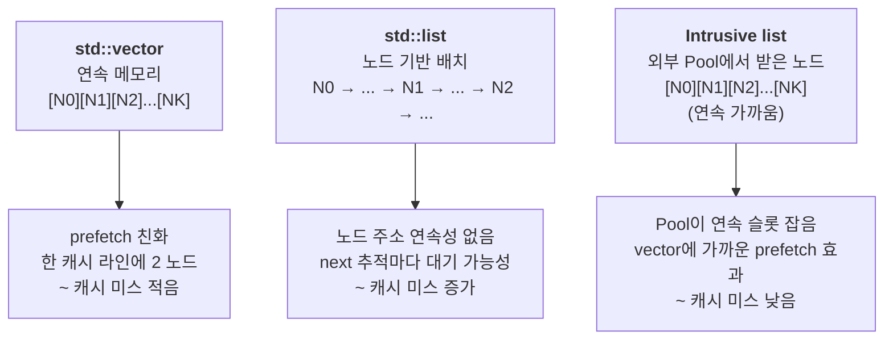
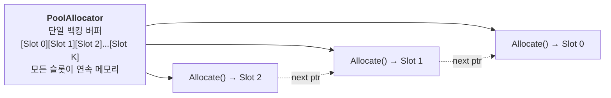

## 들어가며

현재까지의 결과물은 layout · SIMD · branchless · allocator 네 축의 비교가 가능한 측정 도구다. allocator 토글은 *동적 alloc/free 비용* 을 보여 줬다면, 이 단계는 *이미 채워진 컨테이너의 순회 비용* 을 비교한다. 같은 N개 노드를 vector·std::list·Intrusive list 셋에 각각 채워 두고 매 프레임 한 번 순회한다. 같은 작업이지만 ms는 *컨테이너에 따라 수배* 차이가 날 수 있다.

차이의 원인은 *링크 포인터 추적이 만드는 캐시 미스* 다. vector는 연속 메모리라 prefetch가 잘 동작하고, std::list는 노드 기반 컨테이너라 원소 주소 연속성이 보장되지 않는다. Intrusive list는 외부 allocator(Pool)에서 노드를 받으므로 *연속 메모리에 가깝게* 배치되어 vector에 가까운 캐시 효과를 낼 수 있다.

이 단계의 결과물은 다음 다섯 가지다.

1. `ContainerBenchmark` 클래스 — 시작 시 N개 노드 채우고 매 프레임 순회.
2. 세 컨테이너 변종 (vector / std::list / IntrusiveList) 의 분기.
3. IntrusiveList 전용 PoolAllocator (allocator 토글과 분리된 독립 인스턴스).
4. HUD가 container ms, container nodes 표시.
5. container 콤보박스 활성화.

파일 경로 주석이 붙은 스니펫은 저장소의 실제 소스를 그대로 옮긴 것이다. 발췌하느라 가운데를 자른 자리에는 `// ...` 를 남겨 둔다.

---

## 목차
1. [컨테이너 순회의 캐시 차이](#1-컨테이너-순회의-캐시-차이)
2. [ContainerBenchmark 워크로드 설계](#2-containerbenchmark-워크로드-설계)
3. [세 컨테이너의 데이터 채우기](#3-세-컨테이너의-데이터-채우기)
4. [Intrusive list와 외부 Pool의 결합](#4-intrusive-list와-외부-pool의-결합)
5. [main 통합과 HUD 표시](#5-main-통합과-hud-표시)
6. [빌드와 실행 결과](#6-빌드와-실행-결과)

---

## 1. 컨테이너 순회의 캐시 차이

같은 N개 원소의 *순회* 는 컨테이너 종류에 따라 메모리 접근 패턴이 다르다.



세 컨테이너의 핵심 차이는 *데이터 배치* 다. vector는 *주소 연속성* 이 보장되고, std::list는 표준 차원에서 원소 주소 연속성이 보장되지 않는다. Intrusive list는 노드 alloc을 외부 allocator에 맡겨 배치를 *제어 가능* 하다.

순회 시 CPU의 동작은 다음과 같이 갈린다.

| 컨테이너 | 메모리 접근 패턴 | 캐시 미스 | prefetcher 효과 |
|---|---|---|---|
| std::vector | 인접 주소 순차 | 매우 낮음 | 매우 큼 |
| std::list | next 포인터 따라 점프 | 높을 수 있음 | 낮음 |
| Intrusive list (Pool) | 인접 슬롯 순차 (alloc 순서) | 낮음 | 큼 |

*prefetcher 효과* 가 측정의 핵심이다. CPU는 *인접 주소를 잇따라 읽으면 다음 캐시 라인을 미리 가져오는* 하드웨어 prefetcher를 가지고 있다. std::vector는 prefetcher의 가장 좋은 패턴을 보여 주고, std::list는 prefetcher가 *예측하기 어려운* 패턴이라 next 접근에서 메모리 대기 가능성이 커진다.

이 도구는 그 차이를 *같은 N개 원소의 합산 ms* 로 측정한다.

### 왜 합산 작업인가

순회 시 *작업 자체는 가벼울수록* 캐시 미스 비용이 두드러진다. 무거운 산술이 들어가면 *작업 비용이 캐시 미스를 가린다*.

```cpp
// 캐시 미스를 잘 보여 주는 작업
for (auto& n : container) sum += n.dist;
```

`sum += n.dist` 는 한 번의 float load + 한 번의 add. 매우 가볍다. 다음 노드로 넘어가는 *next 추적* 비용이 작업 시간의 대부분이 된다. 컨테이너 종류에 따라 ms가 *수배 갈라지는* 모습이 명확히 드러난다.

## 2. ContainerBenchmark 워크로드 설계

<!-- snippet: src/measure/container_benchmark.h -->
```cpp
// src/measure/container_benchmark.h

#pragma once

#include "alloc/iallocator.h"
#include "ui/toggles.h"

#include <cstddef>
#include <list>
#include <vector>

namespace ppl {

class ContainerBenchmark {
public:
    struct Node {
        float dist;
        int   pad[5];   // Node를 32 byte로 맞춤.
        Node* next;     // intrusive 노드용. vector/list는 무시.
    };
    static_assert(sizeof(void*) != 8 || sizeof(Node) == 32,
                  "Node should stay 32 bytes on 64-bit builds.");

    void Init(Container type, IAllocator* intrusiveAlloc, std::size_t count);
    void Shutdown();
    void RunFrame();

    Container Type()         const { return type_; }
    std::size_t NodeCount()  const { return count_; }
    float LastFrameMs()      const { return lastFrameMs_; }
    float LastSum()          const { return lastSum_; }

private:
    Container   type_         = Container::Vector;
    std::size_t count_        = 0;
    float       lastFrameMs_  = 0.0f;
    float       lastSum_      = 0.0f;

    std::vector<Node> vec_;
    std::list<Node>   list_;

    Node*       intrusiveHead_  = nullptr;
    IAllocator* intrusiveAlloc_ = nullptr;
};

}  // namespace ppl
```

세 가지 설계 결정.

1. **Node 크기 32 byte**: `float dist` + `int pad[5]` + `Node* next` = 32 byte (8-byte 정렬). vector와 intrusive list가 같은 노드 크기를 쓰도록 통일한다. std::list는 이 `Node` 위에 구현체 내부 링크와 allocator 메타데이터가 추가될 수 있다.
2. **`pad[5]`**: Node 한 개가 캐시 라인의 절반(64 byte의 절반 = 32 byte)을 차지하도록 맞춘다. 32 byte 슬롯이라 Pool 슬롯 두 개가 캐시 라인 하나 분량을 차지한다. 라인마다 온전히 두 개가 들어가려면 백킹 버퍼가 32 byte 정렬이어야 하는데, Pool은 `alignof(Node)` 인 8 byte만 요구하므로 실제로는 노드가 라인 경계를 걸칠 수 있다.
3. **외부 `intrusiveAlloc`**: IntrusiveList가 사용할 allocator를 외부에서 받는다. 다양한 allocator로 실험 가능 (이 도구는 Pool로 고정).

### LastSum 노출 이유

`LastSum()` 으로 합산 결과를 객체 상태에 남기는 건 *컴파일러 최적화 방지* 때문이다.

```cpp
// sum을 사용하지 않으면 컴파일러가 루프를 dead code로 삭제할 수 있다.
float sum = 0.0f;
for (...) sum += n.dist;
// sum이 사용되지 않으면 → 루프 자체가 사라짐 → ms = 0
```

`lastSum_` 멤버에 저장하면 측정 루프의 결과가 관측 가능한 객체 상태로 남는다. HUD의 container 줄이 `LastSum()` 을 매 프레임 읽어 표시하므로, 합산 결과가 실제로 프로그램 밖으로 나가는 값이 된다.

## 3. 세 컨테이너의 데이터 채우기

`Init` 이 토글 종류에 따라 분기해 데이터를 채운다.

<!-- snippet: src/measure/container_benchmark.cpp#ContainerBenchmark::Init -->
```cpp
// src/measure/container_benchmark.cpp

void ContainerBenchmark::Init(Container type, IAllocator* intrusiveAlloc,
                              std::size_t count) {
    Shutdown();

    type_           = type;
    count_          = 0;
    intrusiveAlloc_ = intrusiveAlloc;

    std::mt19937 rng(0xBADCAFEu);
    std::uniform_real_distribution<float> dist(0.0f, 100.0f);

    switch (type_) {
        case Container::Vector: {
            vec_.reserve(count);
            for (std::size_t i = 0; i < count; ++i) {
                Node n{};
                n.dist = dist(rng);
                vec_.push_back(n);
            }
            count_ = vec_.size();
            break;
        }
        case Container::StdList: {
            for (std::size_t i = 0; i < count; ++i) {
                Node n{};
                n.dist = dist(rng);
                list_.push_back(n);
            }
            count_ = list_.size();
            break;
        }
        case Container::IntrusiveList: {
            if (!intrusiveAlloc_) break;
            intrusiveHead_ = nullptr;
            for (std::size_t i = 0; i < count; ++i) {
                void* p = intrusiveAlloc_->Allocate(sizeof(Node), alignof(Node));
                if (!p) break;
                Node* node = static_cast<Node*>(p);
                node->dist = dist(rng);
                node->next = intrusiveHead_;
                intrusiveHead_ = node;
                ++count_;
            }
            break;
        }
    }
}
```

### 왜 같은 시드인가

`std::mt19937 rng(0xBADCAFEu)` 시드 고정으로 *세 컨테이너 모두 같은 dist 값* 을 갖는다. 차이가 *데이터 차이* 때문이 아니라 *컨테이너 차이* 때문임을 보장한다.

다만 std::list는 `push_back` 이라 head→tail 순서고 IntrusiveList는 head에 push해 *역순* 으로 쌓인다. 값 집합은 같지만 순회 순서가 다르므로, 부동소수점 합산 결과는 마지막 비트 수준에서 달라질 수 있다. 이 도구는 sum의 정확한 값을 비교하지 않고 루프 제거 방지 용도로만 사용한다.

### Vector의 push_back 비용

`vec_.reserve(count)` 로 미리 용량을 잡아 push_back 시 재할당이 일어나지 않는다. 만약 reserve 없이 push_back을 N번 하면 vector가 *기하급수적 재할당* (16, 32, 64, ...)을 반복해 *시작 시 비용* 이 올라간다. Init은 한 번만 호출되므로 영향이 작지만, 측정 도구의 정직성을 위해 reserve를 명시한다.

### 매 프레임 순회 루프

`RunFrame` 이 컨테이너를 한 번 훑으며 `dist` 를 합산하고, 그 구간만 따로 잰다.

<!-- snippet: src/measure/container_benchmark.cpp#ContainerBenchmark::RunFrame -->
```cpp
// src/measure/container_benchmark.cpp

void ContainerBenchmark::RunFrame() {
    using Clock = std::chrono::steady_clock;
    const auto t0 = Clock::now();

    float sum = 0.0f;
    switch (type_) {
        case Container::Vector: {
            for (const auto& n : vec_) sum += n.dist;
            break;
        }
        case Container::StdList: {
            for (const auto& n : list_) sum += n.dist;
            break;
        }
        case Container::IntrusiveList: {
            for (Node* p = intrusiveHead_; p; p = p->next) sum += p->dist;
            break;
        }
    }

    lastSum_ = sum;

    const auto t1 = Clock::now();
    const auto ns = std::chrono::duration_cast<std::chrono::nanoseconds>(t1 - t0).count();
    lastFrameMs_ = static_cast<float>(ns) / 1.0e6f;
}
```

세 분기가 하는 산술은 똑같다 — float 하나를 읽어 더한다. 갈리는 것은 *원소의 주소를 어떻게 얻는가* 뿐이다. vector는 인덱스 증가, std::list는 노드의 next 포인터, IntrusiveList도 next 포인터지만 그 노드들이 Pool의 연속 슬롯에 놓여 있다.

`steady_clock` 으로 이 루프만 감싸므로 채우기 비용(`Init`)은 측정에 들어오지 않는다. 시간 측정 단위는 나노초로 받아 ms로 환산한다 — 5000 노드 vector 순회는 수십 μs 수준이라 밀리초로 바로 받으면 해상도가 모자란다.

### Shutdown의 노드 회수

vector와 std::list는 `clear()` 로 끝나지만, IntrusiveList의 노드는 외부 allocator가 준 메모리라 직접 돌려줘야 한다.

<!-- snippet: src/measure/container_benchmark.cpp#ContainerBenchmark::Shutdown -->
```cpp
// src/measure/container_benchmark.cpp

void ContainerBenchmark::Shutdown() {
    vec_.clear();
    list_.clear();

    // Intrusive list 정리. Pool은 Reset으로 일괄 회수도 가능하지만
    // 인터페이스 일관성을 위해 노드별 Deallocate.
    if (intrusiveHead_ && intrusiveAlloc_) {
        Node* cur = intrusiveHead_;
        while (cur) {
            Node* next = cur->next;
            intrusiveAlloc_->Deallocate(cur, sizeof(Node));
            cur = next;
        }
    }
    intrusiveHead_  = nullptr;
    intrusiveAlloc_ = nullptr;
    count_          = 0;
}
```

`Node* next = cur->next;` 를 먼저 읽어 두는 순서가 중요하다. `Deallocate` 후에 `cur->next` 를 읽으면 use-after-free다. Pool이 반환된 슬롯을 free list로 재사용하면서 그 자리에 링크를 덮어쓰기 때문에, 실제로 값이 깨진다.

`Shutdown` 이 `intrusiveAlloc_` 까지 null로 되돌리므로, `Init` 은 `Shutdown()` 을 먼저 부른 *뒤에* `intrusiveAlloc_ = intrusiveAlloc;` 을 대입한다. 순서가 뒤집히면 방금 받은 allocator 포인터가 지워진다.

## 4. Intrusive list와 외부 Pool의 결합

IntrusiveList가 *vector에 가까운 캐시 효과* 를 내려면 *연속 메모리* 가 필요하다. PoolAllocator가 이걸 보장한다.



PoolAllocator는 *시작 시 한 번 큰 단일 버퍼* 를 잡고, Allocate 호출마다 *그 버퍼의 슬롯 하나씩* 반환한다. 슬롯이 32 byte 단위로 연속 배치되어 있어 *주소도 연속* 이다.

순회는 next 포인터를 따라가지만 head insert로 만들어진 역순 인접 슬롯을 따라간다. 즉 주소가 단조 감소하는 연속 패턴이라 일반적인 임의 포인터 추적보다 prefetcher가 대응하기 쉽다. 결과적으로 vector 순회와 *주소 패턴이 비슷하다*.

### 왜 std::list와 다른가

일반적인 std::list 구현은 기본 allocator를 통해 노드를 개별 힙 할당한다. 표준은 노드들의 주소 연속성을 보장하지 않고, 구현체의 노드 링크까지 더해져 vector보다 메모리 밀도가 낮다. 그래서 순회가 next 포인터 추적에 의존하고, 캐시 미스가 커지기 쉽다.

std::list에 *커스텀 allocator* 를 줘서 같은 효과를 낼 수 있다(`std::list<Node, Allocator>`). 다만 std::list의 allocator 모델은 *rebind* 등의 복잡도가 있어, 이 도구에서는 *intrusive list가 외부 allocator를 직접 다루는* 패턴으로 단순화한다.

### Pool 인스턴스 분리

allocator 토글이 EventBenchmark에 영향을 주듯이 ContainerBenchmark에도 영향을 줄 수 있는데, 두 워크로드가 *같은 allocator* 를 공유하면 다음이 어긋난다.

- EventBenchmark는 *매 프레임 alloc + Reset*. allocator의 라이브 메모리가 0으로 돌아간다.
- ContainerBenchmark는 *시작 시 한 번 alloc, 매 프레임 순회*. 라이브 메모리가 *N개 노드* 로 유지된다.

두 워크로드가 같은 allocator를 공유하면 EventBenchmark의 Reset이 ContainerBenchmark의 노드를 *지워 버린다*. 노드 포인터가 invalidate되어 다음 프레임 순회가 use-after-free.

해결: ContainerBenchmark용 *독립 PoolAllocator* 인스턴스. main이 두 개의 allocator 인스턴스를 만들어 각각 다른 워크로드에 주입.

<!-- snippet: src/main.cpp -->
```cpp
// src/main.cpp

    // 토글로 교체되는 인스턴스. EventBenchmark 전용이다.
    auto alloc = CreateAllocator(toggles.allocator);

    // ...

    // ContainerBenchmark용 별도 Pool. EventBenchmark의 allocator와 분리해
    // container 토글이 allocator 토글에 영향받지 않게 한다.
    auto containerPool = std::make_unique<ppl::PoolAllocator>(
        sizeof(ppl::ContainerBenchmark::Node),
        alignof(ppl::ContainerBenchmark::Node),
        kContainerCount + 16);

    // ...

        bench.RunFrame(alloc.get());
        cbench.RunFrame();
```

`bench` 는 프레임마다 주입받은 allocator를 쓰고, `cbench` 는 `Init` 때 받아 둔 `containerPool` 을 계속 쓴다. 그래서 allocator 토글이 *EventBenchmark에만* 영향을 주고 ContainerBenchmark는 항상 동일한 Pool로 동작한다.

## 5. main 통합과 HUD 표시

main에 ContainerBenchmark 인스턴스 + Pool + 토글 변경 처리 추가. 먼저 파일 스코프에 헤더 하나와 노드 수 상수 하나가 늘어난다.

<!-- snippet: src/main.cpp -->
```cpp
// src/main.cpp

#include "measure/container_benchmark.h"

// ... (raylib 및 기존 alloc/measure/sim/ui 헤더)

namespace {

// ... (kWindowW · kHudH · kEventCount 등 기존 상수)

// ContainerBenchmark가 보유할 노드 수 (시작 시 한 번 채우고 매 프레임 순회).
constexpr std::size_t kContainerCount = 5000;

// ... (allocator 백킹 용량 상수와 CreateAllocator 팩토리)

}  // namespace
```

main 본문 전문은 다음과 같다.

<!-- snippet: src/main.cpp#main -->
```cpp
// src/main.cpp

int main() {
    SetConfigFlags(FLAG_MSAA_4X_HINT);
    InitWindow(kWindowW, kWindowH, "parts_perf_lab");
    SetTargetFPS(0);

    ppl::Toggles  toggles;
    ppl::Toggles  prevToggles = toggles;

    auto sim = ppl::CreateSimulation(toggles.layout);
    sim->Init(toggles.EntityCount(), kWindowW, kSimH);

    auto alloc = CreateAllocator(toggles.allocator);

    ppl::EventBenchmark bench;
    bench.Init(kEventCount);

    // ContainerBenchmark용 별도 Pool. EventBenchmark의 allocator와 분리해
    // container 토글이 allocator 토글에 영향받지 않게 한다.
    auto containerPool = std::make_unique<ppl::PoolAllocator>(
        sizeof(ppl::ContainerBenchmark::Node),
        alignof(ppl::ContainerBenchmark::Node),
        kContainerCount + 16);

    ppl::ContainerBenchmark cbench;
    cbench.Init(toggles.container, containerPool.get(), kContainerCount);

    ppl::FrameTimer timer;

    ppl::Hud hud;
    hud.Init(kWindowW, kWindowH, kHudH);

    while (!WindowShouldClose()) {
        const float dt = GetFrameTime();

        timer.BeginUpdate();
        sim->Update(dt, toggles.simd, toggles.branchless);
        timer.EndUpdate();

        bench.RunFrame(alloc.get());
        cbench.RunFrame();

        timer.BeginDraw();
        BeginDrawing();
        ClearBackground(Color{10, 10, 14, 255});
        sim->Draw();
        timer.EndDraw();

        // ... (프레임 타이머에 이번 프레임 샘플 커밋)

        hud.Draw(toggles, timer, sim->Count(), bench, *alloc, cbench);
        EndDrawing();

        // 토글 변경 처리.
        // - layout 변경: 시뮬 인스턴스 자체를 교체.
        // - entityCount 변경: 시뮬 재초기화.
        // - allocator 변경: EventBenchmark용 allocator 인스턴스를 새로 만든다.
        // - container 변경: ContainerBenchmark 재초기화.
        if (ppl::RequiresRestart(prevToggles, toggles)) {
            const bool layoutChanged    = (prevToggles.layout    != toggles.layout);
            const bool entityChanged    = (prevToggles.entityPresetIdx != toggles.entityPresetIdx);
            const bool allocatorChanged = (prevToggles.allocator != toggles.allocator);
            const bool containerChanged = (prevToggles.container != toggles.container);

            if (layoutChanged || entityChanged) {
                sim->Shutdown();
                if (layoutChanged) {
                    sim = ppl::CreateSimulation(toggles.layout);
                }
                sim->Init(toggles.EntityCount(), kWindowW, kSimH);
            }

            if (allocatorChanged) {
                alloc = CreateAllocator(toggles.allocator);
            }

            if (containerChanged) {
                cbench.Init(toggles.container, containerPool.get(),
                            kContainerCount);
            }
        }
        prevToggles = toggles;
    }

    sim->Shutdown();
    cbench.Shutdown();
    CloseWindow();
    return 0;
}
```

`cbench.Init` 이 시작 시 한 번 + container 토글 변경 시마다 호출된다. Init이 내부에서 `Shutdown()` 을 먼저 호출해 이전 데이터를 정리하므로 *재초기화* 가 안전하다.

`cbench.RunFrame()` 은 `timer.BeginUpdate()`/`EndUpdate()` 밖에 있다. 컨테이너 순회는 시뮬 update가 아니므로 update ms를 오염시키면 안 되고, 자체 `steady_clock` 으로 이미 재고 있다. `containerPool` 은 `cbench.Shutdown()` 이 노드를 돌려줄 때까지 살아 있어야 한다 — `Shutdown()` 이 `main` 반환 전에 명시적으로 호출되므로 그 시점에는 두 객체 모두 살아 있고, 선언 순서는 이 흐름의 안전에 영향을 주지 않는다.

### HUD 표시

Hud::Draw 시그니처에 `ContainerBenchmark&` 인자가 추가되고, `DrawStats` 가 container ms를 표시한다.

<!-- snippet: src/ui/hud.h -->
```cpp
// src/ui/hud.h

#include "measure/container_benchmark.h"

// ...

class Hud {
public:
    void Init(int windowW, int windowH, int hudHeight);

    // 매 프레임 호출. 토글 상태와 측정값을 받아 HUD를 그리고,
    // 사용자가 토글을 변경했으면 toggles에 반영한다.
    void Draw(Toggles& toggles, const FrameTimer& timer,
              std::size_t entityCount,
              const EventBenchmark& bench,
              const IAllocator& alloc,
              const ContainerBenchmark& cbench);

private:
    void DrawStats(const FrameTimer& timer, std::size_t entityCount,
                   const EventBenchmark& bench, const IAllocator& alloc,
                   const ContainerBenchmark& cbench,
                   int x, int y);

    // ...
};
```

`ContainerBenchmark` 를 값이 아니라 `const&` 로 받는다. HUD는 읽기만 하고, 벤치마크 객체는 vector·list·Pool 노드를 통째로 들고 있어 복사가 곧 재할당이다.

<!-- snippet: src/ui/hud.cpp#Hud::DrawStats -->
```cpp
// src/ui/hud.cpp — Hud::DrawStats

char buf[640];
std::snprintf(buf, sizeof(buf),
              "entities  : %zu\n"
              "update    : %6.3f ms   draw: %6.3f ms\n"
              "cpu fps   : %5.1f   actual: %5d\n"
              "\n"
              "alloc ms  : %6.3f  (%llu allocs, %llu B)\n"
              "live bytes: %llu   peak: %llu\n"
              "container : %6.3f ms  (%zu nodes, sum %.3f)",
              entityCount,
              timer.LastUpdateMs(),
              timer.LastDrawMs(),
              cpuFps,
              actualFps,
              bench.LastFrameMs(),
              static_cast<unsigned long long>(alloc.FrameAllocCount()),
              static_cast<unsigned long long>(alloc.FrameAllocBytes()),
              static_cast<unsigned long long>(alloc.LiveBytes()),
              static_cast<unsigned long long>(alloc.PeakBytes()),
              cbench.LastFrameMs(),
              cbench.NodeCount(),
              static_cast<double>(cbench.LastSum()));
```

좌측 stats 영역에 `container : X.XXX ms (5000 nodes, sum NNN.NNN)` 한 줄이 추가된다.

container 콤보박스 활성화는 비활성화 표시를 걷어내고 값을 토글에 반영하는 것이 전부다.

<!-- snippet: src/ui/hud.cpp#Hud::DrawTogglePanelPass -->
```cpp
// src/ui/hud.cpp — Hud::DrawTogglePanelPass

DrawText("container:", x2, rowY2(row2), 14, LIGHTGRAY);
int containerIdx = (int)toggles.container;
if (GuiDropdownBox(Rect(x2 + kLabelW, rowY2(row2), kFieldW, kRowH),
                   kContainerOptions, &containerIdx, containerEdit_)) {
    containerEdit_ = !containerEdit_;
}
if (!containerEdit_) {
    toggles.container = (Container)std::clamp(containerIdx, 0, kContainerCount - 1);
}
```

여기 쓰인 `kContainerCount` 는 `Container` enum의 항목 수 3이다. main의 `kContainerCount` (노드 수 5000)와 이름은 같지만 main 쪽은 그 번역 단위의 익명 네임스페이스에 있고, 이쪽은 토글 헤더의 `ppl::kContainerCount` 다. 이름이 겹쳐 헷갈리기 쉬운 지점이라 clamp 상한이 3이라는 사실을 기억해 둔다.

## 6. 빌드와 실행 결과

새 번역 단위가 하나 늘었으므로 두 타깃의 소스 목록에 모두 넣는다. 앱에만 넣으면 링크는 되지만 headless 테스트 타깃에서 `ContainerBenchmark` 심볼이 미해결로 남는다.

<!-- snippet: CMakeLists.txt -->
```cmake
# CMakeLists.txt

add_executable(${PROJECT_NAME}
    src/main.cpp
    # ...
    src/measure/container_benchmark.cpp
    # ...
)

# ...

add_executable(parts_core_tests
    tests/core_tests.cpp
    # ...
    src/measure/container_benchmark.cpp
    # ...
)
```

### 자동 검증: `parts_container_tests`

컨테이너를 바꿔도 *같은 계산* 이라는 전제가 깨지면 ms 비교는 의미가 없다. 그 전제를 `container` 그룹이 확인한다. 세 컨테이너를 같은 시드로 채워 노드 수가 정확히 같은지, 합산 결과가 상대오차 1e-4 안에서 일치하는지, 같은 프레임을 두 번 돌려도 합이 변하지 않는지, `Shutdown` 후 노드 수가 0으로 돌아가는지를 본다.

<!-- snippet: tests/core_tests.cpp#TestContainerEquivalence -->
```cpp
// tests/core_tests.cpp — container 그룹

void TestContainerEquivalence() {
    constexpr std::size_t kNodes = 5000;
    using Node = ppl::ContainerBenchmark::Node;

    // 노드 수보다 약간 넉넉한 풀. intrusive 경로가 여기서 노드를 받는다.
    ppl::PoolAllocator pool(sizeof(Node), alignof(Node), 5016);

    float baseline = 0.0f;
    for (int t = 0; t < ppl::kContainerCount; ++t) {
        const auto type = static_cast<ppl::Container>(t);
        const char* label = ppl::ContainerName(type);

        pool.Reset();
        ppl::ContainerBenchmark bench;
        bench.Init(type, &pool, kNodes);

        CHECK_AT(bench.Type() == type, label);
        CHECK_AT(bench.NodeCount() == kNodes, label);

        bench.RunFrame();
        const float sum = bench.LastSum();
        // ...
        if (t == 0) {
            baseline = sum;
        } else {
            const float rel = std::fabs(sum - baseline) / std::fabs(baseline);
            CHECK_AT(rel < 1e-4f, label);
        }

        // 순회는 상태를 바꾸지 않으므로 다시 돌려도 합이 같다.
        bench.RunFrame();
        CHECK_AT(bench.LastSum() == sum, label);

        bench.Shutdown();
        CHECK_AT(bench.NodeCount() == 0, label);
    }
    // ...
}
```

`bench.LastSum() == sum` 은 오차 없는 등식이다. 순회가 상태를 바꾸지 않는다는 성질이라, 여기서 부동소수 오차가 끼면 그건 순회가 아니라 갱신을 하고 있다는 뜻이다. 뒤이어 allocator를 주지 않은 intrusive 경로가 노드를 0개로 두는지와, 풀이 모자랄 때 노드 수가 풀 용량에서 멈추는지도 같은 검사 안에 있다.

```bash
cmake -S . -B build
cmake --build build --config Release
ctest --test-dir build -C Release -R parts_container_tests --output-on-failure

./build/parts_core_tests container              # Linux/macOS
.\build\Release\parts_core_tests.exe container  # Windows
```

```text
parts_core_tests: group `container`
  container/ContainerEquivalence ... 25 check(s) ok
container: 1 test(s), 25 check(s), 0 failure(s)
```

25는 첫 컨테이너 6개 + 나머지 둘 7개씩(baseline과의 상대오차 비교가 하나 더 붙는다) = 20에, allocator 없는 경로 2개와 풀이 모자란 경로 3개를 더한 수다. 컨테이너를 하나 더 붙이면 `ppl::kContainerCount` 를 따라 루프가 늘어나 이 수도 함께 늘어난다.

### 실행 결과

실행 후 좌측 stats 영역 하단에 `container : X.XXX ms (5000 nodes)` 가 매 프레임 갱신된다. container 콤보박스를 클릭해 vector → std::list → IntrusiveList 순서로 바꾸며 변화를 본다.

### 측정 시점에서 보일 수 있는 경향

5000 노드 기준 일반적인 데스크톱 CPU에서 보일 수 있는 경향:

- **Vector**: container ms가 가장 작음. prefetcher가 잘 동작해 캐시 미스가 적다. 보통 수십 μs 단위.
- **StdList**: container ms가 *훨씬 커질 수 있음*. 노드 주소 연속성이 보장되지 않아 cache miss가 늘기 쉽다. 워크로드·allocator·CPU에 따라 vector 대비 수배 차이가 날 수 있다.
- **IntrusiveList (Pool)**: vector보다는 눈에 띄게 큼. Pool이 연속 슬롯을 잡아 캐시 거동은 vector에 가깝지만, 다음 노드 주소를 읽어야 다음 접근이 시작되는 직렬 의존 사슬이 남는다. StdList와의 차이는 노드 수가 커져 캐시 미스가 지배할수록 벌어진다. 정확한 비교 결과는 컴파일러·CPU에 따라 다르다.

container 콤보를 vector → StdList로 바꾼 직후 *세로 절벽* 이 그래프가 아니라 *stats 텍스트* 의 container 값에 나타난다. 5배 이상 점프하는 경우 캐시 미스의 영향이 명확히 드러난 사례다.

### container ms vs alloc ms

이 도구의 두 별도 측정 채널이 *서로 다른 토픽* 을 보여 준다.

| 채널 | 측정 대상 | 영향받는 토글 |
|---|---|---|
| alloc ms (EventBenchmark) | *동적 alloc/free 비용* | allocator |
| container ms (ContainerBenchmark) | *컨테이너 순회 캐시 미스* | container |

allocator 토글이 alloc ms만 움직이고, container 토글이 container ms만 움직인다. 두 토글의 영향 범위가 *직교* 라 섞이지 않는다.

### 검증 체크리스트

- container ms가 0 → 모든 컨테이너에서 0이라면 컴파일러가 sum 루프를 삭제했을 가능성. HUD container 줄의 `sum` 값이 `0` 이 아닌지 확인한다. 컨테이너 내용은 `Init` 이후 바뀌지 않으므로 정상이면 매 프레임 같은 값이 찍힌다.
- IntrusiveList에서 노드 수가 `kContainerCount` 보다 작음 → Pool 고갈. `kContainerCount + 16` 의 여유를 늘림.
- StdList와 IntrusiveList ms가 비슷 → 노드 수가 작거나 측정 노이즈가 큰 경우. Release 빌드인지 확인하고 `kContainerCount` 를 늘려 차이를 키운다.
- container 토글 변경 시 잠깐 멈춤 → Init이 N개 노드를 새로 채우느라 잠깐 비용. 5000개라면 1ms 안쪽이 정상.

### 측정의 정직성

이 도구의 container ms 차이는 *순회 캐시 미스* 의 영향을 보여 준다. 다만 다음이 일반화 금지된 사실이다.

- **항상 vector가 빠르지 않다**: 작업이 *무거우면* 캐시 미스 비용이 가려진다. 매 노드마다 사인·코사인 계산 같은 무거운 작업이 들어가면 vector와 list의 차이가 사라진다.
- **항상 std::list가 느리지 않다**: 노드 *수명* 과 *접근 패턴* 에 따라 list가 더 적합한 경우도 있다. 게임 엔진의 *intrusive linked list* 패턴은 list의 임의 삽입·삭제 강점에 vector의 캐시 효율을 결합한다.
- **Intrusive list의 캐시 효과는 allocator 의존**: Pool 같은 *연속 슬롯 allocator* 가 아니면 std::list와 비슷한 결과가 나올 수 있다.

도구는 *작은 작업 + 순회 위주* 라는 *vector에 가장 유리한 시나리오* 를 보여 준다. 결론을 *내 워크로드* 에 적용할 때는 그 워크로드의 *작업 비중* 과 *접근 패턴* 을 먼저 본다.

---

## 결론

이 단계의 결과물은 vector·std::list·IntrusiveList 세 컨테이너의 같은 N개 원소 순회 비용을 토글로 비교하는 도구다. 약 200줄의 새 코드(ContainerBenchmark + main 통합 + Hud 확장)가 기존 코드 위에 얹혔다.

세 가지 결정이 이 단계의 토대를 만들었다.

1. **외부 Pool로 IntrusiveList 노드 배치 제어** — 연속 슬롯 allocator가 vector에 가까운 캐시 효과를 만든다. *allocator가 컨테이너 성능을 가른다* 는 사실의 직접적 시연.
2. **EventBenchmark allocator와 분리된 독립 Pool** — 두 워크로드가 같은 allocator를 공유하면 EventBenchmark의 Reset이 ContainerBenchmark 노드를 invalidate. 분리해야 안전.
3. **가벼운 합산 작업** — 캐시 미스 비용을 가리지 않도록 작업을 최소화. 컴파일러 최적화 방지를 위해 `LastSum()` 으로 결과를 객체 상태에 남김.

여기까지의 코드는 layout / SIMD / branchless / allocator / container 다섯 축의 비교가 가능하다. 모든 측정값이 *frame timer 와 별도 채널* 에서 ms 단위로 표시된다. 다만 *왜 그 ms가 나오는지* 의 깊이 — 캐시 미스 횟수, branch 미스율, instructions per cycle — 같은 *CPU 카운터* 는 아직 없다. 그래서 ms 차이의 *원인* 은 이 도구 안에서 확인할 수 없고, 외부 프로파일러의 도움을 받아야 한다.

## 더 읽을거리

- Bjarne Stroustrup, "Why you should avoid Linked Lists" (GoingNative 2012) — vector vs list 캐시 차이의 고전 시연
- Sergey Slotin, "Algorithms for Modern Hardware" — prefetcher 친화적 자료구조
- [Folly's IntrusiveList](https://github.com/facebook/folly/blob/main/folly/IntrusiveList.h) — Boost 외 실전 intrusive 구현
- [Boost.Intrusive 설계 근거](https://www.boost.org/doc/libs/release/doc/html/intrusive.html)
- Mike Acton, "Solving the Right Problems for Engine Programmers" (TGC 2017) — 게임 엔진의 데이터 중심 컨테이너 선택 기준
- [Andrei Alexandrescu, "Optimization Tips" (CppCon 2014)](https://www.youtube.com/watch?v=Qq_WaiwzOtI) — std::list 함정
- Daniel Lemire, "Memory Access Patterns are Important" — prefetcher의 동작
