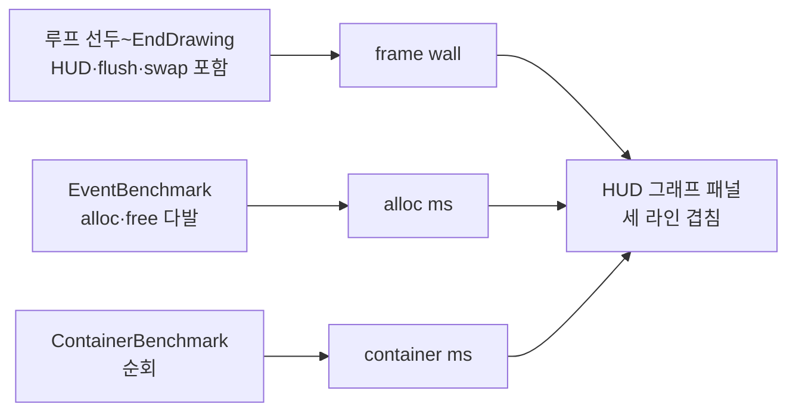
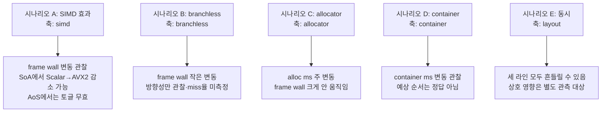
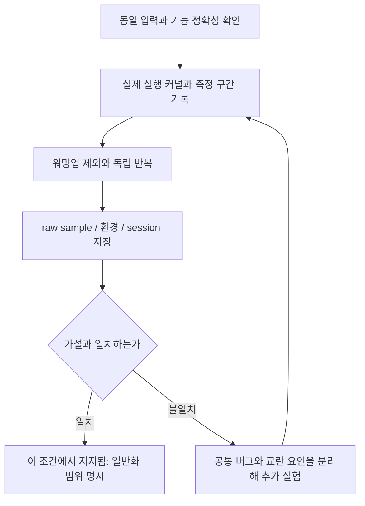
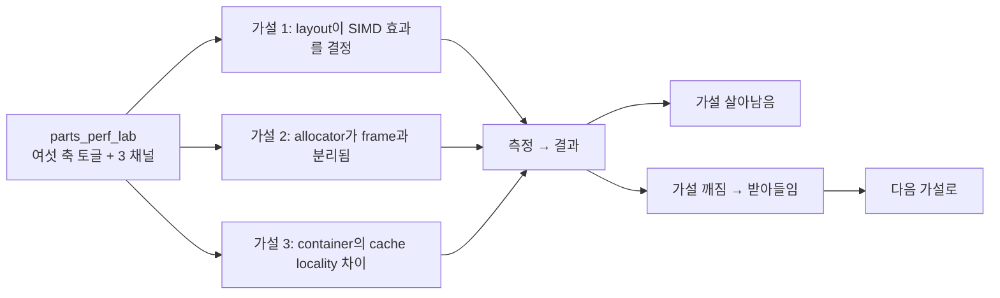

## 들어가며

지난 일곱 단계를 거치며 토글 기반 측정 도구의 골격을 세웠다. SoA·AoS·Archetype 세 메모리 레이아웃, C++ Auto·SSE·AVX2 세 SIMD 폭, 분기 vs 분기 없는 predication, 네 가지 allocator, 세 가지 container까지 — 모두 런타임 토글로 갈아 끼울 수 있다. 그리고 매 프레임 세 가지 측정 채널이 돈다.

> 이 실습은 게임 개발의 모든 CS 주제를 하나의 프로그램에 구현하는 과정이 아니다. 같은 상태를 여러 메모리 배치와 연산 방식으로 처리하고, 할당·순회 비용을 나누어 관찰하는 저수준 성능 실습이다. ECS 는 단일 컴포넌트 조합의 저장 배치까지만 다룬다. query 와 구조 변경, 문자열·인코딩·동시성 등은 별도 실습에서 다룬다.
>
> 실행 결과가 특정 순서로 나와야 성공하는 실습은 아니다. 먼저 같은 입력에 대해 같은 의미의 결과를 계산하는지 확인한다. 그다음 작업량·측정 구간·실행 환경을 맞추고 반복 측정한다. 기대와 다른 성능이 나오면 결과를 숨기거나 구현 오류로 단정하지 않고, 이 실험이 어떤 가정을 충족하지 못했는지 확인한다.
>
> 각 장의 코드는 세 종류로 구분한다. `현재 단계 완성 코드`는 해당 단계의 파일 집합과 함께 빌드할 수 있어야 한다. `발췌 코드`는 생략된 선언과 helper 의 실제 위치를 함께 적는다. `설명용 의사코드`는 의미와 제어 흐름을 보여주며 그대로 붙여 넣는 소스가 아니다. 최종 `src/`와 중간 단계의 함수 시그니처가 다르면 변환 표를 제공한다.

- **frame wall**: `BeginFrame()` 부터 `EndFrame()` 까지의 벽시계 시간. HUD 와 `EndDrawing`(flush/swap) 을 포함하지만 GPU 실행 시간이나 전체 프로그램 CPU 시간은 아니다. layout/SIMD/branchless 토글이 영향을 준다.
- **alloc ms**: `EventBenchmark`가 매 프레임 alloc/free하는 노드 다발의 누적 시간. allocator 토글이 영향을 준다.
- **container ms**: `ContainerBenchmark`가 매 프레임 N개 노드를 한 번 순회하는 비용. container 토글이 영향을 준다.

HUD 좌측 숫자에는 이 밖에 `sim`(Update 구간), `draw`(BeginDrawing/Clear/점 그리기 구간, draw-submit), 그 둘의 합 `sim+sub` 도 함께 표시된다. `sim+sub` 는 전체 CPU 프레임이 아니므로 `cpu fps` 같은 이름을 쓰지 않는다.

그러나 지금까지의 HUD 그래프는 frame 한 라인만 그렸다. allocator를 바꿔도, container를 바꿔도 그래프 자체는 거의 움직이지 않는다 — 효과가 보고 싶은 그래프 채널과 다른 곳에서 나기 때문이다. 측정값은 HUD에 숫자로 표시됐지만 *시간 흐름에 따른 모습* 은 보이지 않았다.

이번 단계에서 그래프를 세 라인으로 확장한다. 같은 패널 위에 frame wall / alloc / container 세 채널을 색을 달리해 겹쳐 그리고, 자동 스케일은 셋의 최댓값으로 잡는다. 그리고 여기서 도구 전체를 어떻게 쓸 것인가 — *어떤 토글 조합으로 어떤 가설을 검증할 것인가* — 와, 마지막으로 이 도구가 *말해주지 않는 것* 들을 정리한다.

---

## 목차

1. [왜 채널을 분리하고 한 그래프에 겹쳐 그리는가](#1-왜-채널을-분리하고-한-그래프에-겹쳐-그리는가)
2. [`FrameTimer` 확장 — 두 채널 슬라이딩 윈도우 추가](#2-frametimer-확장--두-채널-슬라이딩-윈도우-추가)
3. [`Hud::DrawFrameGraph` 확장 — 세 라인을 그리는 폴리라인 폼](#3-huddrawframegraph-확장--세-라인을-그리는-폴리라인-폼)
4. [자동 스케일과 기준선의 의미](#4-자동-스케일과-기준선의-의미)
5. [도구 전체 사용 시나리오](#5-도구-전체-사용-시나리오)
6. [측정의 정직성 — 이 도구가 알려주지 않는 것](#6-측정의-정직성--이-도구가-알려주지-않는-것)
7. [결론](#결론)

---

## 1. 왜 채널을 분리하고 한 그래프에 겹쳐 그리는가

### 채널을 분리한 이유

처음부터 측정 채널을 *세 갈래로 쪼갠* 데에는 분명한 이유가 있다. 토글 효과를 *섞이지 않게* 보기 위함이다.

만약 한 시뮬 프레임 안에 layout 업데이트, allocator 워크로드, container 순회가 모두 섞여 있고 그 합산만 보고된다면, allocator를 Pool로 바꿨을 때 ms가 줄어든 게 *Pool의 효과* 인지 *layout 캐시 동작이 우연히 좋아진 것* 인지 구분할 길이 없다. 토글 하나씩 갈아 끼우며 그래프를 보더라도, 그 변동은 *시뮬 + 할당 + 순회* 가 함께 변한 결과라 인과를 추적하기 어렵다.

그래서 도구는 처음부터 워크로드를 분리했다.

- 시뮬 자체(`ISimulation::Update`)는 layout과 SIMD, branchless의 효과만 받는다. allocator를 바꿔도 시뮬 본체는 영향이 없다 — 시뮬은 layout이 잡아 둔 자기 메모리에서 돈다.
- `EventBenchmark::RunFrame(alloc)`은 매 프레임 N개 노드를 alloc/free하며 allocator 자체의 처리량만 본다. 시뮬 토글과 분리된다.
- `ContainerBenchmark::RunFrame()`은 시작 시 채워진 N개 노드를 그저 순회한다. 컨테이너 종류가 *순회 시* 캐시 동작에 어떻게 영향 주는가만 본다.

세 채널은 각자 다른 workload 를 재므로 주된 효과가 서로 섞이지 않는다. 다만 workload 를 다른 구간에서 측정하는 것은 각 구간의 비용을 구분하는 데 유용할 뿐, 같은 CPU·cache·메모리·OS 를 사용하므로 서로의 성능 영향까지 제거되는 것은 아니다. allocator 를 바꿨을 때 다른 선도 함께 움직였다는 이유만으로 타이머가 잘못됐다고 판정하지 않는다. headless 단일 워크로드 결과와 GUI 동시 실행 결과는 나누어 비교한다.

### 한 그래프에 겹쳐 그리는 이유

채널을 분리한 만큼 그래프도 분리할 수도 있다. 패널 세 개를 위아래로 쌓고 각각 자기 채널만 그리는 식이다. 그렇게 해도 정보가 줄어들지는 않는다.

그럼에도 이번 단계는 *한 패널에 세 라인을 겹쳐* 그리는 쪽을 택한다. 이유는 단 하나, *시간축이 같다* 는 사실 자체가 신호이기 때문이다.

토글을 바꾼 순간이 그래프 위에서는 *수직선* 으로 나타난다. allocator를 Pool에서 malloc으로 바꾸는 순간 alloc ms 라인이 위로 점프하고, 같은 시점에 frame/container 라인은 평탄하다. *동시에* 변하는 것과 *동시에 변하지 않는* 것이 한 화면에 보이면, 인과가 한층 또렷해진다. 패널을 분리하면 같은 t에서 세 점을 눈으로 따라가야 하는데, 한 패널에 겹치면 시각적으로 묶인다.

대신 트레이드오프가 있다. 자동 스케일이 *셋의 최댓값* 기준이라, frame wall이 ~5ms, alloc/container ms가 ~0.5ms 같은 비대칭 시나리오에서는 작은 채널이 바닥에 깔려 평평해 보인다. 그래프가 평탄하다는 것은 *선택한 축과 픽셀 해상도에서* 큰 변화가 보이지 않는다는 뜻이다. 비용이 작은 채널에 변화가 없다는 증명은 아니다. 공통 축은 절대 비용 비교에 사용하고, 작은 변화는 독립 축과 수치 분포로 살펴본다. frame budget 선을 그리는 목적과 allocator 의 미세한 실행 시간을 보는 목적은 다르다.

작은 채널의 변동을 보려면 공통 스케일을 그대로 둔 채 채널별 확대(개별 y 축) 모드로 전환하고, 숫자 요약을 함께 보는 것이 맞다. 워크로드 크기(N)를 바꾸면 전체 비용 자체가 달라지므로 스케일 문제의 해법이 아니다. 채널별 확대 모드, 숫자 요약, session 표식은 **보충 구현 목표** 다.

### 세 채널 한 패널에 겹친 그림



세 화살표는 *서로 다른 워크로드* 에서 출발해 같은 패널에 도착한다.

## 2. `FrameTimer` 확장 — 두 채널 슬라이딩 윈도우 추가

`FrameTimer`는 초기 구현부터 update/draw 두 채널의 슬라이딩 윈도우(600 프레임 ring buffer)를 들고 있었다. 지금은 여기에 frame wall 과 alloc/container 채널이 더해졌다.

frame wall 은 `BeginFrame()`/`EndFrame()` 한 쌍으로 잰다. `BeginFrame` 은 루프 선두, `EndFrame` 은 `EndDrawing` 뒤에 두므로 HUD·flush·swap 이 포함된다. 예전처럼 update+draw 부분합을 frame total 로 부르지 않고, 그 합은 `LastSimDrawSubmitMs()`(`sim + draw-submit`)라는 이름으로 따로 노출한다.

alloc ms와 container ms는 *외부에서 측정* 된다. `EventBenchmark`가 자기 RunFrame 내부에서 시간을 재고 `LastFrameMs()`로 노출하고, `ContainerBenchmark`도 마찬가지다. `FrameTimer`가 이 시간을 직접 측정하면 측정 책임이 흩어진다.

선택은 단순하다. `CommitFrame()`에 두 인자를 받아 슬라이딩에 push만 하게 한다.

`measure/frame_timer.h`:

```cpp
// 최근 N 프레임의 frame/sim/draw-submit/alloc/container 시간을 슬라이딩 윈도우로
// 보관한다. HUD가 이 데이터를 그래프로 표시한다.
//
// 구간 정의(서로 다른 지표를 같은 이름으로 부르지 않는다):
//   - frame wall      : BeginFrame()부터 EndFrame()까지. HUD와 EndDrawing(flush/swap)을
//                       포함하지만 GPU 실행 시간이나 전체 프로그램 CPU 시간은 아니다.
//   - sim             : 시뮬레이션 Update 호출 구간.
//   - draw-submit     : BeginDrawing/Clear/점 그리기 호출 구간. HUD와 EndDrawing 제외.
//                       일부 CPU 렌더 명령 발행 비용이며 GPU 완료 시간이 아니다.
//   - alloc/container : 각 벤치마크가 자체 측정해 CommitFrame으로 넘기는 외부 값.
class FrameTimer {
public:
    static constexpr std::size_t kCapacity = 600;

    // 프레임 전체 wall 구간. BeginFrame은 루프 선두, EndFrame은 EndDrawing 뒤에 둔다.
    void BeginFrame();
    void EndFrame();

    void BeginUpdate();
    void EndUpdate();

    void BeginDraw();
    void EndDraw();

    // 호출 직전에 EndFrame, BeginUpdate/EndUpdate, BeginDraw/EndDraw가 모두
    // 호출되었다고 가정한다. 한 프레임의 측정값과 별도 채널 ms를 링 버퍼에 push한다.
    void CommitFrame(float allocMs = 0.0f, float containerMs = 0.0f);

    // 최근 N 프레임 ms 배열. ring buffer라 head 위치도 함께 반환한다.
    const std::array<float, kCapacity>& FrameWallMs() const { return frameWallMs_; }
    const std::array<float, kCapacity>& UpdateMs()    const { return updateMs_; }
    const std::array<float, kCapacity>& DrawMs()      const { return drawMs_; }
    const std::array<float, kCapacity>& AllocMs()     const { return allocMs_; }
    const std::array<float, kCapacity>& ContainerMs() const { return containerMs_; }
    std::size_t Head()   const { return head_; }
    std::size_t Filled() const { return filled_; }

    float LastFrameWallMs()      const { return lastFrameWallMs_; }
    float LastUpdateMs()         const { return lastUpdateMs_; }
    float LastDrawSubmitMs()     const { return lastDrawMs_; }
    // sim + draw-submit. 전체 CPU 프레임이 아니므로 옛 이름(LastTotalMs)을 쓰지 않는다.
    float LastSimDrawSubmitMs()  const { return lastUpdateMs_ + lastDrawMs_; }
    float LastAllocMs()          const { return lastAllocMs_; }
    float LastContainerMs()      const { return lastContainerMs_; }

private:
    using Clock = std::chrono::steady_clock;
    using Time  = Clock::time_point;

    Time frameStart_{};
    Time updateStart_{};
    Time drawStart_{};

    std::array<float, kCapacity> frameWallMs_{};
    std::array<float, kCapacity> updateMs_{};
    std::array<float, kCapacity> drawMs_{};
    std::array<float, kCapacity> allocMs_{};
    std::array<float, kCapacity> containerMs_{};
    std::size_t head_ = 0;
    std::size_t filled_ = 0;

    float lastFrameWallMs_ = 0.0f;
    float lastUpdateMs_    = 0.0f;
    float lastDrawMs_      = 0.0f;
    float lastAllocMs_     = 0.0f;
    float lastContainerMs_ = 0.0f;
};
```

기본 인자가 0.0f라 기존 호출(`timer.CommitFrame()`)도 그대로 컴파일된다 — 두 채널이 항상 0인 상태가 될 뿐이다. 새 워크로드가 늘어나도 이 시그니처를 깨지 않고 인자만 추가하는 식으로 확장할 수 있다.

`measure/frame_timer.cpp`:

```cpp
void FrameTimer::CommitFrame(float allocMs, float containerMs) {
    lastAllocMs_     = allocMs;
    lastContainerMs_ = containerMs;

    frameWallMs_[head_] = lastFrameWallMs_;
    updateMs_[head_]    = lastUpdateMs_;
    drawMs_[head_]      = lastDrawMs_;
    allocMs_[head_]     = lastAllocMs_;
    containerMs_[head_] = lastContainerMs_;
    head_ = (head_ + 1) % kCapacity;
    if (filled_ < kCapacity) {
        ++filled_;
    }
}
```

호출 측 한 줄 변경. `main.cpp`:

```cpp
timer.CommitFrame(bench.LastFrameMs(), cbench.LastFrameMs());
```

`bench`(EventBenchmark)와 `cbench`(ContainerBenchmark)에서 마지막 프레임의 측정값을 그대로 끌어다 push한다. 두 워크로드는 매 프레임 `RunFrame`이 호출되며 `lastFrameMs_`를 갱신하므로, `CommitFrame` 시점에는 최신 값이 들어 있다.

> 측정 시점 순서가 중요하다. main 루프는
> `BeginFrame → BeginUpdate → sim->Update → EndUpdate → bench.RunFrame → cbench.RunFrame → BeginDraw → sim->Draw → EndDraw → hud.Draw → EndDrawing → EndFrame → CommitFrame`
> 순으로 돈다. frame wall 은 루프 선두에서 시작해 HUD 와 `EndDrawing`(flush/swap) 뒤에서 끝나므로, `CommitFrame` 은 그 뒤에 온다. 그 결과 HUD 가 읽는 지표는 *직전 프레임* 의 커밋 값이고 그래프도 한 프레임 지연된다. `bench.RunFrame`과 `cbench.RunFrame`은 update/draw 타이머 밖에서 측정된다. draw-submit 은 HUD 와 `EndDrawing` 을 제외하지만, frame wall 은 셋을 모두 포함한다.

### 자동 검증: `parts_graph_tests`

세 라인을 한 시간축에 겹쳐 그리는 그림이 의미를 가지려면, 같은 인덱스의 여러 채널 값이 *같은 프레임* 의 것이어야 한다. 채널이 하나라도 어긋나게 밀리면 "동시에 변한다"는 관측 자체가 거짓이 된다. 그 정렬은 창 없이 확인되는 순수 계산이라 `graph` 그룹이 붙들고 있다.

<!-- snippet: tests/core_tests.cpp#TestFrameTimerChannels -->
```cpp
// tests/core_tests.cpp — graph 그룹

void TestFrameTimerChannels() {
    ppl::FrameTimer timer;
    timer.CommitFrame(0.25f, 1.5f);
    CHECK(timer.LastAllocMs() == 0.25f);
    CHECK(timer.LastContainerMs() == 1.5f);
    CHECK(timer.AllocMs()[0] == 0.25f);
    CHECK(timer.ContainerMs()[0] == 1.5f);

    // 인자를 생략한 호출은 두 채널을 0으로 되돌린다. 워크로드가 없는 프레임이
    // 직전 값을 물려받아 그래프에 유령 라인을 남기면 안 된다.
    timer.CommitFrame();
    CHECK(timer.LastAllocMs() == 0.0f);
    CHECK(timer.LastContainerMs() == 0.0f);
    CHECK(timer.AllocMs()[1] == 0.0f);
    CHECK(timer.ContainerMs()[1] == 0.0f);
    CHECK(timer.Head() == 2);

    // 링을 한 바퀴 넘겨도 네 채널이 같은 head로 함께 밀린다.
    constexpr std::size_t kCap = ppl::FrameTimer::kCapacity;
    ppl::FrameTimer rolled;
    for (std::size_t i = 0; i < kCap + 7; ++i) {
        rolled.CommitFrame(static_cast<float>(i), static_cast<float>(i) * 2.0f);
    }
    CHECK(rolled.Filled() == kCap);
    CHECK(rolled.Head() == 7);

    int misaligned = 0;
    for (std::size_t i = 0; i < kCap; ++i) {
        if (rolled.ContainerMs()[i] != rolled.AllocMs()[i] * 2.0f) ++misaligned;
    }
    CHECK(misaligned == 0);

    // head는 *다음에 쓸* 자리다. 가장 최근 샘플은 head-1, 가장 오래된 샘플은 head.
    CHECK(rolled.AllocMs()[6] == static_cast<float>(kCap + 6));
    CHECK(rolled.AllocMs()[7] == 7.0f);
}
```

alloc 채널에 `i`, container 채널에 `i * 2` 를 넣고 링을 한 바퀴 넘겨 돌린 뒤, 600칸 전부에서 두 배 관계가 유지되는지 센다. 어긋난 칸이 하나라도 있으면 두 채널이 서로 다른 프레임을 가리키고 있다는 뜻이다. 마지막 두 단언은 `head` 가 *다음에 쓸* 자리라는 규칙을 고정한다 — 그래프가 왼쪽 끝을 `head` 에서 시작해 오른쪽으로 그리는 순서가 여기서 나온다.

```bash
cmake -S . -B build
cmake --build build --config Release
ctest --test-dir build -C Release -R parts_graph_tests --output-on-failure

./build/parts_core_tests graph              # Linux/macOS
.\build\Release\parts_core_tests.exe graph  # Windows
```

```text
parts_core_tests: group `graph`
  graph/FrameTimerChannels ... 14 check(s) ok
graph: 1 test(s), 14 check(s), 0 failure(s)
```

폴리라인을 그리는 부분 자체는 raylib 호출이라 창 없이 재현되지 않는다. 여기서 고정하는 것은 그 아래 깔린 데이터 정렬이고, 화면에서 세 라인이 실제로 어떻게 보이는지는 아래 사용 시나리오를 직접 따라가 확인한다.

## 3. `Hud::DrawFrameGraph` 확장 — 세 라인을 그리는 폴리라인 폼

기존 `DrawFrameGraph`는 frame total(update + draw) 한 라인만 그리는 구조였다. 지금은 frame wall 한 라인과 alloc/container 두 라인을 그린다. 폴리라인 그리기 로직을 람다로 빼서 같은 코드를 채널마다 반복한다.

`ui/hud.cpp`의 그래프 부분:

```cpp
const auto& frameWall = timer.FrameWallMs();
const auto& draw      = timer.DrawMs();
const std::size_t filled = timer.Filled();
if (filled == 0) return;

const auto& alloc     = timer.AllocMs();
const auto& container = timer.ContainerMs();

// 자동 스케일: 세 라인(frame wall / alloc / container)의 max.
float maxMs = 0.0f;
for (std::size_t i = 0; i < filled; ++i) {
    if (frameWall[i] > maxMs) maxMs = frameWall[i];
    if (alloc[i] > maxMs)     maxMs = alloc[i];
    if (container[i] > maxMs) maxMs = container[i];
}
// 최소 16.67ms 스케일 (60fps 기준선이 보이도록). 이 기준선은 frame budget 관점이며,
// 작은 alloc/container 차이를 가릴 수 있다(그 해석은 숫자 요약과 함께 본다).
if (maxMs < 16.67f) maxMs = 16.67f;

// 60fps / 30fps 기준선. 패널 안에 들어올 때만 그린다.
auto drawHline = [&](float ms, Color c) {
    if (ms > maxMs) return;
    const float ratio = ms / maxMs;
    const int yLine = y + h - (int)(ratio * (h - 4));
    DrawLine(x, yLine, x + w, yLine, c);
};
drawHline(16.67f, Color{80, 200, 80, 100});   // 60fps
drawHline(33.33f, Color{200, 200, 80, 100});  // 30fps
```

스케일이 정해지면 각 채널을 같은 좌표계에 폴리라인으로 그린다.

```cpp
const std::size_t cap = FrameTimer::kCapacity;
const std::size_t head = timer.Head();

// 한 채널을 폴리라인으로 그린다. ms[idx] 값을 0..maxMs 정규화해 y 좌표로.
// x축은 sample index다(프레임률에 따라 실제 경과 시간 길이가 달라진다).
auto drawSeries = [&](const std::array<float, FrameTimer::kCapacity>& series,
                      Color c) {
    int prevX = -1;
    int prevY = 0;
    const float denom = (filled > 1) ? static_cast<float>(filled - 1) : 1.0f;
    for (std::size_t i = 0; i < filled; ++i) {
        const std::size_t idx = (head + cap - filled + i) % cap;
        const float v = series[idx];
        const float ratio = v / maxMs;

        const int px = x + (int)((float)i * w / denom);
        const int py = y + h - (int)(ratio * (h - 4));

        if (prevX >= 0) {
            DrawLine(prevX, prevY, px, py, c);
        }
        prevX = px;
        prevY = py;
    }
};
(void)draw;

// 라인 셋. frame wall은 HUD/EndDrawing 포함, alloc/container는 벤치마크 자체 측정.
drawSeries(frameWall, Color{200, 220, 255, 220}); // frame wall
drawSeries(alloc,     Color{ 80, 220, 220, 200}); // alloc
drawSeries(container, Color{255, 200,  80, 200}); // container
```

마지막으로 현재 스케일과 세 채널 범례를 같은 패널에 올린다.

```cpp
// 좌측 상단: max 스케일.
char label[64];
std::snprintf(label, sizeof(label), "max %.2f ms", maxMs);
DrawText(label, x + 6, y + 4, 12, GRAY);

// 우측 상단: 라인 범례.
const int legendX = x + w - 200;
const int legendY = y + 4;
DrawRectangle(legendX, legendY,     8, 8, Color{200, 220, 255, 220});
DrawText("frame wall",  legendX + 12, legendY,     10, LIGHTGRAY);
DrawRectangle(legendX + 74, legendY, 8, 8, Color{ 80, 220, 220, 200});
DrawText("alloc",      legendX + 86, legendY,     10, LIGHTGRAY);
DrawRectangle(legendX + 124, legendY, 8, 8, Color{255, 200,  80, 200});
DrawText("container",  legendX + 136, legendY,    10, LIGHTGRAY);
```

세 줄의 `drawSeries` 호출이 본체다. 같은 인덱싱·같은 정규화·같은 그리기를 색만 바꿔 세 번 반복한다. frame wall 은 이미 `BeginFrame`/`EndFrame` 한 쌍이 HUD·`EndDrawing` 을 포함해 잰 값이라, 별도로 채널 둘을 더하지 않는다.

색은 의도적으로 *채도가 다른* 셋을 골랐다.

- frame wall: 차분한 라일락 빛 흰색. baseline 채널.
- alloc: 시안. allocator는 보통 frame wall보다 *작은 ms* 라 채도 높은 색이 가독성에 유리.
- container: 앰버. alloc과 색상환에서 떨어져 있어 두 작은 채널이 겹쳐도 구분된다.

알파를 200~220 사이로 잡아 세 라인이 겹치는 구간에서도 각각이 보인다.

범례는 패널 우측 상단 한 줄이다. 컬러 사각형 + 짧은 라벨 셋. 그래프 아래 별도 패널을 두지 않고 *그래프 안* 에 넣어 화면 면적을 아낀다 — HUD가 720p 화면의 140px만 차지한다는 제약을 유지한다.

## 4. 자동 스케일과 기준선의 의미

자동 스케일은 *세 라인(frame wall / alloc / container)의 최댓값* 으로 잡는다. 거기에 두 가지 가드가 있다.

- 최소 스케일 16.67ms. 모든 채널이 작을 때도 60fps 라인이 패널 안에 들어오게 한다.
- 기준선 16.67ms / 33.33ms는 maxMs를 넘으면 그리지 않는다. 패널 위로 튀어나가는 라인을 막는다.

이 최소 스케일은 *frame budget 관점* 의 가드다. alloc/container 처럼 16.67ms 아래에서 움직이는 작은 채널은 이 공통 축에서 픽셀로 반올림되며 차이가 사라져 보일 수 있다. 공통 축은 절대 비용 비교에 쓰고, 그 아래 미세한 차이는 채널별 확대(개별 y 축)와 숫자 요약으로 본다. x축은 고정된 초 단위 구간이 아니라 *표본 번호(sample index)* 라, 같은 600 표본이라도 프레임률에 따라 실제 경과 시간 길이가 달라진다. per-channel 확대 모드와 session 표식은 **보충 구현 목표** 다.

기준선 두 개는 *프레임 예산* 의 가시화다.

- **녹색 16.67ms (60fps)**: 데스크탑 60fps 타깃. PC 게임의 흔한 기준.
- **노란색 33.33ms (30fps)**: 30fps 마지노선. 콘솔 30fps 타이틀이나 전력 절감 모드의 흔한 기준.

frame 라인이 녹색을 넘어서면 *60fps 예산 초과* 다. 노란색을 넘어서면 *30fps 예산도 깨진* 상황이다. 색을 약하게(알파 100) 깔아 라인 자체에 묻히지 않게 했다.

다만 alloc/container 라인이 16.67ms를 넘는 일은 보통 없다. 두 워크로드는 *frame의 일부* 가 아니라 *별개의 측정* 이라, 각자가 ms 단위로 튀는 것은 그 자체가 신호다 — 0.5ms가 1.5ms로 튀어도 *3배 증가* 라는 의미가 있다. 그래프의 절대 위치보다 *변동의 모양* 을 보는 채널들이다.

## 5. 도구 전체 사용 시나리오

여기서부터는 parts_perf_lab을 *어떻게 쓸 것인가* 의 시나리오다. 여섯 축(entity 3 / layout 3 / SIMD 3 / branchless 2 / allocator 4 / container 3)을 모두 곱하면 가짓수가 너무 많다. 의미 있는 비교는 *축 하나만 바꾸는* 시나리오들이다.

### 시나리오 A — SoA의 SIMD 효과를 본다

목적: SIMD가 layout에 대해 어떻게 다르게 작용하는지.

```text
entity   = 100k
layout   = SoA
allocator = (any, alloc 채널은 안 본다)
container = (any, container 채널은 안 본다)
branchless = on
simd     = Scalar  →  SSE  →  AVX2
```

순서대로 토글을 바꾸며 frame wall 을 본다. SoA는 SIMD 폭이 커질 때 frame wall 이 줄어들 *수 있다*. 다만 ms 차이를 *어디에서* 보고 있는지 정확히 인지해야 한다 — 이 도구는 `sim->Update` 안에서만 수동 SIMD를 쓴다. draw 는 raylib 에 맡겼다. 특정 배수나 방향을 합격 기준으로 삼지 않고, 같은 입력에 대한 정확성 검사를 먼저 통과시킨 뒤 측정한다.

대조군: `layout = AoS`로 바꿔 같은 시나리오를 다시 돈다. 이 lab의 AoS 구현에는 수동 SIMD 경로가 없어 SSE/AVX2 요청이 실제 C++ 경로(`C++ Auto`)로 표시된다. HUD의 `simd 요청>실제` 표기가 그 차이를 보여 준다. 이때 토글이 무시된다는 사실은 layout 효과를 입증하는 증거가 아니다 — AoS 에도 compiler 자동 벡터화가 걸릴 수 있으므로, 기대와 다른 결과가 나오면 그 조건을 함께 기록한다.

### 시나리오 B — branchless의 효과는 작다

목적: predication이 분기보다 빠른지 *직접 본다*.

```text
entity   = 100k
layout   = SoA
simd     = Scalar     ← SIMD 경로는 이미 마스크 기반이라 branchless 토글 무관
branchless = off  →  on
```

이 도구의 경계 반사 데모는 드문 경계 사건을 만들 수 있지만, 실제 branch miss 율은 측정하지 않는다. 경계를 넘는 점의 비율은 dt 가 바뀌면 함께 바뀌고, 참/거짓 빈도와 하드웨어 예측 실패율은 다른 측정값이다. ON 경로는 경계에 닿지 않는 원소에도 clamp 를 수행하므로 추가 연산이 있을 수 있다. 다만 C++ 조건 연산자는 선택된 피연산자 하나만 평가하고, compiler 가 부작용 없는 계산을 select 등으로 낮출 수 있으므로 *양쪽을 모두 계산한다* 고 단정하지 않는다. 시간 차이만으로 원인을 확정하지 않고, 생성된 분기와 가능하면 PMU 의 branch miss 를 함께 본다(**보충 구현 목표**). *극적인 차이* 가 아니라 *방향성이 일관* 한지를 본다.

만약 차이가 거의 없다면 그 자체가 결과다 — branchless가 항상 이기는 게 아니라는 사실, 분기 코드가 더 짧아 명령 캐시에 유리할 수도 있다는 가설이 보인다. 도구가 *환상을 깨는* 사례.

### 시나리오 C — allocator 토글로 *frame wall과 alloc ms의 관계* 를 본다

목적: alloc 워크로드가 시뮬과 *진짜로* 분리되어 있는지.

```text
entity   = 10k       ← frame wall을 낮게 유지
layout   = SoA
simd     = AVX2
allocator = Malloc → Arena → Pool → Slab
```

토글을 바꿀 때 *alloc 라인* 이 주로 변하고 frame wall 라인은 크게 움직이지 않는지 본다. 다만 frame wall 까지 함께 흔들렸다고 해서 곧바로 측정 분리가 깨졌다고 판정하지 않는다. 같은 CPU·cache·주파수·OS 를 공유하므로 어느 정도 상호 영향이 남는다. alloc 유효성은 먼저 target/completed/failed 와 capacity 로 확인한다. Arena·Pool·Slab 은 backend 마다 capacity 가 다르고, target 을 채우지 못한 표본(`WARN invalid sample`)은 시간 비교에서 제외한다. 기본 trace(24 B 요청)는 Slab 의 한 class 만 사용하므로, 과거에 사용한 class 수·Owns 탐색·전체 backing 등 여러 요인이 비용을 바꿀 수 있다. 특정 상대배수는 실제 로그 없이 정답처럼 제시하지 않는다.

이 시나리오는 alloc 라인이 토글 변경 시점에 *수직 점프* 하는 모양을 확인하는 데 유용하다. 다만 평탄한 frame 라인을 독립성의 증명으로 쓰지 않는다. headless 단일 워크로드 기준선과 GUI 동시 실행 결과는 서로 다른 실험으로 기록한다.

### 시나리오 D — container 토글로 *순회 비용 차이* 를 본다

목적: 컨테이너 종류가 단순 순회 비용에 미치는 영향.

```text
entity   = 10k       ← frame wall을 낮게 유지
layout   = SoA
container = Vector  →  StdList  →  IntrusiveList
```

container 라인을 본다. 아래는 예상 방향이지 정답이 아니다.

- Vector: 순회 wall time 이 가장 낮을 가능성. 연속 메모리, prefetcher 친화.
- StdList: 높을 가능성. 노드 주소 연속성을 보장하지 않아 캐시 미스가 늘기 쉽다. 다만 시작 시 한 번 push_back 으로 넣은 직후라면 메모리가 비교적 연속할 수 있다.
- IntrusiveList: vector 와 list 사이일 수 있음. 외부 Pool 을 결합하면 노드가 *연속에 가깝게* 배치될 수 있지만, 포인터 추적은 여전히 prefetch 가 어려워 vector 를 따라잡기 어렵다.

주소 배치는 순회 전용 모드에서 `Init` 이후 그대로 유지된다. 오래 돌린다고 노드 주소가 자동으로 흩어지지 않는다. 주소 분포의 변화를 보려면 삭제·재삽입·할당·해제를 넣은 churn trace 를 명시적으로 추가하고, 시작 직후와 후반의 노드 주소 목록과 순회 순서를 기록해 실제 변경 여부를 확인한다(**보충 구현 목표**). 시간이 올라간 것만으로 단편화 증거로 보고하지 않는다.

이 시나리오는 *교과서 예측대로 안 나올 수도 있다*. 이게 도구의 가치 — *정확한 코드 + 정확한 워크로드* 에서 *실제로 어떤 차이* 가 나는지를 본인 머신에서 확인한다.

### 시나리오 E — *세 토글 동시* 의 모양

목적: 여러 축이 합쳐진 결과는 단순 합이 아니라는 사실.

```text
entity   = 100k
layout   = SoA  →  AoS  →  Archetype
simd     = AVX2
allocator = Pool
container = IntrusiveList
```

layout 토글만 바꾸며 세 라인 *모두* 를 관찰한다. 직관적으로는 *frame 라인만* 변할 것 같지만, 현실은 *세 라인 모두* 가 미세하게 흔들린다. 이유:

- layout 변경은 시뮬 데이터 재초기화를 트리거한다. 메모리 할당기 상태가 흔들리면 alloc ms도 살짝 영향을 받을 수 있다.
- 큰 메모리 영역이 새로 만들어지면 OS 페이지 캐시·CPU 캐시 상태가 변한다. *전혀 관계없어 보이는* container 라인도 첫 몇 프레임은 다르게 보일 수 있다.

이 *섞임* 을 보는 것 자체가 결과다. 측정 구간과 객체 소유권은 분리했지만, 같은 CPU·cache·주파수·OS 를 공유하므로 실행 비용의 상호 영향까지 제거한 것은 아니다. 마이크로 측정의 흔들림은 측정 도구가 *현실의 캐시·메모리 시스템* 위에서 돈다는 사실의 그림자다.

### 시나리오 그림



### 측정 절차와 세션

비교는 아래 순서를 목표로 한다. 현재 도구에는 고정 fixture 재로드, 고정 dt·고정 step, warmup 제외, 독립 반복, raw sample 저장·내보내기가 없다. 아래 흐름은 그 목표 절차이며, 미구현 항목은 **보충 구현 목표** 다.



현재 데모는 wall `GetFrameTime()` 을 그대로 쓰므로, 성능 관련 설정을 바꾸면 시뮬레이션 상태와 분기 분포도 함께 변한다. 인과 비교를 위해서는 고정 fixture 를 다시 로드하고 정확성 검사를 통과한 뒤 warmup 을 제외하고, 같은 step 수를 여러 번 반복하며 구현별 실행 순서를 교차한다. raw sample 과 median/p95, 환경·타이머의 시작·종료 위치를 함께 저장한다(**보충 구현 목표**). 제시할 반복 횟수는 정책의 초기값이지 통계적 충분성을 보장하는 숫자가 아니다.

## 6. 측정의 정직성 — 이 도구가 알려주지 않는 것

도구를 다 만들고 나면 도구가 *말해주는 것* 만 보고 결론을 낸다. 그러나 측정은 늘 *어떤 차원* 만 본다. 이 절은 parts_perf_lab이 *말해주지 않는* 것들의 목록이다. 각 항목은 *왜* 도구의 한계인지, *어떻게* 보완할 수 있는지를 같이 쓴다.

### 캐시 미스와 분기 미스의 절대 수치

도구가 보여주는 것은 *시간(ms)* 뿐이다. SoA가 AoS보다 빠르다는 사실은 보이지만, *몇 번의 캐시 미스* 가 *몇 번의 분기 오예측* 으로 *몇 ns의 손해* 가 된 결과인지는 보이지 않는다. ms 차이의 *내역* 이 빠져 있다.

이 차원을 채우려면 하드웨어 성능 카운터를 읽어야 한다.

- Linux: `perf stat ./parts_perf_lab` 또는 프로그램 내부에서 `perf_event_open` 시스템 콜.
- Windows: ETW(Event Tracing for Windows)나 Intel VTune, AMD μProf.
- 둘 다: Intel PCM, Linux의 `perf record`로 함수별 hot path를 본다.

도구 안에 카운터를 통합하려면 *플랫폼 종속 코드* 가 늘어난다. parts_perf_lab은 일부러 *raylib + 표준 C++* 만으로 구성해 어디서든 빌드되게 했고, 그래서 이 차원은 *외부 도구로 보완하라* 는 형태로 남겼다.

### 메모리 단편화의 시간 진행

Pool 과 Slab 은 일정한 슬롯 계약을 제공하지만 모든 공간 낭비를 제거하지는 않는다. 24 B 요청이 32 B class 로 가면 이미 8 B 내부 낭비가 생기고, 미사용 슬롯·class 별 여유 불균형·예약 backing 도 남는다. Malloc 은 OS 와 CRT 의 일반 allocator 라 단편화가 일어날 수 있다. 그러나 도구는 *현재 단편화 정도* 를 시각화하지 않는다.

`IAllocator` 는 requested 기준 논리 live/peak, 실패 횟수, `SlotBytesLive()`, `ReservedBacking()` 정도를 노출한다. HUD 의 `slot/back` 줄이 그중 일부를 보여 준다. *블록 분포가 어떻게 흩어져 있는가*, class 별 여유, RSS 는 보이지 않는다. requested bytes, slot bytes, class 별 여유, backing 용량, RSS 를 나누어 보되, 실행 시간이 느려졌다는 것만으로 단편화가 발생했다고 확정하지 않는다.

이 차원을 채우려면 allocator 내부에 *블록 맵* 을 그리는 시각화를 붙여야 한다 — 별도 패널을 띄우고 각 블록을 색이 다른 사각형으로 그리는 식. free slot 이 충분해도 필요한 class 가 고갈될 수 있으므로, mixed-size/mixed-lifetime trace 로 그 조건을 재현하고 reason 을 표시하는 것도 **보충 구현 목표** 다.

### GPU 시간

`sim->Draw` 는 HUD 의 `draw`(draw-submit) 구간에 잡히지만, 그 안에서 *CPU가 명령을 발행하는 시간* 과 *GPU가 실제로 그리는 시간* 은 분리되지 않는다. draw-submit 은 `BeginDrawing`/`Clear`/점 그리기 호출 구간이라 HUD 와 `EndDrawing` 을 제외한다. HUD·flush·swap 은 frame wall 에만 포함되고, 그 값도 순수한 GPU 시간이 아니므로 present/GPU 시간이라고 부르지 않는다. raylib 5.0 의 기본 렌더 경로는 OpenGL 계열이고, 이 도구가 재는 draw-submit 은 *명령 큐에 던지기* 에 가까운 시간일 수 있다.

GPU 측 시간은 그래픽 API의 timestamp query로만 잴 수 있다 — `glQueryCounter` / D3D11 `ID3D11Query` / Vulkan `vkCmdWriteTimestamp`. 이 도구는 raylib 추상화 뒤에 있어서 그 layer를 뚫지 않는다. D3D11·Vulkan 백엔드용 query 는 별도 확장이며 **보충 구현 목표** 다.

대신 RenderDoc, Nsight Graphics, PIX 같은 GPU 프로파일러로 외부에서 캡처한다.

### ms의 분포

세 라인은 *최근 600 프레임의 슬라이딩 윈도우* 를 그린다. 평균이나 중앙값이 아니라 *원시 시계열* 이다. 이게 강점이지만 한계이기도 하다.

평균이 8ms인 두 시나리오가 있을 때, 한쪽은 *항상 8ms 근처* 고 다른 한쪽은 *대부분 4ms인데 가끔 30ms 스파이크* 일 수 있다. 후자가 사용자 체감에는 훨씬 나쁘지만, 평균만 보면 차이가 없다. 도구의 그래프에서는 *스파이크* 는 보이지만 *분포의 모양* 은 정량화되지 않는다.

분포를 보려면 *히스토그램* 을 그려야 한다. 패널을 하나 더 두고 ms 축을 bin으로 나누어 카운트를 막대로 그리는 식. 이 도구의 다음 확장으로 자연스러운 후보다.

### 단일 머신 단일 빌드

이 도구가 보여주는 ms는 *이 머신의 이 빌드 설정* 에서 잰 값이다. 다른 CPU·다른 컴파일러·다른 최적화 레벨에서 *같은 모양* 이 나오리라는 보장은 없다.

AVX2가 SSE보다 빨라야 한다고 *예상* 했지만, 일부 노트북 CPU는 AVX2 명령을 쓰는 동안 클럭이 다운되어(downclocking) 오히려 SSE보다 느릴 수 있다. AMD Zen 1은 AVX 256을 *내부에서 두 개의 128로 쪼개* 실행해 같은 처리량이지만 명령 디코드 부담이 다르다.

대응: *벤치는 타깃에서 잰다*. 도구가 어디서나 빌드되는 게 가치인 이유다 — 사용자 자신의 머신에서 자신의 워크로드로 직접 본다.

### 의존성 지옥

이 도구는 raylib 5.0 + raygui 4.0을 FetchContent로 끌어다 쓴다. 빌드는 단순하지만, *raylib 내부 변화* 가 측정에 영향을 준다 — 어느 버전이 OpenGL 명령을 다르게 일괄 처리하면 draw-submit 과 frame wall 이 변할 수 있다. CMake 옵션이 SIMD 매크로를 다르게 켜면 빌드별로 frame wall 이 달라진다.

대응 가능한 부분: CMakeLists에 빌드 정보(`PERF_LAB_TARGET_X86`, `PERF_LAB_ENABLE_AVX2`)를 명시했고, raylib 버전을 고정했다. 그래도 *완전한 재현* 을 보장하는 건 도구의 책임 너머다.

### 측정의 *측정 비용*

`std::chrono::steady_clock::now()`는 가볍지만 공짜는 아니다. 매 프레임 frame wall 의 `BeginFrame`/`EndFrame`, update 의 `BeginUpdate`/`EndUpdate`, draw-submit 의 `BeginDraw`/`EndDraw` 로 6번, `EventBenchmark::RunFrame` 안에서 2번, `ContainerBenchmark::RunFrame` 안에서 2번 — 한 프레임에 10번 호출된다. 시스템에 따라 한 호출이 수십 ns 단위라 *측정이 측정 대상에 영향* 을 준다.

큰 워크로드에서는 무시할 수준이지만, 마이크로 측정(0.1ms 차이를 비교하는 시나리오)에서는 신호 대비 노이즈가 커질 수 있다. 진짜 마이크로 벤치는 고정 dt·고정 step 으로 반복하고 timer overhead 를 따로 관찰하거나, Google Benchmark처럼 자동 반복·통계 처리하는 도구를 쓴다(**보충 구현 목표**).

현재 값은 `steady_clock` 이 잰 지정 구간의 경과 시간이다. 단위를 nanoseconds 로 표시한다고 실제 시계 해상도가 1ns 가 되는 것은 아니다. RDTSC 를 쓰더라도 그것이 곧바로 실제 코어 사이클 수를 주는 것은 아니다 — TSC tick 의 의미, clock 에 대한 전제, 실행 순서 보장과 가상화 조건을 함께 밝혀야 한다. CPU cycles 는 지원되는 PMU 로 재고, TSC 실습은 그 전제를 명시한 선택 과제로 둔다(**보충 구현 목표**).

### 정적 분석은 빠져 있다

도구는 *동적 측정* 만 한다. 코드 자체가 *얼마나 SIMD 친화적인지* 를 *컴파일러 출력* 으로 검증하지 않는다. SSE 코드가 정말로 `movups`/`mulps`/`addps`로 컴파일되었는지는 *이 도구로는 알 수 없다*.

- Compiler Explorer (godbolt.org)에서 같은 함수를 붙여 disassembly를 본다.
- `-march=native -O2`와 `-march=native -O3`의 출력 차이를 본다.
- MSVC의 경우 `/Fa` 옵션으로 어셈블리 출력을 받는다.

벤치로 *결과* 를 보고 disassembly로 *왜* 를 보면 그림이 완성된다.

### *정직성* 그 자체

마지막으로 — 측정 도구는 설계자가 보고 싶은 것만 보게 만들 수 있다. layout이 빠르다는 가설을 검증하려고 만든 도구가 *layout이 빠르게 보이는 시나리오* 만 갖고 있을 수 있다. 도구는 가설을 *증명하지 않는다*. 가설이 *깨질 수 있는 환경* 만 마련한다.

도구의 가치는 *깨지면 받아들인다* 는 자세에 달려 있다. AVX2가 더 느리게 나오면 그게 *지금 이 환경* 의 진실이다. branchless가 효과가 없으면 그게 *이 워크로드* 의 진실이다. 도구가 거짓을 말한다고 의심하기 전에, 설계가 *원하던* 답을 유도한 것은 아닌지 먼저 의심한다.

---

## 결론

parts_perf_lab은 여기서 마무리한다. 여덟 단계에 걸쳐 토글 기반 측정 도구의 골격을 세웠고, 마지막 단계에서 측정 채널을 *시각화* 까지 끌어왔다.

도구가 가진 것:

- 여섯 축 토글로 entity 수 / 메모리 layout / SIMD 폭 / 분기 / allocator / container를 *런타임에* 갈아 끼운다.
- 세 측정 채널(frame wall · alloc · container)을 *분리해* 재고 *한 그래프에 겹쳐* 그린다. HUD 에는 sim·draw-submit·`sim+sub` 도 숫자로 함께 보인다.
- ring buffer 슬라이딩 윈도우로 600 프레임의 시계열을 본다.
- 60fps / 30fps 기준선과 자동 스케일로 절대 비교와 상대 비교를 동시에 한다.

도구가 *없는* 것:

- 고정 fixture/고정 dt/고정 step 재생과 독립 반복·warmup·median/p95·JSONL export.
- 채널별 확대(개별 y 축) 모드.
- 하드웨어 카운터(캐시 미스·분기 미스·IPC).
- 메모리 단편화의 시간 진행 시각화.
- GPU 시간의 분리.
- ms 분포의 통계 정량화.
- 정적 분석(disassembly·기계어 검증).
- 삭제·재삽입을 포함한 alloc/free churn trace.

**보충 구현 목표:** 위 목록은 아직 구현하지 않은 항목이다. 없는 것은 *외부 도구* 로 보완한다 — perf, VTune, RenderDoc, Compiler Explorer, Google Benchmark. 도구는 만능을 약속하지 않는다. *자기 차원* 만 정직하게 보여주고, 다른 차원이 필요할 때를 *명시적으로 알려주는* 게 도구의 책임이다.

그리고 더 중요한 것 — 이 도구는 설계된 가정 안에서만 측정한다. 결과가 가설을 *반박* 할 때 받아들이는가가 도구의 가치다. AVX2가 안 빨라도, branchless가 효과 없어도, vector가 list를 못 이겨도 그게 *이 환경의 진실* 이다. 측정의 정직성은 도구가 아니라 *도구를 쓰는 방식* 에 달려 있다.



도구를 다 만들었다. 이제 *쓰는* 단계다. 한 도구가 모든 차원을 측정해주지는 않는다. 그러나 *축 하나씩 분리해서 보는* 이 한 가지를 도구는 잘 한다. 그것으로 충분하다.

## 더 읽을거리

- Agner Fog, *Optimizing software in C++*: 분기 예측·캐시·SIMD의 실측 데이터.
- Agner Fog, *Instruction tables*: AVX/SSE 명령의 latency/throughput 표.
- Brendan Gregg, *Systems Performance*: 측정 방법론 일반서. 측정 도구의 *철학* 부분이 특히 도움됨.
- Linux `perf` 매뉴얼: `perf stat`, `perf record`, `perf top`. 캐시 미스와 분기 미스의 절대 수치를 채우는 첫 도구.
- Intel 64 and IA-32 Architectures Optimization Reference Manual: 캐시·prefetch·SIMD의 공식 문서.
- Compiler Explorer (godbolt.org): 정적 분석을 채우는 도구. SSE/AVX 코드의 실제 어셈블리 확인.
- Google Benchmark: 마이크로 벤치의 표준. 측정 비용 문제를 *통계적 반복* 으로 해결하는 도구.
- raylib 공식 wiki: 도구의 렌더링 추상화에 대한 한계 이해.
