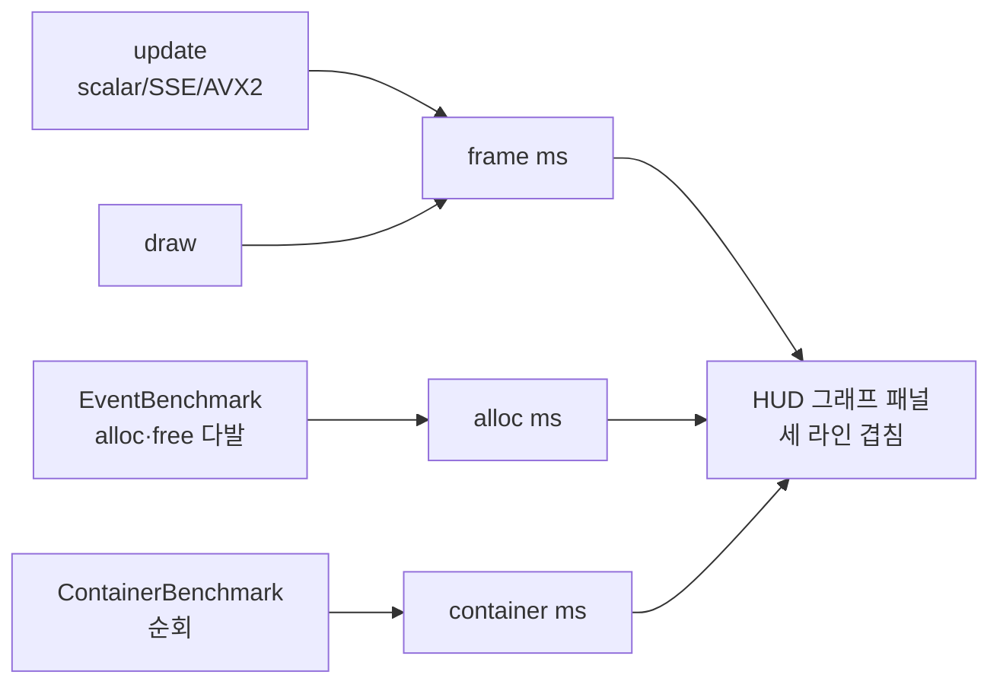
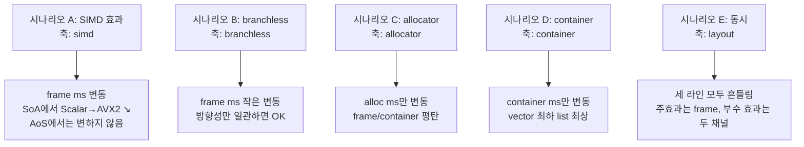
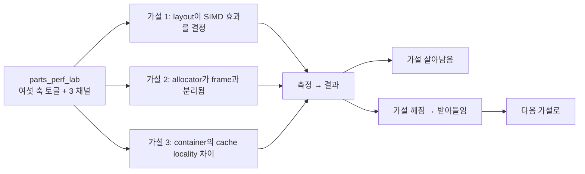

## 들어가며

지난 일곱 단계를 거치며 토글 기반 측정 도구의 골격을 세웠다. SoA·AoS·Archetype 세 메모리 레이아웃, 스칼라·SSE·AVX2 세 SIMD 폭, 분기 vs 분기 없는 predication, 네 가지 allocator, 세 가지 container까지 — 모두 런타임 토글로 갈아 끼울 수 있다. 그리고 매 프레임 세 가지 측정 채널이 돈다.

- **frame ms**: 시뮬 update + draw 합산. layout/SIMD/branchless 토글이 영향을 준다.
- **alloc ms**: `EventBenchmark`가 매 프레임 alloc/free하는 노드 다발의 누적 시간. allocator 토글이 영향을 준다.
- **container ms**: `ContainerBenchmark`가 매 프레임 N개 노드를 한 번 순회하는 비용. container 토글이 영향을 준다.

그러나 지금까지의 HUD 그래프는 frame ms 한 라인만 그렸다. allocator를 바꿔도, container를 바꿔도 그래프 자체는 거의 움직이지 않는다 — 효과가 보고 싶은 그래프 채널과 다른 곳에서 나기 때문이다. 측정값은 HUD에 숫자로 표시됐지만 *시간 흐름에 따른 모습* 은 보이지 않았다.

이번 단계에서 그래프를 세 라인으로 확장한다. 같은 패널 위에 frame / alloc / container 세 채널을 색을 달리해 겹쳐 그리고, 자동 스케일은 셋의 최댓값으로 잡는다. 그리고 이 글이 parts_perf_lab 시리즈의 마지막이라, 도구 전체를 어떻게 쓸 것인가 — *어떤 토글 조합으로 어떤 가설을 검증할 것인가* — 와, 마지막으로 이 도구가 *말해주지 않는 것* 들을 정리한다.

---

## 목차

1. [왜 채널을 분리하고 한 그래프에 겹쳐 그리는가](#1-왜-채널을-분리하고-한-그래프에-겹쳐-그리는가)
2. [`FrameTimer` 확장 — 두 채널 슬라이딩 윈도우 추가](#2-frametimer-확장--두-채널-슬라이딩-윈도우-추가)
3. [`Hud::DrawFrameGraph` 확장 — 세 라인을 그리는 폴리라인 폼](#3-huddrawframegraph-확장--세-라인을-그리는-폴리라인-폼)
4. [자동 스케일과 기준선의 의미](#4-자동-스케일과-기준선의-의미)
5. [도구 전체 사용 시나리오](#5-도구-전체-사용-시나리오)
6. [측정의 정직성 — 이 도구가 알려주지 않는 것](#6-측정의-정직성--이-도구가-알려주지-않는-것)
7. [결론](#결론)

---

## 1. 왜 채널을 분리하고 한 그래프에 겹쳐 그리는가

### 채널을 분리한 이유

처음부터 측정 채널을 *세 갈래로 쪼갠* 데에는 분명한 이유가 있다. 토글 효과를 *섞이지 않게* 보기 위함이다.

만약 한 시뮬 프레임 안에 layout 업데이트, allocator 워크로드, container 순회가 모두 섞여 있고 그 합산만 보고된다면, allocator를 Pool로 바꿨을 때 ms가 줄어든 게 *Pool의 효과* 인지 *layout 캐시 동작이 우연히 좋아진 것* 인지 구분할 길이 없다. 토글 하나씩 갈아 끼우며 그래프를 보더라도, 그 변동은 *시뮬 + 할당 + 순회* 가 함께 변한 결과라 인과를 추적하기 어렵다.

그래서 도구는 처음부터 워크로드를 분리했다.

- 시뮬 자체(`ISimulation::Update`)는 layout과 SIMD, branchless의 효과만 받는다. allocator를 바꿔도 시뮬 본체는 영향이 없다 — 시뮬은 layout이 잡아 둔 자기 메모리에서 돈다.
- `EventBenchmark::RunFrame(alloc)`은 매 프레임 N개 노드를 alloc/free하며 allocator 자체의 처리량만 본다. 시뮬 토글과 분리된다.
- `ContainerBenchmark::RunFrame()`은 시작 시 채워진 N개 노드를 그저 순회한다. 컨테이너 종류가 *순회 시* 캐시 동작에 어떻게 영향 주는가만 본다.

세 채널은 *서로의 효과를 가리지 않고* 측정된다. allocator를 Pool에서 malloc으로 바꾸면 *alloc ms* 만 변하고 frame ms와 container ms는 그대로다 (이 정도 워크로드에서는). 컨테이너를 vector에서 list로 바꾸면 *container ms* 만 변한다. 이 분리가 도구의 핵심이다.

### 한 그래프에 겹쳐 그리는 이유

채널을 분리한 만큼 그래프도 분리할 수도 있다. 패널 세 개를 위아래로 쌓고 각각 자기 채널만 그리는 식이다. 그렇게 해도 정보가 줄어들지는 않는다.

그럼에도 이번 단계는 *한 패널에 세 라인을 겹쳐* 그리는 쪽을 택한다. 이유는 단 하나, *시간축이 같다* 는 사실 자체가 신호이기 때문이다.

토글을 바꾼 순간이 그래프 위에서는 *수직선* 으로 나타난다. allocator를 Pool에서 malloc으로 바꾸는 순간 alloc ms 라인이 위로 점프하고, 같은 시점에 frame/container 라인은 평탄하다. *동시에* 변하는 것과 *동시에 변하지 않는* 것이 한 화면에 보이면, 인과가 한층 또렷해진다. 패널을 분리하면 같은 t에서 세 점을 눈으로 따라가야 하는데, 한 패널에 겹치면 시각적으로 묶인다.

대신 트레이드오프가 있다. 자동 스케일이 *셋의 최댓값* 기준이라, frame ms가 ~5ms, alloc/container ms가 ~0.5ms 같은 비대칭 시나리오에서는 작은 채널이 바닥에 깔려 평평해 보인다. 이 한계는 명시적이다 — 작은 채널이 사라져 보이면 *그 채널이 frame에 비해 1/10 이하로 작다* 는 정보 자체가 신호다.

그래도 작은 채널의 변동이 보고 싶다면 시뮬 entity 수를 줄이거나(frame ms를 깎는다) container N을 키우는(container ms를 키운다) 식으로 *상대 크기* 를 조절할 수 있다. 같은 그래프, 같은 토글, 다른 워크로드 크기로.

### 세 채널 한 패널에 겹친 그림



세 화살표는 *서로 다른 워크로드* 에서 출발해 같은 패널에 도착한다.

## 2. `FrameTimer` 확장 — 두 채널 슬라이딩 윈도우 추가

`FrameTimer`는 초기 구현부터 update/draw 두 채널의 슬라이딩 윈도우(600 프레임 ring buffer)를 들고 있었다. 그래프는 그 두 채널의 *합* 을 frame ms로 그렸다.

이번에 alloc/container 두 채널을 추가한다. 다만 alloc ms와 container ms는 *외부에서 측정* 된다. `EventBenchmark`가 자기 RunFrame 내부에서 시간을 재고 `LastFrameMs()`로 노출하고, `ContainerBenchmark`도 마찬가지다. `FrameTimer`가 이 시간을 직접 측정하면 측정 책임이 흩어진다.

선택은 단순하다. `CommitFrame()`에 두 인자를 받아 슬라이딩에 push만 하게 한다.

`measure/frame_timer.h`:

```cpp
class FrameTimer {
public:
    static constexpr std::size_t kCapacity = 600;

    void BeginUpdate();
    void EndUpdate();

    void BeginDraw();
    void EndDraw();

    // 한 쌍의 update/draw 측정값과 외부 채널 ms를 슬라이딩 윈도우에 push한다.
    // allocMs/containerMs는 EventBenchmark·ContainerBenchmark에서 측정된 값이라
    // FrameTimer가 직접 재지 않고 인자로 받는다.
    void CommitFrame(float allocMs = 0.0f, float containerMs = 0.0f);

    const std::array<float, kCapacity>& UpdateMs()    const { return updateMs_; }
    const std::array<float, kCapacity>& DrawMs()      const { return drawMs_; }
    const std::array<float, kCapacity>& AllocMs()     const { return allocMs_; }
    const std::array<float, kCapacity>& ContainerMs() const { return containerMs_; }

    std::size_t Head()   const { return head_; }
    std::size_t Filled() const { return filled_; }

    float LastUpdateMs()    const { return lastUpdateMs_; }
    float LastDrawMs()      const { return lastDrawMs_; }
    float LastTotalMs()     const { return lastUpdateMs_ + lastDrawMs_; }
    float LastAllocMs()     const { return lastAllocMs_; }
    float LastContainerMs() const { return lastContainerMs_; }

private:
    using Clock = std::chrono::steady_clock;
    using Time  = Clock::time_point;

    Time updateStart_{};
    Time drawStart_{};

    std::array<float, kCapacity> updateMs_{};
    std::array<float, kCapacity> drawMs_{};
    std::array<float, kCapacity> allocMs_{};
    std::array<float, kCapacity> containerMs_{};
    std::size_t head_   = 0;
    std::size_t filled_ = 0;

    float lastUpdateMs_    = 0.0f;
    float lastDrawMs_      = 0.0f;
    float lastAllocMs_     = 0.0f;
    float lastContainerMs_ = 0.0f;
};
```

기본 인자가 0.0f라 기존 호출(`timer.CommitFrame()`)도 그대로 컴파일된다 — 두 채널이 항상 0인 상태가 될 뿐이다. 새 워크로드가 늘어나도 이 시그니처를 깨지 않고 인자만 추가하는 식으로 확장할 수 있다.

`measure/frame_timer.cpp`:

```cpp
void FrameTimer::CommitFrame(float allocMs, float containerMs) {
    lastAllocMs_     = allocMs;
    lastContainerMs_ = containerMs;

    updateMs_[head_]    = lastUpdateMs_;
    drawMs_[head_]      = lastDrawMs_;
    allocMs_[head_]     = lastAllocMs_;
    containerMs_[head_] = lastContainerMs_;
    head_ = (head_ + 1) % kCapacity;
    if (filled_ < kCapacity) {
        ++filled_;
    }
}
```

호출 측 한 줄 변경. `main.cpp`:

```cpp
timer.CommitFrame(bench.LastFrameMs(), cbench.LastFrameMs());
```

`bench`(EventBenchmark)와 `cbench`(ContainerBenchmark)에서 마지막 프레임의 측정값을 그대로 끌어다 push한다. 두 워크로드는 매 프레임 `RunFrame`이 호출되며 `lastFrameMs_`를 갱신하므로, `CommitFrame` 시점에는 최신 값이 들어 있다.

> 측정 시점 순서가 중요하다. main 루프는
> `BeginUpdate → sim->Update → EndUpdate → bench.RunFrame → cbench.RunFrame → BeginDraw → sim->Draw → EndDraw → CommitFrame → hud.Draw`
> 순으로 돈다. `bench.RunFrame`과 `cbench.RunFrame`은 update/draw 타이머 밖에서 측정된다. `CommitFrame`은 시뮬 draw가 끝난 뒤, HUD를 그리기 전에 호출된다. 그래서 `lastUpdateMs_`, `lastDrawMs_`, `bench.LastFrameMs()`, `cbench.LastFrameMs()`가 모두 *같은 프레임의 값* 으로 묶이고, 그래프에는 현재 샘플이 바로 반영된다. HUD 자체를 그리는 비용은 draw ms에서 제외된다.

### 자동 검증: `parts_graph_tests`

세 라인을 한 시간축에 겹쳐 그리는 그림이 의미를 가지려면, 같은 인덱스의 네 값이 *같은 프레임* 의 것이어야 한다. 채널이 하나라도 어긋나게 밀리면 "동시에 변한다"는 관측 자체가 거짓이 된다. 그 정렬은 창 없이 확인되는 순수 계산이라 `graph` 그룹이 붙들고 있다.

<!-- snippet: tests/core_tests.cpp#TestFrameTimerChannels -->
```cpp
// tests/core_tests.cpp — graph 그룹

void TestFrameTimerChannels() {
    ppl::FrameTimer timer;
    timer.CommitFrame(0.25f, 1.5f);
    CHECK(timer.LastAllocMs() == 0.25f);
    CHECK(timer.LastContainerMs() == 1.5f);
    CHECK(timer.AllocMs()[0] == 0.25f);
    CHECK(timer.ContainerMs()[0] == 1.5f);

    // 인자를 생략한 호출은 두 채널을 0으로 되돌린다. 워크로드가 없는 프레임이
    // 직전 값을 물려받아 그래프에 유령 라인을 남기면 안 된다.
    timer.CommitFrame();
    CHECK(timer.LastAllocMs() == 0.0f);
    CHECK(timer.LastContainerMs() == 0.0f);
    // ...
    // 링을 한 바퀴 넘겨도 네 채널이 같은 head로 함께 밀린다.
    constexpr std::size_t kCap = ppl::FrameTimer::kCapacity;
    ppl::FrameTimer rolled;
    for (std::size_t i = 0; i < kCap + 7; ++i) {
        rolled.CommitFrame(static_cast<float>(i), static_cast<float>(i) * 2.0f);
    }
    CHECK(rolled.Filled() == kCap);
    CHECK(rolled.Head() == 7);

    int misaligned = 0;
    for (std::size_t i = 0; i < kCap; ++i) {
        if (rolled.ContainerMs()[i] != rolled.AllocMs()[i] * 2.0f) ++misaligned;
    }
    CHECK(misaligned == 0);

    // head는 *다음에 쓸* 자리다. 가장 최근 샘플은 head-1, 가장 오래된 샘플은 head.
    CHECK(rolled.AllocMs()[6] == static_cast<float>(kCap + 6));
    CHECK(rolled.AllocMs()[7] == 7.0f);
}
```

alloc 채널에 `i`, container 채널에 `i * 2` 를 넣고 링을 한 바퀴 넘겨 돌린 뒤, 600칸 전부에서 두 배 관계가 유지되는지 센다. 어긋난 칸이 하나라도 있으면 두 채널이 서로 다른 프레임을 가리키고 있다는 뜻이다. 마지막 두 단언은 `head` 가 *다음에 쓸* 자리라는 규칙을 고정한다 — 그래프가 왼쪽 끝을 `head` 에서 시작해 오른쪽으로 그리는 순서가 여기서 나온다.

```bash
cmake -S . -B build
cmake --build build --config Release
ctest --test-dir build -C Release -R parts_graph_tests --output-on-failure

./build/parts_core_tests graph              # Linux/macOS
.\build\Release\parts_core_tests.exe graph  # Windows
```

```text
parts_core_tests: group `graph`
  graph/FrameTimerChannels ... 14 check(s) ok
graph: 1 test(s), 14 check(s), 0 failure(s)
```

폴리라인을 그리는 부분 자체는 raylib 호출이라 창 없이 재현되지 않는다. 여기서 고정하는 것은 그 아래 깔린 데이터 정렬이고, 화면에서 세 라인이 실제로 어떻게 보이는지는 아래 사용 시나리오를 직접 따라가 확인한다.

## 3. `Hud::DrawFrameGraph` 확장 — 세 라인을 그리는 폴리라인 폼

기존 `DrawFrameGraph`는 frame total(update + draw) 한 라인만 그리는 구조였다. 폴리라인 그리기 로직을 *함수 객체* 로 빼서 같은 코드를 채널마다 반복한다.

`ui/hud.cpp`의 그래프 부분:

```cpp
const auto& alloc     = timer.AllocMs();
const auto& container = timer.ContainerMs();

// 자동 스케일: 세 채널(frame total / alloc / container)의 max.
float maxMs = 0.0f;
for (std::size_t i = 0; i < filled; ++i) {
    const float total = update[i] + draw[i];
    if (total > maxMs)        maxMs = total;
    if (alloc[i] > maxMs)     maxMs = alloc[i];
    if (container[i] > maxMs) maxMs = container[i];
}
// 최소 16.67ms 스케일 (60fps 기준선이 보이도록)
if (maxMs < 16.67f) maxMs = 16.67f;

// 60fps / 30fps 기준선. 패널 안에 들어올 때만 그린다.
auto drawHline = [&](float ms, Color c) {
    if (ms > maxMs) return;
    const float ratio = ms / maxMs;
    const int yLine = y + h - (int)(ratio * (h - 4));
    DrawLine(x, yLine, x + w, yLine, c);
};
drawHline(16.67f, Color{80, 200, 80, 100});   // 60fps
drawHline(33.33f, Color{200, 200, 80, 100});  // 30fps
```

스케일이 정해지면 각 채널을 같은 좌표계에 폴리라인으로 그린다.

```cpp
const std::size_t cap  = FrameTimer::kCapacity;
const std::size_t head = timer.Head();

// 한 채널을 폴리라인으로 그리는 람다. update/draw 합산 모드와
// 단일 시리즈 모드를 한 함수로 처리한다.
auto drawSeries = [&](const std::array<float, FrameTimer::kCapacity>& series,
                      bool addBoth, Color c) {
    int prevX = -1;
    int prevY = 0;
    const float denom = (filled > 1) ? (float)(filled - 1) : 1.0f;
    for (std::size_t i = 0; i < filled; ++i) {
        const std::size_t idx = (head + cap - filled + i) % cap;
        const float v = addBoth ? (update[idx] + draw[idx]) : series[idx];
        const float ratio = v / maxMs;

        const int px = x + (int)((float)i * w / denom);
        const int py = y + h - (int)(ratio * (h - 4));

        if (prevX >= 0) {
            DrawLine(prevX, prevY, px, py, c);
        }
        prevX = px;
        prevY = py;
    }
};

drawSeries(update,    /*addBoth=*/true,  Color{200, 220, 255, 220}); // frame total
drawSeries(alloc,     /*addBoth=*/false, Color{ 80, 220, 220, 200}); // alloc
drawSeries(container, /*addBoth=*/false, Color{255, 200,  80, 200}); // container
```

마지막으로 현재 스케일과 세 채널 범례를 같은 패널에 올린다.

```cpp
// 좌측 상단: max 스케일.
char label[64];
std::snprintf(label, sizeof(label), "max %.2f ms", maxMs);
DrawText(label, x + 6, y + 4, 12, GRAY);

// 우측 상단: 라인 범례.
const int legendX = x + w - 160;
const int legendY = y + 4;
DrawRectangle(legendX,        legendY, 8, 8, Color{200, 220, 255, 220});
DrawText("frame",     legendX + 12,  legendY,    10, LIGHTGRAY);
DrawRectangle(legendX + 50,   legendY, 8, 8, Color{ 80, 220, 220, 200});
DrawText("alloc",     legendX + 62,  legendY,    10, LIGHTGRAY);
DrawRectangle(legendX + 100,  legendY, 8, 8, Color{255, 200,  80, 200});
DrawText("container", legendX + 112, legendY,    10, LIGHTGRAY);
```

세 줄의 `drawSeries` 호출이 본체다. 같은 인덱싱·같은 정규화·같은 그리기를 색만 바꿔 세 번 반복한다. `addBoth`는 frame total 채널이 *update + draw 합산* 임을 표현하기 위한 플래그다 — 두 배열 모두 슬라이딩에 들어 있어서 어느 한쪽이 아닌 합을 그려야 frame ms가 된다.

색은 의도적으로 *채도가 다른* 셋을 골랐다.

- frame: 차분한 라일락 빛 흰색. baseline 채널.
- alloc: 시안. allocator는 보통 frame보다 *작은 ms* 라 채도 높은 색이 가독성에 유리.
- container: 앰버. alloc과 색상환에서 떨어져 있어 두 작은 채널이 겹쳐도 구분된다.

알파를 200~220 사이로 잡아 세 라인이 겹치는 구간에서도 각각이 보인다.

범례는 패널 우측 상단 한 줄이다. 컬러 사각형 + 짧은 라벨 셋. 그래프 아래 별도 패널을 두지 않고 *그래프 안* 에 넣어 화면 면적을 아낀다 — HUD가 720p 화면의 140px만 차지한다는 제약을 유지한다.

## 4. 자동 스케일과 기준선의 의미

자동 스케일은 *세 채널의 최댓값* 으로 잡는다. 거기에 두 가지 가드가 있다.

- 최소 스케일 16.67ms. 모든 채널이 작을 때도 60fps 라인이 패널 안에 들어오게 한다.
- 기준선 16.67ms / 33.33ms는 maxMs를 넘으면 그리지 않는다. 패널 위로 튀어나가는 라인을 막는다.

기준선 두 개는 *프레임 예산* 의 가시화다.

- **녹색 16.67ms (60fps)**: 데스크탑 60fps 타깃. PC 게임의 흔한 기준.
- **노란색 33.33ms (30fps)**: 30fps 마지노선. 콘솔 30fps 타이틀이나 전력 절감 모드의 흔한 기준.

frame 라인이 녹색을 넘어서면 *60fps 예산 초과* 다. 노란색을 넘어서면 *30fps 예산도 깨진* 상황이다. 색을 약하게(알파 100) 깔아 라인 자체에 묻히지 않게 했다.

다만 alloc/container 라인이 16.67ms를 넘는 일은 보통 없다. 두 워크로드는 *frame의 일부* 가 아니라 *별개의 측정* 이라, 각자가 ms 단위로 튀는 것은 그 자체가 신호다 — 0.5ms가 1.5ms로 튀어도 *3배 증가* 라는 의미가 있다. 그래프의 절대 위치보다 *변동의 모양* 을 보는 채널들이다.

## 5. 도구 전체 사용 시나리오

여기서부터는 parts_perf_lab을 *어떻게 쓸 것인가* 의 시나리오다. 여섯 축(entity 3 / layout 3 / SIMD 3 / branchless 2 / allocator 4 / container 3)을 모두 곱하면 가짓수가 너무 많다. 의미 있는 비교는 *축 하나만 바꾸는* 시나리오들이다.

### 시나리오 A — SoA의 SIMD 효과를 본다

목적: SIMD가 layout에 대해 어떻게 다르게 작용하는지.

```text
entity   = 100k
layout   = SoA
allocator = (any, alloc 채널은 안 본다)
container = (any, container 채널은 안 본다)
branchless = on
simd     = Scalar  →  SSE  →  AVX2
```

순서대로 토글을 바꾸며 frame ms를 본다. SoA는 SIMD가 잘 먹히는 layout이라 Scalar 대비 SSE/AVX2가 *눈에 띄게* 줄어든다. 다만 ms 차이를 *어디에서* 보고 있는지 정확히 인지해야 한다 — 이 도구는 sim->Update 안에서만 SIMD를 쓴다. draw도 SIMD를 쓸 수 있지만 raylib 라이브러리에 맡겼다.

대조군: `layout = AoS`로 바꿔 같은 시나리오를 다시 돈다. AoS는 SIMD가 stride 문제 때문에 도구상 *Scalar 폴백* 으로 두었다. SSE/AVX2 토글이 무시되고 ms가 줄지 않는다 — 이게 의도된 결과다. 사용자는 *왜 같은 입력에 같은 토글인데 ms가 다른가* 를 layout 차이로 귀결시킨다.

### 시나리오 B — branchless의 효과는 작다

목적: predication이 분기보다 빠른지 *직접 본다*.

```text
entity   = 100k
layout   = SoA
simd     = Scalar     ← SIMD 경로는 이미 마스크 기반이라 branchless 토글 무관
branchless = off  →  on
```

이 도구의 경계 반사 분기는 매 프레임 *대부분 false* 다. 한 프레임에 경계를 넘는 점은 전체의 1% 미만이라 branch predictor의 적중률이 99%를 넘고, 분기 예측 미스로 인한 ms 차이는 거의 나타나지 않는다. 그래서 branchless 토글이 만드는 차이는 분기 예측이 아니라 *양쪽 분기를 모두 계산하는 추가 비용* 에서 온다. 경계에 닿지 않는 99% 이상의 점에도 반사와 clamp를 무조건 걸기 때문에 branchless on이 오히려 *조금 느리게* 보일 가능성이 높다. *극적인 차이* 가 아니라 *방향성이 일관* 한지를 본다.

만약 차이가 거의 없다면 그 자체가 결과다 — branchless가 항상 이기는 게 아니라는 사실, predictor가 충분히 영리한 경우는 분기 코드가 더 짧아 명령 캐시에 유리할 수도 있다는 사실이 보인다. 도구가 *환상을 깨는* 사례.

### 시나리오 C — allocator 토글로 *frame ms와 alloc ms의 분리* 를 확인한다

목적: alloc 워크로드가 시뮬과 *진짜로* 분리되어 있는지.

```text
entity   = 10k       ← frame ms를 낮게 유지
layout   = SoA
simd     = AVX2
allocator = Malloc → Arena → Pool → Slab
```

토글을 바꿀 때마다 *alloc 라인만* 변하고 *frame 라인은 그대로* 여야 한다. 만약 frame 라인까지 변한다면, 도구의 *측정 분리* 가 깨졌다는 신호다. Arena로 바꾸면 alloc ms가 가장 낮고 (Reset이 bump pointer를 0으로 되돌리는 한 줄), Pool도 낮고 (O(1) push/pop에 Reset의 free list 재구성만 더해진다), Malloc은 상대적으로 높고, Slab은 프레임마다 여덟 개 클래스 풀 전부를 Reset하느라 Pool의 열 배 안팎까지 올라간다.

이 시나리오는 *수치를 보지 않아도* 시각화만으로 검증된다 — alloc 라인이 토글 변경 시점에 *수직 점프* 하고 frame 라인은 평탄하다면, 분리는 정상이다.

### 시나리오 D — container 토글로 *순회 시 캐시 차이* 를 본다

목적: 컨테이너 종류가 단순 순회 비용에 미치는 영향.

```text
entity   = 10k       ← frame ms를 낮게 유지
layout   = SoA
container = Vector  →  StdList  →  IntrusiveList
```

container 라인만 본다.

- Vector: 가장 낮다. 연속 메모리, prefetcher 친화.
- StdList: 가장 높을 가능성. 노드가 힙 곳곳에 흩어져 캐시 미스 발생. 다만 *시작 시 한 번에* push_back으로 넣은 직후라면 메모리가 비교적 연속할 수도 있다 — 이 점은 사용자가 도구를 오래 돌리며 실제로 확인해야 한다.
- IntrusiveList: vector와 list 사이. 외부 Pool을 결합하면 노드가 *연속에 가깝게* 배치되어 list보다 빠르지만, 포인터 추적은 여전히 prefetch가 어려워 vector를 따라잡기 힘들다.

이 시나리오는 *교과서 예측대로 안 나올 수도 있다*. 이게 도구의 가치 — *정확한 코드 + 정확한 워크로드* 에서 *실제로 어떤 차이* 가 나는지를 본인 머신에서 확인한다.

### 시나리오 E — *세 토글 동시* 의 모양

목적: 여러 축이 합쳐진 결과는 단순 합이 아니라는 사실.

```text
entity   = 100k
layout   = SoA  →  AoS  →  Archetype
simd     = AVX2
allocator = Pool
container = IntrusiveList
```

layout 토글만 바꾸며 세 라인 *모두* 를 관찰한다. 직관적으로는 *frame 라인만* 변할 것 같지만, 현실은 *세 라인 모두* 가 미세하게 흔들린다. 이유:

- layout 변경은 시뮬 데이터 재초기화를 트리거한다. 메모리 할당기 상태가 흔들리면 alloc ms도 살짝 영향을 받을 수 있다.
- 큰 메모리 영역이 새로 만들어지면 OS 페이지 캐시·CPU 캐시 상태가 변한다. *전혀 관계없어 보이는* container 라인도 첫 몇 프레임은 다르게 보일 수 있다.

이 *섞임* 을 보는 것 자체가 결과다. *완벽한 분리* 는 도구가 약속하지 않는다 — 약속하는 건 *주된 효과* 가 채널별로 분리된다는 것이다. 마이크로 측정의 흔들림은 측정 도구가 *현실의 캐시·메모리 시스템* 위에서 돈다는 사실의 그림자다.

### 시나리오 그림



## 6. 측정의 정직성 — 이 도구가 알려주지 않는 것

도구를 다 만들고 나면 도구가 *말해주는 것* 만 보고 결론을 낸다. 그러나 측정은 늘 *어떤 차원* 만 본다. 이 절은 parts_perf_lab이 *말해주지 않는* 것들의 목록이다. 각 항목은 *왜* 도구의 한계인지, *어떻게* 보완할 수 있는지를 같이 쓴다.

### 캐시 미스와 분기 미스의 절대 수치

도구가 보여주는 것은 *시간(ms)* 뿐이다. SoA가 AoS보다 빠르다는 사실은 보이지만, *몇 번의 캐시 미스* 가 *몇 번의 분기 오예측* 으로 *몇 ns의 손해* 가 된 결과인지는 보이지 않는다. ms 차이의 *내역* 이 빠져 있다.

이 차원을 채우려면 하드웨어 성능 카운터를 읽어야 한다.

- Linux: `perf stat ./parts_perf_lab` 또는 프로그램 내부에서 `perf_event_open` 시스템 콜.
- Windows: ETW(Event Tracing for Windows)나 Intel VTune, AMD μProf.
- 둘 다: Intel PCM, Linux의 `perf record`로 함수별 hot path를 본다.

도구 안에 카운터를 통합하려면 *플랫폼 종속 코드* 가 늘어난다. parts_perf_lab은 일부러 *raylib + 표준 C++* 만으로 구성해 어디서든 빌드되게 했고, 그래서 이 차원은 *외부 도구로 보완하라* 는 형태로 남겼다.

### 메모리 단편화의 시간 진행

allocator 토글 중 Pool과 Slab은 *단편화가 발생하지 않게 설계* 되어 있다. Malloc은 OS와 CRT의 일반 allocator라 단편화가 일어날 수 있다. 그러나 도구는 *현재 단편화 정도* 를 시각화하지 않는다.

`IAllocator`는 라이브 바이트와 누적 할당 횟수 정도만 노출한다. *블록 분포가 어떻게 흩어져 있는가* 는 보이지 않는다. 단편화가 의심되는 시나리오는 *오래 돌린 후 alloc ms가 점진적으로 올라가는가* 로 *간접* 추정해야 한다.

이 차원을 채우려면 allocator 내부에 *블록 맵* 을 그리는 시각화를 붙여야 한다 — 별도 패널을 띄우고 각 블록을 색이 다른 사각형으로 그리는 식. 분량이 큰 별도 확장 토픽이다.

### GPU 시간

`sim->Draw`가 그래프의 draw ms 채널에 잡히긴 하지만, 그 안에서 *CPU가 명령을 발행하는 시간* 과 *GPU가 실제로 그리는 시간* 은 분리되지 않는다. 이 구조에서는 HUD와 `EndDrawing`의 present/swap 비용도 draw ms에서 제외된다. raylib가 내부에서 사용하는 OpenGL/DirectX 호출은 *대부분 비동기* 라, 이 도구가 재는 draw ms는 *명령 큐에 던지기* 에 가까운 시간일 수 있다.

GPU 측 시간은 그래픽 API의 timestamp query로만 잴 수 있다 — `glQueryCounter` / D3D11 `ID3D11Query` / Vulkan `vkCmdWriteTimestamp`. 이 도구는 raylib 추상화 뒤에 있어서 그 layer를 뚫지 않는다.

대신 RenderDoc, Nsight Graphics, PIX 같은 GPU 프로파일러로 외부에서 캡처한다.

### ms의 분포

세 라인은 *최근 600 프레임의 슬라이딩 윈도우* 를 그린다. 평균이나 중앙값이 아니라 *원시 시계열* 이다. 이게 강점이지만 한계이기도 하다.

평균이 8ms인 두 시나리오가 있을 때, 한쪽은 *항상 8ms 근처* 고 다른 한쪽은 *대부분 4ms인데 가끔 30ms 스파이크* 일 수 있다. 후자가 사용자 체감에는 훨씬 나쁘지만, 평균만 보면 차이가 없다. 도구의 그래프에서는 *스파이크* 는 보이지만 *분포의 모양* 은 정량화되지 않는다.

분포를 보려면 *히스토그램* 을 그려야 한다. 패널을 하나 더 두고 ms 축을 bin으로 나누어 카운트를 막대로 그리는 식. 이 도구의 다음 확장으로 자연스러운 후보다.

### 단일 머신 단일 빌드

이 도구가 보여주는 ms는 *이 머신의 이 빌드 설정* 에서 잰 값이다. 다른 CPU·다른 컴파일러·다른 최적화 레벨에서 *같은 모양* 이 나오리라는 보장은 없다.

AVX2가 SSE보다 빨라야 한다고 *예상* 했지만, 일부 노트북 CPU는 AVX2 명령을 쓰는 동안 클럭이 다운되어(downclocking) 오히려 SSE보다 느릴 수 있다. AMD Zen 1은 AVX 256을 *내부에서 두 개의 128로 쪼개* 실행해 같은 처리량이지만 명령 디코드 부담이 다르다.

대응: *벤치는 타깃에서 잰다*. 도구가 어디서나 빌드되는 게 가치인 이유다 — 사용자 자신의 머신에서 자신의 워크로드로 직접 본다.

### 의존성 지옥

이 도구는 raylib 5.0 + raygui 4.0을 FetchContent로 끌어다 쓴다. 빌드는 단순하지만, *raylib 내부 변화* 가 측정에 영향을 준다 — 어느 버전이 OpenGL 명령을 다르게 일괄 처리하면 draw ms가 변할 수 있다. CMake 옵션이 SIMD 매크로를 다르게 켜면 빌드별로 frame ms가 달라진다.

대응 가능한 부분: CMakeLists에 빌드 정보(`PERF_LAB_TARGET_X86`, `PERF_LAB_ENABLE_AVX2`)를 명시했고, raylib 버전을 고정했다. 그래도 *완전한 재현* 을 보장하는 건 도구의 책임 너머다.

### 측정의 *측정 비용*

`std::chrono::steady_clock::now()`는 가볍지만 공짜는 아니다. 매 프레임 `BeginUpdate / EndUpdate / BeginDraw / EndDraw`로 4번, `EventBenchmark::RunFrame` 안에서 2번, `ContainerBenchmark::RunFrame` 안에서 2번 — 한 프레임에 8번 호출된다. 시스템에 따라 한 호출이 수십 ns 단위라 *측정이 측정 대상에 영향* 을 준다.

큰 워크로드에서는 무시할 수준이지만, 마이크로 측정(0.1ms 차이를 비교하는 시나리오)에서는 신호 대비 노이즈가 커질 수 있다. 진짜 마이크로 벤치는 *RDTSC* 같은 고해상도 카운터로 직접 사이클을 재거나, Google Benchmark처럼 자동 반복·통계 처리하는 도구를 쓴다.

이 도구는 *프레임 단위 측정* 을 ms로 보는 것이 목적이라 이 정도 오차는 허용한다.

### 정적 분석은 빠져 있다

도구는 *동적 측정* 만 한다. 코드 자체가 *얼마나 SIMD 친화적인지* 를 *컴파일러 출력* 으로 검증하지 않는다. SSE 코드가 정말로 `movups`/`mulps`/`addps`로 컴파일되었는지는 *이 도구로는 알 수 없다*.

- Compiler Explorer (godbolt.org)에서 같은 함수를 붙여 disassembly를 본다.
- `-march=native -O2`와 `-march=native -O3`의 출력 차이를 본다.
- MSVC의 경우 `/Fa` 옵션으로 어셈블리 출력을 받는다.

벤치로 *결과* 를 보고 disassembly로 *왜* 를 보면 그림이 완성된다.

### *정직성* 그 자체

마지막으로 — 측정 도구는 설계자가 보고 싶은 것만 보게 만들 수 있다. layout이 빠르다는 가설을 검증하려고 만든 도구가 *layout이 빠르게 보이는 시나리오* 만 갖고 있을 수 있다. 도구는 가설을 *증명하지 않는다*. 가설이 *깨질 수 있는 환경* 만 마련한다.

도구의 가치는 *깨지면 받아들인다* 는 자세에 달려 있다. AVX2가 더 느리게 나오면 그게 *지금 이 환경* 의 진실이다. branchless가 효과가 없으면 그게 *이 워크로드* 의 진실이다. 도구가 거짓을 말한다고 의심하기 전에, 설계가 *원하던* 답을 유도한 것은 아닌지 먼저 의심한다.

---

## 결론

parts_perf_lab은 여기서 마무리한다. 여덟 단계에 걸쳐 토글 기반 측정 도구의 골격을 세웠고, 마지막 단계에서 측정 채널을 *시각화* 까지 끌어왔다.

도구가 가진 것:

- 여섯 축 토글로 entity 수 / 메모리 layout / SIMD 폭 / 분기 / allocator / container를 *런타임에* 갈아 끼운다.
- 세 측정 채널(frame · alloc · container)을 *분리해* 재고 *한 그래프에 겹쳐* 그린다.
- ring buffer 슬라이딩 윈도우로 600 프레임의 시계열을 본다.
- 60fps / 30fps 기준선과 자동 스케일로 절대 비교와 상대 비교를 동시에 한다.

도구가 *없는* 것:

- 하드웨어 카운터(캐시 미스·분기 미스·IPC).
- 메모리 단편화의 시간 진행 시각화.
- GPU 시간의 분리.
- ms 분포의 통계 정량화.
- 정적 분석(disassembly·기계어 검증).

없는 것은 *외부 도구* 로 보완한다 — perf, VTune, RenderDoc, Compiler Explorer, Google Benchmark. 도구는 만능을 약속하지 않는다. *자기 차원* 만 정직하게 보여주고, 다른 차원이 필요할 때를 *명시적으로 알려주는* 게 도구의 책임이다.

그리고 더 중요한 것 — 이 도구는 설계된 가정 안에서만 측정한다. 결과가 가설을 *반박* 할 때 받아들이는가가 도구의 가치다. AVX2가 안 빨라도, branchless가 효과 없어도, vector가 list를 못 이겨도 그게 *이 환경의 진실* 이다. 측정의 정직성은 도구가 아니라 *도구를 쓰는 방식* 에 달려 있다.



도구를 다 만들었다. 이제 *쓰는* 단계다. 한 도구가 모든 차원을 측정해주지는 않는다. 그러나 *축 하나씩 분리해서 보는* 이 한 가지를 도구는 잘 한다. 그것으로 충분하다.

## 더 읽을거리

- Agner Fog, *Optimizing software in C++*: 분기 예측·캐시·SIMD의 실측 데이터.
- Agner Fog, *Instruction tables*: AVX/SSE 명령의 latency/throughput 표.
- Brendan Gregg, *Systems Performance*: 측정 방법론 일반서. 측정 도구의 *철학* 부분이 특히 도움됨.
- Linux `perf` 매뉴얼: `perf stat`, `perf record`, `perf top`. 캐시 미스와 분기 미스의 절대 수치를 채우는 첫 도구.
- Intel 64 and IA-32 Architectures Optimization Reference Manual: 캐시·prefetch·SIMD의 공식 문서.
- Compiler Explorer (godbolt.org): 정적 분석을 채우는 도구. SSE/AVX 코드의 실제 어셈블리 확인.
- Google Benchmark: 마이크로 벤치의 표준. 측정 비용 문제를 *통계적 반복* 으로 해결하는 도구.
- raylib 공식 wiki: 도구의 렌더링 추상화에 대한 한계 이해.
