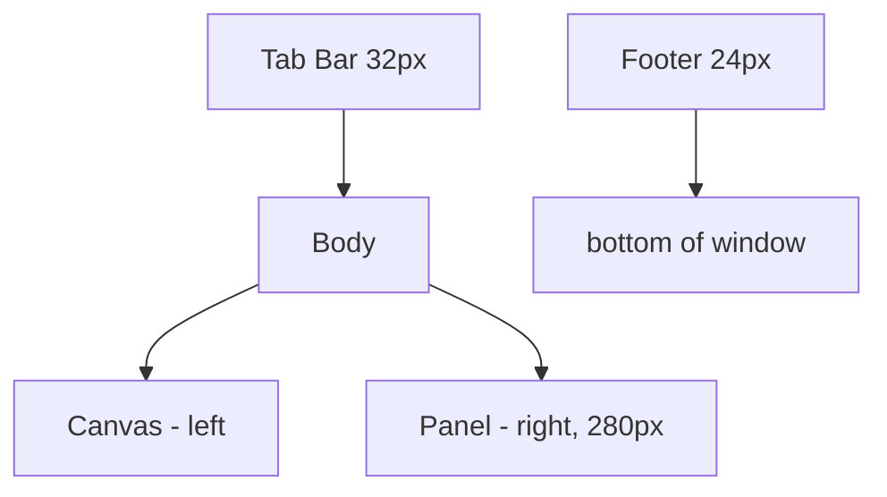

## 들어가며

이 글은 *physics 시리즈의 알고리즘들을 직접 측정·시각화* 하는 도구 — `physics_lab` — 을 처음부터 만드는 작업의 첫 단계다. 시리즈가 *주장* (Semi-implicit Euler 가 Explicit 보다 같은 dt 에서 더 안정, 균등 분포 + 잦은 삽입 / 삭제 워크로드에서 Spatial Hash 가 SAP 대비 후보 쌍 처리 비용이 낮음, Sequential Impulse 가 Penalty 보다 stacking 에 견고) 이라면 이 lab 은 *그 주장을 매개변수 토글로 재현해 그래프로 보여주는 도구*. 통합기를 Explicit Euler 에서 RK4 까지, 응답을 Penalty 에서 PBD 까지, Broad Phase 를 brute 에서 Spatial Hash 까지 *교체하면서 에너지 그래프가 발산 / 수렴하는 모습 + ms/frame 비용 곡선* 이 바로 옆에 그려진다.

성격은 `math_lab` 과 다르다. math_lab 이 *알고리즘 한 개를 마우스로 조작해 시각으로 보는 도구* 라면, *physics_lab 은 같은 시뮬을 여러 구현으로 동시에 돌려놓고 수치로 비교* 한다 — *측정 도구* 에 가깝다. 그래서 시리즈 part01·02 (운동학·적분기), part05 (Broad Phase), part06·07 (SAT / GJK+EPA), part08 (법선 응답), part10·11·12 (제약·SI·PBD) 의 *주장이 그래프 한 장에서 검증* 된다. 마찰 (part09), 회전 강체 동역학 (part03·04), 조인트 (part13), part14~20 은 이 lab 의 범위 밖이다.

이 단계의 결과물은 다음 다섯 가지를 갖춘 *최소 골격*.

1. raylib 윈도우 + 메인 루프.
2. *Scene 인터페이스* — 각 토픽 (적분기, broad phase, 응답 등) 이 한 Scene 으로 구현. 탭으로 전환.
3. *DragHandle* — 마우스로 끌 수 있는 점. 강체 시작 위치 / 외력 인가점 / 제약 anchor 등 거의 모든 Scene 의 입력 위젯.
4. *프레임 타이머* — ms / fps EMA.
5. *raygui 사이드 패널* — 토글 / 슬라이더 / 라벨.

이 단계에서는 *여러 Scene 이 들어갈 골격* 만 깔고, 그 위에 *Welcome Scene* (단일 강체 + 중력 + 바닥 충돌 + 드래그 reset) 한 개를 동작 가능한 형태로 만든다. 적분기 비교, 외력·드래그·스프링, Broad / Narrow Phase, 충돌 응답, 제약, 종합 측정은 이 단계에 없다.

---

## 목차
1. [도구의 성격: 측정 + 시각화](#1-도구의-성격-측정--시각화)
2. [기술 스택: raylib + raygui](#2-기술-스택-raylib--raygui)
3. [프로젝트 구조와 CMakeLists.txt](#3-프로젝트-구조와-cmakeliststxt)
4. [Scene 인터페이스](#4-scene-인터페이스)
5. [DragHandle 위젯](#5-draghandle-위젯)
6. [화면 chrome (탭 / 패널 / 푸터)](#6-화면-chrome-탭--패널--푸터)
7. [Welcome Scene 과 main 루프](#7-welcome-scene-과-main-루프)
8. [빌드와 실행 결과](#8-빌드와-실행-결과)

---

## 1. 도구의 성격: 측정 + 시각화

`math_lab` 이 *알고리즘 한 개의 입력을 마우스로 조작해 출력을 시각으로 보는* 도구라면, `physics_lab` 은 *같은 워크로드를 여러 구현으로 동시에 돌려놓고 수치 / 그래프로 비교* 한다.

| 차원 | math_lab | physics_lab |
|---|---|---|
| 주 목적 | 시각화 (단계별 그림) | 측정 + 시각화 (그래프 + 시뮬 뷰) |
| 입력 | 마우스 드래그 (점 위치) | 토글 / 슬라이더 (구현 선택) + 드래그 (시작 조건) |
| 출력 | 큰 캔버스 + 작은 수치 | 캔버스 + 에너지 / ms 그래프 |
| 시간 모델 | 매 프레임 재계산 | 매 프레임 *고정 dt 적분* + 측정 |
| Step 진행 | Scene 추가 | Scene 추가 + 토글 옵션 추가 |

이 lab 은 *Scene* 단위로 진행한다. 각 Scene 이 한 토픽을 다룬다 — Integrators, Forces, BroadPhase, NarrowPhase, Response, Constraints, Measure. 한 Scene 안에서 *여러 구현 토글* (Euler vs Verlet 같은) 도 가능. Step 단위로 *Scene 한 개를 추가 + 토글 옵션 확장*.

이 단계에서는 Scene들이 들어갈 골격만 만든다. 따라서 현재 실행 상태가 보장하는 것은 Scene 생명주기와 공통 렌더·입력 경계이며, 개별 물리 알고리즘의 정확성이나 성능은 아직 검증하지 않는다.

## 2. 기술 스택: raylib + raygui

`math_lab` / `parts_perf_lab` / `system_kernel_lab` 과 동일한 스택. 일관성 + 학습 곡선 절감.

| 항목 | 선택 |
|---|---|
| 언어 | C++20 |
| 그래픽 | raylib 5.0 (즉시 모드 2D / 3D, `DrawCircle`, `DrawText`) |
| UI | raygui 4.0 (단일 헤더, 라벨 / 버튼 / 슬라이더 / 토글) |
| 빌드 | CMake 3.20+ + FetchContent (시스템 설치 불필요) |

이 lab 의 시각화는 *2D 가 대부분*. 강체 / 충돌 / 입자 / cloth 모두 2D 로 시연해도 *알고리즘 차이가 그대로 드러남*. 3D 가 필요한 곳 (관성 텐서 직관) 만 raylib 의 3D 카메라.

*외부 물리 엔진 사용 금지*. Box2D 같은 기성 엔진을 백엔드로 두면 *비교 대상 사이의 코드 차이가 사라짐* — 토글이 *진짜로 다른 구현* 임이 보장돼야 측정이 의미 있다.

## 3. 프로젝트 구조와 CMakeLists.txt

이 단계의 디렉토리 구조.

```text
physics_lab/
  CMakeLists.txt
  src/
    main.cpp
    scenes/
      iscene.h              Scene 인터페이스
      welcome_scene.h
      welcome_scene.cpp     Step 1 의 placeholder Scene
    ui/
      handle.h
      handle.cpp            DragHandle 위젯
      scene_chrome.h
      scene_chrome.cpp      탭 / 패널 / 푸터 chrome
      raygui_impl.cpp       RAYGUI_IMPLEMENTATION 정의
    measure/
      frame_timer.h
      frame_timer.cpp
  articles/
    step01_skeleton.md
```

`CMakeLists.txt` 는 `math_lab` 의 구조를 그대로 따라간다. *FetchContent* 로 raylib 5.0 + raygui 4.0 을 자동으로 가져온다.

```cmake
cmake_minimum_required(VERSION 3.20)
project(physics_lab CXX)

set(CMAKE_CXX_STANDARD 20)
set(CMAKE_CXX_STANDARD_REQUIRED ON)

# raylib 5.0 의 cmake_minimum 이 오래돼 CMake 4.x 에서 정책 경고가 난다.
if(CMAKE_VERSION VERSION_GREATER_EQUAL "4.0")
    set(CMAKE_POLICY_VERSION_MINIMUM 3.5)
endif()

include(FetchContent)
set(BUILD_EXAMPLES OFF CACHE BOOL "" FORCE)
set(SUPPORT_MODULE_RAUDIO OFF CACHE BOOL "" FORCE)

FetchContent_Declare(
    raylib
    GIT_REPOSITORY https://github.com/raysan5/raylib.git
    GIT_TAG 5.0)
FetchContent_MakeAvailable(raylib)

FetchContent_Declare(
    raygui
    GIT_REPOSITORY https://github.com/raysan5/raygui.git
    GIT_TAG 4.0
    SOURCE_SUBDIR none)
FetchContent_MakeAvailable(raygui)

add_executable(${PROJECT_NAME}
    src/main.cpp
    src/measure/frame_timer.cpp
    src/ui/raygui_impl.cpp
    src/ui/handle.cpp
    src/ui/scene_chrome.cpp
    src/scenes/welcome_scene.cpp)

target_include_directories(${PROJECT_NAME} PRIVATE
    src
    ${raygui_SOURCE_DIR}/src)
target_link_libraries(${PROJECT_NAME} PRIVATE raylib)
```

새 Scene 추가 시 *`add_executable` 의 cpp 목록* 에 한 줄씩 추가한다.

## 4. Scene 인터페이스 + fixed dt accumulator

`physics_lab` 의 모든 토픽이 *한 Scene* 으로 구현된다. 인터페이스가 *입력 / 시뮬 / 그리기 세 단계로 분리* 되어 있다 — 6 개 함수.

```cpp
namespace physlab {

class IScene {
public:
    virtual ~IScene() = default;

    virtual void OnEnter() {}
    virtual void OnExit()  {}

    // 프레임당 1 번. 마우스 / 키보드 / DragHandle 갱신.
    virtual void HandleInput() {}

    // 누적 시간이 dt 만큼 쌓일 때마다 호출. dt 는 항상 같은 값 (fixed).
    virtual void Step(float dt) = 0;

    virtual void DrawWorld(int canvasX, int canvasY,
                            int canvasW, int canvasH) = 0;
    virtual void DrawPanel(int panelX, int panelY,
                            int panelW, int panelH) = 0;
    virtual std::string_view Name() const = 0;
};

}  // namespace physlab
```

`Update(dt)` 한 개를 `HandleInput()` + `Step(dt)` 둘로 쪼갠 이유는 **시간 모델 때문**. physics_lab 은 매 프레임 가변 dt 가 아니라 *고정 dt 누적기* 로 시뮬을 돌린다 — main 루프가 `GetFrameTime()` 만큼 누적기에 더하고, `kFixedDt = 1/120 s` 만큼씩 차감하며 `Step(kFixedDt)` 를 0~N 번 호출.

```cpp
constexpr float kFixedDt  = 1.0f / 120.0f;   // 8.33 ms
constexpr float kMaxAccum = 0.25f;            // spiral of death cap

float accumulator = 0.0f;
while (running) {
    DragHandle::BeginFrame();
    scenes[idx]->HandleInput();        // 프레임당 1 번
    DragHandle::EndFrame();

    float ft = GetFrameTime();
    if (ft > kMaxAccum) ft = kMaxAccum;
    accumulator += ft;
    while (accumulator >= kFixedDt) {
        scenes[idx]->Step(kFixedDt);    // 누적 시간만큼 substep
        accumulator -= kFixedDt;
    }
    // ... DrawWorld / DrawPanel ...
}
```

왜 이렇게 하는가:

- **적분기 비교가 의미를 가지려면 dt 가 일정해야 한다.** 가변 dt 면 Explicit Euler 가 발산하는 임계 dt 를 *측정* 할 수 없다 — 매 프레임 dt 가 다르니까.
- **결정성 측정의 전제.** 같은 입력 시퀀스 → 같은 시뮬 결과. fixed dt + 같은 substep 수라면 부동소수 결정성까지 비교 가능.
- **프레임 드랍이 시뮬을 왜곡하지 않는다.** 한 프레임이 50 ms 걸려도 다음 프레임에서 6 번 substep 돌면 *실제 시간만큼* 따라잡음 (단, `kMaxAccum` 으로 cap — 한 프레임이 너무 길어졌을 때 *다음 프레임에서 30 번 substep* 같은 spiral of death 방지).

`kFixedDt = 1/120 s` 는 *이 단계의 고정값*. dt 를 바꾸는 UI 는 이 단계에 없다.

설계 결정.

- **`OnEnter` / `OnExit`**: Scene 전환 시 호출. 자료구조 초기화 / 강체 위치 reset. *생성자에서 안 함* — 처음 활성화될 때까지 *지연 초기화*.
- **`HandleInput` / `Step` 분리**: 입력은 frame-rate dependent (마우스 이벤트는 프레임당 1 번 들어옴) / 시뮬은 fixed dt. *DragHandle 의 BeginFrame/EndFrame 도 프레임당 1 번이라 HandleInput 쪽에 묶임*.
- **`canvasX/Y/W/H` 매개변수**: Scene 이 *자기 영역만* 신경 쓰면 된다. 윈도우 크기·탭 바 위치는 *상위 chrome 이 관리*.
- **`Name()`**: 탭 라벨에 쓰임. `string_view` 라 *static 문자열* 을 그대로 반환 가능.

이 인터페이스는 *최소 표면*. 추가 기능 (Scene 간 데이터 공유, 결정성 검증의 외부 리셋 등) 이 필요해지면 그때 추가.

## 5. DragHandle 위젯

거의 모든 Scene 이 *마우스로 끌 수 있는 점* 을 입력으로 받는다. 강체의 시작 위치, 스프링의 anchor, 조인트의 pivot, 추가 외력의 적용점. 이 *공통 위젯* 을 처음부터 분리해 둔다.

`math_lab` 의 DragHandle 을 그대로 가져왔다 — namespace 만 `mathlab` → `physlab`. capture 정책도 동일.

```cpp
class DragHandle {
public:
    DragHandle();
    void    Update();
    void    Draw(Color fill, const char* label = nullptr) const;
    Vector2 Position() const { return pos_; }
    bool    IsDragging() const;
    // ...
    static void BeginFrame();
    static void EndFrame();
};
```

핵심: *프로세스 전체에 한 번에 하나의 핸들만 잡힘*. 같은 좌표에 여러 핸들이 겹쳐도 *클릭 시점에 마우스에서 가장 가까운 한 개만* 활성화. 모든 핸들이 공유하는 static 상태 (`g_activeId`) + 매 프레임 시작 / 끝의 `BeginFrame / EndFrame` 으로 *후보 중 한 개 결정*.

이 정책이 *Welcome Scene* 의 *드래그 = 강체 reset* 패턴에 그대로 쓰인다. 강체와 같은 위치의 빨간 반투명 핸들 — 그 위에서 좌클릭을 누른 채로 끌면 강체가 그 위치로 즉시 옮겨진다 (속도 0).

## 6. 화면 chrome (탭 / 패널 / 푸터)

Scene 이 *자기 영역에만 집중* 하려면 *상하좌우 영역 분할* 이 분리되어야 한다. `scene_chrome` 모듈이 그 역할.

```cpp
struct LayoutRects {
    Rectangle tabBar;   // 상단 32px
    Rectangle canvas;   // 중앙 — Scene 의 시뮬레이션 뷰
    Rectangle panel;    // 우측 280px — Scene 의 사이드 패널 (토글, 라벨)
    Rectangle footer;   // 하단 24px — 프레임 타이머
};
LayoutRects ComputeLayout(int screenW, int screenH, int panelW);
```



탭 바는 *Scene 라벨들을 균등 분할* 후 클릭 검출. 반환값이 *클릭으로 결정된 다음 활성 인덱스* — main 루프가 그 값을 받아 *다음 프레임의 활성 Scene* 결정.

푸터는 *프레임 타이머의 ms / fps + 활성 Scene 이름*. `DrawFooter` 의 인자는 이 셋뿐이라 *시뮬 종류별 ms 분해* (Broad / Narrow / Solve / Integrate) 는 표시하지 않는다 — 프레임 전체 ms 만.

## 7. Welcome Scene 과 main 루프

Step 1 의 placeholder Scene 은 *물리 flavor* — *단일 원 강체 + 중력 + 바닥 / 벽 충돌 + 드래그 reset*. Scene framework 가 동작하는지 검증 + *위치 / 속도 / dt 적분 / 충돌 응답* 구조를 가장 단순한 형태로 시연.

```cpp
class WelcomeScene : public IScene {
public:
    void OnEnter() override;
    void HandleInput() override;
    void Step(float dt) override;
    void DrawWorld(int cx, int cy, int cw, int ch) override;
    void DrawPanel(int px, int py, int pw, int ph) override;
    std::string_view Name() const override { return "Welcome"; }

private:
    Vector2 position_  = {0, 0};
    Vector2 velocity_  = {0, 0};
    float   radius_    = 16.0f;
    float   mass_      = 1.0f;
    float   restitution_ = 0.6f;

    DragHandle spawnHandle_{};
    bool initialized_ = false;
    int  lastCanvasX_ = 0, lastCanvasY_ = 0;
    int  lastCanvasW_ = 0, lastCanvasH_ = 0;
};
```

`HandleInput` 은 `spawnHandle_.Update()` 한 줄 — DragHandle 의 클릭·드래그 처리는 *프레임당 1 번* 이면 충분. `Step(dt)` 가 *물리* 부분:

```cpp
void WelcomeScene::Step(float dt) {
    // 1. drag 가 active 면 강체를 핸들 위치로 reset (속도 0)
    if (spawnHandle_.IsDragging()) {
        position_ = spawnHandle_.Position();
        velocity_ = {0, 0};
        return;
    }

    // 2. semi-implicit Euler — 이 Scene 이 쓰는 유일한 적분기.
    //    velocity ← velocity + a * dt, position ← position + velocity * dt
    velocity_.y += kGravity * dt;
    position_.x += velocity_.x * dt;
    position_.y += velocity_.y * dt;

    // 3. 바닥 충돌: 위치 교정 + 속도 반전 × restitution
    //    + 작은 속도면 jitter 방지를 위해 0 으로
    if (position_.y + radius_ > floorY) {
        position_.y = floorY - radius_;
        if (velocity_.y > 0) {
            velocity_.y = -velocity_.y * restitution_;
            if (std::fabs(velocity_.y) < 30.0f) velocity_.y = 0;
        }
    }

    spawnHandle_.SetPosition(position_);  // 핸들은 강체 따라감
}
```

`dt` 가 *항상 1/120 초*. 프레임이 16.7 ms (60 Hz) 라면 매 프레임 `Step` 이 *평균 2 번* 호출됨. 프레임이 8.3 ms 처럼 더 짧으면 1 번 / 더 길면 2~3 번. 강체의 동작은 frame rate 와 *독립*.

함정. *위치 교정 + 속도 반전을 같은 step 에서 한다* — penetration 이 다음 프레임까지 남으면 *틱마다 다시 부딪힘 → jitter*. 이 단순 응답은 *PGS / Baumgarte 같은 정밀한 솔버와 비교할 baseline* 이고, 그 자체로는 접촉이 여럿인 상황을 감당하지 못한다.

`main` 루프는 *Scene 전환 + 입력 + accumulator substep + Draw + chrome*. Step 1 단계는 Scene 한 개라 탭 한 개만 보이지만 *구조는 그대로* — Scene 을 늘릴 때 드는 비용은 `scenes.emplace_back(std::make_unique<...>())` 한 줄이다.

```cpp
constexpr float kFixedDt  = 1.0f / 120.0f;
constexpr float kMaxAccum = 0.25f;

int main() {
    SetConfigFlags(FLAG_VSYNC_HINT | FLAG_MSAA_4X_HINT);
    InitWindow(1280, 720, "physics_lab");
    SetTargetFPS(60);

    std::vector<std::unique_ptr<physlab::IScene>> scenes;
    scenes.emplace_back(std::make_unique<physlab::WelcomeScene>());

    int   activeIdx   = 0;
    int   prevIdx     = -1;
    float accumulator = 0.0f;
    physlab::FrameTimer timer;

    while (!WindowShouldClose()) {
        timer.BeginFrame();

        if (activeIdx != prevIdx) {
            if (prevIdx >= 0) scenes[prevIdx]->OnExit();
            scenes[activeIdx]->OnEnter();
            prevIdx     = activeIdx;
            accumulator = 0.0f;
        }

        physlab::DragHandle::BeginFrame();
        scenes[activeIdx]->HandleInput();
        physlab::DragHandle::EndFrame();

        float ft = GetFrameTime();
        if (ft > kMaxAccum) ft = kMaxAccum;
        accumulator += ft;
        while (accumulator >= kFixedDt) {
            scenes[activeIdx]->Step(kFixedDt);
            accumulator -= kFixedDt;
        }

        BeginDrawing();
        ClearBackground(Color{12, 14, 18, 255});
        auto L = physlab::ComputeLayout(1280, 720, 280);
        physlab::DrawCanvasBackground(L.canvas);
        physlab::DrawPanelBackground(L.panel);
        scenes[activeIdx]->DrawWorld(L.canvas.x, L.canvas.y, L.canvas.width, L.canvas.height);
        scenes[activeIdx]->DrawPanel(L.panel.x,  L.panel.y,  L.panel.width,  L.panel.height);
        // ... 탭 + 푸터 ...
        EndDrawing();
        timer.EndFrame();
    }
}
```

핵심: *Scene 추가가 한 줄 + 시간 모델은 이미 결정성 / 적분기 비교 / 프레임 드랍 견딤 까지 깔려 있다*. Scene 하나를 붙이는 비용은 `scenes.emplace_back` 한 줄 + cpp 파일 등록이 전부다.

## 8. 빌드와 실행 결과

```bash
cmake -S . -B build -DCMAKE_BUILD_TYPE=Release
cmake --build build --config Release -j
./build/Release/physics_lab.exe      # Windows
./build/physics_lab                   # Linux/macOS
```

첫 빌드는 *raylib + raygui 다운로드 + 컴파일* 로 1~3 분. 이후는 incremental.

실행하면 *상단 탭 (Welcome 한 개), 중앙 캔버스 (원 강체가 중력으로 떨어지며 바닥에 튕김), 우측 패널 (pos / vel / speed / 적분기 종류 / restitution 표시), 하단 푸터 (frame ms, fps)* 가 보인다. 캔버스에서 강체를 마우스로 끌면 *그 위치로 즉시 옮겨지고 속도 0 으로 reset* — 떨어지는 시뮬을 *원하는 위치에서 다시 시작* 가능. 반발 계수 0.6 으로 *몇 번 튕긴 뒤 정지*.

---

## 결론

Step 1 에서 만든 것.

1. **Scene 인터페이스 + fixed dt accumulator** — 각 물리 토픽이 한 Scene 으로 캡슐화. `HandleInput()` (프레임당 1) + `Step(dt)` (고정 dt 누적) 분리로 *적분기 비교 / 결정성 측정* 의 토대가 Step 1 부터 깔림.
2. **DragHandle** — `math_lab` 과 동일 패턴. 한 번에 하나만 capture.
3. **scene_chrome** — 상단 탭 / 우측 패널 / 하단 푸터 + 레이아웃 계산.
4. **FrameTimer** — `BeginFrame / EndFrame` + EMA 로 ms / fps 안정 표시.
5. **Welcome Scene + main 루프** — 단일 강체 + semi-implicit Euler + 바닥 / 벽 충돌. 골격이 동작하는지 검증.

이 단계가 보장하는 것은 여기까지다 — Scene 생명주기, fixed dt 누적기, chrome, 그리고 강체 한 개의 동작. 적분기 비교, 외력, Broad / Narrow Phase, 충돌 응답, 제약, 종합 측정은 아직 코드에 없고 자동 테스트도 없다.

## 더 읽을거리

- Glenn Fiedler, ["Fix Your Timestep!"](https://gafferongames.com/post/fix_your_timestep/) — fixed dt accumulator 패턴의 원전.
- [raylib](https://www.raylib.com/) — 시각화 스택 공식 문서.
