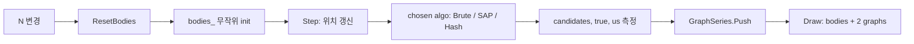

## 들어가며

`physics_lab` 의 네 번째 단계. *N 개의 움직이는 AABB* 에서 *어느 쌍이 충돌 후보인가* 를 추출하는 Broad Phase 세 알고리즘 — Brute O(n²) / SAP (Sweep and Prune) / Spatial Hash — 의 *후보 쌍 수 + 알고리즘 시간 (us)* 을 그래프로 비교한다.

핵심 측정.

- **candidates**: 알고리즘이 *narrow phase 에 넘기는 쌍의 수*. Brute = $\binom{N}{2}$ (모든 쌍). SAP / Hash 는 더 적음.
- **algo overlaps**: 알고리즘이 *발견한* 실제 overlap 쌍 수.
- **ground truth overlaps**: brute force 가 *독립적으로* 계산한 정답. 매 frame 항상 계산 (선택된 알고리즘과 별도).
- **missed = ground truth − algo overlaps**: 0 이면 알고리즘 정확. 0 보다 크면 *false negative* — 알고리즘이 진짜 overlap 을 놓침. 정확성 위반은 시뮬레이션 전체를 망가뜨리므로 가장 우선시되는 불변식.
- **algo time (us)**: 선택된 알고리즘 + 그 후보의 AABB 검사까지의 walltime. brute 가 ground truth 용일 때는 *측정 제외*.

이 셋이 동시에 그래프로 나오면 *trade-off 가 한눈에* 드러난다. Brute 의 candidates 수는 $N^2/2$ 로 폭증하지만 *코드가 단순해 cache 친화적* — N 이 작으면 가장 빠를 수도 있다. SAP / Hash 는 candidates 가 *N 에 가깝게* 적지만 *정렬 / 해시 비용* 이 있다. 교차점 (어느 N 에서 어떤 알고리즘이 가장 빠른가) 이 이 Scene 의 학습 목적.

---

## 목차
1. [세 알고리즘 개요](#1-세-알고리즘-개요)
2. [Brute 구현](#2-brute-구현)
3. [SAP 구현](#3-sap-구현)
4. [Spatial Hash 구현 + dedupe](#4-spatial-hash-구현--dedupe)
5. [측정: us / candidates / 정확성](#5-측정-us--candidates--정확성)
6. [어느 알고리즘이 언제 빠른가](#6-어느-알고리즘이-언제-빠른가)

---

## 1. 세 알고리즘 개요

| 알고리즘 | 복잡도 (랜덤 분포) | 후보 쌍 수 | 메모리 | 강점 | 약점 |
|---|---|---|---|---|---|
| Brute | $O(N^2)$ | $\binom{N}{2}$ | $O(1)$ | 코드 단순, cache 친화 | N 커지면 폭증 |
| SAP | $O(N \log N)$ (sort) + $O(N + k)$ (sweep) | $O(k)$, k = x-overlap pair | $O(N)$ | temporally coherent 좋음 | 한 축 cluster 에 취약 |
| Spatial Hash | $O(N)$ (등록) + $O(N + k)$ (검사) | $O(k)$, k = same-cell pair | $O(N)$ | 균등 분포 + 동적 삽입 / 삭제 | cell 크기 민감 |

"k" 는 알고리즘이 narrow 에 넘기는 후보 쌍의 수 — true overlap 보다 약간 많을 수 있다 (false positive 허용).

## 2. Brute 구현

후보 = 모든 i < j 쌍. AABB 검사를 *Broad 가 직접* 함 (narrow 가 따로 없는 단순 구조 — 비교를 위해).

```cpp
void RunBrute(int& candidates, int& trueOverlap) {
    int n = (int)bodies_.size();
    candidates  = n * (n - 1) / 2;            // 모든 쌍이 후보
    trueOverlap = 0;
    for (int i = 0; i < n; ++i) {
        for (int j = i + 1; j < n; ++j) {
            if (AabbOverlap(bodies_[i], bodies_[j])) ++trueOverlap;
        }
    }
}
```

`AabbOverlap` 은 core 로 승격돼 있다 — Scene 쪽은 `AabbBody` 를 `core::Aabb2` 로 옮겨 담는 얇은 래퍼:

```cpp
// src/scenes/broad_phase_scene.cpp
inline bool AabbOverlap(const AabbBody& a, const AabbBody& b) {
    return core::AabbOverlap(
        {a.pos.x, a.pos.y, a.half.x, a.half.y},
        {b.pos.x, b.pos.y, b.half.x, b.half.y});
}
```

```cpp
// src/core/physics_core.h
inline bool AabbOverlap(const Aabb2& a, const Aabb2& b) {
    const float aHalfX = std::max(0.0f, a.halfX);
    const float aHalfY = std::max(0.0f, a.halfY);
    const float bHalfX = std::max(0.0f, b.halfX);
    const float bHalfY = std::max(0.0f, b.halfY);
    return std::fabs(a.centerX - b.centerX) <= aHalfX + bHalfX &&
           std::fabs(a.centerY - b.centerY) <= aHalfY + bHalfY;
}
```

두 가지가 단순한 두 줄 비교와 다르다. *음수 half 를 0 으로 clamp* 해 퇴화 입력에서 겹침이 뒤집히지 않게 하고, 비교가 `<=` 라 *경계 접촉을 overlap 으로* 본다. clamp 는 `tests/physics_core_tests.cpp` 의 `TestAabbOverlap` 이 검사한다.

캐시 친화 — `bodies_` 가 연속 배열 (`std::vector<AabbBody>`) 이라 *forward sweep* 이 prefetcher 친화. N = 100 정도라면 *L1 안에 다 들어가서* 분기 예측까지 잘 맞으면 SAP / Hash 보다 빠를 수 있다.

문제는 *N 이 1k 를 넘으면* 쌍 수가 50 만, 10k 면 5000 만 — *그래프가 천장을 뚫는다*.

## 3. SAP 구현

핵심 아이디어. *한 축 (x) 으로 정렬* 후 *그 축에서 겹치는 쌍만* 다른 축 검사. 한 축이라도 안 겹치면 다른 축은 볼 필요 없음 (Separating Axis 의 가장 단순한 케이스).

```cpp
struct EndPoint { float v; int idx; bool isMin; };
std::vector<EndPoint> eps;
for (int i = 0; i < n; ++i) {
    eps.push_back({bodies_[i].pos.x - bodies_[i].half.x, i, true});
    eps.push_back({bodies_[i].pos.x + bodies_[i].half.x, i, false});
}
// tie-break: 같은 좌표면 min 먼저, max 나중. 경계 접촉을 overlap 으로
// 보기 위해 min 이 active list 에 먼저 들어가야 한다.
std::sort(eps.begin(), eps.end(),
           [](const EndPoint& a, const EndPoint& b){
               if (a.v != b.v) return a.v < b.v;
               return a.isMin && !b.isMin;
           });

std::vector<int> active;
for (const auto& e : eps) {
    if (e.isMin) {
        // active 안의 모든 box 와 x-overlap.
        for (int idx : active) {
            ++candidates;
            if (AabbOverlap(bodies_[e.idx], bodies_[idx])) ++trueOverlap;
        }
        active.push_back(e.idx);
    } else {
        // box 의 max 가 sweep 을 통과 → active 에서 제거.
        active.erase(std::find(active.begin(), active.end(), e.idx));
    }
}
```

*활성 리스트* (sweep line 이 지나고 있는 box 들) 가 동적으로 유지된다. 새 box 의 min 이 들어오면 *현재 활성 인 모든 box 와의 쌍* 이 후보 (x 축에서 겹친 것 *확정*). max 가 들어오면 active 에서 제거.

`active.erase(find(...))` 가 $O(N)$ 이지만 *active 리스트의 평균 크기* 가 작으면 (sweep line 이 통과하는 동안 활성 박스가 평균 $\sqrt{N}$ 정도면) 전체가 $O(N\sqrt{N})$ 정도. 정렬이 가장 비싸다 — $O(N \log N)$.

*temporally coherent* 한 워크로드 (이번 프레임의 위치가 지난 프레임과 비슷) 에서는 *insertion sort 로 정렬을 incremental 하게 유지* 가능 — 이게 SAP 의 진짜 강점. 우리 Scene 은 매 프레임 fresh sort 라 이 이점이 안 살지만, 시뮬 코드의 *구조* 는 그대로 적용 가능.

## 4. Spatial Hash 구현 + dedupe

격자 셀로 공간을 나누고 *AABB 가 닿는 셀에 자기 인덱스를 등록*. 그 다음 *같은 셀 안 쌍* 만 검사.

```cpp
struct Bucket { std::vector<int> items; };
std::unordered_map<uint64_t, Bucket> grid;

// unsigned shift 로 작성 — 음수 셀에서도 UB 없음.
auto cellKey = [](int cx, int cy) -> uint64_t {
    return ((uint64_t)(uint32_t)cx) << 32 | (uint32_t)cy;
};

// Phase 1: 등록.
for (int i = 0; i < n; ++i) {
    const auto& b = bodies_[i];
    int minCx = (int)std::floor((b.pos.x - b.half.x) / cellSize_);
    int maxCx = (int)std::floor((b.pos.x + b.half.x) / cellSize_);
    int minCy = (int)std::floor((b.pos.y - b.half.y) / cellSize_);
    int maxCy = (int)std::floor((b.pos.y + b.half.y) / cellSize_);
    for (int cy = minCy; cy <= maxCy; ++cy) {
        for (int cx = minCx; cx <= maxCx; ++cx) {
            grid[cellKey(cx, cy)].items.push_back(i);
        }
    }
}
```

*box 의 half 가 cellSize 보다 크면 여러 셀에 등록* — 이게 dedupe 문제의 원인. 한 box 가 셀 4 개에 걸쳐 있으면 다른 box 와의 쌍이 *최대 4 번* 후보로 잡힐 수 있다.

```cpp
// Phase 2: 같은 셀 안 쌍 검사 + dedupe.
std::unordered_set<uint64_t> seen;
for (auto& [key, bucket] : grid) {
    auto& v = bucket.items;
    for (size_t a = 0; a < v.size(); ++a) {
        for (size_t b = a + 1; b < v.size(); ++b) {
            int i = v[a], j = v[b];
            if (i > j) std::swap(i, j);
            uint64_t pk = ((uint64_t)i << 32) | (uint32_t)j;
            if (seen.insert(pk).second) {
                ++candidates;
                if (AabbOverlap(bodies_[i], bodies_[j])) ++trueOverlap;
            }
        }
    }
}
```

`seen` 의 hash set 으로 *이미 검사한 쌍을 skip*. cellSize 가 너무 작으면 *대부분 박스가 4 셀 점유 → seen lookup 비용이 dominant*. cellSize 가 너무 크면 *Brute 에 가까워짐*.

*경험적 좋은 값* — cellSize ≈ 2 ~ 4 × bodyHalf. 우리 Scene 의 슬라이더로 직접 조정 가능.

`cellKey` 의 *32 bit unsigned shift + or*. cell coordinate 가 음수일 수 있으니 `uint32_t` 로 캐스트한 뒤 `uint64_t` 에서 shift 한다 — signed 좌우 shift 의 UB 를 피하려는 것. 정확한 hash 분포는 *대각선 cluster 에 약할 수 있지만* 게임 워크로드에선 충분.

## 5. 측정: us / candidates / 정확성

`std::chrono::high_resolution_clock` 으로 알고리즘 시간 측정.

```cpp
auto t0 = std::chrono::high_resolution_clock::now();
switch (algo_) {
case BroadAlgo::Brute:       RunBrute(c, t); break;
case BroadAlgo::SAP:         RunSAP(c, t);   break;
case BroadAlgo::SpatialHash: RunSpatialHash(c, t); break;
}
auto t1 = std::chrono::high_resolution_clock::now();
double us = std::chrono::duration<double, std::micro>(t1 - t0).count();
```

매 frame brute 가 *반드시* ground truth 를 산출하고, 선택된 알고리즘은 그것과 별도로 측정.

```cpp
int gtCandidates, gtOverlap;
int algoCandidates, algoOverlap;
double algoUs = 0.0;

if (algo_ == BroadAlgo::Brute) {
    // brute 자체가 선택된 알고리즘이면 한 번만 — 같은 호출이 ground truth 도 됨.
    auto t0 = clock::now();
    RunBrute(gtCandidates, gtOverlap);
    auto t1 = clock::now();
    algoUs         = std::chrono::duration<double, std::micro>(t1 - t0).count();
    algoCandidates = gtCandidates;
    algoOverlap    = gtOverlap;
} else {
    // brute 는 ground truth 용 — 시간 측정 *제외*.
    RunBrute(gtCandidates, gtOverlap);

    auto t0 = clock::now();
    switch (algo_) {
    case BroadAlgo::SAP:         RunSAP(algoCandidates, algoOverlap); break;
    case BroadAlgo::SpatialHash: RunSpatialHash(algoCandidates, algoOverlap); break;
    default: break;
    }
    auto t1 = clock::now();
    algoUs = std::chrono::duration<double, std::micro>(t1 - t0).count();
}

int missed = gtOverlap - algoOverlap;   // > 0 이면 false negative
candHist_.Push((float)algoCandidates);
algoOverlapHist_.Push((float)algoOverlap);
gtOverlapHist_.Push((float)gtOverlap);
msHist_.Push((float)algoUs);
```

캔버스 우상단에 *Pairs 그래프* (candidates / algo overlaps / ground truth 세 시리즈), 그 아래 *Time 그래프* (algo us 단일 시리즈).

**정확성 불변식**: `algo overlaps == ground truth` 여야 한다. 다르면 *false negative — 알고리즘 버그*. 패널의 `missed` 라벨이 0 이 아닌 순간 *빨간 띠* 로 표시된다. SAP / Hash 를 새로 짠 직후 이 라벨로 *대각선 cluster / 경계 접촉 / 셀 경계* 같은 코너 케이스의 누락을 즉시 잡는다. 사용자는 토글로 빠르게 전환하며 *missed = 0 이 유지되는지* 확인.

`ground truth` 는 *항상* brute 로 계산. 즉 SAP / Hash 모드일 때도 brute 가 매 프레임 추가로 돈다 — 시뮬 비용은 증가하지만 *알고리즘 정확성을 매 프레임 검증* 한다는 안전성이 더 크다. 실제 게임 엔진에서는 *프로덕션 빌드 한 알고리즘 + 디버그 빌드에서만 brute 검증* 으로 구분.

## 6. 어느 알고리즘이 언제 빠른가

**N = 100, body half = 8, 균등 분포, 속도 100 px/s.**

캔버스 1000 × 700 → 셀 60 px 격자로 약 17 × 12 = 204 셀. 평균 box 점유 셀 ≈ 1 ~ 2. 평균 셀당 box ≈ 0.5.

- Brute: candidates = 4950. AabbOverlap 4950 번. 측정값 ~30 us.
- SAP: candidates ≈ 200 ~ 400 (x-overlap pair 만). 정렬 + sweep 비용. 측정값 ~50 us.
- Hash: candidates ≈ 100 ~ 200. 등록 + dedupe 비용. 측정값 ~80 us.

이 영역에서는 *Brute 가 가장 빠름* — pair 수가 적고 cache 친화적이라 *constant 비용* 이 다른 둘의 정렬 / 해시 비용보다 작음.

**N = 1000, 같은 설정.**

- Brute: candidates = 499500. ~3000 us.
- SAP: candidates ≈ 3000. ~300 us.
- Hash: candidates ≈ 1500. ~400 us.

여기선 *Brute 의 N² 가 폭발* — SAP / Hash 가 10 배 가까이 빠름. SAP 와 Hash 가 비슷한 영역. cellSize 가 좋으면 Hash 가 약간 우위.

**N = 200, cellSize = 8 (너무 작음), bodyHalf = 8.**

각 body 가 4 셀 차지 → dedupe 비용 폭증. Hash 가 *Brute 보다 느려질 수 있음*. cell size 슬라이더로 조정하며 *최적점이 어디인지* 직접 측정.

**N = 200, *모든 body 가 한 줄에 배치*** (SAP 의 약점):

x 축에서 *대부분이 overlap* → SAP 의 candidates 가 Brute 와 비슷해짐. *temporally coherent 한 cluster 패턴* 에서는 SAP 가 약함. Hash 가 더 안정.

이런 시나리오를 슬라이더로 직접 만들어 보면 *"어느 알고리즘이 무조건 좋다" 는 말이 거짓* 임이 드러난다 — 워크로드별로 다르다는 시리즈의 주장이 *직접 측정으로* 검증된다.



---

## 결론

Step 4 에서 추가한 것.

1. **3 알고리즘 구현** — Brute / SAP / Spatial Hash. 각자 30 ~ 50 줄. SAP 정렬에 *tie-break (min 이 max 보다 먼저)* — 경계 접촉을 overlap 으로 검출. Spatial Hash 의 `cellKey` 는 unsigned shift 로 작성 — *음수 셀 좌표에서도 UB 없음*.
2. **Ground truth + missed 불변식** — brute 가 항상 ground truth 를 산출, 선택된 알고리즘의 `overlap` 과 비교. `missed` 가 0 이 아니면 빨간 띠로 *false negative 발생* 표시. 알고리즘이 *우연히* 같은 수의 false positive 와 false negative 를 가지더라도 *별도 그래프 시리즈* 라 차이가 즉시 드러남.
3. **시간 측정 + 2 그래프** — `std::chrono::high_resolution_clock` 으로 us. candidates / algo overlap / ground truth / us 시계열 동시.
4. **cellSize / bodyHalf / N / speed 슬라이더** — 워크로드 변경 후 *각 알고리즘이 어떻게 반응* 하는지 직접 실험.
5. **격자 시각화 (Spatial Hash 모드)** — 점선 격자가 *셀 크기를 시각적으로* 표현. body 가 셀에 어떻게 걸치는지 보임.

이 Scene 에서 얻을 결론은 *간단하지만 강력함* — "Spatial Hash 가 항상 빠르다" 같은 단정은 *워크로드 의존*. N, 분포, body 크기, cellSize 조합이 *모두* 결과에 영향. 시리즈가 강조하는 *"측정 없이 선택하지 말 것"* 이 한 Scene 에 압축.

이 Scene 이 답하는 것은 *어느 쌍이 후보인가* 까지다. 후보 쌍이 진짜 충돌인지, contact normal 과 침투 깊이가 얼마인지는 여기서 계산하지 않는다.

화면의 `missed` 라벨은 *개수* 비교라 false positive 와 false negative 가 같은 수로 생기면 0 을 표시한다. 그래서 `physics_broad_tests` 타깃이 세 알고리즘의 overlap **쌍 집합** 을 그대로 받아 brute 의 집합과 대조한다. `RunBrute` / `RunSAP` / `RunSpatialHash` 에 선택적 출력 인자를 하나 붙여 GUI 경로는 그대로 두고 (`nullptr` 이면 기존 동작) 테스트만 쌍을 수확한다.

```cpp
using OverlapPair = std::pair<int, int>;
void RunSAP(int& candidates, int& trueOverlap,
            std::vector<OverlapPair>* outPairs = nullptr);
```

검사 배치는 네 갈래다 — 정확히 맞닿는 행 / 열 (tie-break 를 지우면 15 쌍이 사라진다), 음수 셀 좌표, `cellSize < bodyHalf` (한 body 가 여러 셀에 등록되어 dedupe 경로를 밟는다), 무작위 50 배치 × N=200.

## 더 읽을거리

- Christer Ericson, *Real-Time Collision Detection*, Ch.7 — SAP·격자·계층 구조의 표준 정리.
- Erin Catto, "Dynamic Bounding Volume Hierarchies" (GDC 2019) — 프로덕션 broad phase 의 현재 표준(동적 AABB 트리).
- [Box2D](https://github.com/erincatto/box2d) `b2DynamicTree` — 위 발표의 구현 실물.
