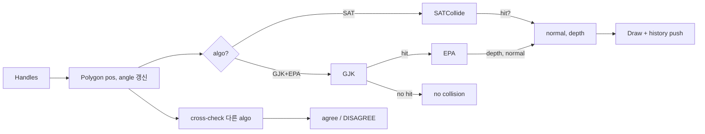

## 들어가며

`physics_lab` 의 다섯 번째 단계. Broad Phase 가 *충돌 후보 쌍* 을 추출했다면, Narrow Phase 는 *진짜 충돌이 있는가, 있다면 contact normal 과 penetration depth 는 얼마인가* 를 답한다. 이 답 (`normal`, `depth`) 이 충돌 응답 솔버의 입력 계약이다.

이 Scene 의 비교 대상.

| 알고리즘 | 대상 | 출력 | 정확성 | 비용 |
|---|---|---|---|---|
| SAT (Separating Axis Theorem) | 볼록 다각형 (직접) | depth + normal | 정확 (분석적) | $O(n_a + n_b)$ 축 검사 |
| GJK (Gilbert–Johnson–Keerthi) | 임의 볼록 도형 (support 함수만) | 충돌 여부 | iterative, 보통 수렴 빠름 | iteration × support cost |
| EPA (Expanding Polytope Algorithm) | GJK 의 충돌 simplex 를 입력으로 | depth + normal | iterative, 수렴 한계 있음 | iteration × support cost |

핵심 차이.

- **SAT**: *변의 법선 = 분리축 후보*. 둘 다 다각형이라야 동작. 코드가 단순하고 빠름.
- **GJK + EPA**: *Support 함수만 있으면 임의 볼록 도형* (원, 캡슐, 다각형, 임의 메시) 까지 동일 코드. 게임 엔진의 표준.

이 Scene 은 두 다각형을 핸들로 옮기고 회전하면서 *두 알고리즘이 같은 결과를 내는지* 매 frame 검증한다. depth 가 1.5 px 이상 차이나거나 충돌 yes/no 가 다르면 *DISAGREE* 빨간 띠.

---

## 목차
1. [Polygon2D: 위치 + 회전 + Support](#1-polygon2d-위치--회전--support)
2. [SAT 구현](#2-sat-구현)
3. [GJK 구현 (simplex 진화)](#3-gjk-구현-simplex-진화)
4. [EPA 구현 (polytope 확장)](#4-epa-구현-polytope-확장)
5. [Scene + 핸들 + cross-check](#5-scene--핸들--cross-check)
6. [무엇을 보는가](#6-무엇을-보는가)

---

## 1. Polygon2D: 위치 + 회전 + Support

```cpp
struct Polygon2D {
    std::vector<Vector2> local;     // 로컬 (회전 / 평행이동 전)
    Vector2              pos;
    float                angle;

    Vector2 ToWorld(Vector2 lp) const {
        float c = std::cos(angle), s = std::sin(angle);
        return {pos.x + c*lp.x - s*lp.y,
                pos.y + s*lp.x + c*lp.y};
    }
    std::vector<Vector2> WorldVerts() const;
    Vector2              Support(Vector2 dir) const;
};
```

`Support(dir)` 는 *주어진 방향에서 가장 먼 꼭짓점*. GJK 가 *유일하게* 도형에 요구하는 인터페이스 — 다각형은 모든 꼭짓점에 대한 dot product 최댓값, 원이면 `pos + dir * radius`, 캡슐이면 더 복잡한 식.

```cpp
Vector2 Polygon2D::Support(Vector2 dir) const {
    // dir 을 local frame 으로 회전.
    float c = std::cos(-angle), s = std::sin(-angle);
    Vector2 dLocal = {c*dir.x - s*dir.y, s*dir.x + c*dir.y};

    int   best    = 0;
    float bestDot = local[0].x*dLocal.x + local[0].y*dLocal.y;
    for (size_t i = 1; i < local.size(); ++i) {
        float d = local[i].x*dLocal.x + local[i].y*dLocal.y;
        if (d > bestDot) { bestDot = d; best = (int)i; }
    }
    return ToWorld(local[best]);
}
```

함정. *world 에서 dir 인데 local 좌표에서 dot 을 구하면 안 됨*. 회전이 있으면 dir 도 *반대로 회전* 해서 local frame 으로 변환 후 비교. 이렇게 하면 *vertex transform 을 매번 안 해도 되어* support 가 더 빠르다.

## 2. SAT 구현

핵심. *두 볼록 도형이 분리되려면, 어딘가에 두 도형을 양쪽으로 가르는 직선이 있다*. 그 직선의 법선이 *분리축*. 다각형의 경우 *후보 분리축은 각 변의 법선* — 무한히 많은 방향 중 *유한한 후보* 만 검사하면 충분 (Minkowski 의 정리).

```cpp
bool SATCollide(const Polygon2D& a, const Polygon2D& b,
                  Vector2& outNormal, float& outDepth) {
    auto va = a.WorldVerts();
    auto vb = b.WorldVerts();
    float   minDepth = INF;
    Vector2 minAxis  = {1, 0};

    auto project = [](const auto& v, Vector2 axis, float& mn, float& mx) {
        mn = mx = Dot(v[0], axis);
        for (size_t i = 1; i < v.size(); ++i) {
            float d = Dot(v[i], axis);
            mn = std::min(mn, d);
            mx = std::max(mx, d);
        }
    };

    auto runAxes = [&](const auto& v) -> bool {
        int n = (int)v.size();
        for (int i = 0; i < n; ++i) {
            Vector2 e    = Sub(v[(i+1)%n], v[i]);
            Vector2 axis = {-e.y, e.x};                  // 변의 외적 법선
            float   len  = std::sqrt(axis.x*axis.x + axis.y*axis.y);
            if (len < 1e-9f) continue;
            axis = {axis.x/len, axis.y/len};

            float amn, amx, bmn, bmx;
            project(va, axis, amn, amx);
            project(vb, axis, bmn, bmx);
            // 이 축에서 b 를 떼어놓는 이동 거리 — 양방향 각각.
            float pushPos = amx - bmn;                  // b 를 +axis 로
            float pushNeg = bmx - amn;                  // b 를 -axis 로
            if (pushPos < 0 || pushNeg < 0) return false;  // 분리 발견 → 충돌 X

            float overlap = std::min(pushPos, pushNeg);    // = 이 축의 MTD
            if (overlap < minDepth) {
                minDepth = overlap;
                minAxis  = (pushPos <= pushNeg) ? axis : Neg(axis);
            }
        }
        return true;
    };

    if (!runAxes(va)) return false;
    if (!runAxes(vb)) return false;
    outNormal = minAxis;
    outDepth  = minDepth;
    return true;
}
```

`overlap` 이 *교집합 길이가 아닌 이유*. 축 위 두 투영 구간의 교집합 길이 `min(amx,bmx) - max(amn,bmn)` 은 *짧은 구간의 길이를 넘지 못한다*. 한 구간이 다른 구간을 통째로 품는 깊은 겹침에서는 그 상한에 걸려 *분리에 실제로 필요한 이동 거리보다 작은 값* 이 나온다. 반면 `min(amx - bmn, bmx - amn)` 은 "b 를 어느 쪽으로 밀어야 두 구간이 떨어지는가" 를 그대로 계산하므로 포함 관계에서도 정확하다. 두 식은 *부분 겹침에서는 같은 값* 이다 — A = [0,3], B = [2,5] 면 둘 다 1. 갈라지는 것은 포함일 때뿐으로, A = [-2,2], B = [-1,1] 이면 교집합 길이는 2, 밀어내기 거리는 3 이다.

`outNormal` 의 *부호 규약*. 충돌 응답에서 normal 은 *피충돌체 (b) 가 a 로부터 밀려나는 방향* 이거나 *그 반대*. 어느 쪽이든 *코드 전체에서 일관* 해야 normal · v 의 부호가 의미 있다. 이 코드는 *깊이로 고른 바로 그 밀어내기 방향* 을 normal 로 삼는다 — `normal` 로 `depth` 만큼 밀면 분리된다는 계약이 성립해야 하므로, 깊이와 방향은 반드시 같은 비교에서 나와야 한다. 중심간 벡터 `b.pos - a.pos` 로 부호를 정하는 흔한 변형은 *투영 구간의 중점이 중심의 투영과 일치하는 도형* (정사각형처럼 중심 대칭인 경우) 에서만 같은 답을 준다. 그 경우 결과는 `a.pos → b.pos` 방향 — *b 가 a 로부터 멀어지는 방향* — 과 일치한다.

성능. 변의 법선 후보 수가 $n_a + n_b$ 개. 각 후보마다 *모든 꼭짓점에 대해 dot* 두 번 → $O((n_a + n_b) \cdot (n_a + n_b))$. 10 각형 두 개면 20 × 20 = 400 dot. 매우 빠르다 (수 μs).

## 3. GJK 구현 (simplex 진화)

핵심 아이디어. *두 도형이 충돌 ⇔ 원점이 Minkowski difference $A \ominus B$ 안에 있다*. CSO (Configuration Space Obstacle) $A - B$ 가 *볼록*. GJK 는 *원점이 CSO 안인지* 를 simplex (point → line → triangle) 를 점점 만들어 가며 결정.

```cpp
Vector2 SupportCSO(const Polygon2D& a, const Polygon2D& b, Vector2 dir) {
    Vector2 sa = a.Support(dir);
    Vector2 sb = b.Support(Neg(dir));
    return Sub(sa, sb);
}
```

CSO 의 support 는 *A 의 support + B 의 -dir support 의 차*.

알고리즘 outline:

```cpp
bool GJK(const Polygon2D& a, const Polygon2D& b,
          std::vector<Vector2>& simplex) {
    Vector2 dir = Sub(b.pos, a.pos);
    if (Dot(dir, dir) < 1e-9f) dir = {1, 0};

    Vector2 s = SupportCSO(a, b, dir);
    simplex   = {s};
    dir       = Neg(s);

    for (int iter = 0; iter < 64; ++iter) {
        Vector2 next = SupportCSO(a, b, dir);
        if (Dot(next, dir) <= 0) return false;       // 원점이 CSO 밖.
        simplex.push_back(next);
        if (DoSimplex(simplex, dir)) return true;
    }
    return false;
}
```

`DoSimplex` 가 *현재 simplex 의 어느 영역에 원점이 있는지* 판단하고, 그에 따라 *불필요한 점 제거 + 다음 방향 갱신*.

- **simplex.size == 2 (line)**: 원점이 *세그먼트 옆 어디* 인지 — `Triple(ab, ao, ab)` 가 *ab 와 수직 + 원점 방향* 의 perpendicular 벡터.
- **simplex.size == 3 (triangle)**: 원점이 *내부* 면 충돌. *AB 바깥쪽* 이면 C 제거 후 line 단계. *AC 바깥쪽* 이면 B 제거.

```cpp
bool DoSimplex(std::vector<Vector2>& s, Vector2& dir) {
    if (s.size() == 2) {
        Vector2 a = s[1], b = s[0];
        Vector2 ab = Sub(b, a), ao = Neg(a);
        Vector2 d = Triple(ab, ao, ab);
        if (Dot(d, d) < 1e-9f) d = {-ab.y, ab.x};   // origin on ab fallback
        dir = d;
        return false;
    }
    // size == 3
    Vector2 a = s[2], b = s[1], c = s[0];
    Vector2 ab = Sub(b, a), ac = Sub(c, a), ao = Neg(a);
    Vector2 abPerp = Triple(ac, ab, ab);
    Vector2 acPerp = Triple(ab, ac, ac);
    if (Dot(abPerp, ao) > 0) {
        s.erase(s.begin());     // remove c
        dir = abPerp; return false;
    }
    if (Dot(acPerp, ao) > 0) {
        s.erase(s.begin() + 1); // remove b
        dir = acPerp; return false;
    }
    return true;                // origin inside triangle
}
```

`Triple(a, b, c)` 가 *Lagrange 항등식* $(a \times b) \times c = b(a \cdot c) - a(b \cdot c)$. 2D 에서 외적은 스칼라지만 *Triple 결과는 vector* — *c 평면에서 c 의 수직 방향, ab 의 반대편이 원점쪽이면 그쪽*.

수렴. 매 iteration 마다 *origin 방향* 으로 새 support 점을 추가. 그 방향에 더 가까운 CSO 점이 *없으면* (Dot(next, dir) ≤ 0) 원점이 CSO 밖 → 충돌 없음. 있으면 simplex 가 커지며 원점을 둘러쌈. 통상 *3~8 iteration* 안에 결판난다.

## 4. EPA 구현 (polytope 확장)

GJK 가 *충돌이라고 답한 simplex* 가 입력. 이 simplex 를 *확장* 해 *원점에서 CSO 표면까지의 최단 거리* 를 구한다 — 이 거리가 *penetration depth*, 그 방향이 *contact normal*.

```cpp
void EPA(const Polygon2D& a, const Polygon2D& b,
          std::vector<Vector2> simplex,
          Vector2& outNormal, float& outDepth) {
    // CCW winding 보장 (origin inside 라 cross 부호로 판단).
    if (Cross(Sub(simplex[1], simplex[0]),
               Sub(simplex[2], simplex[0])) < 0) {
        std::swap(simplex[1], simplex[2]);
    }

    for (int iter = 0; iter < 64; ++iter) {
        // 원점에 가장 가까운 edge 찾기.
        int    bestIdx  = 0;
        float  bestDist = INF;
        Vector2 bestN   = {0, 0};
        for (size_t i = 0; i < simplex.size(); ++i) {
            size_t  j = (i + 1) % simplex.size();
            Vector2 e = Sub(simplex[j], simplex[i]);
            Vector2 n = {e.y, -e.x};                  // CCW 외부 법선
            float   len = std::sqrt(n.x*n.x + n.y*n.y);
            if (len < 1e-9f) continue;
            n = {n.x/len, n.y/len};
            float d = Dot(n, simplex[i]);
            if (d < bestDist) {
                bestDist = d; bestN = n; bestIdx = (int)j;
            }
        }

        // 그 방향으로 CSO 바깥에 더 멀리 점이 있는지.
        Vector2 s = SupportCSO(a, b, bestN);
        float   d = Dot(s, bestN);
        if (d - bestDist < 1e-4f) {
            outNormal = bestN;
            outDepth  = bestDist;
            return;
        }
        simplex.insert(simplex.begin() + bestIdx, s);   // 점 추가
    }
    outNormal = {0, 0};
    outDepth  = 0;
}
```

`bestN` 의 부호. CCW 정렬 후 *오른손 법선* `(e.y, -e.x)` 이 *바깥쪽* (origin 의 반대편). EPA 가 원점에서 *바깥* 쪽으로 *가장 가까운 edge 의 법선* 을 답으로 낸다.

수렴 한계. 매 iteration 마다 *edge 가 하나 추가* 되어 simplex 가 커진다. 더 이상 *확장이 의미 있는* 새 support 점이 안 들어오면 (Dot 차이가 1e-4 이하) 종료. 통상 *5~20 iteration*. *iteration cap 이 필요* — 거의 평행한 경우나 numerical 한계에서 무한 루프 가능성.

## 5. Scene + 핸들 + cross-check

핸들 4 개 — *A 의 중심 / A 의 회전 / B 의 중심 / B 의 회전*. 회전 핸들은 *중심에서 50 px 떨어진 위치* 에 고정, 사용자가 끌면 *그 각도가 polygon 의 angle*.

```cpp
void UpdatePolygonFromHandles(Polygon2D& p,
                                 DragHandle& center, DragHandle& rotation,
                                 float rotRadius) {
    p.pos = center.Position();
    Vector2 d = Sub(rotation.Position(), p.pos);
    float len = std::sqrt(d.x*d.x + d.y*d.y);
    if (len > 1e-3f) {
        p.angle = std::atan2(d.y, d.x);
        rotation.SetPosition({p.pos.x + d.x/len * rotRadius,
                                p.pos.y + d.y/len * rotRadius});  // 일정 거리 유지
    }
}
```

매 frame *둘 다 실행*:

```cpp
Vector2 satN, gjkN;
float   satD, gjkD;
bool    satHit, gjkHit;
double  us;

// 선택된 알고리즘만 us 측정.
if (algo_ == NarrowAlgo::SAT) {
    auto t0 = clock::now();
    satHit  = SATCollide(a_, b_, satN, satD);
    auto t1 = clock::now();
    us = std::chrono::duration<double, std::micro>(t1 - t0).count();
    gjkHit = GjkEpaCollide(a_, b_, gjkN, gjkD);    // cross-check (시간 측정 제외)
} else {
    auto t0 = clock::now();
    gjkHit  = GjkEpaCollide(a_, b_, gjkN, gjkD);
    auto t1 = clock::now();
    us = std::chrono::duration<double, std::micro>(t1 - t0).count();
    satHit = SATCollide(a_, b_, satN, satD);
}

// 동의?
bool agreeHit   = (satHit == gjkHit);
bool agreeDepth = !satHit || std::fabs(satD - gjkD) < 1.5f;
bothAgree_      = agreeHit && agreeDepth;
```

`bothAgree_` 가 false 이면 패널에 *빨간 띠 DISAGREE*. 두 다각형을 *경계 거의 접촉* 위치로 끌어보면 *부동소수 한계* 에서 둘이 다른 결정을 내리는 순간을 발견할 수 있다. 그 순간이 *현실의 충돌 검사가 부동소수 hostile 함* 을 보여주는 케이스.

한 가지 주의. 이 띠는 *공짜로 버그를 잡아주지 않는다*. `overlap` 이 교집합 길이였을 때 반크기 1 정사각형에서 두 알고리즘의 깊이 차는 최대 0.384 로, 임계값 1.5 px 아래라 ctest 스케일에서는 띠가 켜지지 않았다. 화면 위 반지름 40 ~ 50 px 다각형에서는 같은 오차가 15 px 근처까지 커져 띠가 켜졌겠지만, *그 배치를 손으로 만들어야* 보인다. 임계값이 있는 눈금은 임계값 아래의 결함을 못 본다 — 결국 잡아낸 것은 해석해와 직접 대조하는 ctest 쪽이었다.

## 6. 무엇을 보는가

- **두 다각형 + contact normal**: 충돌이면 두 도형이 빨갛게 칠해지고 중앙에서 normal 방향 화살표가 *depth 의 4 배 길이* 로 그려진다 (depth 가 작으면 화살표가 짧음).
- **depth 그래프**: 시간에 따른 penetration depth. 두 다각형을 슬슬 끌어가면 *0 → 양수 → 0* 으로 변하는 산.
- **algo us 그래프**: SAT 와 GJK+EPA 의 시간 비교. *겹친 상태에서는 SAT 가 더 빠름* — GJK 의 iteration overhead + EPA 의 polytope 확장 비용 때문. 떨어져 있을 때는 EPA 가 돌지 않고 GJK 가 1 ~ 2 회 반복에 끝나 GJK+EPA 쪽이 오히려 빠를 수 있다. 다만 *원, 캡슐 같은 도형* 이 섞이면 SAT 가 동작 안 함 → GJK+EPA 만 남음.
- **vertices / radius 슬라이더**: 다각형 모양 변경. *vertices 가 많을수록 SAT 가 비례해서 느려짐*. GJK 는 *iteration 수가 거의 안 변함* — N 에 대해 더 좋게 스케일.
- **cross-check 결과**: SAT 와 GJK+EPA 의 hit / depth 가 매 frame 비교. 일치하면 *agree*, 다르면 *DISAGREE 빨간 띠*.



---

## 결론

Step 5 에서 추가한 것.

1. **Polygon2D + Support 인터페이스** — 다각형 / 원 / 캡슐 / 임의 볼록 도형으로 확장 가능한 *최소 표면*. GJK 는 `Support(dir)` 만 호출.
2. **SAT 구현** — 분리축 후보 = 각 변의 법선. *minOverlap 의 축* 이 contact normal. 코드 50 줄.
3. **GJK 구현** — simplex 진화 (point → line → triangle), Triple product 로 다음 방향 결정. 64 iteration cap.
4. **EPA 구현** — GJK 의 collision simplex 를 확장. 원점에 가장 가까운 edge 의 법선이 답.
5. **Cross-check (매 frame 둘 다 실행)** — SAT 와 GJK+EPA 의 hit / depth 차이가 1.5 px 이상이면 *DISAGREE* 빨간 띠. 부동소수 hostile 케이스 (경계 접촉) 를 *우연히* 만났을 때 즉시 보임.
6. **4 핸들 (중심 × 2, 회전 × 2)** — 회전 핸들은 *고정 거리* 로 자동 유지.
7. **`physics_collision_tests` 타깃** — GUI 없이 SAT / GJK+EPA 를 돌리는 전용 ctest 실행 파일. 테스트 전용 사본을 두지 않도록 *제품이 쓰는 `narrow_phase_scene.cpp` 를 그대로 컴파일* 한다.

```cmake
add_executable(physics_collision_tests
    tests/physics_collision_tests.cpp
    src/scenes/narrow_phase_scene.cpp
    src/ui/handle.cpp
    src/ui/line_graph.cpp
    src/ui/raygui_impl.cpp
)
target_include_directories(physics_collision_tests PRIVATE
    src
    ${raygui_SOURCE_DIR}/src)
target_link_libraries(physics_collision_tests PRIVATE raylib)
add_test(NAME physics_collision_tests COMMAND physics_collision_tests)
# 실행 파일은 `argv[1]` 로 케이스 필터를 받는다. 여기서 추가한 것만 도는 진입점.
add_test(NAME step05.narrow_phase COMMAND physics_collision_tests step05)
```

```powershell
cmake --build build --config Release -j
ctest --test-dir build -C Release -R step05 --output-on-failure
.\build\Release\physics_collision_tests.exe step05   # 같은 것을 직접 — 관측값까지 본다
```

`ctest` 는 통과 / 실패만 알려 준다. 두 번째 줄을 직접 돌리면 네 케이스가 각각 무엇을 쟀는지 보인다.

```text
[step05] separated_and_overlapping
  analytic depths 0.5 / 0.75 matched; boundary touch depth=0 normal=(1,-0)
  ok
[step05] deep_overlap_reference
  45deg cocentric: sat=2.41421 epa=2.41421 mtd=2.41421 intersection=2
  ok
[step05] sat_matches_epa
  7 containment cases: max |sat-epa|=0, max (mtd - intersection)=1.5
  ok
[step05] randomized_agreement
  100 random placements: hits=79 misses=21 containment=15
  ok
4 case(s) ok: physics collision [step05]
```

이 타깃은 hit / miss 판정과 normal 의 단위 길이만 보지 않는다. 반크기 1 정사각형은 침투 깊이가 해석적으로 정해지므로 (중심거리 1.5 → 0.5, 중심거리 1.25 를 세로로 → 0.75) 그 값을 리터럴로 못 박고, `a` 에서 `b` 로 향하는 법선 부호 규약도 검사한다. 화면의 `bothAgree_` 띠와 같은 depth 대조도 ctest 안에 있다.

여기에 무작위 회전·오프셋 100 조합을 돌리는 검사를 얹으면서 *SAT 의 깊이 식이 틀렸다* 는 사실이 드러났다. 테스트 안에 두 값을 따로 계산하는 참조 구현을 두고 비교한 결과다.

- 축 위 두 구간의 *교집합 길이* — 처음 `SATCollide` 가 쓰던 식.
- 두 도형을 분리하는 데 필요한 *최소 이동 거리* (MTD) — `min(amx - bmn, bmx - amn)`.

두 값은 한 구간이 다른 구간을 *포함* 할 때만 갈라진다. 같은 중심에 45 도 돌아간 두 정사각형이 그 예로, 분리에 필요한 이동은 `1 + √2 ≈ 2.414` 인데 교집합 길이는 2 다. EPA 는 79 개 hit 전부에서 MTD 와 일치했고 (`|EPA - MTD| < 1e-3`), SAT 만 포함 배치 15 개 (`MTD - 교집합 > 1e-3` 기준) 에서 최대 0.384 만큼 작게 나왔다. 얕은 접촉 — 실제 응답이 다루는 영역 — 에서는 두 값이 같으므로 stacking 시뮬의 거동은 바뀌지 않지만, 깊이가 *틀린 값* 인 것과 *영향이 작은 값* 인 것은 다르다. `overlap` 식을 MTD 로 고쳤다.

고친 뒤 테스트도 함께 조였다. 예전에는 SAT 깊이가 두 참조값 *중 하나* 와만 일치하면 통과했고 포함 배치에서는 SAT ↔ EPA 깊이 대조를 아예 건너뛰었다 — 과소평가를 정답으로 굳히지는 않았지만 잡아내지도 못하는 상태였다. 이제는 세 가지를 요구한다.

- SAT 깊이 = MTD, 포함 배치도 예외 없음. 무작위 100 조합 전부에 적용.
- 포함 배치 고정 케이스 7 개 (같은 중심 15/30/45/60 도, 큰 정사각형이 작은 것을 삼킨 배치 3 종) 에서 `|SAT - EPA| < 1e-3`.
- `(normal, depth)` 계약의 양면 검사 — `normal` 로 `depth` 보다 조금 *더* 밀면 반드시 떨어지고, 조금 *덜* 밀면 반드시 아직 겹친다. 깊이만 맞고 법선이 엉뚱한 축을 가리키면 여기서 걸린다.

세 번째가 특히 중요하다. 깊이 식을 MTD 로 바꾸면 *최소 축이 달라질 수 있어* 법선 결정 로직도 같이 맞춰야 하는데, 이 검사가 그 둘이 따로 놀지 않는지를 본다. 옛 식으로 되돌려 보면 이 타깃은 65 개 CHECK 가 깨진다.

45 도 배치를 못 박은 네 줄이 그 회귀를 붙잡는 자리다. 세 번째 줄이 핵심이다 — 두 값이 0.41 만큼 떨어져 있으므로 이 검사는 허용 오차를 조이는 것이 아니라 *식 자체* 를 고정한다.

<!-- snippet: tests/physics_collision_tests.cpp@mtd-vs-intersection -->
```cpp
// 두 구현 모두 진짜 MTD 를 낸다 — 해석해와 직접 비교.
CHECK(std::fabs(gjkDepth - (1.0f + std::sqrt(2.0f))) < 1e-3f);
CHECK(std::fabs(satDepth - (1.0f + std::sqrt(2.0f))) < 1e-4f);

// 교집합 길이(2.0) 를 쓰던 옛 식이면 여기서 걸린다. 두 값이 0.41 만큼
// 떨어져 있으므로 이 검사는 허용 오차 문제가 아니라 식 자체를 고정한다.
CHECK(std::fabs(satDepth - ref.intersect) > 0.4f);
CHECK(satDepth > 0.0f);
```

### 무작위 볼록쌍 property 배터리

위의 100 조합은 전부 반크기 1 정사각형이다. 정사각형은 중심 대칭이고 변이 넷뿐이라 SAT 의 축 후보가 사실상 둘이다. 삼각형, 오각형, y 축으로 눌린 칠각형에서도 같은 계약이 성립하는지는 그 100 조합이 답하지 않는다. 입력을 손으로 고르는 한 손으로 고른 만큼만 안다.

그래서 입력을 손으로 고르지 않는 층을 얹었다. 계약을 적고, 생성기가 만든 입력 공간에서 그 계약을 깨는 반례를 찾고, 찾으면 *줄여서* 시드와 함께 찍는다.

```powershell
cmake --build build --config Release -j
ctest --test-dir build -C Release -R step05.property --output-on-failure
.\build\Release\physics_property_tests.exe convex_pair   # 같은 것을 직접 — 관측값까지 본다
```

```text
[step05] convex_pair
  1500 표본: hits=744 misses=756 containment=368 unique-axis=557
  최대 |SAT-MTD|=0 |EPA-MTD|=1.52588e-05 |SAT-EPA|=1.52588e-05
  볼록쌍 버킷: general=669 boundary=215 containment=174 sliver=200 large-scale=158 corpus=84
  ok
1 case(s) ok: physics property [convex_pair]
```

**생성기는 domain 구조를 알아야 한다.** 무작위 점 n 개를 뽑아 볼록인 것만 남기는 방식은 표본을 대부분 버리고, 살아남는 것도 원에 가까운 도형으로 쏠린다. 대신 타원 위의 *정렬된* 각도 n 개로 다각형을 직접 구성한다 — 타원 위의 점들은 언제나 볼록 배치라 버리는 표본이 없다. `aspect` 로 y 축을 눌러 얇은 조각까지 같은 방식으로 만든다. 각도도 균등 표본을 정렬하는 대신 *간격* 을 만들어 정규화한다. 정렬 방식은 "정점이 서로 너무 붙지 않는다" 는 사전조건을 지키지 못하고, 못 지킨 표본을 버리면 분포가 틀어진다.

**균등 난수는 중요한 경계를 거의 만들지 못한다.** 그래서 여섯 버킷으로 나눠 뽑는다.

| 버킷 | 비율 | 무엇을 노리는가 |
|---|---|---|
| general | 45% | 정점 3~8 개, 반지름 0.6~1.6 의 일반 배치 |
| boundary | 15% | 두 도형이 거의 정확히 맞닿는 거리 — hit / miss 가 갈리는 띠 |
| containment | 12% | 한쪽이 다른 쪽을 삼킨 배치 — 교집합 길이 식이 무너지는 자리 |
| sliver | 12% | `aspect` 0.03~0.12 의 얇은 조각, 거의 붙은 정점, 거의 평행한 두 도형 |
| large-scale | 11% | 반지름 60~140 px — 같은 상대 오차가 절대값으로 커진다 |
| corpus | 5% | 과거 실패에서 온 고정 배치 (동심 45 도, 삼킨 정사각형 세 종) |

마지막 줄이 회귀 보존이다. 깊이 식을 교집합 길이로 되돌리면 무너지는 바로 그 배치들을 생성기 안에 corpus 로 넣어 두었다. 무작위 표본이 우연히 그 자리를 비켜 가도 corpus 는 매번 재생된다.

**oracle 은 셋이다.** 하나는 독립 참조 구현 — `tests/sat_reference.h` 가 SAT / GJK+EPA 어느 쪽 코드도 쓰지 않고 교집합 길이와 진짜 MTD 를 따로 계산한다 (differential). 둘은 수학적 성질 — 인자를 바꾸면 깊이는 같고 법선은 뒤집힌다, 같은 rigid transform 을 둘 다에 적용하면 교차 여부와 깊이는 그대로고 법선만 같은 각도로 돈다 (metamorphic). 셋은 `(normal, depth)` 계약의 양면 — 법선으로 깊이보다 조금 더 밀면 반드시 떨어지고, 조금 덜 밀면 반드시 아직 겹친다.

대칭성과 변환 불변에는 사전조건을 붙였다. 최소 축이 여럿 있으면 (동심 정사각형처럼) 어느 축을 골라도 계약 위반이 아니므로, 참조 구현이 *두 번째로 작은* 밀어내기까지 돌려주게 하고 그 차이가 허용 오차의 네 배를 넘을 때만 법선을 본다. 1500 표본 중 557 개가 그 조건을 만족했다.

**허용 오차는 알고리즘의 계약에서 나온다.** EPA 는 지지점이 현재 면까지의 거리와 `1e-4` 안으로 붙으면 멈추고, float32 의 상대 오차는 좌표 크기에 비례한다. 그래서 `tol = 2e-3 + 2e-4 × scale` 이다 — 테스트를 통과시키려고 키운 값이 아니라 두 오차원을 더한 값이고, 실측 최대 편차는 `|EPA-MTD| = 1.5e-5` 로 그 상한의 1/100 이다.

<!-- snippet: tests/physics_property_tests.cpp@property-convex-oracle -->
```cpp
convexStats.worstSatVsMtd =
    std::max(convexStats.worstSatVsMtd, (double)std::fabs(satDepth - ref.push));
convexStats.worstEpaVsMtd =
    std::max(convexStats.worstEpaVsMtd, (double)std::fabs(epaDepth - ref.push));
convexStats.worstSatVsEpa =
    std::max(convexStats.worstSatVsEpa, (double)std::fabs(satDepth - epaDepth));
if (std::fabs(satDepth - ref.push) > tol) {
    return Format("SAT 깊이 %.5f 가 참조 MTD %.5f 와 %.5f 벌어졌다 "
                  "(허용 %.5f, 교집합 길이 %.5f)",
                  (double)satDepth, (double)ref.push,
                  (double)std::fabs(satDepth - ref.push), (double)tol,
                  (double)ref.intersect);
}
```

**반례는 줄여서 찍는다.** 표본 하나가 실패하면 shrink 루프가 후보를 시험한다 — 정점 빼기, 각도를 정다각형으로, `aspect` 를 1 로, 회전을 0 으로, 오프셋을 0 으로, 반지름을 1 로 정규화. 실패가 유지되는 축소만 채택하고 다시 시작한다. 깊이 식을 교집합 길이로 되돌려 확인한 실제 출력이다.

```text
[property FAILED] 무작위 볼록쌍: SAT 깊이 = EPA 깊이 = 참조 MTD, ...
  시드      : 12793680451439230182  (생성기 v1, 표본 5)
  위반      : SAT 깊이 0.31233 가 참조 MTD 0.70820 와 0.39587 벌어졌다 (허용 0.00220, 교집합 길이 0.31233)
  최초 위반 : SAT 깊이 0.94929 가 참조 MTD 2.00974 와 1.06045 벌어졌다 (허용 0.00260, 교집합 길이 0.94929)
  원본 입력 : bucket=containment offset(dir=4.04332 dist=0.36741) A{n=4 r=2.62806 aspect=0.91880 ...} B{n=7 r=0.54721 ...}
  축소 입력 : bucket=containment offset(dir=0.00000 dist=0.00003) A{n=3 r=1.00000 aspect=1.00000 rot=0.00000} B{n=3 r=0.20822 aspect=1.00000 rot=0.00000}
  재현      : physics_property_tests convex_pair 12793680451439230182
```

정점 4 개와 7 개짜리 회전한 다각형 쌍이 *같은 중심의 정삼각형 두 개* 로 줄었다. 큰 삼각형 안에 작은 삼각형이 든 배치 — 포함 배치의 최소형이다. 마지막 줄을 그대로 붙여 넣으면 그 표본 하나만 다시 돈다. 시드만으로는 부족해서 축소된 입력 자체도 함께 찍는다. 생성기를 고치면 같은 시드가 다른 입력을 만들기 때문이고, 그래서 보고에 생성기 버전이 들어 있다.

**property 에도 강도가 있다.** hit / miss 만 맞추는 property 는 깊이를 통째로 0 으로 만들어도 통과한다. 그래서 배터리는 표본 수가 아니라 *의미 버킷 커버리지* 를 검증 지표로 단언한다 — 여섯 버킷이 전부 채워졌는가, hit 과 miss 가 한쪽으로 쏠리지 않았는가 (744 대 756), 포함 배치가 실제로 뽑혔는가 (368), 최소 축이 유일한 표본이 충분한가 (557). 한 버킷이라도 비면 그 분기는 아무것도 검사하지 않은 것이다.

## 더 읽을거리

- Casey Muratori, ["Implementing GJK"](https://caseymuratori.com/blog_0003) — simplex 케이스 처리의 표준 해설.
- Dirk Gregorius, "The Separating Axis Test between Convex Polyhedra" (GDC 2013) — SAT 의 실전 구현 디테일.
- Christer Ericson, *Real-Time Collision Detection*, Ch.5 — 프리미티브 교차 검사의 표준 교과서.
