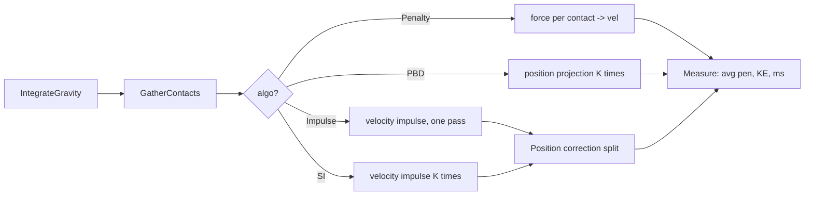

## 들어가며

`physics_lab` 의 여섯 번째 단계. Narrow Phase 가 `(normal, depth)` 를 알려줬다면, *그것을 어떻게 속도 / 위치 갱신에 반영할 것인가* 가 Response 의 문제. 같은 stacking 시나리오 — N 개 원형 강체가 좌우 벽 사이에 쌓이는 — 를 네 응답 방식으로 돌리며 *평균 침투 깊이 / 안정성 / 비용* 을 그래프로 본다.

| 응답 | 작용 level | 강점 | 약점 | 비용 |
|---|---|---|---|---|
| Penalty | force | 단순, 미분 가능 | stiff equation → 작은 dt 필요, 침투 깊음 | 1 pass |
| Impulse (1-shot) | velocity + position correction | force 형보다 안정 | stacking 약함 (한 번에 한 contact 만) | 1 pass |
| Sequential Impulse | velocity (K iter) + position correction | stacking 견고, 게임 엔진 표준 | bias parameter tuning | K iter |
| PBD | position (K iter) + derived velocity | stiff force 모델보다 큰 dt에 견고 | stiffness·감쇠가 dt와 iter에 의존 | K iter |

핵심 관찰. *iterations 가 늘수록 SI / PBD 의 평균 침투가 감소* — 응답이 *수렴* 한다. Penalty 는 *k 가 응답 강도*, *너무 크면 발산 / 너무 작으면 침투 깊음*. Impulse 1-shot 은 *침투 안 사라짐* — stacking 의 가장 아래 박스가 진동 / 침투.

---

## 목차
1. [Contact 자료구조 + 수집](#1-contact-자료구조--수집)
2. [Penalty 응답](#2-penalty-응답)
3. [Impulse (1-shot) 응답](#3-impulse-1-shot-응답)
4. [Sequential Impulse 응답](#4-sequential-impulse-응답)
5. [PBD 응답](#5-pbd-응답)
6. [분리된 위치 보정](#6-분리된-위치-보정)
7. [무엇을 보는가](#7-무엇을-보는가)

---

## 1. Contact 자료구조 + 수집

<!-- snippet: src/core/contact_solver.h#Contact -->
```cpp
struct Contact {
    int     i, j;          // body 인덱스. j = -1 이면 벽 / 바닥 contact
    Vector2 normal;        // i → j 방향 (벽 contact 면 body 가 밀려나는 방향)
    float   depth;
    float   lambda;        // SI 의 accumulated impulse
};
```

normal 의 *부호 규약* 이 가장 헷갈리는 부분. 이 코드는:

- body-body 일 때: `normal = (pos[j] - pos[i]) / dist`. 즉 i 에서 j 로 향함.
- body-wall 일 때: `normal` 이 *body 가 밀려나는 방향*. 바닥이면 `(0, -1)` (위), 왼쪽 벽이면 `(1, 0)`.

이 통일 규약 덕에 응답 코드가 *if (j >= 0) ... else ...* 두 분기로 깔끔하게 갈린다.

<!-- snippet: src/core/contact_solver.h@gather-contacts -->
```cpp
template <class Body>
void GatherCircleContacts(const std::vector<Body>& bodies,
                          const WorldBounds& bounds,
                          std::vector<Contact>& out) {
    out.clear();
    const int n = (int)bodies.size();

    for (int i = 0; i < n; ++i) {
        for (int j = i + 1; j < n; ++j) {
            const Vector2 d =
                SubV(bodies[(size_t)j].pos, bodies[(size_t)i].pos);
            const float r =
                bodies[(size_t)i].radius + bodies[(size_t)j].radius;
            const float dist = std::sqrt(d.x * d.x + d.y * d.y);
            if (dist < r) {
                const UnitNormal2 nrm = SafeUnitNormal(d.x, d.y, i ^ j);
                out.push_back({i, j, {nrm.x, nrm.y}, r - dist, 0.0f});
            }
        }
    }
    // ... 바닥 + 양 벽 (생략)
}
```

contact 수집은 *Broad Phase 가 아니라 brute O(n²)* — Response 가 주제이므로 단순. 중심이 정확히 겹쳐 `dist == 0` 이면 방향을 정할 수 없으므로 `SafeUnitNormal` 이 *결정적인 대체 축* 을 고른다 — 접촉을 그냥 버리면 겹친 body 가 영원히 겹친 채로 남는다.

`Body` 가 템플릿 파라미터인 이유. 이 세 함수(수집 / SI / 위치 보정)는 `src/core/contact_solver.h` 에 *한 벌만* 존재하고, 이 Scene 뿐 아니라 lab 의 측정용 Scene 도 같은 구현을 부른다. 측정이 자기 사본을 들고 있으면 그 측정은 여기서 설명한 솔버가 아니라 사본을 재게 되기 때문이다. body 타입이 요구하는 것은 `pos` / `vel` / `radius` / `invMass` 네 멤버뿐이다.

## 2. Penalty 응답

각 contact 에 *spring force* — `F = k * depth * normal`. 침투가 깊을수록 더 큰 반발.

```cpp
void ApplyPenalty(float dt) {
    std::vector<Contact> contacts;
    GatherContacts(contacts);
    for (const auto& c : contacts) {
        Vector2 fOn_i = Neg(Scale(c.normal, penaltyK_ * c.depth));
        if (c.j >= 0) {
            bodies_[c.i].vel += fOn_i * bodies_[c.i].invMass * dt;
            bodies_[c.j].vel -= fOn_i * bodies_[c.j].invMass * dt;
        } else {
            bodies_[c.i].vel -= fOn_i * bodies_[c.i].invMass * dt;
        }
    }
}
```

`penaltyK_` 의 dilemma — *큰 k 가 침투를 빨리 밀어내지만 stiff 적분기 (Explicit / Semi-impl) 가 발산*. dt 가 1/120 이면 k = 20000 정도가 한계. 큰 dt 에선 발산. *물리적으로 정확한 강체* 가 *수치적으로 풀기 어려운* 케이스의 대표.

게임에서 penalty 가 cloth / soft body 의 *내부* spring 으로는 쓰여도 *rigid stacking* 에는 거의 안 쓰인다.

## 3. Impulse (1-shot) 응답

normal velocity 만큼의 impulse 를 *한 번에* 적용.

```cpp
void ApplyImpulseOnce(std::vector<Contact>& contacts) {
    for (auto& c : contacts) {
        if (c.j >= 0) {
            Vector2 vrel = Sub(bj.vel, bi.vel);
            float   vn   = Dot(vrel, c.normal);
            if (vn < 0) {                          // 접근 중일 때만 처리
                float lambda = -(1 + e) * vn / (bi.invMass + bj.invMass);
                bi.vel -= lambda * bi.invMass * c.normal;
                bj.vel += lambda * bj.invMass * c.normal;
            }
        } else {
            float vn = Dot(bi.vel, c.normal);
            if (vn < 0) {
                float lambda = -(1 + e) * vn / bi.invMass;
                bi.vel += lambda * bi.invMass * c.normal;
            }
        }
    }
}
```

`vn < 0` 가 *접근* (normal 의 반대 방향). 분리 중 (`vn ≥ 0`) 이면 응답 안 함.

문제. *Stacking 에서 가장 아래 박스* 가 *위 박스들의 무게* 를 모두 받지만 *한 번의 impulse* 로는 위 박스들을 *모두 위로 보내기* 부족. 결과: 매 frame *침투가 누적되며 진동*. *iterations 가 필요* — 그게 SI.

## 4. Sequential Impulse 응답

*같은 impulse 를 K 번 반복*. 각 contact 의 *accumulated lambda* 는 ≥ 0 으로 clamp — body 가 밀려나는 방향만 허용 (당기는 방향은 의미 없음, 분리 가능).

**중요한 함정**. restitution 을 *iter 안에서 매번 곱하면 안 된다*. iter 마다 `(1 + e) · vn` 을 다시 주입하면 *분리 속도가 계속 가산* 되어 *에너지 over-injection*. 정지해 있는 박스가 *다시 튀어오르는* 증상.

올바른 처리. *첫 iter 전에 한 번* `target velocity` 를 계산하고, iter 안에서는 `vn → vTarget` 으로 향하게 dLambda 를 계산:

```cpp
void ApplySequentialImpulse(std::vector<Contact>& contacts) {
    // 1) Restitution slop: 접근 속도가 임계값 이하면 *resting contact* 로
    //    보고 restitution = 0. Box2D 의 b2_velocityThreshold 와 같은 아이디어.
    constexpr float kRestThreshold = 50.0f;  // px/s
    std::vector<float> vTarget(contacts.size(), 0.0f);
    for (size_t k = 0; k < contacts.size(); ++k) {
        float vnInit = /* contact 의 초기 vn 계산 */;
        if (vnInit < -kRestThreshold) {
            vTarget[k] = -restitution_ * vnInit;   // 한 번만!
        }
    }

    // 2) iter 안에서는 *bias* 로 vTarget 만 더해줌 — restitution 재주입 X.
    for (int iter = 0; iter < iterations_; ++iter) {
        for (size_t k = 0; k < contacts.size(); ++k) {
            auto& c = contacts[k];
            Vector2 vrel = Sub(bj.vel, bi.vel);
            float   vn   = Dot(vrel, c.normal);
            float   dLambda = -(vn - vTarget[k])
                                / (bi.invMass + bj.invMass);
            float   newL    = std::max(0.0f, c.lambda + dLambda);
            float   applied = newL - c.lambda;
            c.lambda = newL;
            bi.vel -= applied * bi.invMass * c.normal;
            bj.vel += applied * bj.invMass * c.normal;
        }
    }
}
```

핵심. *applied = newL - c.lambda* — 누적 lambda 가 음수가 되면 *과거 적용한 impulse* 일부를 *되돌리는* 효과. clamp 이후의 *증분* 만 적용. 이것이 *constrained quadratic programming* 의 *Gauss-Seidel* 풀이.

iterations 가 충분히 크면 *모든 contact 가 동시에 만족* 하는 velocity 가 수렴. Box2D / Bullet / PhysX 가 모두 이 방식 — 게임 엔진의 *de facto*.

## 5. PBD 응답

*position 을 직접 보정* 후 *velocity 는 derive*.

```cpp
void ApplyPBD(float dt) {
    // 1. predict (Step 안에서 이미 적분됨)
    // 2. iterations 반복: contact 마다 position 보정
    for (int iter = 0; iter < iterations_; ++iter) {
        std::vector<Contact> contacts;
        GatherContacts(contacts);                 // 매번 다시 — 위치가 변하니까
        for (const auto& c : contacts) {
            if (c.depth <= 0) continue;
            float wsum = bi.invMass + bj.invMass;
            float k = c.depth / wsum;
            bi.pos -= k * bi.invMass * c.normal;
            bj.pos += k * bj.invMass * c.normal;
        }
    }
    // 3. vel = (pos - prevPos) / dt
    float invDt = 1.0f / dt;
    for (auto& b : bodies_) {
        b.vel = (b.pos - b.prevPos) * invDt;
    }
}
```

특징. *velocity equation 없이 position 만으로 풀이*. velocity 는 *step 의 끝에서 한 번* 재구성한다. 큰 spring force를 명시적으로 적분하는 방식보다 발산에 강하지만, 퇴화 제약, 지나치게 큰 dt, 부족한 반복, 충돌하는 projection, 잘못된 compliance는 여전히 큰 오차와 진동을 만든다.

단점. *iter 수가 곧 stiffness*. 적게 돌리면 *chain 이 늘어남* / *stacking 이 약함*. 반복 projection이라는 사실만으로 수렴이나 안정성이 자동 증명되지는 않는다.

게임에서 cloth / rope / soft body 의 표준. rigid stacking 에서는 *contact 의 friction / 회전* 처리에 부족함이 있어 SI 가 우세.

## 6. 분리된 위치 보정

SI / Impulse 는 *velocity* 만 풀고, 침투 *위치* 는 별도 보정해야 한다. 가장 단순:

```cpp
for (const auto& c : contacts) {
    if (c.depth <= slop_) continue;                // 작은 침투는 허용 (jitter 방지)
    float eff = (c.depth - slop_) * posCorrectFactor_;   // 0.2 = 점진적 보정
    float k = eff / (bi.invMass + bj.invMass);
    bi.pos -= k * bi.invMass * c.normal;
    bj.pos += k * bj.invMass * c.normal;
}
```

`slop_` (0.5 px) 이하의 침투는 *허용*. 그 이상은 *전체의 20% (posCorrectFactor)* 씩 보정 — 한 frame 에 다 밀면 *튐 (jitter)* 발생. 점진적 보정으로 부드럽게.

이 코드는 velocity impulse와 별도로 위치를 투영하는 단순 post-stabilization이다. 문헌의 split impulse는 운동 에너지를 직접 바꾸지 않는 별도 보정 속도 또는 별도 누적 impulse를 두는 더 구체적인 기법이다. 여기서는 그 구현까지 했다고 부르지 않는다.

보정 pass 는 `iterations / 2` 번 돌고, *매 iteration 시작마다 접촉을 다시 수집한다* — 위치를 밀면 depth 가 바뀌므로 이전 iteration 의 depth 로 계속 미는 것은 틀리다. 반대로 한 iteration *안에서* 는 그 스냅숏을 끝까지 쓴다. 이 "언제 다시 재는가" 가 결과를 바꾸는 진짜 파라미터다 — 같은 공식이라도 갱신 시점이 다르면 다른 시뮬이 된다. 그래서 이 pass 도 수집·SI 와 함께 공유 헤더에 한 벌만 둔다.

## 7. 무엇을 보는가

UI 토글: Penalty / Impulse / SI / PBD. 슬라이더: N (4 ~ 100), iterations (1 ~ 32), restitution (0 ~ 1), penalty k.

캔버스 우측 세 그래프 — *Avg penetration*, *Response ms*, *Total KE*.

**시나리오 A — N=24, iter=8, restitution=0.1.**

- **Penalty**: `k·dt²/m`이 커질수록 침투는 줄 수 있지만 진동과 발산 위험이 증가한다.
- **Impulse (1-shot)**: 접촉 그래프를 한 번만 훑으므로 아래쪽 접촉까지 하중이 충분히 전파되지 않아 침투와 jitter가 오래 남을 수 있다.
- **Sequential Impulse**: 반복 수가 늘면 normal velocity 제약 오차가 감소한다.
- **PBD**: 반복 수가 늘면 위치 제약 오차가 감소하지만, 마찰·회전이 없는 단순 원 모델의 결과를 일반 강체 안정성으로 확대하면 안 된다.

픽셀 단위 침투와 수렴 시간은 `dt`, 배치, 컴파일러, CPU에 따라 달라지므로 고정 수치가 아니라 그래프의 추세를 비교한다.

**시나리오 B — iter 줄이기 (SI / PBD 의 iter = 1).**

- SI iter=1: avg pen 2 ~ 4 px. *iter 가 부족해 lambda 수렴 안 됨*.
- PBD iter=1: 비슷하게 침투 깊음. PBD 는 *position projection* 이 1 회 — 한 번에 모든 contact 못 만족.

iter 슬라이더를 8 → 1 로 줄여보면 *iter 가 곧 stiffness* 임을 직접 확인.

**시나리오 C — Space 키로 모든 body 에 위 방향 임펄스.**

stacking 이 *깨졌다가 다시 정착*. SI / PBD 는 *수 초 만에 안정*. Impulse 는 *영원히 진동* — 1-shot 의 약점.



---

## 결론

Step 6 에서 추가한 것.

1. **4 응답 방식 구현** — Penalty / Impulse / SI / PBD. 각자 30 ~ 50 줄. *normal 부호 규약* 통일로 코드 분기 간단.
2. **Contact 자료구조 + brute 수집** — N²-시뮬레이션이지만 *응답* 이 주제이므로 broad phase 없이 단순.
3. **분리된 position correction** — slop + correctFactor를 둔 단순 post-stabilization.
4. **세 측정 그래프** — avg penetration / response ms / total KE. iter 가 stiffness 임을 *그래프 추이* 로 직접.

5. **`physics_response_tests` 타깃** — `GatherContacts` / `ApplySequentialImpulse` / `ApplyPositionCorrection` 을 창 없이 부른다. 반지름 8 원 두 개를 중심거리 12 로 두면 깊이 4, 법선 (1, 0) 이고, 위치 보정량은 `(4 - slop 0.5) * factor 0.2 = 0.7` 을 둘로 나눈 0.35 씩 — 전부 리터럴로 못 박는다. slop 이하 (깊이 0.2) 는 아예 움직이지 않는지도 함께 본다.

iter 가 stiffness 라는 그래프의 주장도 같은 타깃이 숫자로 받는다. 24 개 body 를 400 스텝 돌린 뒤 남은 평균 침투가 iteration 1 / 2 / 4 / 8 / 16 에서 단조 감소하고 (1.345 → 0.485), 16 회에서 `slop + 1px` 아래로 떨어진다. position correction 을 지우면 16 회에서도 4.07 로 남아 실패한다.

여기서 검증하는 세 함수는 `src/core/contact_solver.h` 의 공유 구현이므로, lab 의 결정성 타깃이 자기 워크로드로 돌리는 것도 *바로 이 코드* 다. 두 타깃이 같은 구현을 서로 다른 각도에서 — 하나는 해석적 리터럴로, 하나는 반복 재현성으로 — 누른다.

이 Scene 에서 얻을 결론. *"올바른 응답 방식" 은 없다* — 워크로드 / 정확성 요구 / 비용 예산에 따라 다름.

- 모바일 게임의 단순 박스 stacking: SI (iter=4~8) 가 답.
- cloth / rope / hair: PBD (iter=10~20) 가 답.
- 정밀 시뮬레이션 (로봇 / FEM): impulse-based 가 부족, *implicit time integration* 으로.
- *prototyping*: penalty 가 가장 빠르게 작성 가능 (k 만 정하면 됨).

## 더 읽을거리

- Erin Catto, ["Iterative Dynamics with Temporal Coherence"](https://box2d.org/publications/) (GDC 2005) — Sequential Impulse 의 원전.
- Müller 외, "Position Based Dynamics" (2006) — PBD 원전.
- Erin Catto, "Soft Constraints" (GDC 2011) — Baumgarte·slop·soft constraint 의 관계 정리.
