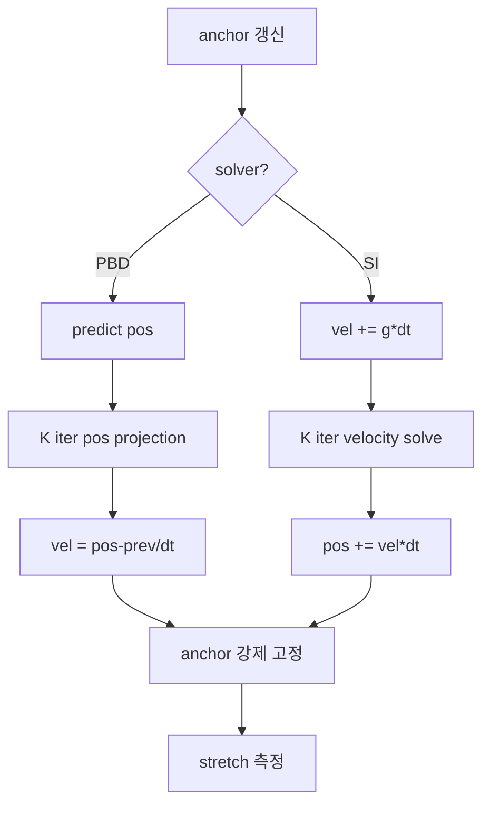

## 들어가며

`physics_lab` 의 일곱 번째 단계. *제약 조건* — N 개 mass 가 일렬로 연결된 *chain*. 첫 mass 는 사용자가 마우스로 끌 수 있는 *pin (anchor)*. 나머지는 중력에 따라 늘어지며 *distance constraint* 로 일정 거리를 유지한다.

이 Scene 의 비교 대상.

| 솔버 | 작용 level | 강점 | 약점 | 표준 사용처 |
|---|---|---|---|---|
| PBD distance constraint | position | 무조건 안정, cloth / rope 표준 | stiffness 가 iter 의존 (적게 돌리면 늘어남) | cloth, rope, soft body |
| Sequential Impulse distance constraint | velocity + Baumgarte | 링크 길이가 rigid, 압축·신장 모두 억제 | position drift 누적 (Baumgarte 로 보정) | rope, 링크 구조물 |

*범위*. 이 Scene 이 구현하는 제약은 *distance constraint 하나* 다. `Particle` 은 `pos / vel / prevPos / invMass` 만 갖는다 — 회전 자유도, 관성 모멘트, 각속도가 없으므로 hinge / slider / motor 같은 joint 와 ragdoll 은 이 lab 의 범위 밖이다.

핵심 차이.

- **PBD**: *constraint 를 position 으로 직접 만족시킴*. iter 한 번에 모든 link 가 한 번씩 *segment 길이로 보정*. 모든 link 가 완전히 만족하려면 *iter 가 충분* 해야 함 — *iter = stiffness*.
- **SI**: *Jacobian × invMass × Jacobianᵀ* 를 풀어 *velocity 가 등식을 만족* 하게. position drift 는 Baumgarte 항 (`-β/dt · (|x_b - x_a| - rest)`) 으로 천천히 보정.

---

## 목차
1. [Chain 자료구조](#1-chain-자료구조)
2. [PBD distance constraint](#2-pbd-distance-constraint)
3. [Sequential Impulse joint (Baumgarte)](#3-sequential-impulse-joint-baumgarte)
4. [Step 흐름 두 갈래](#4-step-흐름-두-갈래)
5. [무엇을 보는가](#5-무엇을-보는가)

---

## 1. Chain 자료구조

```cpp
struct Particle {
    Vector2 pos, vel, prevPos;
    float   invMass = 1.0f;        // 0 = static (pin)
};

struct DistanceConstraint {
    int   a, b;
    float rest;
    float lambda;                  // SI 의 accumulated impulse
};
```

`invMass = 0` 이 *질량 무한대 = 움직이지 않음* — 첫 mass 가 anchor. anchor 위치는 *DragHandle* 이 결정.

```cpp
void BuildChain(int n, float segmentLen) {
    particles_.clear();
    links_.clear();
    Vector2 start = ...;
    for (int i = 0; i < n; ++i) {
        Particle p;
        p.pos = {start.x + i * segmentLen, start.y};
        p.invMass = (i == 0) ? 0.0f : 1.0f;
        particles_.push_back(p);
    }
    for (int i = 0; i < n - 1; ++i) {
        links_.push_back({i, i + 1, segmentLen, 0});
    }
}
```

매 frame:

```cpp
particles_[0].pos = anchorHandle_.Position();
particles_[0].vel = {0, 0};
```

anchor 가 *사용자 입력에 따라 움직임*. 솔버가 chain 의 나머지 mass 를 *그 새 anchor 에 맞춰 늘어뜨림*.

## 2. PBD distance constraint

PBD 의 distance constraint 는 *segment 길이가 rest 와 같도록 두 mass 의 position 을 직접 보정*. 한 link 의 한 iter:

```cpp
Vector2 d = pos[b] - pos[a];
float   len = sqrt(d · d);
float   diff = len - rest;                 // > 0 늘어남 / < 0 압축
float   wsum = invMass[a] + invMass[b];
float   k = diff / (len * wsum);
pos[a] += k * invMass[a] * d;              // a 가 b 쪽으로
pos[b] -= k * invMass[b] * d;              // b 가 a 쪽으로
```

핵심. *각 mass 가 invMass 에 비례해서 보정*. 한쪽이 *static* (invMass = 0) 이면 *모든 보정이 다른 쪽에* — anchor 옆 mass 만 움직이고 anchor 는 고정.

iter 가 한 번이면 *한 link 의 길이만* 정확. 두 번이면 *두 다음 link 도 보정* 되지만 *앞 link 가 살짝 어긋남*. iter 가 많을수록 *모든 link 가 동시에 만족* 하는 상태에 수렴.

```cpp
void SolvePBD() {
    for (int iter = 0; iter < iterations_; ++iter) {
        for (const auto& l : links_) {
            // (위 코드)
        }
    }
}
```

Step 흐름:

```cpp
// 1. predict pos: prevPos = pos; vel += g*dt; pos += vel*dt
for (auto& p : particles_) {
    if (p.invMass <= 0) continue;
    p.vel.y += gravity_ * dt;
    p.pos.x += p.vel.x * dt;
    p.pos.y += p.vel.y * dt;
}
// 2. iterations 반복 — 모든 link 가 constraint 만족하도록 position 보정.
SolvePBD();
// 3. velocity 재구성.
for (auto& p : particles_) {
    p.vel = (p.pos - p.prevPos) / dt;
}
```

prevPos 는 *predict 전* 위치 — `for p in particles: p.prevPos = p.pos;` 가 1단계 *앞에* 와야 한다.

## 3. Sequential Impulse joint (Baumgarte)

SI 의 distance constraint 는 *velocity equation*:

$$
\frac{d}{dt}|x_b - x_a| = 0 \;\Leftrightarrow\; (v_b - v_a) \cdot \hat{n} = 0
$$

이걸 *각 link 마다 K 번 반복* 풀이. position drift 는 *Baumgarte 항* 으로:

$$
(v_b - v_a) \cdot \hat{n} = -\frac{\beta}{\Delta t} (|x_b - x_a| - L_0)
$$

오른쪽 항이 *bias* — 길이가 정확히 rest 이면 0, 늘어났으면 *anchor 쪽으로 끌어당기는 속도 보정*.

```cpp
void SolveSI(float dt) {
    for (auto& l : links_) l.lambda = 0.0f;
    for (int iter = 0; iter < iterations_; ++iter) {
        for (auto& l : links_) {
            Vector2 d   = pos[l.b] - pos[l.a];
            float   len = sqrt(d · d);
            Vector2 n   = d / len;

            float vRel    = (vel[l.b] - vel[l.a]) · n;
            float bias    = -(baumgarte_ / dt) * (len - l.rest);
            float dLambda = -(vRel - bias) / (invM[l.a] + invM[l.b]);
            l.lambda += dLambda;
            vel[l.a] -= dLambda * invM[l.a] * n;
            vel[l.b] += dLambda * invM[l.b] * n;
        }
    }
}
```

`baumgarte_` 는 0 ~ 1 사이. *0 이면 position drift 가 누적* (시간이 흐르며 chain 이 늘어남). *1 이면 한 step 에 모든 drift 해소* — 너무 강하면 *진동 / 발산*.

게임 엔진의 *typical 값* 0.1 ~ 0.3. Box2D 가 0.2.

Step 흐름:

```cpp
// 1. gravity 적분 (velocity).
for (auto& p : particles_) {
    if (p.invMass <= 0) continue;
    p.vel.y += gravity_ * dt;
}
// 2. SI iterations — velocity 가 등식 만족하도록 보정.
SolveSI(dt);
// 3. velocity 로 position 갱신.
for (auto& p : particles_) {
    if (p.invMass <= 0) continue;
    p.pos += p.vel * dt;
}
```

PBD 와 정반대 — *PBD 는 position 풀고 velocity derive*, *SI 는 velocity 풀고 position update*.

## 4. Step 흐름 두 갈래

매 step 안에서 *anchor 강제 고정* — 솔버가 (0 invMass 라 안 움직이지만) *수치 오차* 로 살짝 이동할 수 있어 마지막에 명시:

```cpp
particles_[0].pos = anchorHandle_.Position();
particles_[0].vel = {0, 0};
```

이걸 *솔버 후* 에도 한 번 더. 이 한 줄이 *체인이 anchor 에서 떨어지지 않게* 보장.

`baumgarte_` 항이 *SI 전용*. PBD 토글일 때는 사용 안 됨 — PBD 는 *position 을 직접 보정* 하기 때문에 *Baumgarte 같은 drift 보정 항이 본질적으로 불필요*.

## 5. 무엇을 보는가

- **chain stretch 시각화**: 각 link 의 색이 *늘어남에 비례해서 빨강이 진해짐*. PBD iter 가 부족하면 anchor 가까운 link 는 정상, 멀리 갈수록 *진해진다* — *propagation 한계*.
- **avg stretch 그래프**: 시간에 따른 평균 stretch. anchor 를 끌면 *spike → 정착*. iter 가 충분히 크면 *0 근처 유지*, 부족하면 *진동*.
- **solver ms 그래프**: PBD vs SI 의 시간 비교. 보통 비슷, *N × iterations* 에 비례.

**시나리오 A — N=12, iter=12, PBD.**

chain 이 *완전히 늘어남 = 0* — anchor 에서 자연스럽게 늘어진 모양. anchor 를 끌면 chain 이 *물리적으로 자연스럽게* 따라옴.

**시나리오 B — N=12, iter=2, PBD.**

chain 의 *마지막 link* 가 *눈에 띄게 늘어짐* — propagation 부족. iter 가 너무 적어 *anchor 쪽 link 만 만족* 하고 그 영향이 끝까지 전달 안 됨.

**시나리오 C — N=12, iter=12, SI, baumgarte=0.0.**

chain 이 *시간이 흐르며 점점 늘어남* — velocity constraint 는 *상태 변화율* 만 풀고 *현재 상태의 drift* 는 손대지 않음. baumgarte = 0 이면 누적.

**시나리오 D — N=12, iter=12, SI, baumgarte=0.2.**

drift 가 *천천히 보정* 됨. anchor 를 빠르게 흔들면 *위 link 부터 진동* — Baumgarte 항이 *낮은 주파수의 spring 같이 동작*.



---

## 결론

Step 7 에서 추가한 것.

1. **Chain 자료구조** — Particle + DistanceConstraint. anchor 는 invMass = 0. 같은 자료구조가 *cloth* (격자 + diagonal constraint), *rope* (이 코드 그대로), *muscle* (rest 길이 시간 함수) 로 확장.
2. **PBD distance solve** — iter 안에서 모든 link 의 *position projection*. invMass 비율로 두 mass 분배.
3. **SI distance solve** — velocity 등식 + Baumgarte. accumulated lambda 는 정해진 부호 제한 없음 (거리 *유지* 라 압축 / 늘어남 모두 허용).
4. **두 Step 흐름 분리** — PBD 는 *predict → solve → derive vel*, SI 는 *integrate vel → solve → update pos*. 같은 chain 으로 *완전히 다른 흐름*.
5. **anchor handle 강제 고정** — DragHandle 위치를 매 frame 두 번 강제 — 사용자 입력 → 솔버 후. 수치 오차로 anchor 가 안 흔들리도록.

이 chain 시뮬을 *cloth 격자* 로 확장하면 *Step 7 의 코드를 거의 그대로* — Particle 배열을 2D 격자 + diagonal constraint 추가. *Soft body* 도 tetrahedral mesh 의 edge 마다 DistanceConstraint. PBD 의 일반성이 여기 있다.

눈으로 보는 avg stretch 라벨 외에 `physics_constraints_tests` 타깃이 같은 계산을 ctest 로 검사한다. `SetCanvas` / `SetSolver` / `SetIterations` / `SetBaumgarte` 로 창 없이 chain 을 세우고 `Step` 을 돌린 뒤 `LastAvgStretch()` 를 읽는다.

- PBD 는 iteration 이 곧 stiffness — 1 / 2 / 4 / 8 / 16 회에서 평균 stretch 가 단조 감소한다 (0.0062 → 0.00028). `SolvePBD` 의 반복을 1 회로 고정하면 다섯 값이 같아져 실패한다.
- SI 는 baumgarte = 0 이면 position drift 가 남는다 — 200 스텝 뒤 0.162 대 0.0047 로 35 배 차이. bias 항을 0 으로 만들면 두 값이 같아져 실패한다.

## 더 읽을거리

- Müller 외, "Position Based Dynamics" (J. Vis. Commun. 2007) — PBD distance projection 의 원전.
- Macklin 외, "XPBD: Position-Based Simulation of Compliant Constrained Dynamics" (2016) — iteration 수에 독립적인 강성의 확장.
- Erin Catto, [Box2D Joint 구현](https://github.com/erincatto/box2d) — SI 기반 제약의 프로덕션 실물.
