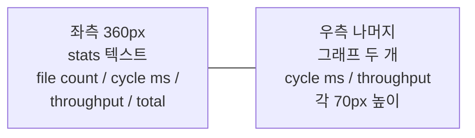
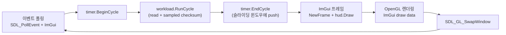

## 들어가며

이 글은 Linux 커널 메커니즘의 비용을 *동일 워크로드 위에서 토글로 비교* 하는 측정 도구의 초기 구현을 설명한다. 시스템 콜 비용, IO 모델, 동기화 프리미티브, 스케줄링 정책, 컨텍스트 스위치에 관한 주장을 직접 재현할 수 있는 환경이 목표다. 측정 대상은 유저 공간 알고리즘 자체가 아니라 *커널 경계를 통과할 때 생기는 비용* 이다.

이 lab은 Linux 전용이다. WSL2(커널 5.15+) 또는 native Linux에서 빌드한다. io_uring·futex·SCHED_FIFO·ftrace 같은 비교 대상이 모두 Linux 커널 기능이고, Windows API 대체로는 측정의 정합이 깨진다. WSL2는 ftrace 일부 기능에 제약이 있을 수 있는데, 그 부분은 완성된 도구에서 *대체 측정 경로* 로 처리한다.

이 단계의 결과물은 다음 다섯 가지를 갖춘 *최소 골격* 이다.

1. SDL2 + ImGui 윈도우와 메인 루프
2. `read(2)` 한 가지로 도는 단일 스레드 IO 워크로드 (16개 × 1MB 파일)
3. 한 *사이클* 의 ms와 처리량(MB/s)을 슬라이딩 윈도우로 보관하는 프레임 타이머
4. 좌측 stats 텍스트 + 우측 두 그래프(cycle ms, throughput) 의 ImGui HUD
5. CMake 한 번으로 빌드되는 프로젝트 구조 + 의존성 설치 스크립트

현재 범위 밖의 확장에서 토글 패널, IO 백엔드 5종(read/pread/mmap/aio/io_uring), 동기화 4종, 스케줄링 3종, 컨텍스트 스위치 2종, 그리고 strace·perf·ftrace 측정 시각화가 추가된다. 이 단계에서는 *측정 인프라의 토대* 만 깔고, 그 위에 read 한 가지로 도는 baseline 워크로드를 단단히 만든다.

---

## 목차

1. 도구의 성격: 시리즈의 짝
2. 기술 스택 선택: SDL2 + ImGui + CMake
3. WSL2 환경 셋업과 의존성 설치
4. 프로젝트 구조와 CMakeLists.txt
5. 워크로드 골격: `FileIoWorkload`
6. 프레임 타이머: 사이클 단위 측정
7. ImGui HUD: stats + 두 그래프
8. main 루프와 ImGui SDL2 OpenGL 통합
9. 빌드와 실행 결과
10. 검증 — 골격이 재현 가능한가

---

## 1. 도구의 성격: 시리즈의 짝

이 도구는 게임이 아니다. 시뮬레이션도 아니다. system 시리즈 글들의 *주장을 직접 측정으로 재현* 하는 환경이다. 시리즈에서 "io_uring은 어떤 조건에서 read 반복보다 시스템 콜 경계를 줄이는가", "mutex fast path, futex wait, atomic CAS는 경합 정도에 따라 어떤 비용을 보이는가", "SCHED_FIFO와 cgroup 설정은 지연 분산을 어떻게 바꾸는가" 같은 질문이 등장한다. 이 질문을 *본인 머신에서 토글 한 번으로 측정* 가능하게 만드는 게 목적이다.

핵심은 셋이다.

- **워크로드의 고정성**: 같은 N개 파일, 같은 결정론적 시드, 같은 가공 루프. 차이는 토글된 *커널 경로* 에서만 나온다.
- **측정 채널의 분리**: 사이클 ms · 처리량 MB/s · 시스템 콜 카운트 · 컨텍스트 스위치 · 페이지 폴트. 각 토글이 어느 채널에 영향을 주는지 그래프에 *세로 절벽* 으로 보인다.
- **재현 가능성**: 결정론적 fixture 파일 + Linux 커널 버전 + WSL2/native 환경 명시. 같은 측정을 누가 돌려도 비슷한 모양이 나오게 한다.

이 단계는 *워크로드와 측정 인프라의 토대* 를 깔고, baseline으로 쓸 read 경로를 박는다. 그 위에 완성된 구성이 토글과 모듈을 얹는다.

## 2. 기술 스택 선택: SDL2 + ImGui + CMake

이 lab의 GUI 요구는 다음과 같다.

- 토글 패널 (콤보박스 5~6개, 슬라이더 2개)
- 시계열 그래프 4~5개 (cycle ms, throughput, p99 latency, syscall count, ctx switches)
- ftrace 타임라인 (간트 차트 형태) — 완성된 도구에서 등장
- 텍스트 stats 패널

parts_perf_lab은 raylib을 썼지만, 이 lab은 *그래프 위주* 라 ImGui가 더 적합하다. ImGui의 `PlotLines` 가 시계열 그래프에 직접 쓰이고, 토글 위젯도 raygui보다 풍부하다. parts_perf_lab은 raylib 자체로 픽셀을 1만 개 그리는 게 핵심이라 raylib이 더 자연스러웠다.

| 항목 | parts_perf_lab (raylib) | system_kernel_lab (SDL2 + ImGui) |
|---|---|---|
| 핵심 그리기 대상 | 1만 점 | 시계열 그래프 + 텍스트 |
| GUI 라이브러리 | raygui (raylib 자매) | ImGui |
| 그래프 그리기 | 직접 폴리라인 (`DrawLine`) | `ImGui::PlotLines` |
| 토글 풍부도 | 콤보·체크박스 | 콤보·체크·슬라이더·트리·테이블 |
| 한 줄 요약 | 픽셀 그리기 위주 | 위젯 + 그래프 위주 |

SDL2는 *윈도우 + OpenGL 컨텍스트* 만 담당한다. WSL2의 WSLg가 X11/Wayland를 Windows 데스크톱에 전달하므로, SDL2 + OpenGL3 백엔드가 *그대로* 동작한다.

빌드 시스템은 CMake 3.20+. ImGui는 FetchContent로, SDL2는 시스템 패키지로 가져온다. ImGui는 단일 헤더 라이브러리가 아니라 *cpp 파일 5~7개* 를 직접 빌드 대상에 넣어야 한다.

## 3. WSL2 환경 셋업과 의존성 설치

WSL2 (Ubuntu 22.04 또는 Debian 12+) 가 설치되어 있다고 가정한다. 처음 한 번 다음 패키지를 설치한다.

```bash
sudo apt-get update
sudo apt-get install -y \
    build-essential \
    cmake \
    git \
    pkg-config \
    libsdl2-dev \
    libgl1-mesa-dev \
    liburing-dev

# 측정 도구. 현재 범위 밖의 확장에서 사용.
sudo apt-get install -y \
    strace \
    linux-tools-generic \
    trace-cmd
```

이 명령은 `scripts/install_deps.sh` 로 저장되어 있어 한 번에 실행 가능하다.

| 패키지 | 용도 |
|---|---|
| `build-essential`, `cmake` | C++20 컴파일 + 빌드 시스템 |
| `pkg-config` | SDL2 설정 발견 |
| `libsdl2-dev` | 윈도우/입력/OpenGL 컨텍스트 |
| `libgl1-mesa-dev` | OpenGL 헤더와 ICD |
| `liburing-dev` | 현재 범위 밖의 확장의 io_uring 백엔드용 (이 단계는 사용 안 함) |
| `strace`, `trace-cmd`, `linux-tools-generic` | 현재 범위 밖의 확장의 측정 도구 |

WSLg는 Windows 11 + WSL2 기본 설치에 포함된다. Windows 10이면 GUI 도구가 별도 X 서버 (VcXsrv 등) 를 요구한다.

### WSL2 환경 확인

빌드 전에 환경이 맞는지 한 번 확인한다.

```bash
uname -r        # 커널 5.15+
echo $WAYLAND_DISPLAY $DISPLAY  # WSLg가 동작하면 둘 중 하나가 비어 있지 않음
glxinfo | head -5               # mesa-utils 패키지 — OpenGL 백엔드 확인
```

`uname -r` 이 5.15 미만이면 io_uring 일부 기능이 빠진다. WSL2 커널은 `wsl --update` 로 갱신 가능하다.

## 4. 프로젝트 구조와 CMakeLists.txt

이 단계의 디렉토리 구조는 다음과 같다.

```text
system_kernel_lab/
  CMakeLists.txt
  scripts/
    install_deps.sh
  src/
    main.cpp
    workload/
      file_io_workload.h
      file_io_workload.cpp
    measure/
      frame_timer.h
      frame_timer.cpp
    ui/
      hud.h
      hud.cpp
```

`workload/`, `measure/`, `ui/` 로 *워크로드/측정/UI* 를 분리해 두었다. 현재 범위 밖의 확장에서 `io/`, `sync/`, `sched/`, `ctx/` 디렉토리가 같은 패턴으로 추가된다.

### CMakeLists.txt

```cmake
cmake_minimum_required(VERSION 3.20)
project(system_kernel_lab CXX)

set(CMAKE_CXX_STANDARD 20)
set(CMAKE_CXX_STANDARD_REQUIRED ON)
set(CMAKE_CXX_EXTENSIONS OFF)

if(NOT CMAKE_BUILD_TYPE AND NOT CMAKE_CONFIGURATION_TYPES)
    set(CMAKE_BUILD_TYPE Release CACHE STRING "Build type" FORCE)
endif()

# 이 lab은 Linux 전용. WSL2 또는 native Linux에서 빌드한다.
if(NOT CMAKE_SYSTEM_NAME STREQUAL "Linux")
    message(FATAL_ERROR
        "system_kernel_lab is Linux-only. Build under WSL2 or native Linux.")
endif()

find_package(SDL2 REQUIRED)
find_package(OpenGL REQUIRED)
find_package(Threads REQUIRED)

include(FetchContent)
FetchContent_Declare(
    imgui
    GIT_REPOSITORY https://github.com/ocornut/imgui.git
    GIT_TAG v1.90.4
    GIT_SHALLOW TRUE
    SOURCE_SUBDIR none
)
FetchContent_MakeAvailable(imgui)
```

여기까지는 프로젝트 기본 설정, Linux 가드, 외부 의존성 수집이다. ImGui는 받아온 소스 파일을 현재 실행 파일 타깃에 직접 넣는다.

```cmake
set(IMGUI_SOURCES
    ${imgui_SOURCE_DIR}/imgui.cpp
    ${imgui_SOURCE_DIR}/imgui_draw.cpp
    ${imgui_SOURCE_DIR}/imgui_tables.cpp
    ${imgui_SOURCE_DIR}/imgui_widgets.cpp
    ${imgui_SOURCE_DIR}/backends/imgui_impl_sdl2.cpp
    ${imgui_SOURCE_DIR}/backends/imgui_impl_opengl3.cpp
)

add_executable(${PROJECT_NAME}
    src/main.cpp
    src/measure/frame_timer.cpp
    src/workload/file_io_workload.cpp
    src/ui/hud.cpp
    ${IMGUI_SOURCES}
)

target_include_directories(${PROJECT_NAME} PRIVATE
    src
    ${imgui_SOURCE_DIR}
    ${imgui_SOURCE_DIR}/backends
    ${SDL2_INCLUDE_DIRS}
)

target_link_libraries(${PROJECT_NAME} PRIVATE
    SDL2::SDL2
    OpenGL::GL
    Threads::Threads
    ${CMAKE_DL_LIBS}
)

target_compile_options(${PROJECT_NAME} PRIVATE
    -Wall -Wextra -Wpedantic)
```

세 가지 결정 포인트.

1. **OS 가드**: `if(NOT CMAKE_SYSTEM_NAME STREQUAL "Linux")` 로 Windows·macOS에서 빌드 시도 시 즉시 실패. 사용자가 환경 착각으로 의미 없는 빌드 오류를 만나는 걸 막는다.
2. **ImGui FetchContent + `SOURCE_SUBDIR none`**: ImGui 저장소 자체에 CMakeLists.txt가 있지만 라이브러리 타깃을 만드는 형태가 아니라, 우리는 *소스만 받아 직접 빌드 대상에 추가* 한다. `SOURCE_SUBDIR none` 으로 ImGui의 CMake가 호출되지 않게 한다.
3. **ImGui SDL2 + OpenGL3 backend**: `imgui_impl_sdl2.cpp` 와 `imgui_impl_opengl3.cpp` 둘 다 빌드 대상. 백엔드가 두 라이브러리(SDL2, OpenGL)를 묶는 어댑터다.

### ImGui 소스 직접 빌드의 트레이드오프

ImGui를 *우리 빌드 타깃의 일부* 로 두는 건 의도적이다.

| 항목 | 직접 빌드 (이 도구의 선택) | 별도 라이브러리 |
|---|---|---|
| 빌드 시간 | 약간 길어짐 (cpp 6개 추가 컴파일) | 한 번 빌드 후 재사용 |
| 버전 충돌 | 없음 | 시스템 ImGui 버전과 충돌 가능 |
| 디버깅 | 우리 빌드와 같은 최적화 옵션 | 별도 빌드 옵션 |
| 사용자 환경 | 어디서나 동일 결과 | 시스템 ImGui 의존 |

이 lab의 우선순위는 *재현성* 이라 직접 빌드 쪽이 자연스럽다.

## 5. 워크로드 골격: `FileIoWorkload`

워크로드는 단순하다. *N개 파일을 read하고 페이지 단위 sampled checksum을 누적하는* 한 사이클이 매 프레임 한 번씩 돈다. 이 단계는 N=16, 파일당 1MB. 총 16MB가 한 사이클의 처리량이다.

### fixture 자동 생성

매번 같은 파일을 측정해야 *재현 가능* 하다. fixture 파일은 결정론적 시드로 자동 생성한다.

```cpp
// src/workload/file_io_workload.h
#pragma once

#include <cstddef>
#include <cstdint>
#include <filesystem>
#include <string>
#include <vector>

namespace skl {

class FileIoWorkload {
public:
    void Init(std::size_t fileCount,
              std::size_t fileBytes,
              const std::filesystem::path& fixtureDir = {});

    // 한 사이클: 모든 파일을 read하고 sampled checksum 갱신.
    // 반환: 이번 사이클에서 처리한 바이트 수.
    std::uint64_t RunCycle();

    void Shutdown();

    std::size_t   FileCount()  const { return paths_.size(); }
    std::size_t   FileBytes()  const { return fileBytes_; }
    std::uint64_t LastChecksum() const { return lastChecksum_; }
    const std::filesystem::path& FixtureDir() const { return fixtureDir_; }

private:
    void GenerateFixture(std::size_t fileCount, std::size_t fileBytes);

    std::filesystem::path        fixtureDir_;
    std::vector<std::string>     paths_;
    std::vector<unsigned char>   buffer_;
    std::size_t                  fileBytes_ = 0;
    std::uint64_t                lastChecksum_ = 0;
    bool                         ownsFixture_ = false;
};

}  // namespace skl
```

namespace는 `skl` 로 둔다. system_kernel_lab의 약어. parts_perf_lab의 `ppl` 과 같은 패턴이다.

### fixture 생성 동작

`Init` 이 호출되면 `/tmp/system_kernel_lab_data/` 에 N개 파일을 만든다. 이미 같은 크기로 만들어진 파일이 있으면 *재생성을 건너뛴다* — 측정 시작 비용을 줄인다.

```cpp
// src/workload/file_io_workload.cpp 일부

namespace {

void FillDeterministicBytes(std::vector<unsigned char>& buf,
                             std::uint64_t seed) {
    std::mt19937_64 rng(seed);
    std::size_t i = 0;
    while (i + sizeof(std::uint64_t) <= buf.size()) {
        const std::uint64_t v = rng();
        std::memcpy(buf.data() + i, &v, sizeof(v));
        i += sizeof(std::uint64_t);
    }
    while (i < buf.size()) {
        buf[i++] = static_cast<unsigned char>(rng() & 0xFF);
    }
}

}  // namespace
```

파일 생성 함수는 디렉토리를 만들고, 이미 같은 크기의 파일이 있으면 그대로 사용한다.

<!-- snippet: src/workload/file_io_workload.cpp#FileIoWorkload::GenerateFixture -->
```cpp
void FileIoWorkload::GenerateFixture(std::size_t fileCount,
                                     std::size_t fileBytes) {
    std::error_code ec;
    std::filesystem::create_directories(fixtureDir_, ec);
    if (ec) {
        throw std::runtime_error("fixture dir create failed: " + ec.message());
    }

    paths_.reserve(fileCount);
    std::vector<unsigned char> tmp(fileBytes);

    for (std::size_t i = 0; i < fileCount; ++i) {
        char name[64];
        std::snprintf(name, sizeof(name), "f_%04zu.bin", i);
        std::filesystem::path p = fixtureDir_ / name;
        paths_.push_back(p.string());

        std::error_code statEc;
        const auto sz = std::filesystem::file_size(p, statEc);
        if (!statEc && sz == fileBytes) continue;  // 이미 같은 크기면 재생성 안 함

        FILE* f = std::fopen(p.c_str(), "wb");
        if (!f) {
            throw std::runtime_error("fixture file open failed: " + p.string());
        }
        FillDeterministicBytes(tmp, /*seed=*/0xC0FFEE'0001ULL + i);
        const std::size_t written = std::fwrite(tmp.data(), 1, tmp.size(), f);
        if (written != tmp.size()) {
            std::fclose(f);
            throw std::runtime_error("fixture file write failed: " + p.string());
        }
        if (std::fclose(f) != 0) {
            throw std::runtime_error("fixture file close failed: " + p.string());
        }
    }
}
```

`mt19937_64` 시드가 *파일별로 다른* 값을 만들도록 `0xC0FFEE0001 + i` 를 쓴다. 같은 머신에서 두 번 돌려도 같은 fixture가 만들어진다.

### read 사이클

```cpp
constexpr std::size_t kChecksumStride = 4096;

std::uint64_t FileIoWorkload::RunCycle() {
    std::uint64_t checksum = lastChecksum_;
    std::uint64_t bytes    = 0;

    for (const auto& path : paths_) {
        const int fd = ::open(path.c_str(), O_RDONLY);
        if (fd < 0) {
            throw std::runtime_error("open failed: " + path + ": "
                                     + std::strerror(errno));
        }

        std::size_t pos = 0;
        while (pos < fileBytes_) {
            const ssize_t n = ::read(fd, buffer_.data() + pos,
                                      fileBytes_ - pos);
            if (n < 0) {
                if (errno == EINTR) continue;
                const std::string msg = "read failed: " + path + ": "
                                      + std::strerror(errno);
                ::close(fd);
                throw std::runtime_error(msg);
            }
            if (n == 0) break;
            pos += static_cast<std::size_t>(n);
        }
        ::close(fd);

        // 페이지 단위 샘플링 checksum.
        // read 자체는 제거되지 않지만, 후속 mmap 백엔드와 같은 방식으로
        // 읽은 데이터를 관찰하기 위해 최소 가공만 수행한다.
        for (std::size_t i = 0; i < pos; i += kChecksumStride) {
            checksum += buffer_[i];
        }
        if (pos > 0 && ((pos - 1) % kChecksumStride) != 0) {
            checksum += buffer_[pos - 1];
        }
        bytes += pos;
    }

    lastChecksum_ = checksum;
    return bytes;
}
```

세 가지 결정 포인트.

1. **매 사이클 open + read + close**: open/close 비용도 측정에 *포함* 된다. 현재 범위 밖의 확장에서 이 비용을 *분리* 하기 위해 fd 캐시 토글이 추가될 수 있다. 이 단계는 가장 단순한 형태로 둔다.
2. **버퍼는 사이클 간 재사용**: `buffer_` 는 `Init` 시점에 한 번 할당. 매 사이클 새로 alloc하면 *측정에 alloc 비용이 섞인다*. parts_perf_lab의 `EventBenchmark` 와 같은 분리 의도.
3. **sampled checksum의 역할**: `read(2)` 자체는 외부 시스템 콜이라 컴파일러가 제거할 수 없다. 그래도 후속 `mmap` 백엔드까지 같은 방식으로 파일 내용을 관찰하려면 버퍼 일부를 실제로 읽어야 한다. 전수 byte sum은 CPU 루프가 IO 차이를 묻을 수 있으므로 4KB 페이지 단위 샘플만 `lastChecksum_` 에 더한다.

### 페이지 캐시의 영향

이 워크로드는 16MB 가 한 사이클이라 *페이지 캐시에 모두 들어간다*. 두 번째 사이클부터는 디스크 IO가 거의 안 일어나고 *커널이 페이지 캐시에서 바로 응답* 한다.

이게 *문제* 가 아니라 *측정 변수* 다. 파일 크기 토글(4KB / 1MB / 1GB) 이 현재 범위 밖의 확장에서 페이지 캐시 효과를 *깨거나 살리는* 식으로 비교 대상이 된다. 1GB는 보통 캐시에 안 들어가 디스크 IO가 매번 발생한다.

이 단계의 baseline은 *캐시 hit 시나리오* 다. 따뜻한 캐시 위에서 read 시스템 콜의 비용이 어느 정도인지 본다.

## 6. 프레임 타이머: 사이클 단위 측정

parts_perf_lab은 *프레임* 단위로 update/draw를 측정했다. 이 lab은 *사이클* 단위 — 한 워크로드 패스가 한 사이클이다. 측정 단위가 다른 이유는 워크로드 자체의 모양이 다르기 때문이다.

| 도구 | 한 측정 단위 | 의미 |
|---|---|---|
| parts_perf_lab | 한 프레임 | 시뮬 + draw 한 번 |
| system_kernel_lab | 한 사이클 | N개 파일 read + 가공 한 번 |

한 사이클이 한 프레임과 *동일하지 않다*. 사이클이 길어지면 (예: 큰 파일) 한 프레임에 한 사이클이 끝나지 않을 수도 있다. 그래서 *렌더링과 측정을 분리* 한다 — 메인 루프가 한 사이클 끝날 때마다 한 프레임을 렌더링하고, 사이클이 짧으면 매 프레임 한 사이클이 도는 모양이 된다.

```cpp
// src/measure/frame_timer.h
#pragma once

#include <array>
#include <chrono>
#include <cstddef>
#include <cstdint>

namespace skl {

class FrameTimer {
public:
    static constexpr std::size_t kCapacity = 600;

    void BeginCycle();
    void EndCycle(std::uint64_t bytesProcessed);

    const std::array<float, kCapacity>& CycleMs()       const { return cycleMs_; }
    const std::array<float, kCapacity>& ThroughputMBs() const { return throughputMBs_; }
    std::size_t Head()   const { return head_; }
    std::size_t Filled() const { return filled_; }

    float         LastCycleMs()       const { return lastCycleMs_; }
    float         LastThroughputMBs() const { return lastThroughputMBs_; }
    std::uint64_t LastBytes()         const { return lastBytes_; }
    std::uint64_t TotalCycles()       const { return totalCycles_; }
    std::uint64_t TotalBytes()        const { return totalBytes_; }

private:
    using Clock = std::chrono::steady_clock;
    using Time  = Clock::time_point;

    Time cycleStart_{};

    std::array<float, kCapacity> cycleMs_{};
    std::array<float, kCapacity> throughputMBs_{};
    std::size_t head_   = 0;
    std::size_t filled_ = 0;

    float         lastCycleMs_       = 0.0f;
    float         lastThroughputMBs_ = 0.0f;
    std::uint64_t lastBytes_         = 0;
    std::uint64_t totalCycles_       = 0;
    std::uint64_t totalBytes_        = 0;
};

}  // namespace skl
```

두 채널을 슬라이딩 윈도우로 보관한다.

- **cycleMs**: 한 사이클의 ms.
- **throughputMBs**: 그 사이클의 MB/s. `bytes / 1e6 / (ms / 1000) = bytes / ms / 1000`.

처리량이 ms와 *반비례* 라 두 그래프는 거울상이지만, 토글 효과를 *읽기 쉬운 단위* 로 본다는 뜻에서 둘 다 둔다. 사이클 ms는 *지연* 의 대용, MB/s는 *throughput* 의 대용이다.

```cpp
// src/measure/frame_timer.cpp
#include "measure/frame_timer.h"

namespace skl {

void FrameTimer::BeginCycle() {
    cycleStart_ = Clock::now();
}

void FrameTimer::EndCycle(std::uint64_t bytesProcessed) {
    const auto end = Clock::now();
    const auto ns  = std::chrono::duration_cast<std::chrono::nanoseconds>(
        end - cycleStart_).count();
    const float ms = static_cast<float>(ns) / 1.0e6f;

    lastCycleMs_ = ms;
    lastBytes_   = bytesProcessed;
    lastThroughputMBs_ = (ms > 0.0f)
        ? static_cast<float>(bytesProcessed) / ms / 1000.0f
        : 0.0f;

    cycleMs_[head_]       = lastCycleMs_;
    throughputMBs_[head_] = lastThroughputMBs_;
    head_ = (head_ + 1) % kCapacity;
    if (filled_ < kCapacity) {
        ++filled_;
    }

    ++totalCycles_;
    totalBytes_ += bytesProcessed;
}

}  // namespace skl
```

`steady_clock` 단조 증가 시계로 ns 단위 정확도. parts_perf_lab과 같은 패턴. ns로 받아 ms로 환산하는 게 디버그 시 정수 ns 값을 직접 확인하기 좋아 명시적으로 그렇게 둔다.

## 7. ImGui HUD: stats + 두 그래프

ImGui는 *즉시 모드* GUI다. 매 프레임 위젯 함수를 호출하고 ImGui가 그리기 명령을 모아 한 번에 OpenGL로 그린다. raygui와 비슷한 모델이지만 *위젯 풍부도와 그래프 지원* 이 한 단계 위다.

### 핵심: 링 버퍼를 PlotLines가 받는 형태로

`ImGui::PlotLines` 는 *연속 배열* 을 받는다. 우리 슬라이딩 윈도우는 *링 버퍼* 라 head가 어디든 *오래된 → 최신* 순서로 풀어낸 임시 배열이 필요하다.

<!-- snippet: src/ui/hud.cpp -->
```cpp
// src/ui/hud.cpp 일부

namespace {

void UnwrapRing(const float* src, std::size_t cap,
                std::size_t head, std::size_t filled,
                float* dst) {
    for (std::size_t i = 0; i < filled; ++i) {
        const std::size_t idx = (head + cap - filled + i) % cap;
        dst[i] = src[idx];
    }
}

}  // namespace
```

600개 float 두 채널 = 4800 byte. 스택에 잡아도 안전한 크기다.

### HUD 본체

```cpp
void Hud::Draw(const FrameTimer& timer, const FileIoWorkload& workload) {
    constexpr float kPanelH = 200.0f;
    ImGui::SetNextWindowPos(ImVec2(0.0f, static_cast<float>(windowH_) - kPanelH));
    ImGui::SetNextWindowSize(ImVec2(static_cast<float>(windowW_), kPanelH));
    constexpr ImGuiWindowFlags flags =
        ImGuiWindowFlags_NoTitleBar | ImGuiWindowFlags_NoResize |
        ImGuiWindowFlags_NoMove | ImGuiWindowFlags_NoCollapse |
        ImGuiWindowFlags_NoBringToFrontOnFocus;

    ImGui::Begin("hud", nullptr, flags);

    // 좌: 핵심 수치.
    ImGui::BeginChild("stats", ImVec2(360, 0), false);
    {
        char buf[512];
        std::snprintf(buf, sizeof(buf),
                      "files       : %zu  x  %.2f MB\n"
                      "cycle ms    : %7.3f\n"
                      "throughput  : %7.1f MB/s\n"
                      "last bytes  : %llu\n"
                      "total cycles: %llu\n"
                      "total MB    : %.1f\n"
                      "fixture dir : %s",
                      workload.FileCount(),
                      static_cast<double>(workload.FileBytes()) / 1.0e6,
                      timer.LastCycleMs(),
                      timer.LastThroughputMBs(),
                      static_cast<unsigned long long>(timer.LastBytes()),
                      static_cast<unsigned long long>(timer.TotalCycles()),
                      static_cast<double>(timer.TotalBytes()) / 1.0e6,
                      workload.FixtureDir().c_str());
        ImGui::TextUnformatted(buf);
    }
    ImGui::EndChild();
    ImGui::SameLine();

    // 그래프 영역은 아래 코드 블록에서 이어진다.
```

그래프 영역은 같은 `Hud::Draw` 함수의 뒤쪽이다. 링 버퍼를 오래된 샘플부터 최신 샘플까지 풀어낸 뒤 `PlotLines` 에 넘긴다.

```cpp
    // 우: 두 그래프.
    ImGui::BeginChild("graphs", ImVec2(0, 0), false);
    {
        const std::size_t filled = timer.Filled();
        if (filled > 0) {
            constexpr std::size_t cap = FrameTimer::kCapacity;
            const std::size_t head = timer.Head();

            float msSeries[cap];
            float tpSeries[cap];
            UnwrapRing(timer.CycleMs().data(),       cap, head, filled, msSeries);
            UnwrapRing(timer.ThroughputMBs().data(), cap, head, filled, tpSeries);

            char overlay[64];
            std::snprintf(overlay, sizeof(overlay),
                          "%.3f ms", timer.LastCycleMs());
            ImGui::PlotLines("cycle ms", msSeries,
                             static_cast<int>(filled), 0, overlay,
                             0.0f, FLT_MAX, ImVec2(0, 70));

            std::snprintf(overlay, sizeof(overlay),
                          "%.1f MB/s", timer.LastThroughputMBs());
            ImGui::PlotLines("throughput", tpSeries,
                             static_cast<int>(filled), 0, overlay,
                             0.0f, FLT_MAX, ImVec2(0, 70));
        } else {
            ImGui::TextUnformatted("(collecting samples...)");
        }
    }
    ImGui::EndChild();

    ImGui::End();
}
```

설계 요점.

- **HUD를 화면 하단 200px 고정 영역에** 배치. `NoMove`/`NoResize`/`NoTitleBar` 플래그로 사용자가 실수로 옮기지 않게 한다.
- **`BeginChild` 로 좌/우 분할**. 좌측 360px stats, 나머지를 그래프 두 개가 나누어 차지.
- **`PlotLines` 의 자동 스케일**: `scale_min=0.0f, scale_max=FLT_MAX` 가 ImGui sentinel — *측정 값의 min/max를 자동* 으로 잡는다.
- **overlay 텍스트**: 그래프 위에 현재 값이 텍스트로 표시되어 그래프가 작아도 정확한 수치를 본다.

### 그림: HUD 영역 구성



토글 패널은 현재 범위 밖의 확장에서 추가된다. 이 단계의 HUD는 *읽기 전용* 이다.

## 8. main 루프와 ImGui SDL2 OpenGL 통합

main은 SDL2 윈도우 생성 → OpenGL 컨텍스트 생성 → ImGui 초기화 → 메인 루프 → 정리 순서다.

```cpp
// src/main.cpp
#include "measure/frame_timer.h"
#include "ui/hud.h"
#include "workload/file_io_workload.h"

#include "imgui.h"
#include "imgui_impl_opengl3.h"
#include "imgui_impl_sdl2.h"

#include <SDL.h>
#include <SDL_opengl.h>

#include <cstdio>
#include <cstdlib>

namespace {
constexpr int kWindowW = 1280;
constexpr int kWindowH = 720;
constexpr std::size_t kFileCount = 16;
constexpr std::size_t kFileBytes = 1u * 1024u * 1024u;
}  // namespace
```

### 초기화

```cpp
int main(int /*argc*/, char** /*argv*/) {
    if (SDL_Init(SDL_INIT_VIDEO | SDL_INIT_TIMER) != 0) {
        std::fprintf(stderr, "SDL_Init failed: %s\n", SDL_GetError());
        return EXIT_FAILURE;
    }

    SDL_GL_SetAttribute(SDL_GL_CONTEXT_FLAGS, 0);
    SDL_GL_SetAttribute(SDL_GL_CONTEXT_PROFILE_MASK,
                        SDL_GL_CONTEXT_PROFILE_CORE);
    SDL_GL_SetAttribute(SDL_GL_CONTEXT_MAJOR_VERSION, 3);
    SDL_GL_SetAttribute(SDL_GL_CONTEXT_MINOR_VERSION, 2);

    constexpr Uint32 windowFlags = SDL_WINDOW_OPENGL | SDL_WINDOW_RESIZABLE
                                   | SDL_WINDOW_ALLOW_HIGHDPI;
    SDL_Window* window = SDL_CreateWindow("system_kernel_lab",
                                           SDL_WINDOWPOS_CENTERED,
                                           SDL_WINDOWPOS_CENTERED,
                                           kWindowW, kWindowH, windowFlags);
    SDL_GLContext glContext = SDL_GL_CreateContext(window);
    if (!glContext) {
        std::fprintf(stderr, "SDL_GL_CreateContext failed: %s\n", SDL_GetError());
        SDL_DestroyWindow(window);
        SDL_Quit();
        return EXIT_FAILURE;
    }
    SDL_GL_MakeCurrent(window, glContext);
    SDL_GL_SetSwapInterval(0);  // VSync 끔.

    IMGUI_CHECKVERSION();
    ImGui::CreateContext();
    ImGui::StyleColorsDark();
    ImGui_ImplSDL2_InitForOpenGL(window, glContext);
    ImGui_ImplOpenGL3_Init("#version 150");

    skl::FileIoWorkload workload;
    workload.Init(kFileCount, kFileBytes);

    skl::FrameTimer timer;
    skl::Hud hud;
    hud.Init(kWindowW, kWindowH);
```

OpenGL 3.2 Core Profile은 ImGui의 OpenGL3 백엔드 최소 요구치. WSL2 + WSLg 의 Mesa d3d12 백엔드가 이 정도는 지원한다.

`SDL_GL_SetSwapInterval(0)` 으로 VSync를 끈다. 측정이 모니터 16.67ms 갭에 묶이지 않게 한다 (parts_perf_lab의 `SetTargetFPS(0)` 와 같은 의도).

### 메인 루프

```cpp
    bool running = true;
    while (running) {
        SDL_Event event;
        while (SDL_PollEvent(&event)) {
            ImGui_ImplSDL2_ProcessEvent(&event);
            if (event.type == SDL_QUIT) running = false;
            if (event.type == SDL_WINDOWEVENT
                && event.window.event == SDL_WINDOWEVENT_CLOSE
                && event.window.windowID == SDL_GetWindowID(window)) {
                running = false;
            }
        }

        // 한 사이클: 워크로드 한 패스.
        timer.BeginCycle();
        const std::uint64_t bytes = workload.RunCycle();
        timer.EndCycle(bytes);

        // ImGui 프레임.
        ImGui_ImplOpenGL3_NewFrame();
        ImGui_ImplSDL2_NewFrame();
        ImGui::NewFrame();

        int w = 0, h = 0;
        SDL_GetWindowSize(window, &w, &h);
        hud.Init(w, h);  // 윈도우 크기 변경 대응.
        hud.Draw(timer, workload);

        ImGui::Render();
        glViewport(0, 0, w, h);
        glClearColor(0.06f, 0.06f, 0.08f, 1.0f);
        glClear(GL_COLOR_BUFFER_BIT);
        ImGui_ImplOpenGL3_RenderDrawData(ImGui::GetDrawData());
        SDL_GL_SwapWindow(window);
    }

    workload.Shutdown();
    ImGui_ImplOpenGL3_Shutdown();
    ImGui_ImplSDL2_Shutdown();
    ImGui::DestroyContext();
    SDL_GL_DeleteContext(glContext);
    SDL_DestroyWindow(window);
    SDL_Quit();
    return EXIT_SUCCESS;
}
```

루프 한 바퀴의 순서가 측정 정직성의 핵심이다.



워크로드 측정(`Begin~End`)이 ImGui/OpenGL 렌더링과 *완전히 분리* 된다. 그래프에 그려지는 ms는 *순수 워크로드 시간* 이다. HUD 그리기 비용은 cycle ms에 섞이지 않는다.

`hud.Init(w, h)` 를 매 프레임 호출하는 건 *윈도우 크기 변경* 에 대응하기 위해서다. 사용자가 윈도우를 리사이즈해도 HUD가 화면 하단에 정확히 붙는다.

## 9. 빌드와 실행 결과

WSL2 셸에서 한 번 구성하고 빌드한다.

```bash
cd /mnt/c/.../projects/mini/system_kernel_lab   # 또는 WSL 안 디렉토리로 복사
cmake -S . -B build
cmake --build build -j
./build/system_kernel_lab
```

첫 빌드는 ImGui 다운로드 + 컴파일에 1~2분 정도 걸린다. 두 번째부터는 30초 안쪽이다.

### 처음 실행 시

처음 실행하면 fixture 디렉토리(`/tmp/system_kernel_lab_data/`)에 16개 파일을 만든다. 16 MB 가 디스크에 쓰여 1~2초 정도 *시작이 느려질 수 있다*. 두 번째 실행부터는 같은 fixture가 있어 즉시 시작된다.

### 화면

화면 위쪽 520px는 비어 있고(현재 범위 밖의 확장에서 토글 패널과 시뮬 시각화가 들어온다), 화면 하단 200px의 HUD에 다음과 같은 정보가 매 사이클 갱신된다.

```text
files       : 16  x  1.05 MB
cycle ms    :   3.421
throughput  :  4900.7 MB/s
last bytes  : 16777216
total cycles: 1247
total MB    : 20916.5
fixture dir : /tmp/system_kernel_lab_data
```

수치는 머신마다 다르다. WSL2 + 페이지 캐시가 따뜻한 상태에서는 read 시스템 콜이 *매우 빠르다* — 몇 ms에 16 MB가 읽힌다. 처리량이 수 GB/s 단위로 보이는 게 정상이다. *디스크가 아니라 페이지 캐시에서 읽고 있다는 신호* 다.

우측 그래프 두 개에는 *시계열* 이 그려진다. 처음 몇 사이클이 지나면 cycle ms가 거의 평탄한 라인이 되고, throughput도 그 거울상으로 평탄하다. 페이지 캐시가 채워진 후의 안정 상태다.

### 검증 체크리스트

코드를 따라 쳤는데 동작이 이상하면 다음을 확인한다.

- 빌드 시 SDL2 헤더를 못 찾음 → `libsdl2-dev` 미설치. `scripts/install_deps.sh` 실행.
- 빌드 시 ImGui FetchContent 실패 → `git` 이 시스템에 설치되어 있어야 한다.
- 실행 시 *Could not initialize GLX* 또는 OpenGL 컨텍스트 실패 → WSLg 미동작 (Windows 10), 또는 `mesa-utils` 미설치. `wsl --update` 후 재시도.
- 실행은 되는데 HUD가 안 보임 → 윈도우 크기가 너무 작아 HUD 200px가 화면 밖. 윈도우를 키우면 보임.
- cycle ms가 0 → fixture 디렉토리에 파일이 안 생성됨, 권한 또는 디스크 공간 확인.
- throughput이 *비정상적으로 큼* (>100 GB/s) → 페이지 캐시가 너무 잘 동작해 read 시스템 콜이 사실상 *메모리 카피* 만 함. 정상이지만 1 GB 파일 토글에서는 캐시 히트가 깨져 *디스크 IO* 측정으로 들어간다.

### WSL2 환경에서의 절대값 주의

이 lab의 측정 절대값은 WSL2 환경에 종속이다.

- WSL2의 *VHD 가상 디스크* 는 native ext4보다 IO 패스가 한 단계 더 길다. *콜드 캐시 디스크 IO* 측정은 native보다 약간 느리다.
- *페이지 캐시 hit* 는 거의 메모리 복사라 환경 차이가 작다.
- 시스템 콜 카운트는 정확히 일치한다 (커널 자체 동작).

현재 범위 밖의 확장에서 *비교* 를 핵심 결과로 다루고, *절대값 인용* 은 환경 명시와 함께만 한다.

## 10. 검증 — 골격이 재현 가능한가

위 체크리스트는 사람이 화면을 보고 판단한다. 그 판단은 화면을 본 사람에게만 남고, 무엇보다 *수치가 같은지* 를 눈으로는 못 본다. 이 lab의 값은 전부 비교로 읽히므로 "같은 조건이면 같은 값" 이 먼저 서야 한다.

지금 만든 것 중 창 없이 확인할 수 있는 것이 둘이다. 결정적 fixture 위의 단일 스레드 사이클, 그리고 사이클 값을 담는 슬라이딩 윈도우. 둘 다 SDL2·OpenGL·ImGui 의존이 없으므로 GUI를 띄우지 않고 검사할 수 있다.

<!-- snippet: tests/system_core_tests.cpp@workload-skeleton -->
```cpp
// tests/system_core_tests.cpp

void TestWorkloadSkeleton() {
    constexpr std::size_t kFileCount = 6;
    constexpr std::size_t kFileBytes = 4096;
    // ...
    std::size_t onDisk = 0;
    for (const auto& entry : std::filesystem::directory_iterator(dir)) {
        if (!entry.is_regular_file()) continue;
        ++onDisk;
        CHECK(std::filesystem::file_size(entry.path()) == kFileBytes);
    }
    CHECK(onDisk == kFileCount);

    const std::uint64_t bytes = workload.RunCycle();
    const std::uint64_t checksum = workload.LastChecksum();
    CHECK(bytes == kFileCount * kFileBytes);
    CHECK(checksum != 0);
    for (int cycle = 0; cycle < 4; ++cycle) {
        CHECK(workload.RunCycle() == bytes);
        CHECK(workload.LastChecksum() == checksum);
    }
    // ...
}
```

파일 개수만 세지 않고 *크기까지* 보는 이유는, 쓰기가 중간에 끊긴 fixture도 개수로는 정상으로 보이기 때문이다. 그리고 fixture 디렉터리를 통째로 지우고 다시 만든 뒤에도 같은 체크섬이 나오는지까지 확인한다 — `GenerateFixture` 가 같은 시드로 재생성한다는 성질이 여기서 검사된다. 이게 깨지면 어제 잰 값과 오늘 잰 값을 나란히 놓을 수 없다.

프레임 타이머 쪽은 시간이 아니라 *회계* 를 본다. 경과 시간은 머신마다 다르지만 링 버퍼의 규칙은 아니다 — 600 사이클을 채우면 `Head()` 가 0으로 되감기고, 한 사이클을 더 넣어도 `Filled()` 는 600에서 멈추며, 누계는 사이클 수와 바이트 수를 그대로 따라가야 한다. 이 회계가 어긋나면 그래프는 그럴듯하게 그려지면서 엉뚱한 구간을 보여 준다.

```bash
cmake -S . -B build -DCMAKE_BUILD_TYPE=Release
cmake --build build -j
ctest --test-dir build -R skl_step01 --output-on-failure
```

```text
    Start 9: skl_step01_core
1/1 Test #9: skl_step01_core ..................   Passed    0.00 sec

100% tests passed, 0 tests failed out of 1
```

ctest는 통과한 케이스의 stdout을 감춘다. *무엇을* 확인했는지 보려면 같은 검사를 실행 파일로 직접 부른다. `--step=01` 은 실행 파일이 가진 검사 중 이 단계가 추가한 것만 고르는 필터다.

```bash
./build/system_core_tests --step=01
```

```text
[strict] SKL_REQUIRE_BACKENDS=<unset> (fallback tolerated)
[ run  ] step01  workload skeleton (deterministic fixture, single thread)
[skeleton] 6 files x 4096 B; bytes/cycle=24576 checksum=1651 (stable across 5 cycles and one regeneration)
[  ok  ] step01  workload skeleton (deterministic fixture, single thread)
[ run  ] step01  frame timer sliding window
[timer] capacity=600 head=1 filled=600 totalCycles=601 totalBytes=616448
[  ok  ] step01  frame timer sliding window
system_core_tests --step=1: 2/11 check(s) run, 0 failed
```

`2/11` 은 이 실행 파일의 검사 열한 개 중 둘만 골랐다는 뜻이다. 나머지 아홉은 여기에 아직 없는 코드를 보므로 이 필터에 걸리지 않는다. 체크섬 `1651` 은 fixture 시드에서 나온 값이라 같은 코드라면 어느 머신에서도 같다 — 숫자가 다르게 나오면 fixture 생성이 결정적이지 않다는 뜻이다.

`[timer]` 줄의 `head=1 filled=600 totalCycles=601` 이 링 버퍼 회계 그 자체다. 601번째 사이클에서 head만 전진하고 filled는 용량에서 멈췄다.

---

## 결론

이 단계의 결과물은 16개 × 1MB 파일을 read하고 sampled checksum을 누적하는 단순 워크로드와, 한 사이클의 ms·처리량을 그래프로 그리는 ImGui HUD다. 약 400줄의 코드(SDL2/ImGui 통합 + 워크로드 + 측정 + HUD)가 동작 가능한 단일 실행 파일로 묶였다.

세 가지 결정이 이 단계의 토대를 만들었다.

1. **SDL2 + ImGui** — raylib보다 *그래프 위주 측정 도구* 에 적합. ImGui의 PlotLines가 시계열을 직접 그리고, 현재 범위 밖의 확장의 토글 패널·테이블·트리도 같은 ImGui로 풀린다.
2. **결정론적 fixture + 사이클 단위 측정** — fixture는 같은 시드로 재생성, 한 사이클은 한 워크로드 패스. 측정의 *재현성* 과 *분리성* 을 동시에 잡는다.
3. **WSL2 트랙 명시** — Linux 전용을 CMake에서 강제. 환경 착각으로 인한 빌드 시도를 차단하고 시리즈와의 정합성을 유지한다.

현재 코드는 토글 없이 read 한 가지 경로로만 돈다. 따라서 같은 워크로드에서 IO 모델·동기화·스케줄링을 바꿨을 때의 차이는 아직 비교할 수 없다. 이 단계가 보장하는 범위는 기준 워크로드와 측정 HUD까지다.

## 더 읽을거리

- [SDL2 공식 위키](https://wiki.libsdl.org/SDL2/) — 윈도우/입력/OpenGL 컨텍스트 패턴
- [Dear ImGui 위키](https://github.com/ocornut/imgui/wiki) — 위젯 카탈로그와 백엔드 설명
- [imgui_demo.cpp](https://github.com/ocornut/imgui/blob/master/imgui_demo.cpp) — 거의 모든 위젯의 실사용 예
- Brendan Gregg, *Systems Performance*, Ch. 8 "File Systems" — 페이지 캐시와 read 비용
- Robert Love, *Linux System Programming*, Ch. 2 "File I/O" — read/pread/mmap의 모델 비교
- [WSL2 GUI 앱 (WSLg) 문서](https://learn.microsoft.com/en-us/windows/wsl/tutorials/gui-apps)
- [Linux man page: read(2)](https://man7.org/linux/man-pages/man2/read.2.html) — 시스템 콜 시그니처와 반환 의미
