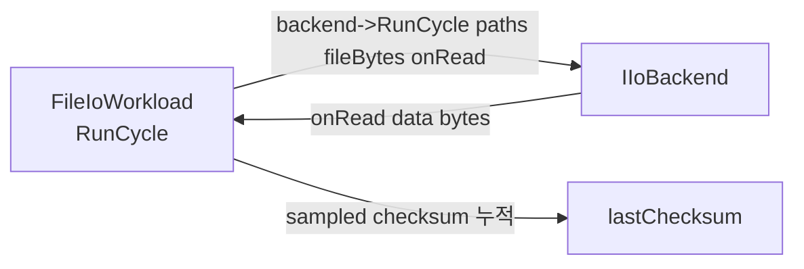

## 들어가며

시작 상태의 결과물은 read(2) 한 가지로 도는 단일 스레드 baseline + ImGui HUD다. read 호출이 `FileIoWorkload::RunCycle` 안에 *하드코딩* 되어 있어 다른 IO 모델(pread/mmap/aio/io_uring)을 같은 워크로드에 끼우려면 *그 함수를 매번 갈아엎어야* 한다. 같은 워크로드 위에서 *다른 backend* 를 비교하는 게 이 lab의 핵심인데, 비교 대상이 하나밖에 없는 상태다.

이 단계의 목표는 *IO 백엔드 추상* 을 얇게 세우는 것이다. `IIoBackend` 인터페이스가 한 사이클의 IO 동작을 정의하고, `ReadBackend` 가 그 첫 구현이다. `FileIoWorkload` 는 backend를 *외부에서 주입받아* 호출만 한다. 토글 UI는 현재 범위 밖의 확장에서 들어오고, 이 단계에서는 *모듈 경계* 만 정리한다. 결과 동작은 시작 상태와 *완전히 동일* — read baseline. 차이는 *내부 구조* 다.

이 단계의 결과물은 다음 다섯 가지다.

1. `IIoBackend` 추상 인터페이스 (`io/io_backend.h`).
2. `ReadBackend` — read 동기 백엔드 (`io/read_backend.cpp`).
3. `BackendType` enum + `CreateBackend` 팩토리 (`io/io_backend_factory.cpp`).
4. `FileIoWorkload` 가 backend 포인터를 받도록 변경.
5. main에서 backend 인스턴스 생성 후 워크로드에 주입.

토글이 없는데 굳이 인터페이스를 먼저 세우는 이유는 *누적성* 이다. 토글 UI와 두 번째·세 번째 백엔드(pread/mmap)가 동시에 들어오면 변경 범위가 두 곳으로 늘고 인터페이스 결정이 *실측에 쫓겨* 어색해진다. 인터페이스를 먼저 단단히 두면 완성된 구성들이 *구현만 추가* 하는 깔끔한 누적이 된다.

---

## 목차

1. 왜 인터페이스가 먼저인가
2. IIoBackend 인터페이스 설계
3. ReadBackend 구현 — read 로직의 이전
4. BackendType enum과 팩토리
5. FileIoWorkload의 backend 주입
6. main 통합과 빌드 결과
7. 검증 — 계약을 코드로 못 박는다

---

## 1. 왜 인터페이스가 먼저인가

이 단계의 *결과 동작은 변하지 않는다*. read backend로 도는 baseline이 그대로다. 그런데 코드는 절반쯤 갈렸다. 왜?

이 lab의 비교 대상은 다섯 가지 IO 모델이다.

- `read(2)` — 동기, 시작 위치는 fd offset
- `pread(2)` — 동기, 시작 위치를 인자로 (offset 인자가 thread-safe)
- `mmap(2) + sampled scan` — 페이지 매핑, 페이지 폴트가 데이터 관찰 시점
- `aio_read` (POSIX AIO) — 비동기 요청 API, Linux에서는 구현 방식이 환경 의존
- `io_uring_submit` — 비동기, 링버퍼 기반

다섯이 *다른 모델* 이다. 동기·비동기 차이가 있고, 시스템 콜 단위가 다르고, 결과 관찰 시점도 다르다. 그렇다면 *공통 인터페이스* 를 어떻게 잡을 것인가가 핵심이다. 잘못 잡으면 한 모델에는 자연스럽고 다른 모델에는 어색한 어댑터가 된다.

### 두 가지 잘못된 시작점

**A. 인터페이스를 *동기 read 모양* 으로 잡는다.**

```cpp
class IIoBackend {
    virtual std::size_t Read(int fd, void* buf, std::size_t bytes) = 0;
};
```

read는 자연스럽지만, mmap은 fd가 아니라 *주소* 로 작업하고, io_uring은 *제출 + 수확* 두 단계라 한 호출에 매핑이 어색하다. async는 *결과가 호출 직후 안 오는* 모델인데 인터페이스가 *값을 반환* 하면 sync 가정이 박힌다.

**B. 인터페이스를 너무 *넓게* 잡는다.**

```cpp
class IIoBackend {
    virtual void OpenAll() = 0;
    virtual void SubmitAll() = 0;
    virtual void Reap() = 0;
    virtual void CloseAll() = 0;
    virtual std::vector<Buffer> Results() = 0;
};
```

io_uring에는 잘 맞지만 read에는 *Submit과 Reap이 같은 호출* 이라 오버헤드만 늘고 의미가 흐려진다. 동기 backend가 *async를 흉내내는* 어색한 형태가 된다.

### 좋은 시작점: 사이클 단위 + 콜백

이 lab의 워크로드는 한 사이클이 *N개 파일을 모두 읽는* 단위다. 그러면 인터페이스도 *사이클 단위* 가 자연스럽다.

```cpp
class IIoBackend {
public:
    using OnFileRead = std::function<void(const unsigned char* data,
                                           std::size_t bytes)>;

    virtual std::uint64_t RunCycle(const std::vector<std::string>& paths,
                                    std::size_t fileBytes,
                                    const OnFileRead& onRead) = 0;
    virtual const char* Name() const = 0;
};
```

세 결정 포인트.

- **사이클 단위** : 한 호출이 *모든 파일* 을 처리한다. 동기 backend는 순차 read, async backend는 batch submit + reap. 둘 다 *같은 시그니처* 안에서 자연스럽다.
- **결과 콜백** : `onRead` 가 *각 파일이 관찰 가능한 시점* 에 호출된다. 동기는 read 직후, async는 reap 시점. 호출자(워크로드)는 *어떤 모델인지 신경 안 쓰고* 결과를 받는다.
- **소유권 단순화** : backend는 자기 임시 버퍼를 직접 들고, 콜백 인자로 *읽은 바이트와 길이만* 넘긴다. 호출자가 버퍼를 미리 잡지 않아도 된다.

이 모델은 *모든 다섯 backend가 자기 자연스러운 형태로* 구현되게 둔다.

| backend | RunCycle 안에서 |
|---|---|
| ReadBackend | for paths: open → read 루프 → close → onRead |
| PreadBackend | for paths: open → pread → close → onRead |
| MmapBackend | for paths: open → mmap → onRead(mapped) → munmap → close |
| AioBackend | `aiocb` 배열 prep → `aio_read` → `aio_suspend`/`aio_error`/`aio_return` → 완료한 것부터 onRead |
| UringBackend | SQE 배열 prep → io_uring_submit → CQE 수확 → 완료 순서대로 onRead |

다섯 모두 *같은 함수 시그니처* 안에서 자기 모델대로 동작한다. 인터페이스가 모델을 *강제하지 않는다* 는 점이 핵심이다.

여기서 `AioBackend`는 POSIX AIO를 뜻한다. Linux native AIO(libaio)의 `iocb`, `io_submit`, `io_getevents`와는 API가 다르다. POSIX AIO는 파일 시스템과 libc에 따라 내부 구현이 달라질 수 있으므로, 결과를 io_uring과 같은 커널 링 버퍼 모델의 특성으로 해석해서는 안 된다.

### 결과 도착 순서가 다르다는 사실 자체가 측정 대상

async backend는 *제출 순서* 와 *결과 도착 순서* 가 다를 수 있다. 디스크 IO 스케줄러가 더 빨리 끝낼 수 있는 요청을 먼저 완료시킨다. 이 lab에서 측정에 영향을 주지는 않는다 (sampled checksum이 *순서 무관* 한 누적이라). 실제 게임 엔진의 에셋 로딩 같은 시나리오에서는 *완료 순서* 가 다음 작업의 시작 시점에 영향을 주는데, 이 lab은 단순 누적이라 그 효과를 측정하지 않는다.

현재 범위 밖의 확장에서 *완료 순서가 frame ms 분포에 어떻게 영향* 을 주는지를 보고 싶으면 onRead 콜백 안에 의존성을 넣는 모드를 추가하면 된다.

## 2. IIoBackend 인터페이스 설계

`src/io/io_backend.h`:

<!-- snippet: src/io/io_backend.h -->
```cpp
#pragma once

#include <cstddef>
#include <cstdint>
#include <functional>
#include <string>
#include <vector>

namespace skl {

class IIoBackend {
public:
    virtual ~IIoBackend() = default;

    using OnFileRead = std::function<void(const unsigned char* data,
                                           std::size_t bytes)>;

    // data 포인터는 onRead 호출 중에만 유효하다.
    // 비동기 구현도 RunCycle 안에서 모든 완료 수확과 onRead 호출을 끝내고 반환한다.
    virtual std::uint64_t RunCycle(const std::vector<std::string>& paths,
                                    std::size_t fileBytes,
                                    const OnFileRead& onRead) = 0;

    virtual const char* Name() const = 0;
};

}  // namespace skl
```

40줄도 안 되는 단순한 인터페이스다. 이게 모든 backend의 공통 약속이다.

### `std::function` 의 비용

`std::function` 은 type erasure가 들어간다. `FileIoWorkload::RunCycle` 이 람다를 넘길 때 작은 type-erased 객체가 만들어지고, 파일별 `onRead` 호출에는 *간접 호출 한 번* 비용이 붙는다. 16개 파일 한 사이클에서 16번 호출이라 측정 노이즈 안에 묻힌다.

대안으로 *템플릿 콜백* 도 가능하다.

```cpp
template <typename F>
std::uint64_t RunCycle(const std::vector<std::string>& paths,
                        std::size_t fileBytes,
                        F&& onRead);
```

템플릿은 *간접 호출 0* 이라 더 빠르지만, *가상 함수와 결합 불가* 다. 가상 + 템플릿 조합을 하려면 *type erasure 어댑터* 를 직접 짜야 하는데, 이미 `std::function` 이 그걸 한다.

이 lab은 *backend 다형성이 핵심* 이라 가상 함수가 우선이고, 콜백 호출 비용이 측정 차이를 만들 만큼 크지 않으니 `std::function` 으로 둔다.

### 구조



워크로드가 backend의 RunCycle을 호출하고, backend는 자기 방식대로 IO를 한 뒤 *각 파일 관찰 시점* 에 onRead로 워크로드에 알린다. 워크로드는 onRead 안에서 sampled checksum을 누적한다.

## 3. ReadBackend 구현 — read 로직의 이전

시작 상태의 `FileIoWorkload::RunCycle` 안에 있던 read 코드를 *그대로* 옮긴다. 변경 사항은 함수 위치와 시그니처뿐이고, *동작은 동일* 하다.

`src/io/read_backend.h`:

<!-- snippet: src/io/read_backend.h -->
```cpp
#pragma once

#include "io/io_backend.h"

#include <vector>

namespace skl {

class ReadBackend final : public IIoBackend {
public:
    std::uint64_t RunCycle(const std::vector<std::string>& paths,
                            std::size_t fileBytes,
                            const OnFileRead& onRead) override;

    const char* Name() const override { return "read"; }

private:
    // 파일당 임시 버퍼. 사이클 간 재사용.
    std::vector<unsigned char> buffer_;
};

}  // namespace skl
```

`final` 키워드는 *다른 클래스가 ReadBackend를 상속하지 않는다* 는 뜻. 컴파일러가 가상 호출을 *직접 호출로 디버추얼라이즈* 할 여지를 준다. 작은 최적화지만 *클래스가 상속 의도가 없음* 을 코드로 표현하는 의미가 더 크다.

`src/io/read_backend.cpp`:

```cpp
#include "io/read_backend.h"

#include <cerrno>
#include <cstring>
#include <fcntl.h>
#include <stdexcept>
#include <unistd.h>

namespace skl {

std::uint64_t ReadBackend::RunCycle(const std::vector<std::string>& paths,
                                      std::size_t fileBytes,
                                      const OnFileRead& onRead) {
    if (buffer_.size() < fileBytes) {
        buffer_.resize(fileBytes);
    }

    std::uint64_t totalBytes = 0;

    for (const auto& path : paths) {
        const int fd = ::open(path.c_str(), O_RDONLY);
        if (fd < 0) {
            throw std::runtime_error(std::string("open failed: ") + path
                                     + ": " + std::strerror(errno));
        }

        std::size_t pos = 0;
        while (pos < fileBytes) {
            const ssize_t n = ::read(fd, buffer_.data() + pos,
                                      fileBytes - pos);
            if (n < 0) {
                if (errno == EINTR) continue;
                const std::string msg = std::string("read failed: ") + path
                                      + ": " + std::strerror(errno);
                ::close(fd);
                throw std::runtime_error(msg);
            }
            if (n == 0) break;  // EOF (파일이 fixture보다 작을 때)
            pos += static_cast<std::size_t>(n);
        }
        ::close(fd);

        onRead(buffer_.data(), pos);
        totalBytes += pos;
    }

    return totalBytes;
}

}  // namespace skl
```

세 가지 변경.

1. **buffer가 backend의 멤버**: 시작 상태에서는 워크로드가 들고 있었다. 백엔드별로 *임시 버퍼 모양이 다를 수 있어* (mmap은 별도 버퍼 없이 mapped address를 넘길 수 있고, POSIX AIO는 `aiocb` 배열이 추가된다) backend 측으로 옮긴다.
2. **콜백 호출**: `onRead(buffer_.data(), pos)` 한 줄이 워크로드의 checksum 누적을 트리거한다.
3. **에러 처리는 그대로**: open/read 실패가 throw로 드러난다. fd leak 방지를 위해 close가 throw 전에 호출된다.

### 짧은 파일은 오류가 아니다 — 다섯 backend가 공유하는 계약

`pos < fileBytes` 로 루프를 빠져나오는 경우, 즉 *요청한 것보다 파일이 짧은* 경우를 무엇으로 볼 것인가. 이건 backend 하나의 구현 문제가 아니라 `IIoBackend` 전체의 계약이라 먼저 정해야 한다. 나중에 다섯 구현이 각자 다르게 정하면 "backend를 바꿔도 같은 값이 나온다"는 이 lab의 전제 자체가 무너지고, 그 전제를 검사하는 테스트를 아예 쓸 수 없게 된다.

정한 계약은 이렇다.

- `RunCycle(paths, fileBytes, onRead)` 는 각 파일을 *최대* `fileBytes` 까지 읽는다.
- 구현은 path마다 `onRead` 를 **정확히 한 번** 부르고, 그때 넘기는 크기 `n` 은 실제로 읽은 바이트다(`0 <= n <= fileBytes`).
- 반환값은 그 `n` 의 합이다. 짧은 파일이 섞이면 `paths.size() * fileBytes` 보다 작다.
- *진짜* I/O 오류(syscall이 -1, `aio_error != 0`, `cqe->res < 0`, mmap/fstat 실패)는 여전히 throw다.

근거는 세 가지다.

1. **POSIX `read(2)` 가 이미 그렇게 구분한다.** 요청보다 적게 돌아오는 것은 정상이고, 0이 EOF이며, 오류는 -1로 따로 알린다. 위 루프의 `if (n == 0) break;` 가 바로 그 구분이다. 여기서 다시 throw를 얹으면 커널이 이미 구분해 준 두 가지를 하나로 뭉개는 셈이다.
2. **backend는 fixture가 얼마나 커야 하는지 모른다.** "내가 요청한 것보다 파일이 작다"와 "파일이 여기서 끝난다"를 구분할 수 있는 것은 크기를 정한 호출자뿐이다.
3. **다섯 구현이 이 판정에서 일치할 수가 없다.** mmap은 매핑한 뒤에는 EOF를 관측조차 못 하고(그래서 매핑 길이를 파일 크기로 잘라야 한다), aio·io_uring은 완료 단위로만 안다. 바이트 수를 돌려주는 쪽이 예외보다 정보량이 많고, 다섯 구현이 같은 값으로 수렴한다.

`tests/system_io_path_tests.cpp` 의 `CheckShortReadContract` 가 이 계약을 못 박는다. 딱 맞는 파일·요청의 절반·4097바이트·1바이트·빈 파일·요청보다 큰 파일을 한 사이클에 섞어 두고, 대상 backend가 *같은 `(크기, 체크섬)` 목록* 과 *같은 총 바이트* 를 내는지 본다(비동기 backend는 완료 순서가 다르므로 정렬해 비교한다).

### EINTR 재시도가 중요한 이유

`read` 가 -1을 반환하고 `errno == EINTR` 이면 *시그널이 도착해서 read가 끊긴* 것이지 실제 IO 에러가 아니다. 단순히 한 번 더 호출하면 된다. 이 패턴이 빠지면 시그널이 도착할 때마다 throw가 나서 도구가 무작위로 죽는다.

정규 파일로는 이 분기가 절대 실행되지 않는다. `tests/system_io_path_tests.cpp` 는 `/tmp` 에 FIFO를 만들고 별도 스레드가 `PIPE_BUF`(4 KB) 단위로 끊어 write 하는 동안, `SA_RESTART` 없는 `SIGUSR1` 핸들러를 걸고 감시 스레드가 읽기 스레드에만 `pthread_kill` 을 1 ms 간격으로 보낸다. 검사 항목은 *시그널이 와도 최종 바이트 수와 체크섬이 무시그널 실행과 완전히 같다* 는 것이다.

"재시도 분기가 정말 실행됐는가"는 fault seam을 *주입 없이* 무장해 센다. `skip` 을 아주 크게 준 규칙(`read:100000000`)은 아무것도 주입하지 않고 호출 횟수만 세는 순수 관측 모드다. `PIPE_BUF` 이하의 write는 원자적이라 파이프에는 항상 4 KB의 배수가 들어 있고, 따라서 시그널이 없으면 `read` 호출 수는 청크 수를 넘을 수 없다. 넘었다면 `-1`/`EINTR` 를 받고 재시도한 호출이 실제로 있었다는 뜻이다(실측: 청크 24개, 무시그널 24회 대 시그널 85회).

### `final` 의 효과

`ReadBackend final : public IIoBackend` 에서 backend의 가상 함수 호출을 디버추얼라이즈할 수 있을까?

컴파일러는 호출 시점에 *정적 타입* 이 `IIoBackend*` 라면 디버추얼라이즈를 못 한다. 그러나 *정적 타입이 ReadBackend*` 라면 `final` 정보로 *상속이 더 없음* 을 알아 직접 호출로 변환한다.

이 도구는 `std::unique_ptr<IIoBackend>` 로 다형 호출을 하므로 디버추얼라이즈가 *대부분 안 일어난다*. `final` 은 상속 의도가 없다는 코드 자체의 의미 표시가 본질이다.

## 4. BackendType enum과 팩토리

토글 UI는 현재 범위 밖의 확장에서 들어온다. 이 단계는 enum과 factory만 둔다.

`src/io/io_backend_factory.h`:

```cpp
#pragma once

#include "io/io_backend.h"

#include <memory>

namespace skl {

enum class BackendType : int {
    Read = 0,
};

constexpr int kBackendTypeCount = 1;

std::unique_ptr<IIoBackend> CreateBackend(BackendType type);

}  // namespace skl
```

이 단계의 enum은 `Read` 한 가지. 현재 범위 밖의 확장에서 `Pread`, `Mmap`, `Aio`, `Uring` 이 추가된다. enum이 확장될 때 `kBackendTypeCount` 도 같이 갱신된다.

### enum의 명시적 정수 값

`Read = 0` 으로 *시작 값을 명시* 한다. raygui나 ImGui의 콤보박스가 *정수 인덱스* 를 in-out으로 받는데, enum 값이 0부터 연속해야 `static_cast<int>` 가 안전하다. 이 lab은 ImGui라 자동이지만 *습관적으로 명시* 해 두면 토글 UI에서 자연스럽다.

### 팩토리 구현

`src/io/io_backend_factory.cpp`:

```cpp
#include "io/io_backend_factory.h"

#include "io/read_backend.h"

namespace skl {

std::unique_ptr<IIoBackend> CreateBackend(BackendType type) {
    switch (type) {
        case BackendType::Read:
            return std::make_unique<ReadBackend>();
    }
    return std::make_unique<ReadBackend>();
}

}  // namespace skl
```

팩토리는 현재 존재하는 `ReadBackend`만 생성한다. 이 구조의 핵심은 열거형에서 구현을 선택하는 책임을 한곳에 모으는 것이다. 사용할 수 없는 백엔드를 조용히 read로 폴백시키면 측정 라벨과 실제 실행 경로가 달라지므로, 폴백은 조용히 일어나면 안 된다 — 실제로 실행된 backend 타입을 호출자에게 돌려주고 stderr로 알린다.

## 5. FileIoWorkload의 backend 주입

`FileIoWorkload` 가 backend 포인터를 받도록 변경한다. 소유권은 호출자에게 있고, 워크로드는 *참조만* 한다.

### 헤더 변경

```cpp
// src/workload/file_io_workload.h
#pragma once

#include "io/io_backend.h"

#include <cstddef>
#include <cstdint>
#include <filesystem>
#include <string>
#include <vector>

namespace skl {

class FileIoWorkload {
public:
    void Init(IIoBackend* backend,
              std::size_t fileCount,
              std::size_t fileBytes,
              const std::filesystem::path& fixtureDir = {});

    // backend만 교체. fixture와 워크로드 파라미터는 유지.
    void SetBackend(IIoBackend* backend) { backend_ = backend; }

    std::uint64_t RunCycle();
    void Shutdown();

    std::size_t   FileCount()    const { return paths_.size(); }
    std::size_t   FileBytes()    const { return fileBytes_; }
    std::uint64_t LastChecksum() const { return lastChecksum_; }
    const std::filesystem::path& FixtureDir() const { return fixtureDir_; }
    IIoBackend*   Backend()      const { return backend_; }

private:
    void GenerateFixture(std::size_t fileCount, std::size_t fileBytes);

    IIoBackend*                  backend_   = nullptr;
    std::filesystem::path        fixtureDir_;
    std::vector<std::string>     paths_;
    std::size_t                  fileBytes_ = 0;
    std::uint64_t                lastChecksum_ = 0;
};

}  // namespace skl
```

세 가지 추가.

- **`IIoBackend* backend_` 멤버**: nullptr default. Init에서 받는다.
- **`SetBackend`**: backend 만 교체. 토글 변경 시 *fixture를 재생성하지 않고 backend만* 갈아끼우는 데 쓴다.
- **`Backend()`**: HUD가 backend 이름을 표시하기 위해 노출. const 포인터로 충분하지만 단순화를 위해 non-const.

### RunCycle 변경

```cpp
std::uint64_t FileIoWorkload::RunCycle() {
    if (!backend_) {
        throw std::runtime_error("FileIoWorkload::RunCycle: backend is null");
    }

    std::uint64_t checksum = 0;
    auto onRead = [&](const unsigned char* data, std::size_t bytes) {
        for (std::size_t i = 0; i < bytes; i += kChecksumStride) {
            checksum += data[i];
        }
        if (bytes > 0 && ((bytes - 1) % kChecksumStride) != 0) {
            checksum += data[bytes - 1];
        }
    };

    const std::uint64_t total = backend_->RunCycle(paths_, fileBytes_, onRead);
    lastChecksum_ = checksum;
    return total;
}
```

시작 상태의 `for path: open → read → close → checksum` 루프가 *backend 호출 한 줄과 onRead 람다* 로 바뀌었다. 핵심이 *명확히 분리* 되어 있다.

- **워크로드의 책임**: 어떤 파일을, 몇 개, 어떤 가공으로.
- **backend의 책임**: 그 파일들을 *어떤 IO 모델로* 읽을지.

이 분리가 이후의 누적을 매끄럽게 한다.

### 람다 capture와 수명

`onRead` 람다는 `checksum` 을 *참조 캡처* (`[&]`) 한다. 람다 객체의 수명이 `RunCycle` 함수 안 (스택)이고 backend의 RunCycle도 그 안에서 끝나므로 dangling 위험이 없다.

backend가 *비동기로 onRead를 *RunCycle 종료 후* 호출* 하는 형태라면 dangling이 생기지만, 우리 인터페이스는 *RunCycle이 모든 onRead가 끝난 뒤에야 반환* 한다는 약속이다. async backend도 RunCycle 안에서 *수확까지 마치고* 반환한다.

## 6. main 통합과 빌드 결과

main에서 backend를 만들고 워크로드에 주입한다.

```cpp
// src/main.cpp 일부

#include "io/io_backend.h"
#include "io/io_backend_factory.h"
#include "measure/frame_timer.h"
#include "ui/hud.h"
#include "workload/file_io_workload.h"

// ... (SDL2/ImGui 초기화)

auto backend = skl::CreateBackend(skl::BackendType::Read);

skl::FileIoWorkload workload;
workload.Init(backend.get(), kFileCount, kFileBytes);
```

두 줄 추가, 한 줄 변경. `unique_ptr<IIoBackend>` 가 main 스택에 살고, 워크로드는 *생포인터* 로 참조한다. main이 종료되면 backend도 자동 정리된다.

### HUD에 backend 이름 추가

```cpp
const IIoBackend* backend = workload.Backend();
const char* backendName = backend ? backend->Name() : "(none)";

char buf[640];
std::snprintf(buf, sizeof(buf),
              "backend     : %s\n"
              "files       : %zu  x  %.2f MB\n"
              ...
```

stats 텍스트의 첫 줄에 `backend : read` 가 표시된다. 토글 변경 시 이 이름이 바뀐다.

### CMakeLists 변경

```cmake
add_executable(${PROJECT_NAME}
    src/main.cpp
    src/io/io_backend_factory.cpp
    src/io/read_backend.cpp
    src/measure/frame_timer.cpp
    src/workload/file_io_workload.cpp
    src/ui/hud.cpp
    ${IMGUI_SOURCES}
)
```

두 cpp 파일이 빌드 대상에 추가됐다. 그 외 변경 없음.

### 빌드와 동작

WSL2에서 재빌드한다.

```bash
cmake --build build -j
./build/system_kernel_lab
```

화면은 시작 상태와 *완전히 동일* 하다. cycle ms, throughput 그래프가 같은 모양으로 그려진다. 차이는 stats 텍스트 첫 줄에 `backend : read` 가 추가된 것뿐.

### 무엇이 달라졌는가

이 단계의 *결과 동작이 변하지 않은* 게 핵심이다. 측정 도구는 *경계가 늘면 동작이 바뀌었는지 즉시 검증할 수 있다*. 이 단계의 검증은 다음과 같이 한다.

1. 시작 상태의 cycle ms 평균을 기록 (예: 3.4 ms).
2. 이 단계로 빌드, 실행.
3. cycle ms 평균이 *같거나 측정 노이즈 안* 인지 확인.

만약 *눈에 띄게 느려졌다면* 인터페이스 도입에 비용이 들어간 신호다. `std::function` 호출 비용, 가상 함수 디스패치 비용이 누적된 결과일 수 있다. 이 lab의 워크로드는 호출이 *파일 수만큼* (16번)이라 그 비용이 측정 노이즈 안에 묻혀야 정상이다.

만약 *빨라졌다면* (드물지만) 컴파일러가 read 코드를 다른 위치에 두면서 inline/캐시 행동이 우연히 좋아진 것. 차이가 의미 있을 정도면 측정 환경의 노이즈를 의심해 본다.

### 검증 체크리스트

- 빌드 시 `IIoBackend` 헤더 못 찾음 → `target_include_directories` 의 `src` 가 빠짐. CMakeLists 확인.
- 링크 오류 *undefined reference to ReadBackend::RunCycle* → `read_backend.cpp` 가 빌드 대상에 빠짐.
- 실행 시 *FileIoWorkload::RunCycle: backend is null* → main에서 `workload.Init(backend.get(), ...)` 의 첫 인자가 null. backend 인스턴스가 만들어졌는지 확인.
- HUD에 backend 이름이 안 보임 → `workload.Backend()` 가 nullptr 반환. main의 Init 호출 시점 확인.

### 측정의 정직성

이 단계는 *측정 결과를 바꾸지 않는 리팩토링* 이다. *코드 분량은 늘고 동작은 같은* 단계라 그래프에는 변화가 없다. 그래도 이 단계가 필요한 이유는 *현재 범위 밖의 확장의 변경 범위* 를 좁히기 위해서다.

토글 UI + pread + mmap 이 들어올 때 *지금* 인터페이스가 없으면 그 단계가 *세 가지 작업을 동시에* 한다 — 인터페이스 설계, UI, 두 backend 추가. 변경 범위가 커지면 *어디서 뭐가 깨졌는지* 추적이 어렵다.

이 단계의 가치는 측정 결과를 바꾸지 않은 채 변경 지점을 좁힌 데 있다. 백엔드 선택, 수명, 워크로드 호출 경계가 분리되었으므로 새 구현을 넣더라도 baseline 경로와 비교 기준을 유지할 수 있다.

## 7. 검증 — 계약을 코드로 못 박는다

인터페이스를 세운 단계의 산출물은 *문서에 적힌 약속* 이다. 약속은 지켜지는지 확인할 방법이 없으면 주석과 다를 바 없다. `IIoBackend` 가 건 약속은 셋이었다 — path 당 onRead 한 번, 넘기는 크기는 *실제로 읽은* 바이트, 반환값은 그 합.

`ReadBackend` 는 그 셋을 지키는 첫 구현이다. 검사 쪽은 파일 크기를 제각각으로 만든 fixture를 한 사이클에 통과시키고, `(크기, 체크섬)` 기록을 path 수만큼 모아 기대값과 통째로 비교한다. 합계만 보면 "두 파일을 한 번에 읽고 한 번만 콜백" 같은 위반이 그대로 통과한다.

<!-- snippet: tests/system_io_path_tests.cpp@short-read-contract -->
```cpp
// tests/system_io_path_tests.cpp

void CheckContractOnFixture(const SizedFixture& fixture, std::size_t requestBytes,
                            const char* label, const skl::BackendType* types,
                            std::size_t count) {
    for (std::size_t idx = 0; idx < count; ++idx) {
        const auto type = types[idx];
        // ...
        // path 당 정확히 한 번.
        CHECK(out.reads.size() == fixture.Paths().size());
        CheckReadsEqual(out.reads, fixture.ExpectedReads(requestBytes), name);
        CHECK(out.bytes == fixture.ExpectedBytes(requestBytes));
        CHECK(OpenFdCount() == fdBefore);
    }
}
```

대상 backend를 인자로 받는 이유는 이 계약을 지켜야 하는 구현이 앞으로 늘기 때문이다. 지금 이 단계가 부르는 목록은 `read` 하나다.

EINTR 재시도 루프도 여기서 처음 생겼다(`if (errno == EINTR) continue;`). 정규 파일로는 절대 밟히지 않는 분기라, 검사는 `/tmp` 에 FIFO를 만들고 `SA_RESTART` 없는 `SIGUSR1` 을 읽기 스레드에만 1 ms 간격으로 보낸다. 판정은 *시그널이 와도 바이트 수와 체크섬이 무시그널 실행과 완전히 같다* 이고, 그 위에 "재시도가 실제로 일어났다"를 seam 호출 횟수로 확인한다.

```bash
cmake --build build -j
ctest --test-dir build -R skl_step02 --output-on-failure
```

```text
    Start 10: skl_step02_core
1/3 Test #10: skl_step02_core ..................   Passed    0.00 sec
    Start 11: skl_step02_fault
2/3 Test #11: skl_step02_fault .................   Passed    0.00 sec
    Start 12: skl_step02_io_path
3/3 Test #12: skl_step02_io_path ...............   Passed    0.31 sec

100% tests passed, 0 tests failed out of 3
```

세 케이스가 각각 성공 경로 · 오류 경로 · I/O 경로다. 무엇을 봤는지는 실행 파일을 직접 부르면 나온다.

```bash
./build/system_io_path_tests --step=02
```

```text
[ run  ] step02  short read contract (read)
  read: mixed fixture {16384, 8192, 4097, 1, 0, 32775} request=16384 -> total=45058 bytes, one onRead per path
[  ok  ] step02  short read contract (read)
[ run  ] step02  fifo partial read loop + EINTR
  fifo chunked read: chunks=24 calls(base)=24 calls(signalled)=89
[  ok  ] step02  fifo partial read loop + EINTR
[ run  ] step02  fifo blocking read EINTR
  read wait via read: calls(base)=1 calls(signalled)=73
[  ok  ] step02  fifo blocking read EINTR
system_io_path_tests --step=2: 3/9 check(s) run, 0 failed
```

읽어야 할 줄은 `calls(base)=24 calls(signalled)=89` 다. `PIPE_BUF` 이하의 write는 원자적이므로 시그널이 없으면 read 호출은 청크 수(24)를 넘을 수 없다. 89는 `-1`/EINTR를 받고 되돌아간 호출이 65번 있었다는 뜻이고, 그런데도 총 바이트와 체크섬은 무시그널 실행과 한 글자도 다르지 않다. 그것이 "재시도가 투명하다"의 관측 가능한 형태다. 뒤 두 숫자는 시그널 타이밍에 따라 실행마다 달라지지만 `signalled > base` 라는 부등호는 달라지지 않는다.

`45058` 은 `16384 + 8192 + 4097 + 1 + 0 + 16384` 다 — 마지막 파일은 요청보다 크지만 요청분만 읽었고, 빈 파일도 콜백을 한 번 받았다.

---

## 결론

이 단계의 결과물은 read backend의 코드가 `IIoBackend` 추상 뒤로 옮겨가고, FileIoWorkload가 backend를 주입받는 구조다. 약 100줄의 새 코드(`io/` 디렉토리 + 워크로드 시그니처 변경 + main 통합)가 시작 상태 위에 얹혔다. *측정 결과는 변하지 않는다*.

세 가지 결정이 이 단계의 토대를 만들었다.

1. **사이클 단위 + 콜백 인터페이스** — 동기·비동기 다섯 모델을 같은 시그니처에 자연스럽게 담는다. backend는 자기 모델대로 IO를 하고, 결과는 콜백으로 워크로드에 알린다.
2. **인터페이스를 토글 UI보다 먼저** — *변경 범위를 좁히는* 단계. backend 를 하나 더 붙이거나 UI 토글을 얹을 때 손대야 하는 파일이 인터페이스 구현 한 곳으로 제한되도록 모듈 경계를 먼저 그어 둔다.
3. **소유권은 호출자, 사용은 워크로드** — backend는 main이 들고 있고 워크로드는 *참조만* 한다. 토글 변경 시 *backend만 교체* 가 자연스러운 패턴이 된다.

현재 코드는 backend 한 가지로만 도는 단일 경로다. 따라서 인터페이스 분리가 동작 보존에는 성공했지만, 서로 다른 IO 모델의 비용 차이를 보여 주지는 못한다.

## 더 읽을거리

- Robert Love, *Linux System Programming*, 2nd ed., Ch. 2 "File I/O" — read/pread의 모델 차이
- Brendan Gregg, *Systems Performance*, Ch. 8 "File Systems" — IO 모델별 측정 패턴
- [C++ Core Guidelines: I.25 — Prefer abstract classes as interfaces](https://isocpp.github.io/CppCoreGuidelines/CppCoreGuidelines#i25-prefer-abstract-classes-as-interfaces-to-class-hierarchies)
- Sean Parent, "Inheritance Is The Base Class of Evil" (GoingNative 2013) — 타입 erasure 패턴
- [`std::function` 의 type erasure 구현](https://en.cppreference.com/w/cpp/utility/functional/function) — 콜백 인터페이스의 비용
- [Linux man page: read(2)](https://man7.org/linux/man-pages/man2/read.2.html) — EINTR 동작
- Jeff Dean & Sanjay Ghemawat, "MapReduce: Simplified Data Processing on Large Clusters" — 사이클 단위 추상화의 고전적 사례
