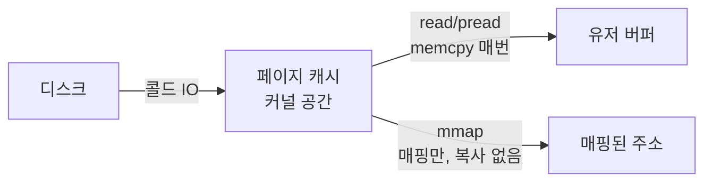
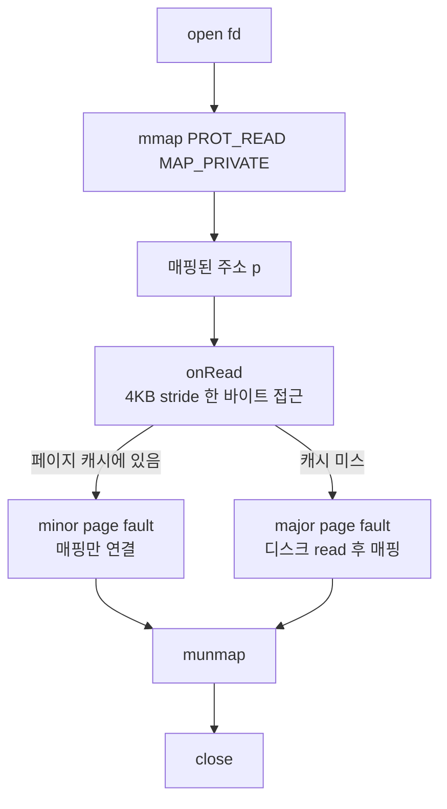
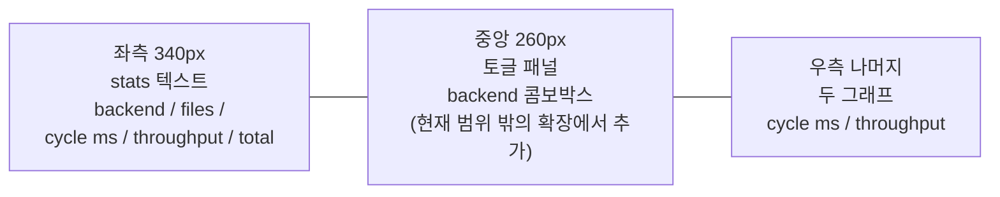

## 들어가며

시작 상태의 결과물은 `IIoBackend` 추상이 자리 잡힌 상태고, ReadBackend 한 가지만 동작하는 도구다. 인터페이스가 다섯 backend(read/pread/mmap/aio/io_uring)를 받을 준비가 되어 있는데 실제 비교 대상은 하나뿐이다. 토글도 없고, 사용자가 backend를 바꾸려면 코드를 수정하고 재빌드해야 한다.

이 단계의 목표는 *런타임 토글 + 두 번째·세 번째 backend* 다. ImGui 콤보박스 한 번 클릭으로 read → pread → mmap이 즉시 교체되고, 그 순간의 cycle ms와 throughput 변화가 그래프에 그려진다. 이게 이 lab이 만들어 내는 *첫 번째 시각적 사건* 이다.

이 단계의 결과물은 다음 다섯 가지다.

1. `Toggles` 구조체 + `RequiresRestart` 변경 감지 (`ui/toggles.h`).
2. `PreadBackend` — pread(2) 동기 백엔드.
3. `MmapBackend` — mmap(2) + 페이지 폴트 모델.
4. `BackendType` enum 확장 (Read / Pread / Mmap), `CreateBackend` 팩토리 분기 추가.
5. ImGui HUD의 3-zone 레이아웃 (좌측 stats / 중앙 토글 / 우측 그래프).

세 backend의 *측정 차이* 가 즉시 보인다. 페이지 캐시가 따뜻한 상태에서 read와 pread는 거의 같고, mmap은 *다른 비용 구조* 를 보인다. 매 사이클 새로 매핑하므로 minor page fault 비용은 남지만, read·pread의 명시적 데이터 복사가 없어서 steady state에서 빠르거나 비슷할 수 있다.

---

## 목차

1. read · pread · mmap 세 모델의 차이
2. Toggles 구조체와 변경 감지
3. PreadBackend 구현
4. MmapBackend 구현
5. ImGui 3-zone HUD와 콤보박스
6. main 통합과 토글 변경 처리
7. 빌드와 실행 결과
8. 검증 — 두 backend가 같은 계약 위에 있는가

---

## 1. read · pread · mmap 세 모델의 차이

세 시스템 콜은 *같은 파일을 읽는 다른 방법* 이다. 비용 구조도 다르다.

### read(2)

```cpp
ssize_t read(int fd, void* buf, size_t count);
```

- fd 내부의 *현재 offset* 에서 count 바이트를 읽는다. offset이 자동 증가.
- 커널이 페이지 캐시에 있는 데이터를 *유저 공간 buf로 복사* 한다. 캐시 미스면 디스크 read 후 복사.
- 시스템 콜 한 번이 한 번의 read.

### pread(2)

```cpp
ssize_t pread(int fd, void* buf, size_t count, off_t offset);
```

- offset을 *인자로 받는다*. fd 내부 offset은 안 바뀐다.
- 다중 스레드가 같은 fd에 동시에 pread를 호출해도 *서로의 offset을 깨지 않는다*. read는 fd offset이 *공유 상태* 라 이런 동시 호출이 위험하다.
- 페이지 캐시 동작·복사 비용은 read와 동일.

### mmap(2)

```cpp
void* mmap(void* addr, size_t length, int prot, int flags, int fd, off_t offset);
```

- 파일을 *가상 메모리 영역에 매핑* 한다. 시스템 콜은 매핑을 만드는 것까지만.
- 매핑된 주소를 *처음 읽으면* 페이지 폴트가 발생, 커널이 페이지 캐시에서 해당 페이지를 채워 넣는다.
- `read(2)` 없이 데이터를 읽는다. 페이지 폴트는 시스템 콜 카운트가 아니라 CPU 예외/커널 fault handler 경로로 잡힌다.
- 유저 공간으로의 *명시적 복사가 없다*. 파일 페이지가 프로세스 가상 주소에 매핑된다.

### 비용 구조 비교



같은 16 MB 데이터를 읽는 비용을 분해하면 다음과 같다.

| 단계 | read | pread | mmap |
|---|---|---|---|
| open | 같음 | 같음 | 같음 |
| 시스템 콜 (open 외) | 파일당 read 루프 | 파일당 pread 루프 | 파일당 mmap + munmap |
| 캐시 미스 경로 | read 내부에서 페이지 캐시 채움 | pread 내부에서 페이지 캐시 채움 | major page fault로 페이지 캐시 채움 |
| warm cache 비용 | 페이지 캐시 → 유저 버퍼 복사 | 페이지 캐시 → 유저 버퍼 복사 | 새 매핑의 minor page fault |
| 유저 공간 복사 | 매번 16 MB | 매번 16 MB | 0 (매핑) |
| close | 같음 | 같음 | 같음 |

페이지 캐시가 따뜻해진 후에는 *유저 공간 복사가 가장 큰 비용* 이다. 16 MB를 한 사이클마다 memcpy하는 read/pread보다 mmap이 *이 비용을 안 낸다는* 의미에서 빠를 수 있다. 다만 mmap의 *페이지 폴트 누적* 도 비용이 있어서 *측정 결과는 워크로드 크기와 페이지 캐시 상태에 따라 달라진다*.

이 lab은 1 MB × 16 = 16 MB 라 페이지 캐시에 모두 들어가는 시나리오다. 측정에서는 *복사 비용 vs 페이지 폴트 비용* 의 트레이드오프가 드러난다.

### sampled checksum의 측정 의미

워크로드의 가공이 *페이지 단위 sampled checksum* (4 KB stride 한 바이트씩) 인 게 핵심이다.

- read/pread: 유저 버퍼에서 4 KB 간격으로 한 바이트 읽음. 16 MB 중 4112개 바이트(파일마다 4 KB 간격 256개 + 마지막 바이트 1개)만 만진다.
- mmap: 매핑된 주소에서 4 KB 간격으로 한 바이트 읽음. *페이지를 처음 만지는 순간* 페이지 폴트로 그 페이지가 채워진다.

mmap의 페이지 폴트 패턴이 *측정 결과에 직접 영향* 을 준다. 현재 구현은 매 사이클 `mmap → onRead → munmap` 을 반복하므로, 두 번째 사이클 이후에도 새 매핑의 PTE를 채우기 위한 minor page fault는 다시 발생한다. 달라지는 것은 디스크 IO다. 파일 페이지가 페이지 캐시에 있으면 major fault가 아니라 minor fault로 끝나고, read·pread처럼 16 MB를 유저 버퍼로 복사하지 않는다.

## 2. Toggles 구조체와 변경 감지

토글 상태를 한 구조체에 모은다. ImGui 위젯이 in-out으로 갱신하고, main이 prev/curr 비교로 변경 감지를 한다.

```cpp
// src/ui/toggles.h
#pragma once

#include "io/io_backend_factory.h"

namespace skl {

struct Toggles {
    BackendType backend = BackendType::Read;
};

inline bool RequiresRestart(const Toggles& a, const Toggles& b) {
    return a.backend != b.backend;
}

}  // namespace skl
```

10줄 헤더. 이 단계의 토글은 backend 한 가지뿐이다. 현재 범위 밖의 확장에서 sync, sched, ctx, worker count, file size 같은 토글이 추가되면 이 구조체에 필드가 들어가고 `RequiresRestart` 가 어느 토글이 *재초기화를 요구하는지* 를 결정한다.

### 모든 토글이 재시작을 요구하는 건 아니다

parts_perf_lab의 토글들과 대비해 보면 의도가 분명해진다.

| 도구 | 토글 | 재시작 필요? |
|---|---|---|
| parts_perf_lab | layout 변경 | 시뮬 인스턴스 교체 |
| parts_perf_lab | SIMD 변경 | 다음 사이클부터 적용 (재시작 X) |
| system_kernel_lab | backend 변경 | backend 인스턴스 교체 |
| system_kernel_lab (후속) | worker count | 워커 풀 재구성 |
| system_kernel_lab (후속) | file size | fixture 재생성 |

backend 변경은 인스턴스 교체가 필요하다 (각 backend가 자기 임시 버퍼·매핑 상태를 들고 있어서). 현재 범위 밖의 확장의 sync 토글 같은 건 *경로 분기* 라 재시작 없이 다음 사이클부터 적용 가능하다.

### prev/curr 폴링의 이유

ImGui도 raygui처럼 *콜백을 안 제공한다*. 위젯이 in-out 인자로 값을 갱신하고, 변경 시점은 *호출자가 직접 비교* 해 알아낸다. 이 모델이 즉시 모드 GUI의 일관된 패턴이다.

```cpp
// main 루프 안
hud.Draw(toggles, timer, workload);

if (RequiresRestart(prevToggles, toggles)) {
    // 재시작 처리
}
prevToggles = toggles;
```

매 프레임 prev와 curr를 비교하므로 *어느 프레임에 변경이 일어났는지* 정확히 안다. 그 프레임에 한 번만 재시작 처리가 일어난다.

## 3. PreadBackend 구현

read와 거의 같다. 차이는 시스템 콜 이름과 *fd offset 안 갱신* 동작.

```cpp
// src/io/pread_backend.cpp 핵심부

std::uint64_t PreadBackend::RunCycle(const std::vector<std::string>& paths,
                                       std::size_t fileBytes,
                                       const OnFileRead& onRead) {
    if (buffer_.size() < fileBytes) {
        buffer_.resize(fileBytes);
    }

    std::uint64_t totalBytes = 0;

    for (const auto& path : paths) {
        const int fd = ::open(path.c_str(), O_RDONLY);
        if (fd < 0) {
            throw std::runtime_error(std::string("open failed: ") + path
                                     + ": " + std::strerror(errno));
        }

        std::size_t pos = 0;
        while (pos < fileBytes) {
            // pread: 시작 offset을 인자로. fd 내부 offset은 안 바뀐다.
            const ssize_t n = ::pread(fd, buffer_.data() + pos,
                                       fileBytes - pos,
                                       static_cast<off_t>(pos));
            if (n < 0) {
                if (errno == EINTR) continue;
                const std::string msg = std::string("pread failed: ") + path
                                      + ": " + std::strerror(errno);
                ::close(fd);
                throw std::runtime_error(msg);
            }
            if (n == 0) break;
            pos += static_cast<std::size_t>(n);
        }
        ::close(fd);

        onRead(buffer_.data(), pos);
        totalBytes += pos;
    }

    return totalBytes;
}
```

read 코드와 한 줄만 다르다 — `read(fd, buf, count)` → `pread(fd, buf, count, offset)`. 단일 스레드 워크로드에서 *측정 차이가 거의 없는 게 정상* 이다.

### 측정에서 보이는 것

이 lab의 워크로드는 단일 스레드라 read와 pread의 차이가 시스템 콜 자체의 비용에서만 나온다. 두 시스템 콜은 *커널 내부에서 거의 같은 코드 경로* 를 타고 (fd offset 갱신 여부만 차이), 측정 결과로는 *cycle ms 차이가 측정 노이즈 안* 이 흔하다.

이게 *기대된 결과* 다. pread의 가치는 *다중 스레드 동시 호출 안전성* 에 있고, 단일 스레드 측정에서는 그 가치가 안 보인다. 그 가치는 *여러 스레드가 같은 fd 를 공유* 하는 시나리오에서만 드러나며, 워커마다 파일을 따로 여는 worker pool 에서는 다중 스레드라도 read ≈ pread 가 유지된다.

이 단계의 측정에서 read ≈ pread 가 나오는 게 *옳은 결과* 다. 차이가 없는 것 자체가 시스템 콜의 *코드 경로가 거의 같다는* 정보다.

## 4. MmapBackend 구현

mmap은 *파일을 가상 메모리에 매핑* 하는 시스템 콜이다. 매핑 후에는 *시스템 콜 없이* 데이터에 접근한다.

### 헤더

<!-- snippet: src/io/mmap_backend.h -->
```cpp
// src/io/mmap_backend.h
#pragma once

#include "io/io_backend.h"

namespace skl {

class MmapBackend final : public IIoBackend {
public:
    std::uint64_t RunCycle(const std::vector<std::string>& paths,
                            std::size_t fileBytes,
                            const OnFileRead& onRead) override;

    const char* Name() const override { return "mmap"; }
};

}  // namespace skl
```

read/pread와 달리 *임시 버퍼 멤버가 없다*. 매핑된 주소에서 파일 페이지를 직접 관찰하므로 별도 유저 버퍼가 필요 없다.

### 구현

<!-- snippet: src/io/mmap_backend.cpp#MmapBackend::RunCycle -->
```cpp
std::uint64_t MmapBackend::RunCycle(const std::vector<std::string>& paths,
                                      std::size_t fileBytes,
                                      const OnFileRead& onRead) {
    std::uint64_t totalBytes = 0;

    for (const auto& path : paths) {
        const int fd = SklOpen(path.c_str(), O_RDONLY);
        if (fd < 0) {
            throw std::runtime_error(std::string("open failed: ") + path
                                     + ": " + std::strerror(errno));
        }

        struct stat st {};
        if (SklFstat(fd, &st) != 0) {
            const std::string msg = std::string("fstat failed: ") + path
                                  + ": " + std::strerror(errno);
            ::close(fd);
            throw std::runtime_error(msg);
        }
        // mmap 기반 읽기는 *정규 파일에만* 정의된다. FIFO·소켓·문자 장치는
        // st_size 가 0 이라 "빈 파일" 과 구분되지 않으므로 조용히 0 바이트를
        // 돌려주는 대신 명시적으로 거부한다.
        if (!S_ISREG(st.st_mode)) {
            const std::string msg =
                std::string("mmap backend requires a regular file: ") + path;
            ::close(fd);
            throw std::runtime_error(msg);
        }

        // 파일이 fileBytes 보다 짧은 것은 EOF 이지 오류가 아니다
        // (io_backend.h 의 short read 계약). 파일 끝을 넘겨 매핑하면 그 영역
        // 접근이 SIGBUS 이므로 매핑 길이 자체를 파일 크기로 자른다.
        const std::size_t available = static_cast<std::size_t>(st.st_size);
        const std::size_t mapBytes  = fileBytes < available ? fileBytes : available;

        if (mapBytes == 0) {
            // mmap(length=0) 은 EINVAL 이다. 빈 파일은 매핑 없이 0 바이트로
            // 관측시킨다 — 다른 backend 와 같은 결과.
            static const unsigned char kEmpty = 0;
            ::close(fd);
            onRead(&kEmpty, 0);
            continue;
        }

        void* p = SklMmap(nullptr, mapBytes, PROT_READ, MAP_PRIVATE, fd, 0);
        if (p == MAP_FAILED) {
            const std::string msg = std::string("mmap failed: ") + path
                                  + ": " + std::strerror(errno);
            ::close(fd);
            throw std::runtime_error(msg);
        }

        // 매핑된 주소를 그대로 onRead에 넘긴다.
        // 워크로드의 sampled checksum이 페이지를 만지면서 *페이지 폴트가 발생*
        // 하고 커널이 페이지 캐시에서 매핑을 채운다. read와 달리 유저 공간으로의
        // 명시적 복사가 없다.
        try {
            onRead(static_cast<const unsigned char*>(p), mapBytes);
        } catch (...) {
            ::munmap(p, mapBytes);
            ::close(fd);
            throw;
        }

        if (SklMunmap(p, mapBytes) != 0) {
            const std::string msg = std::string("munmap failed: ") + path
                                  + ": " + std::strerror(errno);
            // The fault hook may have skipped the real unmap.
            ::munmap(p, mapBytes);
            ::close(fd);
            throw std::runtime_error(msg);
        }
        ::close(fd);

        totalBytes += mapBytes;
    }

    return totalBytes;
}
```

세 가지 결정 포인트.

1. **`MAP_PRIVATE`**: copy-on-write 매핑. 다만 우리는 *읽기만* 하므로 실제로는 페이지 캐시를 그대로 가리킨다. `MAP_SHARED` 도 가능하지만 *쓰기가 밑의 파일로 전파되는* (디스크 반영 자체는 커널 writeback 이나 `msync` 시점) 의미가 있어 read-only 워크로드에는 `MAP_PRIVATE` 가 더 자연스럽다.
2. **`PROT_READ`**: 읽기 전용. 워크로드가 매핑된 주소에 *쓰기를 시도하면* SIGSEGV. 의도적인 가드.
3. **사이클마다 mmap + munmap**: 매번 다시 매핑한다. 매핑을 *유지* 하면 mmap/munmap 시스템 콜과 새 매핑의 minor fault 비용을 줄일 수 있지만, *backend가 매번 새 인스턴스 같은 동작* 을 하도록 통일하기 위해 매번 매핑·해제. 현재 범위 밖의 확장에서 *매핑 캐시* 토글을 추가하면 그 효과를 비교할 수 있다.

### mmap이 short read 계약을 지키려면 fstat이 필요하다

위 메서드는 실제 구현이며, `Skl*` 호출은 오류 주입이 없으면 해당 시스템 API를 호출하는 래퍼다. 매핑 전에 `fstat`으로 크기를 확인하는 이유는 파일이 요청보다 짧아도 EOF로 처리하기 위해서다. 콜백이 예외를 던지면 매핑과 fd를 정리한 뒤 전파한다.

`mmap` 은 *파일 크기를 넘겨서도 성공한다*. 길이는 페이지 단위로 올림되고, 마지막 페이지의 파일 끝 이후 바이트는 0으로 읽힌다. 그러나 **파일 끝을 완전히 넘어간 페이지를 만지면 `SIGBUS`** 다. read·pread는 짧은 파일에서 그냥 적게 돌려주지만, mmap은 매핑이 성공한 뒤에는 EOF를 관측할 방법이 없어 그대로 죽는다. 그래서 매핑 *길이 자체* 를 `min(fileBytes, st_size)` 로 자른다.

두 가지가 따라온다.

- `st_size == 0` 이면 매핑을 아예 하지 않는다. `mmap(length=0)` 은 `EINVAL` 이다. 빈 파일은 매핑 없이 `onRead(ptr, 0)` 으로 관측시켜 다른 backend와 같은 결과를 낸다.
- `S_ISREG` 가 아니면 거부한다. FIFO·소켓·문자 장치는 `st_size` 가 0이라 "빈 파일"과 구분되지 않는다. 조용히 0바이트를 돌려주는 대신 명시적으로 throw 한다 — mmap 기반 읽기는 정규 파일에만 정의된다.

`fstat` 자체의 *실패* 는 여전히 오류다(throw). "파일이 짧다"와 "크기를 못 읽었다"는 다른 사건이다. 크기를 확인한 뒤 다른 프로세스가 파일을 줄이면 여전히 `SIGBUS`가 가능하므로 이 backend는 사이클 중 fixture 파일 크기가 변하지 않는다는 전제가 있다.

### 페이지 폴트의 측정 시점

mmap 호출 자체는 매핑을 생성한다. 페이지 테이블 항목은 매핑된 주소에 접근할 때 채워질 수 있다. 4 KB 기본 페이지 환경에서 1 MiB 파일은 256페이지지만, fault-around가 인접한 캐시 페이지를 함께 매핑하면 폴트 횟수는 그보다 적을 수 있다. 범위와 성공 여부는 커널 설정, 정렬, 페이지 캐시 상태 등에 의존하므로 1 MiB당 16회 이하라고 보장할 수 없다.

페이지 캐시가 따뜻한 상태(콜드 read 이후)에서는 *minor page fault* 만 발생한다. 디스크 IO 없이 커널이 페이지 캐시 항목을 새 VMA의 PTE에 연결한다. 현재 구현은 사이클마다 `munmap` 후 다시 `mmap` 하므로 warm cache에서도 이 minor fault 비용은 매 사이클 다시 든다.

콜드 캐시 상태(첫 사이클)에서는 *major page fault* — 디스크에서 페이지를 읽어 와야 한다. 비용이 ms 단위로 뛴다.

현재 범위 밖의 확장의 perf 카운터가 minor/major fault를 *분리* 해서 표시할 것이다. 이 단계에서는 cycle ms 그래프에서 콜드 캐시의 major fault spike와 warm cache의 minor fault steady state가 섞여 보일 수 있다. fixture 생성 직후에는 파일이 이미 페이지 캐시에 있을 가능성이 높아, 첫 mmap도 major fault가 아니라 minor fault 위주일 수 있다.

### 그림: mmap의 데이터 경로



## 5. ImGui 3-zone HUD와 콤보박스

HUD가 *좌-중-우 3-zone* 으로 갈라진다. 화면 하단 200 px의 한정된 공간을 효율적으로 쓴다.



### Hud::Draw 시그니처 변경

<!-- snippet: src/ui/hud.h#Hud -->
```cpp
// src/ui/hud.h
class Hud {
public:
    void Init(int windowW, int windowH);

    // toggles는 in-out — 사용자 선택이 즉시 갱신된다.
    void Draw(Toggles& toggles,
              const FrameTimer& timer,
              const FileIoWorkload& workload);
private:
    int windowW_ = 0;
    int windowH_ = 0;
};
```

`Toggles&` 가 추가됐다. 콤보박스가 사용자 입력을 받으면 그 변경이 즉시 호출자의 toggles 구조체에 반영된다.

### 토글 패널

```cpp
// src/ui/hud.cpp 일부

ImGui::EndChild();   // stats 끝
ImGui::SameLine();

// 중: 토글 패널.
ImGui::BeginChild("toggles", ImVec2(260, 0), false);
{
    ImGui::TextUnformatted("toggles");
    ImGui::Separator();

    int backendIdx = static_cast<int>(toggles.backend);
    if (ImGui::Combo("backend", &backendIdx,
                     kBackendTypeComboItems)) {
        if (backendIdx >= 0 && backendIdx < kBackendTypeCount) {
            toggles.backend = static_cast<BackendType>(backendIdx);
        }
    }
}
ImGui::EndChild();
ImGui::SameLine();
```

ImGui::Combo의 인터페이스가 raygui보다 단순하다.

- 옵션 문자열은 *NUL로 구분한 단일 string* (`"read\0pread\0mmap\0"`).
- 인덱스는 `int*` 로 in-out.
- *반환값이 true* 인 것은 *사용자가 이번 프레임에 선택했음* 을 의미.

raygui의 *편집 모드 boolean* 같은 모달 상태가 ImGui::Combo에는 없다. 클릭 → 드롭다운 펼침 → 선택 → 닫힘이 *한 번의 호출 내에서* 완결된다.

### `kBackendTypeComboItems` 의 위치

옵션 문자열은 `io_backend_factory.h` 에 둔다 — *enum 가까이*. enum이 확장될 때 옵션 문자열도 같은 곳에서 갱신된다.

```cpp
// src/io/io_backend_factory.h
enum class BackendType : int {
    Read  = 0,
    Pread = 1,
    Mmap  = 2,
};

constexpr int kBackendTypeCount = 3;

inline constexpr const char* kBackendTypeComboItems =
    "read\0pread\0mmap\0";
```

현재 범위 밖의 확장에서 `Aio`, `Uring` 이 추가되면 enum과 옵션 문자열이 한 파일에서 동시에 갱신된다.

### 콤보박스 안 안전 처리

```cpp
if (backendIdx >= 0 && backendIdx < kBackendTypeCount) {
    toggles.backend = static_cast<BackendType>(backendIdx);
}
```

ImGui가 `backendIdx` 에 *유효 범위 밖 값을 쓰는 일* 은 없지만, 명시적 가드가 있으면 현재 범위 밖의 확장에서 옵션 문자열과 enum이 *어긋난 상태* 로 빌드되는 사고를 막는다. enum count가 옵션 수보다 작으면 사용자가 *enum 밖 값* 을 선택할 수 있는데 가드가 그 값을 걸러낸다.

## 6. main 통합과 토글 변경 처리

main에 toggles + 변경 감지를 추가한다.

```cpp
// src/main.cpp 일부

#include "ui/toggles.h"

skl::Toggles toggles;
skl::Toggles prevToggles = toggles;

auto backend = skl::CreateBackend(toggles.backend);

skl::FileIoWorkload workload;
workload.Init(backend.get(), kFileCount, kFileBytes);
```

initial backend는 `toggles.backend` 의 기본값(`Read`)에서 만들어진다. fixture는 시작 상태와 동일하게 자동 생성된다.

### 메인 루프 안 변경 감지

```cpp
hud.Draw(toggles, timer, workload);

ImGui::Render();
glViewport(0, 0, w, h);
glClearColor(0.06f, 0.06f, 0.08f, 1.0f);
glClear(GL_COLOR_BUFFER_BIT);
ImGui_ImplOpenGL3_RenderDrawData(ImGui::GetDrawData());
SDL_GL_SwapWindow(window);

// 토글 변경 처리.
// backend 변경: 인스턴스 재생성 후 워크로드에 주입. fixture는 그대로.
if (skl::RequiresRestart(prevToggles, toggles)) {
    if (prevToggles.backend != toggles.backend) {
        backend = skl::CreateBackend(toggles.backend);
        workload.SetBackend(backend.get());
    }
}
prevToggles = toggles;
```

*프레임 렌더링 끝 직후* 에 변경 감지를 한다. ImGui가 토글을 갱신한 직후라 그 프레임에 변경이 잡힌다. 다음 사이클부터 새 backend가 동작한다.

### `unique_ptr` 재할당의 의미

```cpp
backend = skl::CreateBackend(toggles.backend);
```

`backend` 가 `std::unique_ptr<IIoBackend>` 라 *재할당 시 이전 인스턴스가 자동 해제* 된다. ReadBackend가 가지고 있던 임시 버퍼(`std::vector<unsigned char>`)도 같이 해제된다.

`workload.SetBackend(backend.get())` 이 *생포인터를 갱신* 한다. 워크로드는 backend의 수명에 관여하지 않고, main이 든 unique_ptr이 수명을 책임진다.

### CMakeLists 갱신

```cmake
add_executable(${PROJECT_NAME}
    src/main.cpp
    src/io/io_backend_factory.cpp
    src/io/mmap_backend.cpp
    src/io/pread_backend.cpp
    src/io/read_backend.cpp
    ...
)
```

두 cpp(`mmap_backend.cpp`, `pread_backend.cpp`)가 추가된다. 그 외 변경 없음.

## 7. 빌드와 실행 결과

WSL2에서 재빌드.

```bash
cmake --build build -j
./build/system_kernel_lab
```

화면 하단 HUD에 토글 패널이 나타난다. backend 콤보박스를 클릭해 read → pread → mmap 순서로 바꾼다.

### 측정 시점에서 보일 수 있는 경향

페이지 캐시가 따뜻한 상태에서 `kFileCount = 16, kFileBytes = 1 MB` 워크로드의 일반적인 경향은 다음과 같다.

- **read**: cycle ms가 baseline. WSL2에서 수 ms 정도가 흔하다. 시스템 콜 16번 + memcpy 16 MB.
- **pread**: read와 *측정 노이즈 안에서 거의 같다*. 시스템 콜 코드 경로가 거의 동일.
- **mmap**: 매 사이클 새 매핑을 만들기 때문에 16 × 256 = 4096개 페이지 접촉에서 minor fault 비용이 반복된다. 콜드 캐시면 major fault spike가 추가되고, warm cache면 memcpy가 없는 대신 mmap/munmap + minor fault 비용을 낸다.

콤보를 read → mmap으로 바꾸면 그래프에 *세로 절벽* 이 보일 수 있다. 단, mmap steady state도 fault가 0인 상태가 아니라 *warm cache minor fault + mmap/munmap* 비용이다. mmap → read로 다시 바꾸면 read 경로는 이미 따뜻한 페이지 캐시에서 유저 버퍼 복사를 수행한다.

### 검증 체크리스트

- mmap에서 *cycle ms가 0에 가까움* → sampled checksum이 페이지를 안 만진 것. workload의 onRead 안의 stride 루프가 동작하는지 확인.
- mmap이 *read보다 훨씬 느림* → 콜드 캐시의 major fault, 또는 매 사이클 반복되는 mmap/munmap + minor fault 비용. 사이클을 몇 번 돌리고 warm cache steady state를 본다.
- 콤보 변경이 *바로 반영 안 됨* → main의 prev/curr 비교 위치 확인. ImGui 렌더링 후에 와야 한다.
- 컴파일 오류 *MAP_FAILED 매크로 정의 안 됨* → `<sys/mman.h>` 인클루드 누락.
- 컴파일 경고 *implicit conversion BackendType↔int* → `static_cast` 누락. ImGui::Combo의 in-out 인덱스 변환에서 자주 빠진다.

### 측정의 정직성

이 단계의 결과를 일반화하지 않는다.

- **read ≈ pread** 는 *단일 스레드 워크로드* 에서만 그렇다. 여러 스레드가 *같은 fd* 를 공유할 때만 fd offset 동시 갱신 vs offset 인자 차이가 측정에 들어온다 — 워커마다 파일을 따로 여는 이 lab 의 worker pool 에서는 그 차이가 생기지 않는다.
- **mmap이 read보다 빠른가** 는 워크로드 크기·캐시 상태·실제 가공 패턴에 따라 다르다. 16 MB가 모두 페이지 캐시에 들어가는 시나리오에서는 mmap이 *데이터 복사 비용 0* 이라 유리한데, 가공이 *모든 바이트* 를 만지는 패턴이면 cache miss 위주가 되어 차이가 줄어든다.
- **첫 사이클의 spike** 는 mmap만의 특성이 아니다. read도 콜드 캐시 첫 사이클에서 디스크 IO로 spike가 나는데, 우리 fixture는 시작 직후 디스크에 막 쓰여진 상태라 이미 페이지 캐시에 있다. 그래서 read의 첫 사이클은 spike가 *상대적으로 작다*.

현재 범위 밖의 확장의 *file size 토글* 이 캐시 초과 시나리오를 만들 수 있고, *worker count 토글* 이 다중 스레드 시나리오를 만든다. 이 단계의 결과는 그 시나리오들의 *기준선* 이다.

## 8. 검증 — 두 backend가 같은 계약 위에 있는가

콤보박스로 backend를 바꿨을 때 수치가 달라지는 것은 당연하다. 문제는 *수치가 달라진 이유가 IO 모델 때문인지* 다. 셋이 서로 다른 바이트를 읽고 있으면 그래프 비교는 아무 의미가 없다.

그래서 세 backend에 같은 fixture를 물리고 총 바이트와 체크섬이 *글자까지 같은지* 를 먼저 본다. 크기가 제각각인 파일을 섞은 fixture에서 `(크기, 체크섬)` 기록이 셋 다 같아야 한다 — mmap은 매핑 후에는 EOF를 관측조차 못 하고 pread는 offset 인자로 읽으므로, 셋이 같은 값으로 수렴한다는 것 자체가 검사 대상이다.

`MmapBackend` 는 오류 경로가 셋 더 늘었다는 점에서 앞의 두 동기 backend와 다르다 — `fstat` · `mmap` · `munmap`. 정상 파일과 정상 커널에서는 하나도 실행되지 않으므로, 검사는 syscall wrapper의 주입 seam으로 그 셋을 하나씩 강제로 실패시킨다.

<!-- snippet: tests/system_fault_tests.cpp#TestMmapErrorPaths -->
```cpp
// tests/system_fault_tests.cpp

void TestMmapErrorPaths() {
    TempFixture fixture(4, 64 * 1024);
    auto backend = MakeExact(skl::BackendType::Mmap);
    const std::size_t fdBefore = OpenFdCount();

    {
        ScopedFault fault("fstat:0:EIO:1");
        const CycleOutcome bad = RunOne(*backend, fixture);
        CHECK(bad.threw);
        CHECK(Contains(bad.what, "fstat failed"));
        CHECK(skl::FaultInjectionCount("fstat") == 1);
    }
    CHECK(OpenFdCount() == fdBefore);
    // ...
    {
        // 주입이 실제 unmap을 건너뛰어도 정리 경로는 매핑과 fd를 회수한다.
        ScopedFault fault("munmap:0:EINVAL:1");
        const CycleOutcome bad = RunOne(*backend, fixture);
        CHECK(bad.threw);
        CHECK(Contains(bad.what, "munmap failed"));
    }
    CHECK(OpenFdCount() == fdBefore);

    CheckHealthyAfterFault(*backend, fixture, "mmap");
    CHECK(OpenFdCount() == fdBefore);
    // ...
}
```

세 실패 모두에 같은 사후조건 둘을 건다. `/proc/self/fd` 개수가 그대로일 것(오류 경로가 fd를 흘리지 않음), 그리고 주입을 푼 다음 사이클이 정상값을 낼 것(오류 처리가 backend를 못 쓰는 상태로 두지 않음). 예외를 던지는 것만 확인하면 "던지면서 fd를 흘리는" 구현이 그대로 통과한다.

`PreadBackend` 와 `MmapBackend` 가 스트림을 *조용히* 받아들이지 않는 것도 여기서 확인한다. FIFO 경로를 주면 pread는 `ESPIPE` 로, mmap은 정규 파일이 아니라는 이유로 거부해야 한다 — 0 바이트를 돌려주고 넘어가면 HUD의 처리량이 무한대로 튄다.

```bash
cmake --build build -j
ctest --test-dir build -R skl_step03 --output-on-failure
```

```text
    Start 13: skl_step03_core
1/3 Test #13: skl_step03_core ..................   Passed    0.00 sec
    Start 14: skl_step03_fault
2/3 Test #14: skl_step03_fault .................   Passed    0.00 sec
    Start 15: skl_step03_io_path
3/3 Test #15: skl_step03_io_path ...............   Passed    0.00 sec

100% tests passed, 0 tests failed out of 3
```

```bash
./build/system_fault_tests --step=03
```

```text
[ run  ] step03  pread/mmap: open failure releases fds
  pread: open failed at file 3, fds back to 5, next cycle healthy
  mmap: open failed at file 3, fds back to 5, next cycle healthy
[  ok  ] step03  pread/mmap: open failure releases fds
[ run  ] step03  pread: EINTR retry transparency
  pread: 3 injected EINTR retried, bytes=262144 unchanged
[  ok  ] step03  pread: EINTR retry transparency
[ run  ] step03  mmap error paths
  mmap: fstat/mmap/munmap each failed once -> throw with a named cause, fds stay at 5, next cycle healthy
[  ok  ] step03  mmap error paths
[ run  ] step03  pread/mmap: repeated cycles leak no fds
  pread: 20 clean cycles, open fds 5 -> 5
  mmap: 20 clean cycles, open fds 5 -> 5
[  ok  ] step03  pread/mmap: repeated cycles leak no fds
system_fault_tests --step=3: 4/17 check(s) run, 0 failed
```

`fds back to 5` 가 반복해서 나오는 것이 이 절의 핵심 관측값이다. 세 번째 파일의 open이 실패한 시점에 backend는 이미 fd를 두 개 열었다 닫은 상태이고, 예외가 그 위로 지나갔는데도 열린 fd 수가 시작값으로 돌아왔다. `20 clean cycles, open fds 5 -> 5` 는 오류가 없는 경로에서의 같은 질문 — 사이클을 스무 번 돌려도 누적되지 않는다.

---

## 결론

이 단계의 결과물은 backend 콤보박스로 read → pread → mmap을 즉시 교체할 수 있는 도구다. 약 200줄의 새 코드(두 backend + Toggles + Hud 토글 패널 + main 변경 감지)가 시작 상태 위에 얹혔다.

세 가지 결정이 이 단계의 토대를 만들었다.

1. **Toggles 한 구조체 + RequiresRestart** — 토글 *상태* 와 *변경 감지* 를 분리. 현재 범위 밖의 확장에서 토글이 늘어도 같은 패턴으로 확장.
2. **3-zone HUD** — 좌측 stats / 중앙 토글 / 우측 그래프. 한정된 200 px 공간을 *세 책임* 으로 명확히 갈라 둔다.
3. **mmap의 페이지 폴트 모델** — read의 *명시적 복사* 와 다른 비용 구조. warm cache에서도 새 매핑의 minor fault 비용이 남는다는 점이 측정에 직접 드러난다.

현재 코드는 동기 backend 세 가지를 비교한다. 제출과 완료 수확이 분리되는 비동기 IO는 포함하지 않으므로, 이 결과를 비동기 모델의 비용 특성까지 일반화할 수 없다.

## 더 읽을거리

- [Linux man page: read(2), pread(2)](https://man7.org/linux/man-pages/man2/read.2.html)
- [Linux man page: mmap(2)](https://man7.org/linux/man-pages/man2/mmap.2.html)
- Robert Love, *Linux System Programming*, 2nd ed., Ch. 4 "Advanced File I/O" — pread/pwrite, mmap 차이
- Brendan Gregg, *Systems Performance*, Ch. 8 "File Systems" — 페이지 캐시와 페이지 폴트 비용
- [Dear ImGui Combo 위젯 문서](https://github.com/ocornut/imgui/blob/master/imgui_demo.cpp) — `imgui_demo.cpp` 안의 ShowDemoWindowWidgets 참고
- W. Richard Stevens & Stephen A. Rago, *Advanced Programming in the UNIX Environment* — 시스템 콜 성능 비교의 고전
- [Brendan Gregg, "Linux Page Cache"](https://www.brendangregg.com/blog/) — 페이지 캐시 동작 시각화
