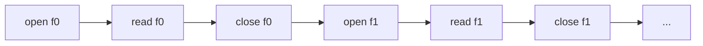
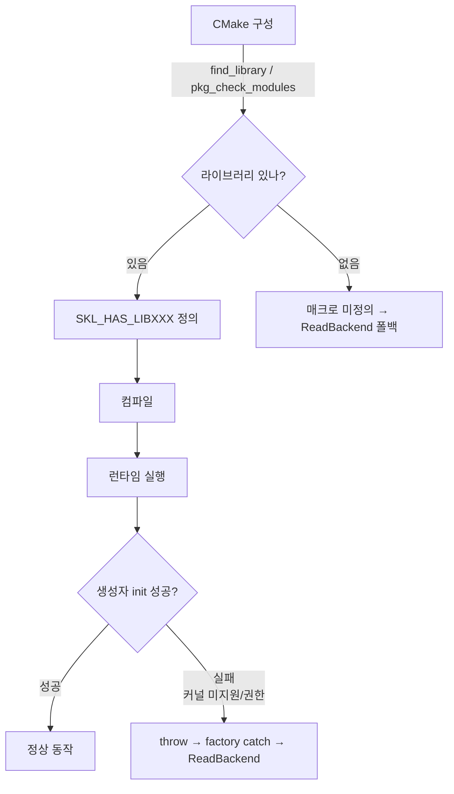

## 들어가며

현재 도구는 read · pread · mmap 세 동기 backend를 토글로 비교한다. 셋 모두 *한 파일씩 직렬* 로 처리하는 모델이고, 측정 차이는 *시스템 콜 비용 vs 메모리 복사 vs 페이지 폴트* 에서 나온다. 비동기 모델의 *시스템 콜 경계 자체* 를 줄이는 효과는 아직 측정에 들어오지 않았다.

이 단계의 목표는 *비동기 backend 두 가지* 를 추가하는 것이다. POSIX AIO(`aio_read`/`aio_suspend`)와 io_uring(liburing). 둘 다 *모든 파일을 한꺼번에 제출하고 완료된 순서대로 수확* 하는 batched 모델이라 동기 backend와 *비용 구조 자체* 가 다르다. 측정에서는 backend별 cycle ms와 throughput의 차이가 그래프에 그려진다.

다만 비동기 backend는 환경 의존이 크다. POSIX AIO는 `aio.h`와 POSIX AIO 심볼이 필요하고, io_uring은 liburing과 사용하는 연산을 지원하는 커널이 필요하다. io_uring이 Linux 5.1에 도입되었다고 해서 모든 opcode가 그 버전부터 지원되는 것은 아니다. 컴파일에 필요한 의존성이 없거나 io_uring 초기화에 실패하면 해당 backend는 read로 폴백한다. 초기화 이후의 I/O 오류까지 자동 폴백하는 것은 아니다. 폴백 시 workload의 활성 backend도 `Read`로 갱신하므로 HUD가 요청값을 성공한 backend처럼 표시하지 않는다.

이 단계의 결과물은 다음 다섯 가지다.

1. CMakeLists.txt 의 `librt` / `liburing` 자동 검출 + 매크로 정의.
2. `AioBackend` — POSIX AIO 모든 파일 batch 제출.
3. `UringBackend` — io_uring SQE/CQE 패턴, PIMPL로 헤더 격리.
4. `BackendType` enum 확장 (5종) + `BackendCompiledIn` 헬퍼.
5. ImGui HUD 콤보를 `BeginCombo + Selectable + BeginDisabled` 패턴으로 — 컴파일에 안 들어간 옵션이 gray로 표시된다.

---

## 목차

1. 동기 vs 비동기 IO 모델의 비용 구조
2. CMake 의존성 자동 검출과 두 단계 가드
3. AioBackend — POSIX AIO batch 패턴
4. UringBackend — SQE 채움 + 일괄 submit + CQE 수확
5. factory의 폴백 정책
6. HUD 콤보의 disabled 표시
7. 빌드와 측정 결과
8. 검증 — 포기한 사이클이 뒤를 오염시키지 않는가

---

## 1. 동기 vs 비동기 IO 모델의 비용 구조

현재 동기 backend(read/pread/mmap)는 *한 파일씩 직렬* 로 처리한다.



16개 파일에서 각 read가 한 번에 요청량을 채우면 read 호출은 16번이다. 부분 읽기나 `EINTR` 재시도가 있으면 더 늘어난다. 한 파일의 읽기 루프가 끝나야 다음 파일로 진행한다.

비동기 backend는 다른 모델이다.

```mermaid
flowchart LR
    Open["open f0..fN<br/>(직렬 16번)"] --> Submit[모든 read 제출<br/>aio_read N번 또는 io_uring_submit 1번]
    Submit --> Wait[수확 루프<br/>완료 순서대로 onRead]
    Wait --> CloseAll[close f0..fN<br/>(완료 시점에)]
```

핵심 차이 둘.

- **제출 단계가 일괄**: io_uring은 N개 read SQE를 큐에 채운 뒤 `io_uring_submit` 한 번으로 제출한다. 보통 이 submit이 `io_uring_enter` 시스템 콜 경계 하나로 이어진다. POSIX AIO는 `aio_read` N번이지만 *블로킹 없이* 큐에 들어간다.
- **여러 요청이 동시에 미완료 상태일 수 있다**: 구현, 장치와 데이터 위치에 따라 처리가 겹칠 수 있다. 요청 수만큼의 병렬 실행이나 선형 속도 향상을 보장하지는 않는다.

fixture 생성 직후에는 페이지 캐시가 따뜻할 가능성이 높다. 이 조건에서도 버퍼 할당, 메모리 복사, 제출·수확, worker 스케줄링 비용은 남는다. cycle ms만으로 차이를 모두 시스템 콜 경계 비용에 귀속할 수는 없다.

### 두 비동기 모델의 차이

| 항목 | POSIX AIO (aio_read) | io_uring |
|---|---|---|
| 인터페이스 | 표준 POSIX | Linux 전용 |
| Linux 구현 | glibc는 *유저 공간 worker thread* (구현 의존) | 커널 네이티브 링버퍼 |
| 제출 비용 | aio_read N번 | SQE N개 + io_uring_submit 1번 |
| 수확 | aio_suspend로 대기한 뒤 aio_error 확인·aio_return 수확 | io_uring_wait_cqe |
| 커널 요구 | POSIX AIO 구현에 의존 | 사용하는 opcode·기능 지원과 실행 권한 필요 |
| 라이브러리 | POSIX AIO (`aio.h`, glibc/librt 계열) | liburing |

POSIX AIO는 표준 인터페이스이고 glibc는 worker thread로 구현한다. io_uring은 Linux 커널의 공유 큐 인터페이스다. API의 비동기성과 내부 실행 방식은 구분해서 설명해야 한다.

이 lab의 측정에서 두 backend가 *같은 인터페이스 안에서 다른 모델* 로 동작하는 모습이 그대로 그래프로 보인다.

## 2. CMake 의존성 자동 검출과 두 단계 가드

비동기 backend를 컴파일하려면 두 라이브러리가 필요하다.

- **POSIX AIO 심볼** — glibc 환경에서는 libc 또는 librt 계열에서 제공된다.
- **liburing** — io_uring 래퍼 라이브러리 (`-luring`). pkg-config 통해 검출.

CMake가 *자동 검출* 해 매크로를 정의한다.

```cmake
# CMakeLists.txt 일부

find_package(PkgConfig)

# POSIX AIO: aio.h와 aio_error 심볼이 실제 링크되는지 검사.
find_library(SKL_RT_LIB rt)
include(CheckCXXSourceCompiles)
set(_SKL_REQUIRED_LIBRARIES_SAVE "${CMAKE_REQUIRED_LIBRARIES}")
if(SKL_RT_LIB)
    set(CMAKE_REQUIRED_LIBRARIES "${SKL_RT_LIB}")
endif()
check_cxx_source_compiles(
    "#include <aio.h>
     int main() { aiocb cb{}; (void)aio_error(&cb); return 0; }"
    SKL_POSIX_AIO_AVAILABLE)
set(CMAKE_REQUIRED_LIBRARIES "${_SKL_REQUIRED_LIBRARIES_SAVE}")
unset(_SKL_REQUIRED_LIBRARIES_SAVE)

# liburing: pkg-config으로 검출.
if(PKG_CONFIG_FOUND)
    pkg_check_modules(LIBURING IMPORTED_TARGET liburing)
endif()

# ... add_executable 후 ...

if(SKL_POSIX_AIO_AVAILABLE)
    target_compile_definitions(${PROJECT_NAME} PRIVATE SKL_HAS_POSIX_AIO=1)
    if(SKL_RT_LIB)
        target_link_libraries(${PROJECT_NAME} PRIVATE ${SKL_RT_LIB})
    endif()
    message(STATUS "POSIX AIO: enabled")
else()
    message(STATUS "POSIX AIO: disabled (headers/symbols unavailable)")
endif()

if(LIBURING_FOUND)
    target_compile_definitions(${PROJECT_NAME} PRIVATE SKL_HAS_LIBURING=1)
    target_link_libraries(${PROJECT_NAME} PRIVATE PkgConfig::LIBURING)
    message(STATUS "io_uring: enabled (liburing ${LIBURING_VERSION})")
else()
    message(STATUS "io_uring: disabled (liburing not found)")
endif()
```

CMake 구성 시 메시지로 어느 backend가 컴파일에 들어갔는지 즉시 보인다.

```text
-- POSIX AIO: enabled
-- io_uring: enabled (liburing 2.5)
```

### 두 단계 가드

이 lab의 backend 가용성은 *두 단계* 로 결정된다.



- **컴파일 타임 가드** (`SKL_HAS_POSIX_AIO`, `SKL_HAS_LIBURING`): 시스템에 필요한 심볼이나 라이브러리가 *없으면* 코드 자체를 컴파일에서 빼고 stub을 둔다. ReadBackend 폴백이 factory에서 일어난다.
- **런타임 가드**: 컴파일에 들어갔어도 *커널 미지원* 이거나 *권한 차단* 이면 backend 생성자가 throw. factory가 catch해 ReadBackend로 폴백.

두 단계가 모두 필요한 이유는 *환경의 다양성* 때문이다. WSL2 커널은 보통 io_uring을 지원하지만 *seccomp나 컨테이너 권한 제약* 으로 io_uring_queue_init이 EPERM을 반환할 수 있다. 컴파일이 성공했어도 런타임이 막힐 수 있다. 두 단계 가드가 *어느 쪽으로 막혀도* 도구가 안전하게 read 폴백으로 동작하게 한다.

## 3. AioBackend — POSIX AIO batch 패턴

핵심은 모든 파일의 요청을 제출하고, 완료된 요청을 정확히 한 번씩 수확하는 것이다. 아래는 `src/io/aio_backend.cpp`의 실제 메서드다. 클래스 선언과 include, 오류 주입용 `SklAio*` 래퍼는 같은 소스 문맥을 사용한다. 래퍼는 주입이 없으면 POSIX API를 호출하며, 수확 래퍼는 오류 주입 중에도 실제 `aio_return`을 수행한다.

<!-- snippet: src/io/aio_backend.cpp#AioBackend::RunCycle -->
```cpp
std::uint64_t AioBackend::RunCycle(const std::vector<std::string>& paths,
                                     std::size_t fileBytes,
                                     const OnFileRead& onRead) {
    const std::size_t n = paths.size();
    if (n == 0) return 0;

    // 사이클마다 fresh aiocb 배열·버퍼·fd 배열을 잡는다. backend 멤버에 들고
    // 재사용하면 alloc 비용이 줄지만, 이 구현은 자원 생성 비용까지 사이클
    // 측정에 포함한다. 버퍼 재사용을 가정한 정상 상태 측정과 구분해야 한다.
    std::vector<aiocb>                       cbs(n);
    std::vector<aiocb*>                      cbsList(n);
    std::vector<std::vector<unsigned char>>  bufs(n);
    std::vector<int>                         fds(n, -1);
    std::vector<bool>                        done(n, false);
    auto closeAll = [&fds]() {
        for (int& fd : fds) {
            if (fd >= 0) {
                ::close(fd);
                fd = -1;
            }
        }
    };

    // Allocate before opening descriptors; allocation failures leave no resources.
    for (auto& buf : bufs) buf.resize(fileBytes);

    // open + aiocb 준비. 제출 전 실패가 나면 pending AIO가 없다.
    for (std::size_t i = 0; i < n; ++i) {
        fds[i] = SklOpen(paths[i].c_str(), O_RDONLY);
        if (fds[i] < 0) {
            closeAll();
            throw std::runtime_error(std::string("open failed: ") + paths[i]
                                     + ": " + std::strerror(errno));
        }
        std::memset(&cbs[i], 0, sizeof(aiocb));
        cbs[i].aio_fildes = fds[i];
        cbs[i].aio_buf    = bufs[i].data();
        cbs[i].aio_nbytes = fileBytes;
        cbs[i].aio_offset = 0;
        cbs[i].aio_sigevent.sigev_notify = SIGEV_NONE;
        cbsList[i] = &cbs[i];
    }

    std::uint64_t totalBytes = 0;
    std::string firstError;
    std::exception_ptr callbackError;
    auto finishCompleted = [&](std::size_t i, bool invokeRead) {
        if (done[i]) return false;

        const int err = ::aio_error(&cbs[i]);
        if (err == EINPROGRESS) return false;
        // 완료된 요청은 성공·실패와 무관하게 정확히 한 번 aio_return 해야
        // 구현이 보유한 요청 자원이 회수된다.
        const ssize_t bytes = SklAioReturn(&cbs[i]);
        if (err != 0) {
            if (firstError.empty()) {
                firstError = std::string("aio_error: ") + paths[i]
                           + ": " + std::strerror(err);
            }
        } else {
            if (bytes < 0) {
                if (firstError.empty()) {
                    firstError = std::string("aio_return failed: ") + paths[i]
                               + ": " + std::strerror(errno);
                }
            } else if (invokeRead && !callbackError) {
                const std::size_t got = static_cast<std::size_t>(bytes);
                try {
                    onRead(bufs[i].data(), got);
                    totalBytes += got;
                } catch (...) {
                    // Keep all aiocb/buffers alive until every request is reaped.
                    callbackError = std::current_exception();
                }
            }
        }

        if (fds[i] >= 0) {
            ::close(fds[i]);
            fds[i] = -1;
        }
        cbsList[i] = nullptr;  // 완료된 요청은 다음 aio_suspend 대기 목록에서 제외.
        done[i] = true;
        return true;
    };

    auto drainSubmitted = [&](std::size_t submitted, bool invokeRead) {
        std::size_t doneCount = 0;
        bool suspendUsable = true;
        while (doneCount < submitted) {
            if (suspendUsable) {
                const int rc = SklAioSuspend(cbsList.data(),
                                             static_cast<int>(submitted),
                                             nullptr);
                if (rc < 0) {
                    if (errno == EINTR) continue;
                    if (firstError.empty()) {
                        firstError = std::string("aio_suspend failed: ")
                                   + std::strerror(errno);
                    }
                    // 버퍼와 aiocb를 해제하기 전에 모든 요청을 반드시
                    // aio_return까지 수확해야 한다. 대기 API가 실패하면
                    // 취소를 요청하고 aio_error를 polling한다.
                    suspendUsable = false;
                    for (std::size_t i = 0; i < submitted; ++i) {
                        if (!done[i]) SklAioCancel(fds[i], &cbs[i]);
                    }
                }
            }

            bool progressed = false;
            for (std::size_t i = 0; i < submitted; ++i) {
                if (finishCompleted(i, invokeRead)) {
                    ++doneCount;
                    progressed = true;
                }
            }
            if (!suspendUsable && !progressed) {
                std::this_thread::yield();
            }
        }
    };

    // aio_read 제출 단계.
    std::size_t submitted = 0;
    for (; submitted < n; ++submitted) {
        if (SklAioRead(&cbs[submitted]) < 0) {
            const std::string msg = std::string("aio_read failed: ")
                                  + paths[submitted]
                                  + ": " + std::strerror(errno);
            for (std::size_t j = 0; j < submitted; ++j) {
                SklAioCancel(fds[j], &cbs[j]);
            }
            drainSubmitted(submitted, /*invokeRead=*/false);
            closeAll();
            throw std::runtime_error(msg);
        }
    }

    // 수확 단계. aio_suspend로 *어느 하나라도 완료* 까지 대기, 완료된 것만
    // 처리하고 다시 대기.
    drainSubmitted(n, /*invokeRead=*/true);
    if (callbackError) std::rethrow_exception(callbackError);
    if (!firstError.empty()) {
        closeAll();
        throw std::runtime_error(firstError);
    }

    return totalBytes;
}
```

준비, 제출, 수확의 순서에는 자원 수명이라는 이유가 있다.

1. **버퍼를 먼저 할당한다.** `resize`가 실패할 때 이미 열린 fd나 제출된 요청이 없도록 한다. `SIGEV_NONE`을 명시해 시그널 통지 대신 수확 루프를 사용한다.
2. **부분 제출 실패도 수확한다.** 성공적으로 제출한 개수만 취소 대상으로 삼고, 취소 성공 여부와 관계없이 해당 요청이 완료될 때까지 기다린다.
3. **완료는 한 번만 처리한다.** `done`과 `cbsList[i] = nullptr`로 중복 `aio_return`과 완료 항목의 반복 대기를 막는다.
4. **콜백 예외도 자원 수명보다 먼저 전파하지 않는다.** 첫 예외를 `exception_ptr`에 저장하고 후속 콜백은 생략한다. 제출한 요청 전체를 수확한 다음 원래 예외를 다시 던진다.

이 구현은 매 사이클 자원을 생성한다. 따라서 측정값에는 제출·수확뿐 아니라 버퍼 할당, 파일 열기, 닫기 비용도 포함된다. 이미 열린 파일과 재사용 버퍼의 정상 상태 성능으로 해석해서는 안 된다.

### `EINPROGRESS` 의 의미

`aio_error` 반환값은:

- `0`: 완료 성공.
- `EINPROGRESS`: 아직 처리 중.
- 기타 errno: 에러.

`aio_suspend` 가 깨어났을 때 *반드시 모든 cb가 완료된 건 아니다* — 일부만 완료된 상태에서 깨어난다. `EINPROGRESS` 인 cb는 *건너뛰고 다음 라운드 aio_suspend* 로 다시 기다린다.

### POSIX AIO의 한계

glibc의 POSIX AIO는 일반적으로 유저 공간 worker thread pool을 사용한다. 제출한 스레드와 실제 읽기를 수행하는 스레드가 분리되므로 호출자에게는 비동기 I/O다. 다만 커널의 비동기 제출 인터페이스를 직접 사용하는 모델과 구현 비용이 다르다. 파일 읽기는 worker가 `pread` 계열 동기 호출을 수행할 수 있다.

이 구조의 의미:

- 제출·통지·worker 동기화 비용이 추가된다. 정확한 시스템 콜 수는 glibc 구현과 완료 시점에 의존한다.
- 여러 파일의 I/O가 겹쳐 진행될 여지는 있으므로 worker 기반이라는 이유만으로 동기 순차 읽기와 같은 성능이라고 단정할 수 없다.
- 작은 파일이나 페이지 캐시에 있는 데이터에서는 관리 비용이 이득보다 커질 수 있다. 장치 병렬성, 요청 크기, 동시 요청 수에 따라 결과가 바뀐다.

io_uring도 작업 종류와 준비 상태에 따라 kernel worker에 작업을 넘길 수 있다. 따라서 이 비교는 "진짜/가짜 비동기"의 구분이 아니라 제출·대기·실행 주체가 다른 두 구현의 비용 비교다.

## 4. UringBackend — SQE 채움 + 일괄 submit + CQE 수확

io_uring은 Submission Queue와 Completion Queue를 유저·커널 공유 메모리로 두는 모델이다. 배치 제출과 공유 완료 큐로 요청당 시스템 콜 비용을 줄일 수 있다. 이 구현은 SQPOLL을 사용하지 않으므로 제출이나 대기 시 시스템 콜이 필요할 수 있다.

### 헤더 (PIMPL)

```cpp
// src/io/uring_backend.h

class UringBackend final : public IIoBackend {
public:
    UringBackend();
    ~UringBackend() override;

    UringBackend(const UringBackend&) = delete;
    UringBackend& operator=(const UringBackend&) = delete;

    std::uint64_t RunCycle(const std::vector<std::string>& paths,
                            std::size_t fileBytes,
                            const OnFileRead& onRead) override;

    const char* Name() const override { return "io_uring"; }

private:
    static constexpr unsigned kQueueDepth = 64;

    // io_uring 구조체는 PIMPL 로 숨긴다. 헤더에 <liburing.h> 노출 안 함.
    struct Impl;
    Impl* impl_ = nullptr;
};
```

`<liburing.h>` 가 헤더에 들어가면 *모든 cpp 파일이 그 헤더를 통해 liburing 의존* 이 된다. PIMPL로 숨겨 *구현 cpp 파일만 liburing을 본다*. 컴파일 시간 단축 + 의존성 격리.

### 생성자에서 ring 초기화

```cpp
// src/io/uring_backend.cpp 핵심부 (SKL_HAS_LIBURING 가드 안)

struct UringBackend::Impl {
    io_uring ring{};
    bool     ringInited = false;
};

UringBackend::UringBackend() : impl_(new Impl) {
    const int rc = io_uring_queue_init(kQueueDepth, &impl_->ring, /*flags=*/0);
    if (rc < 0) {
        delete impl_;
        impl_ = nullptr;
        throw std::runtime_error(std::string("io_uring_queue_init failed: ")
                                 + std::strerror(-rc));
    }
    impl_->ringInited = true;
}

UringBackend::~UringBackend() {
    if (impl_) {
        if (impl_->ringInited) {
            io_uring_queue_exit(&impl_->ring);
        }
        delete impl_;
    }
}
```

`io_uring_queue_init` 이 실패하면 (커널 미지원이면 `-ENOSYS`, 권한 차단이면 `-EPERM`) 생성자가 throw. factory가 이 throw를 catch해 ReadBackend로 폴백한다.

### RunCycle 본체

아래 메서드는 `src/io/uring_backend.cpp` 안에서 사용한다. `SklIoUring*`은 오류 주입용 래퍼이며, `kCancelTag`는 취소 CQE를 구분하는 최상위 비트다. 클래스와 래퍼를 포함한 번역 단위를 빌드해야 하며 독립 프로그램은 아니다.

<!-- snippet: src/io/uring_backend.cpp#UringBackend::RunCycle -->
```cpp
std::uint64_t UringBackend::RunCycle(const std::vector<std::string>& paths,
                                       std::size_t fileBytes,
                                       const OnFileRead& onRead) {
    const std::size_t n = paths.size();
    if (n == 0) return 0;
    if (n > kQueueDepth) {
        throw std::runtime_error("UringBackend: paths exceed kQueueDepth");
    }
    if (fileBytes > std::numeric_limits<unsigned>::max()) {
        throw std::runtime_error("UringBackend: fileBytes exceeds read length");
    }

    drain_ = DrainStats{};

    // 사이클마다 fresh 자원. AioBackend와 같은 정책.
    std::vector<int>                         fds(n, -1);
    std::vector<std::vector<unsigned char>>  bufs(n);
    // 어느 요청의 CQE 를 이미 수확했는가. 취소 대상 특정과 배수 회계에 쓴다.
    std::vector<char>                        reaped(n, 0);
    auto closeAll = [&fds]() {
        for (int& fd : fds) {
            if (fd >= 0) {
                ::close(fd);
                fd = -1;
            }
        }
    };
    auto resetRing = [this]() {
        if (impl_->ringInited) {
            io_uring_queue_exit(&impl_->ring);
            impl_->ringInited = false;
        }
        const int rc = SklIoUringQueueInit(kQueueDepth, &impl_->ring, /*flags=*/0);
        if (rc < 0) {
            throw std::runtime_error(std::string("io_uring reset failed: ")
                                     + std::strerror(-rc));
        }
        impl_->ringInited = true;
    };

    if (!impl_->ringInited) resetRing();

    // flags == 0: consume all prepared SQEs before adding cancellation requests.
    // A permanent cleanup failure cannot justify releasing live I/O buffers.
    auto submitPending = [&]() {
        while (io_uring_sq_ready(&impl_->ring) != 0) {
            const int rc = io_uring_submit(&impl_->ring);
            if (rc < 0 && rc != -EINTR && rc != -EAGAIN)
                std::terminate();
            if (rc <= 0) std::this_thread::yield();
        }
    };

    // 대기 API 가 실패해 사이클을 포기해야 할 때, in-flight 요청은 곧 사라질
    // bufs[] 를 가리킨 채 남는다. 링을 재초기화(io_uring_queue_exit)하는 것만
    // 으로는 커널이 그 요청을 정리하는 시점이 우리 반환 시점과 동기화되지
    // 않는다. 그래서 남은 요청마다 IORING_OP_ASYNC_CANCEL 을 걸고
    // *원 요청 CQE 와 취소 요청 CQE 를 모두 수확한 뒤* 에야 반환한다.
    // (system/part14_io_uring.md 의 drain 규약)
    auto cancelAndDrain = [&]() {
        submitPending();
        // Each read is one-shot. Even an invalid identity still retires one read.
        const std::size_t outstanding = n - drain_.requestCqes;
        if (outstanding == 0) return;

        std::size_t queued = 0;
        for (std::size_t i = 0; i < n; ++i) {
            if (reaped[i]) continue;
            io_uring_sqe* sqe = io_uring_get_sqe(&impl_->ring);
            if (!sqe) std::terminate();
            io_uring_prep_cancel64(sqe, static_cast<__u64>(i), /*flags=*/0);
            // 취소 요청 자신의 CQE 는 최상위 비트로 구분한다. 원 요청의
            // user_data 는 파일 인덱스(< n)라 절대 겹치지 않는다.
            io_uring_sqe_set_data64(sqe, kCancelTag | static_cast<__u64>(i));
            ++queued;
        }
        submitPending();
        drain_.cancelSqes += queued;

        std::size_t pendingOriginals = outstanding;
        std::size_t pendingCancels   = queued;
        while (pendingOriginals > 0 || pendingCancels > 0) {
            io_uring_cqe* cqe = nullptr;
            // Timeout is not completion. Keep ownership until the read CQE arrives.
            __kernel_timespec ts{};
            ts.tv_sec = 1;
            const int injected = SklFaultCheck("io_uring_drain_wait");
            const int rc = injected ? -injected
                : io_uring_wait_cqe_timeout(&impl_->ring, &cqe, &ts);
            if (rc < 0) {
                if (rc == -EINTR || rc == -ETIME || rc == -EAGAIN) continue;
                std::terminate();
            }
            const __u64 data = io_uring_cqe_get_data64(cqe);
            if ((data & kCancelTag) != 0 && (data & ~kCancelTag) < n) {
                if (pendingCancels > 0) --pendingCancels;
                ++drain_.cancelCqes;
            } else if (data < n) {
                reaped[data] = 1;
                if (pendingOriginals > 0) --pendingOriginals;
                ++drain_.requestCqes;
            } else {
                // 취소 CQE 의 user_data 는 우리가 직접 박은 kCancelTag|i 뿐이므로
                // 어느 쪽 형태도 아닌 값은 user_data 가 손상된 원 요청 CQE 다.
                // 최상위 비트만 보고 취소로 세면 pendingOriginals 가 영영 안 준다.
                if (pendingOriginals > 0) --pendingOriginals;
                ++drain_.requestCqes;
            }
            io_uring_cqe_seen(&impl_->ring, cqe);
        }

        // 사후조건: 배수가 끝났으면 CQ 링이 비어 있어야 한다. 남은 CQE 는
        // 다음 사이클이 자기 요청의 완료로 오인할 쓰레기다. 세면서 치운다.
        for (;;) {
            io_uring_cqe* leftover = nullptr;
            if (io_uring_peek_cqe(&impl_->ring, &leftover) != 0 || !leftover) {
                break;
            }
            ++drain_.leftoverCqes;
            io_uring_cqe_seen(&impl_->ring, leftover);
        }
    };

    for (auto& buf : bufs) buf.resize(fileBytes);

    // open + 버퍼 준비. submit 전 실패가 나도 링에 미제출 SQE가 남지 않는다.
    for (std::size_t i = 0; i < n; ++i) {
        fds[i] = SklOpen(paths[i].c_str(), O_RDONLY);
        if (fds[i] < 0) {
            closeAll();
            throw std::runtime_error(std::string("open failed: ") + paths[i]
                                     + ": " + std::strerror(errno));
        }
    }

    // SQE 채움.
    for (std::size_t i = 0; i < n; ++i) {
        io_uring_sqe* sqe = SklIoUringGetSqe(&impl_->ring);
        if (!sqe) {
            closeAll();
            resetRing();
            throw std::runtime_error("io_uring_get_sqe returned null");
        }
        io_uring_prep_read(sqe, fds[i], bufs[i].data(),
                            static_cast<unsigned>(fileBytes), 0);
        // user_data로 fileIdx를 박아 CQE 수확 시 매핑.
        io_uring_sqe_set_data64(sqe, SklUringUserData(i));
    }

    // 일괄 제출. 여러 read 요청을 하나의 submit 경계로 밀어 넣는다.
    const int submitted = SklIoUringSubmit(&impl_->ring);
    if (submitted < 0) {
        // Even an interrupted submit must not leave published reads using locals.
        cancelAndDrain();
        closeAll();
        // 제출 실패 시 준비된 SQE가 링에 남을 수 있다. SQE는 곧 소멸할
        // 버퍼와 닫힌 fd를 가리키므로 다음 사이클 전에 반드시 버린다.
        resetRing();
        throw std::runtime_error(std::string("io_uring_submit failed: ")
                                 + std::strerror(-submitted));
    }
    if (submitted != static_cast<int>(n)) {
        // 보고된 수보다 실제로 더 많이 in-flight 일 수 있고(부분 제출 보고),
        // 남은 SQE 가 링에 그대로일 수도 있다. 어느 쪽이든 취소를 걸고 CQE 를
        // 전부 수확한 뒤에야 버퍼를 놓는다. 취소 SQE 를 제출하는 submit 이
        // 링에 남아 있던 read SQE 도 함께 밀어내므로 양쪽 다 CQE 로 끝난다.
        cancelAndDrain();
        closeAll();
        resetRing();
        throw std::runtime_error("io_uring_submit submitted fewer SQEs than expected");
    }

    // CQE 수확. 완료 순서대로 onRead.
    std::uint64_t totalBytes = 0;
    std::size_t doneCount = 0;
    std::string firstError;
    std::exception_ptr callbackError;
    while (doneCount < n) {
        io_uring_cqe* cqe = nullptr;
        const int waitRc = SklIoUringWaitCqe(&impl_->ring, &cqe);
        if (waitRc < 0) {
            if (waitRc == -EINTR) continue;
            // 아직 수확하지 못한 요청이 bufs[] 를 가리킨 채 남아 있다.
            // 취소를 걸고 원 요청·취소 요청 CQE 를 모두 수확한 뒤 반환한다.
            cancelAndDrain();
            closeAll();
            resetRing();
            throw std::runtime_error(std::string("io_uring_wait_cqe failed: ")
                                     + std::strerror(-waitRc));
        }

        const std::uint64_t idx = io_uring_cqe_get_data64(cqe);
        ++drain_.requestCqes;
        if (idx >= n) {
            if (firstError.empty()) {
                firstError = "io_uring returned invalid user_data";
            }
            io_uring_cqe_seen(&impl_->ring, cqe);
            ++doneCount;
            continue;
        }
        reaped[idx] = 1;
        if (cqe->res < 0) {
            if (firstError.empty()) {
                firstError = std::string("io_uring read failed: ")
                           + paths[idx] + ": "
                           + std::strerror(-cqe->res);
            }
            if (fds[idx] >= 0) {
                ::close(fds[idx]);
                fds[idx] = -1;
            }
            io_uring_cqe_seen(&impl_->ring, cqe);
            ++doneCount;
            continue;
        }
        const std::size_t bytes = static_cast<std::size_t>(cqe->res);
        if (!callbackError) {
            try {
                onRead(bufs[idx].data(), bytes);
                totalBytes += bytes;
            } catch (...) {
                callbackError = std::current_exception();
            }
        }
        if (fds[idx] >= 0) {
            ::close(fds[idx]);
            fds[idx] = -1;
        }
        io_uring_cqe_seen(&impl_->ring, cqe);
        ++doneCount;
    }
    closeAll();
    if (callbackError) std::rethrow_exception(callbackError);
    if (!firstError.empty()) {
        throw std::runtime_error(firstError);
    }

    return totalBytes;
}
```

세 가지 계약을 읽어야 한다.

- **제출량과 수확량을 구분한다.** `io_uring_submit`은 큐에 준비한 수보다 적은 값을 반환할 수 있다. 음수 오류나 부분 제출을 단순 반환으로 처리하지 않고, 남은 제출 항목과 진행 중인 작업을 정리한다.
- **CQE의 식별자와 결과를 별도로 검사한다.** `user_data`는 버퍼를 선택하는 인덱스이고, `res`는 읽은 바이트 수 또는 음수 오류 코드다. 인덱스 검증 없이 버퍼를 참조하면 오류 경로가 메모리 접근 오류가 된다.
- **콜백 실패 후에도 완료를 수확한다.** 콜백 예외를 보관하고 모든 원 요청 CQE를 소비한 뒤 전파한다. 그래야 커널이 참조하는 지역 버퍼가 먼저 파괴되지 않는다.

`io_uring_get_sqe`는 미리 확보한 링의 슬롯을 얻고, `io_uring_prep_read`는 그 슬롯의 필드를 채운다. CQE를 처리한 뒤 `io_uring_cqe_seen`을 호출해야 완료 큐 슬롯을 재사용할 수 있다.

### 대기가 실패하면 — IORING_OP_ASYNC_CANCEL 로 배수

POSIX AIO 쪽에서 이미 정한 규약("버퍼와 `aiocb` 를 해제하기 전에 모든 요청을 `aio_return` 까지 수확한다")은 io_uring에도 그대로 필요하다. `io_uring_wait_cqe` 가 `EINTR` 이 아닌 오류를 돌려주거나 제출 수가 기대와 다르면, in-flight read는 *곧 사라질 `bufs[]`* 를 가리킨 채 남는다.

여기서 `io_uring_queue_exit` 로 링을 버리는 것만으로는 부족하다. 링 fd를 닫으면 커널이 남은 요청을 정리하기는 하지만, 그 정리가 끝나는 시점이 우리가 `RunCycle` 에서 반환하는 시점과 동기화되지 않는다. 그래서 남은 요청마다 `io_uring_prep_cancel64(sqe, user_data, 0)` 로 취소를 걸고, **원 요청 CQE와 취소 요청 CQE를 모두 수확한 뒤에야** 반환한다.

세 가지가 필요하다.

1. **취소 요청 자신의 CQE 를 구분할 태그.** 원 요청의 `user_data` 는 파일 인덱스(`< kQueueDepth`)라 최상위 비트를 절대 쓰지 않는다. 취소 요청에는 `1ull << 63` 을 or 해 둔다.
2. **잘못된 `user_data`도 수명 회계에서 버리지 않는다.** 이 구현은 read 요청마다 CQE 하나인 one-shot 모델이다. 식별자가 잘못된 CQE도 원 요청 완료 개수에 포함하고, 유효한 완료가 확인되지 않은 슬롯에 취소를 요청한다. 어떤 요청이었는지 몰라도 남은 원 요청 CQE를 모두 받아야 버퍼를 해제할 수 있다. multishot 요청에는 이 개수 회계를 그대로 사용할 수 없다.
3. **사후조건: 배수 후 CQ 링이 비어 있어야 한다.** 남은 CQE는 다음 사이클이 자기 요청의 완료로 오인할 쓰레기다. `io_uring_peek_cqe` 로 세면서 치우고, 그 값이 0이 아니면 회계가 틀렸다는 뜻이다.

취소는 원 요청이 이미 끝났으면 `-ENOENT`, 취소할 수 없는 실행 단계라면 `-EALREADY`를 보고할 수 있다. 취소 CQE가 왔다는 이유만으로 원 요청 버퍼를 해제해서는 안 된다. 이 one-shot 구현에서 사이클 전체의 총 수확 CQE는 `paths.size() + 실제 제출한 취소 요청 수`다. 잘못된 식별자를 관측한 경우에는 취소 요청 수가 실제 미완료 read 수보다 클 수 있다. `UringBackend::LastDrainStats()`의 네 숫자(`requestCqes`, `cancelSqes`, `cancelCqes`, `leftoverCqes`)로 이 회계를 검사한다.

배수 대기의 `-ETIME`, `-EINTR`, `-EAGAIN`은 재시도 사유이며 완료 증거가 아니다. 정해진 횟수 뒤 지역 버퍼를 파괴하는 timeout 정책은 사용하지 않는다. 따라서 장치가 응답하지 않으면 이 구현도 종료를 오래 기다릴 수 있다. 복구 불가능한 배수 오류는 `std::terminate`로 처리한다. 이는 LAB의 명시적인 fail-stop 정책이지 일반 서버의 복구 전략이 아니다. 요청 상태를 별도 수명 객체로 옮기는 설계 없이는 "제한 시간 내 반환"과 "커널 참조 버퍼의 안전한 해제"를 동시에 보장할 수 없다.

### 시스템 콜 카운트

이 패턴은 제출 쪽 시스템 콜 경계를 줄인다.

| backend | 16개 정규 파일을 한 사이클에서 읽을 때의 호출 구조 |
|---|---|
| read | open 16 + read 16 (이상) + close 16 = 48+ |
| pread | open 16 + pread 16 이상 + close 16. 부분 읽기·EINTR이면 반복 |
| mmap | open 16 + fstat 16 + mmap 16 + munmap 16 + close 16. 길이가 0이면 매핑 생략 |
| aio | open 16 + aio_read 16회(libc API) + aio_suspend 반복 + close 16. worker의 읽기와 내부 동기화가 별도로 실행됨 |
| io_uring | open 16 + io_uring_submit 1회 + CQE 수확 + close 16 |

io_uring의 *제출 호출이 1번* 인 점이 핵심이다. 16개 파일 read를 SQE 16개로 채운 뒤 한 번에 커널에 넘긴다. `io_uring_wait_cqe` 는 완료가 이미 CQ에 있으면 추가 syscall 없이 돌아올 수 있고, 없으면 대기 경로에서 `io_uring_enter` 를 호출할 수 있다.

이 표는 소스 수준의 호출 구조이지 시스템 콜 실측값이 아니다. libc/liburing 호출과 커널 진입은 일대일 대응하지 않는다. 정확한 호출 수를 확인하려면 worker thread까지 포함하는 `strace -f -c` 등을 사용하고, 추적 자체가 시간 측정에 영향을 준다는 점도 구분한다.

## 5. factory의 폴백 정책

factory는 *컴파일 타임 가드 + 런타임 catch* 두 단계로 폴백을 보장한다.

```cpp
// src/io/io_backend_factory.cpp 핵심부

std::unique_ptr<IIoBackend> CreateBackend(BackendType type) {
    switch (type) {
        case BackendType::Read:  return std::make_unique<ReadBackend>();
        case BackendType::Pread: return std::make_unique<PreadBackend>();
        case BackendType::Mmap:  return std::make_unique<MmapBackend>();

        case BackendType::Aio:
#if defined(SKL_HAS_POSIX_AIO)
            return std::make_unique<AioBackend>();
#else
            std::fprintf(stderr,
                "skl: aio not compiled in, falling back to read\n");
            return std::make_unique<ReadBackend>();
#endif

        case BackendType::Uring:
#if defined(SKL_HAS_LIBURING)
            try {
                return std::make_unique<UringBackend>();
            } catch (const std::exception& e) {
                std::fprintf(stderr,
                    "skl: io_uring runtime init failed (%s), "
                    "falling back to read\n", e.what());
                return std::make_unique<ReadBackend>();
            }
#else
            std::fprintf(stderr,
                "skl: io_uring not compiled in, falling back to read\n");
            return std::make_unique<ReadBackend>();
#endif
    }
    return std::make_unique<ReadBackend>();
}
```

세 가지 정책 결정.

1. **stderr에 폴백 안내**: 사용자가 콤보를 io_uring으로 바꾸고 *실제로 read가 도는* 상황을 즉시 인지하도록. HUD에는 backend 이름이 `"read"` 로 표시되어 있어 *콤보 선택과 실제 동작이 다른* 사실이 텍스트로 드러난다.
2. **Uring만 try-catch**: AIO는 컴파일에 들어가면 대체로 함수 호출 경로가 존재한다. io_uring은 *커널·권한 의존* 이라 컴파일은 됐어도 런타임에 실패할 수 있어 try-catch 필요.
3. **ReadBackend 폴백**: nullptr 반환 대신 *동작하는 backend* 를 반환. main이 nullptr 처리 분기를 안 두어도 안전.

### `BackendCompiledIn` 헬퍼

UI가 *컴파일에 안 들어간 옵션을 disabled* 로 표시하기 위해 컴파일 타임 가드 결과를 노출한다.

```cpp
// src/io/io_backend_factory.h

bool BackendCompiledIn(BackendType type);

// src/io/io_backend_factory.cpp

bool BackendCompiledIn(BackendType type) {
    switch (type) {
        case BackendType::Read:
        case BackendType::Pread:
        case BackendType::Mmap:
            return true;
        case BackendType::Aio:
#if defined(SKL_HAS_POSIX_AIO)
            return true;
#else
            return false;
#endif
        case BackendType::Uring:
#if defined(SKL_HAS_LIBURING)
            return true;
#else
            return false;
#endif
    }
    return false;
}
```

UI가 매크로를 *직접 보지 않게* 함수로 추상화한다. 가드 매크로 이름이 바뀌어도 UI 코드는 영향 없다.

## 6. HUD 콤보의 disabled 표시

`ImGui::Combo` 는 *항목별 disable 제어가 어렵다*. 이 단계는 `BeginCombo + Selectable + BeginDisabled` 패턴으로 풀어, 컴파일에 안 들어간 옵션이 *gray* 로 보이게 한다.

```cpp
// src/ui/hud.cpp 일부

const int currIdx = static_cast<int>(toggles.backend);
const char* preview = (currIdx >= 0 && currIdx < kBackendTypeCount)
                      ? kBackendTypeLabels[currIdx]
                      : "(none)";
if (ImGui::BeginCombo("backend", preview)) {
    for (int n = 0; n < kBackendTypeCount; ++n) {
        const auto t = static_cast<BackendType>(n);
        const bool compiled = BackendCompiledIn(t);
        ImGui::BeginDisabled(!compiled);
        const bool selected = (currIdx == n);
        if (ImGui::Selectable(kBackendTypeLabels[n], selected)) {
            toggles.backend = t;
        }
        if (selected) ImGui::SetItemDefaultFocus();
        ImGui::EndDisabled();
    }
    ImGui::EndCombo();
}
```

핵심 패턴.

- **`BeginCombo` 가 콤보 펼치기/닫기를 제어**. `EndCombo` 와 짝.
- **`Selectable` 이 각 항목**. 클릭 시 true 반환.
- **`BeginDisabled(!compiled) ... EndDisabled()`**: 사이의 위젯이 비활성. 색이 gray로 바뀌고 클릭이 무시된다.
- **`SetItemDefaultFocus`**: 처음 펼칠 때 *현재 선택* 항목에 포커스. UX 디테일.

### 옵션 라벨의 한 곳 관리

라벨 배열을 `io_backend_factory.h` 에 둔다.

<!-- snippet: src/io/io_backend_factory.h comments=keep -->
```cpp
inline constexpr const char* kBackendTypeLabels[kBackendTypeCount] = {
    "read", "pread", "mmap", "aio", "io_uring",
};
```

enum과 라벨이 *한 헤더에서 같이 정의* 되니 enum이 확장될 때 라벨도 *놓치지 않고* 갱신된다.

### gray 표시의 의미

WSL2 환경에 따라 다음 시나리오가 가능하다.

- **liburing-dev 미설치**: `io_uring` 항목만 gray. 사용자가 콤보를 펼쳐 *왜 안 되는지* 즉시 본다.
- **POSIX AIO 심볼 미검출 (드뭄)**: `aio` 도 gray. 표준 glibc 환경에서는 거의 안 일어남.
- **둘 다 OK**: 모든 옵션 활성. 컴파일에는 들어갔지만 *런타임에 io_uring 실패* 면 콤보 선택은 되지만 stderr에 폴백 메시지 + HUD에 backend 이름 `"read"`.

## 7. 빌드와 측정 결과

### 의존성 설치

`scripts/install_deps.sh` 에 이미 `liburing-dev` 가 들어 있다. 따로 추가할 필요 없다.

```bash
bash scripts/install_deps.sh   # 처음 한 번
```

### CMake 구성과 메시지

```bash
cmake -S . -B build
```

구성 메시지에 어느 backend가 들어갔는지 보인다.

```text
-- POSIX AIO: enabled
-- io_uring: enabled (liburing 2.5)
-- Configuring done
-- Generating done
```

### 빌드와 실행

```bash
cmake --build build -j
./build/system_kernel_lab
```

콤보를 펼치면 다섯 옵션이 보인다. 일반적인 WSL2 환경에서 모두 활성. 차례로 선택해 본다.

### 측정 시점에서 보이는 경향

페이지 캐시가 따뜻한 상태에서 `kFileCount = 16, kFileBytes = 1 MB`:

- **read / pread**: 동기 읽기 기준선. 시간은 이 환경에서 측정해야 한다.
- **mmap**: 매 사이클 새 매핑의 페이지 폴트 비용과 명시적 복사 절감 효과를 비교한다. read보다 빠르다고 보장되지 않는다.
- **aio (POSIX AIO, glibc)**: worker 관리 비용 때문에 read보다 느릴 수 있다. 이것은 비동기 API가 아니라는 뜻이 아니라 해당 워크로드에서 병렬 실행의 이득이 비용을 상쇄하지 못할 수 있다는 뜻이다.
- **io_uring**: 제출 경계가 줄어 read 대비 비슷하거나 약간 빠를 수 있다. 워크로드가 작아 차이가 크지 않을 수 있다 — *제출 비용 절감* 은 시스템 콜 카운트가 많은 시나리오에서 두드러진다.

콤보 변경 전후 그래프가 달라질 수 있지만, 특정 순위나 변화량을 정답으로 두지 않는다. 충분한 반복과 동일한 캐시·스레드·전원 조건을 확보하고 분산도 함께 본다.

차이가 더 잘 보이려면 *시스템 콜 카운트* 를 직접 측정해야 한다. cycle ms는 제출/수확 모델의 *bytes 처리량* 측정에 적합하지만, *시스템 콜 경계 비용* 은 strace로 카운트할 때 가장 두드러진다. strace 자동 파싱을 붙이면 그 채널을 그래프와 별도로 볼 수 있다.

### 검증 체크리스트

- 콤보에 `io_uring` 이 *gray* → liburing-dev 미설치. `apt install liburing-dev` 후 cmake 재구성.
- io_uring 선택 시 stderr에 *queue_init failed* → 반환 오류를 확인한다. 미지원·권한 차단·자원 부족 등 원인이 다르며, factory는 read로 폴백한다.
- aio 선택 시 *느림* → worker 관리 비용을 후보로 두되, 스케줄링·할당·읽기 경로를 측정하기 전 원인으로 확정하지 않는다.
- io_uring 선택 시 *read와 거의 같음* → 해당 조건의 결과로 기록한다. 파일 수·크기를 바꿀 때에도 어느 비용이 변하는지 구분하며 성능 차이가 커진다고 미리 단정하지 않는다.
- 컴파일 오류 *aio.h not found* → 헤더 패키지가 따로 필요한 환경. `apt install libc6-dev` (대부분 이미 설치됨).

### 측정의 정직성

이 단계의 결과를 *비동기가 항상 빠르다* 로 일반화하지 않는다.

- POSIX AIO의 비동기 인터페이스와 glibc worker 기반 구현은 양립한다. 표준 API와 내부 실행 모델을 구분한다.
- io_uring의 배치 제출이 시스템 콜 비용을 줄여도 전체 cycle ms의 개선 폭은 다른 비용의 비중에 달려 있다.
- 측정 도구의 한 사이클은 *fixture 16 파일 × 1 MB* 로 고정. 실제 게임 엔진의 *수만 개 작은 파일* 또는 *몇 개 큰 파일* 시나리오는 결과가 다를 수 있다.

이 lab은 *워크로드를 명시적으로 고정* 한 *비교 환경* 이다. 결과를 시리즈 글에 인용할 때는 *워크로드 + 환경 + backend* 를 함께 명시한다.

## 8. 검증 — 포기한 사이클이 뒤를 오염시키지 않는가

비동기 backend가 동기 backend와 다른 점은 *실패했을 때* 드러난다. 동기 backend는 `read` 가 `-1` 을 돌려주면 그걸로 끝이지만, 비동기 backend는 실패한 시점에 커널이 이미 여러 요청을 들고 있다. 그 요청들의 목적지는 곧 스코프를 벗어날 버퍼다. 수확하지 않고 반환하면 해제된 메모리로 커널이 계속 쓴다.

그래서 이 단계의 검사는 던지는지가 아니라 *던지기 전에 전부 거둬들였는지* 를 센다. io_uring 쪽은 `LastDrainStats()` 가 CQE 회계를 관측 전용으로 노출하므로 숫자로 직접 비교할 수 있다.

<!-- snippet: tests/system_io_path_tests.cpp@uring-drain-accounting -->
```cpp
// tests/system_io_path_tests.cpp

{
    ScopedFault fault("io_uring_wait_cqe:0:EIO:1");
    const CycleResult bad = RunOneCycle(*backend, fixture.Paths(), kRequest);
    CHECK(bad.threw);
    CHECK(Contains(bad.what, "io_uring_wait_cqe failed"));
}
{
    const auto& st = backend->LastDrainStats();
    PrintDrainStats("wait_cqe failure", st);
    CHECK(st.cancelSqes   == kFiles);  // 남은 요청마다 취소 요청 하나
    CHECK(st.cancelCqes   == kFiles);  // 취소 요청 CQE 전부 수확
    CHECK(st.requestCqes  == kFiles);  // 원 요청 CQE 도 전부 수확
    CHECK(st.leftoverCqes == 0);       // 링에 남긴 것 없음
}
```

`leftoverCqes == 0` 이 링을 버리기 전에 아무것도 남기지 않았다는 뜻이다. POSIX AIO 쪽은 같은 질문을 `aio_cancel` / `aio_return` 호출 횟수로 센다 — 취소를 건 개수와 수확한 개수가 둘 다 파일 수와 같아야 한다. 대조군으로 *정상 사이클에서는 취소가 0회* 라는 것도 함께 확인한다. 그게 없으면 "항상 취소하는" 구현도 통과한다.

factory의 런타임 폴백도 여기서 못 박힌다. `io_uring_queue_init` 이 `ENOSYS` 를 돌려주는 커널을 seam으로 재현하고, `CreateBackend` 가 `actualType` 에 `read` 를 써 넣는지 본다. 그리고 주입 없이 한 번 더 불러 `io_uring` 이 나오는지 확인한다 — 이게 없으면 "항상 read를 보고하는" 구현도 통과한다.

```bash
cmake --build build -j
ctest --test-dir build -R skl_step04 --output-on-failure
```

```text
    Start 16: skl_step04_core
1/3 Test #16: skl_step04_core ..................   Passed    0.00 sec
    Start 17: skl_step04_fault
2/3 Test #17: skl_step04_fault .................   Passed    0.02 sec
    Start 18: skl_step04_io_path
3/3 Test #18: skl_step04_io_path ...............   Passed    0.33 sec

100% tests passed, 0 tests failed out of 3
```

```bash
./build/system_io_path_tests --step=04
```

```text
[ run  ] step04  short read contract (aio/io_uring)
  aio/io_uring: mixed fixture {16384, 8192, 4097, 1, 0, 32775} request=16384 -> total=45058 bytes, one onRead per path
[  ok  ] step04  short read contract (aio/io_uring)
[ run  ] step04  fifo blocking async wait EINTR
  aio wait via aio_suspend: calls(base)=1 calls(signalled)=71
  io_uring wait via io_uring_wait_cqe: calls(base)=1 calls(signalled)=71
[  ok  ] step04  fifo blocking async wait EINTR
[ run  ] step04  aio cancel drains every request
  aio drain: healthy cycle aio_cancel=0 aio_return=4; suspend EBADF aio_cancel=4 aio_return=4 (every request harvested before the buffers go)
[  ok  ] step04  aio cancel drains every request
[ run  ] step04  io_uring cancel drains both cqes
  wait_cqe failure: requestCqes=4 cancelSqes=4 cancelCqes=4 leftoverCqes=0
  short submit: requestCqes=4 cancelSqes=4 cancelCqes=4 leftoverCqes=0
[  ok  ] step04  io_uring cancel drains both cqes
[ run  ] step04  async callback exception cleanup
[  ok  ] step04  async callback exception cleanup
system_io_path_tests --step=4: 5/11 check(s) run, 0 failed
```

`total=45058` 은 동기 backend가 내는 값과 같다. 완료 순서가 제출 순서와 달라도 `(크기, 체크섬)` 기록을 정렬해 비교하므로 같은 값으로 수렴한다.

`calls(base)=1` 은 데이터가 한 번에 도착할 때 대기 지점을 정확히 한 번만 지난다는 뜻이고, `calls(signalled)=71` 은 시그널이 그 대기를 70번 끊었는데도 결과가 같았다는 뜻이다. 두 비동기 backend가 각자 다른 API(`aio_suspend`, `io_uring_wait_cqe`)에서 같은 성질을 보인다.

`requestCqes=4 cancelSqes=4 cancelCqes=4 leftoverCqes=0` 은 요청 4개가 in-flight인 채로 사이클을 포기했을 때의 회계다. 취소 요청 4개를 걸고, 원 요청 CQE 4개와 취소 CQE 4개를 모두 거둔 뒤 링을 버렸다. `short submit` 줄은 *실제로는 4개가 in-flight인데 3개만 제출됐다고 보고* 되는 경우인데, 같은 회계가 나온다.

```bash
./build/system_fault_tests --step=04
```

```text
[ run  ] step04  factory uring runtime fallback
skl: io_uring runtime init failed (io_uring_queue_init failed: Function not implemented), falling back to read
  factory: queue_init ENOSYS -> actual=read (usable), no injection -> actual=io_uring
[  ok  ] step04  factory uring runtime fallback
```

stderr의 경고가 함께 나오는 것이 정상이다. 폴백은 조용히 일어나면 안 되는 사건이고, 그 경고가 나오는지까지가 계약이다.

---

## 결론

이 단계의 결과물은 비동기 backend 두 가지(POSIX AIO, io_uring)가 추가된 도구다. 두 backend, factory 가드, UI 선택, CMake 검출과 오류 경로의 자원 수명 규약이 기존 동기 backend 구조 위에 얹힌다.

세 가지 결정이 이 단계의 토대를 만들었다.

1. **두 단계 가드** — 컴파일 타임 매크로(`SKL_HAS_POSIX_AIO`/`SKL_HAS_LIBURING`) + 런타임 try-catch. 어느 단계에서 막혀도 ReadBackend로 안전 폴백. 도구가 환경 차이로 *동작 자체가 안 되는* 사고를 막는다.
2. **PIMPL로 io_uring 헤더 격리** — `<liburing.h>` 가 헤더로 새 나가지 않게 backend.h에 forward declaration만. 의존성 분리 + 컴파일 시간.
3. **사이클 단위 batch 모델** — 동기 backend의 직렬 처리와 다른 *제출 + 수확* 분리. POSIX AIO와 io_uring이 *같은 인터페이스 안에서 다른 모델* 로 동작하는 모습이 측정에 그대로 드러난다.

호출 측 사이클은 하나의 실행 흐름이지만, glibc나 커널 내부의 worker까지 단일 스레드인 것은 아니다. 차이는 시스템 콜뿐 아니라 스케줄링, 메모리 복사, 할당, 완료 처리 비용의 합이다. 이를 분리해 측정하지 않았다면 특정 원인 하나의 성능 차이로 단정해서는 안 된다.

## 더 읽을거리

- [Linux man page: aio_read(3), aio_suspend(3)](https://man7.org/linux/man-pages/man3/aio_read.3.html) — POSIX AIO 표준 인터페이스
- [Linux man-pages: aio(7)](https://man7.org/linux/man-pages/man7/aio.7.html) — glibc의 worker thread 구현과 제어 블록·버퍼 수명
- [liburing: io_uring_prep_cancel(3)](https://man7.org/linux/man-pages/man3/io_uring_prep_cancel.3.html) — 취소 결과와 원 요청 완료를 기다려야 하는 조건
- [Jens Axboe, "Efficient IO with io_uring"](https://kernel.dk/io_uring.pdf) — io_uring 백서
- [liburing 저장소](https://github.com/axboe/liburing) — 헤더와 예제
- [Lord of the io_uring](https://unixism.net/loti/) — io_uring 입문서
- Brendan Gregg, *Systems Performance*, Ch. 8 "File Systems" — IO 모델 비교의 표준 레퍼런스
- [Linux man page: io_uring_setup(2), io_uring_enter(2)](https://man7.org/linux/man-pages/man2/io_uring_setup.2.html) — 시스템 콜 직접 호출 형태
