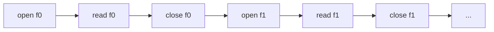
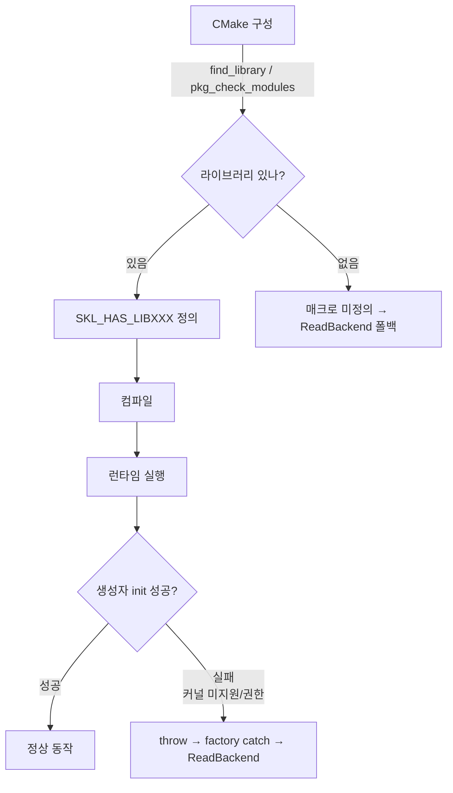

## 들어가며

현재 도구는 read · pread · mmap 세 동기 backend를 토글로 비교한다. 셋 모두 *한 파일씩 직렬* 로 처리하는 모델이고, 측정 차이는 *시스템 콜 비용 vs 메모리 복사 vs 페이지 폴트* 에서 나온다. 비동기 모델의 *시스템 콜 경계 자체* 를 줄이는 효과는 아직 측정에 들어오지 않았다.

이 단계의 목표는 *비동기 backend 두 가지* 를 추가하는 것이다. POSIX AIO(`aio_read`/`aio_suspend`)와 io_uring(liburing). 둘 다 *모든 파일을 한꺼번에 제출하고 완료된 순서대로 수확* 하는 batched 모델이라 동기 backend와 *비용 구조 자체* 가 다르다. 측정에서는 backend별 cycle ms와 throughput의 차이가 그래프에 그려진다.

다만 비동기 backend는 *환경 의존* 이 크다. POSIX AIO는 `aio.h` 와 POSIX AIO 심볼이 필요하고, io_uring은 liburing 라이브러리 + 커널 5.1+ 가 필요하다. 환경에 둘 중 하나라도 없으면 *해당 backend는 read로 폴백* 한다. 컴파일 타임에는 매크로 가드(`SKL_HAS_POSIX_AIO`, `SKL_HAS_LIBURING`)로, 런타임에는 *생성자 throw + factory catch* 로 두 단계 안전망을 둔다. 폴백 시 workload의 활성 backend도 `Read`로 갱신하므로 HUD가 요청값을 성공한 backend처럼 표시하지 않는다.

이 단계의 결과물은 다음 다섯 가지다.

1. CMakeLists.txt 의 `librt` / `liburing` 자동 검출 + 매크로 정의.
2. `AioBackend` — POSIX AIO 모든 파일 batch 제출.
3. `UringBackend` — io_uring SQE/CQE 패턴, PIMPL로 헤더 격리.
4. `BackendType` enum 확장 (5종) + `BackendCompiledIn` 헬퍼.
5. ImGui HUD 콤보를 `BeginCombo + Selectable + BeginDisabled` 패턴으로 — 컴파일에 안 들어간 옵션이 gray로 표시된다.

---

## 목차

1. 동기 vs 비동기 IO 모델의 비용 구조
2. CMake 의존성 자동 검출과 두 단계 가드
3. AioBackend — POSIX AIO batch 패턴
4. UringBackend — SQE 채움 + 일괄 submit + CQE 수확
5. factory의 폴백 정책
6. HUD 콤보의 disabled 표시
7. 빌드와 측정 결과

---

## 1. 동기 vs 비동기 IO 모델의 비용 구조

현재 동기 backend(read/pread/mmap)는 *한 파일씩 직렬* 로 처리한다.



16개 파일 = 16번의 read 시스템 콜 + 각자의 페이지 캐시 lookup. 한 read가 끝나야 다음 read가 시작된다. 페이지 캐시가 따뜻해 IO 자체는 빠르지만, *시스템 콜 경계* 가 16번 일어난다.

비동기 backend는 다른 모델이다.

```mermaid
flowchart LR
    Open["open f0..fN<br/>(직렬 16번)"] --> Submit[모든 read 제출<br/>aio_read N번 또는 io_uring_submit 1번]
    Submit --> Wait[수확 루프<br/>완료 순서대로 onRead]
    Wait --> CloseAll[close f0..fN<br/>(완료 시점에)]
```

핵심 차이 둘.

- **제출 단계가 일괄**: io_uring은 N개 read SQE를 큐에 채운 뒤 `io_uring_submit` 한 번으로 제출한다. 보통 이 submit이 `io_uring_enter` 시스템 콜 경계 하나로 이어진다. POSIX AIO는 `aio_read` N번이지만 *블로킹 없이* 큐에 들어간다.
- **완료가 병렬**: 커널이 N개 read를 *동시에 처리* 할 수 있다. 단일 디스크라도 IO 스케줄러가 인접 블록을 묶어 효율을 높이고, 여러 디스크라면 진짜 병렬 처리.

이 lab은 *페이지 캐시가 따뜻한* 시나리오라 디스크 병렬 효과는 안 보인다. 측정에서 드러나는 건 *시스템 콜 경계 비용* 의 차이다. io_uring이 가장 두드러지고, POSIX AIO는 *유저 공간 worker thread 구현* 에 따라 결과가 갈린다.

### 두 비동기 모델의 차이

| 항목 | POSIX AIO (aio_read) | io_uring |
|---|---|---|
| 인터페이스 | 표준 POSIX | Linux 전용 |
| Linux 구현 | glibc는 *유저 공간 worker thread* (구현 의존) | 커널 네이티브 링버퍼 |
| 제출 비용 | aio_read N번 | SQE N개 + io_uring_submit 1번 |
| 수확 | aio_suspend 폴링 | io_uring_wait_cqe |
| 커널 요구 | 무관 (구현 의존) | 5.1+ |
| 라이브러리 | POSIX AIO (`aio.h`, glibc/librt 계열) | liburing |

POSIX AIO는 *Linux 외 시스템에서도 동작* 이라는 표준성이 있지만, Linux에서의 내부 구현이 *유저 공간 worker thread* 라 *커널 비동기 IO* 의 기대와 다를 수 있다. io_uring은 *진짜 커널 네이티브* 비동기다.

이 lab의 측정에서 두 backend가 *같은 인터페이스 안에서 다른 모델* 로 동작하는 모습이 그대로 그래프로 보인다.

## 2. CMake 의존성 자동 검출과 두 단계 가드

비동기 backend를 컴파일하려면 두 라이브러리가 필요하다.

- **POSIX AIO 심볼** — glibc 환경에서는 libc 또는 librt 계열에서 제공된다.
- **liburing** — io_uring 래퍼 라이브러리 (`-luring`). pkg-config 통해 검출.

CMake가 *자동 검출* 해 매크로를 정의한다.

```cmake
# CMakeLists.txt 일부

find_package(PkgConfig)

# POSIX AIO: aio.h와 aio_error 심볼이 실제 링크되는지 검사.
find_library(SKL_RT_LIB rt)
include(CheckCXXSourceCompiles)
set(_SKL_REQUIRED_LIBRARIES_SAVE "${CMAKE_REQUIRED_LIBRARIES}")
if(SKL_RT_LIB)
    set(CMAKE_REQUIRED_LIBRARIES "${SKL_RT_LIB}")
endif()
check_cxx_source_compiles(
    "#include <aio.h>
     int main() { aiocb cb{}; (void)aio_error(&cb); return 0; }"
    SKL_POSIX_AIO_AVAILABLE)
set(CMAKE_REQUIRED_LIBRARIES "${_SKL_REQUIRED_LIBRARIES_SAVE}")
unset(_SKL_REQUIRED_LIBRARIES_SAVE)

# liburing: pkg-config으로 검출.
if(PKG_CONFIG_FOUND)
    pkg_check_modules(LIBURING IMPORTED_TARGET liburing)
endif()

# ... add_executable 후 ...

if(SKL_POSIX_AIO_AVAILABLE)
    target_compile_definitions(${PROJECT_NAME} PRIVATE SKL_HAS_POSIX_AIO=1)
    if(SKL_RT_LIB)
        target_link_libraries(${PROJECT_NAME} PRIVATE ${SKL_RT_LIB})
    endif()
    message(STATUS "POSIX AIO: enabled")
else()
    message(STATUS "POSIX AIO: disabled (headers/symbols unavailable)")
endif()

if(LIBURING_FOUND)
    target_compile_definitions(${PROJECT_NAME} PRIVATE SKL_HAS_LIBURING=1)
    target_link_libraries(${PROJECT_NAME} PRIVATE PkgConfig::LIBURING)
    message(STATUS "io_uring: enabled (liburing ${LIBURING_VERSION})")
else()
    message(STATUS "io_uring: disabled (liburing not found)")
endif()
```

CMake 구성 시 메시지로 어느 backend가 컴파일에 들어갔는지 즉시 보인다.

```text
-- POSIX AIO: enabled
-- io_uring: enabled (liburing 2.5)
```

### 두 단계 가드

이 lab의 backend 가용성은 *두 단계* 로 결정된다.



- **컴파일 타임 가드** (`SKL_HAS_POSIX_AIO`, `SKL_HAS_LIBURING`): 시스템에 필요한 심볼이나 라이브러리가 *없으면* 코드 자체를 컴파일에서 빼고 stub을 둔다. ReadBackend 폴백이 factory에서 일어난다.
- **런타임 가드**: 컴파일에 들어갔어도 *커널 미지원* 이거나 *권한 차단* 이면 backend 생성자가 throw. factory가 catch해 ReadBackend로 폴백.

두 단계가 모두 필요한 이유는 *환경의 다양성* 때문이다. WSL2 커널은 보통 io_uring을 지원하지만 *seccomp나 컨테이너 권한 제약* 으로 io_uring_queue_init이 EPERM을 반환할 수 있다. 컴파일이 성공했어도 런타임이 막힐 수 있다. 두 단계 가드가 *어느 쪽으로 막혀도* 도구가 안전하게 read 폴백으로 동작하게 한다.

## 3. AioBackend — POSIX AIO batch 패턴

핵심은 *모든 파일을 한꺼번에 aio_read 제출* 한 뒤 *aio_suspend* 로 완료를 기다리는 것이다.

```cpp
// src/io/aio_backend.cpp 핵심부 (SKL_HAS_POSIX_AIO 가드 안)

std::uint64_t AioBackend::RunCycle(const std::vector<std::string>& paths,
                                     std::size_t fileBytes,
                                     const OnFileRead& onRead) {
    const std::size_t n = paths.size();
    if (n == 0) return 0;

    std::vector<aiocb>                       cbs(n);
    std::vector<aiocb*>                      cbsList(n);
    std::vector<std::vector<unsigned char>>  bufs(n);
    std::vector<int>                         fds(n, -1);
    std::vector<bool>                        done(n, false);

    // open + aiocb 준비. 제출 전 실패가 나면 pending AIO가 없다.
    for (std::size_t i = 0; i < n; ++i) {
        fds[i] = ::open(paths[i].c_str(), O_RDONLY);
        if (fds[i] < 0) {
            // 이미 연 fd 정리 후 throw.
            throw std::runtime_error("open failed: " + paths[i]);
        }
        bufs[i].resize(fileBytes);

        std::memset(&cbs[i], 0, sizeof(aiocb));
        cbs[i].aio_fildes = fds[i];
        cbs[i].aio_buf    = bufs[i].data();
        cbs[i].aio_nbytes = fileBytes;
        cbs[i].aio_offset = 0;
        cbsList[i] = &cbs[i];
    }

    // aio_read 제출 단계.
    for (std::size_t submitted = 0; submitted < n; ++submitted) {
        if (::aio_read(&cbs[submitted]) < 0) {
            // 이미 제출된 요청은 cancel + 수확 후 throw.
            throw std::runtime_error("aio_read failed");
        }
    }
```

핵심 결정 포인트.

1. **`aiocb` 배열 + `aiocb*` 배열**: aio_suspend가 *포인터 배열* 을 받기 때문이다. 준비 단계에서 두 배열을 동시에 채운다.
2. **사이클마다 fresh 자원**: AioBackend 멤버에 들고 재사용하면 alloc 비용이 줄지만, 이 단계는 *모델의 비용 자체* 를 측정에 드러내려고 재사용을 미룬다. retain 토글이 들어가면 이 비용을 별도 변수로 비교할 수 있다.
3. **에러 시 fd 정리**: 제출 전 실패는 fd만 닫는다. 제출 후 실패는 이미 제출된 요청을 수확한 뒤 fd를 닫는다.

### 수확 루프

```cpp
    std::uint64_t totalBytes = 0;
    std::string firstError;
    std::size_t doneCount = 0;
    while (doneCount < n) {
        const int rc = ::aio_suspend(cbsList.data(),
                                      static_cast<int>(n), nullptr);
        if (rc < 0) {
            if (errno == EINTR) continue;
            firstError = "aio_suspend failed";
            // aiocb와 버퍼를 해제하기 전에 모든 요청의 종결을 확인해야 한다.
            // outstanding 요청에 cancel을 요청한 뒤 aio_error를 polling한다.
            for (std::size_t i = 0; i < n; ++i)
                if (!done[i]) ::aio_cancel(fds[i], &cbs[i]);
        }

        for (std::size_t i = 0; i < n; ++i) {
            if (done[i]) continue;
            const int err = ::aio_error(&cbs[i]);
            if (err == EINPROGRESS) continue;
            // 성공과 실패 모두 완료된 요청은 정확히 한 번 aio_return한다.
            const ssize_t bytes = ::aio_return(&cbs[i]);
            if (err != 0) {
                firstError = "aio_error";
            } else {
                if (bytes < 0) {
                    firstError = "aio_return failed";
                } else {
                    onRead(bufs[i].data(), static_cast<std::size_t>(bytes));
                    totalBytes += static_cast<std::uint64_t>(bytes);
                }
            }

            ::close(fds[i]);
            fds[i] = -1;
            cbsList[i] = nullptr;
            done[i] = true;
            ++doneCount;
        }
    }
    if (!firstError.empty()) throw std::runtime_error(firstError);

    return totalBytes;
}
```

`aio_suspend` 는 *cbsList 중 어느 하나라도 완료* 되면 깨어난다. 깨어나서 모든 cb를 *aio_error로 상태 확인* 하고 *완료된 것만 처리* 한다. 이미 처리한 cb는 `done` 배열로 표시하고, `cbsList[i] = nullptr` 로 다음 대기 목록에서 제외한다. 완료된 요청은 성공 여부와 관계없이 `aio_return`을 정확히 한 번 호출해야 구현이 보유한 요청 자원을 회수할 수 있다. 대기 함수가 실패해도 `aiocb`와 버퍼를 먼저 파괴해서는 안 된다. 취소를 요청한 뒤 모든 요청이 `EINPROGRESS`를 벗어나 `aio_return`될 때까지 수확한다.

### `EINPROGRESS` 의 의미

`aio_error` 반환값은:

- `0`: 완료 성공.
- `EINPROGRESS`: 아직 처리 중.
- 기타 errno: 에러.

`aio_suspend` 가 깨어났을 때 *반드시 모든 cb가 완료된 건 아니다* — 일부만 완료된 상태에서 깨어난다. `EINPROGRESS` 인 cb는 *건너뛰고 다음 라운드 aio_suspend* 로 다시 기다린다.

### POSIX AIO의 한계

이 backend가 의도하는 *진짜 비동기 IO 측정* 이 Linux에서 보장되지 않는다. glibc의 POSIX AIO는 일반적으로 *유저 공간 worker thread pool* 로 구현되어 있어, 실제 디스크 IO는 worker thread가 *동기 read를 호출* 하는 것이고 main 스레드는 *그 thread를 기다린다*.

이 구조의 의미:

- 시스템 콜 카운트는 read 모델과 비슷하다 (worker thread가 read 호출).
- *제출 + 수확 분리* 는 잘 작동하지만, *커널 비동기 IO의 진짜 효과* 는 안 나온다.
- 측정에서는 read 대비 *worker thread 오버헤드만* 추가되어 *오히려 느릴 수 있다*.

이게 *POSIX AIO를 측정하면 보이는 결과* 다. 비동기 인터페이스가 *진짜 비동기 IO* 를 보장하지 않는다는 사실 자체가 측정으로 드러난다. io_uring과 비교하면 차이가 명확해진다.

## 4. UringBackend — SQE 채움 + 일괄 submit + CQE 수확

io_uring은 *링버퍼 두 개* (Submission Queue, Completion Queue)를 유저-커널 공유 메모리로 두는 모델이다. 시스템 콜이 거의 없는 hot path가 핵심.

### 헤더 (PIMPL)

```cpp
// src/io/uring_backend.h

class UringBackend final : public IIoBackend {
public:
    UringBackend();
    ~UringBackend() override;

    UringBackend(const UringBackend&) = delete;
    UringBackend& operator=(const UringBackend&) = delete;

    std::uint64_t RunCycle(const std::vector<std::string>& paths,
                            std::size_t fileBytes,
                            const OnFileRead& onRead) override;

    const char* Name() const override { return "io_uring"; }

private:
    static constexpr unsigned kQueueDepth = 64;

    // io_uring 구조체는 PIMPL 로 숨긴다. 헤더에 <liburing.h> 노출 안 함.
    struct Impl;
    Impl* impl_ = nullptr;
};
```

`<liburing.h>` 가 헤더에 들어가면 *모든 cpp 파일이 그 헤더를 통해 liburing 의존* 이 된다. PIMPL로 숨겨 *구현 cpp 파일만 liburing을 본다*. 컴파일 시간 단축 + 의존성 격리.

### 생성자에서 ring 초기화

```cpp
// src/io/uring_backend.cpp 핵심부 (SKL_HAS_LIBURING 가드 안)

struct UringBackend::Impl {
    io_uring ring{};
    bool     ringInited = false;
};

UringBackend::UringBackend() : impl_(new Impl) {
    const int rc = io_uring_queue_init(kQueueDepth, &impl_->ring, /*flags=*/0);
    if (rc < 0) {
        delete impl_;
        impl_ = nullptr;
        throw std::runtime_error(std::string("io_uring_queue_init failed: ")
                                 + std::strerror(-rc));
    }
    impl_->ringInited = true;
}

UringBackend::~UringBackend() {
    if (impl_) {
        if (impl_->ringInited) {
            io_uring_queue_exit(&impl_->ring);
        }
        delete impl_;
    }
}
```

`io_uring_queue_init` 이 실패하면 (커널 미지원이면 `-ENOSYS`, 권한 차단이면 `-EPERM`) 생성자가 throw. factory가 이 throw를 catch해 ReadBackend로 폴백한다.

### RunCycle 본체

```cpp
std::uint64_t UringBackend::RunCycle(const std::vector<std::string>& paths,
                                       std::size_t fileBytes,
                                       const OnFileRead& onRead) {
    const std::size_t n = paths.size();
    if (n == 0) return 0;
    if (n > kQueueDepth) {
        throw std::runtime_error("UringBackend: paths exceed kQueueDepth");
    }

    std::vector<int>                         fds(n, -1);
    std::vector<std::vector<unsigned char>>  bufs(n);

    // open + 버퍼 준비.
    for (std::size_t i = 0; i < n; ++i) {
        fds[i] = ::open(paths[i].c_str(), O_RDONLY);
        bufs[i].resize(fileBytes);
    }

    // SQE 채움.
    for (std::size_t i = 0; i < n; ++i) {
        io_uring_sqe* sqe = io_uring_get_sqe(&impl_->ring);
        io_uring_prep_read(sqe, fds[i], bufs[i].data(),
                            static_cast<unsigned>(fileBytes), 0);
        // user_data로 fileIdx를 박아 CQE 수확 시 매핑.
        io_uring_sqe_set_data64(sqe, static_cast<__u64>(i));
    }

    // 일괄 제출. 여러 read 요청을 하나의 submit 경계로 밀어 넣는다.
    const int submitted = io_uring_submit(&impl_->ring);
    if (submitted < 0) {
        closeAll();
        resetRing();  // 미제출 SQE가 가리키는 fd·버퍼 수명을 끊는다.
        throw std::runtime_error("io_uring_submit failed");
    }
    if (submitted != static_cast<int>(n)) {
        // 제출된 CQE를 수확한 뒤 fd를 닫고 링을 재초기화한다.
        for (int i = 0; i < submitted; ++i) {
            io_uring_cqe* cqe = nullptr;
            if (io_uring_wait_cqe(&impl_->ring, &cqe) < 0) break;
            io_uring_cqe_seen(&impl_->ring, cqe);
        }
        closeAll();
        resetRing();
        throw std::runtime_error("partial io_uring_submit");
    }
```

세 가지 핵심 결정.

1. **`io_uring_get_sqe` 로 SQE 슬롯 얻기**: SQ에서 free 슬롯 포인터를 받아 직접 채운다. malloc 없음.
2. **`io_uring_prep_read` 헬퍼**: SQE 필드를 *read 작업용* 으로 채워 주는 liburing 헬퍼. 직접 `sqe->opcode = IORING_OP_READ; sqe->fd = ...` 쓰지 않아도 된다.
3. **`user_data` 에 fileIdx**: CQE 수확 시 *어느 파일의 결과인지* 알아내려고 user_data에 인덱스를 박는다. liburing의 `io_uring_sqe_set_data64` / `io_uring_cqe_get_data64` 한 쌍.

`submit` 오류는 단순히 fd를 닫고 반환할 수 있는 경로가 아니다. SQ에 준비된
요청은 아직 링에 남아 있으며, 그 요청이 가리키는 fd와 버퍼는 함수 반환과 함께
무효가 된다. 음수 오류에서는 링을 재초기화해 미제출 SQE를 버리고, 부분 제출에서는
이미 제출된 요청의 CQE를 먼저 수확한 뒤 링을 재초기화한다.

### CQE 수확

```cpp
    std::uint64_t totalBytes = 0;
    std::size_t doneCount = 0;
    std::string firstError;
    while (doneCount < n) {
        io_uring_cqe* cqe = nullptr;
        const int waitRc = io_uring_wait_cqe(&impl_->ring, &cqe);
        if (waitRc < 0) {
            if (waitRc == -EINTR) continue;
            throw std::runtime_error("io_uring_wait_cqe failed");
        }

        const std::uint64_t idx = io_uring_cqe_get_data64(cqe);
        if (cqe->res >= 0) {
            const std::size_t bytes = static_cast<std::size_t>(cqe->res);
            onRead(bufs[idx].data(), bytes);
            totalBytes += bytes;
        } else {
            firstError = "io_uring read failed";
        }

        ::close(fds[idx]);
        fds[idx] = -1;
        io_uring_cqe_seen(&impl_->ring, cqe);
        ++doneCount;
    }
    if (!firstError.empty()) throw std::runtime_error(firstError);

    return totalBytes;
}
```

수확은 *완료된 순서대로* 한 개씩 본다.

- `io_uring_wait_cqe` 가 *완료 항목 한 개* 가 도착할 때까지 대기.
- `cqe->res` 가 *read 반환값* — 음수면 errno (음의 부호로).
- `cqe->user_data` 가 우리가 박아둔 fileIdx.
- 처리 후 `io_uring_cqe_seen` 으로 *CQ 슬롯 해제* 신호.

### 시스템 콜 카운트

이 패턴은 제출 쪽 시스템 콜 경계를 줄인다.

| backend | 16 파일 사이클의 시스템 콜 |
|---|---|
| read | open 16 + read 16 (이상) + close 16 = 48+ |
| pread | open 16 + pread 16 + close 16 = 48 |
| mmap | open 16 + mmap 16 + munmap 16 + close 16 = 64 |
| aio | open 16 + aio_read 16 (libc 내부) + aio_suspend 다회 + close 16 (worker thread 추가 read 16) |
| io_uring | open 16 + io_uring_submit 1회 + CQE 수확 + close 16 |

io_uring의 *제출 호출이 1번* 인 점이 핵심이다. 16개 파일 read를 SQE 16개로 채운 뒤 한 번에 커널에 넘긴다. `io_uring_wait_cqe` 는 완료가 이미 CQ에 있으면 추가 syscall 없이 돌아올 수 있고, 없으면 대기 경로에서 `io_uring_enter` 를 호출할 수 있다.

**이 표는 이 lab이 검증하지 않는다.** 시스템 콜 경계 수를 세는 측정 채널이 없고, SQ/CQ 링 갱신과 `io_uring_enter` 호출은 liburing 안에서 일어나 이 코드에는 셀 지점 자체가 없다. 즉 위 숫자는 *측정 결과가 아니라 주장* 이며, 확인하려면 `strace -c` 같은 외부 도구를 붙여야 한다.

## 5. factory의 폴백 정책

factory는 *컴파일 타임 가드 + 런타임 catch* 두 단계로 폴백을 보장한다.

```cpp
// src/io/io_backend_factory.cpp 핵심부

std::unique_ptr<IIoBackend> CreateBackend(BackendType type) {
    switch (type) {
        case BackendType::Read:  return std::make_unique<ReadBackend>();
        case BackendType::Pread: return std::make_unique<PreadBackend>();
        case BackendType::Mmap:  return std::make_unique<MmapBackend>();

        case BackendType::Aio:
#if defined(SKL_HAS_POSIX_AIO)
            return std::make_unique<AioBackend>();
#else
            std::fprintf(stderr,
                "skl: aio not compiled in, falling back to read\n");
            return std::make_unique<ReadBackend>();
#endif

        case BackendType::Uring:
#if defined(SKL_HAS_LIBURING)
            try {
                return std::make_unique<UringBackend>();
            } catch (const std::exception& e) {
                std::fprintf(stderr,
                    "skl: io_uring runtime init failed (%s), "
                    "falling back to read\n", e.what());
                return std::make_unique<ReadBackend>();
            }
#else
            std::fprintf(stderr,
                "skl: io_uring not compiled in, falling back to read\n");
            return std::make_unique<ReadBackend>();
#endif
    }
    return std::make_unique<ReadBackend>();
}
```

세 가지 정책 결정.

1. **stderr에 폴백 안내**: 사용자가 콤보를 io_uring으로 바꾸고 *실제로 read가 도는* 상황을 즉시 인지하도록. HUD에는 backend 이름이 `"read"` 로 표시되어 있어 *콤보 선택과 실제 동작이 다른* 사실이 텍스트로 드러난다.
2. **Uring만 try-catch**: AIO는 컴파일에 들어가면 대체로 함수 호출 경로가 존재한다. io_uring은 *커널·권한 의존* 이라 컴파일은 됐어도 런타임에 실패할 수 있어 try-catch 필요.
3. **ReadBackend 폴백**: nullptr 반환 대신 *동작하는 backend* 를 반환. main이 nullptr 처리 분기를 안 두어도 안전.

### `BackendCompiledIn` 헬퍼

UI가 *컴파일에 안 들어간 옵션을 disabled* 로 표시하기 위해 컴파일 타임 가드 결과를 노출한다.

```cpp
// src/io/io_backend_factory.h

bool BackendCompiledIn(BackendType type);

// src/io/io_backend_factory.cpp

bool BackendCompiledIn(BackendType type) {
    switch (type) {
        case BackendType::Read:
        case BackendType::Pread:
        case BackendType::Mmap:
            return true;
        case BackendType::Aio:
#if defined(SKL_HAS_POSIX_AIO)
            return true;
#else
            return false;
#endif
        case BackendType::Uring:
#if defined(SKL_HAS_LIBURING)
            return true;
#else
            return false;
#endif
    }
    return false;
}
```

UI가 매크로를 *직접 보지 않게* 함수로 추상화한다. 가드 매크로 이름이 바뀌어도 UI 코드는 영향 없다.

## 6. HUD 콤보의 disabled 표시

`ImGui::Combo` 는 *항목별 disable 제어가 어렵다*. 이 단계는 `BeginCombo + Selectable + BeginDisabled` 패턴으로 풀어, 컴파일에 안 들어간 옵션이 *gray* 로 보이게 한다.

```cpp
// src/ui/hud.cpp 일부

const int currIdx = static_cast<int>(toggles.backend);
const char* preview = (currIdx >= 0 && currIdx < kBackendTypeCount)
                      ? kBackendTypeLabels[currIdx]
                      : "(none)";
if (ImGui::BeginCombo("backend", preview)) {
    for (int n = 0; n < kBackendTypeCount; ++n) {
        const auto t = static_cast<BackendType>(n);
        const bool compiled = BackendCompiledIn(t);
        ImGui::BeginDisabled(!compiled);
        const bool selected = (currIdx == n);
        if (ImGui::Selectable(kBackendTypeLabels[n], selected)) {
            toggles.backend = t;
        }
        if (selected) ImGui::SetItemDefaultFocus();
        ImGui::EndDisabled();
    }
    ImGui::EndCombo();
}
```

핵심 패턴.

- **`BeginCombo` 가 콤보 펼치기/닫기를 제어**. `EndCombo` 와 짝.
- **`Selectable` 이 각 항목**. 클릭 시 true 반환.
- **`BeginDisabled(!compiled) ... EndDisabled()`**: 사이의 위젯이 비활성. 색이 gray로 바뀌고 클릭이 무시된다.
- **`SetItemDefaultFocus`**: 처음 펼칠 때 *현재 선택* 항목에 포커스. UX 디테일.

### 옵션 라벨의 한 곳 관리

라벨 배열을 `io_backend_factory.h` 에 둔다.

```cpp
inline constexpr const char* kBackendTypeLabels[kBackendTypeCount] = {
    "read", "pread", "mmap", "aio", "io_uring",
};
```

enum과 라벨이 *한 헤더에서 같이 정의* 되니 enum이 확장될 때 라벨도 *놓치지 않고* 갱신된다.

### gray 표시의 의미

WSL2 환경에 따라 다음 시나리오가 가능하다.

- **liburing-dev 미설치**: `io_uring` 항목만 gray. 사용자가 콤보를 펼쳐 *왜 안 되는지* 즉시 본다.
- **POSIX AIO 심볼 미검출 (드뭄)**: `aio` 도 gray. 표준 glibc 환경에서는 거의 안 일어남.
- **둘 다 OK**: 모든 옵션 활성. 컴파일에는 들어갔지만 *런타임에 io_uring 실패* 면 콤보 선택은 되지만 stderr에 폴백 메시지 + HUD에 backend 이름 `"read"`.

## 7. 빌드와 측정 결과

### 의존성 설치

`scripts/install_deps.sh` 에 이미 `liburing-dev` 가 들어 있다. 따로 추가할 필요 없다.

```bash
./scripts/install_deps.sh   # 처음 한 번
```

### CMake 구성과 메시지

```bash
cmake -S . -B build
```

구성 메시지에 어느 backend가 들어갔는지 보인다.

```text
-- POSIX AIO: enabled
-- io_uring: enabled (liburing 2.5)
-- Configuring done
-- Generating done
```

### 빌드와 실행

```bash
cmake --build build -j
./build/system_kernel_lab
```

콤보를 펼치면 다섯 옵션이 보인다. 일반적인 WSL2 환경에서 모두 활성. 차례로 선택해 본다.

### 측정 시점에서 보이는 경향

페이지 캐시가 따뜻한 상태에서 `kFileCount = 16, kFileBytes = 1 MB`:

- **read / pread**: baseline. 수 ms.
- **mmap**: 매 사이클 새 매핑이라 minor page fault 비용. read보다 약간 빠르거나 비슷.
- **aio (POSIX AIO, glibc)**: *worker thread 오버헤드* 로 read보다 *느릴 수 있다*. 비동기 인터페이스가 진짜 비동기 효과를 못 내는 사례.
- **io_uring**: 제출 경계가 줄어 read 대비 비슷하거나 약간 빠를 수 있다. 워크로드가 작아 차이가 크지 않을 수 있다 — *제출 비용 절감* 은 시스템 콜 카운트가 많은 시나리오에서 두드러진다.

콤보를 read → io_uring으로 바꾸면 그래프에 *세로 변화* 가 그려지는데, *모양이 모델마다 다르다*. read와 io_uring이 *비슷* 하게 보이는 게 *현실적인 결과* 다 — 16개 파일이 페이지 캐시에 있을 때는 시스템 콜 비용 자체가 작아 모델 차이가 작다.

차이가 더 잘 보이려면 *시스템 콜 카운트* 를 직접 측정해야 한다. cycle ms는 제출/수확 모델의 *bytes 처리량* 측정에 적합하지만, *시스템 콜 경계 비용* 은 strace로 카운트할 때 가장 두드러진다. strace 자동 파싱을 붙이면 그 채널을 그래프와 별도로 볼 수 있다.

### 검증 체크리스트

- 콤보에 `io_uring` 이 *gray* → liburing-dev 미설치. `apt install liburing-dev` 후 cmake 재구성.
- io_uring 선택 시 stderr에 *queue_init failed* → 커널 < 5.1, 또는 권한 차단. 자동으로 read 폴백.
- aio 선택 시 *느림* → glibc POSIX AIO의 worker thread 오버헤드. *기대된 결과*.
- io_uring 선택 시 *read와 거의 같음* → 워크로드가 작아 시스템 콜 비용 차이가 묻힘. file count·size 토글로 워크로드를 키우면 차이가 뚜렷해진다.
- 컴파일 오류 *aio.h not found* → 헤더 패키지가 따로 필요한 환경. `apt install libc6-dev` (대부분 이미 설치됨).

### 측정의 정직성

이 단계의 결과를 *비동기가 항상 빠르다* 로 일반화하지 않는다.

- POSIX AIO는 Linux에서 *진짜 커널 비동기 IO* 가 아니라 *유저 공간 worker thread* 다. 인터페이스 이름과 실제 동작이 다른 사례.
- io_uring의 효과는 *시스템 콜 비용이 큰 시나리오* 에서 두드러진다. 페이지 캐시 hit 시나리오에서는 cycle ms 차이가 작다.
- 측정 도구의 한 사이클은 *fixture 16 파일 × 1 MB* 로 고정. 실제 게임 엔진의 *수만 개 작은 파일* 또는 *몇 개 큰 파일* 시나리오는 결과가 다를 수 있다.

이 lab은 *워크로드를 명시적으로 고정* 한 *비교 환경* 이다. 결과를 시리즈 글에 인용할 때는 *워크로드 + 환경 + backend* 를 함께 명시한다.

---

## 결론

이 단계의 결과물은 비동기 backend 두 가지 (POSIX AIO, io_uring) 가 추가된 도구다. 약 350줄의 새 코드(두 backend + factory 가드 + UI BeginCombo 패턴 + CMake 검출)가 기존 동기 backend 구조 위에 얹혔다.

세 가지 결정이 이 단계의 토대를 만들었다.

1. **두 단계 가드** — 컴파일 타임 매크로(`SKL_HAS_POSIX_AIO`/`SKL_HAS_LIBURING`) + 런타임 try-catch. 어느 단계에서 막혀도 ReadBackend로 안전 폴백. 도구가 환경 차이로 *동작 자체가 안 되는* 사고를 막는다.
2. **PIMPL로 io_uring 헤더 격리** — `<liburing.h>` 가 헤더로 새 나가지 않게 backend.h에 forward declaration만. 의존성 분리 + 컴파일 시간.
3. **사이클 단위 batch 모델** — 동기 backend의 직렬 처리와 다른 *제출 + 수확* 분리. POSIX AIO와 io_uring이 *같은 인터페이스 안에서 다른 모델* 로 동작하는 모습이 측정에 그대로 드러난다.

여기까지의 코드는 *단일 스레드* 라 동기·비동기 차이가 *시스템 콜 경계 비용* 에서만 나온다. 다중 스레드 워커 풀이 들어오면 *동기화 프리미티브* (spinlock/mutex/futex/atomic CAS) 의 비용이 측정 변수가 된다.

## 더 읽을거리

- [Linux man page: aio_read(3), aio_suspend(3)](https://man7.org/linux/man-pages/man3/aio_read.3.html) — POSIX AIO 표준 인터페이스
- [glibc POSIX AIO 구현 노트](https://sourceware.org/glibc/wiki/) — Linux에서의 worker thread 구현
- [Jens Axboe, "Efficient IO with io_uring"](https://kernel.dk/io_uring.pdf) — io_uring 백서
- [liburing 저장소](https://github.com/axboe/liburing) — 헤더와 예제
- [Lord of the io_uring](https://unixism.net/loti/) — io_uring 입문서
- Brendan Gregg, *Systems Performance*, Ch. 8 "File Systems" — IO 모델 비교의 표준 레퍼런스
- [Linux man page: io_uring_setup(2), io_uring_enter(2)](https://man7.org/linux/man-pages/man2/io_uring_setup.2.html) — 시스템 콜 직접 호출 형태
