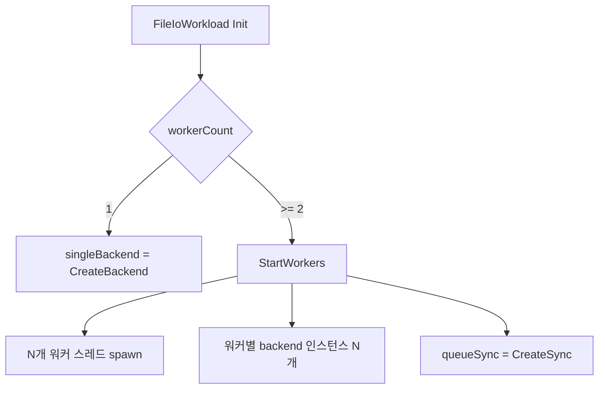

## 들어가며

현재 도구는 IO 모델 5종(read/pread/mmap/aio/io_uring)을 *단일 스레드* 위에서 비교한다. 측정 변수가 *시스템 콜 모델 + 페이지 캐시 동작* 에 한정되어 있고, 다중 스레드 환경에서 등장하는 *동기화 비용* 은 측정에 들어오지 않았다. spinlock·mutex·futex·atomic CAS의 비용 차이도 직접 재현할 길이 없다.

이 단계의 목표는 *워커 풀 + 동기화 4종 토글* 을 추가하는 것이다. 워커 수를 1·2·4·8로 토글하면 작업 큐가 등장하고, 그 큐를 보호하는 락이 spinlock / mutex / futex / atomic CAS 중 하나로 갈아 끼워진다. 같은 16개 파일 워크로드를 *N개 워커가 작업 큐에서 한 파일씩 받아* 처리하는 구조가 된다.

이 단계의 결과물은 다음 다섯 가지다.

1. `ISync` 추상 인터페이스 + 4종 구현 (Spin / Mutex / Futex / CAS).
2. `SyncType` enum + `CreateSync` 팩토리.
3. `FileIoWorkload` 의 워커 풀 통합 — 단일/멀티 두 모드.
4. `Toggles::sync` 와 `Toggles::workerIdx` 추가, `Reconfigure` 진입점.
5. ImGui HUD에 sync, workers 콤보 추가.

worker 수가 1이면 단일 스레드 동작 (sync 토글 무관). >= 2가 되면 *작업 큐 + N개 워커 스레드* 모드로 전환되고, sync 토글의 측정 의미가 살아난다. uncontended fast path 비교가 핵심 — *짧은 critical section* 시나리오에서 4종이 어떻게 갈라지는지가 그래프에 드러난다.

코드 스니펫은 이 단계에서 추가되는 핵심 경로만 보인다. 오류 처리와 보조 함수는 디스크의 통합 코드에 더 자세히 들어 있다.

---

## 목차

1. 동기화 4종의 비용 모델
2. ISync 인터페이스와 4종 구현
3. 워커 풀 통합 — 단일/멀티 두 모드
4. 작업 큐와 메인-워커 동기화
5. Toggles 확장과 Reconfigure
6. HUD 콤보 추가
7. 빌드와 측정 결과

---

## 1. 동기화 4종의 비용 모델

이 lab의 측정 의도는 *uncontended fast path* 비교다. 워크로드가 *짧은 critical section* (큐 push/pop) 만 보호하므로 contention이 흔하지 않고, 4종 모두의 *fast path 비용* 이 핵심 측정 변수가 된다.

### 4종의 모델

| 종류 | fast path | contended path | 시스템 콜 |
|---|---|---|---|
| spinlock (`atomic_flag`) | test-and-set 1번 | retry + yield | yield 구현에 따라 가능 |
| atomic CAS (`atomic<uint32>`) | cmpxchg 1번 | retry + yield | yield 구현에 따라 가능 |
| mutex (`std::mutex`) | atomic 1번 (glibc fast path) | futex wait/wake (커널 내부) | contended에서만 |
| futex (직접 호출) | atomic CAS 1번 | SYS_futex 직접 호출 | contended에서만 |

핵심 통념과 측정 결과의 차이.

- **"futex가 mutex보다 빠르다"** — 통념. *uncontended에서는 거의 같다*. glibc의 std::mutex가 내부적으로 futex를 사용하고, fast path는 *동일한 atomic 한 번* 으로 끝난다. 차이는 contended에서 wrapper 오버헤드 정도.
- **"spinlock이 가장 빠르다"** — 통념. *짧은 critical section + 워커 ≤ 코어* 일 때만. 워커가 코어 수보다 많거나 critical section이 길면 *진짜 일하는 워커가 CPU를 못 받아* 오히려 느려진다.
- **"atomic CAS는 spinlock과 같다"** — 의미는 같지만 *명령이 다르다*. x86-64에서 atomic_flag는 lock xchg, atomic<uint32>::cmpxchg는 lock cmpxchg. 마이크로아키텍처 차이가 측정 노이즈 안에서 어떻게 드러나는지 본다.

### contended vs uncontended

이 lab의 작업 큐가 한 사이클에 얻는 락은 *push 1회 + 성공 pop 16회 + 워커마다 빈 큐를 확인하는 실패 pop 1회* 다. 메인이 16개를 *하나의 락 구간 안에서* 밀어 넣으므로 push는 16회가 아니라 1회다. 워커 4개면 21회, 8개면 25회로 워커 수에 따라 달라진다. 짧은 critical section (`queue.front() / queue.pop()` 또는 `queue.push()`) 라 contention 빈도도 워커 수에 따라 다르다.

- **워커 1개**: 단일 스레드 모드. sync 토글 영향 없음.
- **워커 2개**: contention 드뭄. 두 워커가 *동시에 락 획득 시도* 하는 빈도가 낮다.
- **워커 4개**: contention 빈도 증가. 4명이 *번갈아 가며* 큐에서 작업 받는 형태.
- **워커 8개**: contention 빈번. 코어 수 (보통 4~8) 와 비교해 *워커가 더 많으면* 스케줄러가 워커 간 전환을 한다.

이 lab의 측정 결과는 *fast path가 대부분, 가끔 contention* 시나리오의 평균이다. 작업 수를 크게 만들면 high-contention 시나리오를 따로 볼 수 있다.

### 4종이 같은 인터페이스 안에서 동작하는 이유

`ISync::Lock()` / `ISync::Unlock()` 두 가상 함수가 모든 동기화 구현의 공통 약속이다. 가상 호출 비용 자체가 측정에 들어가지만, 16번 락 호출이라 노이즈 안에 묻힌다.

대안으로 *템플릿 워커 풀* 을 쓰면 가상 호출 비용을 제거할 수 있지만, *런타임 토글* 이 어려워진다. 이 lab은 토글 가능성이 우선이라 가상 함수 인터페이스를 택한다.

## 2. ISync 인터페이스와 4종 구현

### 인터페이스

```cpp
// src/sync/i_sync.h

class ISync {
public:
    virtual ~ISync() = default;

    virtual void Lock()   = 0;
    virtual void Unlock() = 0;

    virtual const char* Name() const = 0;
};
```

극단적으로 단순한 인터페이스. lock/unlock 두 동작만 추상화한다. condition variable이나 try_lock은 *이 lab의 워크로드에 안 쓰여서* 인터페이스에 빠진다.

### SpinSync — atomic_flag

```cpp
// src/sync/spin_sync.h

class SpinSync final : public ISync {
public:
    void Lock() override {
        while (flag_.test_and_set(std::memory_order_acquire)) {
            std::this_thread::yield();
        }
    }
    void Unlock() override {
        flag_.clear(std::memory_order_release);
    }
    const char* Name() const override { return "spinlock"; }

private:
    std::atomic_flag flag_ = ATOMIC_FLAG_INIT;
};
```

`std::atomic_flag::test_and_set` 이 단일 atomic 명령. x86-64에서 `lock xchg` 로 컴파일된다.

`std::this_thread::yield()` 는 *스케줄러에 실행 기회를 양보* 한다. Linux 구현에서는 `sched_yield` 경계가 들어갈 수 있으므로 순수 spin 비용만 측정하지 않는다. 진짜 high-performance spinlock은 x86 `pause` 명령을 직접 쓰는 경우가 많지만, 이 lab은 구현 단순성을 위해 yield로 대체한다.

### MutexSync — std::mutex

```cpp
// src/sync/mutex_sync.h

class MutexSync final : public ISync {
public:
    void Lock()   override { mutex_.lock(); }
    void Unlock() override { mutex_.unlock(); }
    const char* Name() const override { return "mutex"; }

private:
    std::mutex mutex_;
};
```

가장 단순. glibc의 `std::mutex` 는 내부적으로 `pthread_mutex` (PTHREAD_MUTEX_NORMAL) 를 감싼다. fast path는 *atomic CAS 한 번* 으로 끝나고, contended에서만 *futex 시스템 콜* 이 일어난다.

이 구현이 *"std::mutex가 무겁다"* 라는 통념을 측정으로 뒤집는다. fast path 비용은 atomic CAS 한 번이라 spinlock·CAS 와 *거의 같다*.

### FutexSync — Linux futex 직접

Drepper의 3-state futex mutex 패턴.

```cpp
// src/sync/futex_sync.h

class FutexSync final : public ISync {
public:
    void Lock() override {
        std::uint32_t expected = 0;
        if (state_.compare_exchange_strong(expected, 1,
                                            std::memory_order_acquire,
                                            std::memory_order_relaxed)) {
            return;  // uncontended fast path.
        }
        LockSlow();
    }

    void Unlock() override {
        if (state_.fetch_sub(1, std::memory_order_release) != 1) {
            state_.store(0, std::memory_order_release);
            FutexWake(1);
        }
    }
private:
    void LockSlow() { /* contended path: state를 2로 올린 뒤 SYS_futex WAIT */ }
    std::atomic<std::uint32_t> state_{0};  // 0=unlocked, 1=locked, 2=locked+waiters
};
```

세 상태(0/1/2)가 핵심.

- **state 0**: unlocked.
- **state 1**: locked, no waiters. unlock에서 *시스템 콜 없이* 0으로.
- **state 2**: locked, has waiters. unlock에서 *SYS_futex(WAKE)* 시스템 콜 호출.

uncontended fast path는 0→1 CAS 한 번이고 *시스템 콜 없음*. 이게 std::mutex의 fast path와 *거의 같은* 동작이다. 차이는 std::mutex가 PTHREAD wrapper 한 단계를 더 거친다는 점.

### CasSync — atomic<uint32_t> CAS

```cpp
// src/sync/cas_sync.h

class CasSync final : public ISync {
public:
    void Lock() override {
        std::uint32_t expected = 0;
        while (!state_.compare_exchange_strong(expected, 1,
                                                std::memory_order_acquire,
                                                std::memory_order_relaxed)) {
            expected = 0;
            std::this_thread::yield();
        }
    }
    void Unlock() override {
        state_.store(0, std::memory_order_release);
    }
private:
    std::atomic<std::uint32_t> state_{0};
};
```

SpinSync와 *의미는 같다*. 차이는 *명령*. `atomic_flag::test_and_set` 은 x86-64에서 `lock xchg` (1바이트), `atomic<uint32>::cmpxchg` 은 `lock cmpxchg` (4바이트). 마이크로아키텍처 비용이 미세하게 다를 수 있다 — 이 lab의 측정에서 *측정 노이즈 안에서 어떻게 드러나는지* 가 비교의 의미.

## 3. 워커 풀 통합 — 단일/멀티 두 모드

`FileIoWorkload` 가 두 모드를 가진다.



워커 수가 1이면 *단일 backend* 인스턴스 하나로 동작한다. 워커 수가 2 이상이면 *워커 풀 모드* — 워커별 backend 인스턴스 N개와 단일 sync 인스턴스가 만들어진다.

### 워커별 backend 인스턴스

```cpp
// src/workload/file_io_workload.cpp 일부

void FileIoWorkload::StartWorkers() {
    queueSync_ = CreateSync(syncType_);

    workerBackends_.clear();
    workerBackends_.reserve(workerCount_);
    for (std::size_t i = 0; i < workerCount_; ++i) {
        workerBackends_.push_back(CreateBackend(backendType_));
    }
    // ...
}
```

backend가 *임시 버퍼·링버퍼* 같은 상태를 들고 있어 *동시 사용 안전이 보장 안 된다*. 워커당 인스턴스 N개를 만들어 각자 독립적으로 동작하게 한다.

자원 비용은 큰 편 — UringBackend의 ring 4개·8개가 동시에 만들어진다. 다만 측정 도구로서 *모델 분리* 가 우선이라 이 비용을 받아들인다. *공유 ring + thread-safe submit* 패턴을 추가하면 자원 비용 자체도 비교 변수가 된다.

### onRead 콜백의 thread-safety

워커 풀 모드에서 onRead가 *동시 호출* 된다. 워크로드는 atomic add로 checksum을 누적해 안전을 보장한다.

```cpp
inline void AccumulateChecksum(std::atomic<std::uint64_t>& target,
                                const unsigned char* data,
                                std::size_t bytes) {
    std::uint64_t local = 0;
    for (std::size_t i = 0; i < bytes; i += kChecksumStride) {
        local += data[i];
    }
    if (bytes > 0 && ((bytes - 1) % kChecksumStride) != 0) {
        local += data[bytes - 1];
    }
    target.fetch_add(local, std::memory_order_relaxed);
}
```

local 변수에 누적 후 한 번의 `fetch_add` — atomic 횟수 최소화. `relaxed` order는 *순서 무관* 인 누적이라 충분. `RunCycle` 시작 시 `lastChecksum_` 을 0으로 초기화하므로 이 값은 전체 실행 누적이 아니라 *해당 사이클의 관측값* 이다.

## 4. 작업 큐와 메인-워커 동기화

### 작업 큐

`std::queue<std::size_t>` 가 작업 큐. 한 작업 = 한 fileIdx. 큐 push/pop을 `queueSync_->Lock()` / `Unlock()` 으로 보호한다.

```cpp
// 워커의 작업 받기 (FileIoWorkload::WorkerLoop)
for (;;) {
    std::size_t fileIdx = static_cast<std::size_t>(-1);
    bool got = false;

    queueSync_->Lock();
    if (!queue_.empty()) {
        fileIdx = queue_.front();
        queue_.pop();
        got = true;
    }
    queueSync_->Unlock();

    if (!got) break;

    // backend 호출.
    const std::vector<std::string> sub = { paths_[fileIdx] };
    backend->RunCycle(sub, fileBytes_, /*onRead*/ ...);

    remaining_.fetch_sub(1, std::memory_order_acq_rel);
}
```

critical section은 *4~5 명령* 으로 매우 짧다. 락의 *fast path* 비용이 측정 변수가 된다.

### 메인-워커 동기화

워커 풀 패턴의 표준은 *메인이 작업 push 후 condition_variable로 워커들을 깨움* 이다. 다만 이 lab은 *통일된 ISync 인터페이스* 라 condition_variable 없이 한다.

대안: *cycleSeq* 카운터 + *busy polling*.

```cpp
// 메인 (FileIoWorkload::RunCycleMulti)
queueSync_->Lock();
while (!queue_.empty()) queue_.pop();
for (std::size_t i = 0; i < paths_.size(); ++i) queue_.push(i);
remaining_.store(paths_.size(), std::memory_order_release);
queueSync_->Unlock();

workerCycleAck_.store(0, std::memory_order_release);
cycleSeq_.fetch_add(1, std::memory_order_release);

// 모든 워커가 사이클 진입 ack까지 대기.
while (workerCycleAck_.load(std::memory_order_acquire) < workerCount_) {
    std::this_thread::yield();
}

// 모든 작업 완료 대기.
while (remaining_.load(std::memory_order_acquire) > 0) {
    std::this_thread::yield();
}
```

```cpp
// 워커 (FileIoWorkload::WorkerLoop)
while (running_.load(std::memory_order_acquire)) {
    const std::size_t curSeq = cycleSeq_.load(std::memory_order_acquire);
    if (curSeq == lastSeen) {
        std::this_thread::yield();
        continue;
    }
    lastSeen = curSeq;

    workerCycleAck_.fetch_add(1, std::memory_order_release);

    // 작업 큐에서 받아 처리...
}
```

`cycleSeq` 와 `workerCycleAck` 가 *condition_variable의 대용*. 워커가 *yield 하면서 polling*. CPU를 *완전히 잠드는* 모델은 아니고, yield 자체가 스케줄러 노이즈를 만들 수 있지만 sync 인터페이스가 단순해진다.

`remaining_.store` 가 *unlock 전* 에 있는 것이 중요하다. 직전 사이클의 마지막 작업을 막 끝낸 워커는 내부 pop 루프로 곧장 돌아오므로, push 후 unlock과 store 사이에 깨어나면 새 사이클의 항목을 pop해 0에서 `fetch_sub(1)` 을 한다. `std::size_t` 라 SIZE_MAX로 언더플로하고 뒤이은 store가 그 값을 덮어써, 완료 대기 루프가 0을 영원히 못 본다.

#### 이 순서를 어떻게 지키게 만드는가

주석만으로는 다음 사람이 store를 unlock 뒤로 옮기는 것을 막지 못한다. 문제는 그 창이 수백 나노초라 *반복 실행으로 잡기가 매우 어렵다* 는 것이다. 실측으로도 그렇다 — store를 unlock 뒤로 옮긴 빌드에서 워커 8개 × 400사이클 × sync 4종(총 1600사이클)을 돌리면 20회 중 4회만 잡힌다. 사이클당 적중 확률이 ~2e-4 인 셈인데, 이 창을 밟으려면 *메인이 하필 unlock과 store 사이에서 선점당해야* 하기 때문이다.

그래서 `src/testhook/test_hook.h` 에 *테스트 빌드에서만 존재하는* 타이밍 훅 두 개를 두고 테스트가 그 창을 직접 벌린다.

- `WorkerAfterDecrement` — `remaining_.fetch_sub(1)` 직후에 감산 *직전* 값을 받는다. 그 값이 1이면 이 워커가 사이클의 마지막 작업을 끝낸 것이고, 아직 pop 루프 안이다. 테스트는 여기서 그 워커를 붙잡는다.
- `AfterQueueUnlock` — 메인이 push를 끝내고 락을 푼 직후. 테스트는 여기서 붙잡아 둔 워커를 풀어 주고, 그 워커가 항목 하나를 소비해 감산까지 마칠 때까지 기다린다.

두 훅이 랑데부를 이루면 문제의 인터리빙이 100% 재현된다. store가 unlock 앞에 있으면 그 감산은 `8 → 7`, 뒤에 있으면 `0 → SIZE_MAX` 다. 후자에서 `RunCycle` 은 돌아오지 않으므로 테스트는 워치독으로 10초에 진단을 찍고 종료한다(매달린 워커는 join할 수 없다). 변이를 넣은 빌드에서 3회 실행 모두 같은 지점에서 죽고, 되돌리면 다시 통과한다.

#### 랑데부에도 사각이 있다

여기서 "뒤" 가 어디인지를 따져야 한다. `RunTestHook(AfterQueueUnlock)` 은 `Unlock()` 바로 다음 줄이므로, store를 내릴 자리는 사실 *두 곳* 이다.

```cpp
queueSync_->Unlock();
// (A) 여기 — Unlock 과 훅 사이
RunTestHook(TestHookId::AfterQueueUnlock);
// (B) 여기 — 훅 아래
```

랑데부가 잡는 것은 (B) 뿐이다. (A) 에서는 훅이 붙잡아 둔 워커를 풀어 줄 때 store가 *이미 끝나 있어* 그 워커의 감산이 `N → N-1` 이 되고, 테스트는 초록으로 통과한다. 그런데 (A) 도 store를 락 밖으로 내보낸 진짜 회귀다 — 큐에 항목이 보이는데 `remaining_` 은 아직 0인 구간이 생긴다. 결정적 재현 테스트가 이 변이를 놓친다.

(A) 를 잡을 수 있는 건 스트레스뿐인데, 잡으려면 두 가지가 더 필요하다.

첫째, **언더플로를 세는 훅**. 스트레스 구간에서도 `WorkerAfterDecrement` 를 무장하되 랑데부와 달리 락도 대기도 없이 relaxed `fetch_add` 하나만 한다. 스트레스가 찾는 것은 확률적 인터리빙이라, 훅이 타이밍을 건드리면 찾으려던 창 자체가 사라진다.

둘째, **그 카운터를 읽는 감시 스레드**. 여기서 반직관적인 부분이 나온다 — 이 워크로드에서 언더플로와 hang은 *같은 사건* 이다. 0에서의 `fetch_sub` 가 `SIZE_MAX` 를 만들고 곧이어 오는 `store(N)` 이 그 감산을 통째로 지우므로, `remaining_` 은 영영 0이 되지 못한다. 즉 언더플로를 일으킨 바로 그 `RunCycle` 이 그대로 매달린다. 루프로 돌아와 카운터를 읽는 코드는 실행될 기회가 없다. 그래서 카운터는 반드시 *다른 스레드* 가 읽어야 한다. 1ms 주기로 폴링하다 0이 아닌 순간 진단을 찍고 종료하면, 실패가 ctest `TIMEOUT` 60초가 아니라 0.2초에 난다.

셋째는 훅이 아니라 숫자다. 사이클당 적중 확률이 ~2e-4 이므로 1600사이클로는 20회 중 4회밖에 못 잡는다. 32000사이클(sync 4종 × 8000)에서 40/40 이 된다. 워커 수를 코어보다 늘려 선점을 유도하는 쪽도 재봤지만 검출률은 그대로였고 시간만 5배가 됐다 — 사이클 수가 유일하게 듣는 손잡이였다. 정상 코드 소요는 0.2초에서 1.0초로 늘 뿐이다.

두 판정을 다 두는 이유가 여기 있다. 랑데부는 (B) 를 *결정적으로* 잡고, 스트레스+감시 스레드는 (A) 를 잡는다. 어느 한쪽을 지우면 변이 하나가 통째로 빠져나간다.

`SKL_TEST_HOOKS` 가 정의되지 않은 앱 타깃에서는 `RunTestHook` 이 빈 인라인 함수라 호출 자체가 사라진다 — 제품 바이너리에는 분기도 load도 남지 않는다. 실패 주입 seam(`src/fault`)이 "이 syscall이 실패하면?" 을 결정적으로 만든다면, 이 훅은 "두 스레드가 하필 이 순서로 만나면?" 을 결정적으로 만드는 같은 계열의 도구다.

### busy polling의 비용

이 모델은 *항상 깨어 있는 워커* 라 *유휴 시 CPU를 점유* 한다. 사이클이 빠르게 도는 이 lab에서는 큰 문제가 안 되지만, 실제 게임 엔진의 워커 풀에서는 *condition_variable 또는 futex wait* 으로 *실제 sleep* 시키는 게 적절하다.

이 lab은 *측정 도구* 라 polling의 단순성을 우선한다. condition_variable이 있으면 sync 인터페이스가 복잡해지고 (ISync에 wait/notify 추가 필요), spinlock 같은 *condition variable이 없는* 모델이 인터페이스에 어색해진다.

## 5. Toggles 확장과 Reconfigure

```cpp
// src/ui/toggles.h

struct Toggles {
    BackendType backend     = BackendType::Read;
    SyncType    sync        = SyncType::Mutex;
    int         workerIdx   = 0;       // 1 worker
};

inline constexpr WorkerCountPreset kWorkerCountPresets[] = {
    {"1",  1}, {"2", 2}, {"4", 4}, {"8", 8},
};
```

토글이 셋. backend 변경 / sync 변경 / workerCount 변경 모두 `Reconfigure` 트리거.

```cpp
// src/workload/file_io_workload.cpp

void FileIoWorkload::Reconfigure(BackendType backendType,
                                  SyncType    syncType,
                                  std::size_t workerCount) {
    StopWorkers();
    singleBackend_.reset();

    backendType_ = backendType;
    syncType_    = syncType;
    workerCount_ = (workerCount == 0) ? 1 : workerCount;

    if (workerCount_ <= 1) {
        singleBackend_ = CreateBackend(backendType_);
    } else {
        StartWorkers();
    }
}
```

워커 풀 stop/start 비용은 `timer.BeginCycle()` / `timer.EndCycle()` 바깥에서 발생한다. 그래서 토글 전환 순간 UI 프레임은 잠깐 멈출 수 있지만, cycle ms 그래프에는 Reconfigure 비용이 직접 들어가지 않는다. 다음 측정 사이클부터 새 backend·sync·workerCount 조합으로 돈다.

### main 루프에서 변경 처리

```cpp
if (skl::RequiresRestart(prevToggles, toggles)) {
    workload.Reconfigure(toggles.backend, toggles.sync,
                          skl::WorkerCountFromIdx(toggles.workerIdx));
}
prevToggles = toggles;
```

세 토글 중 어느 하나라도 바뀌면 한 함수 호출로 모두 처리한다. backend 분기 한 가지만 처리하던 코드가 *세 토글 통합 처리* 로 바뀐다.

## 6. HUD 콤보 추가

ImGui 콤보 패턴은 backend 콤보와 같은 방식이다. backend 콤보 아래 sync, workers 콤보가 추가된다.

```cpp
// src/ui/hud.cpp 일부

// sync 콤보.
const int curSyncIdx = static_cast<int>(toggles.sync);
const char* syncPrev =
    (curSyncIdx >= 0 && curSyncIdx < kSyncTypeCount)
    ? kSyncTypeLabels[curSyncIdx] : "(none)";
if (ImGui::BeginCombo("sync", syncPrev)) {
    for (int n = 0; n < kSyncTypeCount; ++n) {
        const bool selected = (curSyncIdx == n);
        if (ImGui::Selectable(kSyncTypeLabels[n], selected)) {
            toggles.sync = static_cast<SyncType>(n);
        }
        if (selected) ImGui::SetItemDefaultFocus();
    }
    ImGui::EndCombo();
}

// workers 콤보.
const int curWIdx = toggles.workerIdx;
// ... (workers 콤보도 같은 패턴, kWorkerCountPresets 라벨 사용)
```

stats 텍스트에도 sync, workers 항목이 추가되어 *현재 활성 토글 상태* 가 즉시 보인다.

```text
backend     : read
sync        : mutex
workers     : 4
files       : 16  x  1.05 MB
cycle ms    :   8.124
throughput  :  2065.4 MB/s
total cycles: 312
```

3-zone 레이아웃 (좌측 stats / 중앙 토글 / 우측 그래프) 은 그대로. 콤보가 늘었지만 중앙 패널 260 px 안에 세 콤보가 들어간다.

## 7. 빌드와 측정 결과

### 빌드

```bash
cmake --build build -j
./build/system_kernel_lab
```

새로운 cpp 파일(`sync/sync_factory.cpp`)이 빌드 대상에 추가된다. sync 헤더들은 모두 인라인 구현이라 별도 cpp 없음.

### 측정 시점에서 보이는 경향

worker count 토글을 1 → 2 → 4 → 8 로 바꾸면 cycle ms 변화가 그려진다. 일반적인 4코어 머신에서 16 파일 × 1MB 워크로드의 경향:

- **workers = 1**: baseline. 단일 스레드 경로.
- **workers = 2**: cycle ms가 줄어들 수 있다. 다만 작업 분배·동기화 비용으로 *완벽한 절반* 을 기대하면 안 된다.
- **workers = 4**: 추가 단축. 코어 수에 맞춘 워커가 가장 효율적.
- **workers = 8**: workers = 4 와 비슷하거나 *살짝 느림*. 코어 수보다 워커가 많아 스케줄러 전환 비용 등장.

sync 토글을 mutex → spinlock → futex → CAS 로 바꾸면 *workers ≥ 2* 시나리오에서 미세한 차이가 보인다.

- **mutex / futex**: 거의 같다. uncontended fast path가 *atomic 한 번* 계열로 비슷하다.
- **spinlock / CAS**: 거의 같다. uncontended fast path가 *atomic 한 번 (lock xchg / lock cmpxchg)* 계열이다. contended에서는 yield 비용이 섞인다.
- **mutex/futex vs spin/CAS**: 비슷. 이 lab의 워크로드는 *uncontended이 대부분* 이라 4종 차이가 측정 노이즈에 묻히기 쉽다.

차이를 더 보고 싶으면 *작업 수* 를 키워야 한다. 16 파일 × 1MB는 *사이클당 락 21회(워커 4개 기준)* 라 sync 비용이 cycle ms의 작은 부분이다. file count 토글이 들어가면 이 차원을 넓힐 수 있다.

### 4종 차이가 작게 나오는 게 옳은 결과

이 단계의 *진짜 측정 가치* 는 다음을 보여 주는 것이다.

- **mutex가 무겁다는 통념은 fast path에서는 부정확** — glibc 환경의 std::mutex fast path는 atomic 연산 중심이라 spinlock과 차이가 작다.
- **futex가 mutex보다 빠르다는 통념도 uncontended에서는 부정확** — 둘이 *내부 fast path 동작이 거의 같다*.
- **spinlock의 우위는 짧은 대기에서만 의미가 있다** — 이 lab의 짧은 critical section + 적은 워커 시나리오는 contention이 작고, 코드가 yield를 사용하므로 순수 spin 우위가 크게 드러나지 않는다.

측정 결과가 *통념을 부정* 하는 형태로 나오는 게 *측정 도구의 가치* 다.

### 검증 체크리스트

- workers 토글 변경 시 UI가 잠깐 멈춤 → workload Stop/Start 비용. cycle ms 그래프에는 직접 포함되지 않고, 다음 측정 사이클부터 새 워커 수가 반영된다.
- workers ≥ 2에서 *cycle ms가 single보다 큼* → 워커 풀 오버헤드가 IO 비용보다 크다는 신호. 16 × 1MB 같은 작은 워크로드에서 가능.
- sync 토글 변경이 *효과 없어 보임* → uncontended fast path가 거의 동일. 작업 수를 키운 후 다시 본다.
- workers = 8에서 *throughput이 낮아짐* → 스케줄러 컨텍스트 스위치 비용. 시스템 모니터로 CPU 사용률 확인.
- backend = io_uring + workers ≥ 2에서 *오류* → 워커당 ring 4개·8개. 시스템 file descriptor 한도(`ulimit -n`) 확인.

### 측정의 정직성

이 단계의 결과를 *동기화 모델에 대한 일반 결론* 으로 보지 않는다.

- **워크로드 의존성** — 짧은 critical section + 적은 워커는 *모든 sync가 비슷한* 시나리오. 긴 critical section 또는 고경합 시나리오에서는 결과가 다르다.
- **CPU 마이크로아키텍처 의존** — atomic 명령의 비용이 ISA·세대마다 다르다. Intel Skylake와 AMD Zen 4 비교 시 spinlock과 mutex의 비율이 갈릴 수 있다.
- **glibc 버전 의존** — std::mutex의 내부 구현이 glibc 버전마다 미세하게 달라 측정값이 영향받는다.

도구는 *내 머신·내 빌드 환경* 의 결과를 보여 준다. 시리즈 글에 인용할 때는 환경을 함께 명시한다.

---

## 결론

이 단계의 결과물은 워커 풀 + 동기화 4종 토글이 추가된 도구다. 약 600줄의 새 코드(sync 4종 + factory + workload 워커 통합 + Toggles 확장 + HUD 콤보)가 기존 IO backend 구조 위에 얹혔다.

세 가지 결정이 이 단계의 토대를 만들었다.

1. **단일 ISync 인터페이스로 4종 추상화** — Lock/Unlock 두 함수만 추상화. condition_variable 없이 cycleSeq + busy polling 으로 메인-워커 동기화. spinlock 같은 *condvar 없는* 모델이 인터페이스에 자연스럽게 들어간다.
2. **워커당 backend 인스턴스 N개** — backend의 thread-safety를 가정하지 않고, 워커별 독립 인스턴스로 분리. 자원 비용은 받아들이고 모델 분리를 우선.
3. **단일/멀티 두 모드** — workerCount = 1 이면 단일 스레드 경로. >= 2 일 때만 워커 풀 활성. 토글 한 곳에서 *동작 모드 자체* 가 갈린다.

여기까지의 코드는 *동기화 모델* 의 비용을 보여 주지만, 워커가 *어느 코어에 할당되는지* 는 OS 스케줄러에 맡긴다. SCHED_FIFO 같은 *실시간 스케줄링 정책* 또는 cgroup cpu.weight 같은 *자원 격리* 가 들어오면 스케줄러 정책 자체가 측정 변수가 된다.

## 더 읽을거리

- Ulrich Drepper, "Futexes Are Tricky" (2011) — 3-state futex mutex 패턴의 표준 레퍼런스
- [Linux man page: futex(2)](https://man7.org/linux/man-pages/man2/futex.2.html) — FUTEX_WAIT / FUTEX_WAKE 시스템 콜
- Hans-J. Boehm, "Threads Cannot Be Implemented As a Library" — 메모리 모델과 atomic의 의미
- [cppreference: std::atomic_flag](https://en.cppreference.com/w/cpp/atomic/atomic_flag) — test-and-set 표준 동작
- Paul McKenney, *Is Parallel Programming Hard, And, If So, What Can You Do About It?* — 동기화 프리미티브의 마이크로아키텍처 비용
- Jeff Preshing 블로그 — atomic memory ordering 시각화
- glibc 소스 — `sysdeps/unix/sysv/linux/lowlevellock.h` 가 std::mutex의 내부
