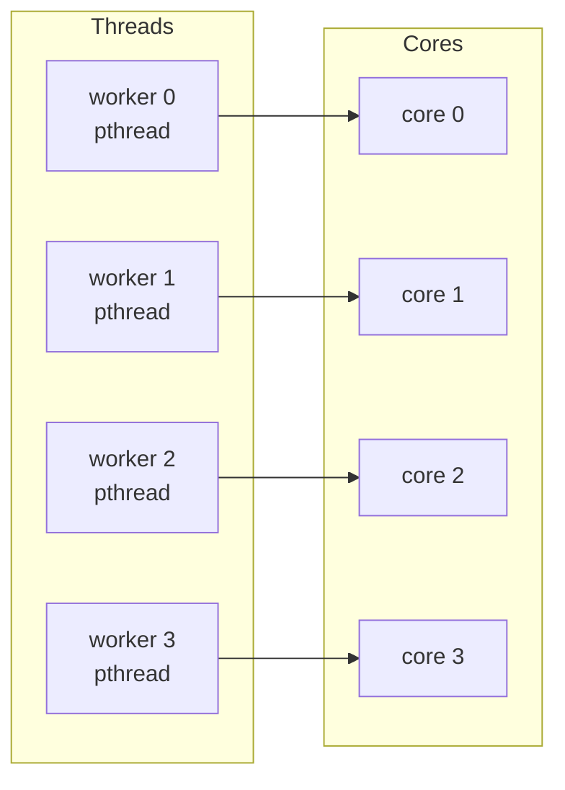
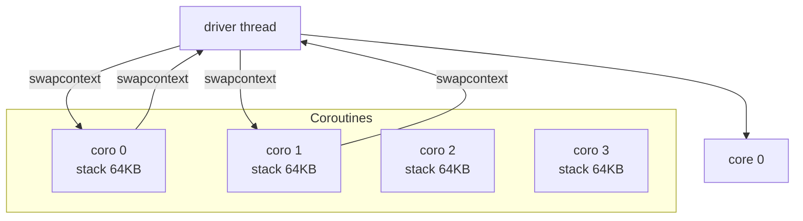
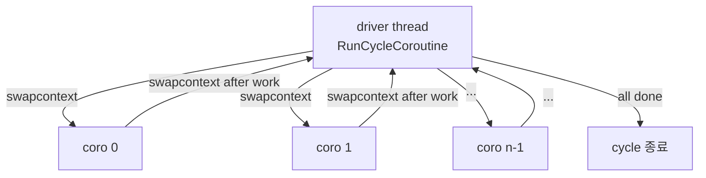

## 들어가며

현재 도구는 워커가 *항상 OS 스레드(pthread)* 다. 워커 4개를 띄우면 4개의 커널 스레드가 진짜 병렬로 돈다. *컨텍스트 스위치 비용* 자체는 측정에 들어오지 않았다 — 워커가 작업 큐에서 작업을 꺼낼 때마다 일어나는 락·yield는 측정했지만, *스레드 자체의 컨텍스트 전환 비용* 은 매 사이클의 ms에 묻혀 있다.

이 단계의 목표는 *컨텍스트 모델 토글* 이다. `ctx = pthread` 면 직전과 동일하게 N개 OS 스레드. `ctx = coroutine` 이면 *한 OS 스레드 위에 N개 stackful coroutine* 이 ucontext로 round-robin으로 도는 형태로 바뀐다. 같은 16개 파일 워크로드를 두 모델로 처리한 cycle ms 차이가 그래프에 그려진다.

코루틴 모델에 대한 *현실적 기대* 가 측정으로 나온다. 이 lab은 *동기 IO* 워크로드라 코루틴이 *IO 대기 중 yield* 할 기회가 거의 없다. 한 코루틴이 read를 부르면 *그 read가 끝날 때까지 다른 코루틴은 못 돈다*. 결과는 *코루틴 모드가 pthread 모드보다 느린* 게 정상이다 — 단일 스레드 직렬 + 컨텍스트 스위치 오버헤드. 코루틴이 빛나는 *비동기 IO와 결합* 시나리오는 이 lab에 없다 (io_uring을 코루틴과 결합하면 모델이 살아나지만 이 단계에서는 다루지 않는다).

이 단계의 결과물은 다음 다섯 가지다.

1. `CtxType` enum 2종 (`Pthread`, `Coroutine`).
2. `FileIoWorkload` 의 `StartCoroutinePool` / `StopCoroutinePool` / `CoroBody`.
3. ucontext entry trampoline (`SklCoroTrampoline`) + driver round-robin.
4. `Toggles::ctx` 와 Reconfigure 시그니처에 CtxType 추가.
5. ImGui HUD에 ctx 콤보 + stats 라인 추가.

코드 스니펫은 핵심 경로만 보인다. 오류 처리와 보조 함수는 통합 코드에 있다.

---

## 목차

1. pthread vs stackful coroutine — 무엇이 다른가
2. ucontext_t 기반 stackful coroutine 패턴
3. driver-중심 round-robin 모델
4. CoroBody — 작업 한 개 처리 + yield
5. trampoline의 register pass-through 트릭
6. workload 통합과 시작/종료
7. Toggles 확장과 HUD
8. 빌드와 측정 결과

---

## 1. pthread vs stackful coroutine — 무엇이 다른가

두 모델 모두 *N개의 작업 단위* 가 있다. 차이는 *그 작업 단위가 어디서 도는가* 다.

### pthread (지금까지의 워커 풀)

각 워커가 *자기 OS 스레드*. 커널 스케줄러가 이 스레드들을 *진짜 병렬로* 코어에 분배한다.



컨텍스트 스위치는 *커널 스케줄러 경계*. 한 워커가 read에서 block되면 그 워커의 스레드가 *runnable 큐에서 빠지고* 다른 스레드(또는 다른 프로세스)에 코어가 할당된다.

비용:
- 스레드 컨텍스트 스위치: **일반적으로 1~5 마이크로초 수준** (캐시·TLB 오염 포함). 환경에 따라 큰 폭으로 변한다.
- read 시스템 콜로 block: 페이지 캐시 hit이면 빠르지만, 콜드 IO면 디스크 대기.
- 코어가 다른 스레드에 할당: *진짜 병렬* 의 효과.

### stackful coroutine (이 단계에서 추가)

N개 코루틴이 *한 OS 스레드 위* 에서 협력적으로 돈다. driver(한 스레드)가 round-robin으로 *코루틴을 swap-in / swap-out*. 한 코루틴이 read를 부르면 *그 read가 끝날 때까지 다른 코루틴은 못 돈다*.



컨텍스트 스위치는 *유저 공간 register save/restore*. 커널을 거치지 않아 *훨씬 빠르다*.

비용:
- 코루틴 컨텍스트 스위치: 보통 **수십~수백 나노초** (callee-saved register 저장·복원 정도). 측정 환경에 따라 변한다.
- 단일 스레드 직렬 실행: read 동안 다른 코루틴 못 돈다.
- 스택 메모리: 코루틴당 64 KB 정도 (조정 가능).

### 두 모델의 측정 비교

| 항목 | pthread | coroutine |
|---|---|---|
| 컨텍스트 스위치 비용 | 마이크로초 단위 | 나노초 단위 |
| 병렬성 | 진짜 N개 코어 활용 | 한 코어 직렬 |
| 동기 IO 대기 | 다른 스레드가 코어 받음 | 다른 코루틴 굶음 |
| 비동기 IO 대기 | 동일 (스레드가 wake-up 대기) | yield + reap 패턴 |
| 메모리 | 스레드 stack 8 MB × N (기본값) | 코루틴 stack 64 KB × N |

이 lab의 측정에서 **pthread 모드가 보통 더 빠르다**. 이유는:

- 동기 read 워크로드에서 *진짜 병렬* 의 이득이 *컨텍스트 스위치 비용 절감* 보다 크다.
- 코루틴 모드는 *N=1 실질적 단일 스레드* 와 같다. 여러 코루틴을 띄워도 *한 번에 한 명만* 일한다.

이게 *옳은 결과*. 코루틴의 가치는 *비동기 IO + yield* 패턴에 있고, 동기 IO 패턴에서는 *pthread가 더 적합* 하다는 사실을 측정이 보여 준다.

## 2. ucontext_t 기반 stackful coroutine 패턴

ucontext_t는 POSIX 표준의 *유저 공간 컨텍스트 전환* 인터페이스다. POSIX에서는 *deprecated* 표시되었지만 Linux에서는 여전히 동작하고, glibc가 구현하는 가장 단순한 stackful coroutine 토대다.

### 핵심 함수 4개

```cpp
#include <ucontext.h>

// 현재 컨텍스트(register 상태)를 저장.
int getcontext(ucontext_t* ucp);

// 저장된 컨텍스트로 점프.
int setcontext(const ucontext_t* ucp);

// ucp가 가리키는 *새 컨텍스트* 에 함수와 stack을 설정. 호출 시 점프.
void makecontext(ucontext_t* ucp, void (*func)(),
                  int argc, ...);

// 현재를 oucp에 저장 + ucp로 점프 (atomic).
int swapcontext(ucontext_t* oucp, const ucontext_t* ucp);
```

`makecontext` 는 *coroutine entry function* 의 포인터와 *stack* 을 등록한다. `swapcontext` 는 *지금 어디서 돌고 있는지 저장 + 다른 컨텍스트로 점프* 를 한 번에 한다.

### 코루틴 한 개의 셋업

```cpp
ucontext_t ctx;
std::vector<unsigned char> stack(64 * 1024);

getcontext(&ctx);                             // 1) 기본값으로 초기화
ctx.uc_stack.ss_sp   = stack.data();
ctx.uc_stack.ss_size = stack.size();
ctx.uc_link          = &driverCtx;            // 종료 시 driver로 복귀
makecontext(&ctx, MyCoroEntry, 0);            // 2) entry 함수 등록

// 처음 점프:
swapcontext(&driverCtx, &ctx);                // 3) 코루틴이 MyCoroEntry부터 시작
```

`getcontext` 가 ucontext_t의 *register 슬롯과 floating-point 슬롯* 을 *현재 값* 으로 채운다. 그 위에 `uc_stack` 만 우리가 잡은 stack으로 갈아 끼운 뒤 `makecontext` 가 entry 함수의 첫 호출을 셋업한다.

### swap의 의미

`swapcontext(&from, &to)` 는 다음 두 동작을 atomic하게 한다.

1. 현재 register 상태를 `from` 에 저장.
2. `to` 의 register 상태로 jump.

C 코드에서 보면 *함수 호출처럼 보이지만 실제로 stack이 통째로 바뀐다*. 다음에 누군가 `swapcontext(&other, &from)` 으로 다시 우리에게 돌아오면, swapcontext가 *반환되어* 다음 줄부터 계속 실행된다.

## 3. driver-중심 round-robin 모델

coroutine 풀의 dispatch는 *driver 스레드* 가 round-robin으로 한다.



driver의 본체:

```cpp
// FileIoWorkload::StartCoroutinePool 안의 driver 람다 일부

std::size_t cur = 0;
std::size_t allDoneCheck = 0;
while (true) {
    if (coros_[cur].done) {
        ++allDoneCheck;
        if (allDoneCheck >= workerCount_) break;
        cur = (cur + 1) % workerCount_;
        continue;
    }
    allDoneCheck = 0;
    swapcontext(&driverCtx_, &coros_[cur].ctx);
    cur = (cur + 1) % workerCount_;
}
```

세 가지 결정 포인트.

1. **round-robin**: 코루틴 0 → 1 → 2 → 3 → 0 → 1 → ... 순환. 코루틴이 swap-back 하면 다음으로.
2. **done 검사**: 코루틴이 *작업 다 떨어져 종료* 하면 `done = true`. 모든 코루틴 done 이면 사이클 끝.
3. **swap 한 번이 한 작업 단위**: 코루틴이 한 작업 처리 후 driver로 swap-back. driver가 다음 코루틴을 깨움. *컨텍스트 스위치가 작업 단위마다 일어난다*.

### driver를 별도 스레드로 둔 이유

driver 자체를 *메인 GUI 스레드*에 두면 GUI가 사이클이 끝날 때까지 *멈춘다*. 코루틴이 동기 read를 호출하면 그 시간 동안 GUI가 freeze.

driver를 *별도 스레드* 에 두고, GUI 스레드(메인)는 `RunCycleCoroutine` 에서 *cycleSeq 시그널* 만 보내고 *완료 ack* 만 기다린다. driver는 그 신호를 받아 dispatch 시작.

```cpp
void FileIoWorkload::RunCycleCoroutine() {
    cycleBytes_.store(0);
    lastChecksum_.store(0, std::memory_order_relaxed);

    queueSync_->Lock();
    while (!queue_.empty()) queue_.pop();
    for (std::size_t i = 0; i < paths_.size(); ++i) queue_.push(i);
    queueSync_->Unlock();

    workerCycleAck_.store(0, std::memory_order_release);
    cycleSeq_.fetch_add(1, std::memory_order_release);

    while (workerCycleAck_.load(std::memory_order_acquire) < 1) {
        std::this_thread::yield();
    }
}
```

이 패턴이 pthread 모드의 cycleSeq + ack 패턴과 *대칭*. 메인 스레드는 두 모드에서 *동일한 polling 형태* 로 사이클 종료를 기다린다.

## 4. CoroBody — 작업 한 개 처리 + yield

코루틴 함수의 본체.

```cpp
void FileIoWorkload::CoroBody(std::size_t coroIdx) {
    auto* backend = coroBackends_[coroIdx].get();

    for (;;) {
        // 작업 큐에서 한 개 pop.
        std::size_t fileIdx = static_cast<std::size_t>(-1);
        bool got = false;
        queueSync_->Lock();
        if (!queue_.empty()) {
            fileIdx = queue_.front();
            queue_.pop();
            got = true;
        }
        queueSync_->Unlock();

        if (!got) break;

        const std::vector<std::string> sub = { paths_[fileIdx] };
        const std::uint64_t bytes = backend->RunCycle(
            sub, fileBytes_,
            [this](const unsigned char* data, std::size_t n) {
                AccumulateChecksum(lastChecksum_, data, n);
            });
        cycleBytes_.fetch_add(bytes, std::memory_order_relaxed);

        // 한 작업 처리 후 driver로 양보 — 컨텍스트 스위치 측정 지점.
        swapcontext(&coros_[coroIdx].ctx, &driverCtx_);
    }

    // 작업 다 떨어지면 done 표시 후 normal return.
    // uc_link가 driverCtx_로 복귀시킨다.
    coros_[coroIdx].done = true;
}
```

세 가지 핵심.

1. **단일 스레드라 sync는 의미 없지만 통과시킨다**: queue_의 락 호출이 의미적으로는 불필요하지만, *sync 토글의 비용을 측정에 그대로 남기기* 위해 동일 락을 통과. 코루틴 모드와 pthread 모드의 측정을 *동일 조건* 에서 비교 가능하게 한다.
2. **한 작업 후 yield**: backend->RunCycle 호출 *끝* 에 `swapcontext` 로 driver 복귀. *컨텍스트 스위치 카운트가 작업 수만큼*.
3. **종료는 uc_link 복귀**: 작업 큐가 비어 break하면 done=true 표시 후 함수가 반환된다. `uc_link = &driverCtx_` 이므로 driver로 돌아가고, driver는 done 코루틴을 *재진입하지 않는다*.

### IO 대기 중 yield가 안 되는 한계

이 코드의 핵심 제약: `backend->RunCycle` *안에서* yield가 안 일어난다. read 시스템 콜이 block되면 *전체 코루틴 풀이 block* 된다.

진짜 *비동기 IO + 코루틴* 패턴이라면 backend가 *제출만 하고 yield*, *완료 알림 받으면 다음 코루틴 깨우기* 가 되어야 한다. io_uring + coroutine이 그 조합 — 우리 lab의 io_uring backend가 *완료 콜백을 코루틴 yield와 결합* 하면 진짜 비동기 코루틴이 된다.

이 단계는 *그 결합 없는* 단순 코루틴이라 *측정상 pthread보다 느린* 게 옳은 결과. 그 사실이 *코루틴의 가치는 비동기 IO와 결합할 때* 라는 정보를 측정으로 보여 준다.

## 5. trampoline과 idx 전달

`makecontext` 의 시그니처는 다음과 같다.

```c
void makecontext(ucontext_t* ucp, void (*func)(), int argc, ...);
```

entry 함수는 멤버 함수가 아니라 자유 함수여야 한다. 그래서 `FileIoWorkload* self` 는 정적 pass-through로 잡고, 코루틴 번호 `idx` 는 `makecontext` 의 정수 인자로 넘긴다. worker 수가 작으므로 `int` 로 넘겨도 충분하다.

```cpp
// src/workload/file_io_workload.cpp

namespace {
FileIoWorkload* g_coroSelf = nullptr;
}

extern "C" {
static void SklCoroTrampoline(int idx) {
    g_coroSelf->CoroBody(static_cast<std::size_t>(idx));
}
}
```

이 방식의 핵심은 `idx` 를 전역 변수에 두지 않는 것. 전역 `g_coroNextIdx` 를 쓰면 모든 `makecontext` 등록이 끝난 뒤 첫 `swapcontext` 가 일어나는 시점에 *마지막 idx* 를 읽을 수 있다. 그러면 코루틴 0번도 마지막 코루틴처럼 실행된다.

### 셋업 코드

```cpp
g_coroSelf = this;

for (std::size_t i = 0; i < coros_.size(); ++i) {
    auto& c = coros_[i];
    getcontext(&c.ctx);
    c.ctx.uc_stack.ss_sp   = c.stack.data();
    c.ctx.uc_stack.ss_size = c.stack.size();
    c.ctx.uc_link          = &driverCtx_;
    c.done                 = false;

    makecontext(&c.ctx,
                reinterpret_cast<void (*)()>(SklCoroTrampoline),
                1,
                static_cast<int>(i));
}
```

두 가지가 중요하다.

1. **idx는 makecontext 인자**: trampoline이 실행될 때 자기 idx를 함수 인자로 받는다. 전역 idx를 나중에 읽지 않으므로 등록 순서와 첫 dispatch 순서가 엇갈려도 안전하다.
2. **uc_link는 driverCtx_**: `CoroBody` 가 `return` 하면 driver context로 자동 복귀한다. 종료 시점에 별도 `swapcontext` 를 한 번 더 호출하지 않는다.

### 사이클마다 context를 다시 만드는 이유

ucontext는 entry 함수가 normal return 한 뒤 같은 context로 다시 진입하는 용도가 아니다. 한 번 끝난 `CoroBody` 를 다음 사이클에 `done=false` 로 바꿔 다시 `swapcontext` 하면 이미 끝난 stack frame에 재진입하는 셈이라 안전하지 않다.

그래서 coroutine pool은 stack 메모리만 유지하고, 매 사이클 시작 시 같은 stack 위에 context entry를 다시 만든다.

```cpp
// driver 스레드가 새 cycleSeq를 감지한 뒤:
for (std::size_t i = 0; i < coros_.size(); ++i) {
    auto& c = coros_[i];
    getcontext(&c.ctx);
    c.ctx.uc_stack.ss_sp   = c.stack.data();
    c.ctx.uc_stack.ss_size = c.stack.size();
    c.ctx.uc_link          = &driverCtx_;
    c.done                 = false;
    makecontext(&c.ctx,
                reinterpret_cast<void (*)()>(SklCoroTrampoline),
                1,
                static_cast<int>(i));
}
```

`StartCoroutinePool` 에서는 stack과 backend만 준비하고, 실제 context entry는 cycle 단위로 만든다. 이 구조가 *한 사이클 종료 후 다음 사이클 재사용* 문제를 막는다.

### SCHED_FIFO idle 대기

driver 스레드는 새 cycleSeq가 올 때까지 대기한다. 기본 스케줄러에서는 `yield` 로 충분하지만, `SCHED_FIFO` 에서 바쁜 yield 루프를 돌면 CFS로 도는 GUI 메인 스레드가 밀릴 수 있다.

```cpp
if (curSeq == lastSeen) {
    if (schedType_ == SchedType::Fifo) {
        std::this_thread::sleep_for(std::chrono::microseconds(50));
    } else {
        std::this_thread::yield();
    }
    continue;
}
```

`SCHED_FIFO` 모드에서는 idle 구간에 짧게 잠들어 메인 스레드가 화면을 갱신할 시간을 준다. 이건 성능 최적화가 아니라 도구가 응답성을 잃지 않게 하는 안전장치다.

## 6. workload 통합과 시작/종료

```cpp
// src/workload/file_io_workload.cpp 일부

void FileIoWorkload::Init(BackendType backendType,
                          SyncType    syncType,
                          SchedType   schedType,
                          CtxType     ctxType,
                          std::size_t workerCount,
                          std::size_t fileCount,
                          std::size_t fileBytes,
                          const std::filesystem::path& fixtureDir) {
    Shutdown();

    backendType_ = backendType;
    syncType_    = syncType;
    schedType_   = schedType;
    ctxType_     = ctxType;
    workerCount_ = (workerCount == 0) ? 1 : workerCount;
    // ... fixture 생성, sched 셋업 ...

    if (workerCount_ <= 1) {
        singleBackend_ = CreateBackend(backendType_);
    } else if (ctxType_ == CtxType::Coroutine) {
        StartCoroutinePool();
    } else {
        StartWorkers();
    }
}
```

세 모드.

| 조건 | 모드 | 워커 형태 |
|---|---|---|
| `workerCount == 1` | 단일 스레드 | backend 1개, 직렬 |
| `workerCount > 1` && `ctx == Pthread` | 워커 풀 | pthread N개 |
| `workerCount > 1` && `ctx == Coroutine` | 코루틴 풀 | 한 driver 스레드 + N개 코루틴 |

### Shutdown 처리

```cpp
void FileIoWorkload::Shutdown() {
    StopWorkers();
    StopCoroutinePool();
    singleBackend_.reset();
    paths_.clear();
    fileBytes_   = 0;
    workerCount_ = 1;
}
```

두 풀 정리 함수가 *idempotent* — 풀이 안 떠 있으면 no-op. 어떤 모드에서 어떤 모드로 바뀌든 안전.

## 7. Toggles 확장과 HUD

```cpp
// src/ui/toggles.h
struct Toggles {
    BackendType backend     = BackendType::Read;
    SyncType    sync        = SyncType::Mutex;
    SchedType   sched       = SchedType::Default;
    CtxType     ctx         = CtxType::Pthread;
    int         workerIdx   = 0;
};
```

5개 토글이 한 구조체에 모인다. RequiresRestart는 `ctx` 변경도 검사.

### HUD 콤보

```cpp
// src/ui/hud.cpp 일부

const int curCtxIdx = static_cast<int>(toggles.ctx);
const char* ctxPrev =
    (curCtxIdx >= 0 && curCtxIdx < kCtxTypeCount)
    ? kCtxTypeLabels[curCtxIdx] : "(none)";
if (ImGui::BeginCombo("ctx", ctxPrev)) {
    for (int n = 0; n < kCtxTypeCount; ++n) {
        const bool selected = (curCtxIdx == n);
        if (ImGui::Selectable(kCtxTypeLabels[n], selected)) {
            toggles.ctx = static_cast<CtxType>(n);
        }
        if (selected) ImGui::SetItemDefaultFocus();
    }
    ImGui::EndCombo();
}
```

backend / sync / sched / ctx / workers 다섯 콤보가 중앙 패널에. 가용 영역이 빠듯하지만 260 px 안에 들어간다.

stats 텍스트에도 ctx 라인 추가.

```text
backend     : read
sync        : mutex
sched req   : default
sched apply : yes
ctx         : coroutine
workers     : 4
files       : 16  x  1.05 MB
cycle ms    :  18.245
throughput  :   919.6 MB/s
```

## 8. 빌드와 측정 결과

CMakeLists에 ucontext_t deprecated 경고 억제 옵션 추가.

```cmake
target_compile_options(${PROJECT_NAME} PRIVATE
    -Wall -Wextra -Wpedantic
    -Wno-deprecated-declarations)  # ucontext_t (POSIX deprecated)
```

빌드.

```bash
cmake --build build -j
./build/system_kernel_lab
```

### 측정 시점에서 보이는 경향

ctx 토글을 pthread → coroutine으로 바꾸면 cycle ms가 *증가* 하는 게 일반적이다.

- **pthread + 4 workers**: baseline. 4 코어 활용.
- **coroutine + 4 workers**: cycle ms가 *늘어남*. 한 스레드 직렬 + 컨텍스트 스위치 오버헤드.

throughput으로 보면 코루틴 모드는 *workers = 1 (단일 스레드)* 와 비슷하거나 *더 느린* 결과가 흔하다. 컨텍스트 스위치 비용이 작업 분할 이득보다 크다.

이게 *옳은 결과*. 코루틴이 동기 IO 워크로드에서 *불리* 한 모델이라는 사실이 측정에 그대로 드러난다.

### 검증 체크리스트

- coroutine 모드 진입 시 *세그폴트* → ucontext stack 부족. `kCoroStackSize` 를 128 KB 이상으로 늘려 본다.
- coroutine 모드의 *결과 checksum이 pthread와 다름* → 작업 큐 처리, coroutine idx 전달, 또는 checksum 누적 순서 문제. `LastChecksum()` 을 비교해 어느 모드에서 달라지는지 먼저 좁힌다.
- coroutine 모드의 *cycle ms가 pthread보다 작음* → 측정 노이즈 또는 워커 수가 코어 수를 크게 초과해 pthread가 손해 본 경우. workerCount = 4 + 코어 수 4 시나리오에서 다시 본다.
- `-Wno-deprecated-declarations` 빠짐 → ucontext_t 사용에 대한 경고가 빌드에 가득. 옵션 추가.

### 측정의 정직성

- **코루틴이 항상 빠르다는 통념은 부정확**. *비동기 IO와 결합* 시 빛나고, 동기 IO에서는 *오히려 손해* 다. 이 lab의 측정이 그 사실을 재현.
- **이 lab의 코루틴은 educational** — Boost.Context, libco, 또는 C++20 stackless coroutines 같은 production-grade 라이브러리는 ucontext 보다 빠르고 deprecated 문제도 없다. 직접 어셈블리로 register save/restore를 짜면 ucontext의 *signal mask 처리* 같은 부수 비용도 빼고 더 빠르다.
- **단일 스레드 직렬 한계** — 코루틴 모드는 코어를 한 개만 쓴다. CPU bound 워크로드가 여러 코어에 분산되어야 하는 시나리오에는 부적합.

도구는 *모델의 차이* 를 보여 준다. 결과를 *어느 모델이 절대 빠르다* 로 일반화하지 않고 *워크로드와 결합 모델을 함께* 본다.

---

## 결론

이 단계의 결과물은 워커가 pthread 또는 ucontext stackful coroutine으로 도는 두 모드를 토글로 전환할 수 있는 도구다. 약 250줄의 새 코드(코루틴 풀 + driver round-robin + Toggles/HUD 확장)가 기존 워커 풀 구조 위에 얹혔다.

세 가지 결정이 이 단계의 토대를 만들었다.

1. **driver-중심 round-robin** — 코루틴 간 직접 swap이 아니라 driver가 모든 dispatch를 결정. 코드 흐름이 명확하고 *어느 코루틴이 done인지* 추적이 쉽다.
2. **driver 별도 스레드** — GUI 메인 스레드가 사이클 동안 freeze하지 않게. cycleSeq + ack 패턴이 pthread 모드와 *대칭* 이다.
3. **trampoline + idx 인자 전달** — `makecontext` 의 정수 인자로 coroutine idx를 넘기고, `self` 만 정적 pass-through로 둔다. context entry는 사이클마다 다시 만들어 종료된 context 재진입을 피한다.

여기까지의 코드는 backend / sync / sched / ctx / workers 다섯 차원의 측정 변수를 갖춘다. 다만 측정 채널은 여전히 *cycle ms · throughput* 두 개뿐이다. 시스템 콜 카운트, 컨텍스트 스위치 카운트, 페이지 폴트 카운트 같은 *직접 카운터* 를 보려면 측정 채널 확장이 필요하다.

## 더 읽을거리

- [Linux man page: makecontext(3), swapcontext(3)](https://man7.org/linux/man-pages/man3/makecontext.3.html)
- [Boost.Context](https://www.boost.org/doc/libs/release/libs/context/) — production grade stackful coroutine
- [libco](https://github.com/higan-emu/libco) — single-file ucontext 대체
- C++20 coroutines (`<coroutine>`) — stackless 모델, 다른 트레이드오프
- Adam Dunkels, "Protothreads: Simplifying Event-Driven Programming" — 작은 메모리 stackless coroutine
- Knuth, *The Art of Computer Programming, Vol. 1*, "Coroutines" — 개념의 고전
- [Russ Cox, "Coroutines for Go"](https://research.swtch.com/coro) — 코루틴 모델과 goroutine(M:N 스케줄링)의 관계 정리
