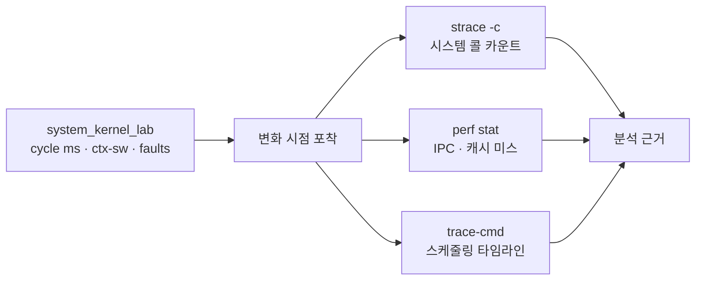
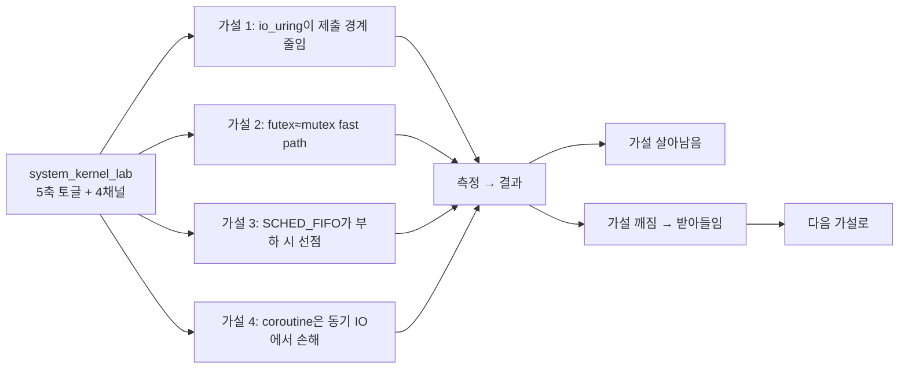

## 들어가며

system_kernel_lab은 backend·sync·sched·ctx·workers 다섯 토글을 가진 측정 도구가 됐다. IO 모델 5종, 동기화 4종, 스케줄링 4종, 컨텍스트 모델 2종을 같은 워크로드 위에서 바꿀 수 있다. 그러나 측정 채널은 *cycle ms · throughput* 두 가지뿐이다. 토글이 *어떻게* ms를 바꾸는지는 그래프에 나오지만, 그 변화의 *원인 — 시스템 콜 횟수, 컨텍스트 스위치, 페이지 폴트 — 은 측정에 보이지 않는다*.

이 단계의 목표는 *측정 채널 확장* 이다. `getrusage(RUSAGE_SELF)` 로 매 사이클 *컨텍스트 스위치 수* 와 *페이지 폴트 수* 를 직접 측정하고, HUD에 두 그래프를 추가한다. 사용자가 토글을 바꾸면 *이 두 채널이 어느 토글에 어떻게 반응하는지* 가 같은 화면에 그려진다. 마지막으로 *전체 사용 시나리오 + perf/strace/ftrace 외부 도구 결합 + 측정 정직성* 을 정리한다.

이 단계의 결과물은 다음 다섯 가지다.

1. `ProcCounters` + `ReadProcCounters` / `DiffCounters` (`measure/proc_counters.h`).
2. `FrameTimer` 슬라이딩 윈도우에 ctxSwitches / pageFaults 채널 두 개 추가.
3. main 루프에서 사이클 시작·끝에 카운터 읽고 delta를 FrameTimer에 push.
4. HUD에 두 stats 라인 + 두 그래프 추가, 패널 높이 200 → 240.
5. 도구 사용 시나리오 + 외부 도구 결합 + 측정 정직성 정리.

코드 스니펫은 핵심 경로만 보인다. 오류 처리와 보조 함수는 통합 코드에 있다.

---

## 목차

1. 왜 cycle ms 외에 직접 카운터가 필요한가
2. getrusage vs perf_event_open
3. ProcCounters와 사이클 단위 delta
4. FrameTimer 채널 확장
5. HUD 그래프 네 개와 패널 재배치
6. 도구 사용 시나리오 — 어떤 토글로 무엇을 보는가
7. 외부 도구 결합 — strace · perf · ftrace
8. 측정의 정직성 — 도구가 알려주지 않는 것
9. 최종 코드의 계약 — 폴백 보고 · 워커 오류 전파 · 자동 테스트
10. 헤드리스 러너 — 조합을 인자로 받고 4채널을 CSV로 남긴다
11. 실측 표 — 이 머신에서 조합이 실제로 갈라지는가
12. 결론

---

## 1. 왜 cycle ms 외에 직접 카운터가 필요한가

cycle ms 그래프는 *결과* 를 보여 준다. *원인* 은 그래프에 안 나온다.

같은 cycle ms 18 ms 가 다음 두 가지에서 모두 나올 수 있다.

- 시나리오 A: 시스템 콜 100 회 + 컨텍스트 스위치 거의 없음 + 페이지 폴트 4096
- 시나리오 B: 시스템 콜 30 회 + 컨텍스트 스위치 200 + 페이지 폴트 100

같은 ms지만 *왜 그 ms가 나오는지* 가 다르다. cycle ms만 보면 두 시나리오를 구분 못 한다. 토글 변경의 *원인* 을 추적하려면 *원인 채널* 도 함께 봐야 한다.

### 이 lab이 추가하는 두 채널

- **ctx switches per cycle**: 한 사이클 동안 발생한 컨텍스트 스위치 수 (voluntary + involuntary 합산).
- **page faults per cycle**: 한 사이클 동안 발생한 페이지 폴트 수 (minor + major 합산). minor fault는 COW, zero-fill, page-cache 매핑처럼 디스크 IO 없이 처리된 fault도 포함한다.

이 둘이 토글에 어떻게 반응하는지를 본다.

| 토글 변경 | cycle ms | ctx switches | page faults |
|---|---|---|---|
| backend: read → mmap | 비슷 | 비슷 | *증가* (mmap 접근이 page fault 경로를 거침) |
| backend: read → io_uring | 비슷 또는 ↓ | 비슷 | 비슷 |
| sync: mutex → spinlock | 비슷 | *감소 가능* (futex wait를 피할 수 있지만 yield 비용이 섞임) |
| sched: default → SCHED_FIFO + 부하 | ↓ | *감소* (선점 안 당함) | 비슷 |
| workers: 1 → 4 | ↓ | *증가* (4 스레드 간 스케줄러 전환) | 비슷 |
| ctx: pthread → coroutine | *증가* | *대폭 감소* (커널 스케줄러 안 거침) | 비슷 |

*같은 ms* 라도 *원인 분포* 가 다르다는 게 두 채널이 보여 주는 정보다.

특히 **ctx: pthread → coroutine** 케이스는 두 채널이 *반대 방향* 으로 움직이는 가장 명확한 사례다. cycle ms는 *증가* (코루틴이 더 느림) 하지만 ctx switches per cycle은 *대폭 감소* (커널 스케줄러를 거의 안 거침). 이게 *코루틴의 본질을 측정으로 드러내는* 신호다 — 컨텍스트 스위치는 싸지만 단일 스레드 직렬이라 처리량이 손해.

## 2. getrusage vs perf_event_open

Linux에서 *프로세스 단위 카운터* 를 얻는 두 가지 표준 방법.

### getrusage(2)

```cpp
#include <sys/resource.h>
struct rusage r;
getrusage(RUSAGE_SELF, &r);
// r.ru_nvcsw, r.ru_nivcsw, r.ru_minflt, r.ru_majflt, ...
```

- 장점: 모든 사용자, 모든 환경에서 동작. 권한 부담 없음.
- 단점: 카운터 종류 제한적 (ctx-sw, page faults, max RSS 등). 하드웨어 카운터(IPC, 캐시 미스) 없음.

### perf_event_open(2)

```cpp
#include <linux/perf_event.h>
perf_event_attr attr{};
attr.type   = PERF_TYPE_HARDWARE;
attr.config = PERF_COUNT_HW_INSTRUCTIONS;
int fd = syscall(SYS_perf_event_open, &attr, 0, -1, -1, 0);
```

- 장점: 풍부한 카운터(instructions, cycles, cache-misses, branch-misses, ...).
- 단점: `/proc/sys/kernel/perf_event_paranoid` 가 2 이하여야 일반 사용자가 자기 프로세스 측정 가능. Ubuntu 22.04 기본값은 4라 *기본은 막혀 있다*.

### 이 lab의 선택: getrusage

이 lab은 *환경 호환성* 을 우선해 getrusage를 쓴다. 모든 사용자가 권한 셋업 없이 측정 가능. perf_event_open은 *외부 perf 도구* 와 결합해 더 풍부한 분석을 보충하는 패턴으로 둔다.

<!-- snippet: src/measure/proc_counters.h -->
```cpp
// src/measure/proc_counters.h

struct ProcCounters {
    long voluntaryCtxSw    = 0;  // ru_nvcsw
    long involuntaryCtxSw  = 0;  // ru_nivcsw
    long minorFaults       = 0;  // ru_minflt: 디스크 IO 없는 fault
    long majorFaults       = 0;  // ru_majflt: 디스크 IO가 필요한 fault
};

ProcCounters ReadProcCounters();

inline ProcCounters DiffCounters(const ProcCounters& a, const ProcCounters& b) {
    auto d = [](long x, long y) -> long { return (y > x) ? (y - x) : 0; };
    return ProcCounters{
        d(a.voluntaryCtxSw,    b.voluntaryCtxSw),
        d(a.involuntaryCtxSw,  b.involuntaryCtxSw),
        d(a.minorFaults,       b.minorFaults),
        d(a.majorFaults,       b.majorFaults),
    };
}
```

### 두 가지 ctx switch의 의미

`ru_nvcsw` 와 `ru_nivcsw` 는 다음을 구분한다.

- **voluntary**: 스레드가 *스스로 양보* — IO 대기, mutex/futex wait, sleep, yield.
- **involuntary**: 스케줄러가 *시간 다 됐다고 빼앗음* — time slice 만료, 더 높은 우선순위 스레드가 들어옴.

이 lab의 워크로드는 IO 대기 + sync wait가 많아 *voluntary가 압도적*. SCHED_FIFO + 부하 시나리오에서는 *involuntary가 줄어드는* (선점 안 당함) 변화가 보일 수 있다.

표시는 *합산값* 한 라인. 더 자세한 분석은 *외부 perf* 로.

## 3. ProcCounters와 사이클 단위 delta

main 루프의 측정 패턴.

<!-- snippet: src/main.cpp#main -->
```cpp
// src/main.cpp 일부

timer.BeginCycle();
const skl::ProcCounters before = skl::ReadProcCounters();
std::uint64_t bytes = 0;
try {
    bytes = workload.RunCycle();
} catch (const std::exception& e) {
    std::fprintf(stderr, "system_kernel_lab cycle failed: %s\n", e.what());
    running = false;
    break;
}
const skl::ProcCounters after = skl::ReadProcCounters();
const skl::ProcCounters delta = skl::DiffCounters(before, after);
const std::uint64_t ctxSwTotal = static_cast<std::uint64_t>(
    delta.voluntaryCtxSw + delta.involuntaryCtxSw);
const std::uint64_t faultsTotal = static_cast<std::uint64_t>(
    delta.minorFaults + delta.majorFaults);
timer.EndCycle(bytes, ctxSwTotal, faultsTotal);
```

`RunCycle` 을 감싼 try/catch는 아래 9절의 *워커 예외 전파* 와 짝이다. 워커가 보관해 둔
예외를 메인이 다시 던지므로, 그 예외가 여기서 잡히지 않으면 도구가 조용히 죽는다.

세 가지 결정 포인트.

1. **사이클 시작·끝 두 번 읽기**: 카운터의 절대값이 아니라 *delta* 를 본다. 프로세스 시작부터 누적된 카운터에서 *이 사이클 동안 늘어난 분* 만 추출.
2. **ReadProcCounters 비용**: `getrusage` 호출 한 번. 사이클당 두 번 추가되며 보통 마이크로초 단위라 프레임 단위 cycle ms 측정에는 영향이 작다.
3. **합산 표시**: voluntary + involuntary, minor + major를 *합산* 해 단순화. minor fault는 COW, zero-fill, page-cache 매핑 등을 포함하므로 “mmap 데이터 적재” 하나로만 해석하지 않는다. 분리 표시는 *외부 perf 도구* 가 더 적합.

### 측정 시점의 일관성

`ReadProcCounters` 호출이 정확히 *RunCycle 직전·직후* 라 사이클 ms 측정과 *같은 구간* 의 카운터 delta를 얻는다. ImGui 렌더링이나 SDL 이벤트 폴링은 사이클 밖이라 카운터에 안 들어간다.

## 4. FrameTimer 채널 확장

`FrameTimer` 가 두 추가 채널을 슬라이딩 윈도우로 보관.

```cpp
// src/measure/frame_timer.h 일부

class FrameTimer {
public:
    void BeginCycle();
    void EndCycle(std::uint64_t bytesProcessed,
                  std::uint64_t ctxSwitchesDelta = 0,
                  std::uint64_t pageFaultsDelta  = 0);

    const std::array<float, kCapacity>& CycleMs()       const;
    const std::array<float, kCapacity>& ThroughputMBs() const;
    const std::array<float, kCapacity>& CtxSwitches()   const;
    const std::array<float, kCapacity>& PageFaults()    const;

    float LastCtxSwitches() const;
    float LastPageFaults()  const;
    // ...
};
```

기본 인자 0이라 *step01의 호출 형태(`EndCycle(bytes)`)도 그대로* 컴파일된다 — 호환성 유지. 새 코드만 추가 인자를 채운다.

```cpp
// src/measure/frame_timer.cpp 일부

void FrameTimer::EndCycle(std::uint64_t bytesProcessed,
                            std::uint64_t ctxSwitchesDelta,
                            std::uint64_t pageFaultsDelta) {
    const auto end = Clock::now();
    const auto ns  = std::chrono::duration_cast<std::chrono::nanoseconds>(
        end - cycleStart_).count();
    const float ms = static_cast<float>(ns) / 1.0e6f;

    lastCycleMs_     = ms;
    lastBytes_       = bytesProcessed;
    lastThroughputMBs_ = (ms > 0.0f)
        ? static_cast<float>(bytesProcessed) / ms / 1000.0f : 0.0f;
    lastCtxSwitches_ = static_cast<float>(ctxSwitchesDelta);
    lastPageFaults_  = static_cast<float>(pageFaultsDelta);

    cycleMs_[head_]       = lastCycleMs_;
    throughputMBs_[head_] = lastThroughputMBs_;
    ctxSwitches_[head_]   = lastCtxSwitches_;
    pageFaults_[head_]    = lastPageFaults_;
    head_ = (head_ + 1) % kCapacity;
    if (filled_ < kCapacity) ++filled_;

    ++totalCycles_;
    totalBytes_ += bytesProcessed;
}
```

float로 보관하는 이유는 *PlotLines가 float 배열을 받기* 때문. 정수 카운터지만 그래프 표시용 float 배열에 그대로 저장.

## 5. HUD 그래프 네 개와 패널 재배치

HUD 패널 높이를 200 → 240 px로 늘려 그래프 네 개가 들어가도록 한다.

<!-- snippet: src/ui/hud.cpp#Hud::Draw -->
```cpp
constexpr float kPanelH = 240.0f;
```

stats 영역에 두 라인 추가.

```text
backend     : read
sync        : mutex
sched req   : default
sched apply : yes
ctx         : pthread
workers     : 4
files       : 16  x  1.05 MB
cycle ms    :   8.124
throughput  :  2065.4 MB/s
ctx-sw/cyc  :     128
faults/cyc  :       8
total cycles: 312
total MB    : 5236.5
fixture dir : /tmp/system_kernel_lab_data
```

### 그래프 영역

기존 두 그래프(cycle ms, throughput)에 두 그래프(ctx switches, page faults)를 더해 네 개. 각 그래프 높이를 70 → 38 px로 줄여 240 px 패널에 들어가게 한다.

```cpp
// src/ui/hud.cpp 일부

ImGui::PlotLines("cycle ms",     msSeries, ..., 0.0f, FLT_MAX, ImVec2(0, 38));
ImGui::PlotLines("throughput",   tpSeries, ..., 0.0f, FLT_MAX, ImVec2(0, 38));
ImGui::PlotLines("ctx switches", csSeries, ..., 0.0f, FLT_MAX, ImVec2(0, 38));
ImGui::PlotLines("page faults",  pfSeries, ..., 0.0f, FLT_MAX, ImVec2(0, 38));
```

각 그래프의 overlay 텍스트가 *현재 값* 을 보여 주므로 그래프가 작아져도 정확한 수치를 본다.


## 6. 도구 사용 시나리오

이 절은 system_kernel_lab을 *어떻게 쓸 것인가* 의 시나리오. 토글 5축을 모두 곱하면 가짓수가 너무 많아 *축 하나만 바꾸는* 시나리오들이 의미 있는 비교다.

### 시나리오 A — IO 모델의 시스템 콜 비용

```text
backend    = read → pread → mmap → io_uring
sync       = mutex
sched      = default
ctx        = pthread
workers    = 1
```

cycle ms와 ctx-sw 두 채널을 본다. read와 pread는 거의 같다 (같은 시스템 콜 코드 경로). mmap은 *page faults 채널이 증가* — 매핑된 페이지를 처음 만질 때 fault 경로를 거친다. io_uring은 제출·완료 경계를 묶어 시스템 콜 전환을 줄일 수 있지만, 이 lab의 작은 워크로드에서는 cycle ms 차이가 미세할 수 있다.

### 시나리오 B — 동기화 4종

```text
backend    = read
sync       = mutex → spinlock → futex → atomic CAS
sched      = default
ctx        = pthread
workers    = 4
```

cycle ms는 거의 같다 (uncontended fast path). ctx-sw 채널을 보면 *spinlock + atomic CAS* 가 *mutex + futex* 보다 살짝 적을 수 있다. 다만 이 lab의 spin/CAS 구현은 contended path에서 `yield` 를 쓰므로 순수 busy spin 비용만 보이지 않는다. uncontended가 대부분이라 차이가 노이즈에 묻히기 쉽다.

### 시나리오 C — 워커 수와 컨텍스트 스위치

```text
backend    = read
sync       = mutex
sched      = default
ctx        = pthread
workers    = 1 → 2 → 4 → 8
```

cycle ms는 워커 수에 따라 *감소* (병렬 효과). ctx-sw 채널은 *증가* — 4 워커 + driver thread가 코어를 나눠 받느라 컨텍스트 스위치가 늘어난다. workers = 8에서는 *코어 수보다 워커가 많아* 추가 ctx-sw가 발생.

### 시나리오 D — pthread vs coroutine

```text
backend    = read
sync       = mutex
sched      = default
ctx        = pthread → coroutine
workers    = 4
```

cycle ms는 *증가* (코루틴 모드는 단일 스레드 직렬). 그러나 ctx-sw 채널은 *대폭 감소* — 코루틴 swap이 커널을 안 거치고 유저 공간 register save/restore 만으로 끝난다. 이 *반대 방향 변화* 가 코루틴의 본질을 가장 명확히 드러낸다.

이 시나리오를 그래프로 보면 cycle ms는 위로, ctx-sw는 아래로 *X자로 갈라진다*. cycle ms만 볼 때보다 *왜* 코루틴이 다른지가 한 화면에 나온다.

### 시나리오 E — 부하 환경에서 sched 비교

```bash
# 별도 터미널에서 부하 생성
stress-ng --cpu $(nproc) --timeout 60s &

# 도구 실행 (CAP_SYS_NICE 필요)
sudo setcap cap_sys_nice+ep ./build/system_kernel_lab
./build/system_kernel_lab
```

```text
backend    = read
sync       = mutex
sched      = default → nice +10 → SCHED_FIFO
ctx        = pthread
workers    = 4
```

부하 상태에서 sched 토글 변화.

- **default + 부하**: cycle ms 증가, *involuntary ctx-sw 증가* (CFS가 stress-ng와 워커를 번갈아 돌림).
- **nice +10 + 부하**: cycle ms 더 증가 (양보 많이).
- **SCHED_FIFO + 부하**: 권한과 코어 상황이 맞으면 cycle ms가 부하 없을 때에 가까워질 수 있다. ctx-sw가 *감소* (SCHED_FIFO가 stress-ng보다 우선 실행). page faults 거의 변화 없음.

세 토글이 *같은 부하* 에서 *cycle ms와 ctx-sw 채널이 같이* 변하는 모습이 한 그래프에 보인다.

### 시나리오 F — backend × workers 동시 변경

```text
backend    = io_uring
sync       = mutex
ctx        = pthread
workers    = 1 → 4
```

io_uring은 여러 read 요청의 *제출 경계* 를 묶을 수 있다. workers = 1 일 때 한 ring에서 여러 SQE를 제출하고 완료를 회수한다. workers = 4 일 때는 *워커당 자기 ring 4 개* 를 쓰므로 제출·완료 대기 지점이 워커 수만큼 늘어난다. ctx-sw도 그 영향을 받는다.

이 시나리오는 io_uring 자체의 한계라기보다 *워커당 ring* 구조의 비용을 보여 준다. 같은 워크로드를 *공유 ring + 다중 워커가 같은 ring에 SQE submit* 하는 패턴으로 바꾸면 제출·완료 경계가 줄어들 수 있다. 이 lab은 단순성을 위해 *워커당 ring* 패턴을 쓴다.

## 7. 외부 도구 결합 — strace · perf · ftrace

이 lab의 두 채널 (ctx-sw, page faults) 은 *대표 카운터* 다. 더 깊은 분석은 외부 도구로 보충한다.

### strace — 시스템 콜 카운트 + 시간

```bash
# 실행 중인 도구의 PID 찾기
PID=$(pgrep system_kernel_lab)

# 30초 동안 시스템 콜 통계
sudo strace -c -p $PID -f &
sleep 30
kill %1
```

출력:

```text
% time     seconds  usecs/call     calls    errors syscall
------ ----------- ----------- --------- --------- ----------------
 35.21    0.124851           4     27840           futex
 22.10    0.078341           5     14080           read
 18.55    0.065772           4     14080           openat
 12.87    0.045621           3     14080           close
  ...
```

이 표가 *각 시스템 콜의 호출 횟수와 누적 시간* 을 보여 준다. 토글 변경 직후 30초 측정하면 *어느 시스템 콜이 늘었는지* 정확히 안다. read/pread/mmap/aio/io_uring 비교의 *원인 분석* 에 강력.

다만 strace 자체가 *ptrace 기반이라 도구 실행을 느리게 한다* — strace 부착 상태에서 측정한 cycle ms는 신뢰하지 않는다. *카운트만* 본다.

### perf stat — 하드웨어 카운터

```bash
sudo perf stat -p $PID -e cycles,instructions,cache-misses,branch-misses sleep 30
```

```text
       8,128,475,290      cycles
      12,058,213,887      instructions    #    1.48  insn per cycle
         128,471,002      cache-misses
          24,156,883      branch-misses
```

IPC, 캐시 미스, 분기 미스 같은 *마이크로아키텍처 지표*. 우리 도구의 ctx-sw / page-faults 채널이 *시스템 단위* 라면 perf는 *CPU 단위*. 두 차원이 보충적이다.

### perf record + perf report — 시간이 어디 가는지

```bash
sudo perf record -p $PID -F 99 sleep 30
sudo perf report --stdio
```

함수별 *소요 시간* 분포가 트리로 나온다. cycle ms가 늘어났을 때 *어느 함수* 가 늘었는지 즉시 안다.

### trace-cmd / ftrace — 스케줄링 이벤트 타임라인

```bash
sudo trace-cmd record -e sched_switch -p $PID sleep 5
sudo trace-cmd report > trace.txt
```

`sched_switch` 이벤트가 *어느 시점에 어느 워커가 코어에 올라갔는지* 의 타임라인. SCHED_FIFO 시나리오에서 *워커가 stress-ng를 선점하는 순간* 이 timestamps로 나온다.

WSL2의 ftrace는 *커널 빌드 옵션* 에 따라 일부 트레이서가 빠져 있을 수 있다. `cat /sys/kernel/debug/tracing/available_tracers` 로 확인. 안 되면 perf record로 대체 가능.

### 도구 결합 패턴

이 lab의 cycle ms 그래프에서 *변화 시점* 을 본다 → 그 시점에 strace/perf 로 *어떤 시스템 콜·함수* 가 변했는지 확인 → 분석 근거로 남긴다.



## 8. 측정의 정직성 — 도구가 알려주지 않는 것

system_kernel_lab을 다 만들고 나면 도구가 *말해주는 것* 만 보고 결론을 낸다. 그러나 측정은 늘 *어떤 차원* 만 본다. 이 절은 도구가 *말해주지 않는* 것들의 목록.

### 도구가 보는 것 vs 못 보는 것

| 차원 | 보는가 | 보는 채널 |
|---|---|---|
| 사이클 ms · throughput | O | cycle ms / throughput |
| 컨텍스트 스위치 카운트 | O | ctx switches per cycle |
| 페이지 폴트 카운트 | O | page faults per cycle |
| 시스템 콜 카운트 | X | 외부 strace -c |
| 시스템 콜별 시간 | X | 외부 strace -c |
| IPC · 캐시 미스 | X | 외부 perf stat |
| 함수별 시간 분포 | X | 외부 perf record |
| 스케줄링 타임라인 | X | 외부 ftrace / trace-cmd |
| 디스크 IO 큐 깊이 | X | 외부 iostat / blktrace |
| 네트워크 (이 도구 무관) | - | - |

이 lab은 *시스템 단위 카운터* 까지가 책임. *CPU 단위 마이크로아키텍처* · *스케줄링 타임라인* · *함수 hot path* 는 외부 도구로.

### 워크로드의 인공성

이 lab의 워크로드는 *16 파일 × 1 MB read + sampled checksum* 으로 고정. 실제 시스템 환경의 IO 패턴과 다르다.

- **파일 수가 작다** — 16 개. 게임 엔진의 에셋 로딩은 수백~수만 파일.
- **파일 크기 균일** — 모두 1 MB. 실제는 수 KB ~ 수백 MB 분포.
- **순차 read 후 종료** — 패턴이 단조롭다. 실제는 random access, partial read 등 복잡.
- **가공이 매우 가볍다** — 4 KB stride 한 바이트 합산. 실제는 압축 해제, 파싱 등.

도구의 측정값을 *실제 시스템에 그대로 적용* 하지 않는다. *상대 비교 + 방향성* 만 인용한다.

### 페이지 캐시 효과

워크로드가 16 MB 라 페이지 캐시에 모두 들어간다. 첫 사이클은 콜드 IO, 두 번째 사이클부터 *캐시 hit*. 측정값은 *캐시 hit 시나리오* 의 결과다.

캐시 영향을 깨려면:

```bash
# 페이지 캐시 비우기 (root 필요)
sudo sh -c 'echo 3 > /proc/sys/vm/drop_caches'
./build/system_kernel_lab
```

도구를 시작한 직후 몇 사이클에는 *디스크 IO 비용* 이 측정에 들어올 수 있고, 두 번째 사이클부터는 페이지 캐시 hit가 지배할 수 있다.

현재 도구는 파일 크기로 페이지 캐시 용량을 확실히 넘기는 조건을 자동으로 만들지 않는다. 콜드 IO를 주장하려면 캐시 상태와 작업 집합 크기를 별도로 통제하고 기록해야 한다.

### 단일 머신 단일 빌드

이 lab의 측정값은 *이 머신 + 이 빌드* 결과다. WSL2 vs native Linux, Intel vs AMD, 커널 5.15 vs 6.5 모두 결과가 다를 수 있다.

대응: *벤치는 타깃에서 잰다*. 도구가 어디서나 빌드되는 게 가치인 이유 — 사용자 자신의 머신에서 자신의 워크로드로 직접 측정.

### 측정의 측정 비용

`getrusage` 호출이 마이크로초 단위 비용. 사이클당 두 번 = 2 마이크로초가 cycle ms에 더해진다. cycle ms가 5 ms 정도면 측정 비용은 *0.04% 노이즈* — 무시할 수준. 그러나 cycle ms가 *0.1 ms 이하* 인 마이크로 측정에서는 측정 비용이 *측정값의 일부* 가 된다.

도구는 *프레임 단위 측정* 이 목적이라 이 정도 오차는 허용. 진짜 마이크로 벤치는 *RDTSC* 같은 사이클 카운터를 직접 쓰거나 Google Benchmark 같은 도구.

### 카운터 정확성

`ru_nvcsw` / `ru_nivcsw` 가 *모든 컨텍스트 스위치* 를 정확히 카운트하는가? 커널 구현에 따라 미세한 차이가 있고, 일부 트레이스 이벤트(예: signal delivery 동안의 짧은 ctx-sw)가 빠질 수 있다. perf stat의 `context-switches` 와 비교하면 *대체로 같지만 완전히 일치하지는 않을* 수 있다.

이 lab의 측정은 *상대 비교* 가 핵심이라 절대값의 미세한 차이는 무시한다. 토글 A → B의 ctx-sw 변화가 *방향성과 비율* 로 의미가 있다.

### 측정 자체가 시스템에 영향

WSL2의 GUI 도구가 도는 것 자체가 *시스템 부하* 다. 다른 *측정 외 작업* 이 같은 시스템에서 돌면 측정에 영향. 가장 깨끗한 측정은:

- 다른 GUI 앱 모두 종료.
- 백그라운드 인덱싱·업데이트 끄기.
- WSL2면 다른 distribution 종료.
- 전원 어댑터 연결 (배터리 모드는 CPU 클럭 다운).

다만 *완벽한 격리* 는 비용이 크다. 도구는 *상대 비교* 가 본질이라 일반 사용 환경에서도 의미 있는 결과가 나온다.

### 도구가 깨질 수 있는 시나리오

워크로드 + 토글 조합에서 도구가 *측정 못 하는* 케이스.

- **io_uring + workers = 8**: 워커당 ring 8 개. 시스템 file descriptor 한도 초과 가능.
- **mmap + 1 GB 파일**: 파일이 페이지 캐시에 안 들어가 *major page fault 폭증* — page faults 채널이 정상 영역을 벗어나 그래프 자동 스케일이 깨질 수 있음.
- **SCHED_FIFO + workers = 8 + busy polling**: 워커 8 개가 *시스템을 점유* 해 GUI 메인 freeze. 도구가 응답 안 함.

대응은 *워커 수 제한 + idle 구간의 짧은 sleep* 이지만, 모든 조합에서 안전을 보장하지는 않는다. *위험 조합* 은 글로 안내.

## 9. 최종 코드의 계약 — 폴백 보고 · 워커 오류 전파 · 자동 테스트

앞 절들이 스니펫으로 보인 것 외에, 최종 코드에는 *측정 결과의 해석에 직접 영향을 주는* 세 가지 계약이 있다.

### CreateBackend는 실제로 만들어진 backend를 돌려준다

factory는 요청한 backend를 만들지 못하면 `ReadBackend` 로 폴백한다. 폴백이 일어났는데 HUD가 *요청 값* 을 그대로 표시하면, 사용자는 read로 돈 결과를 io_uring 결과로 읽는다. 그래서 시그니처가 out 파라미터를 갖는다.

<!-- snippet: src/io/io_backend_factory.h -->
```cpp
// src/io/io_backend_factory.h

// type에 해당하는 backend 인스턴스를 만든다. 요청한 backend가 런타임에
// 초기화되지 않으면 ReadBackend로 폴백하고 actualType에 실제 타입을 쓴다.
// 호출자는 요청 타입이 아니라 actualType을 HUD와 측정 메타데이터에 기록해야 한다.
std::unique_ptr<IIoBackend> CreateBackend(
    BackendType type, BackendType* actualType = nullptr);
```

워크로드는 backend를 만들 때마다 이 out 값을 자기 상태에 되반영한다. 단일 모드·워커 풀·코루틴 풀 세 곳이 같은 헬퍼를 쓴다.

<!-- snippet: src/workload/file_io_workload.cpp#FileIoWorkload::CreateEffectiveBackend -->
```cpp
// src/workload/file_io_workload.cpp

std::unique_ptr<IIoBackend> FileIoWorkload::CreateEffectiveBackend() {
    BackendType actual = backendType_;
    auto backend = CreateBackend(backendType_, &actual);
    backendType_ = actual;
    return backend;
}
```

`Backend()` 가 돌려주는 값이 *요청* 이 아니라 *실제* 라서, HUD의 `backend` 라인은 io_uring을 골랐어도 폴백이 일어나면 `read` 로 바뀐다.

### 워커 스레드의 예외는 메인으로 전파된다

워커 루프에서 backend가 던진 예외를 그 자리에서 놓치면 사이클은 조용히 짧은 결과를 내고 그래프는 *더 빨라진 것처럼* 보인다. 워커는 예외를 잡아 보관하고, 사이클을 기다리던 메인이 다시 던진다.

<!-- snippet: src/workload/file_io_workload.cpp@worker-error -->
```cpp
// src/workload/file_io_workload.cpp

void FileIoWorkload::ClearWorkerError() {
    std::lock_guard<std::mutex> lock(workerErrorMutex_);
    workerError_ = nullptr;
}

void FileIoWorkload::RecordWorkerError(std::exception_ptr error) {
    std::lock_guard<std::mutex> lock(workerErrorMutex_);
    if (!workerError_) workerError_ = std::move(error);
}

void FileIoWorkload::RethrowWorkerError() {
    std::exception_ptr error;
    {
        std::lock_guard<std::mutex> lock(workerErrorMutex_);
        error = workerError_;
    }
    if (error) std::rethrow_exception(error);
}
```

`RunCycleMulti` / `RunCycleCoroutine` 은 시작에서 `ClearWorkerError()`, 완료 대기 후 `RethrowWorkerError()` 를 호출한다. 첫 오류만 보관하는 이유는 워커 N개가 같은 원인으로 동시에 실패했을 때 마지막 것이 원인을 덮지 않게 하기 위해서다.

### 자동 테스트 타깃과 실행

측정 도구라도 *계산이 맞는지* 는 GUI 없이 검사할 수 있어야 한다. 테스트 타깃은 SDL2·OpenGL·ImGui를 링크하지 않고 코어 TU만 모아 빌드한다.

<!-- snippet: CMakeLists.txt -->
```cmake
# CMakeLists.txt 일부

enable_testing()

set(SKL_CORE_TEST_SOURCES
    src/fault/fault_inject.cpp
    src/io/aio_backend.cpp
    src/io/io_backend_factory.cpp
    src/io/mmap_backend.cpp
    src/io/pread_backend.cpp
    src/io/read_backend.cpp
    src/io/uring_backend.cpp
    src/sched/sched_policy.cpp
    src/sync/sync_factory.cpp
    src/workload/file_io_workload.cpp
)

add_executable(system_core_tests
    tests/system_core_tests.cpp ${SKL_CORE_TEST_SOURCES}
    src/measure/frame_timer.cpp)

add_executable(system_fault_tests
    tests/system_fault_tests.cpp ${SKL_CORE_TEST_SOURCES})

add_executable(system_io_path_tests
    tests/system_io_path_tests.cpp ${SKL_CORE_TEST_SOURCES})

set(SKL_TEST_TARGETS system_core_tests system_fault_tests system_io_path_tests)

# ...

foreach(skl_test IN LISTS SKL_TEST_TARGETS)
    target_include_directories(${skl_test} PRIVATE src)
    target_link_libraries(${skl_test} PRIVATE
        Threads::Threads
        ${CMAKE_DL_LIBS}
    )
    target_compile_definitions(${skl_test} PRIVATE SKL_TEST_HOOKS=1)
    target_compile_options(${skl_test} PRIVATE -Wall -Wextra -Wpedantic)
    add_test(NAME ${skl_test} COMMAND ${skl_test})
    set_tests_properties(${skl_test} PROPERTIES TIMEOUT 60)
endforeach()
```

코어 TU 목록을 `SKL_CORE_TEST_SOURCES` 변수 하나로 두는 이유는 타깃이 셋(성공 경로 ·
오류 경로 · I/O 경로)이고 뒤에 헤드리스 러너까지 같은 목록을 쓰기 때문이다. 목록이
갈라지면 어느 타깃이 어느 backend를 링크했는지가 조용히 어긋난다.

`SKL_TEST_HOOKS` 는 테스트 타깃에만 정의한다. `src/testhook/test_hook.h` 의 타이밍 훅이
앱·러너 바이너리에서는 빈 인라인 함수로 사라지도록 하기 위해서다.

`SKL_HAS_POSIX_AIO` / `SKL_HAS_LIBURING` 정의와 라이브러리 링크는 GUI 타깃과 테스트 타깃에 *같이* 걸어야 한다. 한쪽만 걸면 테스트가 도는 backend 집합이 실제 도구와 달라진다.

`TIMEOUT 60` 은 단순한 안전장치가 아니다. 이 lab의 워커 풀은 카운터 기반 완료 대기(`while (remaining_ > 0) yield();`)를 쓰므로, 동기화가 깨지면 *실패* 가 아니라 *멈춤* 으로 나타난다. 타임아웃이 없으면 그 종류의 회귀가 테스트에서 영원히 매달린다.

`tests/system_core_tests.cpp` 의 검사 목록은 파일 끝의 대응표에 있다. 표의 항목마다 *그 검사를 추가한 step 번호* 가 붙어 있다.

- `TestWorkloadSkeleton` / `TestFrameTimerWindow` — 결정적 fixture 위의 단일 스레드 사이클과 슬라이딩 윈도우의 회계.
- `TestReadBackendEquivalence` / `TestSyncBackendEquivalence` / `TestAsyncBackendEquivalence` — backend 그룹마다 같은 총 바이트와 같은 체크섬을 돌려주는지.
- `TestSyncPrimitives` — 4종 동기화가 4스레드 × 20000회 증가에서 상호배제를 지키는지.
- `TestWorkerPoolExecutionModel` / `TestCoroutinePoolExecutionModel` — 두 실행 단위가 단일 스레드 기준값과 같은 결과를 내는지.
- `TestQueueHandoffStress` / `TestQueueHandoffRegression` — 작업 큐 인계 경계의 `remaining_` 언더플로를 반복 스트레스와 `src/testhook` 훅 두 개의 결정적 랑데부로.
- `TestFrameTimerCounterChannels` — 카운터 두 채널이 delta를 가공 없이 그대로 싣는지.

오류 경로(`system_fault_tests`)와 I/O 3항목(`system_io_path_tests`)은 별도 타깃이다. 자세한 범위는 `README.md` 의 검증 범위 절에 있다.

### 실행 단위를 step 입도로 나눈다

전체 실행 케이스 하나만 있으면 각 단계의 독자가 *자기가 방금 만든 것* 을 따로 확인할 수 없다. 초록은 나오지만 그 초록이 무엇에 대한 초록인지는 마지막 단계에서만 대응한다. 그래서 세 실행 파일이 `--step=N` 필터를 받고, CMake가 step마다 `add_test` 를 따로 건다. 전체 실행 케이스는 그대로 두고 *더한* 것이다.

<!-- snippet: CMakeLists.txt@step-tests -->
```cmake
function(skl_add_step_test tag suite target)
    add_test(NAME skl_step${tag}_${suite} COMMAND ${target} --step=${tag})
    set_tests_properties(skl_step${tag}_${suite} PROPERTIES TIMEOUT 60)
endfunction()

# 워크로드 골격 · 프레임 타이머 윈도우
skl_add_step_test(01 core     system_core_tests)
# IIoBackend + ReadBackend + factory
skl_add_step_test(02 core     system_core_tests)
skl_add_step_test(02 fault    system_fault_tests)
skl_add_step_test(02 io_path  system_io_path_tests)
# ...
# 카운터 채널 · 주입 seam 의 계약
skl_add_step_test(08 core     system_core_tests)
skl_add_step_test(08 fault    system_fault_tests)
```

이 배선이 스스로를 지킨다. 대응표에 없는 step을 CMake에서 걸면 실행 파일이 *선택된 검사가 0개* 라며 종료 코드 2로 실패한다. 케이스가 아무것도 돌지 않은 채 초록이 되는 상태가 없다.

이 단계가 얹은 검사는 카운터 두 채널이다. 시간은 머신마다 다르지만 "받은 delta를 그대로 싣는다"는 계약은 아니다.

<!-- snippet: tests/system_core_tests.cpp#TestFrameTimerCounterChannels -->
```cpp
// tests/system_core_tests.cpp

void TestFrameTimerCounterChannels() {
    skl::FrameTimer timer;

    timer.BeginCycle();
    timer.EndCycle(4096, /*ctxSwitchesDelta=*/37, /*pageFaultsDelta=*/11);
    CHECK(timer.LastCtxSwitches() == 37.0f);
    CHECK(timer.LastPageFaults() == 11.0f);
    CHECK(timer.CtxSwitches()[0] == 37.0f);
    CHECK(timer.PageFaults()[0] == 11.0f);

    // 기본 인자 = 0. 카운터를 못 읽는 환경에서도 채널이 조용히 이전 값을
    // 물고 있으면 안 된다.
    timer.BeginCycle();
    timer.EndCycle(4096);
    CHECK(timer.LastCtxSwitches() == 0.0f);
    CHECK(timer.LastPageFaults() == 0.0f);
    // ...
    // 네 채널이 같은 인덱스를 공유한다 — 그래프 네 개가 같은 사이클을 가리킨다.
    CHECK(timer.Head() == 2);
    CHECK(timer.Filled() == 2);
    CHECK(timer.CycleMs()[1] == timer.LastCycleMs());
    // ...
}
```

두 번째 사이클이 0을 싣는지 보는 것이 요점이다. 채널이 이전 값을 물고 있으면 카운터를 못 읽는 환경에서 그래프가 *변화 없음* 대신 *직전 값 유지* 를 그린다. 그리고 네 채널이 같은 인덱스를 공유해야 그래프 넷이 같은 사이클을 가리킨다.

```bash
cmake -S . -B build -DCMAKE_BUILD_TYPE=Release
cmake --build build -j
ctest --test-dir build --output-on-failure
```

```text
      Start  1: system_core_tests
 1/25 Test  #1: system_core_tests ........................   Passed    0.77 sec
      Start  2: system_fault_tests
 2/25 Test  #2: system_fault_tests .......................   Passed    0.02 sec
      Start  3: system_io_path_tests
 3/25 Test  #3: system_io_path_tests .....................   Passed    0.64 sec
      Start  4: system_core_tests_strict
 4/25 Test  #4: system_core_tests_strict .................   Passed    0.86 sec
      Start  5: system_kernel_bench_smoke
 5/25 Test  #5: system_kernel_bench_smoke ................   Passed    0.01 sec
      Start  6: system_kernel_bench_smoke_workers
 6/25 Test  #6: system_kernel_bench_smoke_workers ........   Passed    0.01 sec
      Start  7: system_kernel_bench_fault_channel
 7/25 Test  #7: system_kernel_bench_fault_channel ........   Passed    0.01 sec
      Start  8: system_kernel_bench_rejects_bad_toggle
 8/25 Test  #8: system_kernel_bench_rejects_bad_toggle ...   Passed    0.00 sec
      Start  9: skl_step01_core
 9/25 Test  #9: skl_step01_core ..........................   Passed    0.00 sec
      Start 10: skl_step02_core
10/25 Test #10: skl_step02_core ..........................   Passed    0.00 sec
      Start 11: skl_step02_fault
11/25 Test #11: skl_step02_fault .........................   Passed    0.00 sec
      Start 12: skl_step02_io_path
12/25 Test #12: skl_step02_io_path .......................   Passed    0.31 sec
      Start 13: skl_step03_core
13/25 Test #13: skl_step03_core ..........................   Passed    0.00 sec
      Start 14: skl_step03_fault
14/25 Test #14: skl_step03_fault .........................   Passed    0.00 sec
      Start 15: skl_step03_io_path
15/25 Test #15: skl_step03_io_path .......................   Passed    0.00 sec
      Start 16: skl_step04_core
16/25 Test #16: skl_step04_core ..........................   Passed    0.00 sec
      Start 17: skl_step04_fault
17/25 Test #17: skl_step04_fault .........................   Passed    0.01 sec
      Start 18: skl_step04_io_path
18/25 Test #18: skl_step04_io_path .......................   Passed    0.33 sec
      Start 19: skl_step05_core
19/25 Test #19: skl_step05_core ..........................   Passed    0.94 sec
      Start 20: skl_step05_fault
20/25 Test #20: skl_step05_fault .........................   Passed    0.00 sec
      Start 21: skl_step06_fault
21/25 Test #21: skl_step06_fault .........................   Passed    0.00 sec
      Start 22: skl_step07_core
22/25 Test #22: skl_step07_core ..........................   Passed    0.04 sec
      Start 23: skl_step07_fault
23/25 Test #23: skl_step07_fault .........................   Passed    0.00 sec
      Start 24: skl_step08_core
24/25 Test #24: skl_step08_core ..........................   Passed    0.00 sec
      Start 25: skl_step08_fault
25/25 Test #25: skl_step08_fault .........................   Passed    0.00 sec

100% tests passed, 0 tests failed out of 25
```

앞의 셋이 실행 파일 전체를 도는 케이스다. 그 뒤 `system_core_tests_strict` 는 같은
실행 파일을 `SKL_REQUIRE_BACKENDS=uring,aio` 환경에서 한 번 더 돌려 io_uring/aio가 조용히
read로 폴백하지 않았는지 강제한다(`ctest -LE strict` 로 빼면 그 강제 없이 돈다).
`system_kernel_bench_*` 넷은 헤드리스 러너가 거는 케이스다.

`skl_step01_core` 부터 `skl_step08_fault` 까지 열일곱은 같은 검사들을 step 입도로 다시 건 것이다. 같은 검사가 두 번 도는 셈이라 실행 시간이 조금 늘지만(전체 4초), 얻는 것은 *어느 단계의 무엇이 깨졌는지* 가 케이스 이름에 바로 나온다는 점이다. `ctest -R skl_step05` 처럼 한 단계만 골라 돌릴 수도 있다.

```bash
./build/system_core_tests --step=08
```

```text
[strict] SKL_REQUIRE_BACKENDS=<unset> (fallback tolerated)
[ run  ] step08  frame timer counter channels
[channels] ctx_sw=37,0 faults=11,0 (delta as given, no smoothing)
[  ok  ] step08  frame timer counter channels
system_core_tests --step=8: 1/11 check(s) run, 0 failed
```

`ctx_sw=37,0` 은 첫 사이클이 받은 37을 그대로 싣고 둘째 사이클이 0으로 돌아왔다는 뜻이다. 평활화도 누적도 하지 않는다 — 그래야 CSV의 값과 `strace -c` 의 값을 나란히 놓을 수 있다.

이 테스트가 검사하는 것은 *결과의 동등성* 이지 *성능* 이 아니다. 성능 수치는 환경마다 달라 회귀 판정 기준이 될 수 없다.

## 10. 헤드리스 러너 — 조합을 인자로 받고 4채널을 CSV로 남긴다

앞 절들까지의 측정 경로에는 구멍이 하나 있다. **결과가 화면에만 있다.**

- `main` 은 `argc`/`argv` 를 받지 않는다. 조합은 GUI 콤보로만 바꾼다.
- `FrameTimer` 의 시계열은 `PlotLines` 로만 소비된다. 파일로 나가는 경로가 없다.

그래서 *같은 조합을 두 번 돌린 결과를 나란히 놓기*, *p50/p99 계산*, *다른 머신과 대조*, *스크립트로 회귀 판정* 중 어느 것도 할 수 없다. 눈으로 본 그래프는 인용할 수 없는 측정이다.

세 번째 실행 파일 `system_kernel_bench` 가 그 구멍을 메운다. 워크로드도 계측기도 GUI와 같은 것을 쓰고, 창만 없다.

<!-- snippet: CMakeLists.txt@bench-target -->
```cmake
add_executable(system_kernel_bench
    tools/bench_main.cpp
    ${SKL_CORE_TEST_SOURCES}
    src/measure/frame_timer.cpp
    src/measure/proc_counters.cpp)

target_include_directories(system_kernel_bench PRIVATE src)
target_link_libraries(system_kernel_bench PRIVATE
    Threads::Threads
    ${CMAKE_DL_LIBS}
)
```

SDL2·OpenGL·ImGui는 링크 목록에 없다. 테스트 타깃이 이미 증명한 분리를 그대로 쓴 것이다 — `FrameTimer` 와 `ProcCounters` 는 GUI 의존이 없으므로 테스트가 쓰는 코어 TU 목록에 두 파일만 얹으면 된다. `SKL_HAS_POSIX_AIO` / `SKL_HAS_LIBURING` 정의와 라이브러리 링크는 테스트와 러너에 같은 `foreach` 로 걸린다. 한쪽만 걸면 측정에 들어가는 backend 집합이 GUI 도구와 달라진다.

### 인자

```bash
./build/system_kernel_bench \
    --backend=io_uring --sync=mutex --sched=default --ctx=pthread \
    --workers=4 --cycles=200 --warmup=20 --out=uring_w4.csv
```

| 인자 | 값 | 기본값 |
|---|---|---|
| `--backend` | `read` `pread` `mmap` `aio` `io_uring` | `read` |
| `--sync` | `mutex` `spin` `futex` `cas` | `mutex` |
| `--sched` | `default` `nice` `fifo` `cgroup` | `default` |
| `--ctx` | `pthread` `coroutine` | `pthread` |
| `--workers` | 워커 수 | `1` |
| `--cycles` | 기록할 사이클 수 | `30` |
| `--warmup` | 버릴 사이클 수 | `2` |
| `--files` / `--bytes` | 픽스처 파일 수 · 파일당 바이트 | `16` / `1048576` |
| `--fixture-dir` | 픽스처 디렉터리 | `/tmp/system_kernel_bench_data` |
| `--out` | CSV 경로 (`-` 면 stdout) | `run.csv` |
| `--strict-backend` | 런타임 폴백을 실패로 | 꺼짐 |
| `--min-faults=N` | 사이클당 평균 page fault 하한 | `0` (검사 안 함) |

토글 이름은 `[a-z0-9]` 만 남기고 정규화한 뒤 별칭표와 맞춘다. `io_uring` · `IO_URING` · `uring` 이 같은 값이 되고, UI 라벨의 공백(`atomic CAS`, `nice +10`) 때문에 셸에서 따옴표를 쓸 일이 없다. **모르는 이름은 거부한다** — 조용히 기본값으로 흘리면 CSV가 요청하지도 않은 조합의 수치를 그 이름으로 담게 된다.

### 계측 루프는 GUI와 같다

<!-- snippet: tools/bench_main.cpp@bench-cycle -->
```cpp
timer.BeginCycle();
const skl::ProcCounters before = skl::ReadProcCounters();
std::uint64_t bytes = 0;
try {
    bytes = workload.RunCycle();
} catch (const std::exception& e) {
    std::cerr << "system_kernel_bench: cycle " << i << " failed: "
              << e.what() << '\n';
    workload.Shutdown();
    return 1;
}
const skl::ProcCounters after = skl::ReadProcCounters();
const skl::ProcCounters delta = skl::DiffCounters(before, after);
timer.EndCycle(bytes,
               static_cast<std::uint64_t>(delta.voluntaryCtxSw +
                                          delta.involuntaryCtxSw),
               static_cast<std::uint64_t>(delta.minorFaults +
                                          delta.majorFaults));
```

`getrusage` 를 사이클 직전·직후에 읽어 delta를 `FrameTimer` 로 넘기는 것까지 GUI 루프와 동일하다. CSV에 적히는 값은 `timer.LastCycleMs()` · `LastThroughputMBs()` · `LastCtxSwitches()` · `LastPageFaults()` — 즉 HUD 그래프가 그리는 바로 그 값이다. 러너가 자기만의 계산을 따로 하면 두 경로의 수치가 갈라지고, 그러면 CSV는 HUD를 대신하지 못한다.

`--warmup` 사이클은 똑같이 측정하되 기록하지 않는다. 첫 사이클은 픽스처 생성 직후의 콜드 IO, 할당자 워밍업, 워커 스레드 기동이 섞인다.

### CSV

```text
backend_req,backend,sync,sched,sched_applied,ctx,workers,files,file_bytes,cycle,cycle_ms,mb_per_s,ctx_sw,page_faults
io_uring,io_uring,mutex,default,1,pthread,4,16,1048576,0,1.732844,9681.896,32,0
io_uring,io_uring,mutex,default,1,pthread,4,16,1048576,1,1.688201,9937.926,32,0
```

조합 정보를 행마다 반복해서 싣는다. 용량은 낭비지만 여러 실행의 파일을 그대로 이어 붙여 하나의 표로 읽을 수 있고(헤더 한 줄만 지우면 된다), 행 하나만 봐도 그것이 어떤 조합의 수치인지 알 수 있다. 파일 이름에 조합을 인코딩하는 방식은 파일이 옮겨지거나 이름이 바뀌는 순간 메타데이터를 잃는다.

`backend_req` 와 `backend` 를 나눈 이유가 측정 정직성의 핵심이다. `io_uring` 과 `aio` 는 런타임 초기화가 실패하면 조용히 `read` 로 폴백한다. 요청 값만 적으면 read로 돈 수치를 io_uring 수치로 읽게 된다. 폴백이 일어나면 stderr에 경고가 나가고, `--strict-backend` 를 주면 그 자체가 실패다.

```text
[bench] backend=io_uring(actual io_uring) sync=mutex sched=default(applied) ctx=pthread workers=4
[bench] files=16 x 1048576 B  warmup=20  cycles=200  out=uring_w4.csv
[bench] cycle_ms  mean=1.889  p50=1.829  p99=2.637  min=1.393  max=3.600
[bench] mb_per_s  mean=9070.4  p50=9156.5  p99=11493.3  min=4660.2  max=12040.3
[bench] ctx_sw    mean=32  p50=32  p99=34  min=31  max=34
[bench] faults    mean=0  p50=0  p99=1  min=0  max=1
[bench] bytes/cycle=16777216  checksum=527643
```

요약은 stdout, CSV는 파일로 간다(`--out=-` 이면 반대로 CSV가 stdout, 요약이 stderr). p50/p99는 nearest-rank다 — 사이클 수가 적을 때 보간 정의는 원본에 없는 값을 만들어 내므로 실제 관측값 하나를 고른다.

### 러너 자신의 회귀

러너는 성능을 판정하지 않는다. 환경마다 달라 판정 기준이 될 수 없다. 대신 *정합성* 은 판정한다.

- 사이클마다 총 바이트가 `files * file_bytes` 인지.
- 체크섬이 사이클 간 동일한지.
- 토글 이름이 유효한지(아니면 종료 코드 2).
- `--min-faults=N` 이 주어졌으면 page fault 채널이 정말 값을 내는지.

이 넷이 `add_test` 네 개로 걸려 있다.

```text
5/8 Test #5: system_kernel_bench_smoke ................   Passed
6/8 Test #6: system_kernel_bench_smoke_workers ........   Passed
7/8 Test #7: system_kernel_bench_fault_channel ........   Passed
8/8 Test #8: system_kernel_bench_rejects_bad_toggle ...   Passed
```

`system_kernel_bench_fault_channel` 이 특히 값싸고 강하다. `mmap` backend는 사이클마다 새 매핑을 만들어 반드시 minor fault를 내므로, `--backend=mmap --min-faults=1` 하나로 `getrusage` → `DiffCounters` → `FrameTimer` → CSV 배선 전체를 못 박는다. 실제로 `timer.EndCycle(bytes, ...)` 에서 카운터 인자 둘을 떼어내 `timer.EndCycle(bytes)` 로 바꾸면 나머지 일곱 케이스는 모두 통과하고 이 케이스만 실패한다 — *러너가 돌기는 도는데 두 채널이 아무것도 재지 않는* 상태가 정확히 이 모양이다.

`system_kernel_bench_rejects_bad_toggle` 은 `WILL_FAIL TRUE` 로 걸린 반대 방향 케이스다. 이름 파싱이 모르는 값을 통과시키도록 바꾸면 이 케이스가 실패한다.

## 11. 실측 표 — 이 머신에서 조합이 실제로 갈라지는가

러너가 있어도 *조합마다 다른 값이 나오지 않으면* 아무것도 재지 않는 것이다. 아래는 그 확인이다.

### 측정 환경

| 항목 | 값 |
|---|---|
| OS | Ubuntu 26.04 LTS |
| 커널 | 6.18.33.2-microsoft-standard-WSL2 |
| 실행 형태 | **WSL2 VM** (베어메탈 아님) |
| CPU | 16 논리 코어 |
| 컴파일러 | g++ 15.2.0, `-O3` (Release) |
| liburing | 2.14 |
| 파일시스템 | WSL2 가상 디스크의 ext4 |
| 픽스처 | 16 × 1 MB, 측정 직전에 새로 생성(= 페이지 캐시에 올라간 상태) |
| 사이클 | `--warmup=20 --cycles=200`, 조합당 3회 반복 |

**이 수치를 절대값으로 인용하면 안 된다.** WSL2는 가상 디스크·가상 메모리 관리·호스트 스케줄러가 한 겹씩 더 끼어 있어 베어메탈 Linux와 다른 수를 낸다. 여기서 읽어야 하는 것은 *조합 사이의 상대 관계* 와 *어떤 축이 어떤 채널을 움직이는가* 뿐이다.

### 표

`cycle_ms` 는 3회 반복의 p50 중 중앙값이고, 두 열은 픽스처를 새로 만들어 전 조합을 처음부터 다시 돌린 *독립된 두 세션* 이다.

| 조합 | cycle ms (세션 A / B) | MB/s | ctx-sw/사이클 | faults/사이클 |
|---|---|---|---|---|
| read, w1 | 1.88 / 2.13 | 8953 / 7878 | 0 | 0 |
| pread, w1 | 1.82 / 2.15 | 9249 / 7846 | 0 | 0 |
| mmap, w1 | 0.71 / 0.63 | 24062 / 27267 | 0 | **256** |
| aio, w1 | 3.50 / 2.93 | 4879 / 5684 | **48** | 4 |
| io_uring, w1 | 9.42 / 10.05 | 1733 / 1687 | **17** | **4064** |
| read, w4 | 0.66 / 0.74 | 25550 / 22809 | 0.3 | 0 |
| read, w8 | 0.61 / 0.85 | 26401 / 19081 | 0.9 | 0 |
| read, w4, coroutine | 2.25 / 2.53 | 7219 / 6252 | 0 | 0 |
| read, w4, spinlock | 0.83 / 0.79 | 20460 / 21403 | 0 | 0 |
| io_uring, w4 | 1.76 / 1.67 | 9685 / 10044 | **32** | 0 |
| mmap, w4 | 0.99 / 1.06 | 16976 / 15946 | **13** | **272** |

### 읽히는 것

**backend 축이 가장 크게 갈라진다.** `io_uring, w1` 이 `mmap, w1` 보다 13배 느리다. 세션 간 차이(1.7~13%)보다 훨씬 큰 간격이라 잡음으로 설명되지 않는다. `read` 와 `pread` 는 두 세션 모두 서로 3% 안에 있다 — 같은 커널 경로를 다른 진입점으로 부르는 것이므로 그게 옳은 결과다.

**카운터 채널이 시간 채널보다 훨씬 재현성이 높다.** `ctx-sw` 와 `faults` 열에 세션 A/B를 나눠 적지 않은 이유가 그것이다. 두 세션에서 `aio`=48, `io_uring, w1`=17, `io_uring, w4`=32, `mmap, w1`=256이 그대로 나왔다. 시간은 호스트 부하에 흔들리지만 "이 조합이 사이클마다 페이지를 몇 개 폴트하는가"는 구조가 정하는 값이다. 조합을 특징짓는 지문으로는 시간보다 이쪽이 낫다.

**`io_uring, w1` 의 4064는 워크로드 크기와 정비례한다.** 파일 수를 4 · 8 · 16으로 바꾸면 992 · 2016 · 4064가 나온다. 이 backend는 사이클마다 요청 수만큼 버퍼를 새로 잡으므로(`uring_backend.cpp` 의 `bufs[i].resize(fileBytes)`) 16 MB를 매번 처음 만지는 셈이고, 그 first-touch minor fault가 그대로 채널에 찍힌다. 워커 4개로 나누면 `RunCycle` 당 파일이 하나여서 같은 1 MB 버퍼가 할당자에서 재사용되고 fault가 0으로 떨어진다 — 같은 backend가 워커 수에 따라 fault 채널을 완전히 다르게 쓴다. `aio` 도 같은 "사이클마다 fresh 버퍼" 정책인데 fault가 4에 그친다. 그 차이는 할당자 재사용 여부에서 오고, **이 도구는 그것을 설명하지 못한다** — 러너가 하는 일은 차이가 *있다* 는 사실을 재현 가능한 형태로 남기는 것까지다.

**mmap의 fault 채널은 페이지 캐시 상태에 통째로 달려 있다.** 위 표는 픽스처를 막 생성한 상태의 값(256 fault, 0.7 ms)이다. 같은 픽스처를 한동안 두어 캐시에서 밀려난 뒤 재면 **4096 fault, 5.2 ms** 가 나온다. 16 MB ÷ 4 KB = 4096이므로 페이지마다 폴트가 한 번씩 났다는 뜻이고, 256은 fault-around가 폴트 한 번에 16페이지를 매핑했다는 뜻이다. 두 값 모두 결정적으로 재현된다 — 픽스처 디렉터리를 지우고 다시 만들면 256, 그대로 두고 한참 뒤에 재면 4096. 눈으로 그래프를 보던 때에는 "mmap이 오늘은 느리네" 로 흘러갔을 차이다.

**워커 수는 4에서 포화한다.** 1 → 4에서 1.88 → 0.66 ms로 줄지만 4 → 8은 두 세션 모두 개선이 없다(0.66 → 0.61, 0.74 → 0.85). 16코어 머신이지만 워크로드가 16 MB 페이지 캐시 읽기라 CPU가 아니라 메모리 대역과 사이클당 고정비에서 막힌다.

**코루틴 모드의 예측 하나가 이 환경에서는 관측되지 않는다.** 이 글 앞부분의 예측 표는 `pthread → coroutine` 에서 *cycle ms 증가 + ctx-sw 대폭 감소* 를 적었다. 앞쪽은 맞는다(0.66 → 2.25 ms, 3.4배). 뒤쪽은 **확인할 수 없다** — pthread 쪽 ctx-sw가 이미 사이클당 0.3이라 줄어들 여지가 없기 때문이다. 워크로드가 페이지 캐시 히트라 워커가 블록되지 않고, 블록되지 않으면 voluntary 컨텍스트 스위치가 생기지 않는다. 예측이 성립하려면 워커가 실제로 대기하는 워크로드(콜드 IO, 경합하는 락)가 필요하다. 이건 가설이 틀렸다기보다 *이 워크로드가 그 가설을 검사할 수 없다* 는 쪽이고, 그 사실은 CSV 없이는 알기 어려웠다.

**sync 축은 이 러너로 분리되지 않는다.** `mutex` 대 `spinlock` 이 세션 A에서는 0.66 대 0.83(spin이 느림), 세션 B에서는 0.74 대 0.79로 거의 겹친다. 세션 간 변동이 두 값의 차이만 하다. 워커 4개가 파일 8~16개를 나눠 가지는 동안 락은 사이클당 수십 번만 잡히므로 경합이 거의 없고, 측정하려는 신호가 노이즈보다 작다. 이 축을 보려면 락 획득 횟수를 크게 늘리는 별도 워크로드가 필요하다. **차이를 못 보는 것도 결과다** — GUI 그래프에서는 눈금이 흔들리는 것을 보고 "spinlock이 조금 빠른 것 같다" 고 넘어가기 쉽다.

### 재현

```bash
cmake -S . -B build -DCMAKE_BUILD_TYPE=Release
cmake --build build -j
rm -rf /tmp/skl_fx                      # 픽스처를 새로 만들어 캐시 상태를 맞춘다

for combo in "--backend=read" "--backend=pread" "--backend=mmap" \
             "--backend=aio" "--backend=io_uring" \
             "--backend=read --workers=4" "--backend=read --workers=8" \
             "--backend=read --workers=4 --ctx=coroutine" \
             "--backend=read --workers=4 --sync=spin" \
             "--backend=io_uring --workers=4" "--backend=mmap --workers=4"; do
    ./build/system_kernel_bench $combo --warmup=20 --cycles=200 \
        --fixture-dir=/tmp/skl_fx --out=- 2>/dev/null
done > raw.csv

awk 'NR == 1 || $0 !~ /^backend_req/' raw.csv > all.csv
```

`--out=-` 은 CSV를 stdout으로, 사람이 읽는 요약을 stderr로 보낸다. 실행마다 붙는 헤더를 첫 줄만 남기고 걷어내면 조합이 다른 실행들이 한 CSV로 합쳐진다. 열에 조합이 들어 있으므로 그대로 group-by 할 수 있다.

## 결론

system_kernel_lab은 여기서 마무리한다. 여덟 구현 단계에 걸쳐 토글 기반 시스템 측정 도구의 골격을 세웠고, 마지막 구현에서 *카운터 채널 확장 + 시각화 마무리* 를 끌어왔다.

도구가 가진 것:

- 5 축 토글로 IO 모델 / 동기화 / 스케줄링 / 컨텍스트 / 워커 수를 *런타임에* 갈아 끼운다.
- 4 측정 채널(cycle ms · throughput · ctx-sw · page faults)을 슬라이딩 윈도우로 본다.
- 세 모드(단일 스레드 / 워커 풀 / 코루틴 풀)가 한 워크로드 위에서 비교된다.
- 같은 워크로드·같은 계측기를 창 없이 돌려 사이클마다 4채널을 CSV로 남기는 러너가 있다 — 조합이 명령줄 인자라 재현·반복·머신 간 대조가 된다.
- WSL2 / native Linux 모두에서 *권한 셋업 없이* 동작.

도구가 없는 것:

- 시스템 콜 카운트 (외부 strace -c).
- 하드웨어 카운터 (외부 perf stat).
- 함수별 hot path (외부 perf record).
- 스케줄링 타임라인 (외부 ftrace / trace-cmd).

없는 것은 *외부 도구* 로 보완한다. 도구는 만능을 약속하지 않는다 — *자기 차원* 만 정직하게 보여주고, *다른 차원이 필요할 때를 명시적으로 알려주는* 게 도구의 책임이다.



네 가설이 모두 이 도구만으로 판정되는 것은 아니다. 가설 1(제출 경계)은 시스템 콜 횟수가 4개 채널 어디에도 없어 이 도구 단독으로는 참·거짓을 가릴 수 없다 — cycle ms 차이는 제출 경계 외의 원인으로도 생기므로 `strace -c` 를 함께 붙여야 한다. 가설 2와 가설 4도 *이 워크로드에서는* 절반만 판정된다. 실측 표가 보인 대로 락 경합이 거의 없어 sync 축의 차이가 세션 간 변동에 묻히고, 워커가 블록되지 않아 코루틴의 ctx-sw 이점이 관측 대상 자체를 갖지 못한다. 4개 채널로 판정되는 것은 가설 3(단, 별도 경쟁 부하를 만들었을 때)과 가설 4의 *처리량 손해* 쪽이다.

*가설 깨짐을 받아들임* 이 도구의 가치다. futex가 mutex보다 별로 안 빠르더라도, SCHED_FIFO가 부하 없을 때 효과 없더라도, 코루틴이 동기 IO에서 더 느리더라도 — 그게 *이 환경의 진실*. 도구가 *통념을 부정* 하는 결과를 내놓을 때 그 자체가 측정 정보다.

system_kernel_lab은 시스템 글에서 다룬 개념을 본인 머신에서 직접 재현하는 측정 환경이다. 읽은 내용을 측정으로 검증하고, 가설이 깨지는 지점까지 기록하는 것이 이 도구의 목적이다.

---

## 더 읽을거리

- Brendan Gregg, *Systems Performance*, 2nd ed. — 시스템 측정 방법론의 표준 레퍼런스
- Brendan Gregg 블로그 — perf, ftrace, BPF의 실용 예제 다수
- [Linux man page: getrusage(2)](https://man7.org/linux/man-pages/man2/getrusage.2.html)
- [Linux man page: perf_event_open(2)](https://man7.org/linux/man-pages/man2/perf_event_open.2.html)
- [Linux Kernel ftrace 문서](https://www.kernel.org/doc/html/latest/trace/ftrace.html)
- [Brendan Gregg, "Linux Performance"](https://www.brendangregg.com/linuxperf.html) — 도구 그림 한 장
- Robert Love, *Linux Kernel Development*, 3rd ed. — 커널 내부 구조 이해
- Jens Axboe, "Efficient IO with io_uring" — io_uring 백서
- Ulrich Drepper, "Futexes Are Tricky" — 동기화 프리미티브의 정확성
- W. Richard Stevens & Stephen Rago, *Advanced Programming in the UNIX Environment* — 시스템 콜 표준
