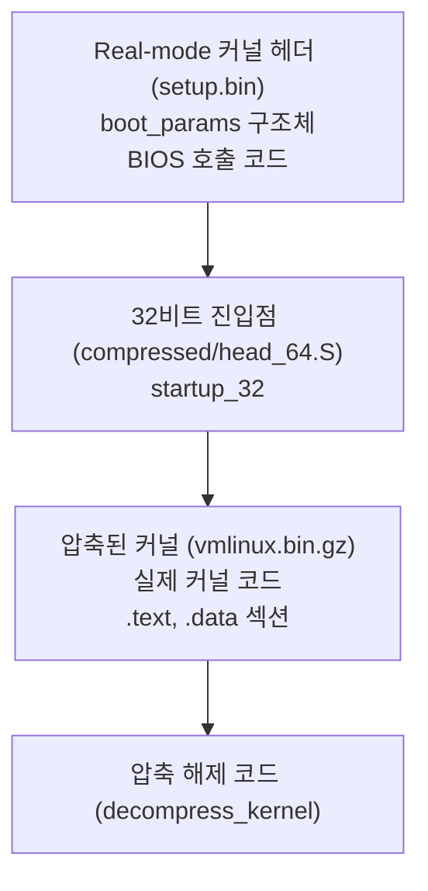

## 들어가며

전원 버튼을 누른다. 화면에 로고가 나타나고, 로그 메시지들이 스쳐 지나가고, 곧 로그인 프롬프트가 뜬다. 그러나 전원이 들어온 순간부터 `main` 함수가 실행되기까지, 그 사이에는 무엇이 일어나는가. 하드웨어는 어떻게 펌웨어를 찾고, 펌웨어는 어떻게 부트로더를 실행하며, 부트로더는 어떻게 압축된 커널을 풀어 메모리에 올리는가.

이 글은 컴퓨터의 부트 프로세스를 단계별로 분해한다. POST에서 시작해서 펌웨어, 부트로더, 커널 압축 해제, `start_kernel`, init 시스템, 그리고 마지막으로 로그인 프롬프트가 뜨는 순간까지를 다룬다. 각 단계가 자신의 소비자에게 어떤 실행 환경과 상태를 넘기는지 추적한다.

부트 프로세스는 하나의 거대한 부트스트래핑이다. 처음에는 CPU가 펌웨어 ROM의 한 줄짜리 명령어밖에 실행할 수 없다. 그것이 점점 더 큰 코드를 메모리에 올리고, 점점 더 복잡한 추상화를 구축한다. 이 과정을 이해하면 운영체제의 레이어가 어떻게 쌓여 있는지가 명확해진다.


---

## 목차
1. [POST와 펌웨어](#1-post와-펌웨어)
2. [부트로더: GRUB의 역할](#2-부트로더-grub의-역할)
3. [커널 압축 해제와 초기화](#3-커널-압축-해제와-초기화)
4. [start_kernel: 커널의 main](#4-start_kernel-커널의-main)
5. [init 프로세스: PID 1의 탄생](#5-init-프로세스-pid-1의-탄생)
6. [systemd vs SysVinit](#6-systemd-vs-sysvinit)
7. [런레벨과 타겟](#7-런레벨과-타겟)
8. [initramfs와 initrd](#8-initramfs와-initrd)
9. [전체 부트 프로세스 요약](#9-전체-부트-프로세스-요약)
10. [부팅 과정 디버깅](#10-부팅-과정-디버깅)


---

## 1. POST와 펌웨어

### 전원이 들어오는 순간

전원 버튼을 누르면 전원 공급 장치(PSU)가 메인보드에 전력을 공급한다. 이 글은 **x86-64 PC와 Linux**를 기준으로 한다. x86 CPU는 리셋 뒤 `CS`의 숨은 base와 명령 포인터가 만드는 물리 주소 `0xFFFFFFF0` 부근에서 명령 실행을 시작한다. 다른 아키텍처의 리셋 벡터와 초기 실행 상태는 다르다.

플랫폼 칩셋은 이 주소를 펌웨어가 저장된 flash/ROM 영역에 매핑한다. CPU는 여기 놓인 점프 명령을 따라 펌웨어 초기화 코드로 진입한다. `0xFFFFFFF0`가 일반 RAM의 마지막 16바이트라는 뜻은 아니다.

```text
물리 메모리 맵:
0x00000000 - RAM 시작
...
0xFFFFFFF0 - 펌웨어 ROM (리셋 벡터)
```

### POST: Power-On Self-Test

펌웨어가 가장 먼저 하는 일은 **POST**(Power-On Self-Test)다. POST는 하드웨어가 정상적으로 작동하는지 검사한다.

1. **CPU와 칩셋 초기화**: 실행 환경, 메모리 컨트롤러, 플랫폼 상태 구성
2. **메모리 발견과 검사**: DRAM을 훈련하고 사용 가능한 범위를 파악하며 정책에 따라 검사
3. **디바이스 열거와 초기화**: 콘솔, 저장 장치, PCI 장치 등 부팅에 필요한 장치 준비
4. **체크섬 검증**: 펌웨어 자체의 무결성 확인

화면 출력 전 실패를 비프음이나 진단 LED로 알리는 플랫폼도 있다. 코드의 의미는 펌웨어 공급자와 메인보드마다 다르므로 “짧게 한 번은 정상” 같은 횟수를 이식 가능한 규칙으로 해석할 수 없다.

### BIOS vs UEFI

펌웨어에는 두 가지 주요 표준이 있다. BIOS와 UEFI다.

#### BIOS: Basic Input/Output System

BIOS는 1975년 CP/M 운영체제를 위해 Gary Kildall이 만들었고, 1981년 IBM PC에 채택되었다.

BIOS의 특징.
- **16비트 리얼 모드**: x86 CPU를 16비트 8086 모드로 실행
- **1MB 주소 공간**: 세그먼트:오프셋 방식 사용
- **MBR 부팅**: 디스크의 첫 512바이트를 읽어 실행
- **레거시 인터럽트**: INT 0x13 (디스크), INT 0x10 (비디오) 등

BIOS는 간단하지만 초기 실행 환경과 서비스 모델에 제약이 많다.
- 전통적인 MBR 파티션 테이블은 32비트 LBA와 512바이트 논리 섹터를 가정하면 약 2TiB까지만 표현한다.
- 느린 부팅 속도
- 제한적인 확장성

2TiB 한계는 BIOS 실행 모드 자체의 절대 한계가 아니라 **MBR 파티션 형식의 한계**다. GRUB 같은 부트로더는 BIOS 시스템에서도 GPT를 읽을 수 있으며, GPT 디스크의 BIOS Boot Partition에 `core.img`를 넣어 부팅할 수 있다.

#### UEFI: Unified Extensible Firmware Interface

UEFI는 1998년 Intel이 Itanium 프로세서를 위해 EFI로 시작했고, 2005년 업계 표준이 되었다.

UEFI의 특징.
- **아키텍처별 네이티브 실행 환경**: IA32, x86-64, AArch64 등 플랫폼 ABI에 맞는 펌웨어와 이미지 실행
- **GPT 파티션**: 보통 128개 파티션 엔트리로 초기화되며 헤더가 엔트리 배열의 크기를 명시한다. 64비트 LBA 표현 범위는 매우 크지만 실제 한계는 장치와 구현에 의해 결정된다.
- **Secure Boot 지원**: 플랫폼 정책과 키 데이터베이스에 따라 서명된 이미지의 신뢰 사슬 검증
- **네트워크 부팅 지원**: PXE Base Code와 플랫폼에 따른 HTTP Boot 등
- **드라이버 모델**: 모듈식 확장 가능

일반적인 디스크 부팅에서는 UEFI Boot Manager가 NVRAM의 `Boot####` 항목을 읽어 장치 경로와 EFI 이미지를 선택한다. 이미지가 놓이는 **EFI System Partition**(ESP)은 UEFI가 정의한 FAT 계열 파일시스템을 사용한다. 고정 디스크에서는 FAT32가 일반적이지만 “모든 ESP는 무조건 FAT32”가 UEFI 전체를 설명하지는 않는다. NVRAM 항목이 없거나 이동식 매체의 기본 경로를 사용할 때는 아키텍처별 fallback 파일명(예: x86-64의 `\EFI\BOOT\BOOTX64.EFI`)이 사용된다.

```text
/EFI/
├── Boot/
│   └── bootx64.efi
├── ubuntu/
│   └── grubx64.efi
└── Microsoft/
    └── Boot/
        └── bootmgfw.efi
```

UEFI 이미지는 PE/COFF 형식을 사용한다. x86-64용 이미지는 PE32+, IA32용 이미지는 PE32처럼 대상 머신 타입과 실행 환경에 맞는 형식이 선택되므로 모든 `.efi` 파일을 PE32+라고 부를 수는 없다.

## 2. 부트로더: GRUB의 역할

### 부트로더의 필요성

펌웨어는 하드웨어를 초기화한 뒤 정책에 따라 부팅 가능한 이미지를 선택한다. BIOS는 첫 부트 섹터의 작은 코드를 실행하고, UEFI는 EFI OS loader나 Linux EFI stub 같은 EFI 이미지를 직접 로드할 수 있다. 다만 파일시스템 해석, 커널·initramfs 선택, 명령행 구성처럼 운영체제에 종속적인 정책은 보통 GRUB 같은 부트로더가 맡는다.

1. **유연성**: 여러 운영체제 중 선택 가능
2. **복잡성 분리**: 펌웨어는 간단하게, 부트로더가 복잡한 로딩 처리
3. **파일시스템 지원**: ext4, Btrfs 등 다양한 파일시스템 읽기

부트로더는 펌웨어와 운영체제 사이의 다리 역할을 한다.

### GRUB: GRand Unified Bootloader

GRUB은 GNU 프로젝트의 부트로더로, 1995년 Erich Boleyn이 만들었다. 현재는 GRUB 2가 널리 사용된다.

#### GRUB 2의 구성 요소별 로딩 (BIOS 부팅 경로)

`Stage 1 → Stage 1.5 → Stage 2`는 GRUB Legacy를 설명할 때 쓰던 용어다. GRUB 2의 BIOS 설치는 비슷한 부트스트래핑을 하지만 실제 구성 요소는 `boot.img`, `core.img`, `normal.mod`와 여러 모듈이다. UEFI 환경에서는 펌웨어가 ESP의 GRUB EFI 바이너리(`grubx64.efi` 등)를 직접 로드하므로 아래 구조를 거치지 않는다.

GRUB 2의 BIOS 경로는 다음과 같다.

**boot.img: 첫 부트 섹터의 최소 코드**
- MBR의 부트 코드 영역이나 파티션 부트 섹터에 설치
- 설치 시 기록한 위치 정보를 이용해 `core.img`의 첫 섹터를 읽는 최소 역할만 수행

```asm
; 실제 GRUB 소스가 아니라 BIOS 경로의 개념적 의사 코드
_start:
    cli                     ; 인터럽트 비활성화
    xor %ax, %ax
    mov %ax, %ds
    mov %ax, %ss
    mov $0x7c00, %sp        ; 스택 설정

    mov $disk_address_packet, %si
    mov $0x42, %ah          ; BIOS INT 13h Extended Read
    int $0x13               ; 디스크 읽기
    jmp core_img            ; core.img 진입점으로 점프
```

**core.img: 내장된 GRUB 핵심과 모듈**
- 크기는 포함한 모듈과 설정에 따라 달라지며 고정 32KiB가 아니다.
- MBR과 첫 파티션 사이의 embedding area 또는 GPT의 BIOS Boot Partition에 저장된다.
- 디스크·파티션·파일시스템 모듈을 이용해 `/boot/grub/`에 접근하고 `normal.mod`를 로드한다.

**normal.mod와 런타임 모듈**
- 설정 파일 `/boot/grub/grub.cfg` 파싱
- 메뉴 표시 및 사용자 입력 처리
- 커널 로딩

#### grub.cfg 파싱

`/boot/grub/grub.cfg` 예시.

```bash
menuentry 'Ubuntu' {
    insmod gzio
    insmod part_gpt
    insmod ext2
    set root='hd0,gpt2'
    linux /boot/vmlinuz-5.15.0-generic root=UUID=xxx ro quiet splash
    initrd /boot/initrd.img-5.15.0-generic
}
```

GRUB은 이 설정을 읽어 다음을 수행한다.
1. 필요한 모듈 로드 (`gzio`, `ext2` 등)
2. 루트 파티션 설정 (`hd0,gpt2`)
3. 커널 이미지 로드 (`vmlinuz`)
4. initramfs 로드 (`initrd.img`)
5. 커널 명령행 파라미터 전달 (`root=`, `ro`, `quiet` 등)

### 커널 로딩 과정

GRUB이 커널을 로드하는 과정은 다음과 같다.

```c
// grub-core/loader/i386/linux.c
grub_err_t
grub_cmd_linux(grub_command_t cmd, int argc, char *argv[])
{
    grub_file_t file;
    struct linux_kernel_header lh;

    // 커널 파일 열기
    file = grub_file_open(argv[0]);

    // 커널 헤더 읽기
    grub_file_read(file, &lh, sizeof(lh));

    // 커널이 bzImage인지 확인
    if (lh.boot_flag != 0xaa55)
        return grub_error(GRUB_ERR_BAD_OS, "invalid magic number");

    // 비디오 모드 정보를 부트 파라미터에 채움
    grub_linux_setup_video(&params);

    // 커널을 메모리에 로드
    grub_relocator_alloc_chunk_addr(relocator, &ch,
                                    lh.code32_start, kernel_size);
    grub_file_read(file, (void *)lh.code32_start, kernel_size);

    // 부트 파라미터 설정
    params.hdr.cmd_line_ptr = cmdline;
    params.hdr.ramdisk_image = initrd_addr;

    return GRUB_ERR_NONE;
}
```

## 3. 커널 압축 해제와 초기화

### bzImage 구조

리눅스 커널은 **bzImage** 포맷으로 배포된다. "bz"는 옛 zImage(저메모리 한계 안에서 압축된 형태)를 확장했다는 의미의 "big zImage"이며, 압축 알고리즘은 이름과 무관하게 커널 빌드 설정으로 선택한다. `CONFIG_KERNEL_*`(GZIP, BZIP2, LZMA, XZ, LZO, LZ4, ZSTD) 중 하나가 켜진다. 최신 배포판은 보통 ZSTD나 XZ를 쓴다.

bzImage의 구조는 다음과 같다.



### 압축 해제 과정

Linux/x86 부트 프로토콜에서 bzImage의 전통적 protected-mode 적재 주소는 `0x100000`이다. 그러나 현대 커널은 헤더의 `relocatable_kernel`, `kernel_alignment`, `pref_address`로 다른 적법한 위치에 적재될 수 있다. 부트로더는 실제 적재 주소와 `code32_start`를 일관되게 설정하고, 커널의 압축 해제 코드는 그 계약을 바탕으로 실행된다.

#### startup_32 진입점

x86-64 커널의 압축 해제 코드는 `arch/x86/boot/compressed/head_64.S`에 있다. 주의할 점은 실행 순서다. `startup_32`는 32비트 모드에서 세그먼트·스택을 설정하고 임시 페이지 테이블을 만든 뒤 **롱 모드로 전환하여 `startup_64`로 점프**한다. `extract_kernel` 호출은 64비트 모드의 `startup_64` 쪽에서 일어난다(32비트 커널용 `head_32.S`에서는 `startup_32`가 직접 호출한다).

```asm
    .code32
SYM_FUNC_START(startup_32)
    cld
    cli

    /* 세그먼트 레지스터 설정 */
    movl    $(__BOOT_DS), %eax
    movl    %eax, %ds
    movl    %eax, %es
    movl    %eax, %ss

    /* 스택 설정, 임시 페이지 테이블 구성,
       __KERNEL_CS:startup_64를 스택에 적재, 롱 모드 활성화 (아래 절 참조) */
    ...

    /* far return으로 64비트 코드(startup_64)에 진입한다 (far jump가 아니다) */
    lret
SYM_FUNC_END(startup_32)

    .code64
SYM_CODE_START(startup_64)
    ...
    /* 압축 해제: extract_kernel(boot_params, heap, ...) 호출 */
    call    extract_kernel
    /* 압축 해제된 커널의 진입점으로 점프 */
    jmp     *%rax
SYM_CODE_END(startup_64)
```

#### extract_kernel 함수

`arch/x86/boot/compressed/misc.c`:

```c
asmlinkage __visible void *extract_kernel(void *rmode, memptr heap,
                                          unsigned char *input_data,
                                          unsigned long input_len,
                                          unsigned char *output,
                                          unsigned long output_len)
{
    const unsigned long kernel_total_size = VO__end - VO__text;
    unsigned long virt_addr = LOAD_PHYSICAL_ADDR;

    /* 디버그 콘솔 초기화 */
    debug_putstr("early console in extract_kernel\n");

    /* 커널 압축 해제 */
    debug_putstr("Decompressing Linux... ");

    __decompress(input_data, input_len, NULL, NULL,
                 output, output_len, NULL, error);

    debug_putstr("done.\n");

    /* 재배치 처리 */
    debug_putstr("Booting the kernel.\n");

    return output;
}
```

`__decompress`는 압축 알고리즘에 따라 다른 함수를 호출한다.
- gzip: `gunzip`
- bzip2: `bunzip2`
- LZMA: `unlzma`
- LZ4: `unlz4`

### 64비트 모드 전환

압축을 해제하기 전에, `startup_32`는 CPU를 64비트 롱 모드로 전환한다.

```asm
    /* 페이지 테이블 설정 (identity mapping) */
    leal    pgtable(%ebx), %edi
    movl    $(BOOT_INIT_PGT_SIZE/4), %ecx
    xorl    %eax, %eax
    rep     stosl

    /* 4-레벨 페이징 활성화 */
    leal    pgtable + 0(%ebx), %edi
    leal    0x1007(%edi), %eax
    movl    %eax, 0(%edi)

    /* CR3에 페이지 테이블 주소 로드 */
    leal    pgtable(%ebx), %eax
    movl    %eax, %cr3

    /* PAE 활성화 */
    movl    %cr4, %eax
    orl     $X86_CR4_PAE, %eax
    movl    %eax, %cr4

    /* IA-32e 모드 활성화 */
    movl    $MSR_EFER, %ecx
    rdmsr
    btsl    $_EFER_LME, %eax
    wrmsr

    /* 점프 대상(startup_64)과 __KERNEL_CS를 스택에 올린다 */
    leal    startup_64(%ebp), %eax
    pushl   $__KERNEL_CS
    pushl   %eax

    /* 페이징 활성화 = 롱 모드 진입 */
    movl    $(X86_CR0_PG | X86_CR0_PE), %eax
    movl    %eax, %cr0

    /* far return으로 64비트 코드에 진입한다 (far jump가 아니다) */
    lret
```

## 4. start_kernel: 커널의 main

### start_kernel 진입

압축 해제된 커널의 진입점은 `start_kernel` 함수다. 이것은 C 언어로 작성된 커널의 첫 번째 함수이며, 사실상 커널의 `main`이다.

`init/main.c`.

```c
asmlinkage __visible void __init __no_sanitize_address start_kernel(void)
{
    char *command_line;
    char *after_dashes;

    set_task_stack_end_magic(&init_task);
    smp_setup_processor_id();
    debug_objects_early_init();
    cgroup_init_early();

    local_irq_disable();
    early_boot_irqs_disabled = true;

    /* 아키텍처별 초기화 */
    setup_arch(&command_line);

    /* 메모리 관리 초기화 */
    mm_init();

    /* 스케줄러 초기화 */
    sched_init();

    /* RCU 초기화 */
    rcu_init();

    /* 타이머 초기화 */
    time_init();

    /* 인터럽트 활성화 */
    local_irq_enable();

    /* 콘솔 초기화 (PCI 설정 전에 먼저 켜는 의도된 예외) */
    console_init();

    /* 나머지 시스템 초기화 */
    rest_init();
}
```

### 핵심 초기화 단계

#### setup_arch: 아키텍처별 초기화

`arch/x86/kernel/setup.c`.

```c
void __init setup_arch(char **cmdline_p)
{
    /* 부트 파라미터 파싱 */
    memcpy(&boot_params, real_mode_data, sizeof(boot_params));

    /* 메모리 맵 파싱 */
    e820__memory_setup();

    /* ACPI 초기화 */
    acpi_boot_table_init();

    /* IO-APIC 초기화 */
    init_apic_mappings();

    /* 페이지 테이블 초기화 */
    init_mem_mapping();

    /* 커널 명령행 파싱 */
    parse_early_param();
}
```

#### mm_init: 메모리 관리 초기화

```c
static void __init mm_init(void)
{
    /* 페이지 할당자 초기화 */
    page_alloc_init();

    /* 메모리 관리 구조체 초기화 */
    mem_init();

    /* 슬랩 할당자 초기화 */
    kmem_cache_init();

    /* vmalloc 초기화 */
    vmalloc_init();
}
```

#### sched_init: 스케줄러 초기화

```c
void __init sched_init(void)
{
    int i;

    /* CPU별 런큐 초기화 */
    for_each_possible_cpu(i) {
        struct rq *rq = cpu_rq(i);

        raw_spin_lock_init(&rq->lock);
        rq->nr_running = 0;
        rq->cpu = i;

        init_cfs_rq(&rq->cfs);
        init_rt_rq(&rq->rt);
        init_dl_rq(&rq->dl);
    }

    /* idle 태스크 설정 */
    init_idle(current, smp_processor_id());
}
```

### rest_init: 첫 프로세스 생성

`start_kernel`의 마지막에서 `rest_init`이 호출된다.

```c
noinline void __ref rest_init(void)
{
    struct task_struct *tsk;
    int pid;

    rcu_scheduler_starting();

    /* kernel_init 스레드 생성 (PID 1이 될 프로세스) */
    pid = kernel_thread(kernel_init, NULL, CLONE_FS);

    /* kthreadd 생성 (PID 2) */
    pid = kernel_thread(kthreadd, NULL, CLONE_FS | CLONE_FILES);
    kthreadd_task = find_task_by_pid_ns(pid, &init_pid_ns);

    /* 부팅 완료, CPU를 idle로 */
    cpu_startup_entry(CPUHP_ONLINE);
}
```

여기서 중요한 점은 다음과 같다.
1. **kernel_init**: PID 1이 될 프로세스, `/sbin/init` 실행
2. **kthreadd**: 모든 커널 스레드의 부모 (PID 2)
3. **cpu_startup_entry**: 현재 CPU를 idle 상태로 (PID 0)

## 5. init 프로세스: PID 1의 탄생

### kernel_init 함수

`kernel_init`은 커널 공간에서 실행되다가, 사용자 공간의 init 프로그램을 실행한다.

```c
static int __ref kernel_init(void *unused)
{
    int ret;

    /* 커널 초기화 완료 대기 */
    kernel_init_freeable();

    /* 남은 initcall 실행 */
    do_basic_setup();

    /* initramfs의 init 경로 기본값 설정 */
    if (!ramdisk_execute_command)
        ramdisk_execute_command = "/init";

    /* 사용자 공간 init 실행 시도 */
    if (ramdisk_execute_command) {
        ret = run_init_process(ramdisk_execute_command);
        if (!ret)
            return 0;
    }

    /* 표준 init 경로들 시도 */
    if (!try_to_run_init_process("/sbin/init") ||
        !try_to_run_init_process("/etc/init") ||
        !try_to_run_init_process("/bin/init") ||
        !try_to_run_init_process("/bin/sh"))
        return 0;

    panic("No working init found.");
}
```

### try_to_run_init_process

```c
static int try_to_run_init_process(const char *init_filename)
{
    int ret;

    ret = run_init_process(init_filename);

    if (ret && ret != -ENOENT) {
        pr_err("Starting init: %s exists but couldn't execute it\n",
               init_filename);
    }

    return ret;
}

static int run_init_process(const char *init_filename)
{
    const char *const *p;

    argv_init[0] = init_filename;
    return do_execve(getname_kernel(init_filename),
                     (const char __user *const __user *)argv_init,
                     (const char __user *const __user *)envp_init);
}
```

`do_execve`가 성공하면 PID 1 프로세스의 사용자 주소 공간이 새 init 바이너리의 것으로 교체된다. 커널 코드 자체는 그대로 전역 커널 주소 공간에 남아 있고, 단지 이 PID 1 태스크가 사용자 모드로 진입할 때 실행되는 코드가 init이 된 것이다. 이것이 **PID 1**의 탄생이다.

### init의 역할

PID 1은 특별한 책임을 진다.

1. **시스템 초기화**: 모든 시스템 서비스 시작
2. **프로세스 관리**: 고아 프로세스의 새로운 부모가 됨
3. **시그널 처리**: 전역 PID 1에는 기본 동작이 치명적인 시그널을 커널이 특별 취급한다. 이는 일반 프로세스처럼 `SIGKILL`·`SIGSTOP` disposition을 변경해 무시한다는 뜻이 아니다.
4. **시스템 종료**: 모든 프로세스를 정리하고 시스템 종료

PID 1이 죽으면 **커널 패닉**이 발생한다.

```c
/* kernel/exit.c */
void do_exit(long code)
{
    struct task_struct *tsk = current;

    if (unlikely(is_global_init(tsk)))
        panic("Attempted to kill init! exitcode=0x%08x\n",
              tsk->signal->group_exit_code ?: (int)code);

    /* ... */
}
```

## 6. systemd vs SysVinit

### SysVinit: 전통적인 init

SysVinit은 1980년대 System V UNIX에서 유래했다. 간단하지만 제약이 많다.

#### SysVinit의 동작 방식

`/etc/inittab` 파싱.

```text
# Default runlevel
id:3:initdefault:

# System initialization
si::sysinit:/etc/rc.d/rc.sysinit

# Runlevels
l0:0:wait:/etc/rc.d/rc 0
l1:1:wait:/etc/rc.d/rc 1
l2:2:wait:/etc/rc.d/rc 2
l3:3:wait:/etc/rc.d/rc 3
l4:4:wait:/etc/rc.d/rc 4
l5:5:wait:/etc/rc.d/rc 5
l6:6:wait:/etc/rc.d/rc 6

# Getty
1:2345:respawn:/sbin/getty tty1
```

서비스 스크립트 예시 (`/etc/init.d/sshd`).

```bash
#!/bin/bash
# chkconfig: 2345 55 25
# description: OpenSSH server daemon

case "$1" in
    start)
        echo "Starting sshd..."
        /usr/sbin/sshd
        ;;
    stop)
        echo "Stopping sshd..."
        killall sshd
        ;;
    restart)
        $0 stop
        $0 start
        ;;
    *)
        echo "Usage: $0 {start|stop|restart}"
        exit 1
        ;;
esac
```

#### SysVinit의 문제점

1. **순차 실행**: 서비스들이 차례대로 시작되어 부팅이 느림
2. **의존성 관리 부족**: 수동으로 스크립트 순서 지정
3. **정적 설정**: 하드웨어 변화에 대응 어려움
4. **프로세스 관리**: 자식 프로세스 추적 어려움

### systemd: 현대적인 init

systemd는 2010년 Lennart Poettering과 Kay Sievers가 만들었다. Fedora 15에서 처음 채택되었고, 현재 대부분의 리눅스 배포판이 사용한다.

#### systemd의 핵심 개념

**유닛(Unit)**: systemd가 관리하는 모든 것은 유닛이다.

유닛 타입.
- **service**: 백그라운드 서비스 (sshd.service)
- **socket**: IPC 소켓 (dbus.socket)
- **target**: 유닛 그룹 (multi-user.target)
- **mount**: 파일시스템 마운트 (home.mount)
- **device**: 디바이스 (sda.device)
- **timer**: 타이머 (cron 대체)

#### 서비스 유닛 예시

`/etc/systemd/system/sshd.service`.

```ini
[Unit]
Description=OpenSSH server daemon
Documentation=man:sshd(8) man:sshd_config(5)
After=network.target auditd.service
Wants=sshdgenkeys.service

[Service]
Type=notify
EnvironmentFile=-/etc/sysconfig/sshd
ExecStart=/usr/sbin/sshd -D $OPTIONS
ExecReload=/bin/kill -HUP $MAINPID
KillMode=process
Restart=on-failure
RestartSec=42s

[Install]
WantedBy=multi-user.target
```

#### systemd의 장점

1. **병렬 시작**: 의존성 있는 서비스만 순차, 나머지는 병렬
2. **소켓 기반 활성화**: 소켓 먼저 생성, 서비스는 필요할 때 시작
3. **cgroup 통합**: 프로세스 그룹 관리로 모든 자식 추적
4. **트랜잭션 기반**: 의존성 해결 자동화
5. **cgroup 기반 리소스 제어**: 서비스별 CPU/메모리 제한(`CPUQuota=`, `MemoryMax=`)

(참고: 한때 존재했던 snapshot 유닛 타입은 systemd v228에서 제거되었다.)

#### systemd의 초기화 과정

1. **default.target 도달**: 부팅 목표 설정
2. **의존성 트리 구성**: 모든 유닛의 의존성 분석
3. **병렬 실행**: 의존성 없는 유닛들 동시 시작
4. **소켓 활성화**: D-Bus, syslog 등 소켓 먼저 생성
5. **서비스 시작**: ExecStart 명령 실행

systemd의 핵심 코드 (`src/core/main.c`).

```c
int main(int argc, char *argv[]) {
    Manager *m = NULL;
    int r;

    /* PID 1인지 확인 */
    if (getpid_cached() == 1) {
        /* 시그널 마스크 설정 */
        assert_se(sigprocmask_many(SIG_BLOCK, NULL, SIGTERM, -1) >= 0);

        /* cgroup 마운트 */
        mount_setup(false);

        /* 매니저 생성 */
        r = manager_new(UNIT_FILE_SYSTEM, &m);

        /* 기본 타겟 로드 */
        manager_load_unit(m, SPECIAL_DEFAULT_TARGET);

        /* 시작! */
        manager_startup(m);

        /* 이벤트 루프 */
        manager_loop(m);
    }

    return 0;
}
```

## 7. 런레벨과 타겟

### SysVinit 런레벨

런레벨은 시스템의 동작 모드를 나타낸다.

| 런레벨 | 설명 |
|-------|------|
| 0 | 시스템 종료 |
| 1 | 싱글 유저 모드 (복구) |
| 2 | 멀티 유저 (네트워크 없음) |
| 3 | 멀티 유저 (텍스트) |
| 4 | 사용자 정의 |
| 5 | 멀티 유저 (그래픽) |
| 6 | 재부팅 |

런레벨 전환은 다음과 같다.

```bash
# 현재 런레벨 확인
$ runlevel
N 3

# 런레벨 5로 전환 (그래픽 모드)
$ init 5
```

### systemd 타겟

systemd는 런레벨 개념을 **타겟**으로 대체했다.

| SysVinit | systemd 타겟 | 설명 |
|----------|-------------|------|
| 0 | poweroff.target | 시스템 종료 |
| 1 | rescue.target | 복구 모드 |
| 3 | multi-user.target | 멀티 유저 (텍스트) |
| 5 | graphical.target | 그래픽 환경 |
| 6 | reboot.target | 재부팅 |

타겟은 여러 유닛을 그룹화한다. 예를 들어 `graphical.target`은 다음과 같다.

```ini
[Unit]
Description=Graphical Interface
Documentation=man:systemd.special(7)
Requires=multi-user.target
Wants=display-manager.service
Conflicts=rescue.service rescue.target
After=multi-user.target rescue.service rescue.target display-manager.service
AllowIsolate=yes
```

타겟 전환은 다음과 같다.

```bash
# 현재 타겟 확인
$ systemctl get-default
graphical.target

# 타겟 변경
$ systemctl isolate multi-user.target

# 기본 타겟 설정
$ systemctl set-default multi-user.target
```

## 8. initramfs와 initrd

### initramfs의 필요성

커널이 루트 파일시스템을 마운트하려면 다음이 필요하다.
1. 파일시스템 드라이버 필요 (ext4, XFS 등)
2. 디바이스 드라이버 필요 (SATA, NVMe 등)
3. 암호화된 경우 복호화 필요 (LUKS)
4. LVM, RAID 설정 필요

이 모든 것을 커널에 내장하면 커널이 너무 커진다. 그래서 **initramfs**를 사용한다.

### initramfs vs initrd

**initrd** (Initial RAM Disk).
- 블록 디바이스로 마운트되는 이미지
- ext2 파일시스템
- 메모리 낭비 (버퍼 캐시 필요)
- 레거시

**initramfs** (Initial RAM Filesystem).
- tmpfs로 마운트
- cpio 아카이브
- 메모리 효율적
- 현대 표준

### initramfs 생성

Ubuntu/Debian의 `update-initramfs` 사용 예다.

```bash
$ update-initramfs -c -k 5.15.0-generic
```

내부적으로 `mkinitramfs`를 실행한다.

```bash
#!/bin/bash
# /usr/sbin/mkinitramfs

DESTDIR=$(mktemp -d)

# 필수 바이너리 복사
copy_exec /bin/busybox /bin/sh
copy_exec /sbin/modprobe
copy_exec /sbin/blkid

# 커널 모듈 복사
for module in $MODULES; do
    cp "$MODULESDIR/$module.ko" "$DESTDIR/lib/modules/"
done

# init 스크립트 생성
cat > "$DESTDIR/init" << 'EOF'
#!/bin/sh
mount -t proc proc /proc
mount -t sysfs sysfs /sys
mount -t devtmpfs devtmpfs /dev

# 모듈 로드
modprobe ext4
modprobe nvme

# 루트 파일시스템 찾기
ROOT=$(blkid -U "$UUID")

# 루트 마운트
mount "$ROOT" /root

# 실제 init으로 전환
exec switch_root /root /sbin/init
EOF

chmod +x "$DESTDIR/init"

# cpio 아카이브 생성
(cd "$DESTDIR" && find . | cpio -H newc -o | gzip -9) > /boot/initramfs.img
```

### initramfs 실행 과정

1. **커널이 initramfs 압축 해제**.
 ```c
 /* init/initramfs.c */
 static int __init populate_rootfs(void)
 {
 char *err = unpack_to_rootfs(__initramfs_start, __initramfs_size);
 if (err)
 panic("junk in compressed archive");

 return 0;
 }
 ```

2. **initramfs의 /init 스크립트 실행**.
 ```bash
 #!/bin/sh

 # 필수 파일시스템 마운트
 mount -t proc proc /proc
 mount -t sysfs sysfs /sys
 mount -t devtmpfs devtmpfs /dev

 # udev 시작
 udevd --daemon
 udevadm trigger
 udevadm settle

 # LVM 활성화
 lvm vgchange -ay

 # 암호화 볼륨 해제
 cryptsetup luksOpen /dev/sda2 root

 # 실제 루트 마운트
 mount /dev/mapper/root /root

 # 임시 파일시스템 이동
 mount --move /proc /root/proc
 mount --move /sys /root/sys
 mount --move /dev /root/dev

 # 루트 전환
 exec switch_root /root /sbin/init
 ```

3. **switch_root로 전환**.
 ```c
 /* util-linux/sys-utils/switch_root.c */
 int main(int argc, char *argv[])
 {
 const char *newroot = argv[1];
 const char *init = argv[2];

 /* 옛 루트의 fd를 미리 열어 둔다 (MS_MOVE 뒤에는 경로 이름이 남지 않는다) */
 int cfd = open("/", O_RDONLY);

 /* 새 루트로 chdir */
 chdir(newroot);

 /* 새 루트를 마운트 */
 mount(newroot, "/", NULL, MS_MOVE, NULL);

 /* 루트 변경 */
 chroot(".");
 chdir("/");

 /* 이전 initramfs 삭제 (경로가 아니라 fd로) */
 recursiveRemove(cfd);

 /* init 실행 */
 execv(init, argv + 2);
 }
 ```

### initramfs 내용 확인

```bash
# initramfs 압축 해제
$ mkdir /tmp/initramfs
$ cd /tmp/initramfs
$ zcat /boot/initramfs-5.15.0.img | cpio -idmv

# 구조 확인
$ tree -L 2
.
├── bin/
│   ├── busybox
│   └── sh -> busybox
├── dev/
│   └── console
├── etc/
│   ├── fstab
│   └── modprobe.d/
├── init
├── lib/
│   └── modules/
│       └── 5.15.0/
├── proc/
├── root/
├── sys/
└── usr/
```

## 9. 전체 부트 프로세스 요약

전원 버튼부터 로그인 프롬프트까지의 전체 과정은 다음과 같다.

```text
1. 전원 ON
   └─> CPU 리셋 벡터 (0xFFFFFFF0)

2. 펌웨어 (UEFI/BIOS)
   ├─> POST (하드웨어 테스트)
   ├─> 부트 디바이스 찾기
   └─> 부트로더 로드

3. 부트로더
   ├─> BIOS GRUB 2: boot.img → core.img → normal.mod
   ├─> UEFI GRUB: 펌웨어가 GRUB EFI 이미지 로드
   ├─> grub.cfg 파싱
   ├─> 커널 이미지 로드 (vmlinuz)
   ├─> initramfs 로드 (initrd.img)
   └─> 커널 명령행 파라미터 설정

4. Linux 커널 (압축된 상태)
   ├─> startup_32 (32비트 진입, 임시 페이지 테이블 구성)
   ├─> 64비트 롱 모드 전환과 startup_64 진입
   └─> extract_kernel() 뒤 압축 해제된 커널 진입

5. start_kernel() (C 언어)
   ├─> setup_arch() (아키텍처 초기화)
   ├─> mm_init() (메모리 관리)
   ├─> sched_init() (스케줄러)
   ├─> time_init() (타이머)
   ├─> console_init() (콘솔)
   └─> rest_init()

6. rest_init()
   ├─> kernel_thread(kernel_init) → PID 1
   ├─> kernel_thread(kthreadd) → PID 2
   └─> cpu_startup_entry() → PID 0 (idle)

7. kernel_init (PID 1, 커널 공간)
   ├─> populate_rootfs() (initramfs 압축 해제)
   └─> run_init_process("/init")

8. initramfs의 /init (사용자 공간)
   ├─> 필요한 가상 파일시스템과 장치 관리 구성
   ├─> 루트 파일시스템에 필요한 드라이버 로드
   ├─> 설정에 따라 LVM/LUKS/네트워크 스토리지 활성화
   ├─> 실제 루트 파일시스템 마운트
   └─> switch_root /root /sbin/init

9. systemd (PID 1, 실제 루트)
   ├─> default.target 로드
   ├─> 의존성 트리 구성
   ├─> 서비스 병렬 시작
   │   ├─> udev.service
   │   ├─> dbus.service
   │   ├─> network.service
   │   └─> ...
   └─> graphical.target 도달

10. 로그인 프롬프트
    └─> getty@tty1.service → login
```

각 단계의 시간은 펌웨어 정책, 메모리 훈련, 저장 장치, 암호화, 장치 탐색, 서비스 그래프와 캐시 상태에 따라 크게 달라진다. 따라서 고정된 초 단위 표는 일반적인 성능 모델이 아니다. 같은 머신에서도 cold boot, warm boot, 커널·서비스 설정을 구분해 측정해야 한다.

systemd의 병렬 시작은 의존성이 없는 작업을 겹칠 수 있지만, SysVinit 대비 항상 특정 배수로 빠르거나 반드시 수십 초를 줄인다고 보장하지 않는다. 임계 경로에 직렬 서비스가 남아 있으면 전체 시간은 그대로다. `systemd-analyze time`, `blame`, `critical-chain`을 함께 사용해 커널 이후 사용자 공간의 총시간, 개별 unit의 활성화 시간, 의존성 임계 경로를 구분한다. 펌웨어와 부트로더 시간은 지원되는 시스템에서 `systemd-analyze time`의 firmware/loader 구간이나 펌웨어 자체 계측으로 확인한다.

## 10. 부팅 과정 디버깅

### 커널 명령행 파라미터

부팅 문제 디버깅을 위한 유용한 파라미터다.

```bash
# GRUB에서 'e' 눌러 편집
linux /vmlinuz-5.15.0 root=UUID=xxx \
    debug \                    # 디버그 메시지 출력
    loglevel=7 \              # 로그 레벨 (0-7)
    earlyprintk=serial \      # 초기 커널 메시지
    initcall_debug \          # initcall 실행 시간 출력
    systemd.log_level=debug   # systemd 디버그
```

### 부팅 시간 분석

```bash
# systemd 부팅 시간 분석
$ systemd-analyze
Startup finished in 3.245s (firmware) + 2.123s (loader) + 1.867s (kernel) + 4.234s (userspace) = 11.469s

# 느린 서비스 찾기
$ systemd-analyze blame
     3.123s NetworkManager-wait-online.service
     1.456s plymouth-quit-wait.service
     0.987s systemd-udev-settle.service

# 크리티컬 패스 확인
$ systemd-analyze critical-chain
graphical.target @4.234s
└─multi-user.target @4.233s
  └─NetworkManager.service @3.456s +777ms
    └─network-pre.target @3.455s
      └─firewalld.service @2.123s +1.332s
```

### 커널 메시지 확인

```bash
# 부팅 로그 확인
$ dmesg | less

# 특정 서브시스템 필터링
$ dmesg | grep -i usb
$ dmesg | grep -i failed

# 시간 정보 포함
$ dmesg -T
[Tue Dec 23 10:15:30 2025] Linux version 5.15.0-generic
[Tue Dec 23 10:15:30 2025] Command line: BOOT_IMAGE=/vmlinuz root=UUID=xxx
```


---

## 결론

전원 버튼을 누르는 것은 단순한 동작이지만, 그 이면에는 펌웨어, 부트로더, 커널, init 시스템이 정교하게 협력하는 과정이 숨어 있다. 각 단계는 이전 단계가 준비한 환경 위에서 실행되며, 점진적으로 더 복잡한 추상화를 구축한다.

BIOS는 하드웨어를 초기화하고, GRUB은 커널을 메모리에 로드하고, 커널은 메모리와 스케줄러를 초기화하고, initramfs는 루트 파일시스템을 마운트하고, systemd는 모든 서비스를 시작한다. 이 모든 것이 완료되어야 비로소 로그인 프롬프트가 보인다.

부트 프로세스를 이해한다는 것은 운영체제의 레이어를 이해한다는 것이다. 펌웨어와 하드웨어의 경계, 커널과 사용자 공간의 경계, 그리고 각 추상화 레벨이 제공하는 서비스가 명확히 보인다. PID 1이 사용자 공간으로 진입한 뒤부터는 커널이 만든 실행 환경 위에서 프로세스와 서비스 관리가 시작된다.

## 더 읽을거리

- [Linux x86 Boot Protocol](https://www.kernel.org/doc/html/latest/arch/x86/boot.html)
- [Kernel Command-Line Parameters](https://www.kernel.org/doc/html/latest/admin-guide/kernel-parameters.html)
- [UEFI Specification](https://uefi.org/specifications)
- [GRUB Manual](https://www.gnu.org/software/grub/manual/)
- [systemd Documentation](https://systemd.io/)
- 소스 코드: `arch/x86/boot/`, `arch/x86/boot/compressed/`, `init/main.c`, `kernel/fork.c`, GRUB의 `grub-core/loader/i386/linux.c`
- Brian Ward, *How Linux Works*
- Robert Love, *Linux Kernel Development*
- Michael Kerrisk, *The Linux Programming Interface*
